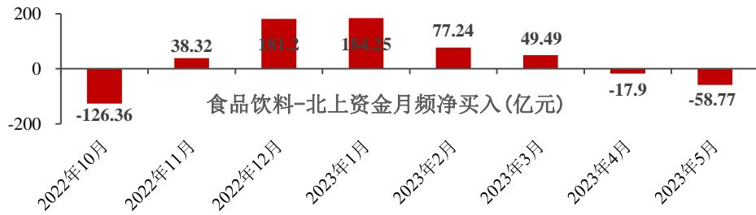
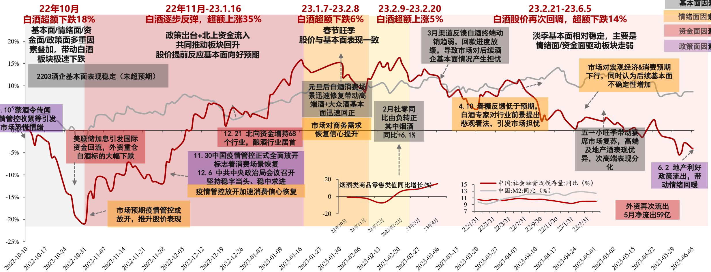
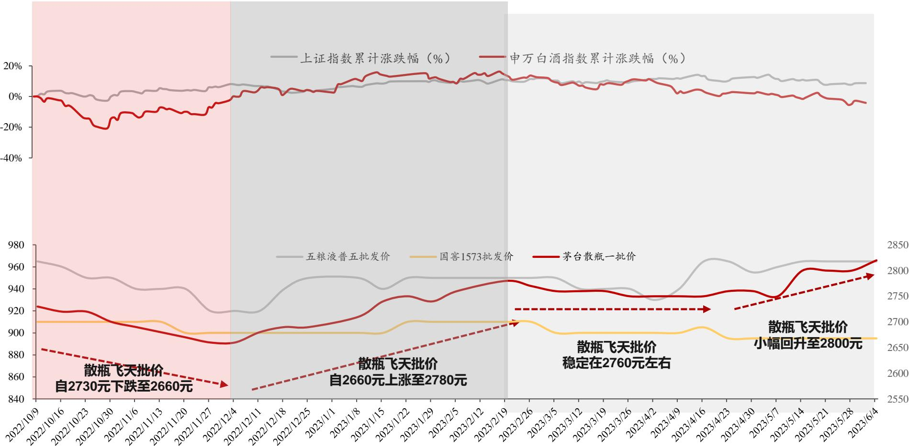
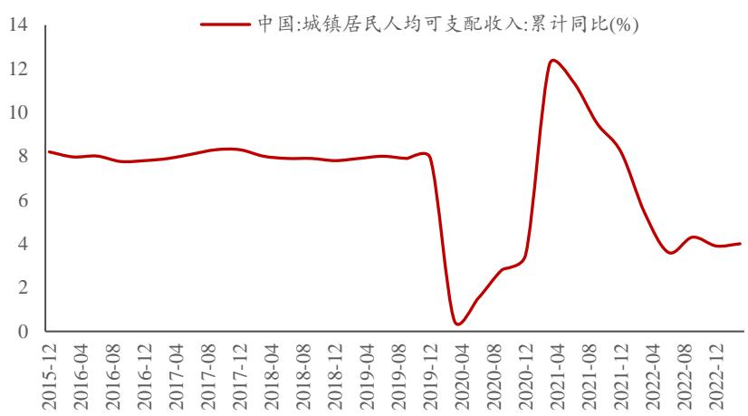
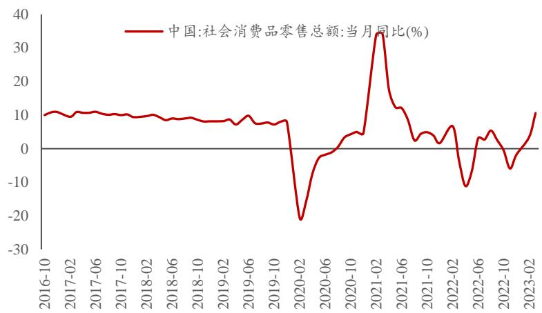
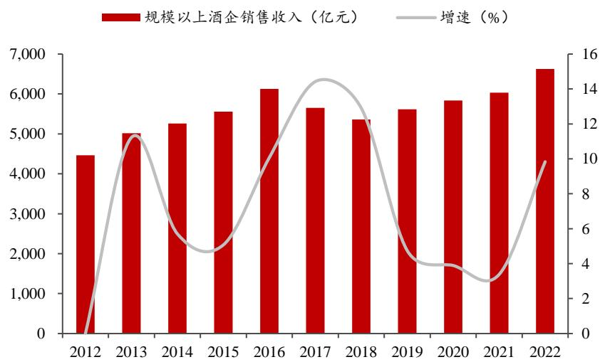
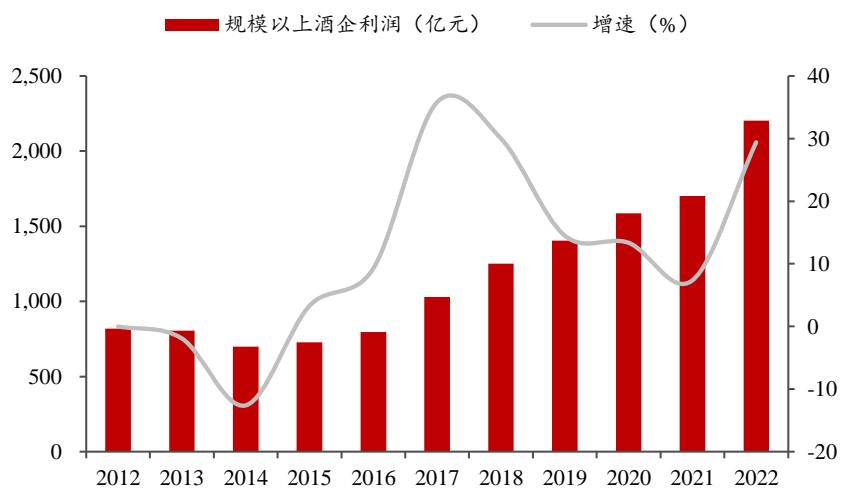
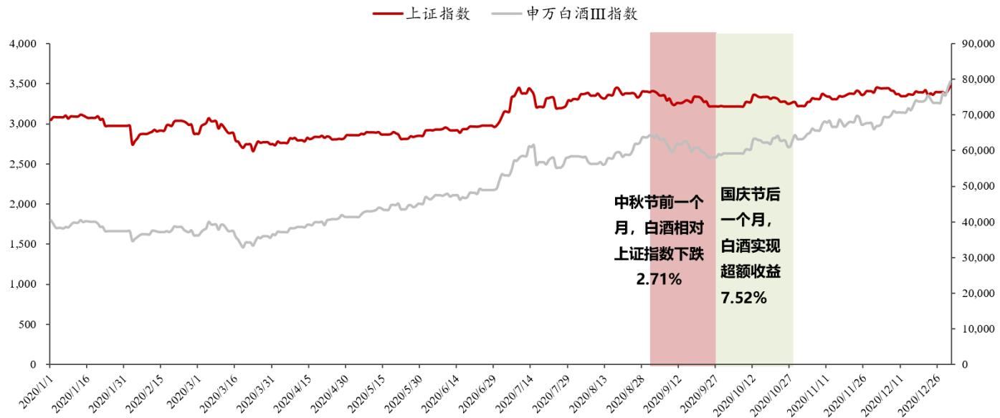
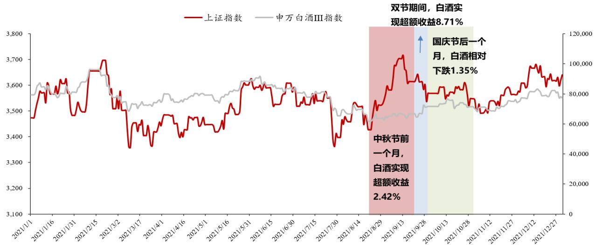
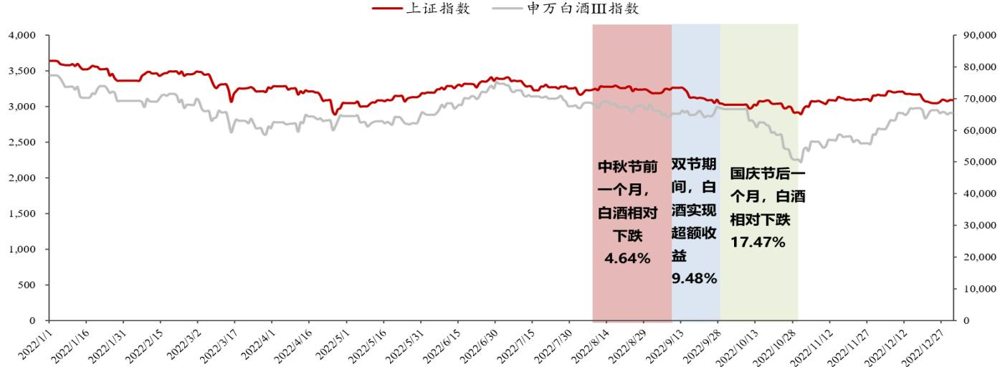

## 取势明道，23H2白酒有什么机会？

# 食饮行业白酒2023年中期投资策略

行业评级：看好（维持）

<table><tr><td>分析师</td><td></td><td>分析师</td><td></td><td>研究助理</td><td></td><td>研究助理</td><td></td></tr><tr><td>姓名</td><td>杨骥</td><td>姓名</td><td>张潇倩</td><td>姓名</td><td>张家祯</td><td>姓名</td><td>潘俊汝</td></tr><tr><td>邮箱</td><td>yangji@stocke.com.cn</td><td>邮箱</td><td>zhangxiaoqian@stocke.com.cn</td><td>邮箱</td><td>zhangjiazhen@stocke.com.cn</td><td>邮箱</td><td>panjunru@stocke.com.cn</td></tr><tr><td>电话</td><td>13911632184</td><td>电话</td><td>15888987689</td><td></td><td></td><td></td><td></td></tr><tr><td>证书编号</td><td>S1230522030003</td><td>证书编号</td><td>S1230520090001</td><td></td><td></td><td></td><td></td></tr></table>

23年VS22年10月，看白酒板块缘何调整？①外部原因：市场仍对未来宏观经济预期不稳，担忧与经济存强关联性的白酒板块或面临：终端需求表现不稳&后期酒企业绩增速降速等情况；②内部原因：由于近期部分酒企管理层有所变动，市场担忧未来潜在管理层变动或对酒企中长期经营产生不确定性；淡季下，近期板块内部缺乏强催化。我们仍看好23H2板块弹性，主因从内部催化剂/板块基本面/情绪面/需求端/估值性价比等角度看，板块均具备较强确定性&弹性。

23年白酒内外环境变化？①价增/分化为优质酒企增长核心驱动力，板块强韧性凸显板块仍处向上周期。 ②受需求影响价位带表现有所分化，升级趋势不改，具体看，高端酒：需求端表现稳健，延续强韧性；次高端：与中产阶级消费、商务消费紧密相连，仍在扩容但恢复速度略慢；中高档价位：100-300元成熟单品表现优异，市占率提升明显，呈现大众消费品质化和升级特点。③渠道提质增量趋势延续，头部酒企经销商平均规模持续提升；④23年白酒行业特征：短期量增为核心动力，产品布局多元受益；在擅长的价位带做增量，同时坚定核心产品不动摇，积极布局中长期发展。

23H2核心关注点？通过复盘过去三年中秋国庆表现，我们认为经济环境（β）仍为决定旺季需求的核心决定因素，而优势酒企（α）在回补消费的抢夺中将更受益，在当前市场情绪中性偏谨慎+经济发展存不确定背景下，或存行业/个别价位带潜在超预期机会，我们坚定看好高端/大众价位带消费旺盛的延续表现，同时关注与经济更紧密的次高端酒终端动销预期差。

投资建议：历史上每次白酒行业的调整都是加大布局力度的好机会。在当前行业处于预期底背景下，我们仍看好23H2消费升级趋势延续下的板块弹性表现，23H2将关注三大投资主线：①确定性主线：看好高端酒需求韧性表现，当前首推估值具备性价比&业绩具备确定性的高端酒，比如：贵州茅台/泸州老窖/五粮液等；②复苏弹性主线：看好随着消费加速复苏，需求&业绩端弹性均较大的次高端酒，比如：山西汾酒/舍得酒业/水井坊等；③季报超预期或事件催化主线，看好潜力升级产品铺货表现，比如：迎驾贡酒/顺鑫农业/金徽酒/洋河股份/今世缘等。

风险提示：经济表现不及预期风险；高端酒批价下行风险；食品安全风险等。

## 目录 C O N T E N T S

01 23vs22年10月看白酒板块为什么调整?
02 23年白酒内外部环境有什么变化?
03 23H2板块核心关注点?
04 强性价比下的差异化投资建议?

## 股价复盘

## 23vs22年10月看白酒板块为什么调整？

  
图：2022年10月至今白酒行业股价走势原因分析  
上证指数累计涨跌幅（%） 申万白酒指数累计涨跌幅（%）

## 1.1 22年10月至今板块走势分析？

23.2.21-23.6.5 白酒股价再次回调，超额下跌14%

淡季基本面相对稳定，主要是情绪面/资金面驱动板块走弱

基本面因素

情绪面因素

资金面因素

政策面因素

22年10月以来白酒板块有多轮超额收益机会。白酒行业在22年10月探底后，于11月开始实现触底反转（主因预期疫情管控放松），23年春节动销超预期再次刺激股价后，由于3月需求端表现偏弱，股价走势再度向下。当前白酒板块估值已具备强性价比。

资料来源：WIND，浙商证券研究所

## 1.2 22年10月至今板块基本面表现情况？

酒企基本面韧性强，利润端具备弹性。22Q3-23Q1白酒板块收入增速分别为16.44%、12.47%、15.82%；归母净利润增速分别为21.49%、17.55%、19.23%，其中区域酒受益于大众酒需求实现恢复性高增、高端酒受益于高端需求韧性强，均实现弹性增长。

图：2022年10月至今白酒行业主要酒企批价走势图（单位：元）  
  
资料来源：WIND，浙商证券研究所

图：主要酒企业绩情况一览

<table><tr><td rowspan="2">分类</td><td rowspan="2">酒企</td><td colspan="2">收入增速 (%)</td><td colspan="2">归母净利润增速 (%)</td></tr><tr><td>2022年</td><td>2023Q1</td><td>2022年</td><td>2023Q1</td></tr><tr><td rowspan="3">高端酒</td><td>贵州茅台</td><td>16.9</td><td>20.0</td><td>19.6</td><td>20.6</td></tr><tr><td>五粮液</td><td>11.7</td><td>13.0</td><td>14.2</td><td>15.9</td></tr><tr><td>泸州老窖</td><td>21.7</td><td>20.6</td><td>30.3</td><td>29.1</td></tr><tr><td rowspan="4">次高端酒</td><td>山西汾酒</td><td>31.3</td><td>20.4</td><td>52.4</td><td>29.9</td></tr><tr><td>舍得酒业</td><td>21.9</td><td>7.3</td><td>35.3</td><td>7.3</td></tr><tr><td>酒鬼酒</td><td>18.6</td><td>-42.9</td><td>17.4</td><td>-42.4</td></tr><tr><td>水井坊</td><td>0.9</td><td>-39.7</td><td>1.4</td><td>-56.0</td></tr><tr><td rowspan="6">区域龙头酒</td><td>洋河股份</td><td>18.8</td><td>15.5</td><td>24.9</td><td>15.7</td></tr><tr><td>今世缘</td><td>23.1</td><td>27.3</td><td>23.3</td><td>25.2</td></tr><tr><td>古井贡酒</td><td>25.9</td><td>24.8</td><td>36.8</td><td>42.9</td></tr><tr><td>口子窖</td><td>2.1</td><td>21.3</td><td>-10.2</td><td>10.4</td></tr><tr><td>迎驾贡酒</td><td>19.6</td><td>21.1</td><td>23.0</td><td>26.6</td></tr><tr><td>金种子酒</td><td>-2.1</td><td>25.5</td><td>-12.4</td><td>-228.1</td></tr><tr><td rowspan="5">三四线酒</td><td>老白干酒</td><td>15.5</td><td>10.4</td><td>81.8</td><td>-61.5</td></tr><tr><td>伊力特</td><td>-16.2</td><td>18.5</td><td>-47.1</td><td>37.0</td></tr><tr><td>顺鑫农业</td><td>-21.5</td><td>4.6</td><td>-758.1</td><td>214.4</td></tr><tr><td>金徽酒</td><td>12.5</td><td>26.6</td><td>-13.7</td><td>10.4</td></tr><tr><td>天佑德酒</td><td>-7.0</td><td>-6.2</td><td>19.0</td><td>-29.5</td></tr></table>

<table><tr><td>高端酒</td><td>15.6</td><td>17.2</td><td>19.1</td><td>19.7</td></tr><tr><td>次高端酒</td><td>24.3</td><td>6.5</td><td>39.2</td><td>14.1</td></tr><tr><td>区域龙头酒</td><td>19.6</td><td>19.7</td><td>22.3</td><td>21.0</td></tr><tr><td>三四线酒</td><td>-11.1</td><td>9.3</td><td>-64.1</td><td>7.6</td></tr></table>

## 1.3 近期板块调整原因？板块后续催化剂？需求恢复状态？

## 我们认为3月至今白酒板块波动主因：

①外部原因：市场仍对未来宏观经济预期不稳，担忧与经济存强关联性的白酒板块或面临：终端需求表现不稳&后期酒企业绩增速降速等情况；

②内部原因：由于近期部分酒企管理层有所变动，市场担忧未来潜在管理层变动或对酒企中长期经营产生不确定性；淡季下，近期板块内部缺乏强催化。

## 但我们看好板块或于23H2超预期表现：

①从内部催化剂角度看，6月（端午节回款+23Q2业绩预期差）/9-10月（中秋国庆）或迎板块内部催化剂；

②从基本面角度看，酒企全年业绩增速确定性强。当前核心酒企单品批价稳定&库存处于合理区间，考虑到22Q2白酒板块低基数（次高端酒基数最低），23Q2板块具备业绩较强确定性&弹性；考虑到23年酒企以业绩为主要目标，业绩达成度高；

③从情绪面角度看，经济持续修复利好信心树立。经济预期仍为影响板块β核心因子，后续市场对动销恢复速度判断或随经济预期（制造业/地产业等数据）而波动（当前市场仍对后续经济恢复速度持观望态度），我们看好后续消费恢复；

④从需求端角度看，当前需求处于加速恢复状态。我们预计4月开始需求端环比恢复明显，整体仍呈“0-300元大众价位+900元以上高端酒价位表现优秀，次高端偏中上沿价位带承压”状态，消费升级趋势仍延续下，我们看好后续需求端表现。

## 02 行业趋势 23年白酒内外部环境有什么变化？

①价增/分化为优质酒企增长核心驱动力，板块强韧性凸显板块仍处向上周期。 ②受需求影响价位带表现有所分化，升级趋势不改，具体看，高端酒：需求端表现稳健，延续强韧性；次高端：与中产阶级消费、商务消费紧密相连，仍在扩容但恢复速度略慢；中高档价位：100-300元成熟单品表现优异，市占率提升明显，呈现大众消费品质化和升级特点。③渠道提质增量趋势延续，头部酒企经销商平均规模持续提升；④23年白酒行业特征：短期量增为核心动力，产品布局多元受益；在擅长的价位带做增量，同时坚定核心产品不动摇，积极布局中长期发展。

## 2.1 价增/分化为优质酒企增长核心驱动力，板块强韧性凸显板块仍处向上周期

板块仍强韧性，价增核心驱动力不改，集中度加速提升。2022年在疫情影响下，963家规模以上酒企完成销售收入/净利润6627亿元（+10%）/2202亿元（+29%），规模以上酒企累计亏损额18.8亿元（-15.7%）,板块基本面呈现强韧性，且在消费升级速度放缓背景下，价增仍为核心驱动力，行业集中度仍处于加速提升过程中，预计白酒行业价升、集中度提升为主线的发展仍将延续。

表：2012-2022年规模以上酒企收入/净利润情况一览

<table><tr><td>年份</td><td>规模以上酒企数量(家)</td><td>规模以上酒企收入(亿元)</td><td>增速(%)</td><td>规模以上酒企利润(亿元)</td><td>增速(%)</td><td>平均规模以上酒企收入(亿元)</td><td>增速(%)</td><td>平均规模以上酒企利润(亿元)</td><td>增速(%)</td></tr><tr><td>2022</td><td>963</td><td>6627</td><td>10%</td><td>2202</td><td>29%</td><td>6.88</td><td>10%</td><td>2.29</td><td>30%</td></tr><tr><td>2021</td><td>965</td><td>6033</td><td>19%</td><td>1702</td><td>33%</td><td>6.25</td><td>11%</td><td>1.76</td><td>16%</td></tr><tr><td>2020</td><td>1040</td><td>5836</td><td>5%</td><td>1585</td><td>13%</td><td>5.61</td><td>17%</td><td>1.52</td><td>28%</td></tr><tr><td>2019</td><td>1176</td><td>5618</td><td>5%</td><td>1404</td><td>12%</td><td>4.78</td><td>29%</td><td>1.19</td><td>38%</td></tr><tr><td>2018</td><td>1445</td><td>5364</td><td>13%</td><td>1251</td><td>30%</td><td>3.71</td><td>5%</td><td>0.87</td><td>34%</td></tr><tr><td>2017</td><td>1593</td><td>5654</td><td>14%</td><td>1028</td><td>36%</td><td>3.55</td><td>-9%</td><td>0.65</td><td>28%</td></tr><tr><td>2016</td><td>1578</td><td>6126</td><td>10%</td><td>797</td><td>9%</td><td>3.88</td><td>9%</td><td>0.51</td><td>9%</td></tr><tr><td>2015</td><td>1563</td><td>5559</td><td>5%</td><td>727</td><td>3%</td><td>3.56</td><td>1%</td><td>0.47</td><td>0%</td></tr><tr><td>2014</td><td>1498</td><td>5259</td><td>6%</td><td>699</td><td>-13%</td><td>3.51</td><td>0%</td><td>0.47</td><td>-18%</td></tr><tr><td>2013</td><td>1423</td><td>5018</td><td>11%</td><td>805</td><td>-2%</td><td>3.53</td><td>2%</td><td>0.57</td><td>-11%</td></tr><tr><td>2012</td><td>1290</td><td>4466</td><td>-</td><td>819</td><td>-</td><td>3.46</td><td>-</td><td>0.64</td><td>-</td></tr></table>

数据来源：WIND，酒业协会，浙商证券研究所

## 2.2 分档次看23年白酒：受需求影响价位带表现有所分化，升级趋势不改

高净值人群仍不断增加叠加白酒需求刚性，消费升级趋势不可逆。从消费力角度看，高净值人群的增加/消费力的增强/居民对品牌化的追求等不断推动行业结构升级：

据国家统计局数据显示，23年一季度城镇居民人均可支配收入14388元，比上年同期名义增长4.0%，扣除价格因素，实际增长2.7%，整体表现平稳；23年4月社会消费品零售总额34910亿元，同比增长18.4%，增速比3月份加快7.8个百分点。

从数据看，22年规模以上酒企收入/净利润 增 速 分 别 约 为 10%/29% ， 且 22 年&23Q1上市公司整体收入/净利润亦呈现强成长性，利润弹性显著。考虑到当前我国高净值人群的数量/质量均不断提升，且居民收入中长期呈增长趋势为消费持续升级提供动力。

从消费属性看，白酒需求具备的社交属性/送礼属性赋予其消费刚性，亦为消费升级趋势不可逆原因之一。

图：23Q1城镇居民可支配收入增速趋势向上  
  
数据来源：招商私人财富报告，浙商证券研究所

图：22年白酒规模以上企业收入实现近10%的增长  
图：23Q1社零总额同比仍处于修复阶段  
  
数据来源：Wind，浙商证券研究所

  
数据来源：国家统计局，浙商证券研究所

图：22年白酒规模以上企业净利润实现近30%的增长  
  
数据来源：中国酒业协会，浙商证券研究所

## 2.2 分档次看23年白酒：受需求影响价位带表现有所分化，升级趋势不改

高端酒价位看：茅五泸等强品牌力高端酒需求端表现稳健，延续强韧性。从批价表现看，茅台表现最为坚挺

次高端价位来看：与中产阶级消费、商务消费紧密相连的次高端价位带仍在扩容，但恢复速度略慢。

中高档价位带看：100-300元成熟单品表现优异，市占率提升明显，并呈现大众消费品质化和升级特点。

表：22年/23Q1酒企收入/净利润/毛利率/净利率相较于21年/22Q1变动幅度情况一览

<table><tr><td rowspan="2" colspan="2"></td><td colspan="2">营业收入增速(%)</td><td colspan="2">归母净利润增速(%)</td><td colspan="2">毛利率差值(个百分点)</td><td colspan="2">净利率差值(个百分点)</td></tr><tr><td>2022年</td><td>2023Q1</td><td>2022年</td><td>2023Q1</td><td>2022年-2021年</td><td>23Q1-22Q1</td><td>2022年-2021年</td><td>23Q1-22Q1</td></tr><tr><td rowspan="3">高端酒</td><td>贵州茅台</td><td>16.87</td><td>20.00</td><td>19.55</td><td>20.59</td><td>0.33</td><td>0.23</td><td>0.21</td><td>-0.05</td></tr><tr><td>五粮液</td><td>11.72</td><td>13.03</td><td>14.17</td><td>15.89</td><td>0.07</td><td>-0.01</td><td>0.80</td><td>0.81</td></tr><tr><td>泸州老窖</td><td>21.71</td><td>20.57</td><td>30.29</td><td>29.11</td><td>0.89</td><td>1.66</td><td>2.99</td><td>3.10</td></tr><tr><td rowspan="4">次高端酒</td><td>山西汾酒</td><td>31.26</td><td>20.44</td><td>52.36</td><td>29.89</td><td>0.45</td><td>0.80</td><td>4.13</td><td>2.71</td></tr><tr><td>舍得酒业</td><td>21.86</td><td>7.28</td><td>35.31</td><td>7.34</td><td>-0.09</td><td>-2.45</td><td>2.51</td><td>-0.23</td></tr><tr><td>酒鬼酒</td><td>18.63</td><td>-42.87</td><td>17.38</td><td>-42.38</td><td>-0.33</td><td>1.77</td><td>-0.27</td><td>0.27</td></tr><tr><td>水井坊</td><td>0.88</td><td>-39.69</td><td>1.40</td><td>-56.02</td><td>-0.02</td><td>-1.75</td><td>0.13</td><td>-6.94</td></tr><tr><td rowspan="5">区域酒</td><td>洋河股份</td><td>18.76</td><td>15.51</td><td>24.91</td><td>15.66</td><td>-0.72</td><td>-0.70</td><td>1.55</td><td>0.11</td></tr><tr><td>古井贡酒</td><td>25.95</td><td>24.83</td><td>36.78</td><td>42.87</td><td>2.07</td><td>1.78</td><td>1.56</td><td>2.80</td></tr><tr><td>今世缘</td><td>23.09</td><td>27.26</td><td>23.34</td><td>25.20</td><td>1.98</td><td>1.09</td><td>0.06</td><td>-0.54</td></tr><tr><td>迎驾贡酒</td><td>19.59</td><td>21.11</td><td>22.97</td><td>26.55</td><td>0.48</td><td>-0.19</td><td>0.74</td><td>1.66</td></tr><tr><td>口子窖</td><td>2.12</td><td>21.35</td><td>-10.24</td><td>10.37</td><td>0.26</td><td>-1.40</td><td>-4.16</td><td>-3.35</td></tr><tr><td rowspan="6">三四线酒</td><td>老白干酒</td><td>15.54</td><td>10.43</td><td>81.81</td><td>-61.51</td><td>1.04</td><td>-4.80</td><td>5.56</td><td>-19.08</td></tr><tr><td>顺鑫农业</td><td>-21.46</td><td>4.63</td><td>-758.08</td><td>214.40</td><td>3.83</td><td>4.87</td><td>-6.61</td><td>5.36</td></tr><tr><td>金徽酒</td><td>12.49</td><td>26.61</td><td>-13.73</td><td>10.41</td><td>-0.96</td><td>-1.38</td><td>-4.28</td><td>-3.05</td></tr><tr><td>伊力特</td><td>-16.24</td><td>18.53</td><td>-47.10</td><td>36.97</td><td>-3.40</td><td>0.43</td><td>-6.14</td><td>3.03</td></tr><tr><td>天佑德酒</td><td>-7.04</td><td>-6.23</td><td>19.05</td><td>-29.46</td><td>-1.05</td><td>-4.47</td><td>1.89</td><td>-6.38</td></tr><tr><td>金种子酒</td><td>-2.11</td><td>25.48</td><td>-12.45</td><td>-228.11</td><td>-2.35</td><td>-7.37</td><td>-2.03</td><td>-5.81</td></tr></table>

数据来源：Wind，浙商证券研究所,注：标蓝为400元及以下价格带，标橙为600元及以上价格带

## 2.3 渠道提质增量趋势延续，头部酒企平均经销商规模持续提升

无论是采取扎根基地市场战略，还是采取全国化的酒企，经销商数量及经销渠道收入均实现快速增长，渠道提质增量。

我们对比了16年及22年的上市公司经销商数量变化/经销商平均规模变化/员工数量变化，认为：在17年至今的白酒行业周期中，主要酒企渠道增长驱动力仍来自于经销商数量的增长，其中优质酒企实现质&量双升。

总结看：近年来头部优质酒企深度全国化能力、扁平化能力持续提升，亦推动行业集中度加速提升。展望未来，我们看好具备强渠道实力的头部酒企，未来渠道提质增量趋势仍将继续演绎。

表：2016及2022年主要酒企省内收入占比及具体渠道/员工人数及同比分析一览

<table><tr><td rowspan="2"></td><td colspan="4">2016年</td><td colspan="8">2022年</td></tr><tr><td>经销商数量(家)</td><td>经销商渠道收入规模(亿元)</td><td>平均经销商规模(万元/家)</td><td>员工人数(人)</td><td>经销商数量(家)</td><td>经销商数量同比16年(%)</td><td>经销商渠道收入规模(亿元)</td><td>经销商渠道收入规模同比16年(%)</td><td>平均经销商规模(万元/家)</td><td>平均经销商规模同比16年(%)</td><td>员工人数(人)</td><td>员工人数同比16年(%)</td></tr><tr><td>贵州茅台</td><td>2416</td><td>354</td><td>1463</td><td>21237</td><td>2189</td><td>-9.4%</td><td>744</td><td>110.4%</td><td>3399</td><td>132.2%</td><td>31413</td><td>47.9%</td></tr><tr><td>五粮液</td><td></td><td></td><td></td><td>25402</td><td>3144</td><td></td><td>405</td><td></td><td>1288</td><td></td><td>25464</td><td>0.2%</td></tr><tr><td>泸州老窖</td><td></td><td></td><td></td><td>2009</td><td>1829</td><td></td><td>233</td><td></td><td>1274</td><td></td><td>3605</td><td>79.4%</td></tr><tr><td>山西汾酒</td><td>987</td><td>43</td><td>433</td><td>7024</td><td>3637</td><td>268.5%</td><td>242</td><td>465.1%</td><td>664</td><td>53.4%</td><td>13712</td><td>95.2%</td></tr><tr><td>舍得酒业</td><td>1009</td><td>12</td><td>122</td><td>3633</td><td>2158</td><td>113.9%</td><td>53</td><td>326.4%</td><td>244</td><td>99.4%</td><td>8876</td><td>144.3%</td></tr><tr><td>酒鬼酒</td><td></td><td></td><td></td><td>974</td><td>1586</td><td></td><td>40</td><td></td><td>255</td><td></td><td>1957</td><td>100.9%</td></tr><tr><td>水井坊</td><td>77</td><td>10</td><td>1351</td><td>1167</td><td>50</td><td>-35.1%</td><td>43</td><td>316.2%</td><td>8657</td><td>541.0%</td><td>1877</td><td>60.8%</td></tr><tr><td>洋河股份</td><td></td><td></td><td></td><td>14913</td><td>8238</td><td></td><td>291</td><td></td><td>353</td><td></td><td>19616</td><td>31.5%</td></tr><tr><td>今世缘</td><td>525</td><td>25</td><td>471</td><td>3117</td><td>1014</td><td>93.1%</td><td>77</td><td>210.9%</td><td>759</td><td>61.0%</td><td>4338</td><td>39.2%</td></tr><tr><td>古井贡酒</td><td></td><td></td><td></td><td>5778</td><td>4399</td><td></td><td>167</td><td></td><td>380</td><td></td><td>11310</td><td>95.7%</td></tr><tr><td>迎驾贡酒</td><td>728</td><td>27</td><td>373</td><td>7260</td><td>1334</td><td>83.2%</td><td>49</td><td>80.4%</td><td>367</td><td>-1.6%</td><td>6911</td><td>-4.8%</td></tr><tr><td>口子窖</td><td>622</td><td>27</td><td>442</td><td>3950</td><td>859</td><td>38.1%</td><td>50</td><td>81.1%</td><td>579</td><td>31.1%</td><td>4188</td><td>6.0%</td></tr><tr><td>顺鑫农业</td><td></td><td></td><td></td><td>6016</td><td>442</td><td></td><td>113</td><td></td><td>2563</td><td></td><td>4462</td><td>-25.8%</td></tr><tr><td>金徽酒</td><td>374</td><td>12</td><td>327</td><td>1620</td><td>736</td><td>96.8%</td><td>19</td><td>54.7%</td><td>257</td><td>-21.4%</td><td>2916</td><td>80.0%</td></tr><tr><td>老白干酒</td><td>1675</td><td>20</td><td>122</td><td>2679</td><td>11023</td><td>558.1%</td><td>40</td><td>97.0%</td><td>37</td><td>-70.1%</td><td>7095</td><td>164.8%</td></tr><tr><td>伊力特</td><td>45</td><td>16</td><td>3557</td><td>1650</td><td>64</td><td>42.2%</td><td>13</td><td>-15.7%</td><td>2109</td><td>-40.7%</td><td>2130</td><td>29.1%</td></tr><tr><td>天佑德酒</td><td></td><td></td><td></td><td>2198</td><td>597</td><td></td><td>8</td><td></td><td>128</td><td></td><td>1866</td><td>-15.1%</td></tr><tr><td>金种子酒</td><td>424</td><td>12</td><td>276</td><td>3431</td><td>297</td><td>-30.0%</td><td>7</td><td>-43.5%</td><td>223</td><td>-19.3%</td><td>2636</td><td>-23.2%</td></tr></table>

数据来源：Wind，浙商证券研究所,注：五粮液、泸州老窖、酒鬼酒、洋河股份、古井贡酒、顺鑫农业、天佑德酒未披露2016年经销商数量及经销渠道收入

## 2.4 23年白酒行业特征：短期量增为核心动力，产品布局多元受益

23年白酒处于大周期向上的修整期，白酒行业存新特点

量价特征：1）短期：受外部因素影响，23年主要酒企均采用“稳价增量”举措以锚定业绩。2）中期：由于大众消费升级仍在延续，因此白酒价格带提升的中期趋势不改，叠加酱酒扩容，次高端仍为中期扩容的主流价格带。

产品结构特征：1）23Q1中档&高档酒表现优。2）产品矩阵布局多元企业表现较优：在23年行业竞争加剧+价位带表现分化背景下，多元布局“产品矩阵”的酒企或更受益，主因：大单品产品矩阵容易受特定价位带短期增长势能减弱影响，而具备向上向下联动能力的全价位带布局&强品牌力的酒企，具备更灵活抢夺红利价位带份额能力。

表：23Q1全价位布局/高端大单品为主的酒企利润增速相对较优

<table><tr><td>公司</td><td>产品结构特征</td><td>23Q1产品结构变化</td><td>23Q1利润增速 (%)</td><td>2023年利润端增 速盈利预测(%)</td></tr><tr><td>贵州茅台</td><td>高端大单品为主</td><td>23Q1茅台酒收入占比同比减少2.3个百分点至87.1%,系列酒依靠价升延续高增趋势</td><td>20.59%</td><td>19%</td></tr><tr><td>五粮液</td><td>高端大单品为主</td><td>受益于强品牌力+高性价比,23Q1产品动销端表现优异(根据五粮液集团公众号信息,1月份五粮液产品发货量和动销量均同比增长两位数),预计八代五粮液收入以量升为主</td><td>15.89%</td><td>19%</td></tr><tr><td>泸州老窖</td><td>高端大单品为主</td><td>受益于Q1大众酒消费表现优秀,预计窖龄特曲等中档酒动销表现优秀</td><td>29.11%</td><td>27%</td></tr><tr><td>山西汾酒</td><td>全价位布局</td><td>考虑到23Q1大众消费价位表现优异,预计青花20/老白汾/巴拿马等产品均增速优秀</td><td>29.89%</td><td>28%</td></tr><tr><td>酒鬼酒</td><td>次高端大单品为 主</td><td>23Q1业绩短期承压,次高端价位恢复不佳+基于库存压力,没有压货&amp;推出激励措施,内参回款进度略承压(预计动销环比Q4有好转)</td><td>-42.38%</td><td>18%</td></tr><tr><td>水井坊</td><td>次高端大单品为 主</td><td>23Q1高档/中档酒实现收入8.02/0.46亿元(-41.04%/+10.78%),其中中档酒收入占比较去年同期提升2.45个百分点至5.40%,得益于天号陈完成铺货</td><td>-56.02%</td><td>7%</td></tr><tr><td>舍得酒业</td><td>次高端大单品为 主</td><td>受益于春节期间大众价位表现优异,23Q1收入占比提升0.69个百分点至12.38%的普通酒(沱牌大曲)收入同比+13.21%至2.36亿;中高档酒收入同比+6.05%至2.36亿元。</td><td>7.34%</td><td>25%</td></tr><tr><td>古井贡酒</td><td>全价位布局</td><td>23Q1受益于元旦后省内消费恢复超预期+消费升级趋势持续+经销商模式改革红利释放(执行1+1+终端联盟模式),23Q1公司回款进度&amp;结构/动销情况均优于往年。</td><td>42.87%</td><td>33%</td></tr><tr><td>洋河股份</td><td>全价位布局</td><td>蓝色经典销售占比超70%,近年来梦系列占比持续提升,22年梦系列销售占比超30%,其中梦6+在梦系列中销售占比较大。</td><td>15.66%</td><td>21%</td></tr><tr><td>今世缘</td><td>全价位布局</td><td>23Q1特A+类/特A类收入占比分别变动-1.10/+1.53pct,特A类占比提升主因返乡潮下中高端价格带表现优异,V系增速或较22年加速</td><td>25.20%</td><td>27%</td></tr><tr><td>口子窖</td><td>全价位布局</td><td>23Q1高档酒收入占比+0.94个百分点至96.80%,中档酒亦稳步实现收入增长,新年份5/6,兼10/20回款顺利</td><td>10.37%</td><td>17%</td></tr><tr><td>迎驾贡酒</td><td>全价位布局</td><td>23Q1中高档酒收入占比同比提升0.27个百分点至82.61%,洞藏系列收入占比持续提升的同时,洞藏内部结构亦在稳步向上</td><td>26.55%</td><td>22%</td></tr><tr><td>金徽酒</td><td>次高端以下产品为主</td><td>23Q1公司高/中/低档产品收入占比分别同比变动-0.92/+1.31/-0.38个百分点至61.17%/37.20%/0.64%,中档酒表现亮眼</td><td>10.41%</td><td>50%</td></tr><tr><td>老白干酒</td><td>全价位布局</td><td>23Q1高档酒、中档酒、低档酒收入同比-9.53%、+38.03%、+36.39%,高档酒占比下降10.37pct至42.56%,主因22Q4以来公司加强高端产品库存管控,停货挺价下23Q1增速放缓</td><td>-61.51%</td><td>4%</td></tr></table>

资料来源：WIND，浙商证券研究所，注：2023年利润端增速盈利预测为浙商证券盈利预测

## 2.4 23年白酒企业特点：“脚踏实地，仰望星空”，保持战略定力

我们认为当前主要酒企都在做正确的事情：①脚踏实地，发挥优势做擅长的事。在经济渐进式复苏背景下，酒企的战略方向多从追求产品升级转为在优势价格带进行放量。比如：山西汾酒从此前的发力青花30复兴版转为将青花20作为基本盘来发展/古井贡酒在聚焦古20背景下，处于大众价位带的古16实现快速放量等。②仰望星空，培育创新着眼长远。在白酒大周期向上的修整期，酒企积极进行厂商模式、消费者培育模式创新，构建更紧密厂商关系，并针对消费者开展更丰富的活动。比如：迎驾贡酒通过开演唱会等方式巩固洞藏系列放量趋势等。③保持战略定力，突出核心产品。23年酒企仍聚焦打造核心产品，不轻易改变产品定位。比如：即使次高端酒价位带短期受外部环境影响，内参/青花30复兴版/品味舍得等产品均仍为酒企核心战略产品不动摇等。

表：酒企动态把握吨价升级与优势价格带放量的节奏

<table><tr><td rowspan="2">公司</td><td colspan="4">销量同比增速(%)</td><td colspan="4">吨价同比增速(%)</td></tr><tr><td>2019</td><td>2020</td><td>2021</td><td>2022</td><td>2019</td><td>2020</td><td>2021</td><td>2022</td></tr><tr><td>贵州茅台</td><td>4%</td><td>-1%</td><td>4%</td><td>3%</td><td>12%</td><td>12%</td><td>8%</td><td>14%</td></tr><tr><td>五粮液</td><td>-14%</td><td>-3%</td><td>13%</td><td>-30%</td><td>45%</td><td>18%</td><td>2%</td><td>60%</td></tr><tr><td>泸州老窖</td><td>-3%</td><td>-15%</td><td>-36%</td><td>11%</td><td>24%</td><td>24%</td><td>93%</td><td>10%</td></tr><tr><td>山西汾酒</td><td>74%</td><td>-3%</td><td>24%</td><td>17%</td><td>-27%</td><td>22%</td><td>15%</td><td>12%</td></tr><tr><td>酒鬼酒</td><td>14%</td><td>16%</td><td>36%</td><td>20%</td><td>11%</td><td>4%</td><td>37%</td><td>-1%</td></tr><tr><td>水井坊</td><td>26%</td><td>-11%</td><td>40%</td><td>-2%</td><td>0%</td><td>-4%</td><td>10%</td><td>3%</td></tr><tr><td>舍得酒业</td><td>6%</td><td>24%</td><td>150%</td><td>6%</td><td>14%</td><td>-18%</td><td>-26%</td><td>15%</td></tr><tr><td>古井贡酒</td><td>9%</td><td>-4%</td><td>16%</td><td>13%</td><td>10%</td><td>3%</td><td>11%</td><td>11%</td></tr><tr><td>洋河股份</td><td>-13%</td><td>-16%</td><td>18%</td><td>6%</td><td>10%</td><td>9%</td><td>2%</td><td>12%</td></tr><tr><td>今世缘</td><td>18%</td><td>1%</td><td>1%</td><td>22%</td><td>11%</td><td>4%</td><td>24%</td><td>1%</td></tr><tr><td>口子窖</td><td>3%</td><td>-19%</td><td>24%</td><td>-1%</td><td>7%</td><td>6%</td><td>1%</td><td>3%</td></tr><tr><td>迎驾贡酒</td><td>-2%</td><td>-14%</td><td>17%</td><td>10%</td><td>11%</td><td>6%</td><td>13%</td><td>9%</td></tr><tr><td>顺鑫农业</td><td>16%</td><td>-4%</td><td>-5%</td><td>-24%</td><td>7%</td><td>8%</td><td>1%</td><td>4%</td></tr><tr><td>伊力特</td><td>-2%</td><td>-30%</td><td>-3%</td><td>-4%</td><td>11%</td><td>12%</td><td>11%</td><td>-12%</td></tr><tr><td>金徽酒</td><td>8%</td><td>-7%</td><td>-9%</td><td>2%</td><td>4%</td><td>14%</td><td>14%</td><td>11%</td></tr><tr><td>金种子酒</td><td>-43%</td><td>74%</td><td>-14%</td><td>14%</td><td>23%</td><td>-35%</td><td>35%</td><td>-14%</td></tr><tr><td>老白干酒</td><td>1%</td><td>-24%</td><td>-3%</td><td>4%</td><td>11%</td><td>18%</td><td>15%</td><td>11%</td></tr><tr><td>天佑德酒</td><td>-3%</td><td>-36%</td><td>17%</td><td>-3%</td><td>-4%</td><td>-4%</td><td>18%</td><td>-4%</td></tr></table>

资料来源：WIND、微酒、酒业家、云酒头条等，浙商证券研究所，注：标红为增速大于等于10%

## 2.4 23年白酒企业特点：“脚踏实地，仰望星空”，保持战略定力

## 表：22年末-23年酒企消费者培育力度加强，模式更加丰富

<table><tr><td rowspan="2">公司</td><td colspan="2">扫码得红包/礼品活动</td><td colspan="2">演唱会</td><td colspan="2">品鉴会</td><td colspan="2">短视频营销</td></tr><tr><td>日期</td><td>活动内容</td><td>日期</td><td>活动内容</td><td>日期</td><td>活动内容</td><td>日期</td><td>活动内容</td></tr><tr><td>贵州茅台</td><td>-</td><td>-</td><td>2023年4月22日</td><td>2023年“壮族三月三”“贵州茅台与我们唱响非遗传承”</td><td>2023年6月5日</td><td>举行“韶华 正青春·鉴美时”主题品鉴会</td><td>2022年5月</td><td>与多个kol合作,博主发布了茅台冰淇淋的测评短视频,宣传茅台冰淇淋</td></tr><tr><td>五粮液</td><td>2022年12月-2023年2月</td><td>推出扫码送红包活动,单瓶扫码红包20元起,最高2000元,中奖率达到99.9%</td><td>2022年1月1日</td><td>独家冠名的《2022四川卫视花开天下·国韵新年演唱会》</td><td>2023年3月28日</td><td>与陕西华鼎酒业有限公司共同举办经典五粮液VIP专属品鉴会</td><td>2023年1月</td><td>推出抖音挑战赛激励活动,带动消费者拍摄家庭团圆、订婚宴请、好友聚会等欢聚场景,分享和美瞬间</td></tr><tr><td>泸州老窖</td><td>2022年2月</td><td>“黑盖”扫码领现金红包</td><td>2023年3月24日</td><td>举办泸州老窖·国窖1573“荣耀盛典”巨星演唱会</td><td>2023年5月9日</td><td>举行“醉美清溪谷”尊享品鉴会</td><td>2023年4月</td><td>旗舰店官号发布改编自《教父》《无间道》等经典名场面的短视频,趣味内容植入客主节活动信息</td></tr><tr><td>山西汾酒</td><td>2022年10月22日</td><td>扫码关注“汾酒山西粉丝团”公众号,领取微信现金红包奖励</td><td>2023年2月21日</td><td>承办唱响黄河·中国民歌山西邀请赛颁奖演唱会</td><td>2023年4月26日</td><td>举办青花汾酒品鉴会</td><td>2023年1月</td><td>联合抖音短视频平台发起“大家都爱汾酒”抖音挑战赛</td></tr><tr><td>酒鬼酒</td><td>2023年1月16-1月30日</td><td>推出“点亮世遗地,扫码赢好礼”活动</td><td>2023年5月21日</td><td>举办酒鬼酒央广云听LIVE音乐节</td><td>2023年5月23日</td><td>举办2023酒鬼酒·品鉴之夜</td><td>2023年5月20日</td><td>在微博、抖音、小红书等主流社交、短视频平台发起了达人打卡、征集爱情故事以及原创短视频等活动</td></tr><tr><td>水井坊</td><td>2022年9月1日-10月31日</td><td>推出“开盖有奖扫码必中”活动,为国球举杯</td><td>-</td><td>-</td><td>2023年3月14日</td><td>主办水井坊·井台线下品鉴会</td><td>-</td><td>-</td></tr><tr><td>舍得酒业</td><td>2023年1月21日-2月5日</td><td>推出“扫码贺新春”活动</td><td>2022年11月13日</td><td>举办以“遇鉴舍得·时光的艺术陈酿”为主题的成都舍得智慧俱乐部海韵之声专场音乐会</td><td>2023年5月21日</td><td>与品乐侍酒联合举办品乐侍酒×舍得老酒品鉴会</td><td>2022年9月</td><td>携手演员王阳用创意短视频《舍得奔赴》传递舍得精神</td></tr><tr><td>古井贡酒</td><td>2022年12月</td><td>推出“扫码中红包,瓶瓶有惊喜”活动</td><td>-</td><td>-</td><td>2023年5月</td><td>举办2023年春季古井贡酒品鉴会</td><td>-</td><td>-</td></tr><tr><td>洋河股份</td><td>2022年12月-2023年3月</td><td>推出“洋河新春送福运”活动</td><td>2023年5月27日</td><td>举办梦之蓝梦6+群星演唱会</td><td>2023年5月14日</td><td>举办“礼赞敦煌文明·匠造传承梦想”“洋河股份2023年封坛酒推介品鉴会</td><td>2022年7月-8月</td><td>联合微酒举办“经典20年 我与海之蓝”短视频大赛</td></tr><tr><td>今世缘</td><td>2022年11月</td><td>推出“喝今世缘D20,赢汽车大奖”的扫码抽奖活动</td><td>2023年5月27日</td><td>举办今世缘·国缘2023汪峰「UNFOLLOW」巡回演唱会</td><td>2023年4月16日</td><td>冠名《中外酒业》高端大咖品鉴会</td><td>2023年4月</td><td>今世缘D20主题短视频“赴一场名为缘分的约”</td></tr><tr><td>口子窖</td><td>2023年3月</td><td>推出“开瓶盖,扫内码,100%中奖”活动</td><td>-</td><td>-</td><td>2023年3月</td><td>举办“兼系列”白酒专家鉴评会</td><td>-</td><td>-</td></tr><tr><td>迎驾贡酒</td><td>2022年8月</td><td>推出“扫码中红包 瓶瓶有惊喜”活动</td><td>2023年5月26日</td><td>举办迎驾洞藏巨星演唱会</td><td>2023年4月8日</td><td>举办“迎驾贡酒”品鉴会</td><td>2023年1月</td><td>策划“徽韵中国年”活动,邀请安徽经济生活频道主持人出镜发布拜年短视频,提升关注度</td></tr></table>

资料来源：WIND、微酒、酒业家、云酒头条等，浙商证券研究所

## 03

## 中秋国庆复盘

## 23H2中秋国庆为核心关注点

通过复盘过去三年中秋国庆表现，我们认为经济环境（β）仍为决定旺季需求的核心决定因素，而优势酒企（α）在回补消费的抢夺中将更受益，在当前市场情绪中性偏谨慎+经济发展存不确定背景下，或存行业/个别价位带潜在超预期机会，我们坚定看好高端/大众价位带消费旺盛的延续表现，同时关注与经济更紧密的次高端酒终端动销预期差。

## 3.1 20年中秋国庆复盘：特殊的一年，后置性消费注定了双节“旺”

宏观经济背景：国内旅游消费旺盛，日均餐饮销售额同比增长。全国共接待国内游客6.37亿人次，按可比口径同比恢复79.0%；实现国内旅游收入4665.6亿元，按可比口径同比恢复69.9%。据商务部监测，10月1日至8日，全国零售和餐饮重点监测企业销售额约1.6万亿元，日均销售额比19年“十一”黄金周增长4.9%。“十一”期间，宁波、北京、甘肃、上海、海南重点监测企业销售额同比分别增长18.8%、18.6%、14.4%、13.7%和12.5%。

实际库存/动销水平：回款表现积极，库存水平良性。回款端看，2020年受益于恢复性消费叠加控货提价举措落地，回款端表现积极。库存层面看，整体酒企库存处于1-2个月左右水平，其中贵州茅台库存不足1个月，五粮液及老窖库存均在1个月内，古井库存2个月左右，洋河股份库存保持1.5个月左右。

表：2020年国庆消费数据统计

<table><tr><td>类别</td><td>趋势</td><td>详细情况</td></tr><tr><td>交通出行</td><td>旅客总量同比下降</td><td>疫情影响下,20年“国庆黄金周”的出国旅游量大幅减少,国内旅游消费势头旺盛。数据显示,国庆节假期国内旅游总数为7.82亿人,创造了近6500亿元的旅游收入。根据中国文化与旅游部的测算,2020年,中国“十一”国内游人次为6.37亿人,国内旅游收入为4665.6亿元,两者皆已达到19年同期的七八成水平。国内热门旅游景区和乡村旅游市场迎来增长机遇。</td></tr><tr><td>旅游相关</td><td>旅游收入同比下降</td><td>2020年国庆中秋八天长假期间,全国共接待国内游客6.37亿人次,按可比口径同比恢复79.0%;实现国内旅游收入4665.6亿元,按可比口径同比恢复69.9%。</td></tr><tr><td>旅游方式</td><td>本地周边游为主</td><td>携程发布《中秋国庆假期旅游大数据报告》显示,机票、火车票、汽车票、用车等各类出行方式均实现全面增长。其中,机票订单量环比9月增长超过100%,火车票订单量环比增长超过300%,汽车票环比增长超过200%。虽然本地游和周边游依然位居市场C位,自然风光景点、动物园和城市公园是热门品类,甘肃、新疆等西部长线目的地备受欢迎,豪车自驾、无人机航拍、美食私家团、户外徒步、滑翔伞、热气球、潜水等热度猛增。</td></tr><tr><td rowspan="2">景区商圈相关</td><td>北京/上海消费恢复较好</td><td>北京:10月8日,北京市商务局发布数据显示,假日8天,重点监测的百家企业实现销售额65.7亿元,同比增长18.6%。22个重点商圈的66家购物中心客流平均回暖率为86.4%。上海:据消费市场大数据实验室(上海)监测显示,国庆中秋节日期间(10月1日至8日,以下简称节日期间)上海市437家大型商业企业实现销售额123.8亿元,同比增长13.7%。</td></tr><tr><td>热门景区外卖订单猛增</td><td>10月8日,美团App发布《2020十一长假生活消费报告》。订餐场景和订单品类带有明显的节假日特点,热门景区、酒店的外卖订单量暴增,地方特色菜备受青睐。外卖成为旅游打卡新方式。数据显示,10月1日至10月5日期间,热门景区外卖单量同比去年增长200%。受疫情影响,歇业长达数月的导游群体,表现出对外卖的强需求。热门景区外卖订单近3成来自导游,他们偏爱川菜、湘菜,订单平均单价超60元。</td></tr><tr><td>整体餐饮消费情况</td><td>全国餐饮数据同比提升</td><td>据商务部监测,10月1日至8日,全国零售和餐饮重点监测企业销售额约1.6万亿元,日均销售额比去年“十一”黄金周增长4.9%。宁波、北京、甘肃、上海、海南重点监测企业销售额同比分别增长18.8%、18.6%、14.4%、13.7%和12.5%,江苏、山西、浙江、广东同比分别增长10.7%、7.8%、6.8%和6.7%。</td></tr><tr><td rowspan="3">重点省市餐饮情况</td><td>北京</td><td>10月8日,北京市商务局发布数据显示,假日8天,重点监测的百家企业实现销售额65.7亿元,同比增长18.6%。22个重点商圈的66家购物中心客流平均回暖率为86.4%。</td></tr><tr><td>河南</td><td>据监测,全省758家重点零售企业黄金周期间实现销售总额50.6亿元,与上年同期基本持平;7个重点监测城市的53家商超和餐饮企业累计实现销售额(营业收入)14.6亿元,同比增长10.6%。</td></tr><tr><td>南京</td><td>10月1日到10月6日,南京异地游客消费力突出,环比数据中,南京本地人到店交易额增长24.3%,而外地人到店交易额飙涨147.7%,仅次于北京。</td></tr></table>

资料来源：WIND，同花顺，携程，美团，商务部，浙商证券研究所

## 3.1 20年中秋国庆复盘：特殊的一年，后置性消费注定了双节“旺”

一、提价潮为2020年关键词。2020年自春节过后，泸州老窖、山西汾酒、剑南春、今世缘、古井贡等优质酒企相继开启产品升级及小幅提价，主要原因为：1）符合升级趋势；2）实现产品价格体系的再梳理，利于稳定批价、维护品牌力；3）促进回款；4）为备战中秋国庆旺季打下基础，可回补部分上半年量。在消费升级趋势不改、市场集中度不断提升的背景下，洋河股份、水井坊、今世缘、酒鬼酒等酒企通过直接提价、进行产品结构升级等方式进行“占位”，而茅台、五粮液等酒企则通过直接提价、进行产品结构升级、加大直营占比、减少渠道配额等方式以实现吨价上提，实现“守位”。品牌力及渠道力较强的优势企业通过小幅提价平衡了现金流及业绩。

二、价位带角度：高端酒价格表现、洋河M6+动销表现超市场预期。1）高端酒：高端酒继续延续稳健向好增长趋势。具体来看，贵州茅台需求强劲，直营放量叠加经销商抛货使得其批价短暂的下行，但需求强劲迅速推升批价回升；五粮液实现旺季放量时仍能挺价；泸州老窖实现量价齐升，其中国窖表现强劲，特曲业绩实现回正；

2）次高端及区域酒：中秋国庆旺季宴席场景动销超预期利好次高端区域酒，同时次高端价位带消费升级正在加速，其中今世缘产品结构稳步提升；洋河股份双节M6+供不应求。

图：2020年中秋前白酒相对上证指数下跌2.71%，国庆后白酒相对上涨7.52%  
  
资料来源：WIND，浙商证券研究所

## 3.2 21年中秋国庆复盘：表现平稳，价升仍为主旋律

宏观经济背景：旅游收入恢复至疫前七成，餐饮消费同比增长。经文化和旅游部数据中心测算，10月1日至7日，全国国内旅游出游5.15亿人次，实现国内旅游收入3890.61亿元。按可比口径同比减少1.5%，恢复至疫前同期的70.1%。餐饮消费总额同比20年增长19%，增长速度最高的省份是广西省和海南省，分别增长了156%和140%。

实际库存/动销水平：酒企回款快于往年，库存表现正常。主要酒企当前打款节奏均快于往年，部分酒企于中秋已接近完成任务。库存层面来看，整体库存水平良性，其中贵州茅台、水井坊、口子窖等酒企库存相对较低，而五粮液、泸州老窖、洋河股份等酒企库存亦保持健康状态。

表：2021年国庆消费数据统计

<table><tr><td>类别</td><td>趋势</td><td>详细情况</td></tr><tr><td>交通出行</td><td>旅客总量同比下降</td><td>10月1日至7日(国庆假期),全国预计共发送旅客4.03亿人次,日均5750万人次,比2019年同期(国庆7天假期)日均下降33.9%,比2020年同期(中秋国庆8天假期)日均下降7.5%。</td></tr><tr><td>旅游相关</td><td>旅游收入同比下降</td><td>10月1日至7日,全国国内旅游出游5.15亿人次,按可比口径同比减少1.5%,按可比口径恢复至疫前同期的70.1%。实现国内旅游收入3890.61亿元,同比减少4.7%,恢复至疫前同期的59.9%。游客满意度达85.5。假日市场总体安全平稳有序。</td></tr><tr><td>旅游方式</td><td>周边、长线两开花</td><td>携程发布《2021年国庆假期出游总结报告》显示,今年国庆出游总体呈现周边、长线两开花的局面,城市微度假、周边深度游、省内长线游、跨省长线游等玩法多样。携程数据显示:省内游和跨省游出行占比各半,一地深度探索更受欢迎。由于部分地区出行限制,短途周边和省内长线游热度提升最快,红色旅游、乡村游、亲子休闲、赏秋风光游等主题最受欢迎。携程门票、租车、主题游较2019年同期增长分别为19%、43%、47%,个性化、自由出行更受欢迎。</td></tr><tr><td rowspan="2">景区商圈相关</td><td>北京/上海消费恢复较好</td><td>北京:据北京市商务局重点监测的百货、超市、专业专卖店、餐饮和电商等业态企业实现销售额63亿元,同比增长7.6%,较2019年增长20.5%,两年平均增速9.8%。全市52个重点商圈7天客流量3298.7万人次,同比增长3.6%。上海:据消费市场大数据实验室(上海)监测显示,国庆节日期间(10月1日至7日)七天全市线上线下消费总额765.88亿元,同比2020年增长16.0%,同比2019年增长12.8%。</td></tr><tr><td>总体消费同比提升</td><td>美团发布《2021年国庆黄金周消费趋势报告》,显示省内游是今年国庆期间人们首选的旅游过节方式,全国异地消费用户占比22.4%,本地消费用户占比77.6%。随着国内疫情防控形势好转,国人消费信心进一步增强,十一黄金周消费经济持续回暖。综合美团各业务(餐饮、住宿、旅游、娱乐、出行等)的消费数据来看,今年国庆节期间的总体消费额同去年国庆节相比上涨29.5%,较2019年国庆节同比上涨51.6%。</td></tr><tr><td rowspan="2">整体餐饮消费情况</td><td>全国餐饮数据同比提升</td><td>今年的十一假期期间,餐饮消费总额同比去年增长了19%,增长速度最高的省份是广西省和海南省,分别增长了156%和140%。</td></tr><tr><td>婚庆餐饮持续火热</td><td>南京东郊国宾馆宴会销售负责人李祥辉介绍,近两年受疫情影响,酒店会议和散客预订有所减少,但婚宴预订却逆势上扬。今年国庆假期,酒店婚宴预订较去年增长20%,较2019年增长13%,创历史最高纪录。</td></tr><tr><td rowspan="3">重点省市餐饮情况</td><td>北京</td><td>据北京市商务局重点监测的百货、超市、专业专卖店、餐饮和电商等业态企业实现销售额63亿元,同比增长7.6%,较2019年增长20.5%,两年平均增速9.8%。全市52个重点商圈7天客流量3298.7万人次,同比增长3.6%。</td></tr><tr><td>河南</td><td>节日期间,全省511家重点零售餐饮企业实现销售总额(营业收入)52.93亿元,比上年同期增长2.7%。</td></tr><tr><td>南京</td><td>南京市正式启动国际消费节,在支付宝、微信、银联、美团、抖音五大平台向南京和南京都市圈市民发放5000万元的商超和餐饮消费券。无锡市在“2021无锡太湖(金秋)购物节”期间,面向全市消费者派发3000万元的政府惠民消费券,预计撬动线下百货、商超、餐饮消费超5亿元。南通市成立南大街促消费联盟并联动开展购物节,投放百货、餐饮、汽车、文旅等2000万元消费券,预计撬动社会消费2亿元。</td></tr></table>

资料来源：WIND，同花顺，携程，美团，商务部，浙商证券研究所

## 3.2 21年中秋国庆复盘：表现平稳，价升仍为主旋律

一、在消费升级趋势延续态势下，价升仍为主旋律。虽然相较于2020年，2021年白酒行业并未出现密集且频繁的“提价潮”，但是酒企仍针对其主要单品进行了陆续提价。我们认为驱动白酒本轮繁荣期的根本原因为消费升级——区别于上一轮周期，在当前共同富裕大背景下，居民可支配收入持续增加，收入结构不断改善，再加上生存型支出显著降低，消费总量将持续扩大，消费结构也将延续升级趋势，因此在实现量适度增的同时，保持价格增长、结构增长为2021年主旋律。

## 二、价位带角度：高端及次高端酒需求仍旺盛，分化显著。

总需求/销量或仍在下降——河南爆发洪灾、全国陆续出现点状式疫情对部分区域短期需求造成一定影响/酒厂纷纷加大团购力度，从而挤压了部分烟酒店需求（特别是千元以下产品）/中秋节部分地区实行跨区域疫情管控，返乡人群下降/部分地区烟酒店密度增加使得终端竞争加剧；

高端及次高端扩容将带来结构性增长——在消费升级延续背景下，次高端及高端酒价位带持续扩容，而100-300元、100元以下规模分别占比达27%、35%的中低端酒处于规模收缩状态，因此大众价位酒销量下降为正常现象；高端及次高端酒规模扩容主要靠价格驱动，因此销量即使仅仅是小幅增长，对业绩端的放大效应带来超预期结果。

图：2021年中秋前白酒相对上证指数上涨2.42%，双节间隔期间相对上涨  
8.71%，国庆后白酒相对上证指数下跌1.35%  
  
资料来源：WIND，浙商证券研究所

## 3.3 22年中秋国庆复盘：动销表现区域分化大，高端酒仍表现最优

宏观经济背景：人口流动同比下降，餐饮婚宴表现优异。疫情下国庆期间整体人口流动率同比下降，2022年国庆节假期7天，全国国内旅游出游4.22亿人次，同比减少18.2%；餐饮数据表现优秀，据商务部监测，10月1-7日，全国零售和餐饮企业实现销售额增长11%，其中部分区域婚宴消费场景以及中型聚餐场景表现亮眼。22年中秋与国企之间间隔20天，中秋以送礼需求为主，国企以宴席&聚饮需求为主。

实际库存/回款水平：虽中秋回款节奏较往年慢，但国庆期间回款顺利。截止9月底，主要酒企回款进度均持平/有超往年表现；库存情况来看，主要酒企库存与同期持平略高。

表：2022年国庆消费数据统计

<table><tr><td>类别</td><td>趋势</td><td>详细情况</td></tr><tr><td>交通出行</td><td>旅客总量同比下降</td><td>十一期间全国铁路、公路、水路、民航预计发送旅客总量25554.11万人次,日均发送3650.6万人次,比2021年同期(国庆7天假期)日均下降36.4%,比2020年同期(国庆8天假期)日均下降41.4%,比2019年同期(国庆7天假期)日均下降58.1%。</td></tr><tr><td>旅游相关</td><td>旅游收入同比下降</td><td>2022年国庆节假期7天,全国国内旅游出游4.22亿人次,同比减少18.2%,按可比口径恢复至2019年同期的60.7%。实现国内旅游收入2872.1亿元,同比减少26.2%,恢复至2019年同期的44.2%。国庆节假期的游客平均出游半径118.7公里,同比下降16.0%,游客在目的地的平均游憩半径9.6公里,同比降26.5%。</td></tr><tr><td>旅游方式</td><td>本地周边游为主</td><td>2022年10月7日,携程发布的《2022年国庆假期旅游总结报告》显示,本地游、周边游、短途游为今年国庆假期主流旅游方式。国庆7天,本地、周边旅游订单占比达65%,本地周边人均旅游花费较去年国庆增长近30%,2021年携程数据显示:省内游和跨省游出行占比各半。</td></tr><tr><td rowspan="2">景区商圈相关</td><td>北京/上海消费恢复较好</td><td>北京:据北京市商务局,国庆假期北京百家重点监测企业实现销售额78.4亿元,同比增长5.4%,全市52个重点商圈客流量3192.2万人次,恢复至去年同期95.1%,上海:消费市场大数据实验室(上海)监测显示,9月30日至10月6日,上海线下消费金额407.7亿元,同比恢复至8成;线上消费金额约254.8亿元,同比增长2.9%。</td></tr><tr><td>本地消费同比提升</td><td>美团发布的2022年“十一”黄金周消费数据显示,本地消费占比77.4%,成为激发假日经济新动能的“主引擎”。国庆假期,本地业态的日均消费额,较今年“五一”劳动节增长34%,较2019年同期相比,增长52%。</td></tr><tr><td rowspan="2">整体餐饮消费情况</td><td>全国餐饮数据同比提升</td><td>商务部监测,10月1日至7日,全国零售和餐饮企业实现销售额约10820亿元,比去年同期增长11%。具中四川、重庆、湖南、青海和湖北重点监测企业销售额同比分别增长15%、13.2%、12.5%、12.2%和11.9%;辽宁、陕西、天津、黑龙江和江苏重点监测企业销售数分别增长11.8%、11.6%、11.2%、11.1%和10.9%;国庆假期前5天,到店餐饮订单量较&quot;五一&quot;假期增长47%。</td></tr><tr><td>婚庆餐饮持续火热</td><td>江苏约7万对新人喜结良缘,婚宴订餐十分活跃,直接带动婚庆餐饮消费超过20亿元:天津超过3万对新人举行婚礼,监测的47家酒店日均订餐超过4600桌。</td></tr><tr><td rowspan="4">重点省市餐饮情况</td><td>北京</td><td>10月7日,北京市商务局公布统计数据,假日期间,市商务局重点监测的百货、超市、专业专卖店、餐饮和电商等业态百家企业实现销售额78.4亿元,同比增长5.4%。全市52个重点商圈客流量3192.2万人次,恢复至去年同期95.1%。</td></tr><tr><td>河南</td><td>据商务部反馈,1-7日,全省重点监测的零售和餐饮企业累计实现销售总额(营业收入)24.5亿元,比上年同期增长0.6%。</td></tr><tr><td>南京</td><td>南京商务部门重点监测的61家餐饮企业实现营业额2.1亿元,其中有37家企业同比实现了正增长。</td></tr><tr><td>江苏</td><td>扬州市提倡&quot;喜事缓办、丧事简办、宴会不办&quot;。对不能延期的宴席活动,要严格限制人数和规模。倡导宴会宴席5桌(50人)以内,家庭聚餐聚会等不超过10人,最大限度减少人员聚集。凡举办5桌(50人)以上婚宴活动的个人,须提前2周向属地疫情防控指挥部报备。</td></tr></table>

资料来源：WIND，携程，美团，商务部，浙商证券研究所

## 3.3 22年中秋国庆复盘：动销表现区域分化大，高端酒仍表现最优

一、酒企动销与优势区域是否爆发疫情相关。由于2022年中秋/国庆期间多白酒重要省份爆发疫情，区域白酒动销表现与本区域“是否有疫情/是否管控较严”呈直接正相关，从主要白酒省份疫情表现看：1）疫情(管控力度）环比中秋恢复：四川、山东、北京等区域；2）疫情(管控力度）环比中秋加剧：河南、广东、湖南等区域。

相应的，结合各区域经济发展情况来看，国庆期间：安徽/江苏局部/四川等区域整体动销均表现优异（四川区域环比改善明显），而河南/广东等区域则动销环比中秋略有压力。

二、价位带角度：高端酒/区域酒动销表现较全国性次高端酒企优。疫情对白酒动销影响需结合区域性特征&价位特征进行分析（判断依据有：有基地市场且受疫情影响小&省外主要市场不在重灾区&高端价位&有成熟单品酒企受疫情影响最小等）。整体来看，22 年中秋国庆白酒动销较21年同期表现平稳，优势区域&强势酒企动销仍实现同比正增长，结构分化延续，其中高端酒/区域酒动销较全国性次高端酒企普遍表现更优。

图：2022年中秋前白酒相对上证指数下跌4.64%，双节间隔期间相对上涨9.48%，国庆后相对下跌17.47%  
  
资料来源：WIND，浙商证券研究所

## 3.4 控货挺价背后蕴含了什么行业运行逻辑？

春节以来，已有多家主流白酒企业宣布对旗下核心产品提价/停货（较去年更多，与2020年频次相当），我们认为当前行业库存压力/价格倒挂情况仍普遍存在，有市场需求/提价动力的品牌酒企核心单品控货挺价旨在稳价格/去库存/提品牌，为淡季正常动作，预计后续将有更多品牌酒企加入控货挺价队伍：①高端酒：近期多通过控货/挺价加强活动等方式实现品牌力的提升，预计后续批价上行确定性强；②次高端酒：亦通过控货挺价等举措实现渠道库存消化/梳理，并且次高端酒正加速继续布局未来升级，预计后续商务消费或加速复苏下，次高端酒弹性可期；③区域酒：处于大众价位带的区域受益于强动销+升级趋势确立，拥有更强的控货提价/推新诉求。

表：20H1及23H1各酒企控货举措一览

<table><tr><td>时间</td><td>品牌</td><td>控货措施</td></tr><tr><td>2020年2月2020年3月</td><td>泸州老窖</td><td>公司取消国窖1573、泸州老窖特曲二月及三月的配额,其他系列酒也有减配额动作。</td></tr><tr><td rowspan="3">2020年4月</td><td>泸州老窖</td><td>4月中旬起分地区逐步实行配额制,5月前不压货、不促销,5月后实行配额</td></tr><tr><td>水井坊</td><td>严格打击窜货,同时默认2、3月经销商全部陈列任务达标,以减轻市场压力</td></tr><tr><td>郎酒</td><td>“连续3月不催款”,不追求短期数字,帮助经销商“活下去”</td></tr><tr><td>时间</td><td>品牌</td><td>控货措施</td></tr><tr><td>2023年1月</td><td>酒鬼酒</td><td>2022年11月底,酒鬼酒发布《关于明确52度500mL内参酒2023年度销售总量的通知》,决定2023年52度500mL内参酒度销售总量不超过800吨。</td></tr><tr><td rowspan="3">2023年2月</td><td>山西汾酒</td><td>山西汾酒已于2月初全面控货,计划停货20天左右。</td></tr><tr><td>洋河股份</td><td>自2月16日起,洋河股份停止接收全国经销商客户梦之蓝M6+产品订单,恢复开票时间另行通知</td></tr><tr><td>泸州老窖</td><td>2月17日起实行泸州老窖1952产品配额制,2023年上半年各经销客户配额投放量限定为签订配额总量的50%以内,52度500ml计划外配额在计划内配额结算价格基础上提升40元/瓶。</td></tr><tr><td>2023年3月</td><td>今世缘</td><td>3月6日,国缘四开暂停接收配额销售订单,如有特殊进货需求,按照配额外产品价格执行(开票价每瓶上浮20元)</td></tr><tr><td>2023年5月</td><td>郎酒</td><td>5月22日郎酒旗下青花郎发布通知,为推动市场良性健康发展,推动产品价值回归,保障市场供求平衡,郎酒已对青花郎、红运郎、青云郎等产品全面控制发货。</td></tr></table>

表：20H1各酒企提价举措一览

<table><tr><td>时间</td><td>品牌</td><td>提价措施</td></tr><tr><td>2020年1月</td><td>剑南春</td><td>1月1日起,水晶剑和金剑南K6提价20元/瓶</td></tr><tr><td rowspan="2">2020年3月</td><td>衡水老白干</td><td>河北石家庄、唐山、秦皇岛等地的老白干绿标62度光瓶酒从供货价到零售价都进行了相应的上调,供货价提升至10元/件,终端零售价则调整为12元/瓶,该调价自3月30日起执行。</td></tr><tr><td>剑南春</td><td>3月1日起,水晶瓶剑南春和珍藏级剑南春出厂价分别上调了25元/瓶、30元/瓶</td></tr><tr><td rowspan="2">2020年4月</td><td>剑南春</td><td>4月1日起,剑南春水晶剑、珍藏剑建议零售价分别上调为489元/瓶、788元/瓶</td></tr><tr><td>山西汾酒</td><td>4月1日起,53度玻汾终端供货价由480元/件上调至504元/件,42度玻汾由420元/件上调至432元/件</td></tr><tr><td rowspan="3">2020年5月</td><td>山西汾酒</td><td>5月1日起,42度玻汾终端标牌价调整为49元/瓶,上调2元;53度玻汾终端标牌价调整为58元/瓶,上调3元</td></tr><tr><td>酒鬼酒</td><td>5月26日起,对红坛(高度柔和)、紫坛(柔和)相继提价,提价幅度分别为30元/瓶和40元/瓶</td></tr><tr><td>西凤酒</td><td>5月15日起,多款自营产品上调价格,西凤绿瓶的出厂价将上调25%-30%,同时终端零售价也将相应上调</td></tr><tr><td rowspan="3">2020年6月</td><td>泸州老窖</td><td>6月24日起,针对河南市场提高52度国窖1573经典装价格,结算价提高10元/瓶,终端供货价提至920元/瓶</td></tr><tr><td>山西汾酒</td><td>53度青花30涨价100元/瓶;48度青花30涨价100元/瓶;53度青花20涨价30/瓶;42度青花20涨价15元/瓶</td></tr><tr><td>今世缘</td><td>7月1日起,统一上调国缘品牌部分主导产品出厂价,同步调整终端供货价、零售价及团购价——四开与对开国缘的零售价及团购价分别上调15元/瓶和10元/瓶</td></tr></table>

表：23H1各酒企提价举措一览

<table><tr><td>时间</td><td>品牌</td><td>提价措施</td></tr><tr><td rowspan="3">2023年1月</td><td>剑南春</td><td>剑南春宣布52度水晶剑南春500ml装单瓶价格上调20元</td></tr><tr><td>酒鬼酒</td><td>自2023年1月1日起,42度500ML酒鬼酒终端供货指导价上调20元/瓶,零售指导价上调20元/瓶</td></tr><tr><td>天佑德酒</td><td>于2023年1月1日起,上调52度国之德G6的市场售价,由568元/瓶上调为588元/瓶,各渠道供货价将同步上调。</td></tr><tr><td>2023年2月</td><td>泸州老窖</td><td>自2月8日起,泸州老窖特曲老字号产品实行“价格双轨制”,即计划外配额52度结算价格按照每500毫升上调30元、38度结算价格按照每500毫升上调20元执行。泸州老窖1952产品配额制。</td></tr><tr><td rowspan="2">2023年3月</td><td>泸州老窖</td><td>自2023年3月20日起,52度500ml泸州老窖1952经销客户计划内结算价格上调20元/瓶,保证金调整为60元/瓶。3月31日起,38度国窖1573经典装(500ml*6)经销商结算价上调30元/瓶</td></tr><tr><td>贵州珍酒</td><td>自3月1日起珍八打款价上调20元/瓶、珍五打款价上调20元/瓶、老珍酒打款价上调10元/瓶</td></tr><tr><td rowspan="2">2023年4月</td><td>舍得酒业</td><td>自2023年4月1日起,品味舍得(第五代)、品味舍得(第四代)、品味舍得(精华版)和品味舍得(庆典装)终端售价上调20元/瓶。</td></tr><tr><td>郎酒</td><td>4月14日,郎酒销售公司下发青花郎涨价通知,主要内容为:即日(4月14日)起,53度青花郎计划内出厂价上调100元。</td></tr><tr><td>2023年5月</td><td>贵州醇</td><td>“贵州醇金典”升级版新品出厂价提高12元/瓶,建议零售价提高为628元/瓶。该产品于5月25日上市发售。</td></tr><tr><td>2023年6月</td><td>五粮液</td><td>五粮液1618自6月10日起经销商统一出货价调为990元。</td></tr></table>

资料来源：WIND、微酒、酒业家、云酒头条等，浙商证券研究所

## 04 投资建议

## 强性价比区间下的差异化投资建议？

## 4.1 推荐建议&盈利预测

投资建议：历史上每次白酒行业的调整都是加大布局力度的好机会。在当前行业处于预期底背景下，我们仍看好23H2消费升级趋势延续下的板块弹性表现，23H2将关注三大投资主线：

①确定性主线：看好高端酒需求韧性表现，当前首推估值具备性价比&业绩具备确定性的高端酒，比如：贵州茅台/泸州老窖/五粮液等；

②复苏弹性主线：看好随着消费加速复苏，需求&业绩端弹性均较大的次高端酒，比如：山西汾酒/舍得酒业/水井坊等；

③季报超预期或事件催化主线，看好潜力升级产品铺货表现，比如：迎驾贡酒/顺鑫农业/金徽酒/洋河股份/今世缘等。

表：酒企盈利预测一览表

<table><tr><td>日期</td><td>2023/6/13</td><td rowspan="2">收盘价(元)</td><td rowspan="2">总市值 (亿元)</td><td rowspan="2">EPS (TTM)</td><td rowspan="2">市盈率 (TTM)</td><td colspan="3">EPS(浙商预测)</td><td colspan="3">PE(浙商预测)</td><td colspan="3">营业收入增速(%)</td><td colspan="3">归母净利润增速(%)</td></tr><tr><td>证券代码</td><td>证券简称</td><td>23E</td><td>24E</td><td>25E</td><td>23E</td><td>24E</td><td>25E</td><td>23E</td><td>24E</td><td>25E</td><td>23E</td><td>24E</td><td>25E</td></tr><tr><td>600519.SH</td><td>贵州茅台</td><td>1699.0</td><td>21342.8</td><td>52.8</td><td>32.2</td><td>59.5</td><td>69.3</td><td>79.8</td><td>28.6</td><td>24.5</td><td>21.3</td><td>16.7%</td><td>15.1%</td><td>14.0%</td><td>19.1%</td><td>16.6%</td><td>15.2%</td></tr><tr><td>000858.SZ</td><td>五粮液</td><td>173.1</td><td>6718.3</td><td>7.3</td><td>23.6</td><td>8.2</td><td>9.5</td><td>11.0</td><td>21.2</td><td>18.2</td><td>15.8</td><td>16.2%</td><td>15.1%</td><td>14.2%</td><td>18.9%</td><td>16.4%</td><td>15.4%</td></tr><tr><td>000568.SZ</td><td>泸州老窖</td><td>220.9</td><td>3251.6</td><td>7.6</td><td>29.0</td><td>8.9</td><td>11.0</td><td>13.3</td><td>24.8</td><td>20.1</td><td>16.6</td><td>22.3%</td><td>20.2%</td><td>19.5%</td><td>26.4%</td><td>23.3%</td><td>21.0%</td></tr><tr><td>600809.SH</td><td>山西汾酒</td><td>204.8</td><td>2498.5</td><td>7.5</td><td>27.1</td><td>8.5</td><td>10.7</td><td>13.3</td><td>24.1</td><td>19.1</td><td>15.4</td><td>25.0%</td><td>22.6%</td><td>20.7%</td><td>28.3%</td><td>26.3%</td><td>23.6%</td></tr><tr><td>000799.SZ</td><td>酒鬼酒</td><td>94.0</td><td>305.4</td><td>2.5</td><td>36.9</td><td>3.8</td><td>4.8</td><td>5.9</td><td>24.8</td><td>19.6</td><td>15.8</td><td>15.4%</td><td>23.5%</td><td>22.4%</td><td>17.5%</td><td>26.3%</td><td>24.1%</td></tr><tr><td>600779.SH</td><td>水井坊</td><td>62.1</td><td>303.2</td><td>2.1</td><td>29.9</td><td>2.7</td><td>3.2</td><td>3.8</td><td>23.3</td><td>19.3</td><td>16.2</td><td>6.6%</td><td>17.5%</td><td>16.3%</td><td>6.9%</td><td>20.7%</td><td>19.4%</td></tr><tr><td>600702.SH</td><td>舍得酒业</td><td>139.2</td><td>463.8</td><td>5.2</td><td>26.9</td><td>6.3</td><td>8.1</td><td>10.8</td><td>22.1</td><td>17.3</td><td>12.9</td><td>30.4%</td><td>26.6%</td><td>26.4%</td><td>24.6%</td><td>27.9%</td><td>33.5%</td></tr><tr><td>000596.SZ</td><td>古井贡酒</td><td>256.7</td><td>1356.7</td><td>6.8</td><td>37.5</td><td>7.9</td><td>9.9</td><td>12.2</td><td>32.5</td><td>26.0</td><td>21.0</td><td>23.1%</td><td>19.3%</td><td>18.6%</td><td>32.9%</td><td>24.9%</td><td>23.6%</td></tr><tr><td>002304.SZ</td><td>洋河股份</td><td>140.7</td><td>2119.6</td><td>6.7</td><td>20.9</td><td>7.5</td><td>8.9</td><td>10.3</td><td>18.7</td><td>15.9</td><td>13.7</td><td>19.1%</td><td>17.0%</td><td>14.6%</td><td>20.6%</td><td>18.1%</td><td>16.1%</td></tr><tr><td>603369.SH</td><td>今世缘</td><td>56.1</td><td>704.0</td><td>2.2</td><td>25.6</td><td>2.5</td><td>3.1</td><td>3.9</td><td>22.2</td><td>17.9</td><td>14.3</td><td>27.4%</td><td>23.6%</td><td>22.5%</td><td>26.8%</td><td>24.1%</td><td>24.8%</td></tr><tr><td>603589.SH</td><td>口子窖</td><td>54.4</td><td>326.6</td><td>2.7</td><td>20.4</td><td>3.0</td><td>3.6</td><td>4.2</td><td>18.0</td><td>15.1</td><td>12.9</td><td>20.2%</td><td>16.2%</td><td>14.3%</td><td>17.1%</td><td>18.8%</td><td>17.1%</td></tr><tr><td>603198.SH</td><td>迎驾贡酒</td><td>59.5</td><td>476.2</td><td>2.3</td><td>25.7</td><td>2.6</td><td>3.2</td><td>3.7</td><td>22.8</td><td>18.8</td><td>15.9</td><td>19.9%</td><td>17.7%</td><td>16.3%</td><td>22.4%</td><td>21.3%</td><td>18.1%</td></tr><tr><td>603919.SH</td><td>金徽酒</td><td>23.6</td><td>119.9</td><td>0.6</td><td>40.3</td><td>0.8</td><td>1.1</td><td>1.3</td><td>28.5</td><td>22.0</td><td>17.9</td><td>25.1%</td><td>19.8%</td><td>16.9%</td><td>50.2%</td><td>29.4%</td><td>22.7%</td></tr><tr><td>600559.SH</td><td>老白干酒</td><td>26.1</td><td>238.3</td><td>0.6</td><td>43.8</td><td>0.8</td><td>1.1</td><td>1.5</td><td>32.4</td><td>23.8</td><td>17.9</td><td>21.7%</td><td>19.5%</td><td>18.5%</td><td>3.9%</td><td>36.3%</td><td>33.1%</td></tr><tr><td>000860.SZ</td><td>顺鑫农业</td><td>31.6</td><td>234.0</td><td>-0.6</td><td>-52.0</td><td>1.0</td><td>1.4</td><td>1.9</td><td>30.8</td><td>22.1</td><td>16.5</td><td>17.7%</td><td>16.6%</td><td>12.6%</td><td>213.0%</td><td>39.1%</td><td>34.2%</td></tr><tr><td>300755.SZ</td><td>华致酒行</td><td>24.6</td><td>102.4</td><td>0.5</td><td>46.8</td><td>1.7</td><td>2.2</td><td>2.6</td><td>14.6</td><td>11.4</td><td>9.3</td><td>25.8%</td><td>20.1%</td><td>18.9%</td><td>91.0%</td><td>28.5%</td><td>22.2%</td></tr></table>

数据来源： WIND，浙商证券研究所整理，注：时间截止2023.06.13

疫情反复或散点爆发：新冠疫情近期有所反复，将对终端需求和供给都产生影响。若后续疫情继续反复或散点爆发，会影响企业经营业绩及板块的估值修复。

原材料价格大幅上涨:由于疫情和海外战争及疫情导致部分原材料价格及包材价格持续上涨，并维持在高位，会对大众品板块内各个标的的成本端造成较大压力,从而影响企业利润水平和盈利能力。

终端需求疲软或需求修复不及预期：消费者消费信心和能力下滑导致产品销售不及预期，则会导致需求疲软，直接影响企业销售，从而对经营造成较大影响。

行业数据存在主观分类和筛选，存在实际情况与数据结论不符的风险。

## 06 免责声明

## 股票投资评级说明

以报告日后的 6个月内，证券相对于沪深300指数的涨跌幅为标准，定义如下：

1、买入 ：相对于沪深300指数表现＋20％以上；

2、增持 ：相对于沪深300指数表现＋10％～＋20％；

3、中性 ：相对于沪深300指数表现－10％～＋10％之间波动；

4、减持 ：相对于沪深300指数表现－10％以下。

## 行业的投资评级：

以报告日后的6个月内，行业指数相对于沪深300指数的涨跌幅为标准，定义如下：

1、看好 ：行业指数相对于沪深300指数表现＋10%以上；

2、中性 ：行业指数相对于沪深300指数表现－10%～＋10%以上；

3、看淡 ：行业指数相对于沪深300指数表现－10%以下。

我们在此提醒您，不同证券研究机构采用不同的评级术语及评级标准。我们采用的是相对评级体系，表示投资的相对比重。

建议：投资者买入或者卖出证券的决定取决于个人的实际情况，比如当前的持仓结构以及其他需要考虑的因素。投资者不应仅仅依靠投资评级来推断结论

## 法律声明及风险提示

本报告由浙商证券股份有限公司（已具备中国证监会批复的证券投资咨询业务资格，经营许可证编号为：Z39833000）制作。本报告中的信息均来源于我们认为可靠的已公开资料，但浙商证券股份有限公司及其关联机构（以下统称“本公司” ）对这些信息的真实性、准确性及完整性不作任何保证，也不保证所包含的信息和建议不发生任何变更。本公司没有将变更的信息和建议向报告所有接收者进行更新的义务。

本报告仅供本公司的客户作参考之用。本公司不会因接收人收到本报告而视其为本公司的当然客户。

本报告仅反映报告作者的出具日的观点和判断，在任何情况下，本报告中的信息或所表述的意见均不构成对任何人的投资建议，投资者应当对本报告中的信息和意见进行独立评估，并应同时考量各自的投资目的、财务状况和特定需求。对依据或者使用本报告所造成的一切后果，本公司及 或其关联人员均不承担任何法律责任。

本公司的交易人员以及其他专业人士可能会依据不同假设和标准、采用不同的分析方法而口头或书面发表与本报告意见及建议不一致的市场评论和/或交易观点。本公司没有将此意见及建议向报告所有接收者进行更新的义务。本公司的资产管理公司、自营部门以及其他投资业务部门可能独立做出与本报告中的意见或建议不一致的投资决策。

本报告版权均归本公司所有，未经本公司事先书面授权，任何机构或个人不得以任何形式复制、发布、传播本报告的全部或部分内容。经授权刊载、转发本报告或者摘要的，应当注明本报告发布人和发布日期，并提示使用本报告的风险。未经授权或未按要求刊载、转发本报告的，应当承担相应的法律责任。本公司将保留向其追究法律责任的权利。