# 中国必需消费 China Staples

# 消费行业 11 月投资策略：利好增多有利于酝酿反弹行情

# An Increase in Positive News is Conducive to Brewing a Rebound Market

## [Table\_yemei1] 观点聚焦 Investment Focus

<table><tr><td>股票名称</td><td>评级</td><td>股票名称</td><td>评级</td></tr><tr><td>贵州茅台</td><td>Outperform</td><td>安琪酵母</td><td>Outperform</td></tr><tr><td>五粮液</td><td>Outperform</td><td>口子窖</td><td>Outperform</td></tr><tr><td>泸州老窖</td><td>Outperform</td><td>水井坊</td><td>Outperform</td></tr><tr><td>山西汾酒</td><td>Outperform</td><td>燕京啤酒</td><td>Outperform</td></tr><tr><td>海天味业</td><td>Outperform</td><td>中炬高新</td><td>Outperform</td></tr><tr><td>洋河股份</td><td>Outperform</td><td>酒鬼酒</td><td>Outperform</td></tr><tr><td>伊利股份</td><td>Outperform</td><td>绝味食品</td><td>Outperform</td></tr><tr><td>古井贡酒</td><td>Neutral</td><td>汤臣倍健</td><td>Outperform</td></tr><tr><td>青岛啤酒</td><td>Outperform</td><td>金龙鱼</td><td>Outperform</td></tr><tr><td>双汇发展</td><td>Outperform</td><td>珠江啤酒</td><td>Outperform</td></tr><tr><td>今世缘</td><td>Outperform</td><td>百润股份</td><td>Outperform</td></tr><tr><td>东鹏饮料</td><td>Outperform</td><td>洽洽食品</td><td>Outperform</td></tr><tr><td>迎驾贡酒</td><td>Outperform</td><td>千禾味业</td><td>Outperform</td></tr><tr><td>舍得酒业</td><td>Outperform</td><td>涪陵榨菜</td><td>Outperform</td></tr><tr><td>安井食品</td><td>Outperform</td><td>天味食品</td><td>Outperform</td></tr><tr><td>重庆啤酒</td><td>Outperform</td><td>盐津铺子</td><td>Outperform</td></tr></table>

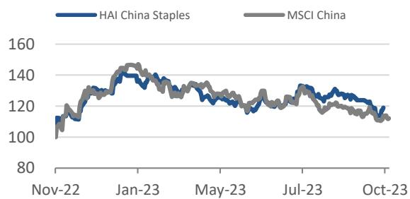  
资料来源： Factset, HTI

## Related Reports

HTI 消费品 10 月需求月报：乳制品和调味品需求略好于预期（Demandfor Dairy Products and Seasonings Slightly Better than Expected） (1 Nov2023)

乳制品行业深度报告：新时期寻找新价值（Searching for New Value inthe New Era） (20 Oct 2023)

消费行业 10 月投资策略：三季报后或将出现更好买点（Better BuyingPoints may Emerge after the Third Quarter Report） (8 Oct 2023)

[Table\_Author] 闻宏伟 Hongwei Wen

hongwei.wen@htisec.com

肖韦俐 Weili Xiao

wl.xiao@htisec.com

(Please see APPENDIX 1 for English summary)

需求： 月重点跟踪的 个行业中 个保持正增长。实现双位数增长的行业包括餐饮、次高端及以上白酒、速冻食品；个位数增长的行业包括调味品、乳制品、软饮料和啤酒；大众及以下白酒延续明显负增长。与上月相比， 个行业增速加快， 个行业增速放缓。结合上市公司三季报，我们对部分行业进行了修正：增速调低的有次高端及以上白酒、餐饮，调高的有乳制品、调味品。

成本：大包粉连续两月反弹，油脂、油料偏弱运行。10 月多数行业成本出现下行，且期货降幅大于现货。具体来看，铝材现货大跌，纸浆、玻璃在期货端下行 ，在现货端上涨2.7%/1.7%。直接原材料部分，蔬菜领跌 9.1%，棕榈油连续两个月下跌，当月现货、期货跌幅接近 5%，豆粕、大豆、玉米、大麦下跌 5.6%/5.1%/3.0%/2.0%，白糖在高位出现回落，现货、期货跌幅均超 2%；上涨品种中，大包粉价格快速上行 9.3%，小麦、大米期货涨幅达 3.2%/1.9%。

资金：外资连续三个月净流出，食饮陆股通占比再降。截至 10 月底，陆股通资金当月净流出447.9亿元（上月净流出374.6亿元），其中沪股通净流出 232.3 亿元，深股通净流出 215.6 亿元；食品饮料板块市值占比为 5.06%，较上月降低 0.17pct。港股通资金当月净流入 213.9 亿元（上月净流入 503.8 亿元），必需消费板块市值占比为 3.57%，较上月上升 0.11pct。

估值：三大股指对应行业估值三连降。A 股食品饮料行业 PE（TTM）处于 2011 年至 2019 年（较新冠疫情前）的 42%分位（26.4x），子行业分位较低的是肉制品（0%，16.6x）、乳品（0%，19.6x）和保健品（6%，21.4x）。H 股必需性消费行业处于57%分位（20.0x），子行业分位较低的是包装食品（0%，11.5x）、食品添加剂（4%，5.7x）和乳制品（5%，15.2x）。美股日常消费品行业处于68%分位（20.7x）；子行业分位较低的是烟草（11%，10.0x）和食品加工与肉类（29%，17.3x）。

建议： 月观点转向乐观，利好汇集不应忽视。 月 股食品饮料和 H 股必需消费指数分别下跌 2.67%和 1.30%（上证指数/恒生指数分别下跌 ），连续 个月下跌。我们路演发现投资者情绪也降至新低。然而物极必反，否极泰来，一些积极因素也在不断汇集。比如三季度乳制品和调味品需求略好于我们的预期；多数产品期货成本指数月度环比明显下降； 股食品饮料行业 年内首次降至 11 年至 19 年的 50%分位以下；贵州茅台、康师傅等龙头企业超预期提价。主要行业排序为：乳制品=啤酒=高端白酒>调味品 方便食饮 养殖业 饲料 运动鞋服 餐饮 区域性白酒 次高端白酒。建议关注个股为伊利股份、蒙牛乳业、中国飞鹤、现代牧业、华润啤酒、贵州茅台、山西汾酒、迎驾贡酒、双汇发展、康师傅、圣农发展、石头科技、宋城演艺、安踏体育、欧派家居等。

风险提示：消费恢复不及预期，原材料价格反弹，人民币贬值。

陈子叶 Susie Chen

susie.zy.chen@htisec.com

## 1 2023 年 10 月消费行业基本面分析

1.1 消费行业收入预测  
表1 HTI 消费行业收入预测（亿元）

<table><tr><td rowspan="2">统计区间</td><td colspan="8">HTI消费行业收入预测(亿元)</td></tr><tr><td>次高端及以上白酒</td><td>大众及以下白酒</td><td>乳制品</td><td>啤酒</td><td>调味品</td><td>速冻食品</td><td>软饮料</td><td>餐饮</td></tr><tr><td>8月营收</td><td>208</td><td>187</td><td>444</td><td>179</td><td>357</td><td>80</td><td>676</td><td>153</td></tr><tr><td>9月营收</td><td>478</td><td>160</td><td>508</td><td>158</td><td>343</td><td>74</td><td>618</td><td>147</td></tr><tr><td>10月营收</td><td>309</td><td>187</td><td>417</td><td>106</td><td>368</td><td>78</td><td>442</td><td>150</td></tr><tr><td>8月同比%</td><td>-14.9%</td><td>-33.2%</td><td>3.8%</td><td>-12.1%</td><td>-6.7%</td><td>-18.0%</td><td>2.4%</td><td>22.9%</td></tr><tr><td>9月同比%</td><td>-16.8%</td><td>-28.6%</td><td>5.8%</td><td>-4.4%</td><td>5.6%</td><td>-13.4%</td><td>2.9%</td><td>16.7%</td></tr><tr><td>10月同比%</td><td>-16.3%</td><td>-24.6%</td><td>3.5%</td><td>-0.8%</td><td>5.8%</td><td>-13.5%</td><td>2.6%</td><td>19.0%</td></tr></table>

资料来源：HTI

据海通国际预测， 月重点跟踪的 个行业中 个保持正增长。实现双位数增长的行业包括餐饮、次高端及以上白酒、速冻食品；个位数增长的行业包括调味品、乳制品、软饮料和啤酒；大众及以下白酒延续明显负增长。与上月相比，4 个行业增速加快， 个行业增速放缓。 月底 股三季报披露完毕，结合上市公司三季度数据，我们对部分行业预测数据进行了修正。其中增速调低的有次高端及以上白酒、餐饮行业，增速调高的有乳制品、调味品行业，其他不变。

次高端及以上白酒行业收入为 309 亿元，同比增长 16.3%。1-10 月累计收入为3156 亿元，同比增长 16.6%。10 月中秋国庆旺季，宴席需求火爆，大众聚饮和送礼有明显恢复，商务宴请相对疲软。多个厂家加大对终端扫码红包和经销商返利，以获取宴席份额。旺季后批价略有回落但总体平稳，压力测试顺利度过。经过旺季消化库存水平环比下降，之后 11-12 月是淡季，仍以消化库存为主。经销商和厂家会进一步完成打款和发货，今年发货速度慢于往年，预期年底库存仍处于较高位置。年底前厂家会和经销商签订来年合同，为 24 年开门红做准备。

大众及以下白酒行业收入为 187 亿元，同比下降 24.6%。1-10 月累计收入为 1902亿元，同比下降 28.0%。今年以来，非头部品牌的大众及以下白酒消费表现低迷，名优酒企陆续聚焦性价比产品，推进渠道下沉，抢抓宴席、聚饮等刚性场景，攫取市场份额。行业挤压式增长下，品牌分化不断加剧，倒逼中小酒企的经销代理发生明显的供给端出清，行业集中度进一步提升。

啤酒行业收入为 106 亿元，同比增长 0.8%。1-10 月累计收入为 1600 亿元，同比增长 6.2%。10 月气温逐步转凉，啤酒行业进入销售淡季，销量环比向下，但在基数压力消退，叠加中秋国庆双节需求集中释放的带动下，行业整体呈小幅增长，我们预计短期渠道仍在消化旺季库存，行业月度销量增速有望平稳回正，产品结构升级下的价增贡献也将持续显现。

图1 次高端及以上白酒行业收入预测（亿元）  
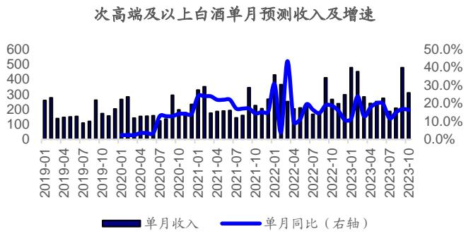  
资料来源：HTI

图2 啤酒行业收入预测（亿元）  
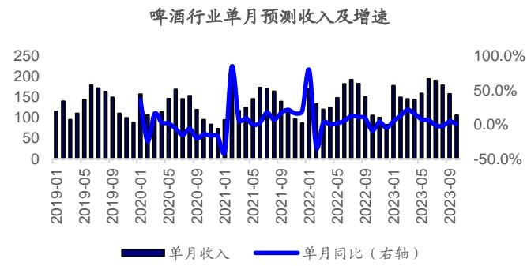  
资料来源：HTI

调味品行业收入为 368 亿元，同比提升 5.8%。1-10 月累计收入为 3536 亿元，同比增长2.5%。10月中秋国庆旺季餐饮表现火爆，节日后回落明显，但环比9月增速持平甚至略好，带动调味品 2B 端需求表现稳健。头部企业预期在今年持续去库存，并在年底和春节前完成渠道去库存的动作，对出货节奏进行优化，与经销商节奏适配，总体出货端将慢于动销端。3Q23 调味品行业整体表现好于预期，受益于基数下行和餐饮恢复，行业最差阶段已经结束。

乳制品行业收入为 417 亿元，同比提升 3.5%。1-10 月累计收入为 4293 亿元，同比增长 4.4%。结合上市公司三季报，液态奶表现好于预期，且九月双节备货表现更为亮眼。虽然双节过后经销商进货意愿有所回落，渠道短期仍在消化旺季库存，10 月环比9月走弱，但此为历年正常现象，乳制品10月同比仍实现低个位数增长，行业整体仍较平稳。考虑去年年尾为低基数，我们预计今年 Q4 行业增长无虞，但鉴于明年春节较晚，乳企或更注重明年开门红。

图3 调味品行业收入预测（亿元）  
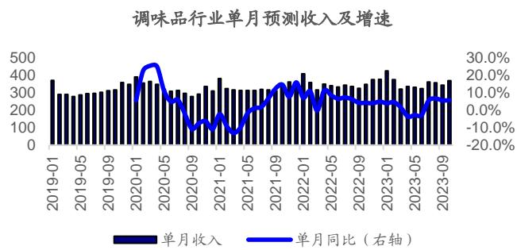  
资料来源：HTI

图4 乳制品行业收入预测（亿元）  
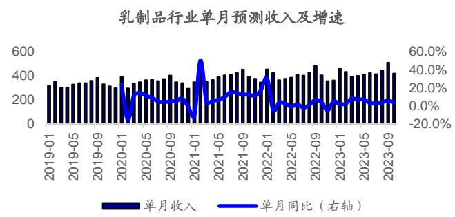  
资料来源：HTI

速冻板块整体收入为 78亿元，单月同比增长 13.5%。1-10月累计收入 842亿元，累计同比增长 17.3%。速冻品进入传统旺季，景气度环比提升。10 月前期下游餐饮需求旺盛，此后回复平稳。我们预计四季度速冻板块有望维持较高景气度水平。

软饮料行业收入为 442 亿元，同比增长 2.6%。1-10 月累计收入为 5679 亿元，同比增长 3.8%。受气温下降及去年行业基数影响，10 月软饮料销售环比降低，同比改善，行业延续渐进式复苏趋势。中长期来看，软饮料具备低价高频消费属性，同时头部品牌陆续推出大瓶装饮料，迎合消费者注重性价比的行为转变，销量增长驱动行业规模提升。

图5 速冻食品行业收入预测（亿元）  
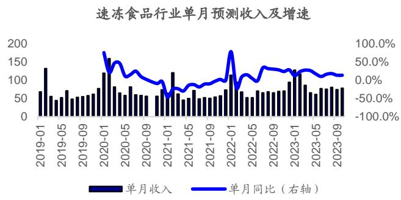  
资料来源：HTI

图6 软饮料行业收入预测（亿元）  
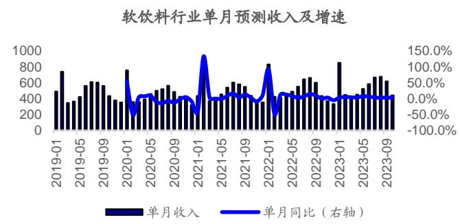  
资料来源：HTI

餐饮上市公司总计收入为150亿元，同比增长19.0%。1-10月累计收入为1416亿元，同比增长 23.8%。10 月前期受到双节带动，餐饮消费翻台率表现亮眼，甚至有超过 2019 年同期的情况。节后，餐饮需求频次有所回落，节假日集中消费态势较为明显。目前餐饮消费普遍客单价表现较弱，未来将保持持续复苏态势。

图7 餐饮行业单月收入预测（亿元）  
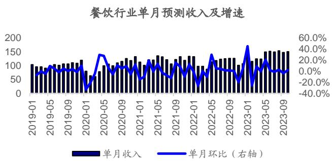  
资料来源：HTI

图8 餐饮行业累计收入预测（亿元）  
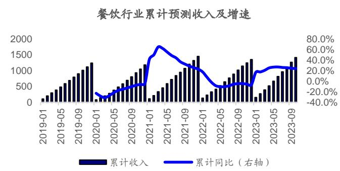  
资料来源：HTI

注：考虑到数据来源口径问题，我们采用环比增速作图来反映行业经营增长情况

表2 HTI 消费品现货成本指数

<table><tr><td rowspan="2" colspan="2">日期</td><td colspan="6">HTI消费品成本指数(现货指数)</td></tr><tr><td>啤酒</td><td>调味品</td><td>乳制品</td><td>方便面</td><td>速冻食品</td><td>软饮料</td></tr><tr><td>基准日</td><td>2023/10/31</td><td>138.98</td><td>123.59</td><td>112.25</td><td>109.33</td><td>125.30</td><td>121.49</td></tr><tr><td>上周</td><td>2023/10/24</td><td>139.49</td><td>123.82</td><td>112.47</td><td>109.31</td><td>125.59</td><td>121.73</td></tr><tr><td>上月</td><td>2023/9/30</td><td>139.30</td><td>125.42</td><td>111.64</td><td>109.86</td><td>126.50</td><td>121.34</td></tr><tr><td>今年年初</td><td>2023/1/1</td><td>130.71</td><td>115.73</td><td>115.61</td><td>113.92</td><td>126.43</td><td>121.16</td></tr><tr><td>去年同期</td><td>2022/10/31</td><td>135.24</td><td>120.13</td><td>118.43</td><td>117.13</td><td>128.52</td><td>124.84</td></tr><tr><td></td><td>较上周</td><td>-0.37%</td><td>-0.19%</td><td>-0.20%</td><td>0.02%</td><td>-0.23%</td><td>-0.20%</td></tr><tr><td></td><td>较上月</td><td>-0.23%</td><td>-1.46%</td><td>0.55%</td><td>-0.48%</td><td>-0.95%</td><td>0.12%</td></tr><tr><td></td><td>较今年年初</td><td>6.32%</td><td>6.79%</td><td>-2.91%</td><td>-4.04%</td><td>-0.89%</td><td>0.27%</td></tr><tr><td></td><td>较去年同期</td><td>2.76%</td><td>2.87%</td><td>-5.22%</td><td>-6.66%</td><td>-2.50%</td><td>-2.69%</td></tr></table>

资料来源：Wind，HTI

截至 10 月 31 日，啤酒成本现货指数为 138.98，啤酒成本期货指数为 138.79。月度来看，较上月同期啤酒成本现货指数下降0.23%，啤酒成本期货指数下降1.36%。中长期看，今年年初以来啤酒成本现货指数提升6.32%，啤酒成本期货指数下降2.26%，较去年同期，啤酒成本现货指数提升 2.76%，啤酒成本期货指数提升 5.11%。

调味品成本现货指数为 123.59，调味品成本期货指数为 128.24。月度来看，较上月同期调味品成本现货指数下降1.46%，调味品成本期货指数下降2.37%。中长期看，今年年初以来调味品成本现货指数提升6.79%，调味品成本期货指数下降0.31%，较去年同期，调味品成本现货指数提升 2.87%，调味品成本期货指数提升 3.74%。

图9 啤酒行业成本现货指数  
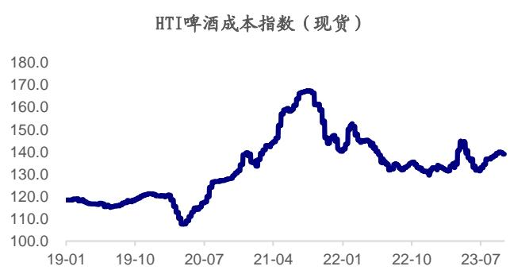  
资料来源：Wind，HTI

图10 调味品行业成本现货指数  
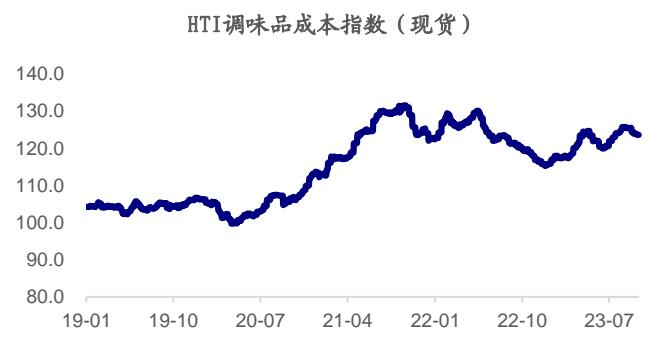  
资料来源：Wind，HTI

乳制品成本现货指数为 112.25，乳制品成本期货指数为 103.36。月度来看，较上月同期乳制品成本现货指数提升0.55%，乳制品成本期货指数下降1.88%。中长期看，今年年初以来乳制品成本现货指数下降2.91%，乳制品成本期货指数下降1.96%，较去年同期，乳制品成本现货指数下降 5.22%，乳制品成本期货指数下降 3.28%。

方便面成本现货指数为 109.33，方便面成本期货指数为 113.72。月度来看，较上月同期方便面成本现货指数下降0.48%，方便面成本期货指数下降1.51%。中长期看，今年年初以来方便面成本现货指数下降 4.04%，方便面成本期货指数下降 10.16%，较去年同期，方便面成本现货指数下降 6.66%，方便面成本期货指数下降 10.25%。

图11 乳制品行业成本现货指数  
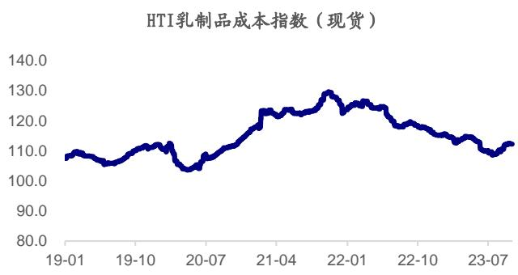  
资料来源：Wind，HTI

图12 方便面行业成本现货指数  
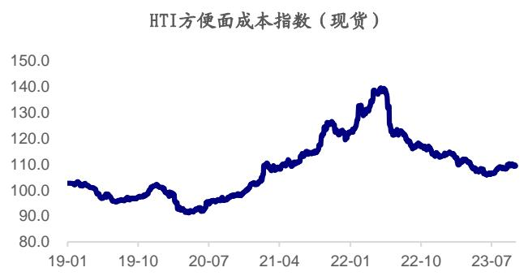  
资料来源：Wind，HTI

速冻食品成本现货指数为 125.3，速冻食品成本期货指数为 122.51。月度来看，较上月同期速冻食品成本现货指数下降0.95%，速冻食品成本期货指数下降0.93%。中长期看，今年年初以来速冻食品成本现货指数下降 0.89%，速冻食品成本期货指数下降 4.77%，较去年同期，速冻食品成本现货指数下降 2.5%，速冻食品成本期货指数下降 7.83%。

软饮料成本现货指数为 121.49，软饮料成本期货指数为 137.35。月度来看，较上月同期软饮料成本现货指数提升0.12%，软饮料成本期货指数下降1.66%。中长期看，今年年初以来软饮料成本现货指数提升0.27%，软饮料成本期货指数下降2.46%，较去年同期，软饮料成本现货指数下降 2.69%，软饮料成本期货指数提升 2.91%。

图13 速冻食品行业成本现货指数  
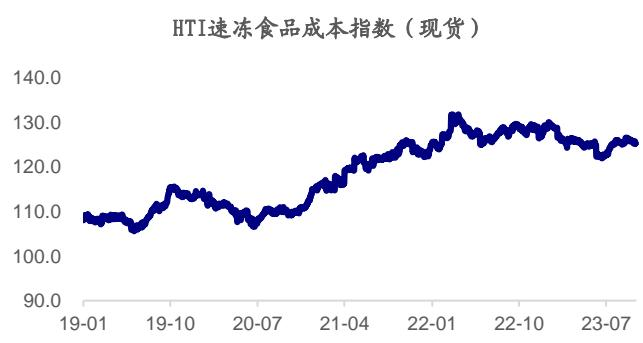  
资料来源：Wind，HTI

图14 软饮料行业成本现货指数  
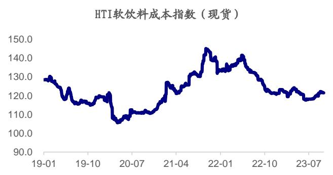  
资料来源：Wind，HTI

## 1.3 消费行业重点新闻

表3 2023 年 10 月消费行业新闻

<table><tr><td>日期</td><td>行业</td><td>标题及链接</td></tr><tr><td>10.8</td><td>乳业</td><td>《婴幼儿配方乳粉产品配方注册管理办法》实施https://mp.weixin.qq.com/s/wLDGlffUo40zAnGzpQSYuw</td></tr><tr><td>10.9</td><td>酒类</td><td>8月河南酒类销售增长21.5%https://www.163.com/dy/article/IGA5E65N0519SQQ7.html</td></tr><tr><td>10.9</td><td>酒饮茶</td><td>前8月四川酒饮茶营收超2211亿https://mp.weixin.qq.com/s/14Le2chxkm7YZlwJYnVUDg</td></tr><tr><td>10.10</td><td>白酒</td><td>贵州新增2.13亿酒类项目https://m.bbtnews.com.cn/article/316765</td></tr><tr><td>10.11</td><td>乳业</td><td>恒天然上调奶价预期https://baijiahao.baidu.com/s?id=1736416871147121495&amp;wfr=spider&amp;for=pc</td></tr><tr><td>10.11</td><td>餐饮</td><td>全国餐饮堂食消费规模较2019年增长254%https://baijiahao.baidu.com/s?id=1779088004005658071&amp;wfr=spider&amp;for=pc</td></tr><tr><td>10.13</td><td>白酒</td><td>10月上旬全国白酒价格指数下跌https://overseas.weibo.com/detail/4956073346990811</td></tr><tr><td>10.18</td><td>白酒</td><td>贵州遵义预计到2025年全市白酒产值在2500亿以上https://baijiahao.baidu.com/s?id=1779906464156693086&amp;wfr=spider&amp;for=pc</td></tr><tr><td>10.19</td><td>乳业</td><td>前三季度牛奶产量增长7.2%https://mp.weixin.qq.com/s/mgZ9Gf3EFczgNnvsoWJMhQ</td></tr><tr><td>10.20</td><td>啤酒</td><td>多地前8月啤酒产量出炉https://baijiahao.baidu.com/s?id=1777364372123695992&amp;wfr=spider&amp;for=pc</td></tr><tr><td>10.20</td><td>白酒</td><td>四川前三季度白酒产量同比下降12.1%https://mp.weixin.qq.com/s/SHZZ9BJ_aGDmTjeoRhkAEw</td></tr><tr><td>10.25</td><td>烟酒</td><td>前9月烟酒类零售总额4026亿https://mp.weixin.qq.com/s/2Ss_APW9L-fBtaEpbQ88Kw</td></tr></table>

资料来源：wind，HTI

1.4 重点公司公告及新闻  
表4 2023 年 10 月消费公司公告

<table><tr><td>日期</td><td>公司</td><td>摘要</td></tr><tr><td>10.9</td><td>汤臣倍健</td><td>汤臣倍健2023年前三季度预计归属上市公司股东的净利润为18.49-19.79亿元,比上年同期增长24.77%-33.55%,归属于上市公司股东的扣除非经常性损益的净利润为17.39-18.79亿元。</td></tr><tr><td>10.11</td><td>五粮液</td><td>上市公司董事会同意全资子公司四川省宜宾普拉斯包装材料有限公司实施绿色功能性食品包装新材料项目(一期)。其中,该项目总投资为7.67亿元,五粮液按照项目总投资额的50%给予资本金支持。</td></tr><tr><td>10.11</td><td>百润股份</td><td>业绩预告:百润股份预计2023年前三季度归属于上市公司股东的净利润约6.4亿元~6.71亿元,同比增长110%~120%;基本每股收益0.61元~0.64元。业绩变动主要原因是,2023年第三季度,公司预调鸡尾酒业务及香精香料业务销售收入继续保持较快增长。2023年前三季度,公司预计归属于上市公司股东的净利润较上年同期增长110%~120%。</td></tr><tr><td>10.14</td><td>燕塘乳业</td><td>业绩预告:7-9月预计实现归属于上市公司股东的净利润约为4458.61万元-5245.42万元,相较去年的2622.71万元,同比增长70%-100%;预计实现扣除非经常性损益后的净利润约为3511.43万元-4131.10万元,相较去年的2065.55万元,同比增长70%-100%;基本每股收益为0.2834元-0.3334元。</td></tr><tr><td>10.17</td><td>盐津铺子</td><td>业绩预告:盐津铺子预计实现净利润为3.91亿元~4.01亿元,净利润同比增长78.70%~83.28%。报告期内,公司多个渠道、多个品类实现快速发展;鹌鹑蛋等新品取得爆发式增长;整体生产成本有所下降。</td></tr><tr><td>10.17</td><td>金徽酒</td><td>金徽酒第三季度实现营业收入4.96亿元,同比增长47.84%;实现归属于上市公司股东的净利润1823.08万元,同比增长884.79%。前三季度营收约20.19亿元,同比增加29.32%;归属于上市公司股东的净利润约2.73亿元,同比增加27.55%。</td></tr><tr><td>10.18</td><td>三元股份</td><td>三元股份公告,艾莱发喜(八喜冰淇淋品牌方)业务增长稳定,市场空间大,为进一步加强对艾莱发喜的管理权和控制权,促进艾莱发喜未来长远发展,同时一揽子实现艾莱宏达对公司的利润补偿,经双方协商,拟将艾莱宏达持有的艾莱发喜剩余5%股权全部减资退出,减资价格依据评估值确定。本次艾莱宏达减资退出后,艾莱发喜成为公司全资子公司。</td></tr><tr><td>10.18</td><td>良品铺子</td><td>良品铺子全资子公司宁波广源聚亿投资有限公司拟将所持宜春赵一鸣食品科技有限公司3%的股权以总计约1.05亿元人民币的价格转让给上海翼嗨企业管理咨询合伙企业、厦门黑逸三号境外连接创业投资合伙企业。交易完成后广源聚亿不再持有赵一鸣股权,在良品铺子合并报表层面当期预计产生约6000万元的投资收益。</td></tr><tr><td>10.19</td><td>珠江啤酒</td><td>2023年前三季度,珠江啤酒实现营业收入45.51亿元,同比增长10.71%;实现净利润6.43亿元,同比增长12.78%。第三季度,公司实现营业收入17.78亿元,同比增长5.94%;实现净利润2.77亿元,同比增长8.03%。</td></tr><tr><td>10.23</td><td>贵州茅台</td><td>贵州茅台在1-9月实现营业收入1032.68亿元,同比增长18.48%;净利润为528.76亿元,同比增长19.09%。贵州茅台历史上首次在前三季度就实现千亿营收,归属于上市公司股东的净利润也突破500亿大关,接近2021年整年的营收和利润水平。</td></tr><tr><td>10.26</td><td>汤臣倍健</td><td>前三季度,汤臣倍健实现营业收入77.82亿元,同比增长26.34%;归属于上市公司股东的净利润19.01亿元,同比增长28.28%。第三季度,公司实现营收21.86亿元,同比增长12.75%;归母净利润为3.56亿元,同比下降17.96%。在主营业务收入中,境内业务方面:主品牌“汤臣倍健”实现收入45.11亿元,同比增长30.38%;“健力多”品牌实现收入9.96亿元,同比下降1.83%;“Life-Space”国内产品实现收入3.84亿元,同比增长51.96%。</td></tr></table>

资料来源：wind，HTI

表5 2023 年 10 月消费公司新闻

<table><tr><td>日期</td><td>公司</td><td>标题及链接</td></tr><tr><td>10.9</td><td>蒙牛乳业</td><td>蒙牛推出优益C畅快新品http://zjnews.china.com.cn/yuanchuan/2023-09-22/391902.html</td></tr><tr><td>10.10</td><td>中国飞鹤</td><td>飞鹤率先推出国内首款HMO奶粉https://mp.weixin.qq.com/s/Yp1m2-8-r-s1HTnkGznE7Q</td></tr><tr><td>10.10</td><td>百威亚太</td><td>百威推出首款有机啤酒https://www.foodtalks.cn/news/48556</td></tr><tr><td>10.16</td><td>青岛啤酒</td><td>青岛啤酒50亿建威士忌厂区https://baijiahao.baidu.com/s?id=1779610195958952467&amp;wfr=spider&amp;for=pc</td></tr><tr><td>10.17</td><td>燕京啤酒</td><td>燕京啤酒21亿项目落户桂林https://baijiahao.baidu.com/s?id=1779713942278933318&amp;wfr=spider&amp;for=pc</td></tr><tr><td>10.19</td><td>珠江啤酒</td><td>珠啤发布9.32亿扩产项目https://www.163.com/dy/article/IH6N2SF30534A4SC.html</td></tr><tr><td>10.19</td><td>瑞幸咖啡</td><td>“瑞幸咖啡年底门店数将突破1.5万家https://news.cnstock.com/news,bwkx-202310-5136224.htm</td></tr><tr><td>10.20</td><td>宝立食品</td><td>宝立食品和百胜中国合作获批准https://www.junhe.com/deals/709</td></tr><tr><td>10.23</td><td>库迪咖啡</td><td>钱治亚提出库迪2025年门店要达2万家https://www.cnstock.com/v_company/scp_gsxw/202310/5138372.htm</td></tr><tr><td>10.24</td><td>蜜雪冰城</td><td>蜜雪冰城在全球共有3.2万家店http://www.myzaker.com/article/653226178e9f0901894f3be9</td></tr></table>

资料来源：wind，HTI

## 2 消费行业资金流向跟踪

## 2.1 A 股产业资本及解禁资金跟踪

从行业来看，23 年 10 月建筑和银行行业净增持额最大，分别为 11.29 和 4.79 亿元，净增减持额/自由流通市值分别为 0.16%和 0.02%；医药和电子行业净减持额最大，分别为 21.42 和 20.1 亿元，净增减持额/自由流通市值分别为-0.06%和-0.06%。

图15 2023 年 10 月行业净增持额&净增持额/自由流通市值  
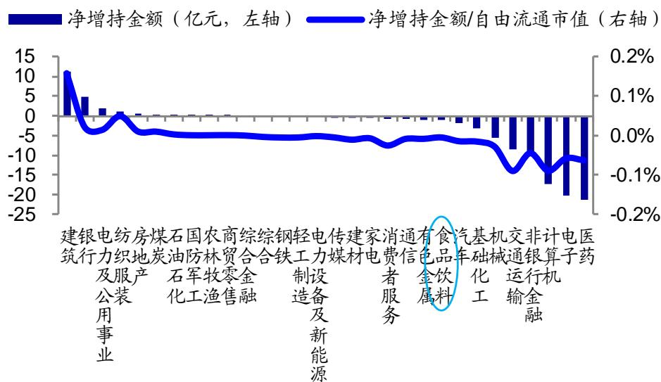  
资料来源：wind，海通国际策略组，HTI，数据截至 2023年 10月 31日

表6 2023 年 10 月产业资本增减持个股

<table><tr><td>个股</td><td>增减持市值(亿元)</td><td>占流通市值比(%)</td></tr><tr><td>三只松鼠</td><td>-0.84</td><td>-2.59</td></tr><tr><td>东鹏饮料</td><td>-0.59</td><td>-0.32</td></tr><tr><td>李子园</td><td>-0.42</td><td>-1.49</td></tr><tr><td>金字火腿</td><td>-0.38</td><td>-1.14</td></tr><tr><td>祖名股份</td><td>-0.07</td><td>-0.68</td></tr><tr><td>嘉必优</td><td>0.01</td><td>0.05</td></tr><tr><td>克明食品</td><td>0.01</td><td>0.07</td></tr><tr><td>中信尼雅</td><td>0.44</td><td>1.14</td></tr><tr><td>妙可蓝多</td><td>0.67</td><td>1.52</td></tr></table>

资料来源：wind，海通国际策略组，HTI

按照 23 年 10 月 31 日的股价估算：11 月非银行金融、电子、医药等行业解禁金额最大，解禁金额分别为 738、220、200 亿元，解禁市值/自由流通市值分别为3.31%、0.63%、0.59%。

图16 2023 年 10 月各行业解禁市值&解禁市值/自由流通市值  
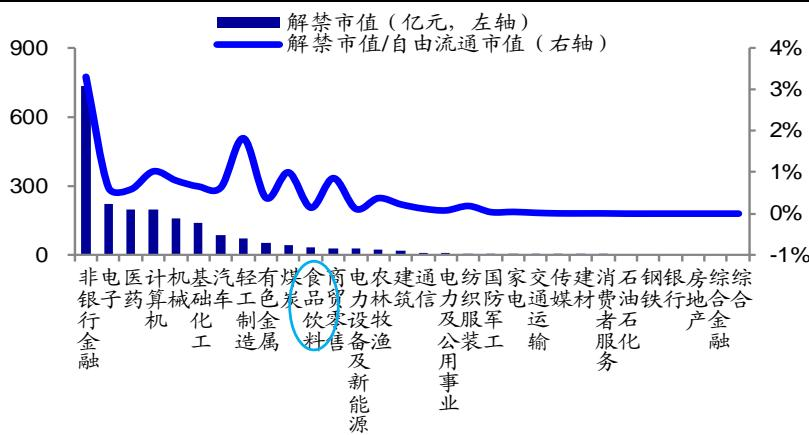  
资料来源：wind，海通国际策略组，HTI，数据截至 2023年 10月 31日

表7 2023 年 11 月食品饮料板块解禁个股

<table><tr><td>个股</td><td>解禁市值(亿元)</td><td>占总市值比(%)</td></tr><tr><td>仲景食品</td><td>24.17</td><td>55.9%</td></tr><tr><td>恒顺醋业</td><td>10.89</td><td>9.9%</td></tr></table>

资料来源：wind，海通国际策略组，HT

行业大额买入跟踪：近 5 个交易日排名前 5 的中信一级行业为：银行、综合、钢铁、电力及公用事业、石油石化。

表8 一级行业大额买入与资金流向（20231016-20231020）

<table><tr><td rowspan="2"></td><td colspan="2">大买单成交金额占比</td><td colspan="2">净主动买入金额占比</td></tr><tr><td>5日均值</td><td>5日均值分位数</td><td>5日均值</td><td>5日均值分位数</td></tr><tr><td>银行</td><td>83.3%</td><td>93.9%</td><td>-2.7%</td><td>24.2%</td></tr><tr><td>综合</td><td>81.1%</td><td>93.0%</td><td>-4.8%</td><td>71.3%</td></tr><tr><td>钢铁</td><td>81.0%</td><td>85.2%</td><td>0.3%</td><td>63.5%</td></tr><tr><td>电力及公用事业</td><td>80.5%</td><td>92.2%</td><td>0.9%</td><td>36.1%</td></tr><tr><td>石油石化</td><td>80.0%</td><td>86.9%</td><td>-6.8%</td><td>68.0%</td></tr><tr><td>煤炭</td><td>79.7%</td><td>87.7%</td><td>-4.9%</td><td>57.4%</td></tr><tr><td>房地产</td><td>79.7%</td><td>3.3%</td><td>2.0%</td><td>2.0%</td></tr><tr><td>综合金融</td><td>79.2%</td><td>21.7%</td><td>-4.3%</td><td>93.9%</td></tr><tr><td>建筑</td><td>78.7%</td><td>18.9%</td><td>-5.8%</td><td>33.6%</td></tr><tr><td>非银行金融</td><td>78.7%</td><td>50.0%</td><td>-0.2%</td><td>62.3%</td></tr><tr><td>有色金属</td><td>78.3%</td><td>89.3%</td><td>2.1%</td><td>64.3%</td></tr><tr><td>交通运输</td><td>78.3%</td><td>13.1%</td><td>-6.3%</td><td>16.0%</td></tr><tr><td>商贸零售</td><td>78.2%</td><td>51.2%</td><td>-4.1%</td><td>84.4%</td></tr><tr><td>纺织服装</td><td>77.8%</td><td>100.0%</td><td>-6.3%</td><td>26.6%</td></tr><tr><td>家电</td><td>77.1%</td><td>100.0%</td><td>-6.2%</td><td>98.8%</td></tr><tr><td>建材</td><td>77.0%</td><td>14.8%</td><td>-2.6%</td><td>0.4%</td></tr><tr><td>电力设备及新能源</td><td>76.8%</td><td>73.4%</td><td>3.2%</td><td>57.0%</td></tr><tr><td>农林牧渔</td><td>76.6%</td><td>89.3%</td><td>-5.2%</td><td>73.0%</td></tr><tr><td>基础化工</td><td>76.1%</td><td>75.0%</td><td>-2.5%</td><td>33.6%</td></tr><tr><td>机械</td><td>75.0%</td><td>99.2%</td><td>-6.3%</td><td>64.3%</td></tr><tr><td>汽车</td><td>75.0%</td><td>100.0%</td><td>-3.0%</td><td>100.0%</td></tr><tr><td>消费者服务</td><td>74.9%</td><td>9.8%</td><td>-6.9%</td><td>85.7%</td></tr><tr><td>传媒</td><td>74.7%</td><td>26.2%</td><td>-9.9%</td><td>73.8%</td></tr><tr><td>轻工制造</td><td>74.5%</td><td>54.1%</td><td>-8.1%</td><td>8.2%</td></tr><tr><td>医药</td><td>73.9%</td><td>85.2%</td><td>-5.2%</td><td>95.9%</td></tr><tr><td>通信</td><td>73.2%</td><td>48.0%</td><td>-10.5%</td><td>84.0%</td></tr><tr><td>计算机</td><td>73.1%</td><td>100.0%</td><td>-9.9%</td><td>98.8%</td></tr><tr><td>国防军工</td><td>72.6%</td><td>0.8%</td><td>-8.5%</td><td>89.8%</td></tr><tr><td>电子</td><td>72.3%</td><td>100.0%</td><td>-8.7%</td><td>100.0%</td></tr><tr><td>食品饮料</td><td>66.7%</td><td>4.9%</td><td>-1.7%</td><td>100.0%</td></tr></table>

资料来源:Wind，海通国际金工组，HT

截至 2023 年 10 月 29 日，计算机、消费者服务、汽车、传媒和纺织服装的行业拥挤度相对较高，纺织服装和基础化工的行业拥挤度上升幅度相对较大。

表9 行业拥挤度情况

<table><tr><td>行业名称</td><td>20231027 拥挤度</td><td>20231020 拥挤度</td><td>拥挤度变化</td></tr><tr><td>计算机</td><td>0.75</td><td>0.82</td><td>(0.07)</td></tr><tr><td>消费者服务</td><td>0.63</td><td>0.54</td><td>0.09</td></tr><tr><td>汽车</td><td>0.61</td><td>0.71</td><td>(0.11)</td></tr><tr><td>传媒</td><td>0.56</td><td>0.54</td><td>0.02</td></tr><tr><td>纺织服装</td><td>0.55</td><td>(0.19)</td><td>0.75</td></tr><tr><td>电子</td><td>0.48</td><td>0.47</td><td>0.01</td></tr><tr><td>机械</td><td>0.30</td><td>0.02</td><td>0.28</td></tr><tr><td>轻工制造</td><td>0.27</td><td>0.10</td><td>0.17</td></tr><tr><td>建筑</td><td>0.19</td><td>0.08</td><td>0.10</td></tr><tr><td>食品饮料</td><td>0.19</td><td>0.35</td><td>(0.16)</td></tr><tr><td>国防军工</td><td>0.12</td><td>0.15</td><td>(0.03)</td></tr><tr><td>石油石化</td><td>0.10</td><td>0.14</td><td>(0.04)</td></tr><tr><td>商贸零售</td><td>0.08</td><td>(0.39)</td><td>0.47</td></tr><tr><td>医药</td><td>0.08</td><td>(0.28)</td><td>0.36</td></tr><tr><td>钢铁</td><td>0.06</td><td>(0.05)</td><td>0.11</td></tr><tr><td>非银行金融</td><td>0.01</td><td>0.44</td><td>(0.43)</td></tr><tr><td>通信</td><td>(0.14)</td><td>0.04</td><td>(0.18)</td></tr><tr><td>农林牧渔</td><td>(0.15)</td><td>(0.56)</td><td>0.41</td></tr><tr><td>电力设备及新能源</td><td>(0.15)</td><td>(0.29)</td><td>0.14</td></tr><tr><td>综合</td><td>(0.17)</td><td>(0.47)</td><td>0.30</td></tr><tr><td>银行</td><td>(0.21)</td><td>0.01</td><td>(0.22)</td></tr><tr><td>煤炭</td><td>(0.31)</td><td>(0.20)</td><td>(0.12)</td></tr><tr><td>交通运输</td><td>(0.35)</td><td>(0.68)</td><td>0.33</td></tr><tr><td>房地产</td><td>(0.35)</td><td>0.13</td><td>(0.48)</td></tr><tr><td>电力及公用事业</td><td>(0.39)</td><td>(0.87)</td><td>0.48</td></tr><tr><td>基础化工</td><td>(0.44)</td><td>(0.95)</td><td>0.51</td></tr><tr><td>家电</td><td>(0.52)</td><td>(0.27)</td><td>(0.26)</td></tr><tr><td>建材</td><td>(0.60)</td><td>(0.48)</td><td>(0.12)</td></tr><tr><td>有色金属</td><td>(0.61)</td><td>(0.71)</td><td>0.09</td></tr></table>

资料来源：Wind，海通国际金工组，HTI

## 2.2 陆股通资金跟踪

截至 2023 年 10 月 31 日，陆股通资金当月净流出 447.9 亿元（上月净流出 374.6亿元），其中沪股通净流出 232.3 亿元，深股通净流出 215.6 亿元；食品饮料板块市值占比为 5.06%，较上月降低 0.17pct。

图17 陆股通每月净流入情况（亿元）  
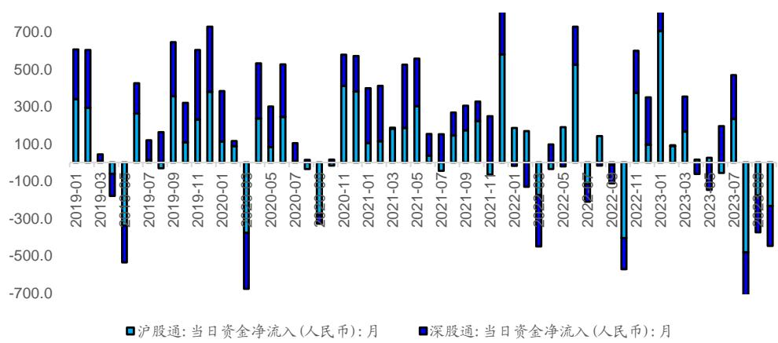  
资料来源：wind，HTI，数据截至 2023 年 10 月 31 日

图18 食饮板块陆股通持股市值占比  
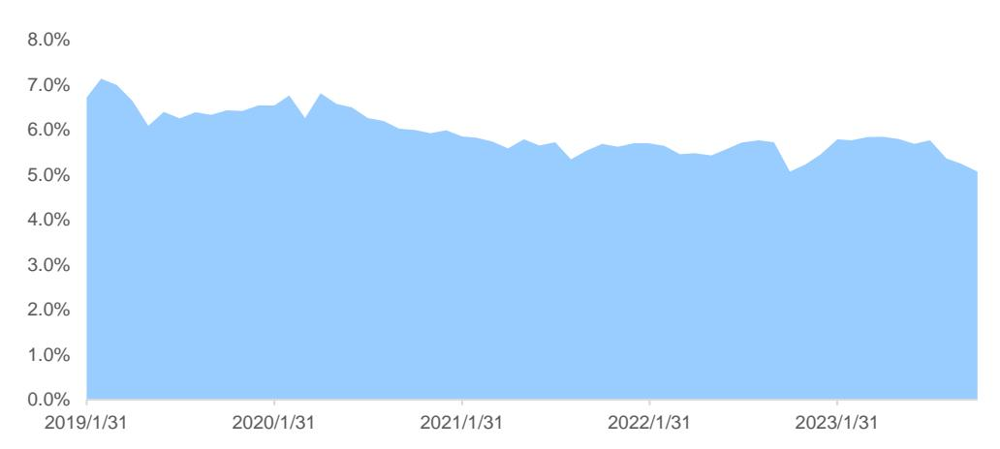  
资料来源：wind，HTI，数据截至 2023 年 10 月 31 日

乳品行业陆股通占比为 8.77%，在食品饮料子行业中受北向资金支持比例最大；陆股通持股占比靠后的子行业分别为其他酒类（0.87%）和熟食（1.25%）。软饮料月末较月初再度增持最多（0.20pct），月末陆股通市值占比为 2.07%；熟食月末较月初减持最多（-0.37pct），月末陆股通市值占比为 1.25%。

图19 食饮子板块陆股通持股市值占比月初月末对比  
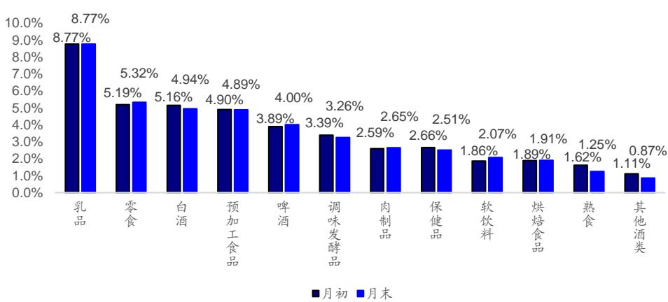  
资料来源：wind，HTI，数据截至 2023 年 10 月 31 日

从陆股通持股标的来看，按市值排名的十大个股中，持股比例居前的分别为贵州茅台（6.7%）、五粮液（5.0%）、泸州老窖（3.4%）；按陆股通持股比例排名，洽洽食品（16.7%）陆股通占比最高，伊利股份（13.3%）和安井食品（10.1%）次之。其中，佳禾食品陆股通月末较月初减持最多（-1.23pct），中炬高新陆股通增持最多（0.62pct）。

表10 食饮板块陆股通持股情况

<table><tr><td colspan="5">总市值排名</td><td colspan="5">陆股通持股占比排名</td></tr><tr><td></td><td>证券简称</td><td>月末持股占比(%)</td><td>月初持股占比(%)</td><td>持股变化(pct)</td><td></td><td>证券简称</td><td>月末持股占比(%)</td><td>月初持股占比(%)</td><td>持股变化(pct)</td></tr><tr><td>1</td><td>贵州茅台</td><td>6.7</td><td>6.9</td><td>-0.22</td><td>1</td><td>洽洽食品</td><td>16.7</td><td>17.6</td><td>-0.97</td></tr><tr><td>2</td><td>五粮液</td><td>5.0</td><td>5.2</td><td>-0.2</td><td>2</td><td>伊利股份</td><td>13.3</td><td>13.7</td><td>-0.37</td></tr><tr><td>3</td><td>泸州老窖</td><td>3.4</td><td>3.5</td><td>-0.14</td><td>3</td><td>安井食品</td><td>10.1</td><td>10.4</td><td>-0.30</td></tr><tr><td>4</td><td>山西汾酒</td><td>1.9</td><td>2.1</td><td>-0.22</td><td>4</td><td>佳禾食品</td><td>8.2</td><td>9.4</td><td>-1.23</td></tr><tr><td>5</td><td>海天味业</td><td>3.9</td><td>4.0</td><td>-0.13</td><td>5</td><td>东鹏饮料</td><td>7.4</td><td>6.8</td><td>0.56</td></tr><tr><td>6</td><td>洋河股份</td><td>2.3</td><td>2.3</td><td>0</td><td>6</td><td>重庆啤酒</td><td>7.0</td><td>6.7</td><td>0.33</td></tr><tr><td>7</td><td>伊利股份</td><td>13.3</td><td>13.7</td><td>-0.37</td><td>7</td><td>贵州茅台</td><td>6.7</td><td>6.9</td><td>-0.22</td></tr><tr><td>8</td><td>古井贡酒</td><td>1.6</td><td>1.7</td><td>-0.1</td><td>8</td><td>涪陵榨菜</td><td>6.0</td><td>6.1</td><td>-0.04</td></tr><tr><td>9</td><td>青岛啤酒</td><td>3.4</td><td>3.5</td><td>-0.08</td><td>9</td><td>中炬高新</td><td>5.4</td><td>4.8</td><td>0.62</td></tr><tr><td>10</td><td>双汇发展</td><td>3.5</td><td>3.4</td><td>0.1</td><td>10</td><td>五粮液</td><td>5.0</td><td>5.2</td><td>-0.20</td></tr></table>

资料来源：wind，HTI，数据截至 2023 年 10 月 31 日

## 2.3 港股通跟踪

截至 2023 年 10 月 31 日，港股通资金当月净流入 213.9 亿元（上月净流入 503.8亿元），必需消费板块市值占比为 3.57%，较上月上升 0.11pct。

图20 港股通每月净流入情况（亿元）  
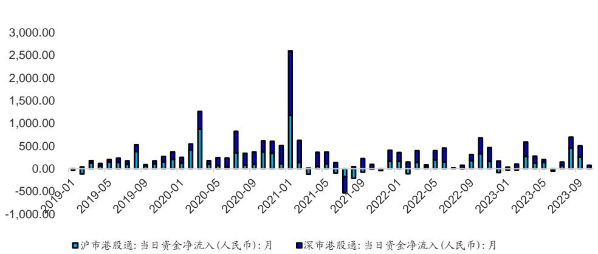  
资料来源：wind，HTI，数据截至 2023 年 10 月 31 日

图21 必需消费板块港股通持股市值占比  
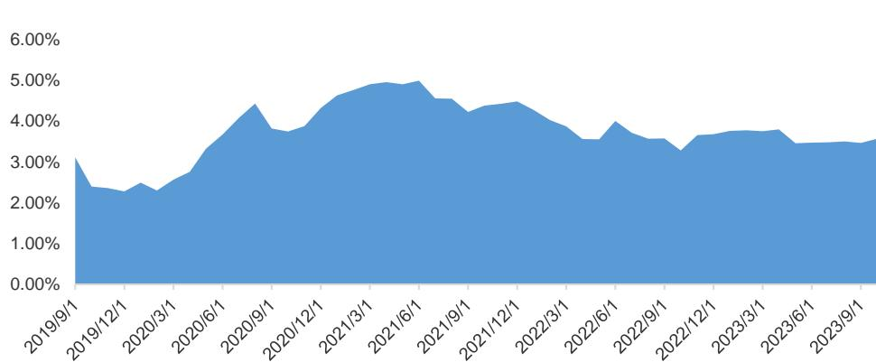  
资料来源：wind，HTI，数据截至 2023 年 10 月 31 日

食品添加剂行业港股通占比为 10.46%，较月初增持 0.39pct；酒精饮料港股通市值占比为 6.11%，排名次之；港股通持股占比靠后的子行业分别为非酒精饮料（0.56%）、包装食品（2.11%）和乳制品（5.06%）。

图22 食饮子板块港股通持股市值占比月初月末对比  
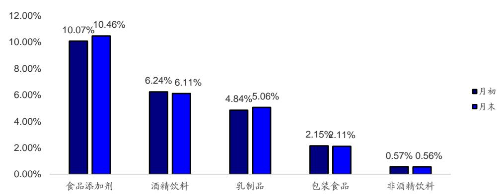  
资料来源：wind，HTI，数据截至 2023 年 10 月 31 日

上月港股通持股标的中，按市值排名的十大个股中，港股通持股比例居前的分别为农夫山泉（1.1%）、百威亚太（0.2%）、华润啤酒（12.7%）；按港股通持股比例排名，青岛啤酒（24.0%）港股通比例最高，周黑鸭（20.6%）和华宝国际（20.1%）次之。

表11 食饮板块港股通持股情况

<table><tr><td colspan="5">总市值排名</td><td colspan="5">港股通持股占比排名</td></tr><tr><td></td><td>证券简称</td><td>月末持股占比(%)</td><td>月初持股占比(%)</td><td>持股变化(pct)</td><td></td><td>证券简称</td><td>月末持股占比(%)</td><td>月初持股占比(%)</td><td>持股变化(pct)</td></tr><tr><td>1</td><td>农夫山泉</td><td>1.1</td><td>1.2</td><td>-0.04</td><td>1</td><td>青岛啤酒</td><td>24.0</td><td>24.8</td><td>-0.82</td></tr><tr><td>2</td><td>百威亚太</td><td>0.2</td><td>0.2</td><td>0.00</td><td>2</td><td>周黑鸭</td><td>20.6</td><td>20.7</td><td>-0.13</td></tr><tr><td>3</td><td>华润啤酒</td><td>12.7</td><td>12.7</td><td>-0.05</td><td>3</td><td>华宝国际</td><td>20.1</td><td>20.1</td><td>0.08</td></tr><tr><td>4</td><td>青岛啤酒</td><td>24.0</td><td>24.8</td><td>-0.82</td><td>4</td><td>华润啤酒</td><td>12.7</td><td>12.7</td><td>-0.05</td></tr><tr><td>5</td><td>蒙牛乳业</td><td>3.5</td><td>3.4</td><td>0.07</td><td>5</td><td>颐海国际</td><td>10.5</td><td>10.0</td><td>0.52</td></tr><tr><td>6</td><td>康师傅</td><td>0.9</td><td>0.8</td><td>0.04</td><td>6</td><td>优然牧业</td><td>8.4</td><td>8.4</td><td>0.05</td></tr><tr><td>7</td><td>中国旺旺</td><td>0.1</td><td>0.1</td><td>0.01</td><td>7</td><td>中国飞鹤</td><td>8.6</td><td>8.3</td><td>0.29</td></tr><tr><td>8</td><td>中国飞鹤</td><td>8.6</td><td>8.3</td><td>0.29</td><td>8</td><td>中烟香港</td><td>8.1</td><td>8.0</td><td>0.03</td></tr><tr><td>9</td><td>统一</td><td>0.6</td><td>0.5</td><td>0.13</td><td>9</td><td>阜丰集团</td><td>7.8</td><td>7.6</td><td>0.19</td></tr><tr><td>10</td><td>颐海国际</td><td>10.5</td><td>10.0</td><td>0.52</td><td>10</td><td>现代牧业</td><td>7.2</td><td>7.2</td><td>0.02</td></tr></table>

资料来源：wind，HTI，数据截至 2023 年 10 月 31 日

## 3 历史行情

## 3.1 A 股行业涨跌幅表现

从A股一级行业涨跌幅来看，10月份电子、汽车和医药生物涨幅居前，分别上涨3.9%、2.0%和 1.7%，社会服务（-6.1%）和机械设备（-4.4%）跌幅领先。食品饮料收跌 1.2%，在 31 个行业分类中位居第 11 名，较上月（-1.0%）前进 9 名。

图23 A 股一级行业涨跌幅（%）  
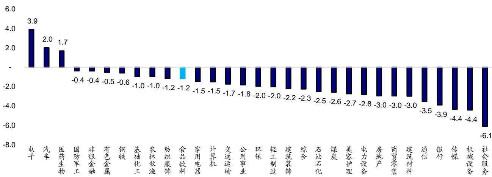  
资料来源：wind，HTI，数据截至 2023 年 10 月 31 日

10 月食饮子行业涨跌互现，软饮料（2.6%）和零食（2.4%）涨幅领先，但啤酒、乳品和其他酒类跌幅超过 3%。

图24 A 股食饮子行业涨跌幅（%）  
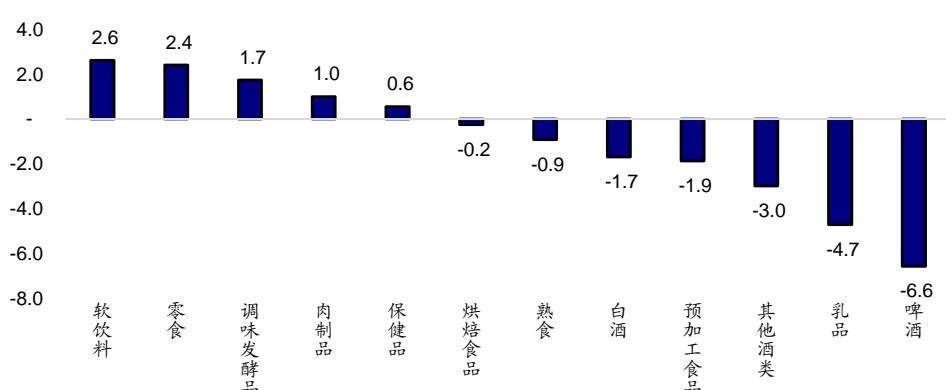  
-资料来源：wind，HTI，数据截至 2023 年 10 月 31 日

表12 A 股食饮板块个股涨跌幅

<table><tr><td colspan="5">按市值排序</td><td colspan="5">按涨幅排序</td></tr><tr><td></td><td>证券简称</td><td>最新市值 (亿元)</td><td>最新收盘价 (元)</td><td>相对月初涨 跌幅(%)</td><td></td><td>证券简称</td><td>最新市值 (亿元)</td><td>最新收盘价 (元)</td><td>相对月初涨 跌幅(%)</td></tr><tr><td>1</td><td>贵州茅台</td><td>21162</td><td>1685</td><td>-6.3</td><td>1</td><td>莲花健康</td><td>128</td><td>7</td><td>18.9</td></tr><tr><td>2</td><td>五粮液</td><td>6055</td><td>156</td><td>-0.1</td><td>2</td><td>洽洽食品</td><td>188</td><td>37</td><td>13.2</td></tr><tr><td>3</td><td>泸州老窖</td><td>3159</td><td>215</td><td>-0.9</td><td>3</td><td>天味食品</td><td>157</td><td>15</td><td>10.1</td></tr><tr><td>4</td><td>山西汾酒</td><td>3016</td><td>247</td><td>3.2</td><td>4</td><td>盐津铺子</td><td>155</td><td>79</td><td>6.0</td></tr><tr><td>5</td><td>海天味业</td><td>2094</td><td>38</td><td>-0.9</td><td>5</td><td>东鹏饮料</td><td>768</td><td>192</td><td>5.0</td></tr><tr><td>6</td><td>洋河股份</td><td>1839</td><td>122</td><td>-5.6</td><td>6</td><td>安井食品</td><td>379</td><td>129</td><td>4.8</td></tr><tr><td>7</td><td>伊利股份</td><td>1746</td><td>27</td><td>3.4</td><td>7</td><td>迎驾贡酒</td><td>614</td><td>77</td><td>4.3</td></tr><tr><td>8</td><td>古井贡酒</td><td>1274</td><td>279</td><td>2.7</td><td>8</td><td>安琪酵母</td><td>304</td><td>35</td><td>4.1</td></tr><tr><td>9</td><td>青岛啤酒</td><td>949</td><td>84</td><td>-4.4</td><td>9</td><td>桃李面包</td><td>140</td><td>9</td><td>4.0</td></tr><tr><td>10</td><td>双汇发展</td><td>908</td><td>26</td><td>-0.7</td><td>10</td><td>燕京啤酒</td><td>293</td><td>10</td><td>3.4</td></tr></table>

资料来源：wind，HTI，数据截至 2023 年 10 月 31 日

## 3.2 H 股行业涨跌幅表现

10 月份 H 股除工业以外，其他子行业全线收跌，综合企业（-8.6%）、电讯业（-7.1%）跌幅居前。必需性消费（-0.4%）在 12 个一级行业中排名第 2 名，较上个月（-1.9%）前进 7 名。

必需性消费子行业中，超市及便利店（+3.1%）、非酒精饮料（+1.9%）涨幅居前，食品添加剂（-4.1%）和乳制品（-3.1%）跌幅居前。

图25 H 股一级行业涨跌幅（%）  
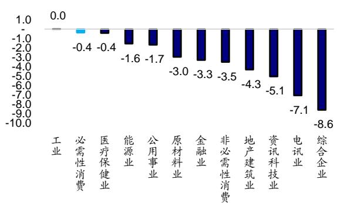  
资料来源： ， ，数据截至 年 月 日

图26 H 股必需消费二级行业涨跌幅（%）  
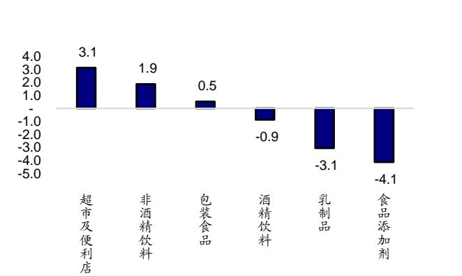  
资料来源： ， ，数据截至 年 月 日（上图剔除了必需消费子行业中的禽畜肉类、禽畜饲料、个人护理、农产品）

表13 恒生食饮板块个股涨跌幅

<table><tr><td colspan="5">按市值排序</td><td colspan="5">按涨幅排序</td></tr><tr><td></td><td>证券简称</td><td>最新市值(亿港元)</td><td>最新收盘价(港元)</td><td>相对月初涨跌幅(%)</td><td></td><td>证券简称</td><td>最新市值(亿港元)</td><td>最新收盘价(港元)</td><td>相对月初涨跌幅(%)</td></tr><tr><td>1</td><td>农夫山泉</td><td>5010</td><td>45</td><td>-1.0</td><td>1</td><td>中国飞鹤</td><td>441</td><td>5</td><td>5.2</td></tr><tr><td>2</td><td>百威亚太</td><td>1971</td><td>15</td><td>-3.8</td><td>2</td><td>颐海国际</td><td>147</td><td>14</td><td>5.2</td></tr><tr><td>3</td><td>华润啤酒</td><td>1343</td><td>41</td><td>-3.6</td><td>3</td><td>卫龙</td><td>171</td><td>7</td><td>3.3</td></tr><tr><td>4</td><td>青岛啤酒</td><td>1034</td><td>59</td><td>-7.5</td><td>4</td><td>VITASOY INT&#x27;L</td><td>103</td><td>10</td><td>1.7</td></tr><tr><td>5</td><td>蒙牛乳业</td><td>1005</td><td>26</td><td>-2.7</td><td>5</td><td>高鑫零售</td><td>157</td><td>2</td><td>-0.6</td></tr><tr><td>6</td><td>康师傅</td><td>585</td><td>10</td><td>-5.1</td><td>6</td><td>农夫山泉</td><td>5010</td><td>45</td><td>-1.0</td></tr><tr><td>7</td><td>中国旺旺</td><td>577</td><td>5</td><td>-4.9</td><td>7</td><td>蒙牛乳业</td><td>1005</td><td>26</td><td>-2.7</td></tr><tr><td>8</td><td>中国飞鹤</td><td>441</td><td>5</td><td>5.2</td><td>8</td><td>统一企业</td><td>230</td><td>5</td><td>-3.1</td></tr><tr><td>9</td><td>珍酒李渡</td><td>372</td><td>11</td><td>-5.3</td><td>9</td><td>华润啤酒</td><td>1343</td><td>41</td><td>-3.6</td></tr><tr><td>10</td><td>统一企业</td><td>230</td><td>5</td><td>-3.1</td><td>10</td><td>百威亚太</td><td>1971</td><td>15</td><td>-3.8</td></tr></table>

资料来源：wind，HTI，数据截至 2023 年 10 月 31 日

## 3.3 美股行业涨跌幅表现

10 月美股一级行业全线收跌，信息技术（-10.4%）、医疗保健（-9.6%）跌幅领先。日常消费品行业下跌 9.3%，在 11 个美股一级行业排第 9 名，较上月（-7.1%）后退 4 名。

日常消费品子行业中，除大卖场与超市上涨 2.0%，其他子行业均收跌，软饮料（-10.5%）和烟草（-9.8%）跌幅居前。

图27 美股一级行业涨跌幅（%）  
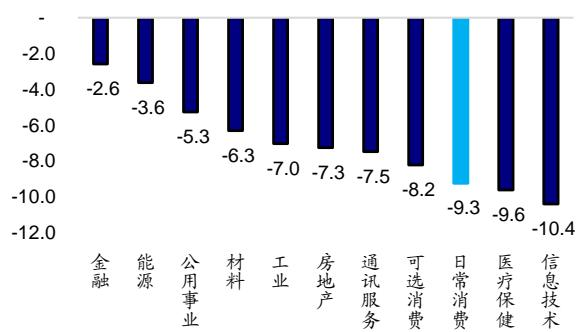  
资料来源：wind，HTI，数据截至 2023 年 10 月 31 日

图28 美股日常消费品行业子板块涨跌幅（%）  
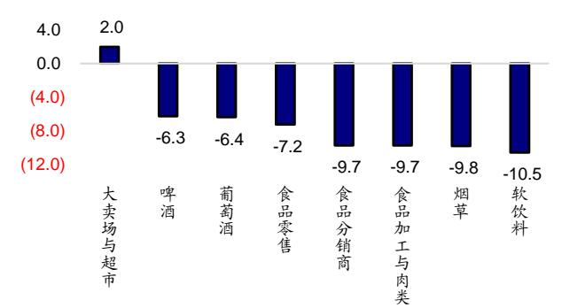  
资料来源：wind，HTI，数据截至 2023年 10月 31日（上图剔除了日常消费品子行业中的家庭用品、个人用品、药品零售、农产品）

本月美股消费板块中小市值公司普遍受到追捧，大部分公司涨幅居前。

表14 美股日常消费板块个股涨跌幅

<table><tr><td colspan="5">按市值排序</td><td colspan="5">按涨幅排序</td></tr><tr><td></td><td>证券简称</td><td>最新市值 (亿美元)</td><td>最新收盘价 (美元)</td><td>相对月初涨跌幅(%)</td><td></td><td>证券简称</td><td>最新市值 (亿美元)</td><td>最新收盘价 (美元)</td><td>相对月初涨跌幅(%)</td></tr><tr><td>1</td><td>沃尔玛</td><td>4398</td><td>163</td><td>2.2</td><td>1</td><td>PILGRIMS PRIDE</td><td>60</td><td>26</td><td>11.7</td></tr><tr><td>2</td><td>帝亚吉欧</td><td>4293</td><td>154</td><td>2.9</td><td>2</td><td>BELLRING BRANDS</td><td>57</td><td>44</td><td>6.1</td></tr><tr><td>3</td><td>开市客</td><td>2446</td><td>552</td><td>-2.2</td><td>3</td><td>FOMENTO ECONOMICO MEXICANO SAB</td><td>406</td><td>113</td><td>3.9</td></tr><tr><td>4</td><td>可口可乐</td><td>2442</td><td>56</td><td>0.9</td><td>4</td><td>通用磨坊</td><td>379</td><td>65</td><td>2.9</td></tr><tr><td>5</td><td>百事</td><td>2245</td><td>163</td><td>-3.6</td><td>5</td><td>帝亚吉欧</td><td>4293</td><td>154</td><td>2.9</td></tr><tr><td>6</td><td>菲利普莫里斯国际</td><td>1384</td><td>89</td><td>-3.7</td><td>6</td><td>百威英博</td><td>988</td><td>57</td><td>2.8</td></tr><tr><td>7</td><td>可口可乐 凡萨瓶装</td><td>1278</td><td>76</td><td>-1.1</td><td>7</td><td>沃尔玛</td><td>4398</td><td>163</td><td>2.2</td></tr><tr><td>8</td><td>百威英博</td><td>988</td><td>57</td><td>2.8</td><td>8</td><td>西斯科</td><td>335</td><td>66</td><td>1.4</td></tr><tr><td>9</td><td>亿滋国际</td><td>901</td><td>66</td><td>-4.6</td><td>9</td><td>克罗格</td><td>326</td><td>45</td><td>1.4</td></tr><tr><td>10</td><td>奥驰亚</td><td>710</td><td>40</td><td>-4.5</td><td>10</td><td>可口可乐</td><td>2442</td><td>56</td><td>0.9</td></tr></table>

资料来源：wind，HTI，数据截至 2023 年 10 月 31 日

## 4 估值水平

## 4.1 A 股行业估值表现

图29 A 股一级行业市盈率（TTM）处于 2011 年以来目前绝对位置（从左至右行业为最新市盈率历史分位从高到低排序）  
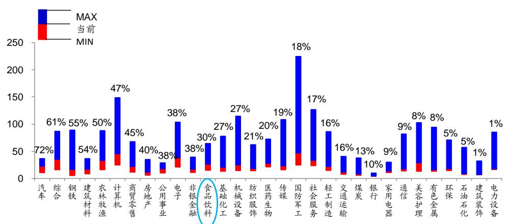  
资料来源：wind，HTI，海通国际策略组，数据截至 2023年 10月 31日

截至 2023 年 10 月 31 日，A 股一级行业中，PE（TTM，下同）历史分位数处于2011 年以来 10%以下的行业有 8 个，包括电力设备、建筑装饰和石油石化等。食品饮料的 PE 历史分位数为 30%（26.4x），较上月末（39%，28.1x）降低 9pct，在 31 个行业中排名第 12 名。

图30 A 股一级行业市盈率（TTM）处于 2011 年至 2019 年以来目前绝对位置（从左至右行业为最新市盈率历史分位从高到低排序）  
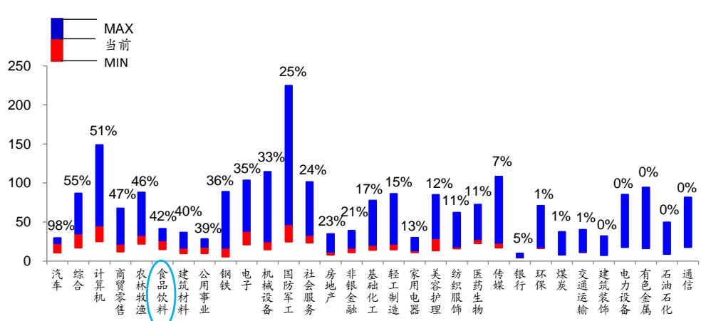  
资料来源：wind，HTI，数据截至 2023 年 10 月 31 日

近期伴随疫情影响的结束，市场经济活动逐步修复，但仍未回归至 2019 年疫情前水平，为排除疫情因素对行业的影响，我们选取了当前 PE 与 2011 年至 2019 年的历史数据进行比较。A股一级行业中 PE历史分位数处于 2011年至 2019年 10%以下的行业有 10 个，其中通信、石油石化和有色金属等行业历史估值最低；食品饮料的 PE历史分位数为 42%，较上月下跌 14pct，在 31 个行业中排名第 6 名。

图31 A 股食饮子行业市盈率（TTM）处于 2011 年以来目前绝对位置（从左至右行业为最新市盈率历史分位从高到低排序）  
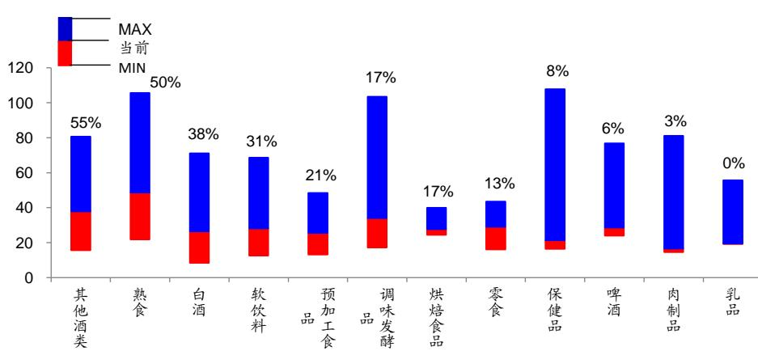  
资料来源：wind，HTI，数据截至 2023 年 10 月 31 日

A 股食品饮料子行业 PE 历史分位数处于 2011 年以来较低的分别为乳品（0%）、肉制品（3%）、啤酒（6%）。PE 绝对值最低的行业分别是肉制品（16.6x）、乳品（19.6x）、保健品（21.4x）。

图32 A 股食饮子行业市盈率（TTM）处于 2011 年至 2019 年以来目前绝对位置（从左至右行业为最新市盈率历史分位从高到低排序）  
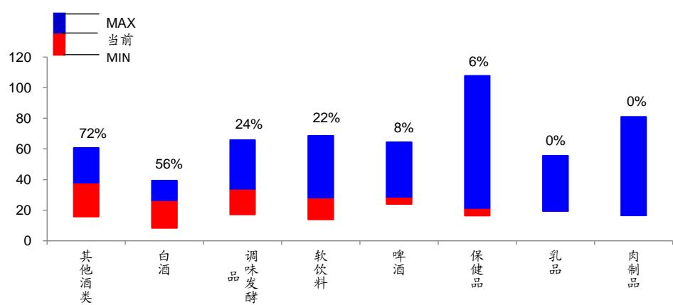  
资料来源：wind，HTI，数据截至 2023 年 10 月 31 日

A股食品饮料子行业中PE历史分位数处于2011年至2019年较低的行业有肉制品（0%）、乳品（0%）和保健品（6%）。

图33 A 股重点公司市盈率（TTM）处于 2011 年以来绝对位置（从左至右行业为最新市盈率历史分位从高到低排序）  
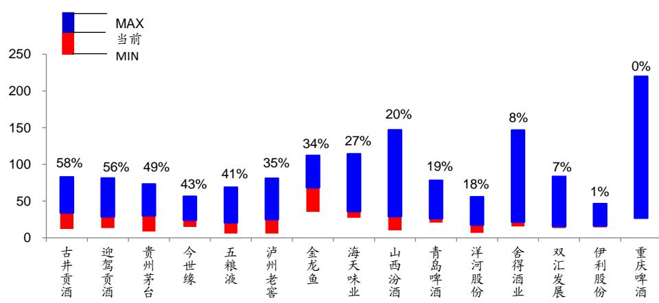  
资料来源：wind，HTI，数据截至 2023 年 10 月 31 日

图34 A 股重点公司市盈率（TTM）处于 2011 年至 2019 年以来绝对位置（从左至右行业为最新市盈率历史分位从高到低排序）  
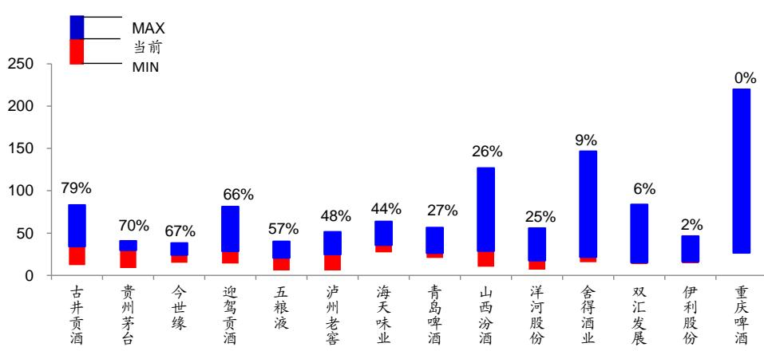  
资料来源：wind，HTI，数据截至 2023 年 10 月 31 日

截至2023年10月31日，A股市场食品饮料板块龙头企业的估值水平有所下降，A 股龙头的估值中位数为 25x（相较 9 月下降 2x）。

图35 A 股食饮板块重点个股（市值前 30）最新估值水平（TTM）  
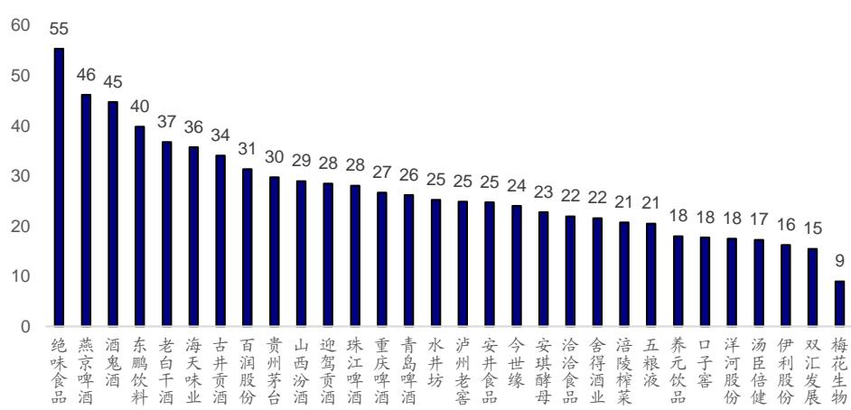  
资料来源： ， ，数据截至 年 月 日，剔除估值为负的顺鑫农业和中炬高新

## 4.2 H 股行业估值表现

图36 H股一级行业市盈率（TTM）处于2011年以来目前绝对位置（从左至右行业为最新市盈率历史分位从高到低排序）  
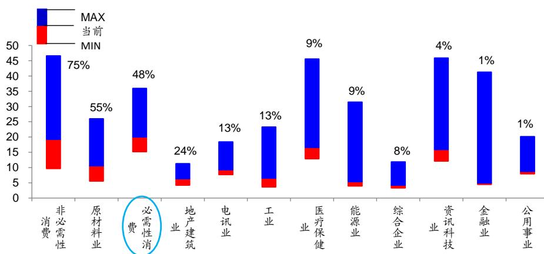  
资料来源：wind，HTI，数据截至 2023 年 10 月 31 日

截至2023年10月31日，H股一级行业PE历史分位数处于2011年以来10%以下的行业有公共事业、金融业、资讯科技业和综合企业等。必需性消费行业 PE 历史分位数为 48%（20.0x），历史分位数与上月末（52%，20.4x）下降 4pct，在 12 个一级行业中排名第 3 名。

图37 H 股一级行业市盈率（TTM）处于 2011 年至 2019 年以来目前绝对位置（从左至右行业为最新市盈率历史分位从高到低排序）  
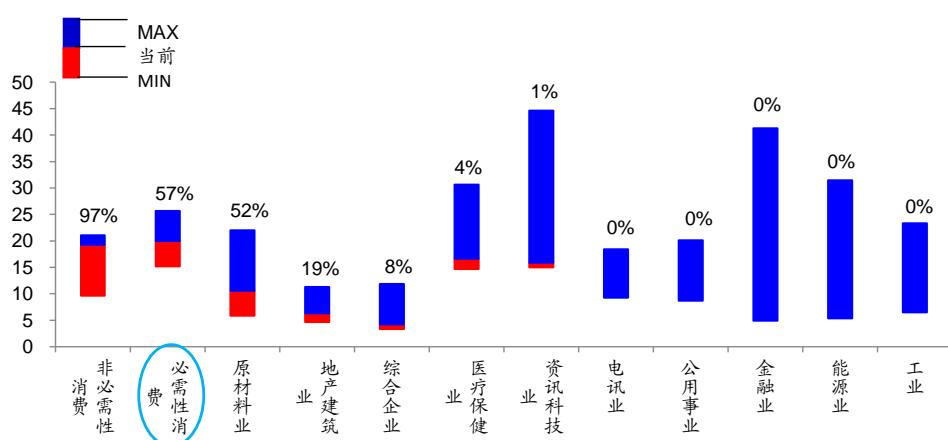  
资料来源：wind，HTI，数据截至 2023 年 10 月 31 日

H股一级行业中PE历史分位数处于2011年至2019年10%以下的行业有工业、能源业、金融业等。必需性消费的 PE 历史分位数为 57%，较上个月下降 4pct，在 12 个行业中排名第 2 名。

图38 H 股必需消费行业子板块市盈率（TTM）处于 2011 年以来目前绝对位置（从左至右行业为最新市盈率历史分位从高到低排序）  
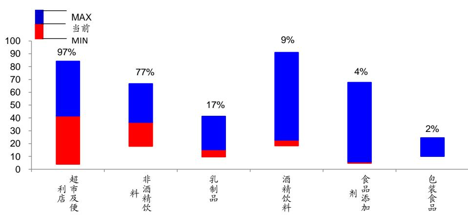  
资料来源：wind，HTI，数据截至 2023 年 10 月 31 日

H 股必需消费行业 PE 历史分位数处于 2011 年以来相对靠后的行业有包装食品（2%）、食品添加剂（4%）、酒精饮料（9%）。PE 绝对值最低的行业分别是食品添加剂（5.7x）和包装食品（11.5x）。

图39 H 股必需消费行业子板块市盈率（TTM）处于 2011 年至 2019 年以来目前绝对位置（从左至右行业为最新市盈率历史分位从高到低排序）  
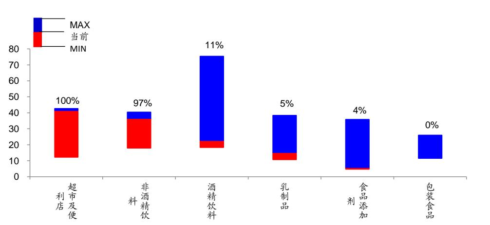  
资料来源：wind，HTI，数据截至 2023 年 10 月 31 日

H股必需消费行业PE历史分位数处于2011年至2019年10%以下的行业有包装食品（0%）、食品添加剂（4%）和乳制品（5%）。

图40 H股重点公司市盈率（TTM）处于2011年以来绝对位置（从左至右行业为最新市盈率历史分位从高到低排序）  
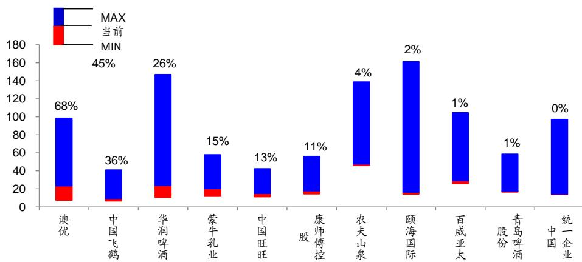  
资料来源：wind，HTI，数据截至 2023年 10月 31日（异常值剔除如下：华润啤酒 201503-201608；蒙牛乳业201703-201803；澳优 201203-201408）

图41 H 股重点公司市盈率（TTM）处于 2011 年至 2019 年以来绝对位置（从左至右行业为最新市盈率历史分位从高到低排序）  
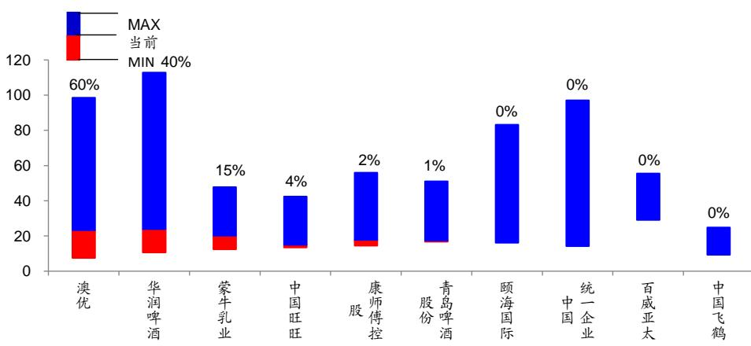  
资料来源：wind，HTI，数据截至 2023年 10月 31日（异常值剔除如下：华润啤酒 201503-201608；蒙牛乳业201703-201803；澳优 201203-201408）

截至 2023 年 10 月 31 日，港股估值中枢保持稳定，H 股食饮龙头（市值前 15）的估值中位数为 16x（相较 9 月持平）。

图42 恒生食饮板块重点个股（市值前 15）最新估值水平（TTM）  
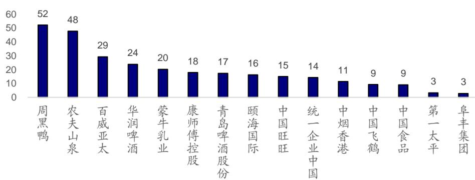  
资料来源：wind，HTI，数据截至 2023年 10月 31日（因达利退市，替换为周黑鸭，样本有所变化）

## 4.3 美股行业估值表现

图43 美股一级行业市盈率（TTM）处于 2011 年以来目前绝对位置（从左至右行业为最新市盈率历史分位从高到低排序）  
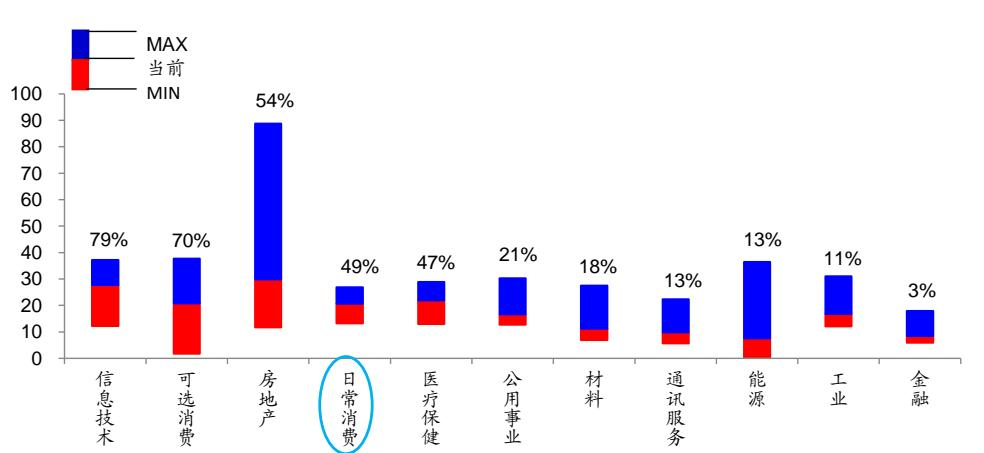  
资料来源：wind，HTI，数据截至 2023 年 10 月 31 日（已剔除房地产行业 2013/03 至 2014/02，2015/4 至2015/11 的异常数据）

截至 2023 年 10 月 31 日，美股一级行业 PE 历史分位数处于 2011 年以来较低的是金融（3%）和工业（11%）。日常消费品的 PE 历史分位数为 49%（20.7x），历史分位数与上月末（64%，21.8x）下降 15pct，在 11 个行业中排名第 4 名。

图44 美股一级行业市盈率（TTM）处于2011年至2019年以来目前绝对位置（从左至右行业为最新市盈率历史分位从高到低排序）  
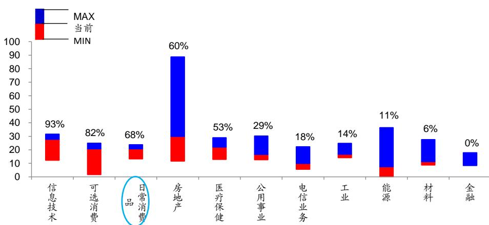  
资料来源：wind，HTI，数据截至 2023 年 10 月 31 日（已剔除房地产行业 2013/03 至 2014/02，2015/4 至2015/11 的异常数据）

美股一级行业 PE 历史分位数处于 2011 年至 2019 年较低行业有金融（0%）、材料（6%）。日常消费品的 PE 历史分位数为 68%，较上月下降 17pct，在 11 个行业中排名第 3 名。

图45 美股日常消费品行业子板块市盈率（TTM）处于 2011 年以来绝对位置（从左至右行业为最新市盈率历史分位从高到低排序）  
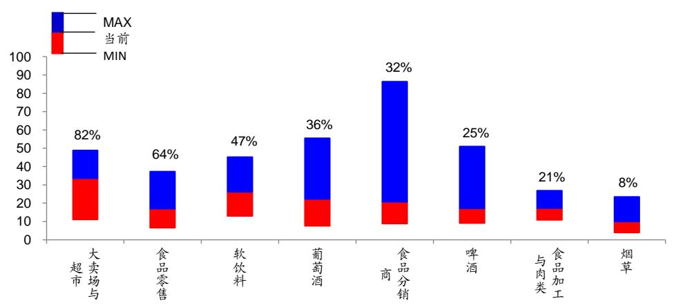  
资料来源：wind，HTI，数据截至 2023 年 10 月 31 日

美股日常消费品行业 PE 历史分位数处于 2011 年以来较低的行业为烟草（8%）、食品加工与肉类（21%）和啤酒（25%）。PE 绝对值最低的行业分别是烟草（10.0x）、食品零售（17.0x）。

图46 美股日常消费品行业子板块市盈率（TTM）处于2011年至2019年以来绝对位置（从左至右行业为最新市盈率历史分位从高到低排序）  
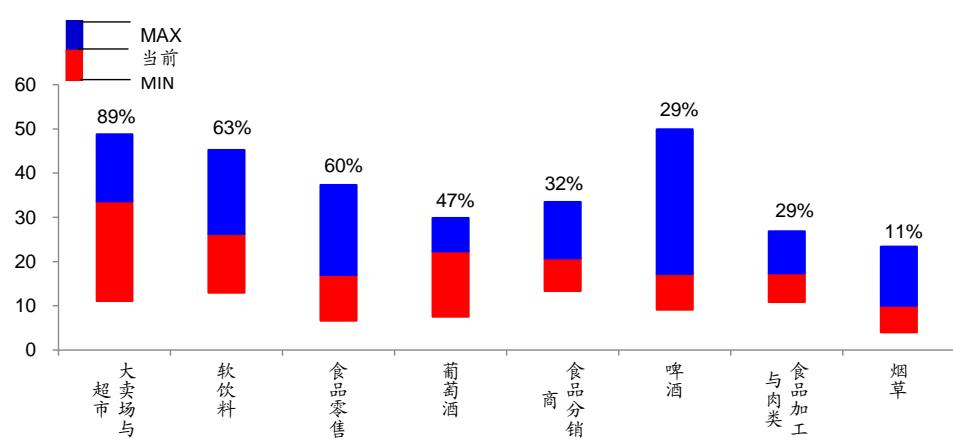  
资料来源：wind，HTI，数据截至 2023 年 10 月 31 日

美股日常消费品行业 PE 历史分位数处于 2011 年至 2019 年较低的行业为烟草（11%）和食品加工与肉类（29%）。

图 美股重点公司市盈率（ ）处于 年以来绝对位置（从左至右行业为最新市盈率历史分位从高到低排序）  
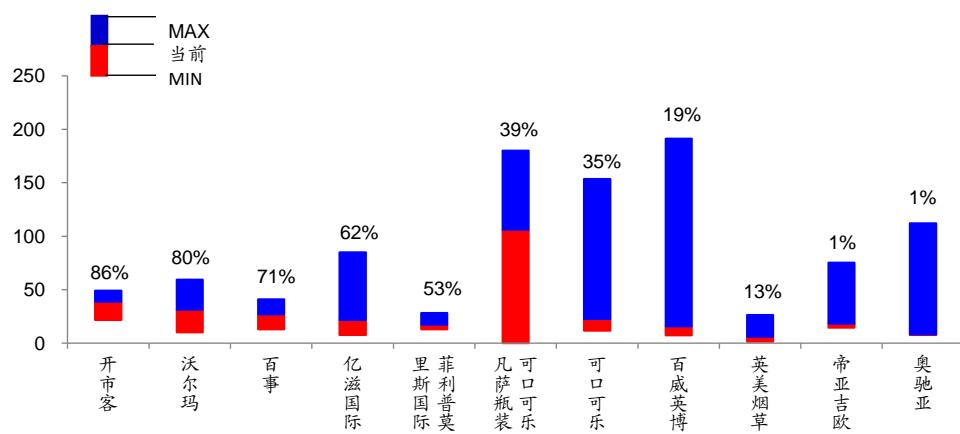  
资料来源：wind，HTI，数据截至 2023年 10月 31日（异常值剔除如下：可口可乐凡萨瓶 201806-201904、201504-201704；百威英博 202101-202204；奥驰亚 202001-202010）

图48 美股重点公司市盈率（TTM）处于 2011 年至 2019 年以来绝对位置（从左至右行业为最新市盈率历史分位从高到低排序）  
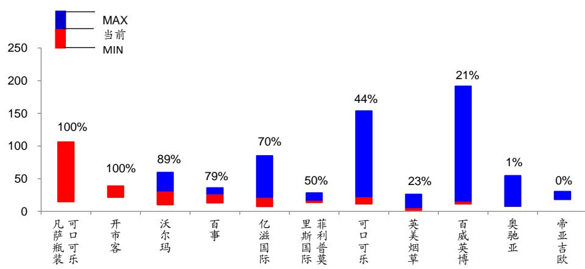  
资料来源：wind，HTI，数据截至 2023年 10月 31日（异常值剔除如下：可口可乐凡萨瓶 201806-201904、201504-201704；百威英博 202101-202204；奥驰亚 202001-202010）

截至 2023 年 10 月 31 日，美股食饮板块估值中枢有所下降，美股食饮龙头（市值前 30）的估值中位数为 18x（相较 9 月下降 1x）。

图49 美股食饮板块重点个股（市值前 30）最新估值水平（TTM）  
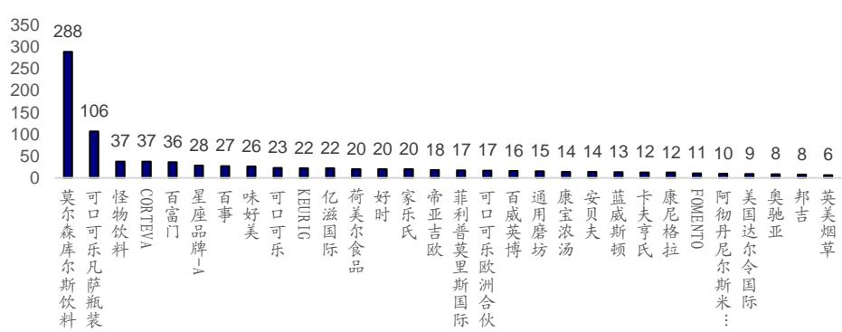  
资料来源：wind，HTI，数据截至 2023年 10月 31日，剔除估值为负的星座品牌、泰森食品、斯马克、CELSIUS

## 5 投资建议

高端/次高端白酒：寇媛媛认为 2023 年是白酒行业分化元年，优质酒企全年业绩目标完成确定性强，组织力较弱的酒企初现颓势。

中秋国庆旺季，总体动销呈持平表现。其中，宴席需求火爆，大众聚饮和送礼有明显恢复，商务宴请相对疲软。旺季后批价略有回落但总体平稳，压力测试顺利度过。各家白酒公司均公布了前三季度业绩，前三季度次高端以上白酒企业主营收亿，同比增长 16.8%，对应三季度次高端以上白酒企业收入为 917 亿，同比增长15.7%，3Q总体表现弱于我们预期，环比 2Q和 1Q增速略有收窄。前三季度大部分次高端以上白酒企业仍能实现毛利率的维持和提升，部分酒企 GPM 呈下降趋势，如舍得酒业、水井坊、老白干。前三季度大部分次高点以上白酒企业的销售费用率增加，如酒鬼酒、今世缘、洋河增加较多，而金种子酒、山西汾酒、老白干的费用率下降较多。

分公司来看，贵州茅台 3Q23 收入和利润增速符合预期(此前市场已调低预期)，营业总收入 343.3 亿元，同比+13.1%；归母净利润为 169 亿元，同比+15.7%，净利率同比提升 1.1 个点至 49.2%，直营和非标酒仍是主要增长引擎。五粮液 3Q23 收入和利润超预期，3Q23 实现营业总收入 170.3 亿元，同比+17%；归母净利润为 58 亿元，同比+18.5%，受益于中秋国庆旺季普五刚需特性，多个场景需求稳健增长。泸州老窖23Q3 公司实现营业总收入 73.5 亿元，同增 25.4%，归母净利润 34.8 亿元，同增29.4%，扣非净利 34.49 亿元、同比+29.12%，主要受益于中秋国庆旺季，国窖系列维持高增速，特曲和窖龄系列环比有所加速。珍酒李渡 3Q23 预期收入增速 25%，利润在增速高于收入增速，受益于高端产品的优秀表现和次高端产品环比加速。酒鬼酒3Q23 收入和利润持续低于预期，3Q23 实现营业总收入 11.8 亿，同比-37%低于我们预期，预期延续 2Q23 的趋势，量价双跌，归母净利润为 5700 万，同比下降 78%，净利率为 9.4%，主要因为竞争加剧，叠加渠道改革和去库存影响。

经过中秋国庆旺季消化库存水平环比下降，之后 11-12 月是淡季，仍以消化库存为主。经销商和厂家会进一步完成打款和发货，今年发货速度慢于往年，预期年底库存仍处于较高位置。年底前厂家会和经销商签订来年合同，为2024年开门红做准备。

我们看好珍酒李渡优秀的白酒平台管理能力，珍酒和李渡在行业下行周期中有机会取得竞品份额。我们认为五粮液是宴请和餐饮场景恢复后弹性较大的高端白酒标的，大商贡献今年主要增量，收入利润确定性较高。我们看好泸州老窖双品牌全价格带产品抓手众多，高度国窖表现或超预期，腰部产品增速高于高端产品，拉动整体收入利润增长。酒鬼酒短期面临批价下行和库存去化的问题，消费回暖和终端动销慢于预期带来恢复性增长延后，此外公司自 年起进行的渠道改革使经销商信心缺失和打款延后，也影响短期业绩表现。根据最新股价，贵州茅台 五粮液 泸州老窖 珍酒李渡/酒鬼酒对应 2023 年 PE 估值为 28.6X/20X/24X/19.7X/31.8X。8 月我们判断白酒行业将呈震荡向上行情，看多整体白酒赛道，具体排序为贵州茅台、五粮液、泸州老窖、珍酒李渡，看空酒鬼酒。

大众白酒：陈子叶认为当前白酒行业仍处于中期调整阶段，行业弱复苏趋势延续。

当前区域龙头酒企已完成 2023 年三季报的业绩披露. 具体来看，单三季度，山西汾酒收入+13.6%，利润+27.1%；洋河股份收入+11.0%，利润+7.5%；今世缘收入+28.0%，利润+26.4%；古井贡酒收入+23.4%，利润+46.8%；迎驾贡酒收入+21.9%，利润 。年初以来消费需求呈渐进式恢复，存量时代下，白酒行业终端竞争进一步加剧，部分公司主动降速，聚焦于市场秩序及价盘渠道管理，从而保障整体业务的长期良性发展。

结构端，徽酒受益于大众消费复苏和宴席场景贡献，且价格带竞争格局相对稳定，单三季度，古井、迎驾毛利率同比+5.7pct/+3.9pct，毛销差同比+4.7pct/+4.3pct，归母净利润率同比+3.5pct/+4.5pct。但苏酒头部企业，洋河和今世缘毛利率提升幅度环比前两季度增长放缓，同比甚至已有下滑，二者毛利率同比-1.2pct/+1.1pct，毛销差同比-2.7pct/-3.4pct。我们判断主因公司加大了产品货折及宴席买赠等活动力度，产品结构扰动亦产生一定影响，归母净利润率同比-0.9pct/-0.3pct。23Q3 山西汾酒毛利率同比-2.9pct，我们判断，主因宴席需求恢复向好，腰部产品老白汾、巴拿马持续高增，玻汾略有放量，因此毛利率存在短期波动。但受益于规模效应持续释放，叠加公司费投的精细化管理，销售费用率的降幅（-5.8pct）环比上两季度进一步提升，归母净利润率同比+3.2pct，经营效率稳步提升。

中秋国庆前期白酒传统消费旺季开启，各家酒企争相抢占市场机遇，终端动销有所好转，产品批价震荡上行。随着双节结束，白酒市场需求转淡，价格再度下滑。目前我们认为白酒行业仍处于渠道去库存阶段，酒厂追赶任务、渠道态度谨慎以及终端购买力疲软等因素共同导致了供需矛盾的出现，也逐步验证我们从 年 月份以来提出的白酒行业进入了中期调整的观点。当前各大酒企重点发力宴席市场，通过现金红包、反向激励、宴席配赠等方式加入动销大战，提升开瓶率，推动库存去化。在消费需求和组织效能等因素带动下，名酒集中化的马太效应将进一步增强。

白酒批价方面，经渠道调研反馈，本月飞天批价波动较大，散瓶、整箱、精品环比上月-60/-75/-30元，茅台1935阶段性触底，批价下跌 40元至970元。洋河M6+/水晶梦批价 元，青花 批价 元，古 古 古 批价 元。上涨品种中，国窖1573/窖龄60批价+10/+5元，青花30复兴版/国缘四开批价+15/30元。当前行业供需平衡修复仍在途中，由于明年春节较晚，部分酒企更多的收入和利润确认或放在明年，以保证开门红的顺利达成，需继续关注春节前批价走势及库存变化。我们维持前期判断，白酒行业将整体呈现长期温和而非短期报复式恢复，消费场景回归是复苏的基础，而消费力的实质性回暖决定了复苏的高度和持久力。

当前山西汾酒、古井贡酒、洋河股份、迎驾贡酒和今世缘估值处于 2011 至 2019年疫情前的 26%/79%/25%/66%/67%分位。建议关注个股为洞藏系列产品起势、后阶段延续放量的迎驾贡酒，全年目标明确、股权激励彰显信心的今世缘，业绩确定性强、估值分位处于低位的山西汾酒，基酒储备充足、具备估值性价比的洋河股份。

啤酒行业：陈子叶认为啤酒行业具备结构升级和成本改善逻辑，估值有望逐步修复。

当前啤酒企业已完成 2023 年三季报的业绩披露，四家主要啤酒上市公司（百威亚太只有中国区增速而未做绝对值拆分；华润啤酒未披露三季报）实现营收 609.7 亿元，同比+7.5%，销量 1453 万千升，同比+2.7%，吨价提升 4.7%至 4196.4 元/千升。据国家统计局显示，1-9 月啤酒行业产量累计同比增长 2.1%。四家啤酒龙头企业销量在行业普遍面临高基数压力下，销量增速跑赢行业产量增速，且在结构端升级趋势明显，市场份额稳步提升。具体来看，单三季度，百威亚太收入+2.0%（内生+7.1%），EBITDA -1.5%（内生+4.1%）；青岛啤酒收入-4.6%，归母净利润+4.7%；重庆啤酒收入+6.5%，归母净利润+5.4%；燕京啤酒收入+8.5%，归母净利润+37.4%；珠江啤酒收入+5.9%，归母净利润+8.0%。

销量端， 受去年同期高基数、极端天气和消费偏弱等因素扰动，青岛啤酒销量同比转负（-11.3%），降幅最大，百威亚太次之，中国区啤酒销量同比-0.1%，珠江啤酒录得小幅正增（ ），重庆啤酒和燕京啤酒销量增速跑赢同业，分别同比。结构端，百威亚太中国区（ ）和青岛啤酒（ ）吨价提升幅度最为明显，季度间呈环比上行趋势，燕京啤酒（ ）、珠江啤酒（ ）、重庆啤酒（+1.1%）吨价同比提升，环比放缓。展望四季度，啤酒行业进入低基数区间（22Q4 产量同比下滑约-4%左右），我们维持前期判断，预计行业全年可录得全量增中低个位数，价增中个位数水平。

成本端，23Q3 青岛啤酒和珠江啤酒吨成本同比+2.4%/2.9%，季度间呈环比下降趋势，在结构上移带动下毛利率同比+2.9pct/0.8pct；重庆啤酒吨成本同比+3.4%，环比上季度有所上行，主因高档疆外乌苏增长缓慢，缺少高毛利产品的价格贡献，毛利率同比-1.1pct；燕京啤酒吨成本同比+3.7%，环比上季度有所上行，主因材料成本的基数差异，产品结构亦有一定影响。费用端，当前场景的回归带动各家酒企在费用投放上逐步恢复正常，费率变动在 0.5cpt 以内浮动，品牌建设与渠道活动持续推进，抢占市场份额。

中长期来看，头部公司中高档以上大单品有望持续发力，推动产品吨价和毛利率逐步提升，啤酒行业高端化逻辑演绎持续。成本端，根据 HTI 消费品成本跟踪，玻璃价格已较前期高点有所回落，铝材价格仍在高位但瓦楞纸已较年初下跌近 10%，同时，商务部宣布澳麦双反政策结束，当前大麦价格已较年初下降超过 20%，利好明年大麦的低位锁价。建议继续关注各家公司的大麦询价及采购情况，成本端压力改善幅度将逐渐明朗。

目前时点，我们建议关注啤酒行业配置机会，尤其是高端化确定性强、产品与运营优势凸显的青岛啤酒；完成内部管理措施改革，目前估值水平具有性价比的重庆啤酒；次高及以上产品销量增长明确，吨价成长空间大的华润啤酒。根据 Wind 一致预期和最新股价，青岛啤酒/重庆啤酒/华润啤酒对应 2023 年 PE 估值为 25.4X/25.2X/22.7X。

乳制品行业：肖韦俐认为乳制品需求延续分化，液态奶不乏有亮眼表现，奶粉仍有压力。

乳制品公司三季报业绩已完成披露，主要上市公司（23M9 营收规模在 15 亿以上，包括伊利/光明/新乳业/三元/天润/燕塘）前三季度实现营收 1360 亿元，同比+2.8%，实现扣非归母净利润 95 亿元，同比+12.2%。根据国家统计局数据，23M9 乳制品产量累计同比+3.8%，乳业量增延续。

（1）液态奶需求处在环比修复阶段。主要乳企伊利 23Q3 在低基数下实现液态奶+8.5%的增长（22Q3下滑4.9%），超过我们预期。同时我们预计蒙牛 23Q3在高基数下亦能实现接近中个位数的增长。主要受益于双节旺季备货表现较好，产品结构超预期，高端白奶恢复较好（如金典 23Q3 实现 20%增长），但常温酸奶仍有压力。虽然双节过后经销商进货意愿有所回落，渠道短期仍在消化旺季库存，10 月环比 9 月走弱，实现低个位数增长，但此为历年正常现象。考虑去年年尾为低基数，我们预计今年Q4 行业增长无虞，但鉴于明年春节较晚，乳企或更注重明年开门红。

盈利表现有所分化，外部压力较强时，经营能力强的乳企有更好的表现。

伊利股份利润超预期，Q3营业总收入312亿元（同比+2.7%），扣非归母净利润为26.6 亿元（同比+56.9%）。23Q3 毛利率为 32.6%（同比+1.6PCT），主因液态奶结构表现强劲，销售费率 17.9%（同比-0.9PCT），公司主动持续优化费率。光明乳业略低于预期，Q3 营业总收入 65 亿元（同比-6.4%），扣非归母净利润为-0.05 亿元（同比-111.7%）。23Q3 公司毛利率 15.5%（同比-1.2PCT），主因海外子公司亏损；销售费用率 13.0%（同比+1PCT）。新乳业略低于预期，Q3 营业总收入 29 亿元（同比+7.3%），扣非归母净利润为 1.6 亿元（同比+54.4%）。233Q 毛利率 26.4%（同比+2.2PCT），主因外收原奶红利、产品结构提升；销售费率 14%（同比+0.4PCT），较为稳定。三元略低于预期，Q3 营业总收入 19 亿元（同比-7.1%），扣非归母净利润为 0.1 亿元（同比-59.0%）。23Q3 毛利率 21.7%（同比-2.7PCT），主因合并范围变更、大包粉出售、及促销加大影响，销售费用率 15.9%（同比-4PCT），系电商平台结算模式调整，及公司主动控制费用。天润乳业符合预期，Q3 营业总收入 7 亿元（同比+12.2%），扣非归母净利润为 0.3 亿元（同比-35.5%）。23Q3 毛利率 17.6%（同比+0.01PCT），环比-3.35pct，主因牧业板块拖累，主要由于并购新农后奶源自给率显著提升，外购原奶成本下行带来的红利减少；天润 23Q3 销售费用率 5.7%（同比-0.4PCT），基本稳定。燕塘乳业符合预期，Q3 营业总收入 5 亿元（同比+1.6%），扣非归母净利润为 0.4 亿元（同比+110.6%）。2023Q3 毛利率 27.6%（同比+3.5PCT），主要因自给率较低，社会化原奶下行，成本持续改善；燕塘 2023Q3 销售费用率为 10.6%（同比-1PCT），费率有优化。

（2）婴配粉需求仍在磨底，厂商积极求变。供给端来看，行业整体仍竞争激烈，多数厂家价盘松动；且需求端 2023 年仍在磨底，0-3 岁人群持续缩减，今年婴配粉消费量仍将双位数下降。此次中报业绩，头部厂商延续压力，但降幅有所收窄，伊利奶粉板块收入 23Q3 同比-3.8%，相较上个季度 9%的下跌已有好转，且 10 月婴儿粉已实现正增长。

受限于需求较弱，飞鹤、伊利等厂商老产品批价变化不大，通过新品放量实现价格上移。飞鹤主推“卓”系列产品，伊利与澳优亦推新国标产品。面对行业困境，厂商均进行主动控货，坚定实施去库存战略，不盲目参与价格竞争。飞鹤进行渠道全面改革，推进数字生态门店转变，将线下母婴店的交易结算转至线上，增强厂商对价盘掌控力，杜绝终端乱价、比价现象；并以首次入会、终身绑定的方式，促进经销商及门店拓新。

重点关注：伊利股份、蒙牛乳业、中国飞鹤。根据 Wind 一致预期和最新股价，伊利/蒙牛/飞鹤对应 2023 年 PE 估值为 16.49X/15.69X/9.13X。

调味品行业：寇媛媛认为受益于基数下行和餐饮恢复，调味品整体表现好于预期，行业最差阶段已经结束。

各家调味品公司均公布了前三季度业绩，上市调味品企业营收 306 亿元，同比增长 2.3%，，对应 3Q23 调味品行业 96.3 亿，同比增长 5.9%，受益于基数下行和餐饮恢复，整体表现好于预期，行业最差阶段已经结束。

前三季度调味品企业毛利率有升有降，其中海天味业、恒顺醋业、涪陵榨菜呈下降趋势，中炬高新、千禾味业、天味食品毛利率呈上升趋势。前三季度除海天味业销售费用率略有增加，其他所有上市调味品企业的销售费用率呈下降趋势。海天味业3Q23 实现营业总收入 56.85 亿元，同比+2.20%；实现归母净利润 12.32 亿元，同比-3.24%；实现扣非归母净利润11.82亿元，同比-1.87%，收入和利润略低于预期，仍在调整期。 中炬高新美味鲜实现营收 亿元，同比 ，归母净利润 亿元，同比+64.57%，收入符合预期，利润超预期。此外，总经理聘任落地，聘任余向阳为总经理，林颖为常务副总经理，刘虹、陈代坚、郭毅航为副总经理，中炬高新有望迎来进一步的内部改革和业绩释放。千禾味业 3Q23 实现营收 8.00 亿元，同增48.45%；归母净利润 1.31 亿元，同增 90.43%；扣非归母净利润 1.30 亿元，同增93.03%，业绩超预期，盈利能力大幅改善。恒顺醋业公司 3Q23 收入/归母净利润分别同比+0.03%/-44.6%，低于预期，利润大幅下滑主要系受竞争加剧及公司优化 SKU 策略影响，毛利率大幅下降。天味食品 3Q23 实现收入 8.08 亿元，同比增长 16.39%；实现归母净利润 亿元，同比增长 ，超预期。天味食品毛利率大幅提升，主要系原材料采购成本下降，以及高毛利率的电商业务占比提升。涪陵榨菜 3Q23 收入/归母净利润同比-1.5%/+4.8%，收入端降幅环比 Q2 收窄，库存持续下降，利润端毛利率受成本影响同比下降，品牌费用减少使得费用率大幅改善，净利率有所修复。

三季度调味品受益于暑期旺季餐饮恢复，动销端出货较上半年有明显恢复，其中月餐饮因为旅游旺季明显恢复，恢复程度超过之前我们预期的 年同期水平，进入 区间，部分企业表现在 以上。 月中上旬餐饮有明显回落，到月下旬数据又有明显回升趋势。10 月中秋国庆旺季餐饮表现火爆，节日后回落明显，但环比 9 月增速持平甚至略好，带动调味品 2B 端需求稳健。头部企业预期在今年持续去库存，并在年底和春节前完成渠道去库存的动作，对出货节奏进行优化，与经销商节奏适配，总体出货端将慢于动销端。调味品行业成本端仍有压力，主要原材料大豆价格、辣椒价格和油脂价格仍在高位震荡，白砂糖价格近期持续走高，包装材料如玻瓶和瓦楞纸价格略有回升，人民币汇率走弱对于由美金结算的原材料有进一步的压力。

根据 Wind 一致预期和最新股价，海天味业/恒顺醋业/千禾味业/天味食品对应2023 年 PE 估值为 33.2X/60.7X/34.9X/35.6X，中炬高新对应 2024 年 PE 估值为 32.7X，对于调味品板块呈中性评级。

复合调味品：宋琦认为定制餐调增长稳健，旺季 C 端产品景气度提升在即。

端需求受餐饮复苏带动增长稳健， 端需求进入旺季环比回暖，且高基数影响消散，消费场景有望回复良性状态。盈利端看，原材料成本有所回落，C 端业务需求回暖带来毛利率提升，B 端业务毛利率相对稳定。建议重点关注 C 端产品进入旺季收入及利润有望释放弹性的天味食品，以及下游优质餐饮大客户复苏趋势较强且定制业务带动盈利能力提升的宝立食品。

速冻食品：宋琦认为速冻板块进入传统旺季，需求韧性较强，成本红利有望维持。

下游餐饮行业景气度持续修复，连锁餐饮企业翻台表现亮眼，带动速冻行业 B 端存量客户需求增加。此外进入下半年，速冻板块迎来传统旺季，需求环比走强趋势明显。盈利端看，目前部分原材料价格较去年同期有所回落，整体保持相对稳定。同时行业内主要公司持续提升销售费用效率，实现营销投入精准化。此外，随着需求提升，规模优势逐渐发挥更大作用。费用管控叠加效率提升，行业净利率提升明显。展望四季度，需求旺季到来叠加下游餐饮持续改善，全年 B 端餐饮需求恢复保持乐观。此外，C 端消费因场景分流而带来的影响即将消散，C 端业务高基数影响逐渐减弱，但仍需关注 C 端渠道碎片化的影响。建议重点关注安井食品。

休闲食品&卤制品：肖韦俐认为休闲食品延续高增态势，卤制品成本下行明显。

休闲食品公司三季报业绩已完成披露，主要上市公司（23M9 营收规模在 13 亿以上，包括洽洽/盐津/劲仔/甘源）前三季度实现营收 103 亿元，同比+23.5%，实现扣非归母净利润 11 亿元，同比+25.1%。

分公司来看，洽洽食品利润超预期，Q3 营业总收入 18 亿元（同比+5.1%），扣非归母净利润为 2.2 亿元（同比-10.7%）。二季度为成本高点，毛利率低点；三季度成本边际改善明显，新采购季有望继续下行。盐津铺子符合预期，Q3 营业总收入 11 亿元（同比+46.2%），扣非归母净利润为 1.4 亿元（同比+82.9%）。23Q3 收入高增长系零食量贩、电商、定量流通的渠道红利持续释放，以及魔芋、鹌鹑蛋等多品类延续高增长。劲仔食品超预期，Q3 营业总收入 6 亿元（同比+45.9%），扣非归母净利润为 0.4亿元（同比+26.1%）。三季度全品类实现较高增长、鹌鹑蛋表现亮眼。同时鱼干成本边际下行。甘源食品超预期，Q3 营业总收入 5 亿元（同比+37.3%），扣非归母净利润为 0.8 亿元（同比+93.6%）。风味坚果多渠道放量，零食量贩&商超会员渠道收入继续提升，同时原料成本价格保持下行趋势。

卤制品公司三季报业绩已完成披露，主要上市公司（23M9 营收规模在 16 亿以上，包括绝味/紫燕/煌上煌）前三季度实现营收 100 亿元，同比+5.8%，实现扣非归母净利润 7 亿元，同比+39.1%。绝味食品符合预期，Q3 营业总收入 19 亿元（同比+8.3%），扣非归母净利润为 1.4 亿元（同比+20.3%）。主业增长略显乏力，但成本压力缓解，盈利能力逐步改善。

养殖行业：宋琦对生猪与白羽鸡养殖持中性态度。

短期抛售猪价再次快速下跌。猪价长期在成本线附近徘徊，养殖端资金压力持续增加，叠加北方部分区域疫病有所增加，近期出现中小养殖户提前出栏现象，因此近期猪肉供大于求，猪价继续走低。此外，需求端持续弱复苏，并未带来较强的猪价上涨支撑。进入四季度，消费旺季或可带来一定程度的猪价上涨，但猪价整体或将持续低位至 2024 年。

前期产能去化带来近期白羽鸡肉和鸡苗价格有所回升。目前毛鸡和鸡苗价格回暖使得商品代和父母代养殖亏损收窄，但整体上仍未转亏为盈，所以产能去化仍将继续。同时，由于猪价持续走低，生猪出栏加速，猪肉的大量供给极可能挤压鸡肉需求，因此短期内鸡价或将持续震荡。

运动鞋服行业：寇媛媛认为运动鞋服行业短期增速放缓力度高于预期，但中长期仍建议超配运动鞋服产业链标的。

运动行业 7 月需求表现较弱，8 月环比 7 月需求有所改善，8 月李宁、安踏、FILA品牌线下均有高单位数至 10%的增速，特步 8 月呈中高双位数增速，特步好于行业整体的动销表现主要受益于消费降级和优秀的跑鞋矩阵。我们预期李宁、安踏、特步 9月线下动销环比进一步改善，主要因为进入低基数和中秋国庆旅游旺季的带动，FILA品牌 9 月增速或走弱，因为去年基数较高。10 月旺季表现较好，旺季后增速有所回落。

运动品牌公司公布 3Q23 流水情况，其中李宁中单位数，安踏高单位数，FILA 流水增长low teens，特步流水增长20-30%，除李宁外，流水表现均好于我们预期。安踏预期今年行业增速为高单位数，李宁也下调全年收入至单位数区间，整体运动服饰赛道增速放缓力度高于我们预期。预期 11-12 月各家企业将增加折扣，迅速去化库存。中长期我们仍建议超配运动鞋服产业链标的，预期行业未来 5 年增速为 10%左右，量价齐升，其中专业运动、户外、女性运动、儿童运动是增速更快的子赛道。

10 月我们的组合是看多安踏体育、李宁、特步国际、申洲国际。安踏体育作为平台型公司的优秀运营能力，FILA 品牌和其他品牌受益于低基数、线上新渠道拓展、户外赛道增速快，表现优异，直营模式将较大带动利润率的恢复，安踏品牌在 DTC 基本结束后店铺运营能力和总体利润率将有望进一步提升。安踏公司未来 2-3 年致力于提升店效，有助于利润率中枢上移。李宁在终端仍有较好的表现，且库存水平领先行业，短中期或面临国外品牌份额提升的压力，我们看好李宁的多运动品类的优异表现，完善的跑鞋和篮球鞋矩阵，以及多个长寿产品系列为中长期发展保驾护航。近期李宁股价下跌较多，目前 2023 年估值仅 18.3X，具有较高吸引力。特步国际基于较低的价格带占据了高性价比的价格带，跑步专业定位深入人心，2023 年大众运动品牌特步大货和儿童品牌稳健增长，专业运动品牌收入高增且有望盈亏平衡，时尚运动预期减亏。目前特步国际 年估值仅 ，具有较高吸引力。申洲国际最差时间已过，随着海外去库存周期结束，3Q23 开始公司订单有一定回暖，同时主要客户之一的 可能打开供应商供货比例的天花板，订单回暖将带动产能利润率和毛利率的提升。根据 Wind 一致预期和最新股价，李宁/安踏体育/特步国际/申洲国际对应2023 年 PE 估值为 14.5X/23.4X/14.7X/23.2。

批零社服行业： 汪立亭、李宏科发布最新报告，国考报名过审人数创新高，公考培训龙头有望受益。

2024 年国考报名过审人数超 300 万人，创历史新高。根据国家公务员局招考公告，2024 国家公务员考试招录名额 3.96 万人（+6.74%），相较于 2020 年增长64.12%；国考招录人数自19年后持续增加，延续5年扩招趋势。在招录人数增多的趋势下，报名人数维持高增速，2024 年国考报名过审人数为 303.3 万（+16.76%），创历史新高，报录比由 70：1 增至 77：1。2021-2024 年国考招录人数/报名过审人数CAGR15.5%/23.0%，报名录取率从 1.73%（2020）下降至 1.31%（2024）。

录用计划向应届生倾斜，应届生招录比例高。国家公务员岗位设有针对于应届生的特定岗位，2024年国考招考岗位数18948个，其中7330个岗位仅限2024应届高校毕业生报考，招录人数 16954 人，占比 42.86%；4520 个岗位限应届毕业生报考，招录人数 9238 人，占比 23.35%。总体而言，在 2024 年国考中，应届生招录人数占比66.21%，远超非应届生。

应届毕业生人数增加，国考培训潜在客群数量庞大。根据历年《全国教育事业发展统计公报》，2020年普通本专科招生967.45万人，相比2016年增加218.84万人，增长率达 29.23%，预计 2024 高校应届毕业生相比于 2020 本科应届毕业生也将大幅上升，毕业生人数将达 1187 万人。考虑到 3 年高中、4 年本科/专科的学制，预计未来4-7 年，国内高校应届毕业生数量还会持续增加，国考培训潜在客群数量庞大。

国考竞争激烈程度加剧，参培率或将进一步上升。从目前情况来看，近年来就业形势相对严峻，国考报名人数整体上涨，且录用计划向应届生倾斜，使竞争更加激烈。国考热情的持续高涨为培训带来市场空间，我们认为考生参培率或将进一步上升，公考培训龙头企业有望受益。

公考培训龙头基本盘仍在，中公教育困境反转正当时。中公教育发布前三季度业绩预告，预计3Q23归母净利润1.3-1.7亿元，同比增长94.9-153.5%；扣非净利润同比增长 110.2-174.0%；1-3Q23 利润 2.2 亿-2.6 亿元，同比扭亏。公司 1Q/2Q 利润各 2430万/5768 万元，利润逐季度改善。对比同行，传智、粉笔等职业教育企业疫情后人效提升（2022 年，传智教育、粉笔人效各提升 29%、9%；传智教育 2022 年人效相比2019年提升34%）。公司最近在积极解决退费问题，向财信信托借款不超过18亿元，用于补充公司流动资金。我们认为若退费问题顺利解决，中公教育人效有较大提升空间。

投资建议：看好出行链进入复苏向上新通道，基本面有望从短期复苏转向长期高质量发展叠加政策端传导，我们建议优选修复确定性高或基本面存在拐点的优质龙头，关 注估值消化充分、存在事件催化的弹性标的。A 股重点关注：宋城演艺、中公教育、中国中免，关注：北京人力、科锐国际、天目湖、锦江酒店、首旅酒店。H 股重点关注：粉笔，关注：东方甄选、海底捞、百胜中国、华住集团-S。

家电行业： 陈子仪建议业绩披露期，看好经营逐步向好、业绩有望较快增长，估值仍具性价比优势的小家电、白电龙头。

核心观点：10 月进入三季报披露期。我们看好经营逐步向好、业绩改善趋势中的小家电及估值底部提供足够安全垫的白电龙头。重点关注：（1）景气度回升，经营向好的扫地机器人龙头【石头科技】；小家电重点公司【新宝股份】【小熊电器】；（ ）估值底部，业绩表现稳健的白电龙头【海尔智家】【美的集团】【格力电器】；（3）政策加持，地产后周期稳健经营、估值有望修复的厨电龙头【老板电器】。

造纸轻工行业：郭庆龙认为三季报利润亮眼，定制家居企业降本控费效果显著。

定制家居龙头三季报利润亮眼。欧派家居发布三季报，23Q3 实现营业收入 67.2亿元，同比增长 2.2%；实现归母净利润 11.8 亿元，同比增长 21.1%，归母净利率17.5%，同增 2.7pct；实现扣非归母净利润 11.3 亿元，同比增长 20.2%扣非归母净利率16.8%，同增 2.5pct。

欧派推出惠民产品菲思卡尔系列。 年 月 日至 月 日，欧派推出惠民产品—菲思卡尔系列，主打衣柜 699 元/㎡，橱柜 699 元/m，定位“限时普惠、轻松定制美好家 。菲思卡尔包括 芙瑜 、 绮悦 、 诺森 三大产品系列覆盖原木风、奶油风、轻奢风等主流风格，3 大产品均为同系开发，满足入户、客餐厅、厨房、卧室、书房等全屋空间定制需求。除了柜类普惠价 699 元，欧派还推出多款普惠家具、电器套餐，提供高性价比整家一站购物服务金牌厨柜发布三季报，23Q3 实现营业收入 10.4亿元，同减 1.6%；实现归母净利润 0.9 亿元，同增 24.8%，归母净利率 8.6%，同增1.8pct；实现扣非归母净利润 0.7 亿元，同比增长 20.2%，扣非归母净利率 6.4%，同增1.2pct。此前索菲亚发布前三季度业绩预增公告，23Q3 预计实现归母净利润 4.5-4.7亿，同增 15%-20%；预计实现扣非归母净利润 4.3-4.5 亿，同增 13%-18%。

索菲亚米兰纳推出 688 元/㎡真普惠装整家活动。本次的 688 元/㎡真普惠产品有40 个生产专利和多个外观专利加持，42 款热销花色自由搭配，八大空间、五大主流风格任选，同时不设门槛，超值保价300天。板材方面，本次的688元/㎡普惠产品由国标 E0 级认证升级为 F4 星认证。

尚品宅配推出699惠民专供活动——衣柜699元/㎡，厨柜699/m，9月8日-10月31 日限时限量抢购。此次活动衣柜 18 款畅销花色任选，厨柜 8 款花色任选，18mm厚度柜身、门板 E0 级抗菌环保板材。依托行业首个“AI 设计工厂”和工业 4.0 工厂，12小时内输出 AB 款创意方案及 8k 超高清效果图，板材利用率远高于传统家具企业，交货周期最快可缩短至 15 天。

外部环境承压下，头部定制家居企业向外积极开展各类营销活动，推出高性价比套餐，迎合终端消费趋势；向内严格执行降本控费，严冬修炼内功，提升自身盈利水平。我们认为，近期政策暖风频吹，24 年竣工数据仍有支撑下家居股业绩修复可期，建议关注定制家居龙头欧派家居、索菲亚、志邦家居、金牌厨柜、尚品宅配。

## 6 风险提示

消费恢复不及预期，原材料价格反弹，人民币贬值。

## APPENDIX1

## Summary

The view turned optimistic in November, and the positive convergence should not be ignored. The A-share Food & Beverage and H-share Consumer Staples Indices fell by 2.67% and 1.30% respectively in October (the Shanghai Composite Index/Hang Seng Index fell by 2.95%/3.91% respectively). falling for the third consecutive month, Our roadshow found that investor sentiment has also fallen to new lows. However, the extremes of things must be reversed, otherwise some positive factors are also converging. For example, demand for dairy products and condiments in the third quarter was slightly better than we expected; The futures cost index of most products decreased significantly month-on-month; For the first time this year, the PE of the A-share food and beverage industry fell below the 50th percentile of 11 to 19 years; Leading enterprises such as Kweichow Moutai and Master Kon raised prices more than expected. The main industries are sorted as follows: dairy products = beer = high-end liquor> condiments = convenient food and beverage = aquaculture = feed = sports shoes and clothing> catering = regional liquor = sub-high-end liquor. It is suggested to pay attention to the individual stocks of Yili Co., Ltd., Mengniu Dairy, China Feihe, Modern Dairy, China Resources Beer, Kweichow Moutai, Shanxi Fenjiu, Yingjiagong Liquor, Shuanghui Development, Master Kong, Sunnong Development, Roborock, Songcheng Performing Arts, Anta Sports, Opai Home, etc

Risk warning: consumption recovery is less than expected, raw material prices rebound, and the RMB depreciates.

## [Table\_APPENDI[Table\_disclaim附录 APPENDIX

## 重要信息披露

本研究报告由海通国际分销，海通国际是由海通国际研究有限公司(HTIRL)，Haitong Securities India Private Limited (HSIPL)，Haitong International Japan K.K. (HTIJKK)和海通国际证券有限公司(HTISCL)的证券研究团队所组成的全球品牌，海通国际证券集团(HTISG)各成员分别在其许可的司法管辖区内从事证券活动。

## IMPORTANT DISCLOSURES

This research report is distributed by Haitong International, a global brand name for the equity research teams of Haitong International Research Limited (“HTIRL”), Haitong Securities India Private Limited (“HSIPL”), Haitong International Japan K.K. (“HTIJKK”), Haitong International Securities Company Limited (“HTISCL”), and any other members within the Haitong International Securities Group of Companies (“HTISG”) each authorized to engage in securities activities in its respective jurisdiction

## HTIRL 分析师认证 Analyst Certification:

我，闻宏伟，在此保证（i）本研究报告中的意见准确反映了我们对本研究中提及的任何或所有目标公司或上市公司的个人观点，并且（ii）我的报酬中没有任何部分与本研究报告中表 达的具体建议或观点直接或间接相关；及就此报告中所讨论目标公司的证券，我们（包括我们的家属）在其中均不持有任何财务利益。我和我的家属（我已经告知他们）将不会在本研 究报告发布后的 3 个工作日内交易此研究报告所讨论目标公司的证券。I, Hongwei Wen, certify that (i) the views expressed in this research report accurately reflect my personal views about any or all of the subject companies or issuers referred to in this research and (ii) no part of my compensation was, is or will be directly or indirectly related to the specific recommendations or views expressed in this research report; and that I (including members of my household) have no financial interest in the security or securities of the subject companies discussed. I and my household whom I have already notified of this, will not deal in or trade any securities in respect of the issuer that I review within 3 business days after the research report is published

我，肖韦俐，在此保证（ ）本研究报告中的意见准确反映了我们对本研究中提及的任何或所有目标公司或上市公司的个人观点，并且（ ）我的报酬中没有任何部分与本研究报告中表 达的具体建议或观点直接或间接相关；及就此报告中所讨论目标公司的证券，我们（包括我们的家属）在其中均不持有任何财务利益。我和我的家属（我已经告知他们）将不会在本研 究报告发布后的 3 个工作日内交易此研究报告所讨论目标公司的证券。I, Weili Xiao, certify that (i) the views expressed in this research report accurately reflect my personal views about any or all of the subject companies or issuers referred to in this research and (ii) no part of my compensation was, is or will be directly or indirectly related to the specific recommendations or views expressed in this research report; and that I (including members of my household) have no financial interest in the security or securities of the subject companies discussed. I and my household whom I have already notified of this, will not deal in or trade any securities in respect of the issuer that I review within 3 business days after the research report is published

我，陈子叶，在此保证（i）本研究报告中的意见准确反映了我们对本研究中提及的任何或所有目标公司或上市公司的个人观点，并且（ii）我的报酬中没有任何部分与本研究报告中表 达的具体建议或观点直接或间接相关；及就此报告中所讨论目标公司的证券，我们（包括我们的家属）在其中均不持有任何财务利益。我和我的家属（我已经告知他们）将不会在本研 究报告发布后的 3 个工作日内交易此研究报告所讨论目标公司的证券。I, Susie Chen, certify that (i) the views expressed in this research report accurately reflect my personal views about any or all of the subject companies or issuers referred to in this research and (ii) no part of my compensation was, is or will be directly or indirectly related to the specific recommendations or view expressed in this research report; and that I (including members of my household) have no financial interest in the security or securities of the subject companies discussed. I and my household whom I have already notified of this, will not deal in or trade any securities in respect of the issuer that I review within 3 business days after the research report is published

## 利益冲突披露 Conflict of Interest Disclosures

海通国际及其某些关联公司可从事投资银行业务和/或对本研究中的特定股票或公司进行做市或持有自营头寸。就本研究报告而言，以下是有关该等关系的披露事项（以下披露不能保证及时无遗漏，如需了解及时全面信息，请发邮件至 ERD-Disclosure@htisec.com）

HTI and some of its affiliates may engage in investment banking and / or serve as a market maker or hold proprietary trading positions of certain stocks or companies in this research report. As far as this research report is concerned, the following are the disclosure matters related to such relationship (As the following disclosure does not ensure timeliness and completeness, please send an email to ERD-Disclosure@htisec.com if timely and comprehensive information is needed).

海通证券股份有限公司和/或其子公司（统称“海通”）在过去 12 个月内参与了 603517.CH and 2469.HK 的投资银行项目。投资银行项目包括：1、海通担任上市前辅导机构、保荐人或主承销商的首次公开发行项目；2、海通作为保荐人、主承销商或财务顾问的股权或债务再融资项目；3、海通作为主经纪商的新三板上市、目标配售和并购项目。

Haitong Securities Co., Ltd. and/or its subsidiaries (collectively, the "Haitong") have a role in investment banking projects of 603517.CH and 2469.HK within the past 12 months. The investmen banking projects include 1. IPO projects in which Haitong acted as pre-listing tutor, sponsor, or lead-underwriter; 2. equity or debt refinancing projects of 603517.CH and 2469.HK for which Haiton acted as sponsor, lead-underwriter or financial advisor; 3. listing by introduction in the new three board, target placement, M&A projects in which Haitong acted as lead-brokerage firm.

作为回报，海通拥有 603589.CH 一类普通股证券的 1%或以上。

The Haitong beneficially owns 1% or more of a class of common equity securities of 603589.CH.

603517.CH 及 2469.HK 目前或过去 12 个月内是海通的投资银行业务客户。

603517.CH and 2469.HK are/were an investment bank clients of Haitong currently or within the past 12 months.

贵州茅台酒厂集团啤酒有限责任公司 安徽省安粮集团有限公司 益海嘉里（上海）国际贸易有限公司 安徽省安粮集团有限公司002557.CH, 内蒙古蒙牛乳业（集团）股份有限公司, 嘉必优生物技术（武汉）股份有限公司, 600305.CH, 农夫山泉杭州千岛湖饮用水有限公司,农夫山泉浙江千岛湖有限公司,农夫山泉浙江千岛湖有限公司，农夫山泉杭州千岛湖饮用水有限公司 香港华润 集团 有限公司上海代表处 西安光明乳业销售有限公司 北京中公教育科技有限公司 北京科锐北方科技发展有限公司 锦江国际 集团 有限公司 嘉谟证券有限公司－海底捞国际金融私人有限公司 嘉谟证券有限公司－海底捞控股私人有限公司 及 目前或过去 个月内是海通的客户。海通向客户提供非投资银行业务的证券相关业务服务。

贵州茅台酒厂集团啤酒有限责任公司, 000596.CH, 000895.CH, 603589.CH, 603517.CH, 安徽省安粮集团有限公司,益海嘉里（上海）国际贸易有限公司,安徽省安粮集团有限公司, 002507.CH,

002557.CH, 内蒙古蒙牛乳业（集团）股份有限公司, 嘉必优生物技术（武汉）股份有限公司, 600305.CH, 农夫山泉杭州千岛湖饮用水有限公司,农夫山泉浙江千岛湖有限公司,农夫山泉浙江千岛湖有限公司，农夫山泉杭州千岛湖饮用水有限公司, 605300.CH, 香港华润(集团)有限公司上海代表处, 西安光明乳业销售有限公司, 北京中公教育科技有限公司, 北京科锐北方科技发展有限公司, 锦江国际(集团)有限公司, 嘉谟证券有限公司－海底捞国际金融私人有限公司 R,嘉谟证券有限公司－海底捞控股私人有限公司 R and 002705.CH are/were a client of Haitongcurrently or within the past 12 months. The client has been provided for non-investment-banking securities-related services.

603589.CH 及 605300.CH 目前或过去 12 个月内是海通的客户。海通向客户提供非证券业务服务。

603589.CH and 605300.CH are/were a client of Haitong currently or within the past 12 months. The client has been provided for non-securities services.

海通预计将（或者有意向）在未来三个月内从 2469.HK 获得投资银行服务报酬。

Haitong expects to receive, or intends to seek, compensation for investment banking services in the next three months from 2469.HK.

海通在过去的 12 个月中从 603589.CH, 603517.CH, 605300.CH, 嘉谟证券有限公司－海底捞国际金融私人有限公司 R 及嘉谟证券有限公司－海底捞控股私人有限公司 R 获得除投资银行服务以外之产品或服务的报酬。

Haitong has received compensation in the past 12 months for products or services other than investment banking from 603589.CH, 603517.CH, 605300.CH, 嘉谟证券有限公司－海底捞国际金融 私人有限公司 R and 嘉谟证券有限公司－海底捞控股私人有限公司 R.

## 评级定义（从 2020 年 7月 1日开始执行）：

海通国际（以下简称 ）采用相对评级系统来为投资者推荐我们覆盖的公司：优于大市、中性或弱于大市。投资者应仔细阅读 HTI 的评级定义。并且 HT发布分析师观点的完整信息，投资者应仔细阅读全文而非仅看评级。在任何情况下，分析师的评级和研究都不能作为投资建议。投资者的买卖股票的决策应基于各自情况（比如投资者的现有持仓）以及其他因素。

## 分析师股票评级

优于大市，未来 12-18 个月内预期相对基准指数涨幅在 10%以上，基准定义如下

中性，未来 12-18 个月内预期相对基准指数变化不大，基准定义如下。根据FINRA/NYSE 的评级分布规则，我们会将中性评级划入持有这一类别。

弱于大市，未来 12-18 个月内预期相对基准指数跌幅在 10%以上，基准定义如下

各地股票基准指数：日本 – TOPIX, 韩国 – KOSPI, 台湾 – TAIEX, 印度 – Nifty100, 美国 – SP500; 其他所有中国概念股 – MSCI China.

## Ratings Definitions (from 1 Jul 2020):

Haitong International uses a relative rating system using Outperform, Neutral, or Underperform for recommending the stocks we cover to investors. Investors should carefully read the definitions of all ratings used in Haitong International Research. In addition, since Haitong International Research contains more complete information concerning the analyst's views, investors should carefully read Haitong International Research, in its entirety, and not infer the contents from the rating alone. In any case, ratings (or research) should not be used or relied upon as investment advice. An investor's decision to buy or sell a stock should depend on individual circumstances (such as the investor's existing holdings) and other considerations.

## Analyst Stock Ratings

Outperform: The stock’s total return over the next 12-18 months is expected to exceed the return of its relevant broad market benchmark, as indicated below.

Neutral: The stock’s total return over the next 12-18 months is expected to be in line with the return of its relevant broad market benchmark, as indicated below. For purposes only of FINRA/NYSE ratings distribution rules, our Neutral rating falls into a hold rating category.

Underperform: The stock’s total return over the next 12-18 months is expected to be below the return of its relevant broad market benchmark, as indicated below.

Benchmarks for each stock’s listed region are as follows: Japan – TOPIX,

评级分布 Rating Distribution

截至 2023 年 9月 30日海通国际股票研究评级分布

<table><tr><td></td><td>优于大市</td><td>中性(持有)</td><td>弱于大市</td></tr><tr><td>海通国际股票研究覆盖率</td><td>89.3%</td><td>1.1%</td><td>9.6%</td></tr><tr><td>投资银行客户*</td><td>3.9%</td><td>5.8%</td><td>10.0%</td></tr></table>

\*在每个评级类别里投资银行客户所占的百分比。  
上述分布中的买入，中性和卖出分别对应我们当前优于大市，中性和落后大市评级。  
只有根据 FINRA/NYSE 的评级分布规则，我们才将中性评级划入持有这一类别。请注意在上表中不包含非评级的股票。  
此前的评级系统定义（直至 2020 年 6 月 30日）：  
买入，未来 12-18 个月内预期相对基准指数涨幅在 10%以上，基准定义如下  
中性，未来 12-18 个月内预期相对基准指数变化不大，基准定义如下。根据 FINRA/NYSE 的评级分布规则，我们会将中性评级划入持有这一类别。  
卖出，未来 12-18 个月内预期相对基准指数跌幅在 10%以上，基准定义如下  
各地股票基准指数：日本 – TOPIX, 韩国 – KOSPI, 台湾 – TAIEX, 印度 – Nifty100; 其他所有中国概念股 – MSCI China

Haitong International Equity Research Ratings Distribution, as of September 30, 2023

<table><tr><td></td><td>Outperform</td><td>Neutral(hold)</td><td>Underperform</td></tr><tr><td>HTI Equity Research Coverage</td><td>89.3%</td><td>1.1%</td><td>9.6%</td></tr><tr><td>IB clients*</td><td>3.9%</td><td>5.8%</td><td>10.0%</td></tr></table>

\*Percentage of investment banking clients in each rating category.  
BUY, Neutral, and SELL in the above distribution correspond to our current ratings of Outperform, Neutral, and Underperform.  
For purposes only of FINRA/NYSE ratings distribution rules, our Neutral rating falls into a hold rating category. Please note that stocks with an NR designation are not included in the table above Previous rating system definitions (until 30 Jun 2020):  
BUY: The stock’s total return over the next 12-18 months is expected to exceed the return of its relevant broad market benchmark, as indicated below.  
NEUTRAL: The stock’s total return over the next 12-18 months is expected to be in line with the return of its relevant broad market benchmark, as indicated below. For purposes only of FINRA/NYSE ratings distribution rules, our Neutral rating falls into a h old rating category.  
SELL: The stock’s total return over the next 12-18 months is expected to be below the return of its relevant broad market benchmark, as indicated below.  
Benchmarks for each stock’s listed region are as follows: Japan – TOPIX, Korea – KOSPI, Taiwan – TAIEX, India – Nifty100; for all other China-concept stocks – MSCI China.

海通国际非评级研究：海通国际发布计量、筛选或短篇报告，并在报告中根据估值和其他指标对股票进行排名，或者基于可能的估值倍数提出建议价格。这种排名或建议价格并非为了进行股票评级、提出目标价格或进行基本面估值，而仅供参考使用。

Haitong International Non-Rated Research: Haitong International publishes quantitative, screening or short reports which may rank stocks according to valuation and other metrics or may suggest prices based on possible valuation multiples. Such rankings or suggested prices do not purport to be stock ratings or target prices or fundamental values and are for information only.

海通国际 股覆盖：海通国际可能会就沪港通及深港通的中国 股进行覆盖及评级。海通证券（ ），海通国际于上海的母公司，也会于中国发布中国 股的研究报告。但是，海通国际使用与海通证券不同的评级系统，所以海通国际与海通证券的中国 A 股评级可能有所不同。

Haitong International Coverage of A-Shares: Haitong International may cover and rate A-Shares that are subject to the Hong Kong Stock Connect scheme with Shanghai and Shenzhen. Haitong Securities (HS; 600837 CH), the ultimate parent company of HTISG based in Shanghai, covers and publishes research on these same A-Shares for distribution in mainland China. However, the rating system employed by HS differs from that used by HTI and as a result there may be a difference in the HTI and HS ratings for the same A-share stocks.

海通国际优质 股（ ）指数：海通国际 指数是一个包括 支由海通证券覆盖的优质中国 股的计量产品。这些股票是通过基于质量的筛选过程，并结合对海通证券股团队自下而上的研究。海通国际每季对 指数成分作出复审。

Haitong International Quality 100 A-share (Q100) Index: HTI’s Q100 Index is a quant product that consists of 100 of the highest-quality A-shares under coverage at HS in Shanghai. These stocks are carefully selected through a quality-based screening process in combination with a review of the HS A-share team’s bottom-up research. The Q100 constituent companies are reviewed quarterly.

盟浪义利（ ）数据通免责声明条款：在使用盟浪义利（ ）数据之前，请务必仔细阅读本条款并同意本声明：

第一条 义利（ ）数据系由盟浪可持续数字科技有限责任公司（以下简称 本公司 ）基于合法取得的公开信息评估而成，本公司对信息的准确性及完整性不作任何保证。对公司

述的评估结果造成的任何直接或间接损失负责。

第二条 盟浪并不因收到此评估数据而将收件人视为客户，收件人使用此数据时应根据自身实际情况作出自我独立判断。本数据所载内容反映的是盟浪在最初发布本数据日期当日的判断，盟浪有权在不发出通知的情况下更新、修订与发出其他与本数据所载内容不一致或有不同结论的数据。除非另行说明，本数据（如财务业绩数据等）仅代表过往表现，过往的业绩表现不作为日后回报的预测。

## 第三条

改、复制、编译、汇编、再次编辑、改编、删减、缩写、节选、发行、出租、展览、表演、放映、广播、信息网络传播、摄制、增加图标及说明等，否则因此给盟浪或其他第三方造成损失的，由用户承担相应的赔偿责任，盟浪不承担责任。

第四条 如本免责声明未约定，而盟浪网站平台载明的其他协议内容（如《盟浪网站用户注册协议》《盟浪网用户服务（含认证）协议》《盟浪网隐私政策》等）有约定的，则按其他协议的约定执行；若本免责声明与其他协议约定存在冲突或不一致的，则以本免责声明约定为准。

SusallWave FIN-ESG Data Service Disclaimer: Please read these terms and conditions below carefully and confirm your agreement and acceptance with these terms before using SusallWave FIN-ESG Data Service.

1. FIN-ESG Data is produced by SusallWave Digital Technology Co., Ltd. (In short, SusallWave)’s assessment based on legal publicly accessible information. SusallWave shall not be responsible for any accuracy and completeness of the information. The assessment result is for reference only. It is not for any investment advice for any individual or institution and not for basis of purchasing, selling or holding any relative financial products. We will not be liable for any direct or indirect loss of any individual or institution as a result of using SusallWave FIN-ESG Data

2. SusallWave do not consider recipients as customers for receiving these data. When using the data, recipients shall make your own independent judgment according to your practical individua status. The contents of the data reflect the judgment of us only on the release day. We have right to update and amend the data and release other data that contains inconsistent contents or different conclusions without notification. Unless expressly stated, the data (e.g., financial performance data) represents past performance only and the past performance cannot be viewed as the prediction of future return.

3. The copyright of this data belongs to SusallWave, and we reserve all rights in accordance with the law. Without the prior written permission of our company, none of individual or institution can use these data for any profitable purpose. Besides, none of individual or institution can take actions such as amendment, replication, translation, compilation, re-editing, adaption, deletion, abbreviation, excerpts, issuance, rent, exhibition, performance, projection, broadcast, information network transmission, shooting, adding icons and instructions. If any loss of SusallWave or any third-party is caused by those actions, users shall bear the corresponding compensation liability. SusallWave shall not be responsible for any loss.

4. If any term is not contained in this disclaimer but written in other agreements on our website (e.g. User Registration Protocol of SusallWave Website, User Service (including authentication) Agreement of SusallWave Website, Privacy Policy of Susallwave Website), it should be executed according to other agreements. If there is any difference between this disclaim and other agreements this disclaimer shall be applied

## 重要免责声明：

非印度证券的研究报告：本报告由海通国际证券集团有限公司（ ）的全资附属公司海通国际研究有限公司（ ）发行，该公司是根据香港证券及期货条例（第 章）持有第 4 类受规管活动（就证券提供意见）的持牌法团。该研究报告在 HTISGL 的全资附属公司 Haitong International (Japan) K.K.（“HTIJKK”）的协助下发行，HTIJKK 是由日本关东财务局监管为投资顾问。

印度证券的研究报告：本报告由从事证券交易、投资银行及证券分析及受 Securities and Exchange Board of India（“SEBI”）监管的 Haitong Securities India Private Limited（“HTSIPL”）所发行，包括制作及发布涵盖 BSE Limited（“BSE”）和 National Stock Exchange of India Limited（“NSE”）上市公司（统称为「印度交易所」）的研究报告。HTSIPL 于 2016 年 12 月 22 日被收购并成为海通国际证券集团有限公司（“HTISG”）的一部分。

所有研究报告均以海通国际为名作为全球品牌，经许可由海通国际证券股份有限公司及/或海通国际证券集团的其他成员在其司法管辖区发布。

本文件所载信息和观点已被编译或源自可靠来源，但 、 或任何其他属于海通国际证券集团有限公司（ ）的成员对其准确性、完整性和正确性不做任何明示或暗示的声明或保证。本文件中所有观点均截至本报告日期，如有更改，恕不另行通知。本文件仅供参考使用。文件中提及的任何公司或其股票的说明并非意图展示完整的内容，本文件并非不应被解释为对证券买卖的明示或暗示地出价或征价。在某些司法管辖区，本文件中提及的证券可能无法进行买卖。如果投资产品以投资者本国货币以外的币种进行计价，则汇率变化可能会对投资产生不利影响，过去的表现并不一定代表将来的结果，某些特定交易，包括设计金融衍生工具的，有产生重大风险的可能性，因此并不适合所有的投资者，您还应认识到本文件中的建议并非为您量身定制。分析师并未考虑到您自身的财务情况，如您的财务状况和风险偏好。因此您必须自行分析并在适用的情况下咨询自己的法律、税收、会计、金融和其他方面的专业顾问，以期在投资之前评估该项建议是否适合于您。若由于使用本文件所载的材料而产生任何直接或间接的损失， 及其董事、雇员或代理人对此均不承担任何责任。

除对本文内容承担责任的分析师除外，HTISG 及我们的关联公司、高级管理人员、董事和雇员，均可不时作为主事人就本文件所述的任何证券或衍生品持有长仓或短仓以及进行买卖。的销售员、交易员和其他专业人士均可向 的相关客户和公司提供与本文件所述意见相反的口头或书面市场评论意见或交易策略。 可做出与本文件所述建议或意见不一致的投资决策。但 HTIRL 没有义务来确保本文件的收件人了解到该等交易决定、思路或建议。

请访问海通国际网站www.equities.htisec.com，查阅更多有关海通国际为预防和避免利益冲突设立的组织和行政安排的内容信息。

非美国分析师披露信息：本项研究首页上列明的海通国际分析师并未在 FINRA 进行注册或者取得相应的资格，并且不受美国FINRA有关与本项研究目标公司进行沟通、公开露面和自营证券交易的第 条规则之限制。

## IMPORTANT DISCLAIMER

For research reports on non-Indian securities: The research report is issued by Haitong International Research Limited (“HTIRL”), a wholly owned subsidiary of Haitong International Securities Group Limited (“HTISGL”) and a licensed corporation to carry on Type 4 regulated activity (advising on securities) for the purpose of the Securities and Futures Ordinance (Cap. 571) of Hong Kong, with the assistance of Haitong International (Japan) K.K. (“HTIJKK”), a wholly owned subsidiary of HTISGL and which is regulated as an Investment Adviser by the Kanto Finance Bureau of Japan.

For research reports on Indian securities: The research report is issued by Haitong Securities India Private Limited (“HSIPL”), an Indian company and a Securities and Exchange Board of India (“SEBI”) registered Stock Broker, Merchant Banker and Research Analyst that, inter alia, produces and distributes research reports covering listed entities on the BSE Limited (“BSE”) and the National Stock Exchange of India Limited (“NSE”) (collectively referred to as “Indian Exchanges”). HSIPL was acquired and became part of the Haitong International Securities Group of Companies (“HTISG”) on 22 December 2016.

All the research reports are globally branded under the name Haitong International and approved for distribution by Haitong International Securities Company Limited (“HTISCL”) and/or any other members within HTISG in their respective jurisdictions.

The information and opinions contained in this research report have been compiled or arrived at from sources believed to be reliable and in good faith but no representation or warranty, express or implied, is made by HTIRL, HTISCL, HSIPL, HTIJKK or any other members within HTISG from which this research report may be received, as to their accuracy, completeness or correctness. All opinions expressed herein are as of the date of this research report and are subject to change without notice. This research report is for information purpose only. Descriptions of any companies or thei securities mentioned herein are not intended to be complete and this research report is not, and should not be construed expressly or impliedly as, an offer to buy or sell securities. The securities referred to in this research report may not be eligible for purchase or sale in some jurisdictions. If an investment product is denominated in a currency other than an investor's home currency, a change in exchange rates may adversely affect the investment. Past performance is not necessarily indicative of future results. Certain transactions, including those involving derivatives, give rise to substantial risk and are not suitable for all investors. You should also bear in mind that recommendations in this research report are not tailor-made for you. The analyst has not taken into account your unique financial circumstances, such as your financial situation and risk appetite. You must, therefore, analyze and should, where applicable, consult your own legal, tax, accounting, financia and other professional advisers to evaluate whether the recommendations suits you before investment. Neither HTISG nor any of its directors, employees or agents accepts any liability whatsoeve for any direct or consequential loss arising from any use of the materials contained in this research report.

HTISG and our affiliates, officers, directors, and employees, excluding the analysts responsible for the content of this document, will from time to time have long or short positions in, act as principal in, and buy or sell, the securities or derivatives, if any, referred to in this research report. Sales, traders, and other professionals of HTISG may provide oral or written market commentary or trading strategies to the relevant clients and the companies within HTISG that reflect opinions that are contrary to the opinions expressed in this research report. HTISG may make investment decisions that are inconsistent with the recommendations or views expressed in this research report. HTI is under no obligation to ensure that such other trading decisions, ideas or recommendations are brought to the attention of any recipient of this research report.

Please refer to HTI’s website www.equities.htisec.com for further information on HTI’s organizational and administrative arrangements set up for the prevention and avoidance of conflicts of interest with respect to Research.

Non U.S. Analyst Disclosure: The HTI analyst(s) listed on the cover of this Research is (are) not registered or qualified as a research analyst with FINRA and are not subject to U.S. FINRA Rule 2241 restrictions on communications with companies that are the subject of the Research; public appearances; and trading securities by a research analyst.

## 分发和地区通知：

除非下文另有规定，否则任何希望讨论本报告或者就本项研究中讨论的任何证券进行任何交易的收件人均应联系其所在国家或地区的海通国际销售人员。

香港投资者的通知事项：海通国际证券股份有限公司(“HTISCL”)负责分发该研究报告，HTISCL 是在香港有权实施第 1 类受规管活动（从事证券交易）的持牌公司。该研究报告并不构成《证券及期货条例》（香港法例第 571 章）（以下简称“SFO”）所界定的要约邀请，证券要约或公众要约。本研究报告仅提供给 SFO 所界定的“专业投资者”。本研究报告未经过证券及期货事务监察委员会的审查。您不应仅根据本研究报告中所载的信息做出投资决定。本研究报告的收件人就研究报告中产生或与之相关的任何事宜请联系 HTISCL 销售人员。

美国投资者的通知事项：本研究报告由 ， 或 编写。 ， ， 以及任何非 美国联营公司，均未在美国注册，因此不受美国关于研究报告编制和研究分析人员独立性规定的约束。本研究报告提供给依照 1934 年“美国证券交易法”第 15a-6 条规定的豁免注册的「美国主要机构投资者」（“Major U.S. Institutional Investor”）和「机构投资者」（”U.S. Institutional Investors”）。在向美国机构投资者分发研究报告时，Haitong International Securities (USA) Inc. （“HTI USA”） 将对报告的内容负责。任何收到本研究报告的美国投资者，希望根据本研究报告提供的信息进行任何证券或相关金融工具买卖的交易，只能通过 HTI USA。HTI USA 位于 340 Madison Avenue, 12th Floor, New York, NY 10173，电话（212）351-6050。 HTI USA 是在美国于 U.S. Securities and Exchange Commission（“SEC”）注册的经纪商，也是 Financial Industry Regulatory Authority, Inc.（“FINRA”）的成员。 HTIUSA 不负责编写本研究报告，也不负责其中包含的分析。在任何情况下，收到本研究报告的任何美国投资者，不得直接与分析师直接联系，也不得通过 HSIPL，HTIRL 或 HTIJKK 直接进行买卖证券或相关金融工具的交易。本研究报告中出现的 HSIPL，HTIRL 或 HTIJKK 分析师没有注册或具备 FINRA 的研究分析师资格，因此可能不受 FINRA 第 2241 条规定的与目标公司的交流，公开露面和分析师账户持有的交易证券等限制。投资本研究报告中讨论的任何非美国证券或相关金融工具（包括 ADR）可能存在一定风险。非美国发行的证券可能没有注册，或不受美国法规的约束。有关非美国证券或相关金融工具的信息可能有限制。外国公司可能不受审计和汇报的标准以及与美国境内生效相符的监管要求。本研究报告中以美元以外的其他货币计价的任何证券或相关金融工具的投资或收益的价值受汇率波动的影响，可能对该等证券或相关金融工具的价值或收入产生正面或负面影响。美国收件人的所有问询请联系：

Haitong International Securities (USA) Inc. 340 Madison Avenue, 12th Floor New York, NY 10173 联系人电话：(212) 351 6050

## DISTRIBUTION AND REGIONAL NOTICES

Except as otherwise indicated below, any Recipient wishing to discuss this research report or effect any transaction in any security discussed in HTI’s research should contact the Haitong Internationa salesperson in their own country or region.

Notice to Hong Kong investors: The research report is distributed by Haitong International Securities Company Limited (“HTISCL”), which is a licensed corporation to carry on Type 1 regulated activit (dealing in securities) in Hong Kong. This research report does not constitute a solicitation or an offer of securities or an invitation to the public within the meaning of the SFO. This research report is only to be circulated to "Professional Investors" as defined in the SFO. This research report has not been reviewed by the Securities and Futures Commission. You should not make investment decisions solely on the basis of the information contained in this research report. Recipients of this research report are to contact HTISCL salespersons in respect of any matters arising from, or in connection with, the research report.

Notice to U.S. investors: As described above, this research report was prepared by HTIRL, HSIPL or HTIJKK. Neither HTIRL, HSIPL, HTIJKK, nor any of the non U.S. HTISG affiliates is registered in the United States and, therefore, is not subject to U.S. rules regarding the preparation of research reports and the independence of research analysts. This research report is provided for distribution to “major U.S. institutional investors” and “U.S. institutional investors” in reliance on the exemption from registration provided by Rule 15a-6 of the U.S. Securities Exchange Act of 1934, as amended When distributing research reports to “U.S. institutional investors,” HTI USA will accept the responsibilities for the content of the reports. Any U.S. recipient of this research report wishing to effect any transaction to buy or sell securities or related financial instruments based on the information provided in this research report should do so only through Haitong International Securities (USA) Inc. (“HTI USA”), located at 340 Madison Avenue, 12th Floor, New York, NY 10173, USA; telephone (212) 351 6050. HTI USA is a broker-dealer registered in the U.S. with the U.S. Securities and Exchange Commission (the “SFC”) and a member of the Financial Industry Regulatory Authority, Inc. (“EINRA”). HTI USA is not responsible for the preparation of this research report nor for the analysis contained therein. Under no circumstances should any U.S. recipient of this research report contact the analyst directly or effect any transaction to buy or sell securities or related financia instruments directly through HSIPL, HTIRL or HTIJKK. The HSIPL, HTIRL or HTIJKK analyst(s) whose name appears in this research report is not registered or qualified as a research analyst with FINRA and, therefore, may not be subject to FINRA Rule 2241 restrictions on communications with a subject company, public appearances and trading securities held by a research analyst account. Investin in any non-U.S. securities or related financial instruments (including ADRs) discussed in this research report may present certain risks. The securities of non-U.S. issuers may not be registered with or be subject to U.S. regulations. Information on such non-U.S. securities or related financial instruments may be limited. Foreign companies may not be subject to audit and reporting standard and regulatory requirements comparable to those in effect within the U.S. The value of any investment or income from any securities or related financial instruments discussed in this researc report denominated in a currency other than U.S. dollars is subject to exchange rate fluctuations that may have a positive or adverse effect on the value of or income from such securities or related financial instruments. All inquiries by U.S. recipients should be directed to:

Haitong International Securities (USA) Inc.

340 Madison Avenue, 12th Floor

New York, NY 10173

Attn: Sales Desk at (212) 351 6050

中华人民共和国的通知事项：在中华人民共和国（下称 中国 ，就本报告目的而言，不包括香港特别行政区、澳门特别行政区和台湾）只有根据适用的中国法律法规而收到该材料的人员方可使用该材料。并且根据相关法律法规，该材料中的信息并不构成 在中国从事生产、经营活动 。本文件在中国并不构成相关证券的公共发售或认购。无论根据法律规定或其他任何规定，在取得中国政府所有的批准或许可之前，任何法人或自然人均不得直接或间接地购买本材料中的任何证券或任何实益权益。接收本文件的人员须遵守上述限制性规定。

加拿大投资者的通知事项：在任何情况下该等材料均不得被解释为在任何加拿大的司法管辖区内出售证券的要约或认购证券的要约邀请。本材料中所述证券在加拿大的任何要约或出售行为均只能在豁免向有关加拿大证券监管机构提交招股说明书的前提下由 Haitong International Securities (USA) Inc. （“HTI USA”）予以实施，该公司是一家根据 National Instrument 31-（ ）的规定得到「国际交易商豁免」（ ）的交易商，位于艾伯塔省、不列颠哥伦比亚省、安大略省和魁北克省。在加拿大，该等材料在任何情况下均不得被解释为任何证券的招股说明书、发行备忘录、广告或公开发行。加拿大的任何证券委员会或类似的监管机构均未审查或以任何方式批准该等材料、其中所载的信息或所述证券的优点，任何与此相反的声明即属违法。在收到该等材料时，每个加拿大的收件人均将被视为属于National Instrument 45-106 Prospectus Exemptions 第 1.1 节或者 Securities Act (Ontario)第 73.3(1)节所规定的「认可投资者」（“Accredited Investor”），或者在适用情况下 NationaInstrument 31-103 第 1.1 节所规定的「许可投资者」（“Permitted Investor”）。

新加坡投资者的通知事项：本研究报告由 （ ） 公司注册编号 于新加坡提供。 是符合《财务顾问法》（第110 章）（“FAA”）定义的豁免财务顾问，可（a）提供关于证券，集体投资计划的部分，交易所衍生品合约和场外衍生品合约的建议（b）发行或公布有关证券、交易所衍生品合约和场外衍生品合约的研究分析或研究报告。本研究报告仅提供给符合《证券及期货法》（第 289 章）第 4A 条项下规定的机构投资者。对于因本研究报告而产生的或与之相关的任何问题，本研究报告的收件人应通过以下信息与 HTISSPL 联系：

Haitong International Securities (Singapore) Pte. Ltd

50 Raffles Place, #33-03 Singapore Land Tower, Singapore 048623

电话: (65) 6536 1920

日本投资者的通知事项：本研究报告由海通国际证券有限公司所发布，旨在分发给从事投资管理的金融服务提供商或注册金融机构（根据日本金融机构和交易法（ ））第（ ）条，第 （ ）条的执行及相关条款）。

英国及欧盟投资者的通知事项：本报告由从事投资顾问的 Haitong International Securities Company Limited 所发布，本报告只面向有投资相关经验的专业客户发布。任何投资或与本报告相关的投资行为只面对此类专业客户。没有投资经验或相关投资经验的客户不得依赖本报告。Haitong International Securities Company Limited 的分支机构的净长期或短期金融权益可能超过本研究报告中提及的实体已发行股本总额的 ％。特别提醒有些英文报告有可能此前已经通过中文或其它语言完成发布。

澳大利亚投资者的通知事项：Haitong International Securities (Singapore) Pte Ltd, Haitong International Securities Company Limited 和 Haitong International Securities (UK) Limited 分别根据澳大利亚证券和投资委员会（以下简称“ASIC”）公司（废除及过度性）文书第 2016/396 号规章在澳大利亚分发本项研究，该等规章免除了根据 2001 年《公司法》在澳大利亚为批发客户提供金融服务时海通国际需持有澳大利亚金融服务许可的要求。ASIC 的规章副本可在以下网站获取：www.legislation.gov.au。海通国际提供的金融服务受外国法律法规规定的管制，该等法律与在澳大利亚所适用的法律存在差异。

印度投资者的通知事项：本报告由从事证券交易、投资银行及证券分析及受 Securities and Exchange Board of India（“SEBI”）监管的 Haitong Securities India Private Limited（“HTSIPL”）所发布，包括制作及发布涵盖 BSE Limited（“BSE”）和 National Stock Exchange of India Limited（“NSE”）（统称为「印度交易所」）研究报告。

研究机构名称: Haitong Securities India Private Limited

SEBI 研究分析师注册号: INH000002590

地址: 1203A, Floor 12A, Tower 2A, One World Center

841 Senapati Bapat Marg, Elphinstone Road, Mumbai 400 013, India

CIN U74140MH2011FTC224070

电话: +91 22 43156800 传真:+91 22 24216327

合规和申诉办公室联系人： Prasanna Chandwaskar ；电话: +91 22 43156803; 电子邮箱: prasanna.chandwaskar@htisec.com

“请注意，SEBI 授予的注册和NISM 的认证并不保证中介的表现或为投资者提供任何回报保证”。

本项研究仅供收件人使用，未经海通国际的书面同意不得予以复制和再次分发。

版权所有：海通国际证券集团有限公司 2019 年。保留所有权利。

People’s Republic of China (PRC): In the PRC, the research report is directed for the sole use of those who receive the research report in accordance with the applicable PRC laws and regulations Further, the information on the research report does not constitute "production and business activities in the PRC" under relevant PRC laws. This research report does not constitute a public offer of the security, whether by sale or subscription, in the PRC. Further, no legal or natural persons of the PRC may directly or indirectly purchase any of the security or any beneficial interest therein without obtaining all prior PRC government approvals or licenses that are required, whether statutorily or otherwise. Persons who come into possession of this research are required to observe these restrictions.

Notice to Canadian Investors: Under no circumstances is this research report to be construed as an offer to sell securities or as a solicitation of an offer to buy securities in any jurisdiction of Canada Any offer or sale of the securities described herein in Canada will be made only under an exemption from the requirements to file a prospectus with the relevant Canadian securities regulators and only by Haitong International Securities (USA) Inc., a dealer relying on the “international dealer exemption” under National Instrument 31-103 Registration Requirements, Exemptions and Ongoing Registrant Obligations (“NI 31-103”) in Alberta, British Columbia, Ontario and Quebec. This research report is not, and under no circumstances should be construed as, a prospectus, an offering memorandum, an advertisement or a public offering of any securities in Canada. No securities commission or similar regulatory authority in Canada has reviewed or in any way passed upon this research report, the information contained herein or the merits of the securities described herein and any representation to the contrary is an offence. Upon receipt of this research report, each Canadian recipient will be deemed to have represented that the investor is an “accredited investor” as such term is defined in section 1.1 of National Instrument 45-106 Prospectus Exemptions or, in Ontario, in section 73.3(1) of the Securities Act (Ontario), as applicable, and a “permitted client” as such term is defined in section 1.1 of NI 31-103, respectively

Notice to Singapore investors: This research report is provided in Singapore by or through Haitong International Securities (Singapore) Pte Ltd (“HTISSPL”) [Co Reg No 201311400G. HTISSPL is an Exempt Financial Adviser under the Financial Advisers Act (Cap. 110) (“FAA”) to (a) advise on securities, units in a collective investment scheme, exchange-traded derivatives contracts and over-the counter derivatives contracts and (b) issue or promulgate research analyses or research reports on securities, exchange-traded derivatives contracts and over-the-counter derivatives contracts. This research report is only provided to institutional investors, within the meaning of Section 4A of the Securities and Futures Act (Cap. 289). Recipients of this research report are to contact HTISSPL vi the details below in respect of any matters arising from, or in connection with, the research report:

Haitong International Securities (Singapore) Pte. Ltd.

10 Collyer Quay, #19-01 - #19-05 Ocean Financial Centre, Singapore 049315

Telephone: (65) 6536 1920

Notice to Japanese investors: This research report is distributed by Haitong International Securities Company Limited and intended to be distributed to Financial Services Providers or Registered Financial Institutions engaged in investment management (as defined in the Japan Financial Instruments and Exchange Act ("FIEL") Art. 61(1), Order for Enforcement of FIEL Art. 17-11(1), and related articles).

Notice to UK and European Union investors: This research report is distributed by Haitong International Securities Company Limited. This research is directed at persons having professional experience in matters relating to investments. Any investment or investment activity to which this research relates is available only to such persons or will be engaged in only with such persons Persons who do not have professional experience in matters relating to investments should not rely on this research. Haitong International Securities Company Limited’s affiliates may have a net long or short financial interest in excess of 0.5% of the total issued share capital of the entities mentioned in this research report. Please be aware that any report in English may have been published previously in Chinese or another language.

Notice to Australian investors: The research report is distributed in Australia by Haitong International Securities (Singapore) Pte Ltd, Haitong International Securities Company Limited, and Haitong International Securities (UK) Limited in reliance on ASIC Corporations (Repeal and Transitional) Instrument 2016/396, which exempts those HTISG entities from the requirement to hold an Australian financial services license under the Corporations Act 2001 in respect of the financial services it provides to wholesale clients in Australia. A copy of the ASIC Class Orders may be obtained at the following website, www.legislation.gov.au. Financial services provided by Haitong International Securities (Singapore) Pte Ltd, Haitong International Securities Company Limited, and Haitong International Securities (UK) Limited are regulated under foreign laws and regulatory requirements, which are different from the laws applying in Australia.

Notice to Indian investors: The research report is distributed by Haitong Securities India Private Limited (“HSIPL”), an Indian company and a Securities and Exchange Board of India (“SEBI”) registered Stock Broker, Merchant Banker and Research Analyst that, inter alia, produces and distributes research reports covering listed entities on the BSE Limited (“BSE”) and the National Stock Exchange o India Limited (“NSE”) (collectively referred to as “Indian Exchanges”)

Name of the entity: Haitong Securities India Private Limited

SEBI Research Analyst Registration Number: INH000002590

Address : 1203A, Floor 12A, Tower 2A, One World Center

841 Senapati Bapat Marg, Elphinstone Road, Mumbai 400 013, India

CIN U74140MH2011FTC224070

Ph: +91 22 43156800 Fax:+91 22 24216327

Details of the Compliance Officer and Grievance Officer : Prasanna Chandwaskar : Ph: +91 22 43156803; Email id: prasanna.chandwaskar@htisec.com

“Please note that Registration granted by SEBI and Certification from NISM in no way guarantee performance of the intermediary or provide any assurance of returns to investors”.

This research report is intended for the recipients only and may not be reproduced or redistributed without the written consent of an authorized signatory of HTISG

Copyright: Haitong International Securities Group Limited 2019. All rights reserved.

http://equities.htisec.com/x/legal.html