# 11 月上旬白酒价格环比上行，茅台节气酒全系亮相

# ——食品饮料行业周观点(11.06-11.12)

## 行业核心观点：

上周食品饮料板块下跌1.72%，于申万31个子行业中位列第31。上周（2023年11月06日-2023年11月12日），沪深300指数上涨0.07%，申万食品饮料指数下跌1.72%，跑输沪深300指数1.79个百分点，在申万31个一级子行业中排名第31。上周食品饮料子板块大部分下跌，其中零食（+1.57%）、其他酒类（+1.49%）、保健品（+0.07%）涨幅居前三。宏观层面，11月上旬全国白酒环比价格总指数上涨0.05%，10月份食品烟酒类价格同比下降2.1%，环比下降0.4%。白酒方面，茅台集团与轩尼诗举行座谈，茅台二十四节气冬系列文化产品和“茅台·1935中国国家地理”文创酒发布，贵州茅台2023年立冬美食节启动。五粮液酒文化博览馆与吉林省酒文化博物馆文化共建签约揭牌，泸州老窖再获深交所信息披露工作A级评价，泸州老窖新专利可制备风味红茶，2023青花汾酒发展论坛召开，会稽山启动首届低度中国酒·中国黄酒文化复兴大会暨会稽山280周年发展大会，金种子酒业3项创新成果获奖，古越龙山甲辰龙年生肖酒发布。啤酒方面，华润雪花啤酒（朝阳）年产30万千升啤酒项目有序推进。大众食品方面，华润怡宝成都工厂二期项目预计年底竣工，君乐宝集团入股茉酸奶30%股份，安琪酵母：目前正在考察海外扩产或建厂。建议关注：1）白酒：酒类消费将持续恢复，同时分化趋势将延续，预计高端酒及区域地产龙头表现更优，关注高端酒及区域酒核心资产；2）啤酒：长期高端化趋势延续，短期澳麦“双反”政策取消叠加包材价格下降，啤酒企业成本压力有所缓解，同时消费市场持续复苏，啤酒需求端向好，建议关注高端化啤酒龙头；3）大众品：大众食品需求刚性较强，业绩分化明显。建议关注业绩表现较好的速冻食品、调味品、软饮料、乳制品、休闲零食等大众品行业龙头。

## 投资要点:

本周行情回顾：上周食品饮料板块下跌1.72%，于申万31个子行业中位列第31。上周（2023年11月06日-2023年11月12日），沪深300指数上涨0.07%，申万食品饮料指数下跌1.72%，跑输沪深300指数1.79个百分点，在申万31个一级子行业中排名第31。年初至今沪深300指数下跌7.36%，申万食品饮料指数下跌9.72%，跑输沪深300指数2.36个百分点，在申万31个一级子行业中排名第21。上周食品饮料子板块大部分下跌，其中零食（+1.57%）、其他酒类（+1.49%）、保健品（+0.07%）涨幅居前三。

白酒每周谈：上周白酒板块下跌2.20%，其中古井贡B（+2.47%）、皇台酒业（+1.27%）、酒鬼酒（+0.16%）涨幅居前三，贵州茅台下跌1.95%，五粮液下跌1.73%。贵州茅台：上周，20年飞天茅台批价维持3060元

强于大市 (维持)

2023年11月13日

## 行业相对沪深300指数表现

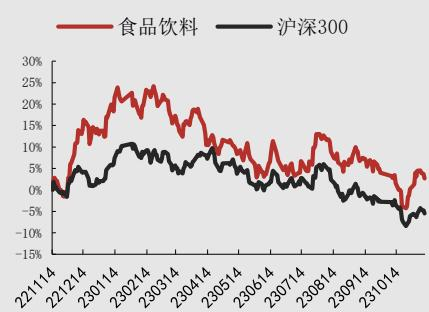  
数据来源：聚源，万联证券研究所

## 相关研究

食饮板块持续上涨，白酒行业信心提振整体业绩稳健增长，白酒分化加剧三季报业绩增长稳健，板块强势反弹

分析师: 陈雯

执业证书编号： S0270519060001

电话：02032255207

邮箱： chenwen@wlzq.com.cn/瓶，飞天散瓶价格由2820元/瓶上涨到2840元/瓶。茅台集团与轩尼诗举行座谈，茅台二十四节气冬系列文化产品和“茅台·1935中国国家地理”文创酒发布，贵州茅台2023年立冬美食节启动。五粮液：上周，普五（八代）价格保持稳定，维持960元/瓶。泸州老窖：上周，泸州老窖(52度)价格由328.00元/瓶降至320.00元/瓶后又恢复原价。泸州老窖再获深交所信息披露工作A级评价。

## 食品饮料其它板块：

啤酒：华润啤酒：华润雪花啤酒（朝阳）年产30万千升啤酒项目正有序推进，按照年度计划将完成固定资产投资2亿元。该项目预计总投资10.2亿元，项目规划产能30万千升/年，占地面积280亩，建设内容主要包括联合车间、包装车间、成品库等；新增糖化生产线一套、发酵罐清酒罐42个、筒仓11个、瓶装生产线一条、听装生产线一条及其他配套设备。项目达产后预计年可实现产值8亿元，实现利税1.5亿元。

大众食品：安琪酵母：11月6日，安琪酵母发布投资者调研记录显示，目前公司收入增长中海外市场占比较多，因此公司未来在海外将会有更长远的市场开发计划。公司目前正在积极考察海外适合扩产或者建厂的地方。

风险因素：1. 政策风险 2. 食品安全风险 3. 经济增速不及预期风险

## 正文目录

1 上周行情回顾....4
2 白酒每周谈....5
2.1 资本市场个股表现....5
2.2 价格跟踪及点评....5
2.3 北向资金跟踪....6
2.4 行业动态及重点公司事件跟踪点评....7
3 食品饮料子板块行业动态及重点公司跟踪点评....9
4 上市公司公告及大事提醒....10
5 投资建议....10
6 风险因素....11

图表1：申万一级行业上周涨跌幅(%) 4  
图表2：申万一级行业年初至今涨跌幅(%) 4  
图表3：食品饮料子板块上周及年初至今涨跌幅(%) 4  
图表4：食品饮料子板块PE-TTM(2023.11.10) 4  
图表5：食品饮料领涨领跌个股(%) 5  
图表6：白酒板块个股周涨跌幅(%) 5  
图表7：飞天茅台批价跟踪（元） 6  
图表8：普五批价跟踪（元） 6  
图表9：名酒线上零售价跟踪（元） 6  
图表10：茅五泸北向资金持股数量及持股比例 7  
图表11：贵州茅台北向资金净流入金额 7  
图表12：上周食品饮料板块重点上市公司公告及重大事件 10

## 1 上周行情回顾

上周食品饮料板块下跌1.72%，于申万31个子行业中位列第31。上周（2023年11月06日-2023年11月12日），沪深300指数上涨0.07%，申万食品饮料指数下跌1.72%，跑输沪深300指数1.79个百分点，在申万31个一级子行业中排名第31。年初至今沪深300指数下跌7.36%，申万食品饮料指数下跌9.72%，跑输沪深300指数2.36个百分点，在申万31个一级子行业中排名第21。

子板块层面：上周食品饮料子板块大部分下跌，其中零食（+1.57%）、其他酒类（+1.49%）、保健品（+0.07%）、啤酒（-0.27%）、调味发酵品（-0.28%）、乳品（-0.37%）、烘焙食品（-0.71%）、肉制品（-1.06%）、预加工食品（-1.58%）、软饮料（-1.96%）、白酒（-2.20%）。PE（TTM）分别为其他酒类（124.67倍）、调味发酵品（50.58倍）、保健品（37.85倍）、零食（37.25倍）、啤酒（28.08倍）、烘焙食品（27.59倍）、白酒（27.51倍）、软饮料（27.07倍）、预加工食品（26.46倍）、肉制品（22.34倍）、乳品（21.49倍）。

图表1：申万一级行业上周涨跌幅(%)  
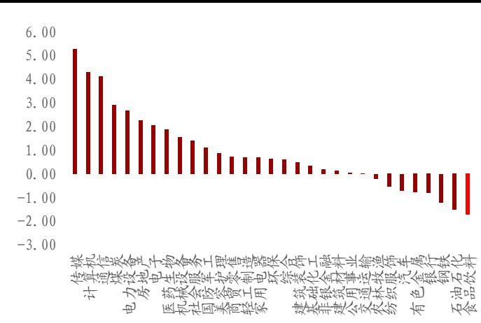  
资料来源：同花顺iFinD，万联证券研究所

图表2：申万一级行业年初至今涨跌幅(%)  
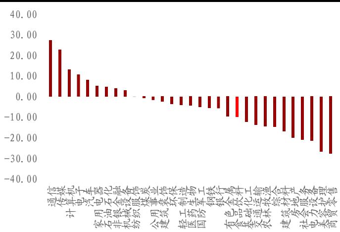  
资料来源：同花顺iFinD，万联证券研究所

图表3: 食品饮料子板块上周及年初至今涨跌幅 (%)  
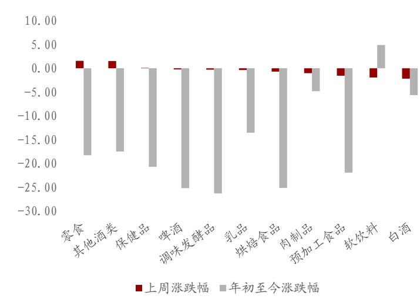  
资料来源：同花顺iFinD，万联证券研究所

图表4: 食品饮料子板块PE-TTM(2023.11.10)  
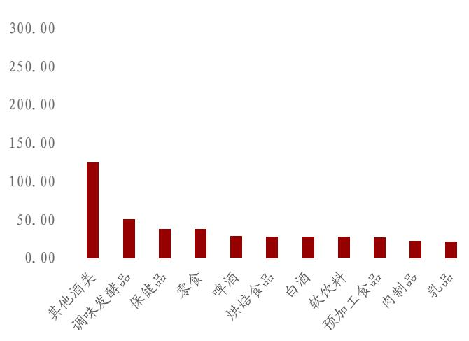  
资料来源：同花顺iFinD，万联证券研究所

图表5：食品饮料领涨领跌个股(%)

<table><tr><td colspan="2">领涨个股</td><td colspan="2">领跌个股</td></tr><tr><td>朱老六</td><td>7.02</td><td>莲花健康</td><td>-11.43</td></tr><tr><td>盐津铺子</td><td>6.55</td><td>今世缘</td><td>-4.91</td></tr><tr><td>ST 交昂</td><td>6.25</td><td>珠江啤酒</td><td>-4.62</td></tr><tr><td>好想你</td><td>6.16</td><td>绝味食品</td><td>-4.20</td></tr><tr><td>盖世食品</td><td>5.96</td><td>泸州老窖</td><td>-4.16</td></tr></table>

资料来源：同花顺iFinD，万联证券研究所

## 2 白酒每周谈

## 2.1 资本市场个股表现

上周白酒板块下跌2.20%，其中古井贡B(+2.47%)、皇台酒业(+1.27%)、酒鬼酒(+0.16%)涨幅居前三，贵州茅台下跌1.95%，五粮液下跌1.73%。

图表6: 白酒板块个股周涨跌幅(%)  
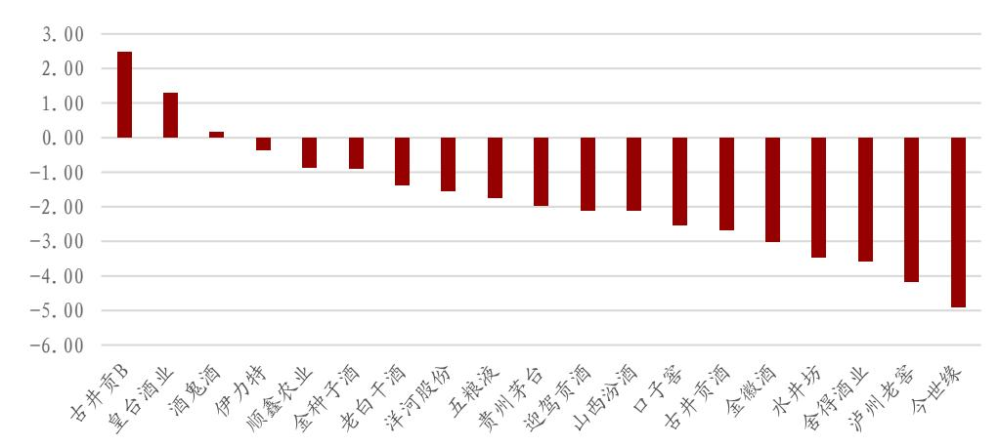  
资料来源：同花顺iFinD，万联证券研究所

## 2.2 价格跟踪及点评

上周，20年飞天茅台批价维持3060元/瓶，飞天散瓶价格由2820元/瓶上涨到2840元/瓶。普五（八代）价格维持960元/瓶。根据京东商城数据，本周大部分名酒价格不变，五粮液(52度)价格维持1029.00元/瓶，洋河梦之蓝(M3)(52度)价格维持639.00元/瓶，习酒窖藏1988(53度)价格维持698.00元/瓶，水井坊(52度)价格维持560.00元/瓶，30年青花汾酒(53度)价格维持1099.00元/瓶。少部分名酒价格出现波动，泸州老窖(52度)价格由328.00元/瓶降至320.00元/瓶后又恢复原价，剑南春(52度)价格由489.00元/瓶降至469.00元/瓶后又恢复原价。

图表7: 飞天茅台批价跟踪（元）  
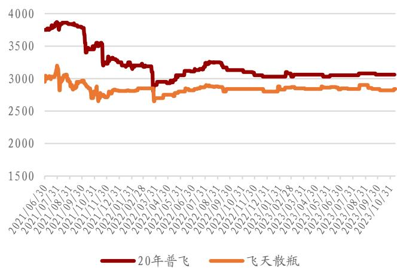  
资料来源：今日酒价，万联证券研究所

图表8: 普五批价跟踪（元）  
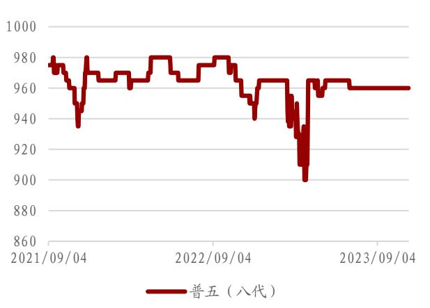  
资料来源：今日酒价，万联证券研究所

图表9: 名酒线上零售价跟踪（元）  
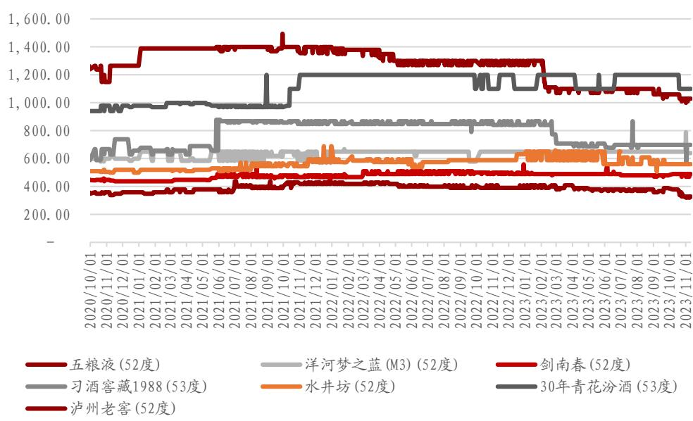  
资料来源：京东，万联证券研究所

## 2.3 北向资金跟踪

截至2023年11月10日，贵州茅台北向资金持股8555.17万股，持股比例为6.81%，较上上周增加0.01pct；五粮液北向资金持股19679.56万股，持股比例为5.06%，较上上周减少0.04pct；泸州老窖北向资金持股5394.47万股，持股比例为3.66%，较上上周增加0.17pct。贵州茅台上周累计净流出1.82亿元。

图表10: 茅五泸北向资金持股数量及持股比例  
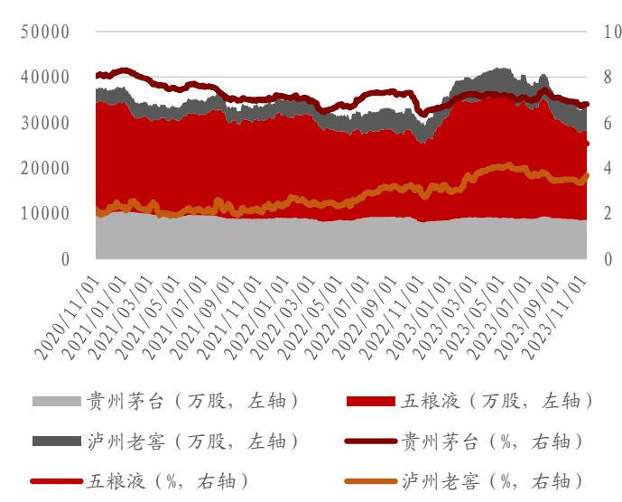  
资料来源：同花顺iFinD，万联证券研究所

图表11：贵州茅台北向资金净流入金额  
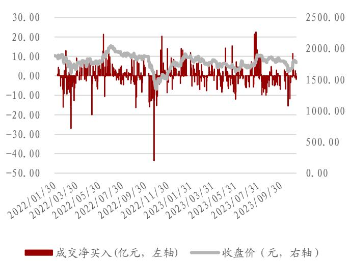  
资料来源：同花顺iFinD，万联证券研究所

## 2.4 行业动态及重点公司事件跟踪点评

## 11月上旬全国白酒环比价格总指数上涨0.05%

11月10日，全国白酒价格调查资料显示，2023年11月上旬全国白酒环比价格总指数为100.05，上涨 $0.05\%$ 。从分类指数看，名酒环比价格指数为99.96，下跌 $0.04\%$ ；地方酒环比价格指数为100.09，上涨 $0.09\%$ 。基酒环比价格指数为100.28，上涨 $0.28\%$ 。从定基价格指数看，2023年11月上旬全国白酒商品批发价格定基总指数为110.83，上涨 $10.83\%$ 。其中，名酒定基价格指数为114.30，上涨 $14.30\%$ ；地方酒定基价格指数为105.95，上涨 $5.95\%$ ；基酒定基价格指数为108.99，上涨 $8.99\%$ 。（糖酒快讯）

## 茅台集团与轩尼诗举行座谈

11月6日，茅台集团与轩尼诗在茅台国际大酒店举行座谈。双方围绕产品合作、渠道建设、文化传播、履行社会责任和可持续发展等进行深入沟通交流，共叙友谊，共话未来。（糖酒快讯）

## 茅台二十四节气冬系列文化产品发布

11月8日，贵州茅台二十四节气冬系列文化产品发布会在海南三亚茅台度假村和巽风数字世界线上线下同步举行。作为贵州茅台2023年“二十四节气酒”的收官之作，贵州茅台二十四节气冬系列文化产品在表现传承文化之美、科技创新之美的基础上，进一步突出茅台美酒和椰风海韵的融合之美，以及再开新局、共创未来的开放之美，再启“美自天成”的寻美之旅。（糖酒快讯）

## “茅台·1935中国国家地理”文创酒正式发布

11月9日，“茅台1935·寻道中国”科学探索活动收官之站走进北国边城——黑龙江黑河，于“胡焕庸线”北端持续开启寻美之旅，探寻“瑷珲”之城的自然人文密码，感受“神州边陲”的魅力。活动中，“茅台1935·国之大医”公益基金会向黑河市中医药发展事业捐赠50万元，用于支持黑河市医疗发展。活动现场，“第35台中国国家地理”文创酒正式发布。（糖酒快讯）

## 贵州茅台2023年立冬美食节启动

11月8日，时值茅台厂庆日，以“享暖冬珍味·品茅台臻美”为主题的贵州茅台2023年立冬美食节在茅台国际大酒店和三亚海棠湾茅台度假村两地同时启动，进一步弘扬中华传统美食文化，深化饮与食文化相融的茅台美学表达，传递茅台美酒美食美生活。（糖酒快讯）

## i茅台APP推出“向美而行·共赴山河”（黑河站）线上活动

11月5日-11月11日期间，i茅台APP推出“向美而行·共赴山河”（黑河站）线上活动。活动一、投放增量：2023年11月5日-11月11日，全国可申购门店每天9:00享约申购场茅台1935投放增量60%。活动二、专场活动：11月9日19:00-22:00在贵州省、云南省、四川省、陕西省、山西省、内蒙古自治区、河北省及黑龙江省区域门店开展茅台1935线上专场申购活动，共计投放1935组53%vol 500ml茅台1935，每个用户可申购1组。活动三、抽奖活动：2023年11月5日-11月11日，在全国可申购门店申购成功茅台1935，且在11月17日17点前完成提货的用户，将有机会获得茅台1935酒2瓶或定制20寸行李箱一个。获奖名单将于11月18日20点在i茅台APP公布。（糖酒快讯）

## 五粮液酒文化博览馆与吉林省酒文化博物馆文化共建签约揭牌

11月3日，五粮液酒文化博览馆、吉林省酒文化博物馆文化共建签约揭牌仪式在白山方大集团隆重举行。双方将充分发挥各自资源优势，围绕文化共建合作协议，在文化研究、品牌推广、文创产品研发、产品展览、队伍建设等方面加强交流，以务实的合作推进双方文化宣传和品牌打造。（糖酒快讯）

## 泸州老窖再获深交所信息披露工作A级评价

近日，深圳证券交易所公布了深市上市公司2022-2023年度信息披露工作评价结果通报，泸州老窖凭借在信息披露、规范运作及投资者关系管理等方面的优异表现，再次获得最高评价A级（优秀）考评结果，这已是公司连续4年荣获此殊荣。（糖酒快讯）

## 泸州老窖新专利可制备风味红茶

11月10日，泸州老窖股份有限公司及旗下泸州品创科技有限公司申请的“一种风味红茶及其制备方法和应用”专利公布。摘要显示，该专利涉及一种风味红茶。并且该申请参考了花果香味在茶饮中的呈香顺序，调制出了前调为花香、后调为果香的茶饮。（糖酒快讯）

## 2023青花汾酒发展论坛召开

11月6日，2023青花汾酒发展论坛在上海国际会议中心召开。行业专家大咖齐聚一堂，共话行业趋势，共商清香未来。论坛上，袁清茂为“汾酒营销顾问委员会”顾问委员颁发聘书。（糖酒快讯）

## “青花汾酒文化体验中心”项目正式启动

11月6日，“青花汾酒文化体验中心”项目正式启动。青花汾酒文化体验中心集中展示了汾酒品牌价值，向消费者展示产品，帮助消费者进一步体验汾酒文化，了解汾酒工艺，通过高度还原的场景及高品质沉浸式体验，满足消费者对高品质生活的追求，进一步提升汾酒的自身价值。（糖酒快讯）

## 会稽山启动首届低度中国酒·中国黄酒文化复兴大会暨翻稽海发展大会

11月9日，会稽山重磅启动首届低度中国酒·中国黄酒文化复兴大会暨会稽山280周年发展大会。在本次大会上，正式牵手江南大学，为酿造工程技术中心揭牌，同时发布228道会稽山绍兴酒酿制工艺技术规范。此外，会稽山·兰亭全新改版，于大会上重磅发布4款产品：兰亭标准版、兰亭大师版、兰亭1993版、兰亭280周年纪念版。（糖酒快讯）

## 金种子酒业3项创新成果获奖

日前，华润啤酒技术研究院正式公布了2023年度创新成果奖评选结果。金种子酒业共有3项创新成果上榜，其中，“52%vol金种子馥20白酒”荣获产品创新银奖，“功能性酿酒微生物的筛选及其在绿色酿造生产中的应用”“夏秋茶渥堆成曲及混合固态发酵产业化关键技术与应用”2项成果分别荣获技术创新铜奖、技术创新优秀奖，成为华润酒业唯一荣获华润啤酒技术创新奖的白酒企业。（糖酒快讯）

## 古越龙山甲辰龙年生肖酒发布

11月9日，古越龙山“龙步青云酬壮志，鹏飞碧宇览神州”甲辰龙年生肖酒全球发布会在绍兴饭店·府山隐成功举行，古越龙山甲辰龙年生肖酒是古越龙山推出的第四款生肖纪念酒。活动现场，相关负责人对古越龙山甲辰龙年生肖酒的品牌赋能、文化认同和全新价值作了重点阐述。（糖酒快讯）

## 3 食品饮料子板块行业动态及重点公司跟踪点评

## 10月份食品烟酒类价格同比下降2.1%，环比下降0.4%

11月9日，国家统计局发布数据显示，10月份，全国居民消费价格同比下降0.2%，环比下降0.1%。10月份，食品烟酒类价格同比下降2.1%，影响CPI（居民消费价格指数）下降约0.61个百分点；食品烟酒类价格环比下降0.4%，影响CPI下降约0.12个百分点。按类别分，10月份，酒类居民消费价格环比上涨0.0%，同比下降0.5%，1-10月同比上涨0.6%。（糖酒快讯）

## 华润雪花啤酒（朝阳）年产30万千升啤酒项目有序推进

华润雪花啤酒（朝阳）年产30万千升啤酒项目正有序推进，按照年度计划将完成固定资产投资2亿元。该项目预计总投资10.2亿元，项目规划产能30万千升/年，占地面积280亩，建设内容主要包括联合车间、包装车间、成品库等；新增糖化生产线一套、发酵罐清酒罐42个、筒仓11个、瓶装生产线一条、听装生产线一条及其他配套设备。项目达产后预计年可实现产值8亿元，实现利税1.5亿元。（糖酒快讯）

## 华润怡宝成都工厂二期项目预计年底竣工

近日，据成都日报新闻消息，华润怡宝成都工厂二期项目预计将于今年年底竣工。据悉，工厂位于新津区天府智能制造产业园，总投资约10亿元。建成后，华润怡宝成都生产基地将达到11条纯净水和饮料生产线（含一期），届时，除怡宝瓶装和桶装纯净水之外，还将生产假日、菊花茶、蜜水等系列饮料，预计年产值将超过15亿元。（食品饮料企业动态）

## 君乐宝集团入股茉酸奶30%股份

11月8日，君乐宝乳业集团与茉酸奶战略合作签约仪式，君乐宝乳业集团将入股茉酸奶品牌持有公司 $30\%$ 股份，双份在乳制品原料供应、新品研发、食品安全和经营管理等多个领域开展深度合作。（食品饮料企业动态

## 安琪酵母：目前正在考察海外扩产或建厂

11月6日，安琪酵母发布投资者调研记录显示，目前公司收入增长中海外市场占比较多，因此公司未来在海外将会有更长远的市场开发计划。公司目前正在积极考察海外适合扩产或者建厂的地方。（食品饮料企业动态）

## 4 上市公司公告及大事提醒

图表12: 上周食品饮料板块重点上市公司公告及重大事件

<table><tr><td>公司简称</td><td>日期</td><td>事件类型</td><td>事件概览</td></tr><tr><td>口子窖</td><td>2023/11/8</td><td>股份回购</td><td>公司拟用自有资金不低于0.55亿元(含)、不超过1.1亿元(含)以集中竞价交易方式回购公司股份,回购价格不超55元/股。本次回购股份拟用于公司股权激励或员工持股计划。</td></tr><tr><td>洋河股份</td><td>2023/11/11</td><td>高管变动</td><td>林青女士和郑步军先生因工作调整申请辞去公司副总裁职务。辞去上述职务后,林青女士仍担任公司党委委员、内部审计机构负责人及公司子公司苏酒集团贸易股份有限公司副董事长,郑步军先生仍担任公司党委委员及公司泗阳分公司党委书记、总经理。</td></tr><tr><td>洋河股份</td><td>2023/11/7</td><td>高管变动</td><td>陈太松先生因工作调整,申请辞去公司第七届监事会监事职务,其辞职后仍担任公司全资子公司贵州贵酒集团有限公司党委书记、董事长职务。</td></tr><tr><td>百润股份</td><td>2023/11/9</td><td>重大事项</td><td>公司投资生产基地扩建项目实施主体巴克斯酒业(天津)有限公司于近日取得了项目用地的《不动产权证书》,宗地面积42,046平方米。</td></tr><tr><td>安井食品</td><td>2023/11/11</td><td>股份回购</td><td>2023年11月10日,安井食品集团股份有限公司(以下简称“公司”)通过集中竞价交易方式首次回购股份66,600股,占公司当前总股本的比例为0.02%,成交最高价为126.28元/股,成交最低价为124.83元/股,已支付的资金总金额为人民币8,361,903.01元(不含交易费用)。</td></tr><tr><td>盐津铺子</td><td>2023/11/10</td><td>股份回购</td><td>截至2023年11月8日,公司累计通过回购专用证券账户以集中竞价交易方式回购股份数量为1,401,050股,占公司总股本196,060,485股的0.7146%,最高成交价为人民币82.98元/股,最低成交价为人民币73.43元/股,成交总金额为人民币109,318,864.15元(含交易费用等)。本次回购符合既定的回购方案和回购报告书,符合相关法律法规规定。公司本次回购股份方案已实施完毕。</td></tr></table>

资料来源：公司公告，万联证券研究所

## 5 投资建议

建议关注：1）白酒：酒类消费将持续恢复，同时分化趋势将延续，预计高端酒及区域地产龙头表现更优，关注高端酒及区域酒核心资产；2）啤酒：长期高端化趋势延续，短期澳麦“双反”政策取消叠加包材价格下降，啤酒企业成本压力有所缓解，同时消费市场持续复苏，啤酒需求端向好，建议关注高端化啤酒龙头；3）大众品：大众食品需求刚性较强，业绩分化明显。建议关注业绩表现较好的速冻食品、调味品、软饮料、乳制品、休闲零食等大众品行业龙头。

## 6 风险因素

1. 政策风险：食品饮料中的诸多板块，如白酒等，与政策关联度较大，限制或管控相应产品于某些消费场景的消费将会带来较大的行业调整。

2. 食品安全风险: 食品安全是消费者关注的重中之重, 消费者对出现食品安全问题的产品及公司甚至行业的信任度及消费意愿将大幅下降。

3. 经济增速不及预期风险: 白酒等子板块仍有一定的周期性, 提示经济增速不及预期的风险。

## 行业投资评级

强于大市：未来6个月内行业指数相对大盘涨幅10%以上；

同步大市：未来6个月内行业指数相对大盘涨幅10%至-10%之间；

弱于大市：未来6个月内行业指数相对大盘跌幅10%以上。

## 公司投资评级

买入：未来6个月内公司相对大盘涨幅15%以上；

增持：未来6个月内公司相对大盘涨幅5%至15%；

观望：未来6个月内公司相对大盘涨幅-5%至5%；

卖出：未来6个月内公司相对大盘跌幅5%以上。

基准指数：沪深300指数

## 风险提示

我们在此提醒您，不同证券研究机构采用不同的评级术语及评级标准。我们采用的是相对评级体系，表示投资的相对比重建议；投资者买入或者卖出证券的决定取决于个人的实际情况，比如当前的持仓结构以及其他需要考虑的因素。投资者应阅读整篇报告，以获取比较完整的观点与信息，不应仅仅依靠投资评级来推断结论。

## 证券分析师承诺

本人具有中国证券业协会授予的证券投资咨询执业资格并登记为证券分析师，以勤勉的执业态度，独立、客观地出具本报告。本报告清晰准确地反映了本人的研究观点。本人不曾因，不因，也将不会因本报告中的具体推荐意见或观点而直接或间接收到任何形式的补偿。

## 免责条款

万联证券股份有限公司（以下简称“本公司”）是一家覆盖证券经纪、投资银行、投资管理和证券咨询等多项业务的全国性综合类证券公司。本公司具有中国证监会许可的证券投资咨询业务资格。

本报告仅供本公司的客户使用。本公司不会因接收人收到本报告而视其为客户。在任何情况下，本报告中的信息或所表述的意见并不构成对任何人的投资建议。本报告中的信息或所表述的意见并未考虑到个别投资者的具体投资目的、财务状况以及特定需求。客户应自主作出投资决策并自行承担投资风险。本公司不对任何人因使用本报告中的内容所导致的损失负任何责任。在法律许可情况下，本公司或其关联机构可能会持有报告中提到的公司所发行的证券头寸并进行交易，还可能为这些公司提供或争取提供投资银行、财务顾问或类似的金融服务。

市场有风险，投资需谨慎。本报告是基于本公司认为可靠且已公开的信息撰写，本公司力求但不保证这些信息的准确性及完整性，也不保证文中的观点或陈述不会发生任何变更。在不同时期，本公司可发出与本报告所载资料、意见及推测不一致的报告。分析师任何形式的分享证券投资收益或者分担证券投资损失的书面或口头承诺均为无效。

本报告的版权仅为本公司所有，未经书面许可任何机构和个人不得以任何形式翻版、复制、刊登、发表和引用。未经我方许可而引用、刊发或转载的引起法律后果和造成我公司经济损失的概由对方承担，我公司保留追究的权利。

## 万联证券股份有限公司 研究所

上海浦东新区世纪大道 1528 号陆家嘴基金大厦

北京西城区平安里西大街28号中海国际中心

深圳福田区深南大道2007号金地中心

广州天河区珠江东路11号高德置地广场