# 立足价值，静等风来

强于大市(维持)

# ——食品饮料行业2024年投资策略报告

## [行业核心观点：Table\_Summar

回顾 2023年，作为疫情管控放开的元年，国内经济整体呈现弱复苏态势，社零增速上半年高开低走，下半年逐步企稳回升。与此同时，消费分层趋势逐步凸显，K 型结构复苏明显，“高质性价比”产品更受消费者青睐。食品饮料板块韧性较强，粮油食品类、饮料类社零同比稳健增长，白酒、啤酒、乳制品、速冻食品等主要子板块上市公司实现营收利润双增。由于存量资金博弈和投资者信心不足，“坡长雪厚”的食品饮料板块遭遇杀估值。展望2024 年，宏观经济有望持续改善，居民收入水平有望提升，食品饮料行业将保持稳中向好趋势，目前食品饮料绝大部分子板块均处于历史底部估值区间，具备中长期配置价值，随着投资者信心回升，具备业绩稳定性的食饮细分龙头有望重获市场青睐。基于此我们推荐三条主线，①K型结构复苏主线：优选价格带向上、业绩稳增长的高端白酒龙头，以及承接大众宴席、社交聚饮等需求的热门地产酒龙头；②需求回暖主线：餐饮行业疫后显现出强劲的修复动力，增速明显高于社零增速，且高景气度有望延续到 2024年，建议关注受益于餐饮回暖的速冻食品企业；③成本压力缓解主线：包括，纸箱、大麦等原材料价格下降、产品高端化趋势延续的啤酒龙头；上游原奶价格下降、全产业链扩张布局的乳制品龙头；上游大豆价格下降、在复合调味品和健康食品领域合理布局的调味品企业龙头。

## 投资要点：

白酒板块：静待商务需求回暖，复苏仍是 2024全年主线。短期来看，K 型结构复苏趋势明显，高端白酒及中端/大众白酒增长动力更足，同时茅台提价进一步打开行业价格天花板，带动板块扩容。2023 年白酒宴席需求有序恢复、商务需求较为平淡， 年商务需求有望随着外部宏观经济的恢复而边际改善。中长期来看，白酒行业结构升级趋势不改，白酒龙头寡头垄断格局稳固，具备提价能力，且行业集中度有望进一步提升，建议关注受益于 K 型复苏趋势的高端白酒和热门地产酒龙头。

速冻食品板块：下游餐饮景气度较高，重点关注 B 端恢复情况。短期来看，2023 年餐饮行业快速恢复且超过疫情前规模，且增速高于消费行业整体水平，餐饮门店数量回升但仍未恢复至疫情前水平。展望2024年，预计餐饮行业将回归疫情前增长节奏，景气度延续，速冻食品B 端需求有望稳健增长。中长期来看，我国速冻食品市场规模已超千亿，但对标海外人均食用量仍有较大提升空间。B 端餐饮业对速冻食品的依赖性显著提升；过去 3年疫情为“懒人经济”按下加速键，社会结构变化仍将对 C 端市场增长形成有力支撑。建议关注受益于短期餐饮高景气度延续，长期发展潜力大的速冻食品龙头。

2023 年 12 月 07 日7

## [Table\_Chart] 行业相对沪深 300 指数表现

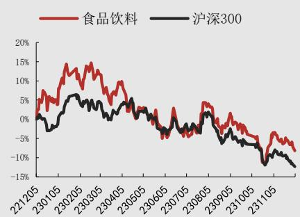  
数据来源：聚源，万联证券研究所

## [Table\_Rep相关研究

茅台特别分红释放发展利好，啤酒出口数据增长明显

各品类线上销售同比增速均较 9 月下降，冲饮保持正增长

10 月白酒线上销量持续高增长，淘系平台表现最为强劲

[Table\_A分析师: ] 陈雯

执业证书编号： S0270519060001

电话： 02032255207

邮箱： chenwen@wlzq.com.cn

研究助理: 李晨崴

电话： 18079728929

邮箱： licw@wlzq.com.cn

啤酒板块：短期成本压力缓解，行业逐步向高成熟度市场发展。短期来看，2023年以来纸箱价格持续回落，啤酒企业包材成本压力有所缓解。同时澳麦“双反”政策取消，有望缓解啤酒企业 2024年的原料成本压力。中长期来看，啤酒行业进入存量竞争时代，中国啤酒行业正处于中成熟度转向高成熟度发展的过程，高端化是未来发展趋势。目前五大龙头格局保持稳定，且行业集中度持续提高，优选高端化趋势延续、盈利空间逐步释放的啤酒龙头。

乳制品板块：成本下行释放利润空间，消费场景趋向多元化。短期来看，原奶产能出现阶段性过剩，价格自 年 月持续下降，乳企成本压力有所缓解，2024 年利润有望得到进一步释放。中长期来看，伊利股份和蒙牛乳业双寡头格局稳定，区域奶企错位竞争。对标国外，我国乳制品人均消费量有待提升，消费者对乳制品功能性诉求增加叠加消费场景多元化，市场仍有较大发展空间。建议关注生产成本缓解、全产业链扩张布局的乳制品龙头。

调味品板块：酱油企业盈利有望改善，“健康”需求方兴未艾。短期来看， 年大豆价格持续走低，但因酱油生产周期较长，在报表端传导速度偏慢，同时 2024年大豆供给充足有望进一步降低成本，预计未来 年内以酱油企业为代表的调味品公司盈利有望改善。中长期来看，复合调味品切中 / 端多种痛点，市场增速高于行业增速，调味品复合化是行业发展重要趋势，国内复调渗透率有待持续提升。同时随着经济水平的提升和健康饮食意识的增强，消费者对健康调味品的需求逐渐增加，健康调味品成为热门赛道。建议关注受益于成本压力缓解、在复合调味品和健康食品领域合理布局的调味品企业。

风险因素：经济复苏不及预期风险、原材料价格波动风险、政策风险、食品安全风险。

## 正文目录

1 复盘 2023：整体弱复苏，杀估值带动板块下跌....6
1.1 行情回顾：食饮指数表现平淡，板块估值处于历史低位....6
1.2 业绩回顾：前三季度营收利润稳健增长，业绩与指数明显背离....7
2 展望 2024：行业有望保持稳中向好趋势，精选优质赛道....11
3 K 型结构复苏主线：白酒....13
3.1 白酒：静待商务需求回暖，复苏仍是 2024 全年主线....13
3.1.1 K 型结构复苏明显，估值修复逻辑有望引领短期普涨行情....13
3.1.2 24 年商务需求有望边际改善，茅台提价带动市场扩容....14
3.1.3 长期结构升级趋势不改，优选高端白酒优质赛道....14
4 需求回暖主线：速冻食品....16
4.1 速冻食品:下游餐饮景气度较高，重点关注 B 端恢复情况....16
4.1.1 B 端修复表现强于 C 端，2024 年行业 B 端需求有望稳健增长....16
4.1.2 行业发展潜力大，B/C 端共振未来可期....17
5 成本压力缓解主线：啤酒、乳制品、调味品....19
5.1 啤酒：短期成本压力缓解，行业逐步向高成熟度市场发展....19
5.1.1 原材料叠加包材价格下降，成本压力有望缓解....19
5.1.2 存量竞争时代，寡头垄断格局已定....22
5.1.3 高端化是未来发展趋势，对标国外仍有较大增长空间....22
5.2 乳制品：成本下行释放利润空间，消费场景趋向多元化....26
5.2.1 原奶价格持续下降，乳企兑现利润空间....26
5.2.2 双寡头格局稳定，区域奶企错位竞争....27
5.2.3 人均消费量有待提升，市场空间广阔....28
5.3 调味品：酱油企业盈利有望改善，“健康”需求方兴未艾....30
5.3.1 大豆量多价优，成本压力减轻....30
5.3.2 复合调味品景气度较高，健康调味品成热门赛道....31
6 投资建议....33
7 风险提示....33

图表1：申万一级行业2023年涨跌幅（%）....6  
图表2：食品饮料申万三级行业2023年涨跌幅（%）....6  
图表3：食品饮料申万三级行业2023年股价驱动因素....6  
图表4：申万一级行业五年估值区间（按PE-TTM排序）....7  
图表5：食品饮料申万三级行业五年估值区间（按PE-TTM排序）....7  
图表6：2017-2023Q1-3食品饮料板块营收及同比....7  
图表7：2017-2023Q1-3食品饮料板块归母净利润及同比....7  
图表8：申万一级子行业营业收入及归母净利润同比增速（%）....8  
图表9：2017-2023Q1-3食饮板块毛利率&净利率....8  
图表10：食品饮料主要原材料成本延续下降趋势....8  
图表11：2023Q1\~Q3食品饮料申万三级行业营收与归母净利增速....9  
图表12：中国CPI和PPI月度同比增速....10  
图表13：中国金融机构储蓄存款月度余额和同比增速....10  
图表14：中国新成立基金（股票+混合）规模....10  
图表15：食饮板块重仓比例走势及其重仓比例平均值....10

图表16: 8月以来社零增速持续回暖....11  
图表17: 粮油、食品类/饮料类表现稳健....11  
图表18: 居民人均可支配收入持续增长....11  
图表19: 三季度以来消费者信心指数持续上升（%）....11  
图表20: 2023年以来多部门发声促消费....12  
图表21: 23Q1-3各档次白酒业绩情况....13  
图表22: 主要上市酒企业绩与估值对比（按前三季度归母净利润增速排序）....13  
图表23: 飞天茅台批价跟踪（元）....14  
图表24: 名酒线上零售价跟踪（元）....14  
图表25: 近年来白酒产量下滑（万千升）....15  
图表26: 主流酒企吨价持续提升（万元/吨）....15  
图表27: 规模以上白酒企业数量持续下降（家）....15  
图表28: 我国白酒市场集中度进一步提高....15  
图表29: 餐饮增速较社零增速表现更优....16  
图表30: 餐饮门店数量尚未恢复至疫情前水平（万家）....16  
图表31: 速冻食品企业B端收入占比提升....16  
图表32: 限额以上单位餐饮收入增长更快....16  
图表33: 中国速冻食品规模及增速....17  
图表34: 2019年世界主要国家和地区人均速冻食品食用量对比（kg）....17  
图表35: 速冻行业细分赛道市场结构梳理....17  
图表36: 中国团餐市场规模及增速....18  
图表37: 2020-2022年中国餐饮连锁化率....18  
图表38: 2021年中国消费者对速冻食品满意度分析....18  
图表39: 我国家庭规模变化（人/户）....18  
图表40: 中国冷链物流市场规模（亿元）....19  
图表41: 中国冷库总容量及冷藏车保有量....19  
图表42: 啤酒生产成本构成....19  
图表43: 瓦楞纸出厂价（元/吨）....20  
图表44: 中国平板玻璃市场价（元/吨）....20  
图表45: 打包易拉罐平均价(元/吨，不含税)....20  
图表46: 铝价（元/吨）....20  
图表47: 中国大麦进口平均单价（美元/吨）....21  
图表48: 澳麦价格更具优势（美元/千克）....21  
图表49: 2021年实施“双反”政策后中国大麦主要进口国来源地占比....21  
图表50: 2017-2021年中国啤酒行业CR5集中度....22  
图表51: 2021年中国啤酒行业市场份额分布....22  
图表52: 中国高端啤酒消费量（亿升）....23  
图表53: 近年来啤酒企业不断提价....23  
图表54: 中国啤酒行业尚处于中成熟度市场....24  
图表55: 中国啤酒人均消费呈增长趋势....24  
图表56: 2022年各国啤酒人均消费（美元）....24  
图表57: 各啤酒企业吨价持续上升（元/千升）....25  
图表58: 2022年各啤酒企业吨价（元/千升）....25  
图表59: 我国啤酒罐化率逐年上升....25  
图表60: 对比成熟市场，我国啤酒罐化率仍有提升空间....25  
图表61: 奶牛存栏量和单产变化....26  
图表62: 国内原奶产量变化....26

图表63: 原奶价格变化（元/公斤）....26  
图表64: 乳制品行业竞争梯队....27  
图表65: 2022年乳制品行业竞争格局....27  
图表66: 乳制品细分赛道竞争格局....28  
图表67: 中国居民平衡膳食宝塔新旧版对比....29  
图表68: 我国居民人均奶类消费量与增速....29  
图表69: 中美日人均乳制品消费量（千克/年）....29  
图表70: 2022年消费者认为喝奶的好处....30  
图表71: 2022年消费者对乳制品的功能诉求....30  
图表72: 大豆价格（元/吨）....30  
图表73: 全球大豆产量（亿吨）....30  
图表74: 我国复合调味品市场增速高于行业整体增速....31  
图表75: 复合调味品市场细分品类（亿元）....31  
图表76: 2020年中外复合调味品渗透率对比....32  
图表77: 复合调味品切中B/C端多种痛点....32  
图表78: 2023年中国消费者对调味品健康化态度....32  
图表79: 2023年中国消费者对健康型调味品需求....32  
图表80: 中国典型调味品企业健康化产品布局情况....33

资料来源：同花顺iFinD，万联证券研究所注：数据截止2023年11月10日

资料来源：同花顺iFinD，万联证券研究所注：数据截止2023年11月10日

## 1 复盘2023：整体弱复苏，杀估值带动板块下跌

## 1.1 行情回顾：食饮指数表现平淡，板块估值处于历史低位

23年股市整体表现不佳，食品饮料板块涨幅靠后。2023年A股股市整体表现欠佳，2023年1月1日至11月10日（以下用年初指代1月1日，至今指代11月10日）31个申万一级行业中21个行业指数走势下跌。从绝对涨幅来看，食品饮料行业年初至今下跌9.72%，在31个申万一级行业中排名21，涨幅靠后；从相对涨幅来看，食品饮料行业跑输沪深300指数2.35个百分点，表现弱于大盘。

图表1：申万一级行业2023年涨跌幅（%）  
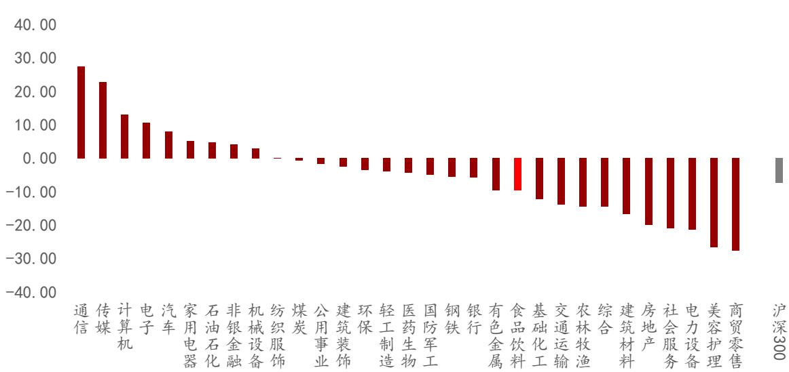  
资料来源：同花顺iFinD，万联证券研究所  
注：数据截止2023年11月10日

食饮子板块指数除软饮料外全部下行，估值回落带动各子板块下跌。2023年食品饮料申万三级行业指数除软饮料外全部下跌，肉制品与白酒跌幅在5%左右，其余子板块下跌超10%。分解来看，所有细分板块均遭遇了估值下跌，且为股价下跌的主要原因。其中，预加工食品、啤酒、调味发酵品的PE-TTM估值较年初下跌幅度超过30%，乳品、零食、白酒的PE-TTM估值较年初下跌幅度也超过20%。

图表2：食品饮料申万三级行业2023年涨跌幅（%）  
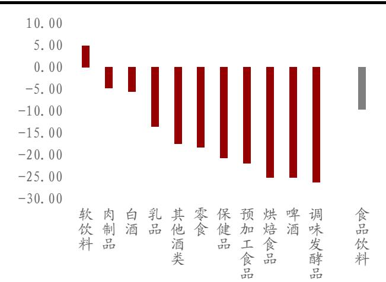

图表3：食品饮料申万三级行业2023年股价驱动因素  
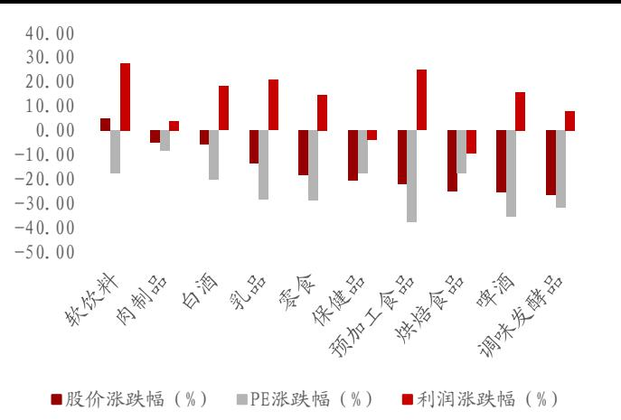

食品饮料板块处于历史估值低位，多个子板块明显低估。从五年跨度的区间估值来看，当前食品饮料板块的估值百分位为14.68%，处于历史低位。细分子板块来看，多个子板块估值较低，除软饮料估值百分位接近中枢水平外，其余子板块估值百分位均低于20%。其中，保健品、肉制品、调味品、预加工食品、乳品与啤酒的估值百分位分别为8.72%、8.37%、3.85%、3.45%、0.91%、0.45%，接近历史估值最低点。

图表4：申万一级行业五年估值区间（按PE-TTM排序）  
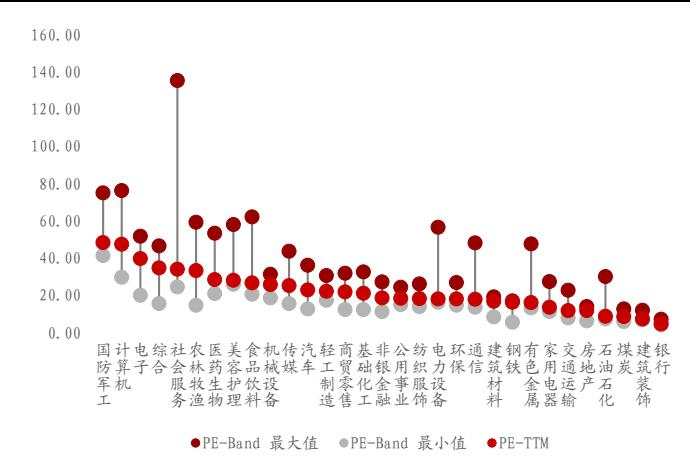  
资料来源：同花顺iFinD，万联证券研究所注：数据截止2023年11月10日

图表5：食品饮料申万三级行业五年估值区间（按PE-TTM排序）  
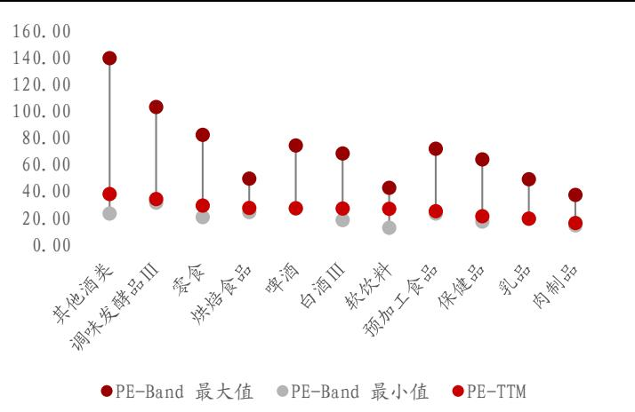  
资料来源：同花顺iFinD，万联证券研究所注：数据截止2023年11月10日

## 1.2 业绩回顾：前三季度营收利润稳健增长，业绩与指数明显背离

食品饮料板块2023Q1-Q3营收/归母净利润稳健增长，增速居于申万各一级行业前列。2023年前三季度食品饮料板块业绩维持稳健增长，营业收入合计7885.41亿元，同比增长8.71%，在申万一级行业中排名第4；归母净利润合计1621.71亿元，同比增长15.28%，在申万一级行业中排名第7。近年来，即使处于疫情期间，食品饮料板块营收/归母净利润仍旧维持正增长，板块业绩稳定性强。在消费逐步复苏、市场持续回暖的背景下，食品饮料板块韧性十足，业绩表现优于市场，增长确定性较强。

图表6：2017-2023Q1-3食品饮料板块营收及同比  
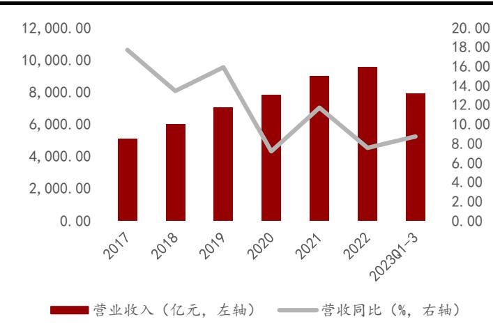  
资料来源：同花顺iFinD，万联证券研究所

图表7：2017-2023Q1-3食品饮料板块归母净利润及同比  
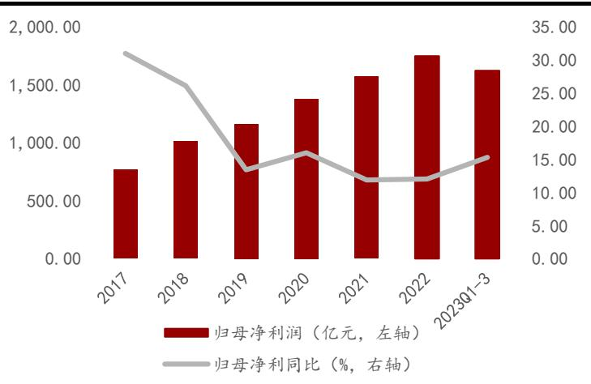  
资料来源：同花顺iFinD，万联证券研究所

图表8：申万一级子行业营业收入及归母净利润同比增速（%）

<table><tr><td colspan="2">2023Q1~Q3营收增速</td><td>2023Q1~Q3归母净利润增速</td></tr><tr><td>社会服务</td><td>-15.00</td><td>-600.00</td></tr><tr><td>汽车</td><td>-10.00</td><td>-300.00</td></tr><tr><td>电力设备</td><td>-5.00</td><td>-100.00</td></tr><tr><td>食品饮料</td><td>-15.00</td><td>-300.00</td></tr><tr><td>国防军工</td><td>-10.00</td><td>-100.00</td></tr><tr><td>农林牧渔</td><td>-5.00</td><td>-300.00</td></tr><tr><td>建筑装饰</td><td>-15.00</td><td>-100.00</td></tr><tr><td>家用电器</td><td>-10.00</td><td>-300.00</td></tr><tr><td>传媒</td><td>-5.00</td><td>-100.00</td></tr><tr><td>通信</td><td>-10.00</td><td>-300.00</td></tr><tr><td>美容护理</td><td>-5.00</td><td>-100.00</td></tr><tr><td>纺织服饰</td><td>-10.00</td><td>-300.00</td></tr><tr><td>机械设备</td><td>-5.00</td><td>-100.00</td></tr><tr><td>有色金属</td><td>-10.00</td><td>-300.00</td></tr><tr><td>环保</td><td>-5.00</td><td>-100.00</td></tr><tr><td>公用事业</td><td>-10.00</td><td>-300.00</td></tr><tr><td>非银金融</td><td>-5.00</td><td>-100.00</td></tr><tr><td>医药生物</td><td>-10.00</td><td>-300.00</td></tr><tr><td>计算机</td><td>-5.00</td><td>-100.00</td></tr><tr><td>交通运输</td><td>-10.00</td><td>-300.00</td></tr><tr><td>商贸零售</td><td>-5.00</td><td>-100.00</td></tr><tr><td>房地产</td><td>-10.00</td><td>-300.00</td></tr><tr><td>银行</td><td>-5.00</td><td>-100.00</td></tr><tr><td>石油石化</td><td>-10.00</td><td>-300.00</td></tr><tr><td>建筑材料</td><td>-5.00</td><td>-100.00</td></tr><tr><td>综合</td><td>-10.00</td><td>-300.00</td></tr><tr><td>轻工制造</td><td>-5.00</td><td>-100.00</td></tr><tr><td>电子</td><td>-10.00</td><td>-300.00</td></tr><tr><td>钢铁</td><td>-5.00</td><td>-100.00</td></tr><tr><td>基础化工</td><td>-10.00</td><td>-300.00</td></tr><tr><td>煤炭</td><td>-15.00</td><td>-600.00</td></tr></table>

资料来源：同花顺iFinD，万联证券研究所

受益于各类原材料价格下行， 食饮板块毛利率迅速回升，超过疫情前水平。自2019年疫情爆发以来，食品饮料的生产与销售均受到较大扰动，需求紧缩、成本高企，在报表端的直接反应即毛利率连续下行。2022年下半年以来，主要原材料瓦楞纸、大麦、大豆及原奶价格均持续走低，成本下降的影响逐渐传导至报表端，部分企业盈利能力有所提升进而带动板块整体毛利率触底回升。此外，由于部分产品生产周期较长或者采购方式较为特殊，现在仍使用成本较高的存货生产，原材料价格下降的影响还未体现在报表端，未来1-2年内食品饮料板块毛利率或将持续受益于原材料价格下降。

图表9：2017-2023Q1-3食饮板块毛利率&净利率  
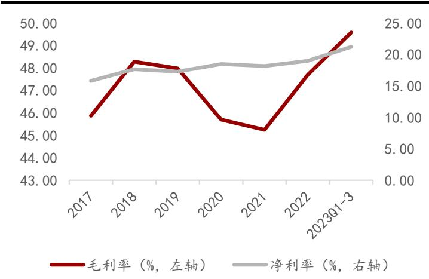  
资料来源：同花顺iFinD，万联证券研究所

图表10：食品饮料主要原材料成本延续下降趋势  
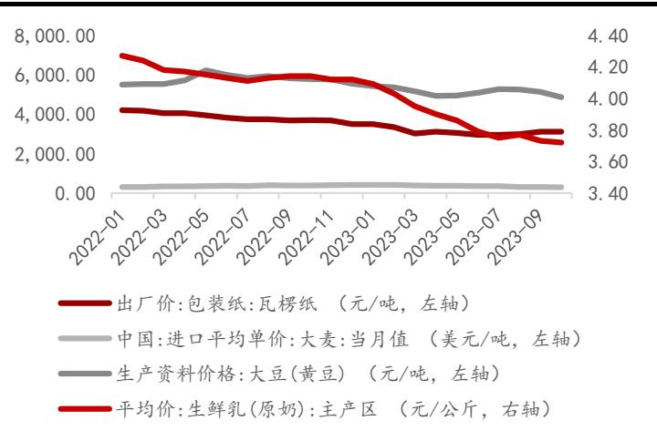  
资料来源：同花顺iFinD，wind，万联证券研究所

## 食品饮料内部子板块大部分实现收入利润双增长，但业绩表现分化。2023年前三季

度，食品饮料申万三级子板块大部分实现收入利润双增长，但受外部宏观经济与行业自身特性等因素影响，业绩表现较为分化。其中，收入增速最高的为保健品、白酒、软饮料，归母净利润增速最高的为其他酒类、软饮料、乳品；收入下滑的有肉制品和零食，归母净利润下滑的有肉制品及调味品板块。重点来看：①白酒板块营收同比+15.91%，归母净利润同比+18.92%。23Q1随着疫情影响逐步缓解，消费场景逐渐修复，白酒迎来脉冲式的修复；23Q2消费者信心下降叠加白酒淡季影响，板块需求回落；23Q3板块延续平稳表现，中秋/国庆期间双节期间礼赠需求密集释放、宴席需求持续走强，商务需求仍在恢复过程中。②预加工食品板块营收同比+10.69%，归母净利润同比+17.22%。23Q1受益于疫后消费回补，板块营收/归母净利实现较高增长；23Q2消费复苏节奏放缓，板块消费增速回落；23Q3增速略有放缓，但受益下游餐饮业的逐步复苏，板块整体依旧延续较高景气度。③啤酒板块营收同比+7.45%，归母净利润同比+17.87%，受益于原材料成本下降，利润增速高于营收增速。23Q1实受益于外部宏观环境改善、线下消费场景回补，啤酒消费整体呈现复苏态势，支撑板块收入/归母净利润较快增长；23Q2消费预期回落，啤酒消费走弱；23Q3受旺季期间恶劣天气影响，啤酒需求有所承压。④乳制品板块营收同比+2.65%，归母净利润同比+20.17%。23Q1-3需求回温慢，板块营收增速相对较缓，但受益于原奶价格持续下行，板块盈利能力有所提升，归母净利润增速较高。⑤调味品板块营收同比+4.36%，归母净利润同比-21.64%，中炬高新因股权争夺导致业绩大幅下滑从而拖累板块。剔除中炬高新后调味品板块营收同比+4.68%，归母净利润同比+0.27%，营收利润均实现正增长，但涨幅偏弱。23Q1受益于线下餐饮的复苏，调味品板块需求迅速回温；23Q2随着外部环境的复苏趋势走弱、消费者信心跌至低谷，板块业绩增速放缓；23Q3外部环境复苏趋势不改，板块表现较为平稳，业绩增速有所回升。

图表11：2023Q1～Q3食品饮料申万三级行业营收与归母净利增速

<table><tr><td colspan="3">2023Q1~Q3 营收增速</td><td colspan="3">2023Q1~Q3 归母净利润增速</td></tr><tr><td>排名</td><td>名称</td><td>增速(%)</td><td>排名</td><td>名称</td><td>增速(%)</td></tr><tr><td>1</td><td>保健品</td><td>22.25</td><td>1</td><td>其他酒类</td><td>52.36</td></tr><tr><td>2</td><td>白酒III</td><td>15.91</td><td>2</td><td>软饮料</td><td>31.99</td></tr><tr><td>3</td><td>软饮料</td><td>15.22</td><td>3</td><td>乳品</td><td>20.17</td></tr><tr><td>4</td><td>烘焙食品</td><td>10.72</td><td>4</td><td>白酒III</td><td>18.92</td></tr><tr><td>5</td><td>预加工食品</td><td>10.69</td><td>5</td><td>啤酒</td><td>17.87</td></tr><tr><td>6</td><td>其他酒类</td><td>9.84</td><td>6</td><td>预加工食品</td><td>17.22</td></tr><tr><td>7</td><td>啤酒</td><td>7.45</td><td>7</td><td>保健品</td><td>14.20</td></tr><tr><td>8</td><td>调味发酵品III</td><td>4.36</td><td>8</td><td>零食</td><td>12.24</td></tr><tr><td>9</td><td>乳品</td><td>2.65</td><td>9</td><td>烘焙食品</td><td>10.01</td></tr><tr><td>10</td><td>零食</td><td>-0.05</td><td>10</td><td>调味发酵品III</td><td>-21.64</td></tr><tr><td>11</td><td>肉制品</td><td>-2.39</td><td>11</td><td>肉制品</td><td>-28.87</td></tr></table>

资料来源：同花顺iFinD，万联证券研究所

23Q1-3食品饮料板块业绩稳健增长，但股价表现较为萎靡，我们认为业绩与股价出现明显背离的原因如下：

➢ 经济层面：（1）CPI和PPI双降，市场担忧经济复苏前景。2023年10月CPI同比由上月持平转为下跌0.2%，降幅较上月扩大0.2个百分点。PPI同比下降2.6%，降幅较上月扩大0.1个百分点。（2）居民储蓄意愿较强，消费信心不足。2023年10月居民储蓄存款为134.11万亿元，同比增长16.41%，仍处于较高水平，说明经济虽然逐步复苏，但居民消费意愿仍然低迷。市场在宏观经济弱复苏之下对于消费长期前景存在担忧。

图表12：中国CPI和PPI月度同比增速%  
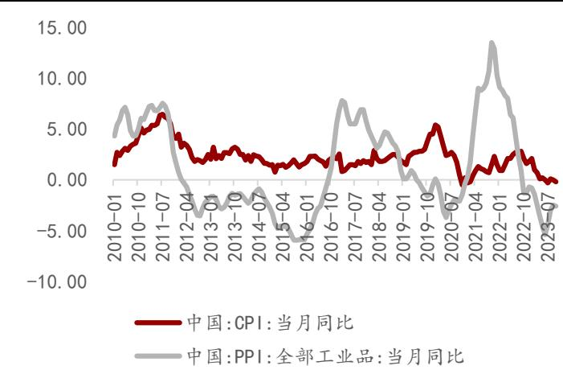  
资料来源：国家统计局，wind，万联证券研究所

图表13：中国金融机构储蓄存款月度余额和同比增速  
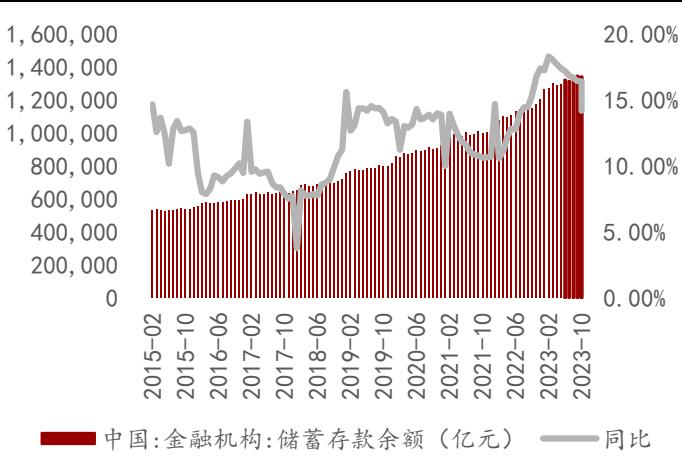  
资料来源：wind，万联证券研究所

➢ 资金层面：一方面，投资者投资信心不足，参与新发市场意愿下降，导致新基金发行持续降温，未能给股市带来充足的增量资金。以基金成立日为统计口径，月均新发基金（股票+混合）规模分别为2020年1655.54亿份、2021年1702.74亿份、2022年337.88亿份，2022年新发基金规模较前两年断崖式下跌，而2023年进一步下降，1-11月月均新发基金（股票+混合）224.51亿份，较2022年下降33.55%。基金新发市场低迷，未能给股市带来较为充足的增量资金。另一方面，2023年以来食饮行业基金重仓比例始终处于平均重仓比例之下，存量资金也未能给予食饮板块较多支持。22Q4-23Q2经济虽然逐步复苏，但市场在宏观经济弱复苏之下对于消费长期前景存在担忧，重仓比例不断回落至历史低位；23Q3政府出台消费刺激政策叠加消费数据触底回升，食品饮料基金重仓比例有所上升，但目前仍处于平均重仓比例之下，市场仍持观望态度，存量资金也未能给予食品饮料板块较多支持。

图表14：中国新成立基金（股票+混合）规模  
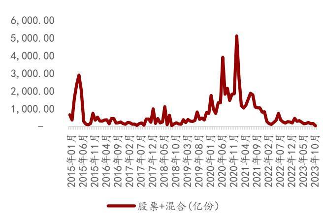  
资料来源：wind，万联证券研究所

图表15：食饮板块重仓比例走势及其重仓比例平均值  
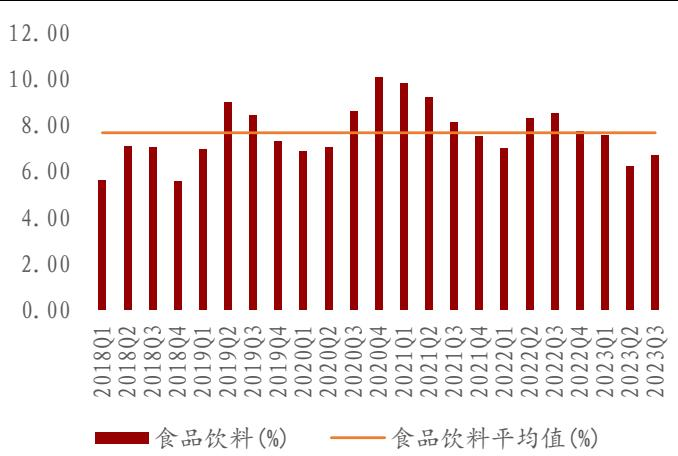  
资料来源：wind，万联证券研究所

宏观经济弱复苏和存量资金博弈交织背景下，“坡长雪厚”消费蓝筹遭遇杀估值。由于对经济前景不明朗叠加资金流动性不足，2023年市场倾向于短炒热门板块，如科技板块；或者估值低或股息率高，具备安全边际的板块，如中特估等。“坡长雪厚”、受长线资金青睐而曾经拥有高估值的传统消费蓝筹，如食品饮料板块等，则遭遇杀估值。

## 2 展望2024：行业有望保持稳中向好趋势，精选优质赛道

2023年国内经济整体呈现弱复苏态势，社零增速上半年高开低走，下半年逐步企稳回升。22年底疫情管控放开后，23Q1国内消费市场经历了消费场景回补带来的阶段性脉冲式修复。23Q2以来市场对于经济复苏的预期回落，复苏节奏有所放缓，社零增速下探。23Q3以来，党中央、国家发改委、国务院等多部门密集召开会议，多举措助力市场恢复信心，社零数据月度同比增速从2023年8月以来持续回暖。从消费者信心上看，23H1消费者信心指数出现下滑，从1月的91.2下滑至6月的86.4，但三季度以来消费者信心持续上升，9月回升至87.2，信心持续修复。2023年前三季度，全国居民人均可支配收入比上年同期增长6.32%，增长趋势不改。

图表16：8月以来社零增速持续回暖  
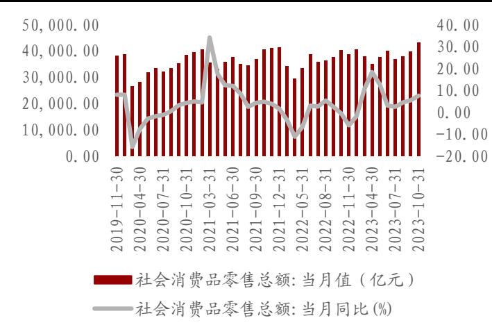  
资料来源：同花顺iFinD，万联证券研究所

图表17：粮油、食品类/饮料类表现稳健  
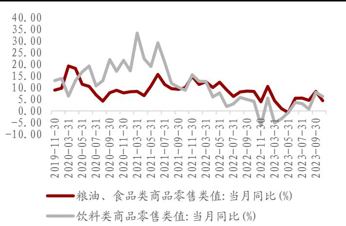  
资料来源：同花顺iFinD，万联证券研究所

图表18：居民人均可支配收入持续增长  
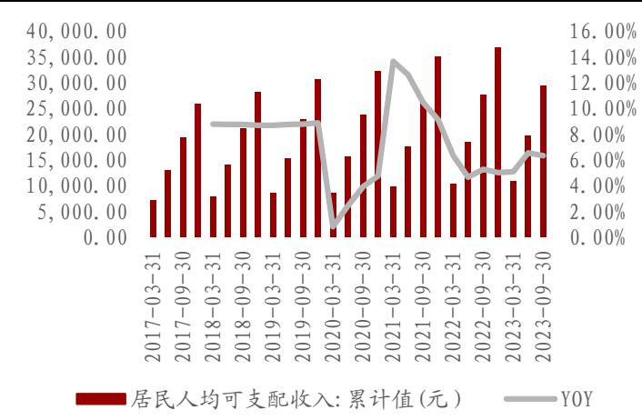  
资料来源：同花顺iFinD，万联证券研究所

图表19：三季度以来消费者信心指数持续上升（%）  
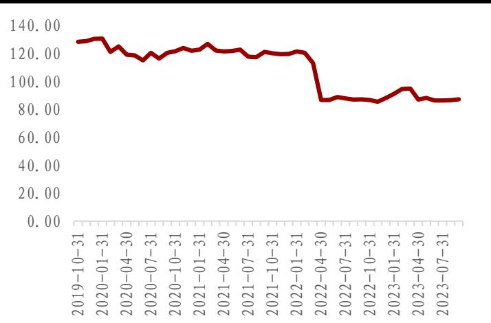  
资料来源：同花顺iFinD，，万联证券研究所

图表20：2023年以来多部门发声促消费

<table><tr><td>时间</td><td>事件名称</td><td>主要内容</td></tr><tr><td>2023年4月28日</td><td>中共中央政治局会议</td><td>会议强调“恢复和扩大需求是当前经济持续回升向好的关键所在”,要多渠道增加城乡居民收入,改善消费环境,促进文化旅游等服务消费。</td></tr><tr><td>2023年7月18日</td><td>国家发展改革委举行7月份新闻发布会</td><td>国家发展改革委政策研究室主任金贤东表示,将围绕稳定大宗消费、促进汽车消费和电子产品消费、拓展农村消费、优化消费环境等方面抓紧制定出台恢复和扩大消费的政策。同时强调将坚持常态化召开民营企业家座谈会,建立与民营企业沟通交流机制。</td></tr><tr><td>2023年7月24日</td><td>中共中央政治局会议</td><td>在促消费方面,会议提到要提振汽车、电子产品、家居等大宗消费,推动体育休闲、文化旅游等服务消费。要积极扩大国内需求,发挥消费拉动经济增长的基础性作用,通过增加居民收入扩大消费,通过终端需求带动有效供给,把实施扩大内需战略同深化供给侧结构性改革有机结合起来。</td></tr><tr><td>2023年7月28日</td><td>国家发展改革委发布《关于恢复和扩大消费的措施》</td><td>以习近平新时代中国特色社会主义思想为指导,深入贯彻党的二十大精神,坚持稳中求进工作总基调,完整、准确、全面贯彻新发展理念,加快构建新发展格局,着力推动高质量发展,把恢复和扩大消费摆在优先位置,优化就业、收入分配和消费全链条良性循环促进机制,增强消费能力,改善消费条件,创新消费场景,充分挖掘超大规模市场优势,畅通经济循环,释放消费潜力,更好满足人民群众对高品质生活的需要,并出台了恢复和扩大消费的20条措施。</td></tr><tr><td>2023年8月16日</td><td>国务院第二次全体会议</td><td>会议强调要着力扩大国内需求,继续拓展扩消费、促投资政策空间,提振大宗消费,调动民间投资积极性,扎实做好重大项目前期研究和储备。</td></tr><tr><td>2023年9月27日</td><td>国务院办公厅印发《关于释放旅游消费潜力推动旅游业高质量发展的若干措施》</td><td>措施包括加大优质旅游产品和服务供给、激发旅游消费需求、加强入境旅游工作、提升行业综合能力、保障措施五大方面,旨在深入贯彻落实习近平总书记关于文化和旅游工作的重要论述和中央政治局会议精神,丰富优质旅游供给,释放旅游消费潜力。</td></tr></table>

资料来源：中国政府网，国家发展改革委，万联证券研究所

2024年国内经济有望持续改善，食品饮料行业将保持稳中向好趋势。我们判断2024年各项稳增长和刺激消费的政策有望延续，国内经济有望持续改善，食品饮料行业将保持稳中向好趋势。同时，由于不同人群所在行业复苏节奏不同，导致消费端K型复苏结构明显，消费分层趋势将延续，“高质性价比”产品更受消费者青睐。

精选优质赛道，推荐三条主线。目前食品饮料绝大部分子板块均处于底部估值区间，具备中长期配置价值，随着投资者信心回升，具备业绩稳定性的食饮细分龙头有望重获市场青睐。基于此我们推荐三条主线，①K型结构复苏主线：建议关注受益于K型复苏趋势的高端白酒和热门地产酒龙头；②需求回暖主线：建议关注受益于餐饮回暖的速冻食品企业；③成本压力缓解主线：包括，纸箱、大麦等原材料价格下降、产品高端化趋势延续的啤酒龙头；上游原奶价格下降、全产业链扩张布局的乳制品龙头；上游大豆价格下降、在复合调味品和健康食品领域合理布局的调味品企业龙头。

## 3 K型结构复苏主线：白酒

## 3.1 白酒：静待商务需求回暖，复苏仍是 2024全年主线3.1.1K型结构复苏明显，估值修复逻辑有望引领短期普涨行情

K型结构复苏明显，高端白酒与中端/大众白酒龙头经营韧性较强。①以茅台为首的高端酒收藏属性较为突出，主要消费人群为中产及以上人群，基本盘较稳，受益于礼赠/高端商务宴请，需求相对稳健；②受商务需求弱复苏影响，次高端白酒恢复缓慢，部分需求降级由中端/大众白酒承接，业绩表现较为分化，品牌、渠道力强的酒企表现更佳；③在当前环境下消费者更加追求具备性价比的产品，中端/大众白酒在大众宴席、社交聚饮等需求回补的催化下更具成长力。总体来看，白酒板块复苏节奏温和，高端白酒与中端/大众白酒龙头经营韧性较强。

图表21：23Q1-3各档次白酒业绩情况

<table><tr><td>档次</td><td>23Q1-3 营收(亿元)</td><td>23Q1-3 营收同比(%)</td><td>23Q1-3 归母净利润(亿元)</td><td>23Q1-3 归母净利润同比(%)</td></tr><tr><td>高端白酒</td><td>1877.47</td><td>17.00</td><td>862.75</td><td>18.83</td></tr><tr><td>次高端白酒</td><td>763.67</td><td>13.95</td><td>250.67</td><td>16.65</td></tr><tr><td>中端/大众白酒</td><td>466.66</td><td>15.73</td><td>74.80</td><td>25.11</td></tr></table>

资料来源：同花顺iFinD，万联证券研究所

酒企业绩稳健增长，估值修复逻辑有望引领短期普涨行情。主要上市酒企2023年前三季度业绩保持稳健增长，18家酒企中仅4家归母净利润同比下滑。但受主力资金大幅外流、投资者信心不足等负面因素冲击，大部分酒企出现了业绩与估值相背离的情况。高端白酒龙头贵州茅台、五粮液、泸州老窖前三季度归母净利润同比分别增长19.09%/14.24%/28.58%，全年估值（PE-TTM）分别下跌9.41%/21.53%/22.91%。随着消费持续复苏、消费者信心提升，投资者逐渐恢复信心，短期内前期遭遇估值杀跌但基本面依然良好的白酒企业有望率先迎来估值修复普涨行情。

图表22：主要上市酒企业绩与估值对比（按前三季度归母净利润增速排序）  
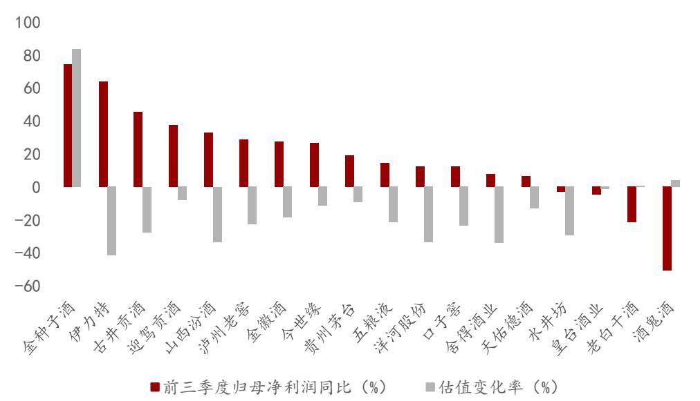  
资料来源：同花顺iFinD，万联证券研究所

注：顺鑫农业数据未列入：全年估值变化率为2023年11月10日PE-TTM相较于2023年1月1日PE-TTM的变化率

## 3.1.2 24年商务需求有望边际改善，茅台提价带动市场扩容

从消费场景来看，2023年宴席需求明显回温，商务需求表现平淡，2024年商务需求有望边际改善。白酒消费场景主要分为宴席场景及商务场景，宴席场景是中端/大众白酒的主要消费场景，2023年作为疫情管控放开的元年，受益于疫后线下消费的恢复，白酒的宴席回补需求释放，消费明显回温；而商务场景是次高端及高端白酒的主要消费场景，对外部宏观经济环境的依赖性较强，受外部宏观环境弱复苏的影响，白酒商务需求表现相对平淡。随着宏观经济持续复苏及消费市场持续回暖，2024年宴席场景需求将保持稳健增长态势，商务场景需求则有望进一步复苏并迎来边际改善。

从消费结构来看，高端白酒及中端/大众白酒增长动力较强态势有望延续，茅台提价带动市场扩容。在消费分层趋势下，2023年白酒呈现K型结构复苏态势，“两头”表现好于“中间”，高端白酒及中端/大众白酒从中受益，次高端白酒性价比略输一筹，预计2024年还将延续这一态势。2023年11月1日茅台上调53%vol贵州茅台酒（飞天、五星）出厂价（平均上调幅度20%），此次提价对白酒行业整个价格体系有较为积极的影响，再度提升白酒行业价格天花板，为其他高端白酒（五粮液、泸州老窖）、次高端白酒（山西汾酒、舍得酒业等）预留更大的提价空间，有利于白酒板块扩容。

图表23：飞天茅台批价跟踪（元）  
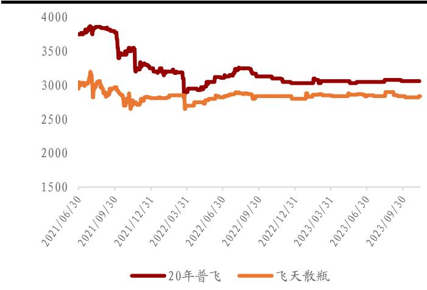  
资料来源：今日酒价，万联证券研究所

图表24：名酒线上零售价跟踪（元）  
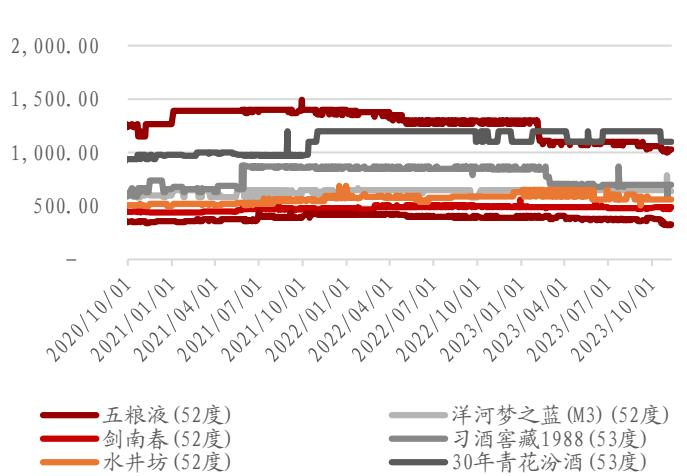  
资料来源：同花顺iFinD，万联证券研究所

## 3.1.3长期结构升级趋势不改，优选高端白酒优质赛道

中长期来看，白酒行业量减价增、结构升级趋势明显。近年来国内白酒产量呈明显的下降趋势，2022年白酒产量为671.2万千升，较2017年的1198.1万千升下降了43.98%。产量下降的同时，行业进入品质提升和优胜劣汰的发展阶段，白酒高端化趋势明显，白酒消费趋势发生“由量到质”的转变。在此期间，贵州茅台/五粮液/泸州老窖通过提价和产品结构的优化调整，2017-2022年的吨价年复合增速分别达到13.45%/28.24%/34.01%。目前，我国的白酒消费结构处于存量市场竞争阶段，行业集中度不断提升，品牌化、品质化发展趋势愈加明显。消费者对于酒类品质的要求越来越高，“少喝酒、喝好酒”的理念深入人心，贵州茅台、五粮液等头部酒企近期不断扩产年份酒、老酒等优质产能，而没有品牌特色、品质特色的酒企产能严重过剩，产量逐年下降。

图表25：近年来白酒产量下滑（万千升）  
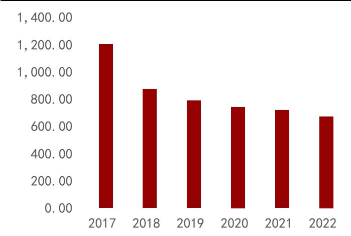  
资料来源：同花顺iFinD，万联证券研究所

图表26：主流酒企吨价持续提升（万元/吨）  
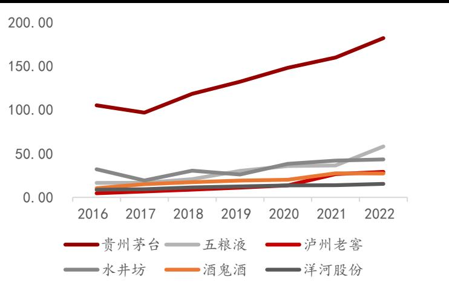  
资料来源：同花顺iFinD，万联证券研究所

白酒头部企业寡头垄断格局稳固，行业集中度有望进一步提升。优质的白酒品牌不仅代表着白酒酿造的高品质，更是消费者心里对品牌的历史、地位、以及其自身价格定位等多要素的认同感。消费升级以及消费者品牌意识的提升，进一步强化了知名酒企的品牌价值，消费者更倾向为有品质保证的品牌产品支付更高的溢价，同时优质品牌酒企通过提升营销能力以及管理能力，主导行业价格升级，导致白酒行业分化加剧，头部白酒企业市场销售份额不断攀升，行业中小企业受挤压，白酒企业数量不断减少。根据国家统计局数据，规模以上白酒企业从2017年的1593家降至2022年的963家，降幅达39%。以销售收入数据看，茅台、五粮液近三年营收持续上升，占上市白酒板块营收比例持续扩大，从2020年的26.09%提升到2022年的29.89%，白酒行业集中度进一步提升。我们认为，高端白酒护城河较深，其他品牌跻身高端酒之列的难度很大，行业寡头垄断格局较为稳固，高端白酒具备奢侈品属性，供需格局偏紧，具备向上提价能力，成长确定性高。随着消费者对品牌认知度的持续增强，消费升级的持续推进，未来白酒行业集中度有望进一步提升。

图表27：规模以上白酒企业数量持续下降（家）  
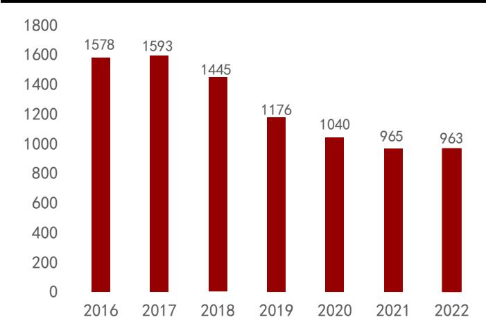  
资料来源：国家统计局，前瞻产业研究院，中商产业研究院，万联证券研究所

图表28：我国白酒市场集中度进一步提高  
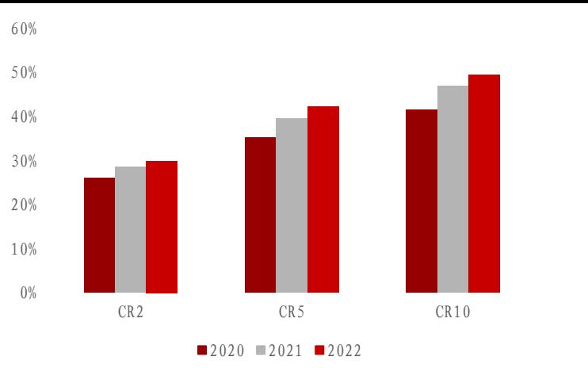  
资料来源：同花顺iFinD，万联证券研究所

## 4 需求回暖主线：速冻食品

4.1 速冻食品:下游餐饮景气度较高，重点关注 B端恢复情况4.1.1 B端修复表现强于C端，2024年行业B端需求有望稳健增长

预计2024年餐饮行业高景气度延续，速冻食品行业餐饮端需求有望稳健增长。从餐饮社零数据来看，餐饮行业疫后迅速修复，餐饮业2023年以来的月度社零增速均优于整个消费行业社零总额增速水平，2023年1-10月餐饮社零总额41,905亿元，同比+18.55%，且规模已经超过疫情前2019年同期的水平。从餐饮门店数量来看，23Q1餐饮门店数量开始回升，截止23Q2仍低于疫情前水平，基于目前的回升趋势，餐饮门店数量2023年底至2024年有望赶超疫情前水平。展望2024年，我们认为餐饮行业高景气度有望延续，回归疫情前的+10%左右的正常增长节奏，作为上游的速冻食品企业将从中受益。

图表29：餐饮增速较社零增速表现更优  
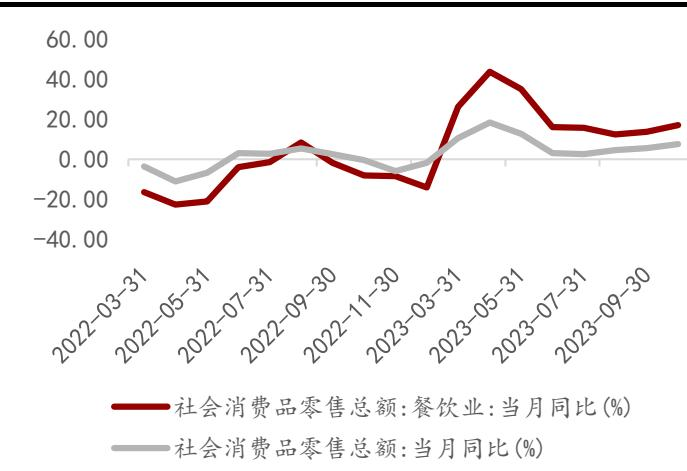  
资料来源：同花顺iFinD，万联证券研究所

图表30：餐饮门店数量尚未恢复至疫情前水平（万家）  
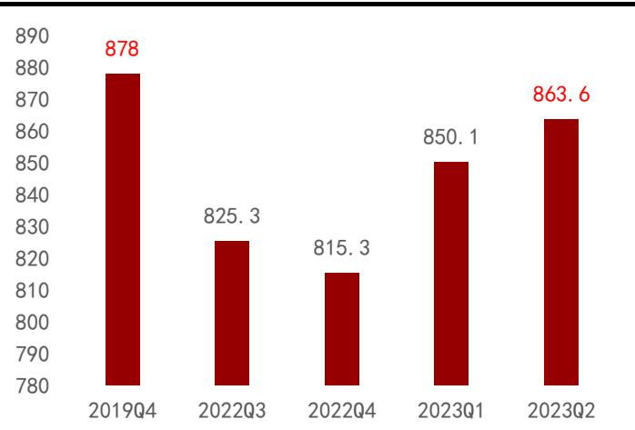  
资料来源：辰智大数据，万联证券研究所

总体来看，速冻食品B端恢复表现强于C端。2023年国内B端餐饮消费快速恢复，带动较多速冻食品企业B端收入占比提升，其中B端头部企业凭借自身的资源、成本、经营等优势快速恢复，中小B端企业恢复速度相对较缓。C端直营商超、线上等渠道在2022年高基数下，2023年客流量减少，使得直营商超渠道的表现普遍不佳，加之C端各细分渠道呈现碎片化特点，渠道分流现象较为显著。

图表31：速冻食品企业B端收入占比提升  
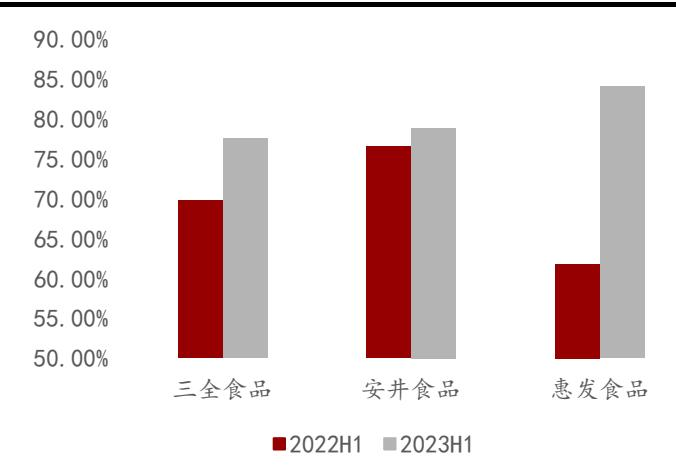  
资料来源：各公司公告，万联证券研究所

图表32：限额以上单位餐饮收入增长更快  
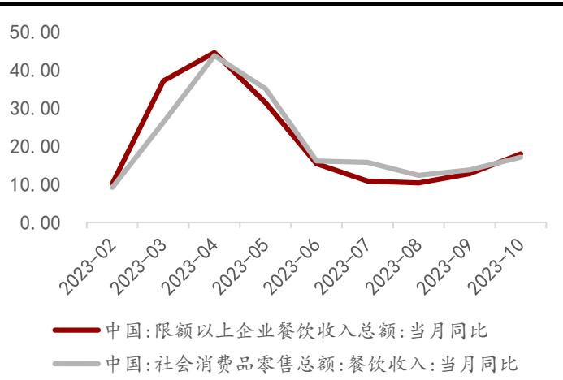  
资料来源：同花顺iFinD，万联证券研究所

## 4.1.2行业发展潜力大，B/C端共振未来可期

我国速冻食品市场规模超千亿，对标海外人均食用量仍有较大提升空间。我国速冻食品市场规模从2017年1058亿元增长至2022年的1688.5亿元，2017-2022年CAGR为9.80%，预计2025年速冻食品市场规模达2130.9亿元，2022-2025年CAGR为8.07%。从人均食用量角度，国内水平远低于发达国家，仍有较大提升空间。据艾媒咨询统计，2019年世界主要国家和地区人均速冻食品食用量中，美国人均速冻食品食用量最多，达到60kg；欧洲/日本速冻食品人均食用量为35/20kg，而我国人均食用量仅为9kg，是美国/欧洲/日本的15%/26%/45%，发展潜力较大。

图表33：中国速冻食品规模及增速  
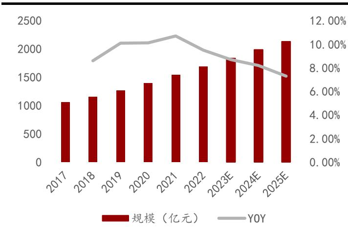  
资料来源：艾媒咨询，万联证券研究所

图表34：2019年世界主要国家和地区人均速冻食品食用量对比（kg）  
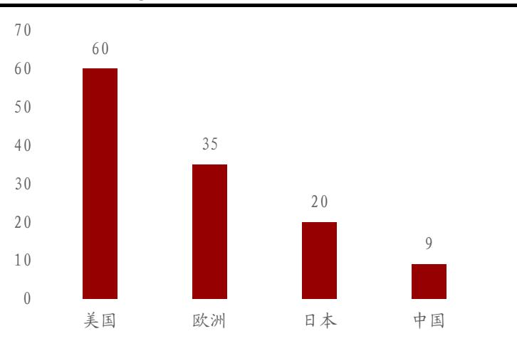  
资料来源：艾媒咨询，万联证券研究所

速冻米面：赛道较成熟，消费者更重视品质及口味，品类多元化是发展趋势。速冻米面赛道相对其他子赛道较成熟，市场集中度较高。为迎合消费者不同口味，各企业加大推出新品力度；销售渠道以C端商超为主，但C端线上渠道较为分散，主要品牌线上渠道市占率较低，同时也在向体量更大、盈利空间更广阔的餐饮渠道推进。

速冻火锅料：直接受益于火锅热，集中度较低。速冻火锅料行业目前市场集中度较低，广泛应用于各种消费场景，有望成为速冻食品行业发展的重点。伴随龙头加快扩张步伐以及监管强化，龙头企业的优势逐渐凸显，火锅料行业有望加速向头部企业集中。速冻火锅料的销售渠道主要为小型B端：中小型餐饮门店、酒店、外卖店等。随着火锅逐渐从餐厅走向家庭，C端渗透率有望进一步提高。

图表35：速冻行业细分赛道市场结构梳理

<table><tr><td></td><td>市场规模(2023)</td><td>增速</td><td>竞争格局</td><td>渠道结构</td></tr><tr><td>速冻米面</td><td>约904亿元</td><td>7%-8%</td><td>集中度较高,CR3=64%,三全、思念和湾仔码头的市场份额分别为28%/19%/17%。</td><td>C端消费占比较高,向B端餐饮渗透中。</td></tr><tr><td>速冻火锅料</td><td>约658亿元</td><td>10%+</td><td>集中度较低,CR5=20%,安井市占率为9%,其次是海霸王、海欣、惠发和升隆分别为5%/2%/2%/2%。</td><td>B端为主,C端加速渗透。</td></tr></table>

资料来源：华经产业研究院，万联证券研究所

## B端餐饮业对速冻食品的依赖性显著提升。一方面，团餐行业进入快速发展期，速冻

食品占据出餐速度优势与成本优势。2022年中国团餐市场规模为1.98万亿元，随着团餐多样化发展和行业服务、技术的升级，预估将保持较高增速增长。速冻食品具有提高出菜速度、减少后厨面积、丰富品类、降低原材料成本等优势。团餐的单次餐量要求餐厅加快制作菜品的速度，叠加各项成本压力的上升倒逼餐饮企业选择标准化程度较高的速冻食品。另一方面，餐饮行业连锁化趋势日益明显，对于食材标准的要求进一步提升。消费者对于食品安全的重视使餐饮企业采购原材料选择高品质供应商，规模化程度较高的速冻食品企业优先受益。

图表36：中国团餐市场规模及增速  
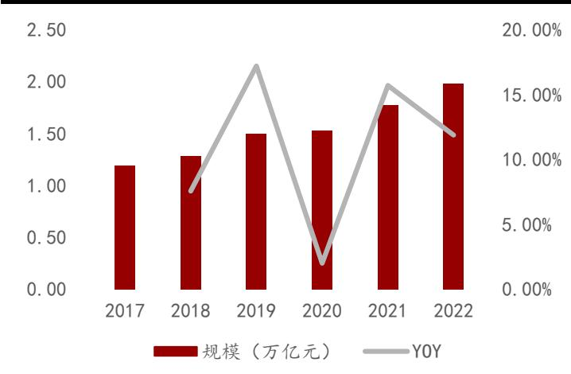  
资料来源：智研咨询，万联证券研究所

图表37：2020-2022年中国餐饮连锁化率  
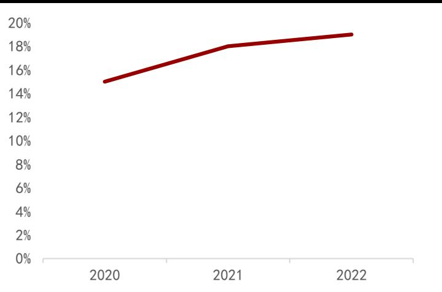  
资料来源：美团，万联证券研究所

过去3年的疫情为“懒人经济”按下加速键，社会结构变化仍将对C端市场增长形成有力支撑。一方面，快节奏的生活和繁忙的工作使得“懒人经济”应运而生，催生只需简单烹饪即可享用的速冻食品，满足消费者在忙碌的工作之余也可享受美食的需求。疫情期间，因居家时间较长，人们偏向于选择存放时间较长同时可供选择品类较多的食物，速冻食品完成消费者培育，并为“懒人经济”按下加速键，外卖、生鲜电商的崛起也为速冻食品打开了新的渠道空间，优质速冻龙头更能把握住本次机遇，完成市场规模扩张。另一方面，1982年我国家庭规模为4.41人/户，至2020年下降到2.62人/户，家庭结构由多代同堂为主转变为三口或两口之家为主。由年轻人组成的小型化家庭没有足够的时间与精力准备复杂的食材进行备菜、烹饪。预制菜或成为小型化家庭消费者对简单化、便捷化一日三餐需求的绝佳解决方案。

图表38：2021年中国消费者对速冻食品满意度分析  
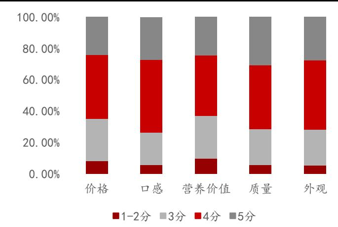  
资料来源：艾媒咨询，万联证券研究所

图表39：我国家庭规模变化（人/户）  
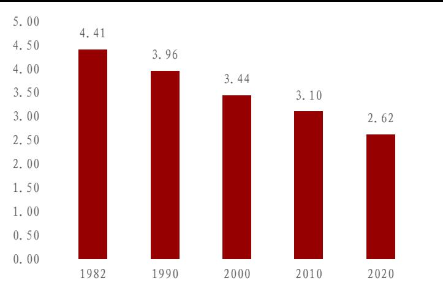  
资料来源：同花顺iFinD，万联证券研究所

## 速冻食品行业依赖冷链物流的发展，冷链技术进步为速冻行业发展提供支持。速冻食

品在厂家生产、经销商储运、零售商陈列和消费者使用等过程中对温度的要求要保持在 以下，速冻食品的运输对冷链物流有很高的依赖性，冷藏技术和冷链物流的发展是速冻食品行业发展的重要基础。我国冷链物流市场规模持续增长，2022 年达到 6371 亿元，近年增速保持在10%以上，2025年预计将达到 8686亿元。此外，2022年我国冷库总容量达 5686万吨，冷藏车保有量 37万辆。近几年来，各项政策出台鼓励冷链基础设施建设，为速冻食品行业发展营造良好环境。人们对食品安全愈加重视，更注重食材的新鲜程度，消费升级和食品安全意识提升也推动着冷链技术的不断进步，为速冻食品行业发展提供保障。

图表40：中国冷链物流市场规模（亿元）  
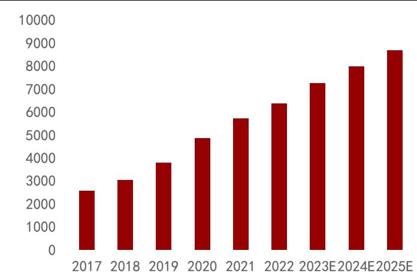  
资料来源：艾媒咨询，万联证券研究所

图表41：中国冷库总容量及冷藏车保有量  
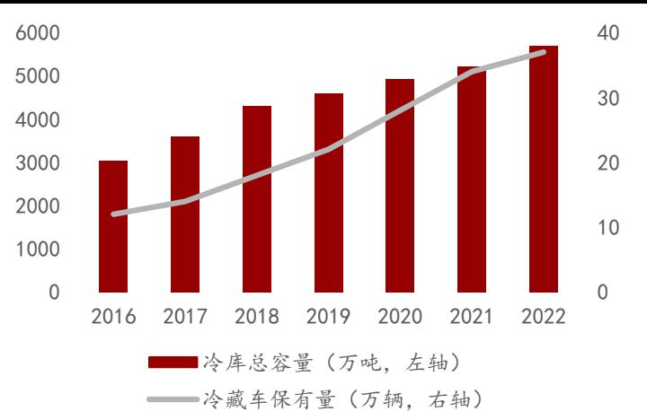  
资料来源：艾媒咨询，万联证券研究所

## 5 成本压力缓解主线：啤酒、乳制品、调味品

## 5.1 啤酒：短期成本压力缓解，行业逐步向高成熟度市场发展5.1.1原材料叠加包材价格下降，成本压力有望缓解

啤酒企业包装材料及原材料成本在总成本中的占比超过75%。根据智研咨询统计的数据，包装物/原材料/其他材料在啤酒生产成本中分别占据49%/27%/24%，包装材料及原材料是啤酒最主要的生产成本。我国啤酒企业多从国内采购生产所需的包装材料，成本变动主要受国内玻璃瓶、易拉罐及瓦楞纸等价格的影响。啤酒企业整体向上议价能力较弱，对主要包装材料的价格波动较为敏感，包装材料价格的频繁波动会给啤酒企业带来成本压力。

图表42：啤酒生产成本构成  
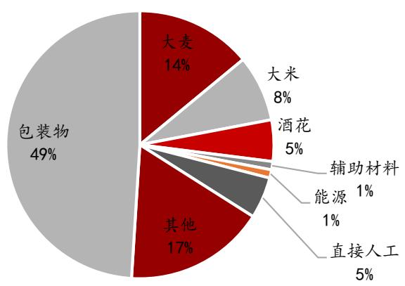  
资料来源：智研咨询，万联证券研究所

## ➢ 包装材料

2023年以来纸箱价格持续回落，啤酒企业成本压力有望缓解。包装材料方面，啤酒企业一般采取季度或者半年度滚动的方式和上游企业签订协议锁定成本。2023年以来我国瓦楞纸价格延续下降趋势，截止2023年11月17日出厂价约3060元/吨，同比下降17%左右；自2022年下半年以来，玻璃价格呈上涨趋势，但我国啤酒罐化率正稳步提升，玻璃的使用场景将逐步减少；2023年以来，易拉罐价格和铝价保持稳定。

图表43：瓦楞纸出厂价（元/吨）  
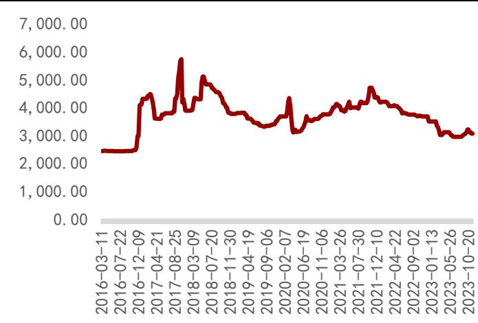  
资料来源：同花顺iFind，万联证券研究所

图表44：中国平板玻璃市场价（元/吨）  
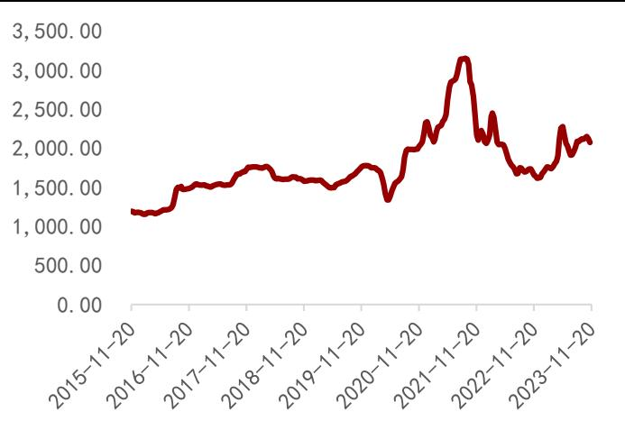  
资料来源：wind，万联证券研究所

图表45：打包易拉罐平均价(元/吨，不含税)  
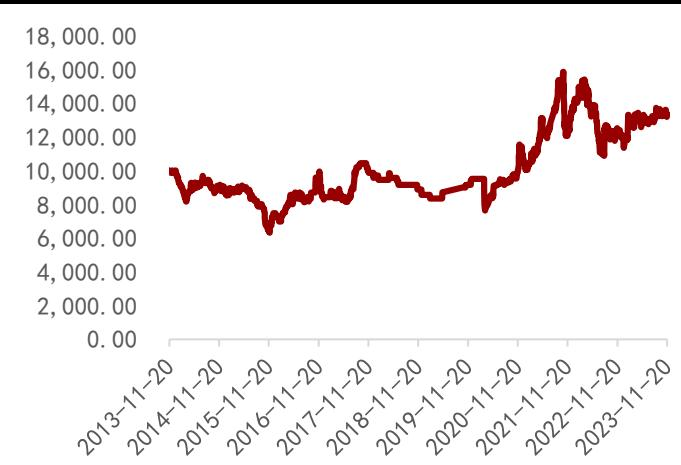  
资料来源：wind，万联证券研究所

图表46：铝价（元/吨）  
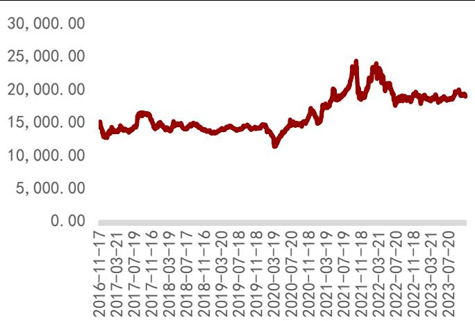  
资料来源：同花顺iFind，万联证券研究所

## ➢ 原材料

大麦进口价格自2020年下半年持续走高，2023年自高点连续回落。近年来大麦价格受外部因素影响明显，全球大麦价格持续上涨推动中国大麦进口价格随之增长，2022年在俄乌冲突、法国大旱等原因的影响下，全球大麦价格涨至历史高位，进口均价从2020年下半年的220美元左右/吨提升至2022年底的410美元/吨，达到阶段性高点，啤酒企业成本压力较大。2023年国内大麦进口价格自高点连续回落，2023年10月进口均价为292美元/吨，当月同比下降23.64%。

图表47：中国大麦进口平均单价（美元/吨）  
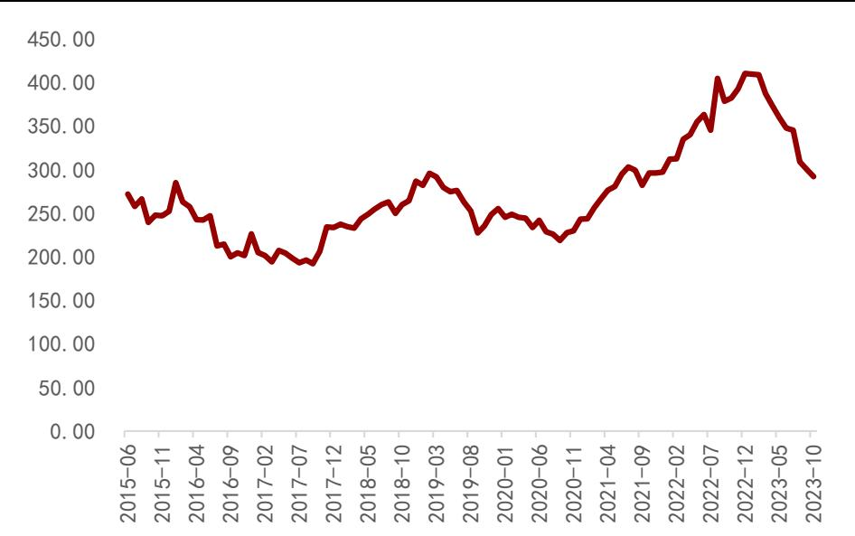  
资料来源：wind，万联证券研究所

2023年8月起澳麦“双反”政策取消，啤酒企业原料成本有望进一步降低。2023年8月4日，商务部发布《关于原产于澳大利亚的进口大麦所适用反倾销措施和反补贴措施复审裁定的公告》显示，鉴于中国大麦市场情况发生变化，对原产于澳大利亚的进口大麦继续征收反倾销税和反补贴税已无必要，自2023年8月5日起，终止对原产于澳大利亚的进口大麦征收反倾销税和反补贴税。对比历史大麦进口价格，澳大利亚大麦整体价格水平较其他国家更低，而短期内乌克兰大麦受战争因素影响价格或仍处于高位。此外，从澳大利亚到中国的路途时间较欧洲、南美国家更短，运输成本方面具有优势。从啤酒厂商的原材料采购模式看，中国啤酒企业一般于年底签订协议锁定次年的大麦价格，因此年内的大麦价格波动对啤酒企业的生产成本影响相对较小。本次终止对澳大利亚大麦的“双反”税收政策，有望缓解2024年啤酒企业的原料成本压力。

图表48：澳麦价格更具优势（美元/千克）  
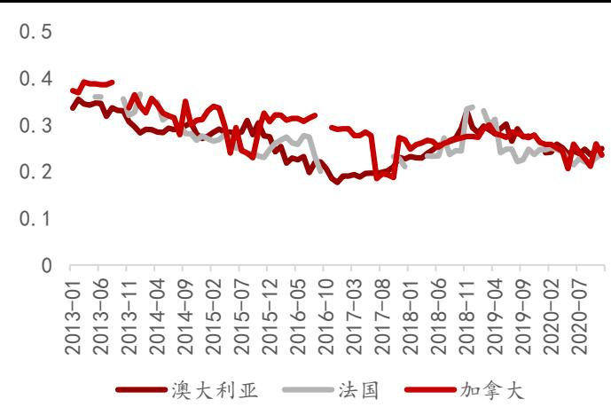  
资料来源：wind，万联证券研究所

图表49：2021年实施“双反”政策后中国大麦主要进口国来源地占比  
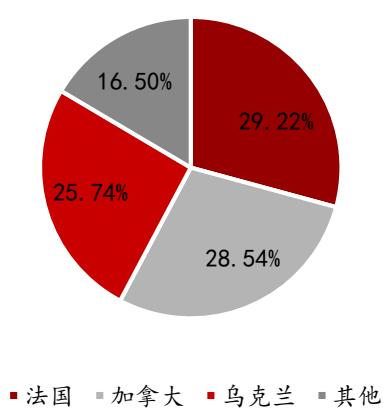  
资料来源：海关总署，万联证券研究所

## 5.1.2存量竞争时代，寡头垄断格局已定

啤酒产量呈下降趋势，行业进入存量竞争。2013年以前，啤酒行业处于增量时代，我国啤酒产销量稳健增长。自1978年改革开放政策实施以来，中国啤酒行业开始快速发展，经过40余年的快速扩张期后，国内啤酒产量在2013年达到顶峰5061.54万千升，此后持续回落，消费量也在2013年前后达到顶峰后逐年下滑。2013年之后，啤酒行业进入存量发展期，从“量增”到“质升”换轨明显，整体产量开始缓慢下滑，2022年我国啤酒产量3568.7万千升，较2013年减少29.49%。

啤酒行业行业集中度持续提高，五大龙头格局保持稳定。近年来，我国啤酒行业集中度稳步提升，2017年我国啤酒行业CR5仅为75.6%，至2021年CR5升至92.9%，五大啤酒龙头的市场份额已占据九成以上，其中华润啤酒/青岛啤酒/百威英博/燕京啤酒/重庆啤酒市占率分别为31.0%/22.3%/21.6%/10.2%/7.8%。整体来看，我国啤酒行业格局稳定，啤酒龙头凭借其长期积累下的品牌、产品、规模、渠道、技术等优势，逐步挤压中小酒企的生存空间，中小酒企产能或将进一步出清，啤酒行业集中度预计将会进一步提升，但提升幅度可能放缓。

图表50：2017-2021 年中国啤酒行业 CR5 集中度  
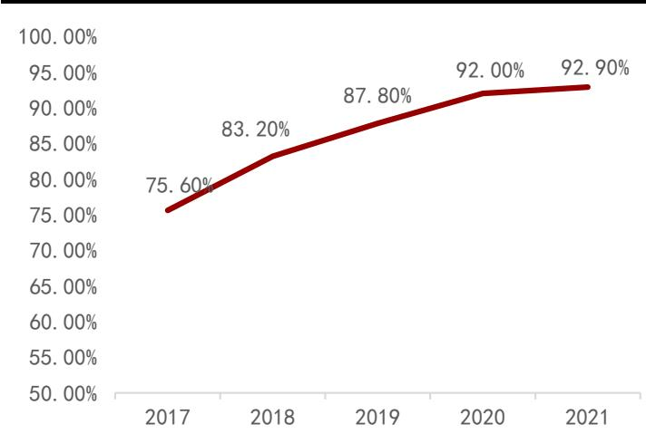  
资料来源：头豹研究院，万联证券研究所

图表51：2021年中国啤酒行业市场份额分布  
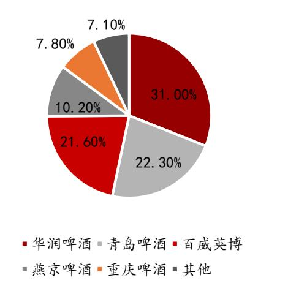  
资料来源：头豹研究院，万联证券研究所

## 5.1.3高端化是未来发展趋势，对标国外仍有较大增长空间

在存量竞争背景下，高端啤酒消费量稳步增长。自2013年以来，我国高端啤酒消费量逐年递增。根据 Global Data 统计的数据，2013 年我国高端啤酒消费量为 59 亿升，2018 年增加至 80.3 亿升，预计 2023 年将增加至 102 亿升，2013-2023 年 CAGR为 5.63%。啤酒总销量下滑主要是中低端啤酒消费量减少导致，高端啤酒消费量依旧保持增长趋势，行业高端化趋势凸显。

图表52：中国高端啤酒消费量（亿升）  
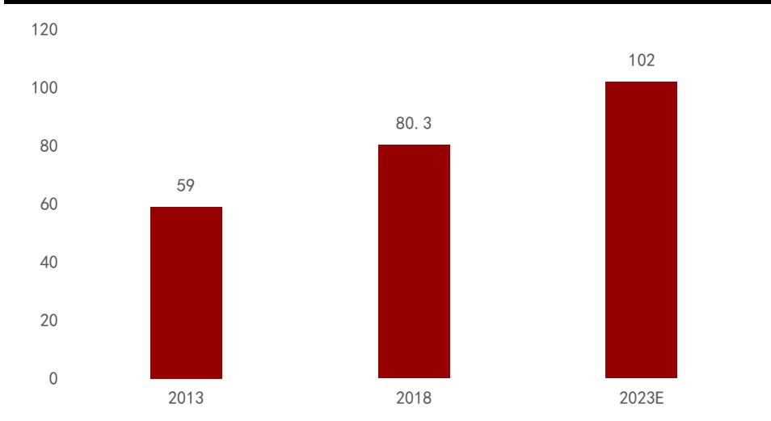  
资料来源：G1oba1 Data，万联证券研究所

近年来啤酒龙头企业为向高端化转型和应对成本上行的压力不断提价。在进入存量竞争时代后，酒企为向高端化转型和应对成本上行压力已多次实施提价措施，消费者接受度较高，酒企向下游议价能力较强。近十五年来，啤酒行业大约进行了 轮大规模的提价活动。第一轮为2007年-2008年由于进口澳麦价格上涨以及玻璃瓶、纸箱价格上涨导致的成本压力驱动提价；第二轮为 年 年澳麦价格大幅上涨导致的提价；第三轮是2017-2018年进口大麦、玻璃瓶、瓦楞纸等原材料价格上涨推动了提价；第四轮是2021年由于进口澳麦加税导致价格上涨以及包材价格持续提升驱动龙头提价。

图表53：近年来啤酒企业不断提价

<table><tr><td>企业</td><td>提价时间</td><td>涉及产品/地区</td><td>提价措施</td></tr><tr><td rowspan="3">华润啤酒</td><td>2021年9月-2022年3月</td><td>勇闯天涯</td><td>出厂价提高5毛左右,终端顺价至7元</td></tr><tr><td>2022年1月</td><td>清爽、超爽、精致、冰酷、原麦汁</td><td>每箱提价2元</td></tr><tr><td>2022年6月</td><td>红区市场中档产品(除勇闯天涯)</td><td>每箱提价6元左右,老雪新品迭代</td></tr><tr><td rowspan="3">青岛啤酒</td><td rowspan="3">2022年5月下旬</td><td>新装纯生</td><td>从66元/箱提升至70元/箱</td></tr><tr><td>提装经典款</td><td>从23.5元/箱提升至24元/箱</td></tr><tr><td>崂山啤酒</td><td>零售价从3-4元提升至5-6元</td></tr><tr><td rowspan="3">重庆啤酒</td><td>2022年2-5月</td><td>乌苏啤酒</td><td>上调620ml红乌苏产品价格,提价5%左右</td></tr><tr><td>2022年6月</td><td>乐堡啤酒、重庆啤酒</td><td>提价3%-8%</td></tr><tr><td>2022年12月</td><td>乌苏啤酒</td><td>提价3%-8%</td></tr><tr><td>百威亚太</td><td>2022年3-4月</td><td>全国范围内</td><td>产品售价调升,增幅达中单位数</td></tr></table>

资料来源：智研咨询，万联证券研究所

中国啤酒行业正处于中成熟度转向高成熟度发展的过程。从人均消费和市场成熟度评分来看，中国啤酒行业尚处于中成熟度市场，而同为亚洲国家的韩国、日本与新西兰已处于高成熟度市场。对标海外市场,国内啤酒消费结构整体偏低端，我国啤酒行业高端化空间仍很大。目前，中国啤酒行业正逐步转向高成熟度市场，啤酒龙头开始寻求摆脱产品单一的同质化，向高端化、多元化转型。

图表54：中国啤酒行业尚处于中成熟度市场  
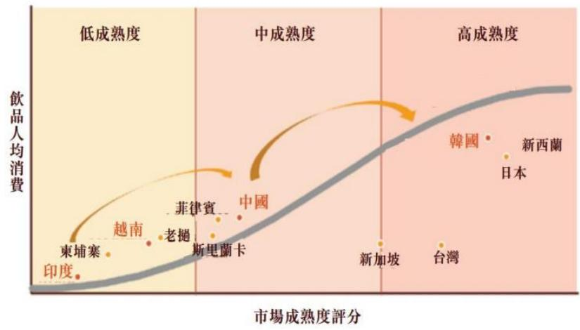  
资料来源：百威亚太招股说明书，万联证券研究所

## ➢ 人均消费增长

中国啤酒人均消费不断增长，但与发达国家相比还存在较大差距。2015-2022年我国啤酒人均消费从6.9美元增加至9.8美元，整体呈现稳步增长趋势。2022年美国/日本/德国/英国啤酒人均消费分别为273美元/162美元/137美元/116美元，对比发达国家我国啤酒人均消费水平仍较低。随着大众消费观念的转变，啤酒行业各类产品的持续推新，在品质和口感的进一步提升下，我国啤酒人均消费还有较大的发展空间。

图表55：中国啤酒人均消费呈增长趋势  
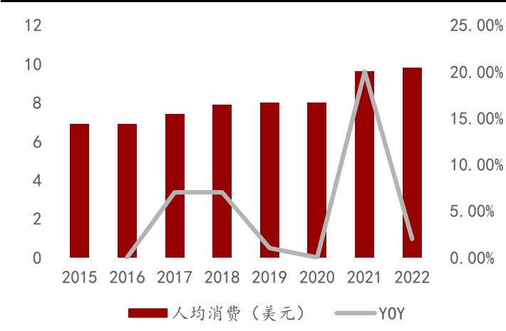  
资料来源：Euromonitor，观研天下，万联证券研究所

图表56：2022年各国啤酒人均消费（美元）  
  
资料来源：Euromonitor，观研天下，万联证券研究所

## ➢ 吨价提升

国内啤酒企业吨价持续提升，但较外资酒企仍有增长空间。啤酒企业近几年吨价进入上行通道，与国内啤酒消费量下行形成鲜明对比。2017-2022年我国主要啤酒企业吨价呈现上升趋势，2022年重庆啤酒/青岛啤酒/珠江啤酒/燕京啤酒吨价分别为4915/3985/3682/3502元/千升，分别较2017年+37.33%/+20.88%/+18.35%/+30.11%。

虽然国内啤酒企业吨价持续上升，但整体平均吨价较日韩、欧美等发达国家仍然有较大差距。国内啤酒企业相较于百威亚太等国际企业而言，吨价上仍有较大提升空间。在中国大陆市场，百威亚太在高端啤酒中的市占率排名第一，平均吨价也位于五大龙头第一，国内酒企仍有较大的差距需要追赶。吨价上升成为行业发展的重要推动力，行业整体量平价增趋势明显。

图表57：各啤酒企业吨价持续上升（元/千升）  
  
资料来源：各公司公告，万联证券研究所

图表58：2022年各啤酒企业吨价（元/千升）  
  
资料来源：各公司公告，万联证券研究所

## ➢ 罐化率提升

罐化率逐年提升降低酒企成本压力，但对标成熟市场仍有较大提升空间。成本方面，相较玻璃瓶装包装，铝罐包装生产原料成本较低、耗材较少且具有保质性强、易运输的特点，能直接降低啤酒厂商的包材成本和运输成本，减少啤酒产品的长途损耗率，扩大可覆盖的市场面积。在价格方面，同等规格的罐装啤酒产品通常售价更高，未来罐装产品占比持续提升将对啤酒厂商出厂吨价起到推升作用。目前我国啤酒消费以玻璃瓶为主，但我国啤酒行业罐化率水平近年来一直呈增长趋势，从2016年24.6%提升至2021年的30.3%，铝罐包装日益成为中国啤酒包装的未来趋势。2021年美国/英国罐化率分别为73.3%/65.7%，全球平均水平也达到了48.4%，对比成熟市场，我国罐化率还有很大的提升空间。

图表59：我国啤酒罐化率逐年上升  
  
资料来源：Euromonitor，万联证券研究所

图表60：对比成熟市场，我国啤酒罐化率仍有提升空间  
  
资料来源：Euromonitor，万联证券研究所

## 5.2 乳制品：成本下行释放利润空间，消费场景趋向多元化5.2.1原奶价格持续下降，乳企兑现利润空间

奶牛存栏量逐渐回升叠加奶牛单产提升，原奶供应充足。近年来，随着规模化牧场的增加，奶牛品种更为优良以及奶牛养殖环境和技术的改善，奶牛存栏量保持稳步提升。2021年全国奶牛存栏量为1094.1万头，同比增长4.85%。同时随着牧场规模化、专业化以及机械化水平提升，奶牛单产逐年提升，2022年奶牛单产9.2吨，规模牧场奶牛单产超过欧盟平均水平。2022年中国原奶产量达3932万吨，同比增长6.77%，原奶供应较为充足。

图表61：奶牛存栏量和单产变化  
  
资料来源：wind，中国奶业协会，中商产业研究院，万联证券研究所

图表62：国内原奶产量变化  
  
资料来源：wind，万联证券研究所

原奶价格持续下降，成本压力有望进一步缓解。原奶价格自2021年8月至今持续下降，截止23年11月10日累计降幅达15.30%。原奶价格下行一方面是需求因素，近两年来中国乳制品消费需求放缓，酸奶、含乳饮料等部分品类销售甚至出现下降；另一方面是供给因素，由于近两年国内奶牛养殖市场迅速扩张，原奶产能出现阶段性过剩，此外进口奶源对国内原奶也存在挤占效应。原奶价格呈现震荡下行的趋势，对于产业链中游乳制品加工企业而言，成本压力有望缓解，利润有望得到进一步释放。

图表63：原奶价格变化（元/公斤）  
  
资料来源：同花顺iFinD，万联证券研究所

## 5.2.2双寡头格局稳定，区域奶企错位竞争

伊利股份和蒙牛乳业占据乳制品行业的半壁江山。根据乳制品企业的经营范围、渠道覆盖程度及规模，我国乳企可分为全国性乳企、区域性乳企、地方性乳企三大梯队。我国乳制品行业集中度高，根据中商产业研究院数据显示，2022年伊利股份、蒙牛乳业和光明乳业分列市占率前三，CR3高达48.7%。其中伊利和蒙牛这两大全国性乳企行业领先地位稳固，在市场中形成一定品牌壁垒，二者市占率均在20%以上，行业市占率CR2为45.5%；区域性乳企和地方性乳企市占率均为个位数，主要经营低温乳制品以差异化竞争。

图表64：乳制品行业竞争梯队  
  
图表65：2022年乳制品行业竞争格局

  
资料来源：wind，中国奶业协会，中商产业研究院，万联证券资料来源：中商产业研究院，万联证券研究所研究所

常温奶：伊利股份与蒙牛乳业为常温奶领域两大龙头，市占率接近80%。根据华经产业研究院数据显示，2021年常温奶领域蒙牛市占率为41.6%，位居第一；伊利稍次之位居第二，市占率为35.9%，二者合计占比为77.5%，双雄格局稳固。伊利和蒙牛争夺行业第一地位的背后是两家公司在产品、渠道和品牌策略上的差异。伊利和蒙牛的产品定位相似度较高，但二者渠道建设的方向和步伐不同，品牌营销的侧重点也有所差异，导致两家公司业绩释放的周期不同，当前常温奶领域蒙牛占比略高于伊利。

低温奶：低温奶市场拓展依奶源地遵循“圆心-半径”理论，市场竞争呈区域割据局面。低温奶因为保质期较短，运输半径有限，所以市场拓展范围必须以奶源地为圆心，冷链运输为半径，导致低温奶行业市场竞争呈区域割据的局面。如我国西北地区和西南地区呈现新希望和蒙牛并驱争先的格局；华中和华东地区呈现光明、伊利和蒙牛三足鼎立的局面；而华南地区主要是卡士、燕塘和晨光三方竞争。受运输半径限制，低温奶行业暂未形成大型龙头企业，仍以中小企业为主。

低温白奶领域以光明、三元等区域性乳企为主，且市场集中度不断提升。根据头豹研究院数据显示，2020年低温白奶市场前三分别为光明、三元和新乳业，市占率分别为16%、14%和10%。且随着渠道精耕与扩张以及乳企并购整合，低温白奶市场集中度逐渐提升，CR5由2019年的36%提升至2020年的52%。

低温酸奶领域伊利、蒙牛为两巨头占据主导地位，两者市占率超50%。根据头豹研究院数据显示，2020年伊利、蒙牛市占率分别为31%、23%；区域乳企也具有一定市场基础，2020年君乐宝、光明以及新希望市占率分别为9%、7%和3%，分别位居第三至第五。

奶粉：进口奶粉增速放缓，飞鹤等国产品牌强势崛起。根据欧睿咨询发布的数据显示，2020年，国产奶粉市场份额达到53%，首次超过外资品牌。其中以飞鹤奶粉表现最为突出，2020年其市占率提升至14.8%，位居第一。从婴配奶粉竞争格局来看，市场集中度较高，国产品牌市占率不断提升。根据智研咨询数据显示，2022年婴配奶粉市场市占率CR5为57.2%，市场集中度较高；且2022年婴配奶粉市场销售额前五的品牌分别为飞鹤、伊利、雀巢、达能和君乐宝，市占率分别为17.5%、12.3%、10.7%、10.3%、6.4%，其中国产品牌占据三席。

奶酪：国产品牌妙可蓝多逐渐崛起，行业集中度逐渐提升。根据中商产业研究院数据显示，2021年妙可蓝多市场份额首超百吉福，两者市占率分别为28%、24%。同时行业集中度不断提升，CR5由2019年的57%上升至2021年的64%。但前五奶酪品牌中，国内本土品牌仅妙可蓝多一家，国内奶酪品牌仍存在较大的增长空间。

图表66：乳制品细分赛道竞争格局  
  
资料来源：华经产业研究院，头豹研究院，中商产业研究院，欧睿咨询，前瞻产业研究院，智研咨询，万联证券研究所

## 5.2.3人均消费量有待提升，市场空间广阔

对标国外，我国乳制品人均消费量有待提升。从行业空间看，我国乳制品人均消费量距离发达国家仍有一定距离，长期行业前景广阔。2022年4月26日，中国营养学会发布《中国居民膳食指南（2022）》。相较《中国居民膳食指南（2016）》，新版指南将奶及奶制品的推荐摄入量从每人每天不少于300克，更加明确为每人每天300—500克，建议人们多食用奶及奶制品。尽管近年来，我国居民乳制品消费潜力有所提升，但在全球范围内，中国人的饮奶量仍然偏低。2020年，我国人均乳制品年消费量不足25kg，远低于美国的91kg，与饮食结构相似的日本人均年消费量36kg相比也有着一定的差距。随着国民健康意识的不断提升，城乡居民对于乳制品的消费需求将进一步提升，乳制品作为营养与健康膳食的重要组成部分受到消费者更多的关注。

图表67：中国居民平衡膳食宝塔新旧版对比  
  
资料来源：中国营养协会，万联证券研究所

图表68：我国居民人均奶类消费量与增速  
  
资料来源：国家统计局，万联证券研究所

图表69：中美日人均乳制品消费量（千克/年）  
  
资料来源：萝卜投资，万联证券研究所

消费者对乳制品功能性诉求增加叠加消费场景更加多元化，将逐步拓展市场空间。乳制品营养丰富，越来越多的消费者意识到乳制品对人体健康的益处。根据《2022中国奶商指数报告》调查显示，82.2%的公众认可喝奶能提升免疫力，80.4%的公众认可喝奶有助于预防骨质疏松，73.7%的公众认可喝奶能补充能量。消费者对乳制品的功能诉求主要集中在健康方面，其中激活/提升免疫力、促进骨路/关节健康以及促进肠胃健康位列前三，同时也新增了体重管理、控三高、保护视力、增强记忆力等更多消费诉求。此外，消费场景多元化趋势显现。传统乳制品主要消费场景是早餐和礼品赠送，但随着产品功能的不断丰富，乳制品逐渐用于运动健身、公司团建、下午茶以及社交聚会等新兴场所，未来市场仍有较大发展空间。

图表70：2022年消费者认为喝奶的好处  
  
资料来源：《2022中国奶商指数报告》，万联证券研究所

图表71：2022年消费者对乳制品的功能诉求  
  
资料来源：《2022中国奶商指数报告》，万联证券研究所

## 5.3 调味品：酱油企业盈利有望改善，“健康”需求方兴未艾5.3.1大豆量多价优，成本压力减轻

2023年大豆价格持续走低，2024年大豆供给充足有望进一步降低成本。2023年年初以来大豆价格持续下行，但因酱油生产周期较长，在报表端传导速度偏慢，23Q2起原材料成本下降的影响逐渐传导至报表端，成本压力持续减弱，部分龙头企业盈利能力有所提升。据美国农业部最新展望报告预测，2024年度全球大豆产量达4.106亿吨，较上年增加4020万吨，主要由于巴西、美国、阿根廷、中国和巴拉圭等主产国的大豆产量均出现增长，此外中国进口量大约为1亿吨，2024年大豆供给充足，酱油企业短期成本压力有望缓解。整体来看，预计未来1-2年内以酱油企业为代表的调味品公司盈利仍有望持续改善。

图表72：大豆价格（元/吨）  
  
资料来源：同花顺iFinD，万联证券研究所

图表73：全球大豆产量（亿吨）  
  
资料来源：中国农业外经外贸信息网，万联证券研究所

## 5.3.2复合调味品景气度较高，健康调味品成热门赛道

复调市场增速高于行业增速，企业积极抢占份额。复合调味品具有便捷化、口味稳定等特点，近年来随着国内的消费升级，复合调味品发展速度快于整体市场。当前复合调味品的行业增速在10%以上，高于行业整体增速，仍有较大成长空间，市场发展前景广阔。就市场格局来看，通过全行业持续共同教育、不断扩大市场需求，头部企业有望凭借品牌和渠道优势收割市场，龙头优势更为明显。但在品类细化发展的过程中，复合调味品的种类相较于传统调味品更加多元化、需求差异大，爆款菜核心调料初步形成一定规模，拉动需求增长，如小龙虾、黄焖鸡米饭、新奥尔良烤翅等爆品带动相应调味品市场激增，部分企业或可通过大单品策略实现突围。

图表74：我国复合调味品市场增速高于行业整体增速  
  
资料来源：Frost&Sullivan，万联证券研究所

图表75：复合调味品市场细分品类（亿元）  
  
资料来源：Frost&Sullivan，万联证券研究所

复合调味品切中B/C端多种痛点，调味品复合化是行业发展重要趋势。我国复合调味品仍处于成长期，除了老牌复合调味品企业颐海、天味等之外，如海天、恒顺等传统单一调味品龙头也纷纷入局，未来有望共同发力将市场做大，B端餐饮扩容以及向C端渗透的进程都将加快。 端：互联网的普及带动外卖行业的发展，外卖的便捷性和配送时间的重要性要求餐厅加快制作菜品的速度，复合调味品的使用大大节约了烹饪的时间，提高了烹饪效率；同时餐饮行业连锁化趋势对于口味和用料内部标准化以及用料安全性的要求进一步提高，进而驱动复合调味品的需求增长。C端：80/90后逐渐成为厨房的主力军，相比上一代，较快的工作节奏、较大的工作压力导致80/90后烹饪时对简易性和便捷性的要求较高，“一菜一料”的便捷化需求逐渐凸显，此外，越来越多90后、00后作为“烹饪小白”对复合调味品的需求较大。复合调味品可有效简化烹饪过程，缩短做饭时间，消费者也愿意为了便捷性支付溢价。

对标海外，国内复调渗透率有待持续提升。海外发达国家如美国、日本、韩国等早于我国经历过餐饮连锁化和家庭便捷化的需求觉醒，在此带动下的复合调味品渗透率均高于50%。据艾媒咨询数据，2020年我国复合调料的渗透率仅为26%，仍具有较大提升空间，复合调味品赛道有望率先引领调味品行业基本面复苏。

图表76：2020年中外复合调味品渗透率对比  
  
资料来源：艾媒咨询，万联证券研究所

图表77：复合调味品切中B/C端多种痛点  
  
资料来源：万联证券研究所

随着经济水平的提升和健康饮食意识的增强，消费者对健康调味品的需求逐渐增强。根据艾媒咨询数据，92.6%的消费者持认同调味品健康化趋势。在健康调味品的期待方面，“0添加（防腐剂、甜味剂、着色剂等）”“少糖（或0蔗糖）”“少盐减钠”的健康需求均超6成以上，健康饮食已成为消费者全新的生活态度。随着年轻一代消费意识的转变，消费者在饮食方面相较于性价比更加关注调味品的产品安全、健康程度等因素，饮食需求向着低盐、低油、低糖、低脂的健康方向发展。未来国内对调味品的健康需求将不断增强，主打健康和安全的健康调味品市场渗透率将会进一步提升，发展前景可期。

图表78：2023年中国消费者对调味品健康化态度  
  
资料来源：艾媒咨询，万联证券研究所

图表79：2023年中国消费者对健康型调味品需求  
  
资料来源：艾媒咨询，万联证券研究所

调味品企业加速布局健康调味品赛道，挖掘新增长点。随着消费者对饮食的需求更加注重安全和健康，调味品企业调整产品研发的主要方向以抢占市场，市场上出现众多相较常规产品更为健康的“减钠、有机、 添加”产品。调味品龙头企业海天味业推出有机系列、零添加头道酱油产品；李锦记推出薄盐纯味鲜系列产品；恒顺醋业推出有机糯米醋。随着调味品企业纷纷布局健康化赛道，产品同质化趋势也越发明显，在健康调味品赛道形成差异化竞争优势将成为企业制胜点。

图表80：中国典型调味品企业健康化产品布局情况

<table><tr><td>企业</td><td>健康方向</td><td>产品</td></tr><tr><td>海天味业</td><td>有机、0添加</td><td>有机系列、零添加头道酱油</td></tr><tr><td>恒顺醋业</td><td>有机、0添加</td><td>有机糯米醋</td></tr><tr><td>松鲜鲜</td><td>减钠、0添加</td><td>松茸调味系列</td></tr><tr><td>千禾味业</td><td>0添加</td><td>头道原香</td></tr><tr><td>鲁花</td><td>0添加</td><td>黑豆酱油</td></tr><tr><td>加加食品</td><td>0添加</td><td>面条鲜酱油</td></tr><tr><td>中炬高新</td><td>0添加</td><td>厨邦零添加</td></tr><tr><td>李锦记</td><td>减钠</td><td>薄盐纯味鲜</td></tr><tr><td>欣和食品</td><td>减钠</td><td>六月鲜轻盐系列</td></tr><tr><td>太太乐</td><td>减钠</td><td>原味鲜减盐酱油系列</td></tr></table>

资料来源：艾媒咨询，万联证券研究所

## 6 投资建议

回顾2023年，作为疫情管控放开的元年，国内经济整体呈现弱复苏态势，社零增速上半年高开低走，下半年逐步企稳回升。与此同时，消费分层趋势逐步凸显，K型结构复苏明显，“高质性价比”产品更受消费者青睐。食品饮料板块韧性较强，粮油食品类、饮料类社零同比稳健增长，白酒、啤酒、乳制品、速冻食品等主要子板块上市公司实现营收利润双增。由于存量资金博弈和投资者信心不足，“坡长雪厚”的食品饮料板块遭遇杀估值。展望2024年，宏观经济有望持续改善，居民收入水平有望提升，食品饮料行业将保持稳中向好趋势，目前食品饮料绝大部分子板块均处于底部估值区间，具备中长期配置价值，随着投资者信心回升，具备业绩稳定性的食饮细分龙头有望重获市场青睐。基于此我们推荐三条主线，①K型结构复苏主线：优选价格带向上、业绩稳增长的高端白酒龙头，以及承接大众宴席、社交聚饮等需求的热门地产酒龙头；②需求回暖主线：餐饮行业疫后显现出强劲的修复动力，增速明显高于社零增速，且高景气度有望延续到2024年，建议关注受益于餐饮回暖的速冻食品企业；③成本压力缓解主线：包括，纸箱、大麦等原材料价格下降、产品高端化趋势延续的啤酒龙头；上游原奶价格下降、全产业链扩张布局的乳制品龙头；上游大豆价格下降、在复合调味品和健康食品领域合理布局的调味品企业龙头。

## 7 风险提示

1.经济复苏不及预期风险：白酒等子板块仍有一定的周期性，若经济复苏不及预期，可能导致市场下跌风险。

2.原材料价格波动风险：若原材料及包材价格剧烈波动，将对公司的盈利稳定性造成影响。

3.政策风险：食品饮料中的诸多板块，如白酒等，与政策关联度较大，限制或管控相应产品于某些消费场景的消费将会带来较大的行业调整。

4.食品安全风险：食品安全是消费者关注的重中之重，消费者对出现食品安全问题的产品及公司甚至行业的信任度及消费意愿将大幅下降。

食品饮料行业推荐上市公司估值情况一览表  
（数据截止日期：2023年12月01日）

<table><tr><td rowspan="2">证券代码</td><td rowspan="2">公司简称</td><td colspan="3">每股收益</td><td rowspan="2">每股净资产最新</td><td rowspan="2">收盘价</td><td colspan="3">市盈率</td><td rowspan="2">市净率最新</td><td rowspan="2">投资评级</td></tr><tr><td>22A</td><td>23E</td><td>24E</td><td>22A</td><td>23E</td><td>24E</td></tr><tr><td>600519.SH</td><td>贵州茅台</td><td>49.93</td><td>59.32</td><td>70.79</td><td>173.39</td><td>1760.28</td><td>34.59</td><td>29.67</td><td>24.87</td><td>10.37</td><td>增持</td></tr><tr><td>000858.SZ</td><td>五粮液</td><td>6.88</td><td>7.82</td><td>8.73</td><td>31.48</td><td>147.21</td><td>26.28</td><td>18.82</td><td>16.86</td><td>4.96</td><td>买入</td></tr><tr><td>600600.SH</td><td>青岛啤酒</td><td>2.74</td><td>3.29</td><td>3.84</td><td>20.60</td><td>74.09</td><td>39.29</td><td>22.52</td><td>19.29</td><td>4.25</td><td>增持</td></tr><tr><td>300973.SZ</td><td>立高食品</td><td>0.85</td><td>1.38</td><td>1.97</td><td>13.28</td><td>53.91</td><td>113.29</td><td>39.07</td><td>27.37</td><td>4.79</td><td>增持</td></tr><tr><td>605499.SH</td><td>东鹏饮料</td><td>3.60</td><td>5.25</td><td>6.48</td><td>14.94</td><td>194.60</td><td>49.40</td><td>37.07</td><td>30.03</td><td>12.24</td><td>增持</td></tr><tr><td>603517.SH</td><td>绝味食品</td><td>0.38</td><td>0.96</td><td>1.44</td><td>11.37</td><td>30.93</td><td>160.76</td><td>32.22</td><td>21.48</td><td>3.31</td><td>增持</td></tr></table>

资料来源：携宁科技云估值，同花顺iFinD，万联证券研究所  
注：数据提取日期为2023年12月1日，EPS取自我们团队预测，PE为提取日收盘价除以EPS所得出。

## [Table\_Inudstry行业投资评级

强于大市：未来6个月内行业指数相对大盘涨幅10％以上；

同步大市：未来6个月内行业指数相对大盘涨幅10％至-10％之间；

弱于大市：未来6个月内行业指数相对大盘跌幅10％以上。

## [Table\_StockRa公司投资评级

买入：未来6个月内公司相对大盘涨幅15％以上；

增持：未来6个月内公司相对大盘涨幅5％至15％；

观望：未来6个月内公司相对大盘涨幅-5％至5％；

卖出：未来6个月内公司相对大盘跌幅5％以上。

基准指数 ：沪深300指数

## [Table\_Ris风险提示

我们在此提醒您，不同证券研究机构采用不同的评级术语及评级标准。我们采用的是相对评级体系，表示投资的相对比重建议；投资者买入或者卖出证券的决定取决于个人的实际情况，比如当前的持仓结构以及其他需要考虑的因素。投资者应阅读整篇报告，以获取比较完整的观点与信息，不应仅仅依靠投资评级来推断结论。

## [Table\_PromiseInf证券分析师承诺

本人具有中国证券业协会授予的证券投资咨询执业资格并登记为证券分析师，以勤勉的执业态度，独立、客观地出具本报告。本报告清晰准确地反映了本人的研究观点。本人不曾因，不因，也将不会因本报告中的具体推荐意见或观点而直接或间接收到任何形式的补偿。

## [Tale\_Relie免责条款

万联证券股份有限公司（以下简称“本公司”）是一家覆盖证券经纪、投资银行、投资管理和证券咨询等多项业务的全国性综合类证券公司。本公司具有中国证监会许可的证券投资咨询业务资格。

本报告仅供本公司的客户使用。本公司不会因接收人收到本报告而视其为客户。在任何情况下，本报告中的信息或所表述的意见并不构成对任何人的投资建议。本报告中的信息或所表述的意见并未考虑到个别投资者的具体投资目的、财务状况以及特定需求。客户应自主作出投资决策并自行承担投资风险。本公司不对任何人因使用本报告中的内容所导致的损失负任何责任。在法律许可情况下，本公司或其关联机构可能会持有报告中提到的公司所发行的证券头寸并进行交易，还可能为这些公司提供或争取提供投资银行、财务顾问或类似的金融服务。

市场有风险，投资需谨慎。本报告是基于本公司认为可靠且已公开的信息撰写，本公司力求但不保证这些信息的准确性及完整性，也不保证文中的观点或陈述不会发生任何变更。在不同时期，本公司可发出与本报告所载资料、意见及推测不一致的报告。分析师任何形式的分享证券投资收益或者分担证券投资损失的书面或口头承诺均为无效。

本报告的版权仅为本公司所有，未经书面许可任何机构和个人不得以任何形式翻版、复制、刊登、发表和引用。未经我方许可而引用、刊发或转载的引起法律后果和造成我公司经济损失的概由对方承担，我公司保留追究的权利。

## [Table\_AdressInfo] 万联证券股份有限公司 研究所

上海浦东新区世纪大道 1528号陆家嘴基金大厦

北京西城区平安里西大街28 号中海国际中心

深圳福田区深南大道 2007号金地中心

广州天河区珠江东路 11号高德置地广场