# 食品饮料 2024 年度投资策略白酒持续分化，大众品盈利修复可期投资要点

[◆ta 震荡走低，估值回落。2023 年以来食品饮料行业整体震荡走低，截止到 12 月14 日，指数跌幅为 18.49%，跑输大盘；PE 估值为 24 倍，处于近十年 13.8%的估值分位数水平；细分行业方面，二级子行业食品加工、白酒、非白酒、饮料乳品、休闲食品以及调味发酵品 PE 估值分别为 22.5/24.1/31.5/18.5/31.2/36.1倍，分别处于近十年 0.5%/35.7%/32.4%/0.9%/14.8%/35.7%分位数水平，二级子行业 PE估值十年期分位数均大幅低于 50%，已经具备较强的估值吸引力。

◆ 宏观背景：消费有望实现内生性修复。随着低基数效应以及消费场景修复等补偿性消费的影响的逐步减弱，2024 年消费修复或更将取决于居民消费力的边际改善程度以及消费意愿的提升，一方面，居民收入提升，消费力趋于改善，央行 2023 年三季度货币政策执行报告指出，“消费潜能继续释放。居民收入增速已连续 2 个季度高于名义经济增速，个人所得税扣除标准提高、存量房贷利率下调等政策持续显效，还将继续支持扩大居民收入，提升消费能力”；另一方面，宏观经济持续恢复向好，有助于消费者信心提升，央行 2023年三季度货币政策执行报告指出，“三季度 GDP 增速好于市场，经济内生动力还将不断增强”。

◆ 白酒：行业盈利能力持续分化，或临近底部。2023年消费弱复苏的背景下，白酒整体需求不振，批价下行，行业仍处于调整期；与此同时，规模以上白酒企业数量减少，但白酒行业的营收依旧在上升，白酒行业的市场集中度有所提升，疫情过后上市龙头酒企依旧经营稳健有韧性，11 月 1 日贵州茅台公告上调53%vol 贵州茅台酒（飞天、五星）出厂价格，平均上调幅度约为 20%，不同价格带分化加剧，区域酒〉高端酒〉次高端；估值方面，截止到 2023 年 12月 14日，行业估值水平 PE(TTM)已回落至 24 倍，茅台受益于稳定的盈利能力和品牌议价能力等估值为 29 倍，但如五粮液、泸州老窖等酒企估值已回落至 20 倍以下，行业或临近底部。建议重点关注业绩稳健的头部白酒企业贵州茅台；高端低估值酒企五粮液、泸州老窖；积极全国化的清香型龙头企业山西汾酒；受益于当地经济增速较快，白酒消费升级的区域龙头古井贡酒（安徽）、今世缘（江苏）等。

◆ 啤酒：高端化趋势延续，成本改善业绩弹性凸显。疫情过峰消费场景逐步修复，啤酒产量呈阶段性企稳；高端化仍在推进；2023年以来原材料及包材价格走低，啤酒企业的业绩弹性有望进一步凸显，建议重点关注高端化稳步推进的龙头企业青岛啤酒等。

◆ 食品加工：预制菜方兴未艾，成长空间大。需求端，B 端餐饮行业连锁化率提升和降本增效双重驱动，C 端人群结构变化，需求提升；供给产品端，研发水平和冷冻技术快速进步，品类扩充空间广阔；物流端，冷链物流快速发展；政策端，政策引导助力行业稳健发展，多重因素驱动预制菜市场规模稳健增长。建议关注拥有大批优质餐饮大客户（百胜中国、海底捞、华莱士、真功夫、老乡鸡、瑞幸咖啡等）布局 2B端餐饮产业链的千味央厨，BC兼顾、全渠发力积极布局第二增长曲线预制菜的安井食品等。

◆ 休闲食品：渠道变化+产品红利，助推企业盈利增长。渠道方面，目前迎合“性价比”需求的零食量贩式业态快速发展，与此同时线上兴趣电商渠道的兴起；产品方面，具有中国特色口味特征的咸辣零食保持较高速增长，行业红利依旧

## 投资评级 同步大市

维持评级

首选股票 评级

## 行业表现

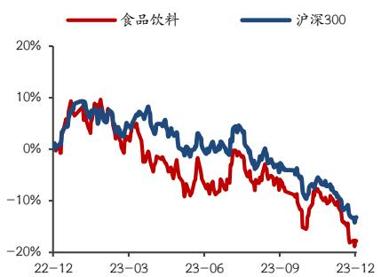

<table><tr><td></td><td>1M</td><td>3M</td><td>12M</td></tr><tr><td>绝对收益</td><td>-9.1%</td><td>-12.7%</td><td>-18.3%</td></tr><tr><td>相对收益</td><td>-3.2%</td><td>-1.9%</td><td>-5.3%</td></tr></table>

资料来源：恒生聚源，万和证券研究所

## 作者

## 费瑶瑶

分析师

资格证书：S038051804000

联系邮箱：feiyy@wanhesec.com

联系电话：(0755)82830333-115

## 相关报告

《行业专题-万和证券-食品饮料行业-白酒持续分化，大众品趋于改善-行业专题--2023年三季报业绩综述》 2023-11-09

《行业专题-万和证券-食品饮料行业-白酒经营有韧性，大众品短期承压-行业专题--2023 年中报业绩综述》 2023-09-11

存在。在渠道变迁以及产品红利背景下，建议重点关注休闲零食类渠道和品类双重提升的企业劲仔食品等。

◆ 调味品：成本改善、消费场景修复，盈利能力逐步恢复。受益于餐饮、旅游行业的恢复，消费场景呈现积极恢复态势，Q3 市场动销较上半年有了明显的提升；原材料方面，随着近期食糖价格的回落，毛利率有望预计底部企稳，行业盈利能力有望逐步恢复。

◆ 投资建议：维持行业“同步大市”评级。展望 2024年消费整体有望实现内生修复，白酒行业集中度提升，头部企业经营韧性强；大众品原材料成本改善，盈利能力有望持续修复。估值方面，截止到 12月 14日，食品饮料行业 PE估值为24 倍，处于近十年 13.8%的估值分位数水平，已经具备较强的估值吸引力，建议积极关注行业的整体投资机会。

◆ 风险提示：宏观经济复苏不及预期，整体消费低迷风险；地缘政治风险；原材料成本抬升风险；行业竞争加剧、食品安全负面舆情等风险。

## 正文目录

一、行情回顾：震荡走低，估值回落......5
（一）行业整体震荡走低，子行业仅软饮料取得正收益......5
（二）估值水平：回落至近十年低位，具备较强吸引力......6
（三）机构及北上资金：持仓比例依旧处于高位......6
1、公募基金食品饮料行业重仓股持仓比例处于历史高位，且环比有所提升......6
2、北上资金：持续减持，但持仓占比依旧位居第一......7
二、宏观背景：消费有望实现内生性修复......9
（一）消费整体呈现弱复苏......9
（二）消费有望实现内生性修复......10
三、白酒：行业盈利能力持续分化，或临近底部......11
（一）产业复盘2003-2021年：从量价齐升到价格主导......11
（二）当前周期判断：仍处于调整阶段，但市场集中度提升、头部企业经营韧性强......13
（三）市场复盘：本轮调整周期长幅度大，或临近底部......16
四、大众品：成本改善，盈利修复......18
（一）啤酒：高端化趋势延续，成本改善业绩弹性凸显......18
1、行业规模呈阶段性企稳......18
2、高端化结构升级延续......18
3、成本压力缓解，业绩弹性有望凸显......19
（二）食品加工：预制菜方兴未艾，成长空间大......21
1、预制菜行业概况......21
2、多重因素驱动预制菜市场规模有望稳步增长......21
3、行业发展初期，竞争格局分散......23
4、他山之石：美国和日本预制食品发展历程......24
（三）休闲食品：渠道变迁+产品红利，助推企业盈利增长......26
1、休闲食品行业概览：大行业，小公司......26
2、渠道：迎合“性价比”需求的零食量贩业态快速兴起......26
3、产品：中国特色口味零食行业增速高，仍处于行业红利期......28
4、渠道变迁+产品红利，差异化布局助推企业盈利增长......28
（四）调味品：成本改善、消费场景修复，盈利能力逐步恢复......30
1、基础调味品低速稳定增长，复合调味品前景广阔......30
2、原材料成本有望持续改善，毛利率预计底部企稳......31
3、消费场景积极修复，盈利能力逐步恢复......32
五、投资建议：白酒持续分化，大众品盈利修复可期......34
六、风险提示......35

## 图表目录

图1 SW一级行业指数涨跌幅（截至2023.12.14）....5  
图2 SW食品饮料指数走势（截至2023.12.14）....5  
图3 SW食品饮料及子行业涨跌幅（截至2023.12.14）....5  
图4 SW食品饮料PE估值水平（截止到12月14日）....6  
图5 SW食品饮料及二级子行业近十年PE估值分位数（截止到12月14日）....6  
图6 2023Q3公募基金重仓股申万一级行业持仓比例....7  
图7 食品饮料行业机构中重仓占比及超配比例....7  
图8 北上资金申万一级行业持仓市值及占比....8  
图9 北上资金食品饮料行业持股市值及占总市值比例....8  
图10 2018-2023年社会消费品零售总额当月同比....9  
图11 中国消费者信心指数....9  
图12 社会消费品零售总额及分项当月增速....9  
图13 限额以上企业商品零售额及分项当月同比....10

图14 居民收入和名义GDP累计增速....10
图15 2002-2022年白酒行业盈利能力变化....11
图16 2002-2023.10白酒产量及同比增速....12
图17 茅五泸出厂价....12
图18 2002-2022年茅五泸价格变化....12
图19 部分酒企核心单品批价（元/500ml）....13
图20 规模以上白酒企业数量....14
图21 2019-2023年白酒不同价格带单季度和归母净利润单季度增速....15
图22 2006-2023年白酒行业的涨跌幅及估值（PE-TTM）变化....16
图23 2004-2023.10啤酒产量及增速....18
图24 2019-2023年啤酒单月销量....18
图25 2017-2023H啤酒行业企业吨价（元/吨）....19
图26 2019-2023H年华润啤酒次高端及以上啤酒销量和占比....19
图27 啤酒成本结构（燕京啤酒2022）....19
图28 进口大麦价格....19
图29 啤酒上游原材料价格....20
图30 啤酒行业龙头上市公司毛利率（%）....20
图31 啤酒行业龙头上市公司毛销差（%）....20
图32 啤酒行业龙头上市公司净利率（%）....20
图33 预制菜产业链....21
图34 中国预制菜2015-2025E市场规模....21
图35 主要国家餐饮连锁化率....22
图36 餐饮行业使用预制菜后成本对比....22
图37 消费者就餐情况....22
图38 我国冷链物流2015-2025E市场规模....23
图39 中国预制菜竞争格局....24
图40 2021年休闲食品各品类占比....26
图41 2022年零食行业公司份额....26
图42 量贩零食的发展阶段....28
图43 中国休闲食品行业按口味划分的零售额....28
图44 中国调味品发展趋势....30
图45 2016-2022E中国复合调味料市场规模....30
图46 调味品行业产业链....31
图47 海天味业成本结构（2012）....31
图48 期货收盘价：黄大豆1号（元/吨）....31
图49 食糖价格指数（元/吨）....32
图50 苯二甲酸与乙二醇价格走势....32
图51 玻璃价格走势....32
图52 瓦楞纸价格走势（元/吨）....32

表1 SW食品饮料行业涨跌幅前十（%，截至2023.12.14）....6
表2 2013-2023前三季度白酒上市公司合同负债（预收账款）同比增速....14
表3 白酒行业历次调整（倍）....16
表4 白酒上市公司不同周期的涨跌幅（%）及估值（截止时间为2023年12月14日）....17
表5 啤酒行业上市公司营业收入、归属母公司及同比增速....20
表6 休闲零食的发展历程....26
表7 零食量贩的发展历程....27
表8 休闲食品部分上市公司2020-2023Q1-3业绩....29
表9 调味品部分上市公司2020Q1-2023Q3毛利率趋势（%）....32
表10 调味品行业上市公司单季度营业收入及同比增速（亿元）....33
表11 调味品行业龙头上市公司单季度归母净利润及同比增速（亿元）....33

## 行情回顾：震荡走低，估值回落

## （一） 行业整体震荡走低，子行业仅软饮料取得正收益

2023 年以来行业整体震荡走低，截止到 12 月中旬，申万食品饮料指数跌幅为 18.49%，跑输大盘，在申万一级行业分类中排名靠后，二级子行业全线走低，三级子行业仅软饮料实现 1.1%的正收益。2023 年初防疫政策优化，受益于春节期间回补消费以及返乡潮，行业延续了上年的涨幅；春节后消费疲弱，市场对于经济复苏的预期回落，行业走势持续走低。7月中共中央政治局会议强调巩固经济回升向好趋势，并陆续出台了系列促消费政策，受益于政策利好，食品饮料作为顺周期表现较优；8 月受市场整体悲观情绪、外资流出等影响，表现有所压制，8 月 27 日证监会统筹一二级市场平衡优化 IPO、再融资监管安排，市场情绪有所修复；9-10月受市场担忧龙头公司增速放缓以及美债收益率攀升影响，板块持续走低；10月 24日中央财政将增发1 万亿国资，市场信心有所修复；11 月1日，茅台时隔6 年再次提价，提振产业信心；12月悲观预期持续蔓延，指数再次走低。

图 1 SW 一级行业指数涨跌幅（截至 2023.12.14）  
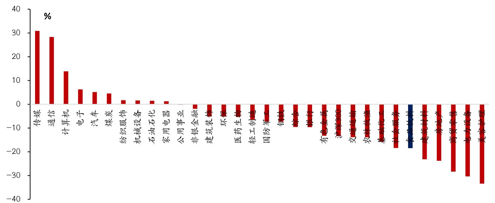  
资料来源：Wind，万和证券研究所

图 2 SW 食品饮料指数走势（截至 2023.12.14）  
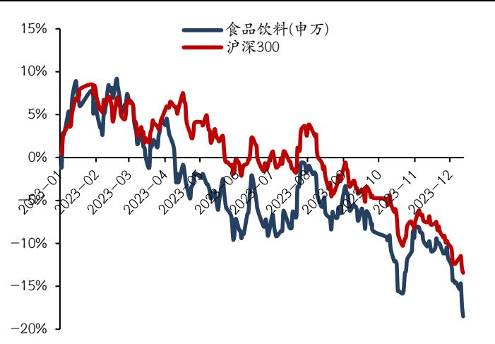  
资料来源：Wind，万和证券研究所

图 3 SW 食品饮料及子行业涨跌幅（截至 2023.12.14）  
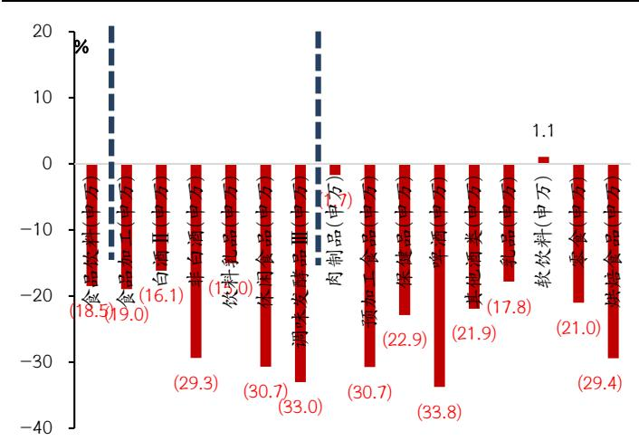  
资料来源：Wind，万和证券研究所

涨幅居前的个股行业涵盖预加工食品、软饮料以及肉制品等，但是没有典型的行业属性，更多体现在市值较小的个股，由于行业缺乏整体的趋势性β行情，更多的体现主题投资方向。

表 1 SW 食品饮料行业涨跌幅前十（%，截至 2023.12.14）

<table><tr><td>证券名称</td><td>涨幅前十</td><td>所属行业</td><td>证券名称</td><td>跌幅前十</td><td>所属行业</td></tr><tr><td>惠发食品</td><td>102.76</td><td>食品加工--预加工食品</td><td>绝味食品</td><td>-55.20</td><td>休闲食品--熟食</td></tr><tr><td>莲花健康</td><td>96.31</td><td>调味发酵品II--调味发酵品III</td><td>酒鬼酒</td><td>-50.79</td><td>白酒II--白酒III</td></tr><tr><td>泉阳泉</td><td>61.95</td><td>饮料乳品--软饮料</td><td>妙可蓝多</td><td>-50.69</td><td>饮料乳品--乳品</td></tr><tr><td>康比特</td><td>57.81</td><td>食品加工--保健品</td><td>立高食品</td><td>-50.11</td><td>休闲食品--烘焙食品</td></tr><tr><td>威龙股份</td><td>45.15</td><td>食品饮料--非白酒--其他酒类</td><td>重庆啤酒</td><td>-49.60</td><td>非白酒--啤酒</td></tr><tr><td>盖世食品</td><td>41.36</td><td>食品加工--预加工食品</td><td>海天味业</td><td>-46.87</td><td>调味发酵品II--调味发酵品III</td></tr><tr><td>一鸣食品</td><td>22.68</td><td>饮料乳品--乳品</td><td>舍得酒业</td><td>-44.05</td><td>白酒II--白酒III</td></tr><tr><td>华统股份</td><td>18.35</td><td>食品加工--肉制品</td><td>良品铺子</td><td>-41.05</td><td>休闲食品--零食</td></tr><tr><td>金字火腿</td><td>16.30</td><td>食品加工--肉制品</td><td>宝立食品</td><td>-40.32</td><td>调味发酵品II--调味发酵品III</td></tr><tr><td>欢乐家</td><td>11.33</td><td>饮料乳品--软饮料</td><td>来伊份</td><td>-38.87</td><td>休闲食品--零食</td></tr></table>

资料来源：Wind，万和证券研究所

## （二） 估值水平：回落至近十年低位，具备较强吸引力

行业整体估值回落，已经回落至近十年低位。截止到 12 月 14 日，食品饮料行业 PE 估值为 24倍，处于近十年13.8%的估值分位数水平。细分行业方面，二级子行业食品加工、白酒、非白酒、饮料乳品、休闲食品以及调味发酵品 PE 估值分别为 22.5/24.1/31.5/18.5/31.2/36.1 倍，分别处于近十年 0.5%/35.7%/32.4%/0.9%/14.8%/35.7%分位数水平，二级子行业 PE 估值十年期分位数均大幅低于50%，已经具备较强的估值吸引力。

图 4 SW 食品饮料 PE估值水平（截止到 12月 14日）  
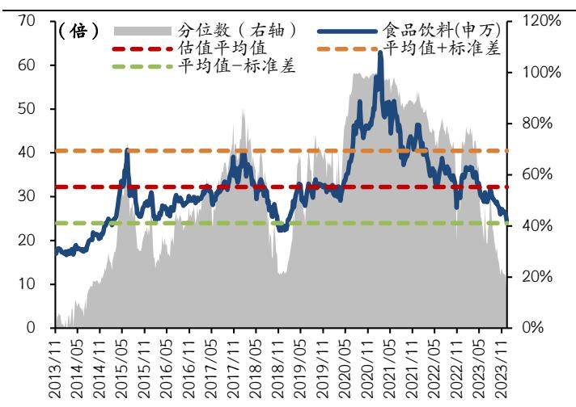  
资料来源：Wind，万和证券研究所

图 5 SW 食品饮料及二级子行业近十年 PE估值分位数（截止到 12 月 14 日）  
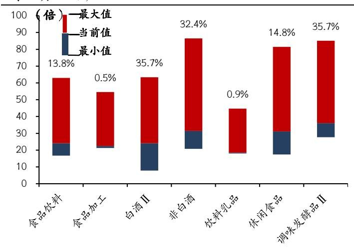  
资料来源：Wind，万和证券研究所

## （三） 机构及北上资金：持仓比例依旧处于高位

## 1、 公募基金食品饮料行业重仓股持仓比例处于历史高位，且环比有所提升

截止2023Q3 底公募基金食品饮料重仓股持仓比例持续回升至 14.00%，超配比例回升至6.20%。截止到 2023Q3 底，公募基金持股总市值为 2.96 万亿元，申万一级行业食品饮料、医药生物、电子、电力设备、计算机重仓股持仓比例位居前五，分别为 14.00%/12.18%/11.00%/10.07%/5.09%。食品饮料行业机构重仓持仓市值为4151.64亿元，持仓比例较2023Q3 环比提升1.10pct；2023Q3底食品饮料流通市值占 A 股流通市值比例为 7.80%，食品饮料依旧处于超配状态，超配比例为6.20%，环比提升0.79pct，超配比例略高于历史平均水平5.80%。

（备注：本文基金样本为全部内地公募基金，文中持仓比重均为基金重仓比重，本文所提持仓比例均为占基金持仓所有市值的比重，未剔除港股和未分类个股）

图6 2023Q3公募基金重仓股申万一级行业持仓比例  
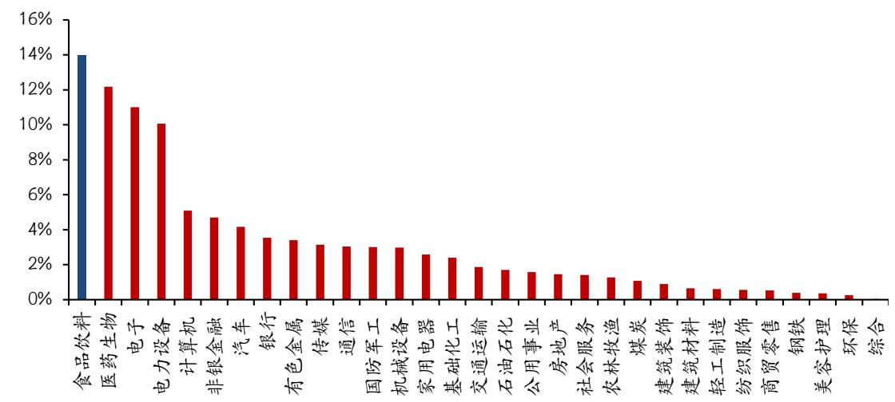  
资料来源：Wind，万和证券研究所

图7 食品饮料行业机构中重仓占比及超配比例  
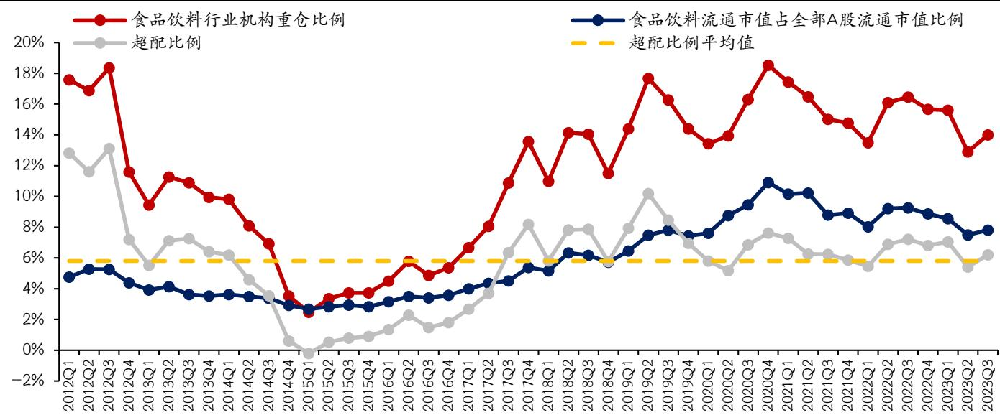  
资料来源：Wind，万和证券研究所

## 2、 北上资金：持续减持，但持仓占比依旧位居第一

截止11月30日，北上资金总规模为2.28 万亿，申万一级行业食品饮料、电力设备、医药生物、银行、电子持股市值占比位居前五，分别为 11.99%/9.69%/9.44%/8.03%/7.25%；其中，食品饮料持仓规模为2738亿元，持仓数量为27.56亿股，自2023年 4月以来北上资金连续7个月持续减持，市值占比回落至 4.85%，处于近6 年以来底部区域。

（备注：本文北上资金包括陆股通、QFII/RQFII 以及外资私募）

图 8 北上资金申万一级行业持仓市值及占比  
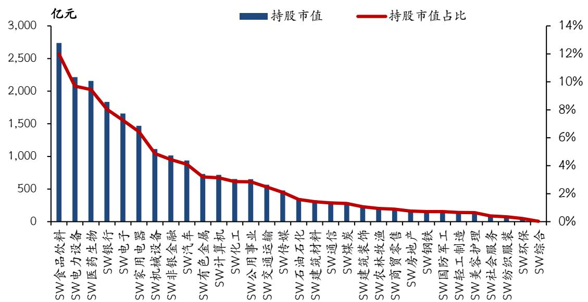  
资料来源：Wind，万和证券研究所

图 9 北上资金食品饮料行业持股市值及占总市值比例  
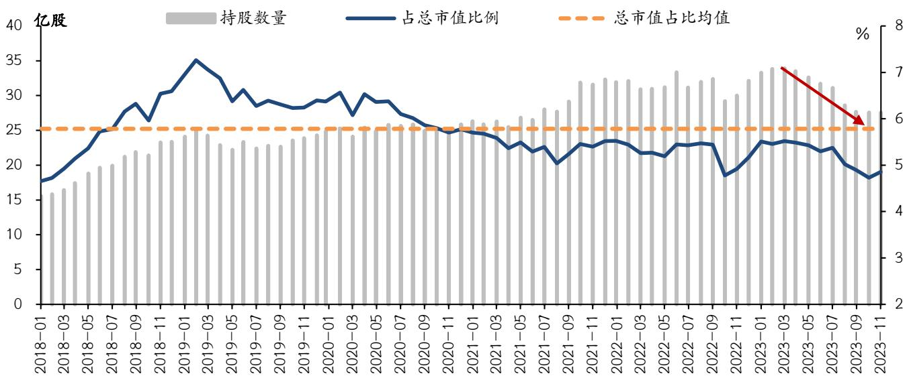  
资料来源：Wind，万和证券研究所

## 宏观背景：消费有望实现内生性修复

## （一） 消费整体呈现弱复苏

消费整体呈现弱复苏，餐饮消费好于商品消费。10月份社会消费品零售总额同比增速7.6%，呈现逐月回升的态势，但增速加快有上年同期低基数的作用，消费复苏依旧偏弱，且依旧低于2018-2019 年增速中枢，当前居民的消费意愿仍有待提升。分项看，餐饮收入及商品销售 10 月份增速为 17.1%/6.5%，其中餐饮消费受益于居民消费场景修复表现略好，增速比 9 月份+3.3pct，连续两个月加快，呈现出典型的服务消费和商品消费的分化。

限额以上消费占据整体消费的约 3-4 成，10月份当月同比增速为8.7%，增速高于消费总额，其中酒类、金银珠宝、体育娱乐、家用电器、通讯器材以及汽车类保持了高于限额整体的增速，食品、饮料、日用品等必选消费，相较于上年的高基数，增速稳定；金银珠宝、餐饮、服装、体育用品等的高增速主要受益于消费场景的修复、生活半径的打开并叠加去年同期低基数；地产系的建筑装潢、家具、家电两年复合增速持续为负；大宗消费方面，汽车类占据了限额以上企业商品零售总额的三成左右，10 月大幅回升至 11.40%，增速比9月份加快8.6个百分点。

图 10 2018-2023 年社会消费品零售总额当月同比  
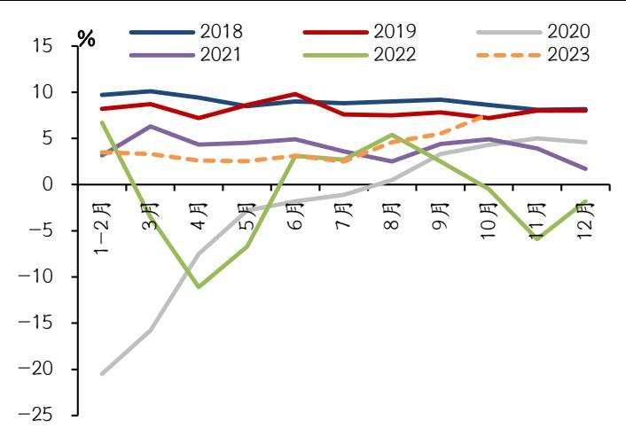  
资料来源：Wind，万和证券研究所（2021年1-7月及2023年3-5月为两年复合增速）

图 11 中国消费者信心指数  
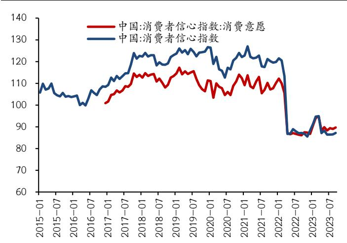  
资料来源：Wind，万和证券研究所

图 12 社会消费品零售总额及分项当月增速  
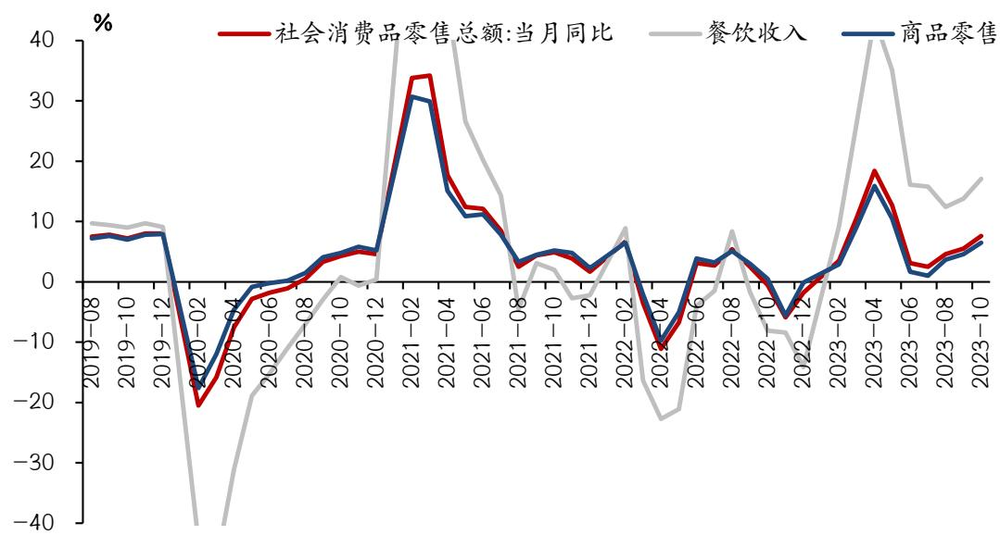  
资料来源：Wind，万和证券研究所

图 13 限额以上企业商品零售额及分项当月同比  
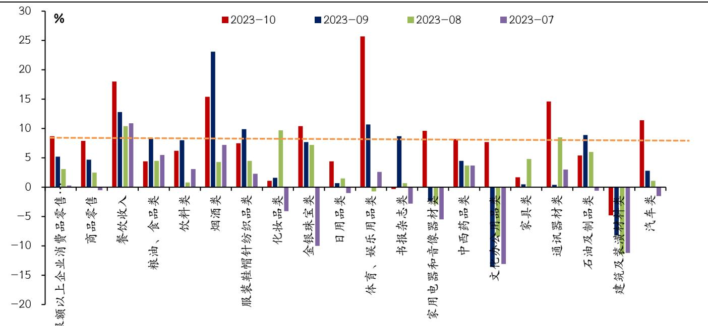  
资料来源：Wind，万和证券研究所（限额以上单位是指年主营业务收入2000 万元及以上的批发业企业（单位、个体户）、500万元及以上的零售业企业（单位、个体户）、200万元及以上的住宿和餐饮业企业（单位、个体户））

## （二） 消费有望实现内生性修复

随着低基数效应以及消费场景修复等补偿性消费的影响的逐步减弱，2024 年消费修复或更将取决于居民消费力的边际改善程度以及消费意愿的提升，一方面，居民收入提升，消费力趋于改善，央行2023年三季度货币政策执行报告指出，“消费潜能继续释放。居民收入增速已连续2 个季度高于名义经济增速，个人所得税扣除标准提高、存量房贷利率下调等政策持续显效，还将继续支持扩大居民收入，提升消费能力”；另一方面，宏观经济持续恢复向好，有助于消费者信心提升，央行 2023年三季度货币政策执行报告指出，“三季度GDP 增速好于市场，经济内生动力还将不断增强”。虽然复苏可能慢于预期，且消费者信心或将影响未来数月的增长率，但中国市场的长期前景依然强劲。根据麦肯锡全球研究院（MGI）的模拟分析，2025 年中高收入和高收入家庭的数量有望达到 2 亿户，2030 年有望达到 2.6 亿户。2025 年，高收入城市的数量预计将达到82 个，到 2030年预计将达到93 个。

图 14 居民收入和名义 GDP累计增速  
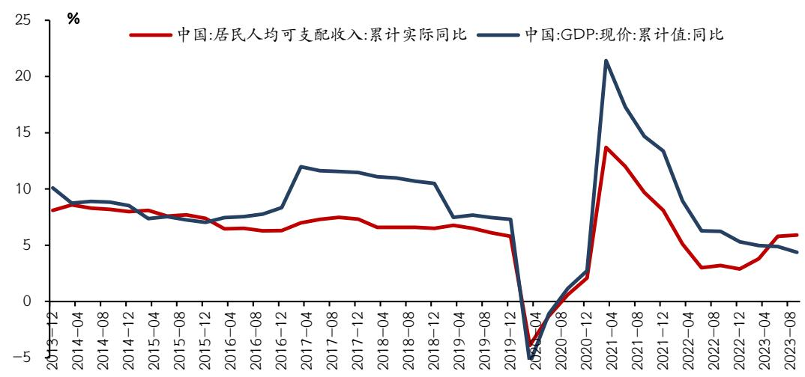  
资料来源：Wind，万和证券研究所

## 白酒：行业盈利能力持续分化，或临近底部

## （一） 产业复盘2003-2021 年：从量价齐升到价格主导

复盘白酒行业近二十年的发展，主要经历了 2003-2012 年量价齐升的黄金十年和 2015-2021 年量减价升的高质量发展以及2013-2014 年行业调整期。

2003-2012 年：量价齐升黄金十年。2003-2012 期间受益于宏观经济的高速发展以及居民可支配收入的快速提升，白酒行业经历了量价齐升的黄金十年，期间白酒产量从2003 年331万千升提升至 2012 年 1153 万千升，复合增长率达 14.86%；价格方面，以茅五泸龙头企业出厂价和批发价为价格参考，期间茅五泸经过多次提价，截止2012年底出厂价分别为819/659/889元/500ml，市场批价也快速提升至 1175/693/741 元/500ml。供需双旺，以白酒上市企业为代表，行业营收和归母净利润实现高速增长，截止 2012 年行业实现营收和归母净利润为 1126.06 亿元、380.90亿元，复合增长率达 24.65%、50.17%。

2013-2014 年：供需失衡批价回落。受 2012 年底白酒塑化剂负面舆情、国家推出“八项规定”限制“三公”消费的政策以及宏观经济低迷等影响，白酒产量增速和批价均快速回落，且批价与出厂价出现倒挂，2013-2014年行业盈利能力连续两年下滑。

2015-2021 年：量减价升高质量发展。2015 年随着龙头企业批价的企稳回升，行业迎来新一轮成长周期，产量方面，白酒产量自 2016年达到 1358万千升之后逐年下滑至2021年715 万千升，并于2022、2023 年持续下滑；价格方面，受益于商务宴请消费场景以及消费升级等，龙头企业批价也逐季抬升，期间贵州茅台批价突破 3500元/500ml，龙头企业多次提高出厂价。2015-2021年期间，虽然白酒产量逐年走低，但是行业复苏价格抬升，行业依旧维持了较为持续增长态势，截止到 2021 年规模以上白酒企业销售收入及利润总额分别为 6033 亿元、1702 亿元，期间复合增速分别为1.37%、13.48%；上市公司口径行业营收和归母净利润分别为3056 亿元、1084亿元，期间复合增速分别为 18.01%、22.21%，其中上市公司营收占比已从2015 年的20.26%提升至202年 50.66%。

图 15 2002-2022 年白酒行业盈利能力变化  
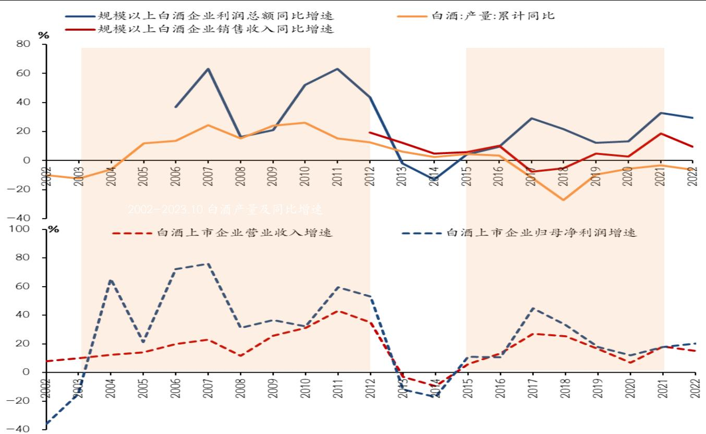  
资料来源：Wind，国台酒业及郎酒招股说明书，中国酒业协会，万和证券研究所

图 16 2002-2023.10 白酒产量及同比增速  
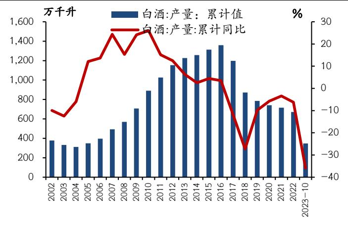  
资料来源：Wind，万和证券研究所

图 17 茅五泸出厂价  
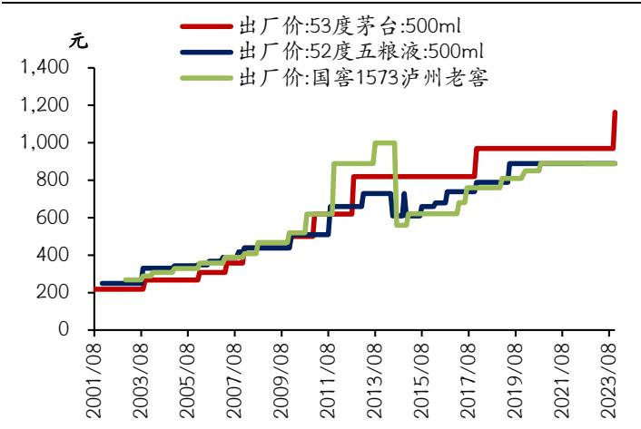  
资料来源：Wind，万和证券研究所

图 18 2002-2022 年茅五泸价格变化  
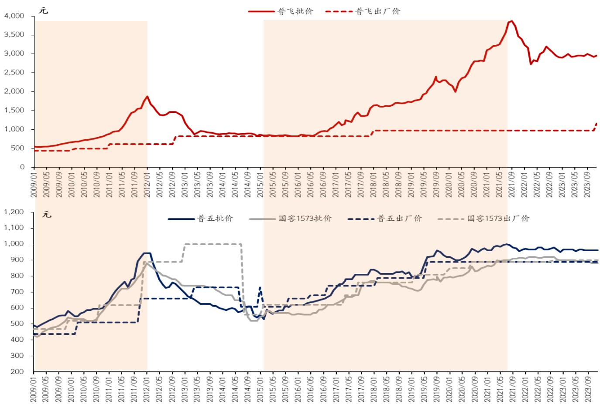  
资料来源：Wind，万和证券研究所

## （二） 当前周期判断：仍处于调整阶段，但市场集中度提升、头部企业经营韧性强

产量规模负增长，行业增长由利润驱动。2022 年以来白酒总产量依旧持续回落，2022 年产量为671.2万千，同比增速为-5.6%，2023 年前10个月累计产量为347.8 万千升，同比增速为-35.9%；2022年白酒销售额为6,626 亿元，同比增长9.60%，规模以上企业实现利润总额 2,202亿元，同比增长29.36%，平均毛利率50.21%，比 2021年末（45.99%）增长4.22个百分点，行业韧性强，利润持续攀升，市场处在从重产销逐步变为重利润的调整期，发展稳中向好的根本趋势没有改变。

酒商库存高，终端动销不畅，行业景气度弱。中国酒业协会联合腾讯发布了《2023 年中国白酒行业消费白皮书》，2022年因外出机会减少而导致消费场景变少等多方因素之下，终端市场动销情况并不容乐观，约 39.7%酒商库存在 5 个月以上，33.6%酒商库存在 3 至 5 个月，渠道经销商大都面临较大的库存压力；与此同时，2022 年 1 月至 6 月酒商业绩平均下滑 5.7%，其中 63.6%酒商业绩同比下滑，27.2%酒商较上年持平，仅 8%左右酒商实现增长。批价由供需决定，是衡量行业景气度的核心指标之一，自2022 年以来酒企的核心单品批价均有不同程度的走弱，2023 年以来受消费不及预期影响，批价依旧走弱，库存压力仍然存在，行业景气度弱。

图 19 部分酒企核心单品批价（元/500ml）  
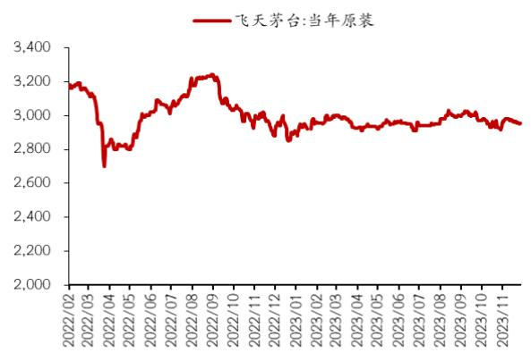

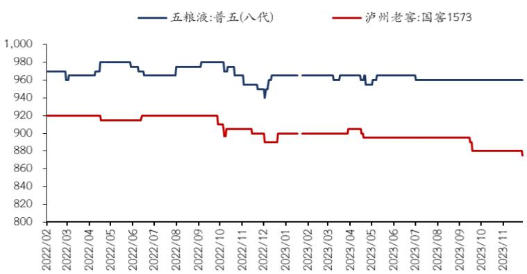

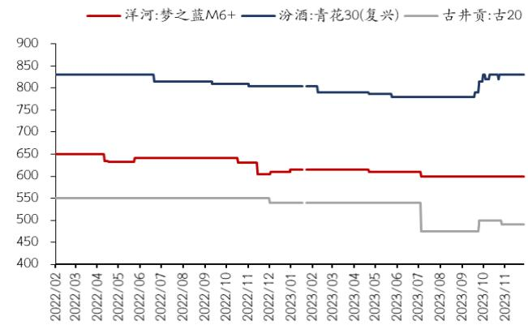  
资料来源：Wind，万和证券研究所

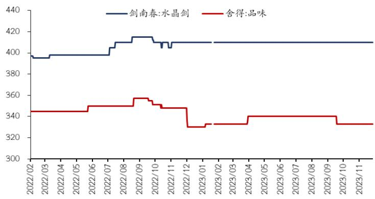

规模以上白酒企业数量减少，行业集中度进一步提升。2022 年1 月至12月，纳入到国家统计局范畴的规模以上白酒企业963 家。从历史趋势上看，规模以上白酒企业数量在2017 年达到顶峰之后，便迎来了下滑时期。规模以上白酒企业数量虽然减少，但白酒行业的营收依旧在上升，这也可以从一个侧面看出，白酒行业的市场集中度有所提升。2021年，965 家规模以上企业中，亏损企业130 家；2022年截至12 月末，963家规模以上企业中，亏损企业 169家。

图 20 规模以上白酒企业数量  
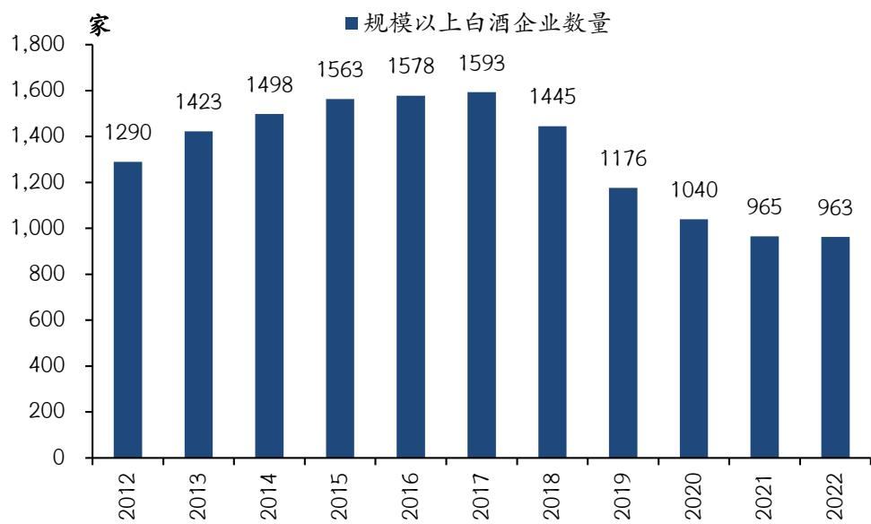  
资料来源：《2023年中国白酒行业消费白皮书》，中国酒业协会，万和证券研究所

上市公司整体收入增速稳健，抗周期能力增强。合同负债（预收账款）反馈了渠道的打款意愿以及酒企的战略导向，2022 年以来行业多数酒企业合同负债（预收账款）表现较弱，但是白酒上市公司整体营收和归母净利润均保持了双位数的增长，收入稳健盈利韧性强，抗周期能力增强。

表 2 2013-2023前三季度白酒上市公司合同负债（预收账款）同比增速

<table><tr><td colspan="2"></td><td>2013</td><td>2014</td><td>2015</td><td>2016</td><td>2017</td><td>2018</td><td>2019</td><td>2020</td><td>2021</td><td>2022</td><td>2023Q1-3</td></tr><tr><td rowspan="3">高端酒企</td><td>贵州茅台</td><td>-40%</td><td>-52%</td><td>460%</td><td>112%</td><td>-18%</td><td>-6%</td><td>1%</td><td>-3%</td><td>-5%</td><td>22%</td><td>-4%</td></tr><tr><td>五粮液</td><td>-87%</td><td>4%</td><td>132%</td><td>216%</td><td>-26%</td><td>44%</td><td>87%</td><td>-31%</td><td>52%</td><td>-5%</td><td>33%</td></tr><tr><td>泸州老窖</td><td>-47%</td><td>48%</td><td>-31%</td><td>-33%</td><td>83%</td><td>-18%</td><td>40%</td><td>-25%</td><td>109%</td><td>-27%</td><td>56%</td></tr><tr><td rowspan="5">次高端酒企</td><td>山西汾酒</td><td>-69%</td><td>3%</td><td>0%</td><td>38%</td><td>70%</td><td>81%</td><td>72%</td><td>9%</td><td>137%</td><td>-6%</td><td>9%</td></tr><tr><td>洋河股份</td><td>4%</td><td>1%</td><td>40%</td><td>205%</td><td>9%</td><td>6%</td><td>51%</td><td>30%</td><td>80%</td><td>-13%</td><td>-33%</td></tr><tr><td>舍得酒业</td><td>146%</td><td>-43%</td><td>149%</td><td>-40%</td><td>-3%</td><td>29%</td><td>3%</td><td>45%</td><td>79%</td><td>-55%</td><td>-10%</td></tr><tr><td>水井坊</td><td>-82%</td><td>502%</td><td>-26%</td><td>109%</td><td>90%</td><td>-5%</td><td>131%</td><td>98%</td><td>30%</td><td>7%</td><td>15%</td></tr><tr><td>酒鬼酒</td><td>-68%</td><td>69%</td><td>0%</td><td>-19%</td><td>-9%</td><td>10%</td><td>34%</td><td>248%</td><td>92%</td><td>-69%</td><td>-27%</td></tr><tr><td rowspan="9">区域酒企</td><td>古井贡酒</td><td>28%</td><td>156%</td><td>61%</td><td>3%</td><td>-19%</td><td>128%</td><td>-54%</td><td>128%</td><td>51%</td><td>-55%</td><td>-12%</td></tr><tr><td>今世缘</td><td>25%</td><td>-13%</td><td>-5%</td><td>55%</td><td>68%</td><td>43%</td><td>12%</td><td>-16%</td><td>89%</td><td>-1%</td><td>-4%</td></tr><tr><td>口子窖</td><td>4%</td><td>-39%</td><td>25%</td><td>108%</td><td>93%</td><td>7%</td><td>-13%</td><td>-4%</td><td>-12%</td><td>-17%</td><td>0%</td></tr><tr><td>迎驾贡酒</td><td>-40%</td><td>18%</td><td>1%</td><td>13%</td><td>0%</td><td>1%</td><td>-16%</td><td>15%</td><td>28%</td><td>11%</td><td>21%</td></tr><tr><td>老白干酒</td><td>-18%</td><td>34%</td><td>-16%</td><td>88%</td><td>-40%</td><td>-15%</td><td>87%</td><td>-12%</td><td>92%</td><td>10%</td><td>2%</td></tr><tr><td>伊力特</td><td>-28%</td><td>-30%</td><td>-46%</td><td>144%</td><td>-18%</td><td>-58%</td><td>-28%</td><td>6%</td><td>-6%</td><td>-5%</td><td>-46%</td></tr><tr><td>青青稞酒</td><td>-35%</td><td>-80%</td><td>171%</td><td>128%</td><td>-76%</td><td>192%</td><td>-16%</td><td>-13%</td><td>96%</td><td>-6%</td><td>113%</td></tr><tr><td>金徽酒</td><td>-20%</td><td>56%</td><td>61%</td><td>75%</td><td>-57%</td><td>-17%</td><td>81%</td><td>-12%</td><td>79%</td><td>42%</td><td>56%</td></tr><tr><td>金种子酒</td><td>72%</td><td>3%</td><td>-12%</td><td>-39%</td><td>-41%</td><td>-13%</td><td>35%</td><td>15%</td><td>-24%</td><td>13%</td><td>4%</td></tr><tr><td colspan="2">合计</td><td>-52%</td><td>-6%</td><td>89%</td><td>101%</td><td>-10%</td><td>9%</td><td>31%</td><td>-3%</td><td>49%</td><td>-5%</td><td>-34%</td></tr></table>

资料来源：Wind，万和证券研究所

不同价格带则有所分化，头部企业增长势头稳健，韧性更强。具体来看，区域酒〉高端酒〉次高 端 ，2023Q3 营收 增速 分 别 23.50%/16.23%/10.21% ， 归母 公司 净 利润 增 速则 分 别为38.8%/18.0%/12.2%，区域酒企主要受益于基地市场消费升级以及双节宴席等消费场景的修复；高端酒企品牌力强、经营稳健，营收连续 7 个季度保持了约 15%的增速，归母净利润连续 7 个季度保持了17%以上的增速，贵州茅台于2023 年11月1日公告上调53%vol贵州茅台酒（飞天、五星）出厂价格20%，充分释放了盈利空间；次高端主要集中在商务场合，消费场景受经济波动影响较大，在经济弱复苏背景下修复较弱。

图 21 2019-2023 年白酒不同价格带单季度和归母净利润单季度增速  
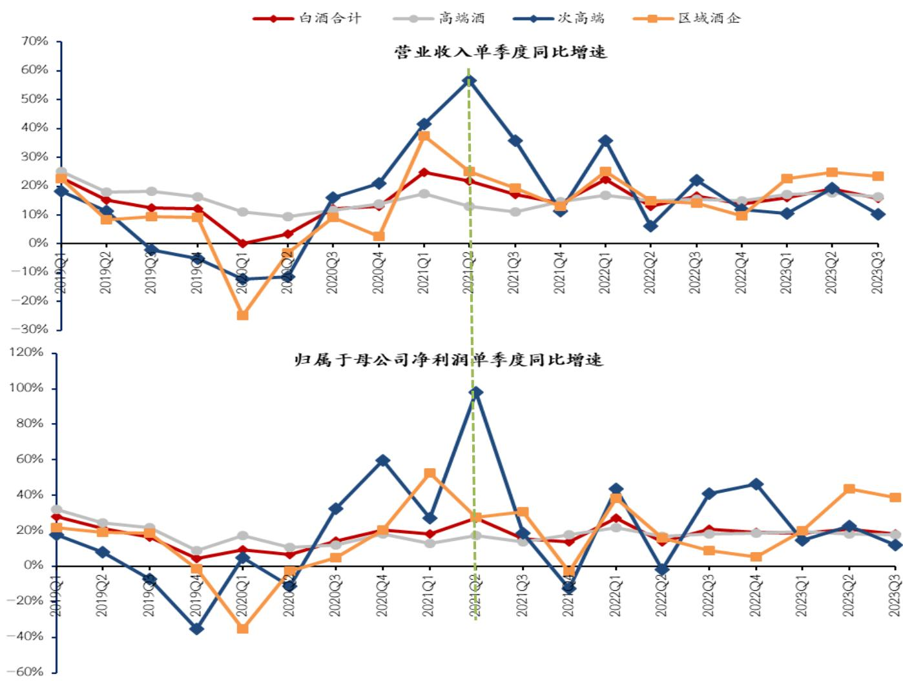  
资料来源：Wind，万和证券研究所（备注：高端酒企业：贵州茅台、五粮液、泸州老窖；次高端：洋河股份、山西汾酒、舍得酒业、水井坊、酒鬼酒；区域酒企：古井贡酒、今世缘、口子窖、迎驾贡酒、老白干酒、伊力特、青青稞酒、金徽酒、金种子酒、皇台酒业）

## （三） 市场复盘：本轮调整周期长幅度大，或临近底部

我们复盘了2006年以来白酒行业的表现，期间有四轮较为明显的调整，分别为：

第一轮为 2007/12-2008/11，受全球金融危机影响行业调整幅度达 66.53%，周期达 325 天。

第二轮为 2012/7-2014/1，金融危机之后行业经历了价量齐升繁荣发展期，而 2012 年国家推出“八项规定”限制“三公”消费的政策出台以及“塑化剂”负面舆情等影响，消费场景受到显著影响，从而导致行业库存高企、批价与零售价倒挂，本轮调整幅度达 59.44%，周期长达546天。

第三轮为2018/6-2018/10，受中贸贸易摩擦悲观预期影响市场，本轮调整幅度为39.85%，周期仅为140天。

第四轮为2021/2-至今，本轮调整周期长幅度大，或临近底部。本轮调整幅度高，为48.04%（按2022 年 12 月 31 日最低点测算）；调整时间长，如考虑白酒行业 2023 年以来的持续下跌，调整时间已接近三年，一是本轮调整伊始估值高，达 63 倍，二是 2023 年以来行业内结构性分化加剧，龙头企业盈利能力稳健有韧性，股价较为坚挺，但是次高端在消费复苏偏弱的背景下大幅走低。一方面，目前行业短期面临库存压力，但是上市酒企经营稳健抗周期能力增强；二是本轮调整的周期从时间维度上已远超前三轮调整，虽然行业估值仍高于前三轮的最低值，但是行业内分化比较明显，截止到2023 年 12 月 14 日，行业估值水平 PE(TTM)已回落至 24 倍，茅台受益于稳定的盈利能力和品牌议价能力等 PE(TTM)29倍，但如五粮液、泸州老窖等酒企估值已回落至20倍以下，或临近底部。

图 22 2006-2023 年白酒行业的涨跌幅及估值（PE-TTM）变化  
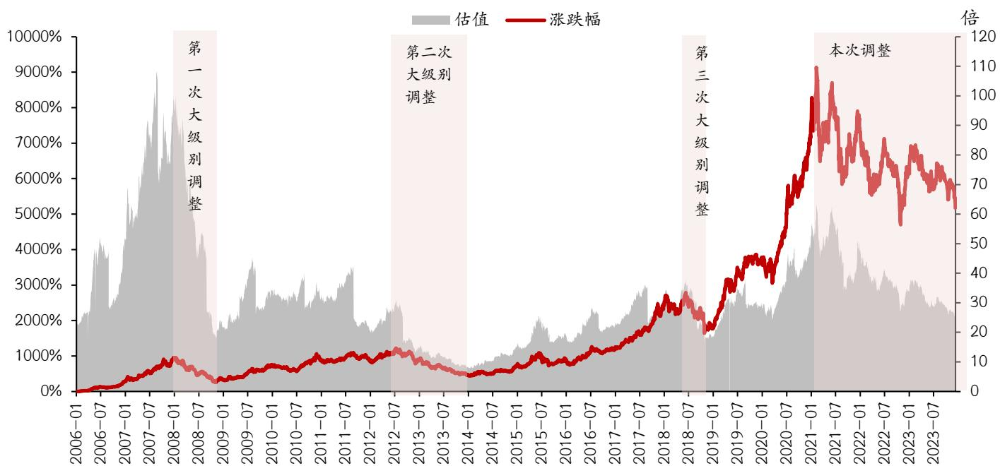  
资料来源：Wind，万和证券研究所

表 3 白酒行业历次调整（倍）

<table><tr><td rowspan="2"></td><td colspan="3">最高点</td><td colspan="3">最低点</td><td rowspan="2">调整幅度</td><td rowspan="2">调整时间(天)</td></tr><tr><td>日期</td><td>点位</td><td>PE(TTM)</td><td>日期</td><td>点位</td><td>PE(TTM)</td></tr><tr><td>第一轮调整</td><td>2007/12/18</td><td>11005.91</td><td>99</td><td>2008/11/7</td><td>3684.03</td><td>17</td><td>-66.53%</td><td>325</td></tr><tr><td>第二轮调整</td><td>2012/7/13</td><td>13767.25</td><td>31</td><td>2014/1/10</td><td>5584.66</td><td>8</td><td>-59.44%</td><td>546</td></tr><tr><td>第三轮调整</td><td>2018/6/12</td><td>30065.89</td><td>38</td><td>2018/10/30</td><td>18085.51</td><td>17</td><td>-39.85%</td><td>140</td></tr><tr><td>本轮调整</td><td>2021/2/10</td><td>96157.33</td><td>63</td><td>2022/10/31</td><td>49967.45</td><td>27</td><td>-48.04%</td><td>628</td></tr></table>

资料来源：Wind，万和证券研究所（备注：本轮调整已2022 年10月31日最低进行测算，如考虑白酒行业2023 年以来的持续下跌，调整时间已接近三年，截止到2023年12月 14日行业估值（PE-TTM）已经回落至24 倍，部分酒企估值已回落至20 倍以下）

表 4 白酒上市公司不同周期的涨跌幅（%）及估值（截止时间为 2023 年 12月 14日）

<table><tr><td>证券代码</td><td>证券简称</td><td>2021年2月至2022年10月</td><td>2021年2月至2023年11月</td><td>2023年至今</td><td>PE(TTM)(倍)</td></tr><tr><td>801125.SI</td><td>白酒II(申万)</td><td>-44.63</td><td>-33.26</td><td>-16.14</td><td>24.15</td></tr><tr><td>600519.SH</td><td>贵州茅台</td><td>-43.51</td><td>-23.48</td><td>-3.82</td><td>28.87</td></tr><tr><td>000858.SZ</td><td>五粮液</td><td>-57.22</td><td>-52.52</td><td>-24.88</td><td>17.43</td></tr><tr><td>000568.SZ</td><td>泸州老窖</td><td>-44.77</td><td>-27.20</td><td>-23.01</td><td>19.63</td></tr><tr><td>600809.SH</td><td>山西汾酒</td><td>-18.04</td><td>-15.17</td><td>-22.88</td><td>25.32</td></tr><tr><td>002304.SZ</td><td>洋河股份</td><td>-38.04</td><td>-43.77</td><td>-31.49</td><td>15.35</td></tr><tr><td>600702.SH</td><td>舍得酒业</td><td>42.92</td><td>17.15</td><td>-44.05</td><td>16.49</td></tr><tr><td>600779.SH</td><td>水井坊</td><td>-36.89</td><td>-32.66</td><td>-32.57</td><td>23.25</td></tr><tr><td>000799.SZ</td><td>酒鬼酒</td><td>-42.35</td><td>-59.53</td><td>-50.79</td><td>39.20</td></tr><tr><td>000596.SZ</td><td>古井贡酒</td><td>-15.58</td><td>9.81</td><td>-13.71</td><td>27.75</td></tr><tr><td>603369.SH</td><td>今世缘</td><td>-36.99</td><td>-8.78</td><td>-6.04</td><td>19.37</td></tr><tr><td>600559.SH</td><td>老白干酒</td><td>-14.65</td><td>-4.95</td><td>-19.53</td><td>33.83</td></tr><tr><td>603198.SH</td><td>迎驾贡酒</td><td>56.32</td><td>136.87</td><td>5.37</td><td>24.06</td></tr><tr><td>603589.SH</td><td>口子窖</td><td>-33.58</td><td>-20.80</td><td>-21.77</td><td>15.52</td></tr><tr><td>002646.SZ</td><td>青青稞酒</td><td>3.38</td><td>17.74</td><td>-9.21</td><td>80.24</td></tr><tr><td>600197.SH</td><td>伊力特</td><td>-8.06</td><td>7.58</td><td>-14.69</td><td>38.19</td></tr><tr><td>603919.SH</td><td>金徽酒</td><td>-35.70</td><td>-14.39</td><td>-8.25</td><td>36.29</td></tr><tr><td>600199.SH</td><td>金种子酒</td><td>61.09</td><td>65.63</td><td>-28.89</td><td></td></tr></table>

资料来源：Wind，万和证券研究所（备注：金种子酒受亏损影响估值为负值）

## 大众品：成本改善，盈利修复

## （一） 啤酒：高端化趋势延续，成本改善业绩弹性凸显

## 1、 行业规模呈阶段性企稳

行业规模呈阶段性企稳态势，市场格局相对稳定。回顾啤酒行业发展历程，中国啤酒市场作为全球最大的啤酒生产及消费市场，经过几十年的持续发展啤酒行业总量自2013年触顶后逐步回落，并于 2018-2019 年回落至 3800 万千升左右，2021-2022 年分别实现产量 3562.40、3568.7 万千升，2023 年前 10 个月累计产量为 3180.40 万千升，累计同比为 2.2%，预计全年在 3600 万千升左右，目前已呈阶段性企稳态势，但与疫情前依旧存在较大差距；行业大型企业加快产能优化整合步伐，持续推进规模化生产提高运营效率，目前中国市场前五大啤酒企业已占市场份额已提升至92.6%，形成了相对稳定的市场竞争格局。

图 23 2004-2023.10 啤酒产量及增速  
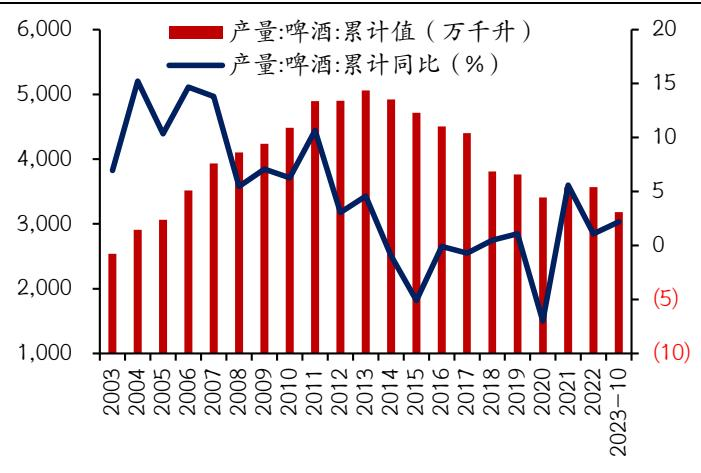  
资料来源：Wind，万和证券研究所

图 24 2019-2023 年啤酒单月销量  
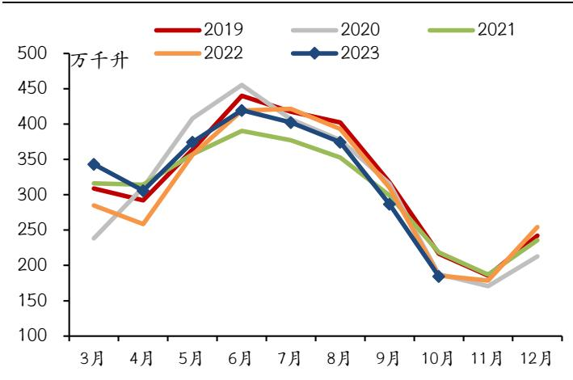  
资料来源：Wind，万和证券研究所

## 2、 高端化结构升级延续

行业高端化结构化升级延续。《2021 年度中国酒业协会啤酒分会工作报告》指出高端化是中国啤酒市场发展的必经之路；我国中高端及以上啤酒的市场份额不足800万千升,市场占比不足20%,与其他成熟啤酒市场相比还有非常大的上升空间。在此背景下，啤酒行业竞争主线和核心增长逻辑依然是主打高端化，近些年啤酒龙头企业也纷纷通过推出系列新品，完善品牌矩阵，布局高端，2017 以来年国内啤酒厂商等吨价均稳步提升，但与国际巨头依旧存在较大的差距，百威亚太2023 上半年吨价提升至5356.23 元/吨。

啤酒厂商纷纷加大高端化布局。华润啤酒持续以“决战高端,质量发展”为战略管理主题,深入推进高端化产品矩阵布局，2023 年上半年公司次高端及以上销量 144.4 万千升，较上年同期增长26.4%，占比持续提升至21.98%；青岛啤酒中高端以上产品实现销量281.2万千升，同比增长15%；重庆啤酒以“国际高端品牌+本地强势品牌”的品牌组合为依托，推进产品高端化，2022 年中高端销量为233万千升，同比增长2.37%，占比达81.56%。

图 25 2017-2023H 啤酒行业企业吨价（元/吨）  
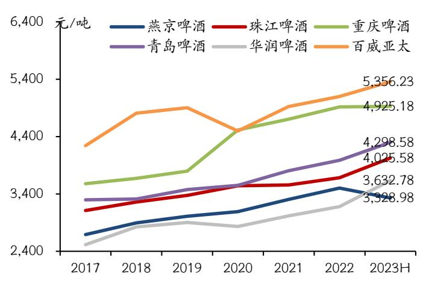  
资料来源：Wind，万和证券研究所

图 26 2019-2023H 年华润啤酒次高端及以上啤酒销量和占比  
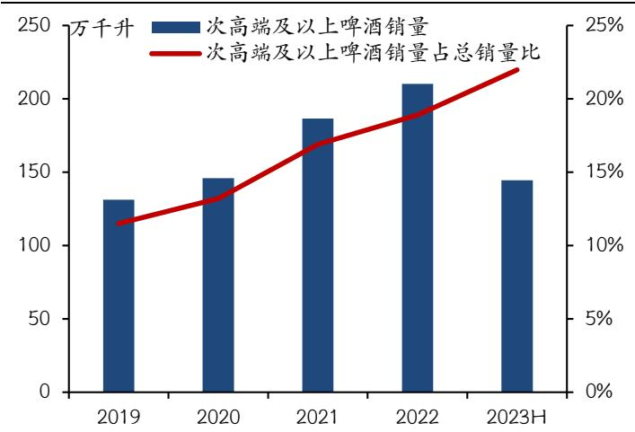  
资料来源：Wind，万和证券研究所

## 3、 成本压力缓解，业绩弹性有望凸显

成本压力趋于缓解，毛利率有望企稳回升。啤酒的生产成本主要包括原料（大麦、大米、啤酒花等）、包材（铝、玻璃、瓦楞纸等）及人工成本等约占生产总成本 70%。2023 年以来主要原材料及包材价格全线走低，进口大麦价格高位回落，8月4日澳洲大麦双反政策的落地，大麦价格仍有回落空间，截止到2023 年10 月已回落至291.90美元/吨，较去年同期-23.64%。2023 前三季度青岛啤酒、重庆啤酒、燕京啤酒、珠江啤酒毛利率分别为 39.7%/49.2%/44.0%/45.6%，Q3 毛利率则分别为 40.9%/50.5%/48.0%/45.7%，环比 Q2 +2.9pct/-1.1pct/+0.2pct/+0.8pct，多数酒企毛利率环比改善；2023Q3 青岛啤酒、重庆啤酒、燕京啤酒、珠江啤酒毛销差分别为29.3%/34.9%/32.1%/32.7%，环比 Q2 -2.5pct/-0.6pct/-4.2pct/-2.3pct，较上年同期+2.4pct/-1.5pct/+0.3pct/+1.1pct；净利率分别为 16.2%/21.4%/11.4%/15.9%，环比 Q2 -2.3pct/-0.2pct/-1.2pct/-0.6pct，较上年同期+1.4pct/-0.4pct/+2.3pct/+0.6pct。

图 27 啤酒成本结构（燕京啤酒 2022）  
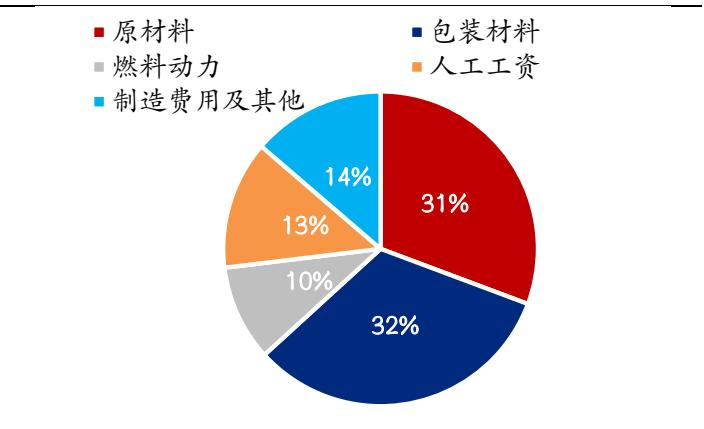  
资料来源：燕京啤酒2022年年报，万和证券研究所

图 28 进口大麦价格  
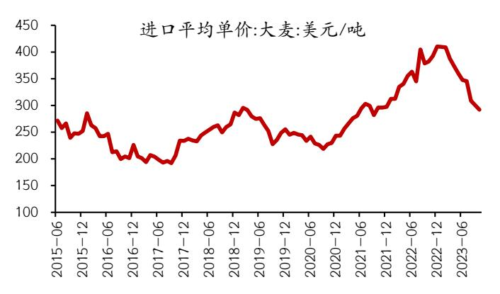  
资料来源：Wind，万和证券研究所

图 29 啤酒上游原材料价格  
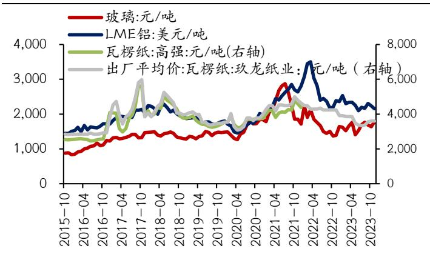  
资料来源：Wind，万和证券研究所

图 30 啤酒行业龙头上市公司毛利率（%）  
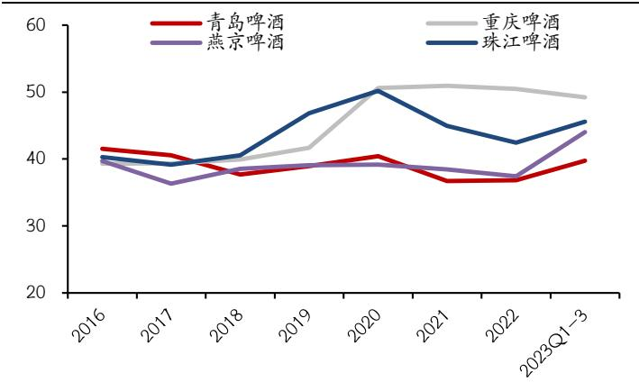  
资料来源：Wind，万和证券研究所

图 31 啤酒行业龙头上市公司毛销差（%）  
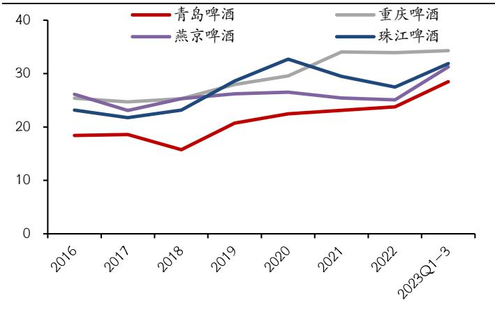  
资料来源：Wind，万和证券研究所

图 32 啤酒行业龙头上市公司净利率（%）  
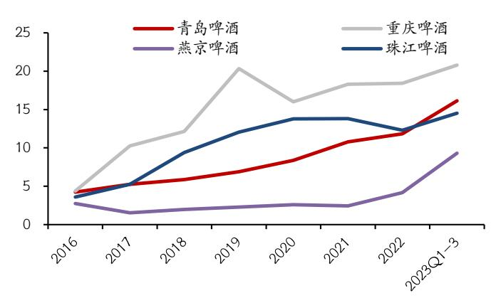  
资料来源：Wind，万和证券研究所

受益于场景修复及高端化结构升级，行业龙头盈利持续稳定增长。2023 前三季度青岛啤酒、重庆啤酒、燕京啤酒、珠江啤酒分别实现收入 309.8/130.3/124.2/45.5 亿元，分别同比增长6.4%/6.9%/9.7%/10.7%；归属于母公司净利润分别为 49.1/13.4/9.6/6.4 亿元，分别同比增长15.0%/13.7%/42.2%/12.8%。单季度看，2023Q3 青岛啤酒、重庆啤酒、燕京啤酒、珠江啤酒实现收入分别为 93.9/45.2/47.9/17.8 亿元，同比增速分别为-4.6%/6.5%/8.5%/5.9%，增速环比 Q2 -12.7pct/-3.1pct/+0.9pct/+5.4pct；归母净利润分别为 14.8/4.8/4.4/2.8 亿元，同比增速分别为4.7%/5.3%/37.4%/8.0%，增速环比 Q2 -9.7pct/-18.2pct/+8.9pct/-7.0pct。展望 2024 年随着消费修复以及原材料价格走低，预计企业业绩弹性有望进一步凸显。

表 5 啤酒行业上市公司营业收入、归属母公司及同比增速

<table><tr><td></td><td></td><td>2016</td><td>2017</td><td>2018</td><td>2019</td><td>2020</td><td>2021</td><td>2022</td><td>2023Q1-3</td><td>趋势变化</td><td rowspan="3"></td><td></td><td></td><td></td><td></td><td></td><td></td><td></td><td></td><td></td><td></td><td></td></tr><tr><td rowspan="3">营业收入(亿元)</td><td>青岛啤酒</td><td>261.1</td><td>262.8</td><td>265.8</td><td>279.8</td><td>277.6</td><td>301.7</td><td>321.7</td><td>309.8</td><td>_ _ _ _ _ _ _ _ _ _ _ _ _ _ _ _ _ _ _ _ _ _ _ _ _ _ _ _ _ _ _ _ _ _ _ _ _ _ _ _ _ _ _ _ _ _ _ _ _ _ _ _ _ _ _ _ _ _ _ _ _ _ _ _ _ _ _ _ _ _ _ _ _ _ _ _ _ _ _ _ _ _ _ _ _ _ _ _ _ _ _ _ _ _ _ _ _ _ _ _ _ _</td><td></td><td></td><td></td><td></td><td></td><td></td><td></td><td></td><td></td><td></td><td></td></tr><tr><td>重庆啤酒</td><td>32.0</td><td>31.8</td><td>34.7</td><td>35.8</td><td>109.4</td><td>131.2</td><td>140.4</td><td>130.3</td><td>_ _ _ _ _ _ _ _ _ _ _ _ _ _ _ _ _ _ _ _ _ _ _ _ _ _ _ _ _ _ _ _ _ _ _ _ _ _ _ _ _ _ _ _ _ _ _ _ _ _ _ _ _ _ _ _ _ _ _ _ _ _ _ _ _ _ _ _ _ _ _ _ _ _ _ _ _ _ _ _ _ _ _ _ _ _ _ _ _ _ _ _ _ _ _ _ _ _ _</td><td>燕京啤酒</td><td>115.7</td><td>112.0</td><td>113.4</td><td>114.7</td><td>109.3</td><td>119.6</td><td>132.0</td><td>124.2</td><td colspan="2">_ _ _ _ _ _ _ _ _ _ _ _ _ _ _ _ _ _ _ _ _ _ _ _ _ _ _ _ _ _ _ _ _ _ _ _ _ _ _ _ _ _ _ _ _ _ _ _ _ _ _ _ _ _ _ _ _ _ _ _ _ _ _ _ _ _ _ _ _ _ _ _ _ _ _ _ _ _ _ _ _ _ _ _ _ _ _ _ _ _ _ _ _ _ _ _ _ _</td></tr><tr><td>珠江啤酒</td><td>35.4</td><td>37.6</td><td>40.4</td><td>42.4</td><td>42.5</td><td>45.4</td><td>49.3</td><td>45.5</td><td>_ _ _ _ _ _ _ _ _ _ _ _ _ _ _ _ _ _ _ _ _ _ _ _ _ _ _ _ _ _ _ _ _ _ _ _ _ _ _ _ _ _ _ _ _ _ _ _ _ _ _ _ _ _ _ _ _ _ _ _ _ _ _ _ _ _ _ _ _ _ _ _ _ _ _ _ _ _ _ _ _ _ _ _ _ _ _ _ _ _ _ _ _ _ _ _ _ _</td><td></td><td></td><td></td><td></td><td></td><td></td><td></td><td></td><td></td><td></td><td></td><td></td></tr><tr><td rowspan="4">营收同比增速(%)</td><td>青岛啤酒</td><td>(5.5)</td><td>0.7</td><td>1.1</td><td>5.3</td><td>(0.8)</td><td>8.7</td><td>6.6</td><td>6.4</td><td>_ _ _ _ _ _ _ _ _ _ _ _ _ _ _ _ _ _ _ _ _ _ _ _ _ _ _ _ _ _ _ _ _ _ _ _ _ _ _ _ _ _ _ _ _ _ _ _ _ _ _ _ _ _ _ _ _ _ _ _ _ _ _ _ _ _ _ _ _ _ _ _ _ _ _ _ _ _ _ _ _ _ _ _ _ _ _ _ _ _ _ _ _ _ _ _ _ _</td><td rowspan="2"></td><td></td><td></td><td></td><td></td><td></td><td></td><td></td><td></td><td></td><td></td><td></td></tr><tr><td>重庆啤酒</td><td>(3.8)</td><td>(0.6)</td><td>9.2</td><td>3.3</td><td>7.1</td><td>19.9</td><td>7.0</td><td>6.9</td><td>_ _ _ _ _ _ _ _ _ _ _ _ _ _ _ _ _ _ _ _ _ _ _ _ _ _ _ _ _ _ _ _ _ _ _ _ _ _ _ _ _ _ _ _ _ _ _ _ _ _ _ _ _ _ _ _ _ _ _ _ _ _ _ _ _ _ _ _ _ _ _ _ _ _ _ _ _ _ _ _ _ _ _ _ _ _ _ _ _ _ _ _ _ _ _ _ _ _</td><td></td><td></td><td></td><td></td><td></td><td></td><td></td><td></td><td></td><td></td><td></td></tr><tr><td>燕京啤酒</td><td>(7.7)</td><td>(3.3)</td><td>1.3</td><td>1.1</td><td>(4.7)</td><td>9.4</td><td>10.4</td><td>9.7</td><td>_ _ _ _ _ _ _ _ _ _ _ _ _ _ _ _ _ _ _ _ _ _ _ _ _ _ _ _ _ _ _ _ _ _ _ _ _ _ _ _ _ _ _ _ _ _ _ _ _ _ _ _ _ _ _ _ _ _ _ _ _ _ _ _ _ _ _ _ _ _ _ _ _ _ _ _ _ _ _ _ _ _ _ _ _ _ _ _ _ _ _ _ _ _ _ _ _ _ ~</td><td rowspan="2"></td><td></td><td></td><td></td><td></td><td></td><td></td><td></td><td></td><td></td><td></td><td></td></tr><tr><td>珠江啤酒</td><td>0.7</td><td>6.2</td><td>7.3</td><td>5.1</td><td>0.1</td><td>6.8</td><td>8.6</td><td>10.7</td><td>_ ~ ~ ~ ~ ~ ~ ~ ~ ~ ~ ~ ~ ~ ~ ~ ~ ~ ~ ~ ~ ~ ~ ~ ~ ~ ~ ~ ~ ~ ~ ~ ~ ~ ~ ~ ~ ~ ~ ~ ~ ~ ~ ~ ~ ~ ~ ~ ~ ~ ~ ~ ~ ~ ~ ~ ~ ~ ~ ~ ~ ~ ~ ~ ~ ~ ~ ~ ~ ~ ~ ~ ~ ~ ~ ~ ~ ~ ~ ~ ~ ~ ~ ~ ~ ~ ~ ~ ~ ~ ~ ~ ~ ~ ~ ~ ~ ~ ~ ~ ~ %</td><td></td><td></td><td></td><td></td><td></td><td></td><td></td><td></td><td></td><td></td><td></td></tr><tr><td rowspan="4">归母净利润(亿元)</td><td>青岛啤酒</td><td>10.4</td><td>12.6</td><td>14.2</td><td>18.5</td><td>22.0</td><td>31.6</td><td>37.1</td><td>49.1</td><td colspan="2">_ _ _ _ _ _ _ _ _ _ _ _ _ _ _ _ _ _ _ _ _ _ _ _ _ _ _ _ _ _ _ _ _ _ _ _ _ _ _ _ _ _ _ _ _ _ _ _ _ _ _ _ _ _ _ _ _ _ _ _ _ _ _ _ _ _ _ _ _ _ _ _ _ _ _ _ _ _ _ _ _ _ _ _ _ _ _ _ _ _ _ _ _ _</td><td></td><td></td><td></td><td></td><td></td><td></td><td></td><td></td><td></td><td></td><td></td></tr><tr><td>重庆啤酒</td><td>1.8</td><td>3.3</td><td>4.0</td><td>6.6</td><td>10.8</td><td>11.7</td><td>12.6</td><td>13.4</td><td colspan="2">_ _ _ - - - - - - - - - - - - - - - - - - - - - - - - - - - - - - - - - - - - - - - - - - - - - - - - - - - - - - - - - - - - - - - - - - - - - - - - - - - - - - - - - - - - - - - - - - - - - - - - - - - -</td><td></td><td></td><td></td><td></td><td></td><td></td><td></td><td></td><td></td><td></td><td></td></tr><tr><td>燕京啤酒</td><td>3.1</td><td>1.6</td><td>1.8</td><td>2.3</td><td>2.0</td><td>2.3</td><td>3.5</td><td>9.6</td><td colspan="2">_ - - - - - - - - - - - - - - - - - - - - - - - - - - - - - - - - - - - - - - - - - - - - - - - - - - - - - - - - - - - - - - - - - - - - - - - - - - - - - - - - - - - - - - - - - - - - - - - - - - - 1</td><td></td><td></td><td></td><td></td><td></td><td></td><td></td><td></td><td></td><td></td><td></td></tr><tr><td>珠江啤酒</td><td>1.1</td><td>1.9</td><td>3.7</td><td>5.0</td><td>5.7</td><td>6.1</td><td>6.0</td><td>6.4</td><td colspan="2">_ - - - - - - - - - - - - - - - - - - - - - - - - - - - - - - - - - - - - - - - - - - - - - - - - - - - - - - - - - - - - - - - - - - - - - - - - - - - - - - - - - - - - - - - - - - - - - - - - -</td><td></td><td></td><td></td><td></td><td></td><td></td><td></td><td></td><td></td><td></td><td></td></tr></table>

资料来源：Wind，万和证券研究所

## （二） 食品加工：预制菜方兴未艾，成长空间大

## 1、 预制菜行业概况

预制菜是指以农、畜、禽、水产品为原料，配以各种辅料进行预加工（如分切、搅拌、腌制、滚揉、成型、调味）而成的成品或半成品，经简单烹饪或加热后，可作为日常正餐食用。根据原材料生熟程度，预制菜分为即食食品、即热食品、即烹食品、即配食品四种主要形态。预制菜行业产业链由上游原材料供应商、中游预制菜生产及加工和下游消费者共同组成，上游原材料价格波动将直接影响预制菜成本；中游加工厂商的发展能促进上游原材料的标准化、集约化；下端销售市场由B端、C 端市场组成，其中B 端市场占据80%份额。

图 33 预制菜产业链  
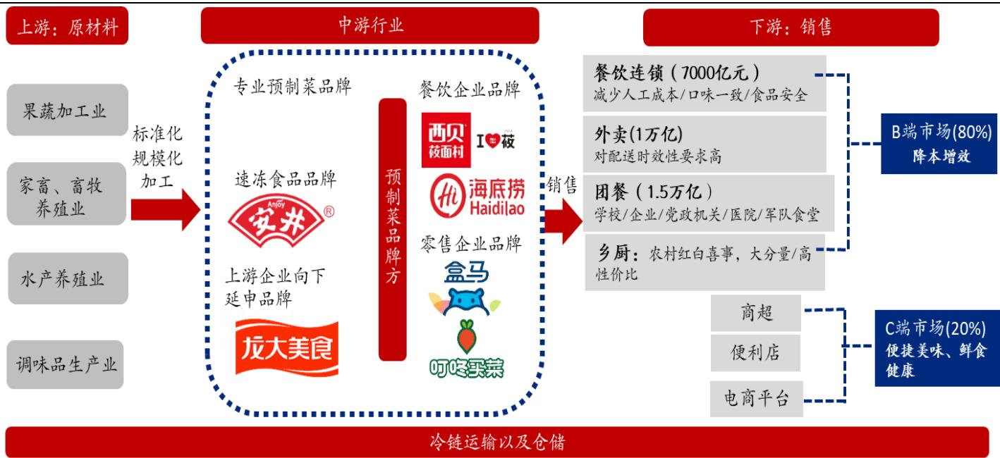  
资料来源：《预制菜行业洞察报告》，《2023 中国预制菜数字消费报告》，万和证券研究所

## 2、 多重因素驱动预制菜市场规模有望稳步增长

2021 年中国预制菜市场规模超过 3000 亿元，2017-2020 年的年均复合增长率为 28.8%，预计到2025 年将会突破8300 亿元，多重因素驱动行业进入蓬勃发展期。B端小吃快餐店、连锁餐饮店、主打外卖的餐饮店、团餐等是预制菜应用的主要场景，预制菜能够帮助餐饮业降本增效，提升盈利能力；C端年轻消费者对便捷又美味的食物需求也促进了预制菜行业的发展。

图 34 中国预制菜 2015-2025E 市场规模  
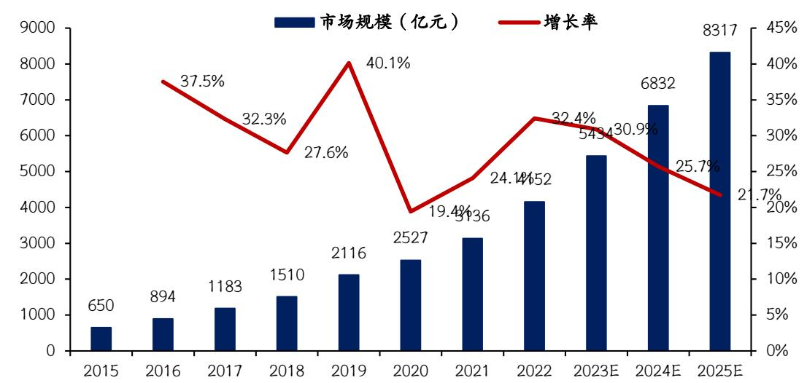  
资料来源：《2022年中国连锁餐饮报告》，万和证券研究所

消费需求 B 端：餐饮行业连锁化率和降本提效双重驱动。根据中培育发展预制菜产业国连锁经营协会等机构发布的《2022 年中国连锁餐饮行业报告》显示，2018-2021 年国内餐饮连锁化率分别为 12.8%、13.3%、15.0%和 18.0%，行业连锁化率逐年提升，但相比国外成熟市场连锁化率还有较大的空间。目前部分头部连锁餐饮企业中预制菜使用比例已经较高，真功夫、吉野家、西贝等连锁餐饮企业都有一定程度的使用预制菜，餐饮连锁背后都是中央厨房在支撑。餐饮连锁化趋势进一步推动预制食品的应用，餐饮龙头扩张过程中提高连锁化率伴随着对食材供应标准的提高，而预制菜厂商具备成本优势、标准化程度高。与此同时，预制菜可以有效减少 B 端餐饮店的食材成本、人工成本和后厨面积，帮助餐饮店提升利润率水平，同时有效减少顾客等待的时间。

图 35 主要国家餐饮连锁化率  
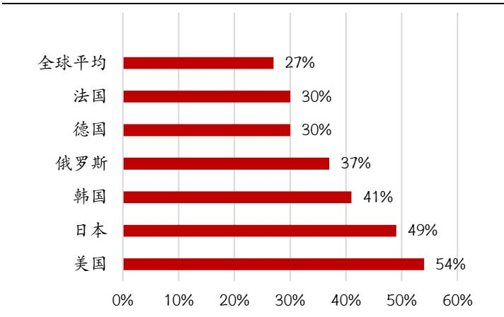  
资料来源：千味央厨2022年公司年报，万和证券研究所

图 36 餐饮行业使用预制菜后成本对比  
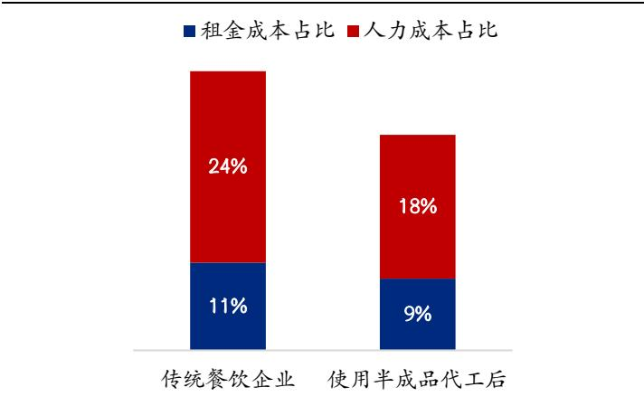  
资料来源：《2022年中国连锁餐饮报告》，万和证券研究所

消费需求C 端：人群结构变化，需求提升。目前居家就餐场景依然在，但家庭小型化趋势，新一代消费者普遍做饭技能缺失、加班文化及快节奏生活致使没有精力烹饪、“懒”文化，预制食品的便捷性迎合消费者需求。

图 37 消费者就餐情况  
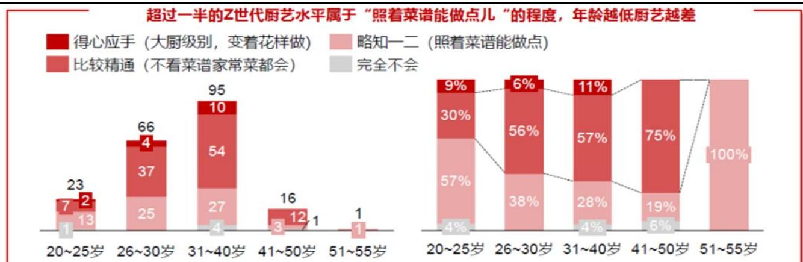

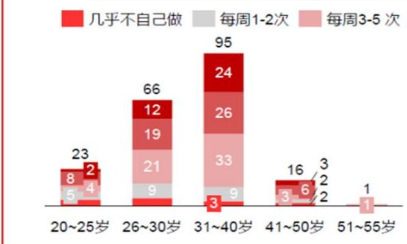

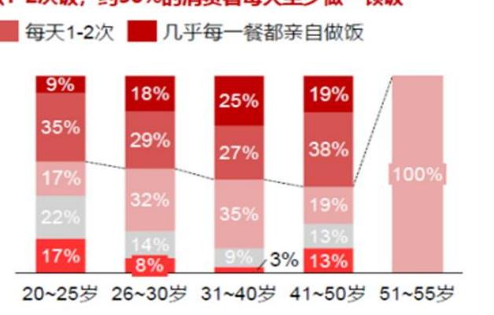  
资料来源：《2022年中国连锁餐饮行业报告》 ，万和证券研究所（Z世代是指1995-2009年间出生的一代人）

供给产品端：研发水平和冷冻技术快速进步，品类扩充空间广阔。随着研发水平和冷冻技术的进步，从第一代零下18 摄氏度快速冷冻、第二代零下 120 摄氏度以下液氮速冻发展到第三带液氮速冻之后使用水雾技术，迅速成膜，预制菜口味和品质相较以前有了很大的提升，逐步接近餐厅水平，且品类也是越来越丰富。举例来说，信良记将“液氮速冻”技术用到了他的麻辣小龙虾产品上，液氮冷冻技术堪称锁鲜神器，超快的冷冻速度既能保持龙虾的口感，又能避免长途运输活虾的伤亡损耗。目前液氮速冻技术被迅速、广泛应用于鱼、虾、螃蟹、鸡、鸭、肉（牛、羊等）、水果（杨梅、荔枝等）、蔬菜、及各种预制食品（牛排、生鱼片、肉丸子、炸虾、肉饼、汉堡包、比萨饼、蛋制品、汤料等）的冷冻中。

物流端：冷链物流完善为预制食品跨区域流通、线上交易以及新消费品牌崛起提供基础设施。自 2015 年以来国内冷链物流基础设施不断完善，第三方专业服务机构涌现，例如顺丰 2014 年底起正式成立冷运事业部，京东2015 年开始打造冷链物流体系，2018 年正式推出京东冷链。根据预制菜电商交易也在2016年以后快速发展。目前中国除西藏和青海外，其他省会级一二线城市均覆盖，预计在2025 年中国冷链乡镇覆盖率可达八成。

图 38 我国冷链物流 2015-2025E 市场规模  
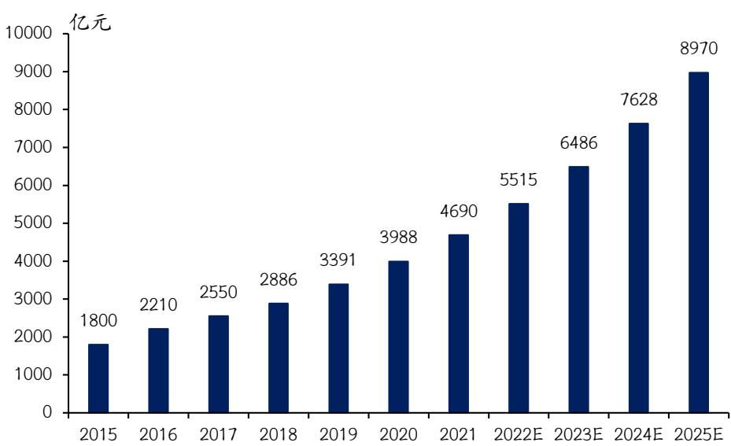  
资料来源：《2022年中国连锁餐饮报告》，万和证券研究所

政策端：政策引导，助力行业稳健发展。2023 年 2 月，《中共中央国务院关于做好 2023 年全面推进乡村振兴重点工作的意见》要求，提升净菜、中央厨房等产业标准化和规范化水平，培育发展预制菜产业，培育发展预制菜产业首次写入中央一号文件，纳入国家兴农计划；2023年7 月，国务院办公厅转发国家发改委《关于恢复和扩大消费的措施》的通知，提出培育“种养殖基地+中央厨房+冷链物流+餐饮门店”模式，挖掘预制菜市场潜力，加快推进预制菜基地建设，充分体现安全、营养、健康的原则，提升餐饮质量和配送标准化水平。与此同时，地方政府层面，广东、云南、山东、四川等 12 省发布实施意见、指导意见，51 个城市发布相关支持政策助力食品深加工产业加速发展。

## 3、 行业发展初期，竞争格局分散

贯穿上下游，预制菜行业参与者众多，主要包括专业预制菜企业、速冻企业、农林牧渔企业、餐饮供应链平台、餐饮中央厨房、生鲜零售平台六种类型。其产业模式和渠道模式各有优势，共同构成尚在探索成长期的预制菜赛道。短期来看仍将维持分散态势，长期来看核心竞争壁垒企业有望挖掘成长潜力形成规模化发展，引领行业。B 端市场已经逐渐渗透并形成一定规模，疫情带来了 C 端消费的需求，并使得各大电商、生鲜超市预制菜销量成倍增长，行业市场容量进一步打开。

图 39 中国预制菜竞争格局  
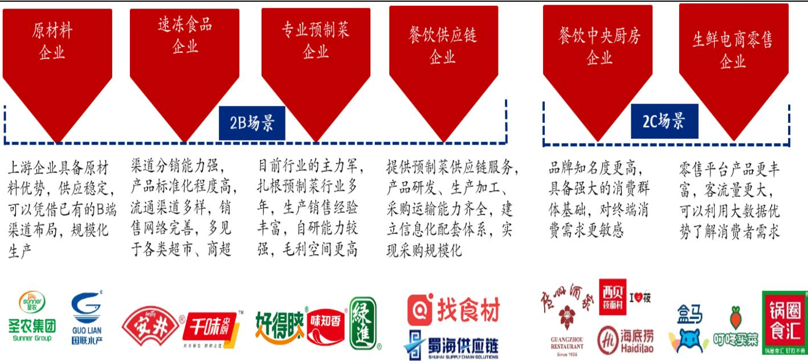  
资料来源：《预制菜行业洞察报告》，万和证券研究所

## 4、 他山之石：美国和日本预制食品发展历程

从全球角度来看，预制菜起源于美国，后在日本、欧洲发展发展快速发展，而目前我国的预制菜依旧处于发展初期，通过对全球预制菜发展进行分析，厘清国内预制菜的发展方向和市场机遇等。

## （1） 美国预制菜发展历程

美国预制菜的发展历程，一共经历三个主要发展阶段：

第一是萌芽期，从上世纪 20 年代到 50 年代，这一时期工业化程度提升和人口密度增加带来的餐饮业发展，以及速冻技术的提升，刺激速冻食品销量增长，行业销量复合增速达到了 35%以上。

第二是成长期，大约是 1950 年从全球预制菜到 1970 年，这是美国预制菜的高速成长期，餐饮需求增加，加之美式快餐巨头纷纷成立，如肯德基、麦当劳、必胜客、福来鸡（chick fil）、汉堡王等，倒逼食材标准化，为半成品菜发展带来契机；与此同时，战后“婴儿潮一代”走向成年，居民从市区迁往郊区，连锁超市和终端冷柜开始普及，均带来增量需求，行业销量复合增速在10%以上。

第三是成熟期，从1970 年算起至今，可以界定为2012 年，那时的Sysco 销售规模突破400 亿美元，成为美国预制菜的真正霸主，美国预制菜从萌芽到出现寡头垄断，大概经历了 90 年。

Sysco：全球 B 端食材供应链头部品牌。Sysco 通过横向和纵向并购实现快速扩张，截止到 2020年，已在全球拥有 326 个配送中心，62.5万个客户（到2021财年已超过 65万个），1.4 万辆物流车（87%为自有），40 多万SKU，在美国3100亿美元的餐饮服务市场中市占率第一（16%），也是全球B端食材供应链的头部品牌。

## （2） 日本预制菜发展历程

日本是预制菜生产消费大国，其中占比最大、最具代表性的是速冻食品，目前日本已经成为全球速冻食品第三大消费市场、亚洲第一大消费市场，年消费量超过 300 万吨，速冻食品品种早就超过 3000 种，其中烹饪调制食品竟然多达 2400 余种。日本预制食品行业同样 B 端先行，餐饮端的大比例应用，也在不断教育消费者认知，也经历了三个发展阶段：

行业导入期（1958～1974年）技术进步叠加政策引导，预制菜获得推广，1958～1974 年预制菜行业产值的 CAGR（复合年均增长率）高达 45.9%。上世纪60、70年代中期，日本经济高速增长，东京奥运会和大阪世博会，加速了预制菜的市场推广。但日本本土食品资源相对匮乏，为了满足市场需求，1965 年日本政府出台“冷藏链劝告”，支持制冷技术、冷藏设备研发和制造，并大力扶持速冻食品企业以及冷链建设。随后，预制菜在酒店、餐饮及食堂的渗透率迅速提升。1965 年电冰箱普及率超过50%，居民通过速冻食品改善饮食水平。

行业成长期（1975～1997年）餐饮连锁化叠加饮食场景外部化，推动行业持续增长，1975～1997年预制菜行业产值的 CAGR为 9.7%。1970 年后肯德基、麦当劳等连锁餐饮品牌进入日本市场，1986 年至1997年餐饮连锁化率从6.5%增至 11.5%。房租、人工成本亦明显提升，标准化和降本提效驱动下，B端使用预制菜的需求持续增长。上世纪70年代中期之后，日本经济进入稳定增长期，消费者外出就餐增多，外食率从1975 年的27.8%增长至1997 年的 39.7%。1975年日本电冰箱普及率达到 96%，1990 年日本微波炉普及率达到 70%，为 C 端预制菜市场奠定坚实基础。

行业成熟期（1998～2022）日本经济增长停滞，导致行业进入成熟期，1998～2022 年预制菜行业产值的 CAGR 仅为 1.1%。上世纪 90 年代，日本经济泡沫破裂后，日本居民外出就餐需求减少，餐饮行业增长停滞，导致预制菜的B 端需求增长停滞。但同时，预制菜的 C端整体增速反而有所提升，其中部分应用了新技术的细分产品的CAGR超过10%。一方面是因为消费者对餐饮便捷化的需求并未改变，另一方面是由于日本家庭单元更趋小型化、老龄化。

日冷集团：日本冷冻预制菜行业“头号玩家”。日冷 2021 年的营业额为 6027 亿日元，营业利润率为 5.3%，净利率为 3.9%，其中速冻食品营收为 2442 亿日元，营业利润率为 5.8%，市占率日本第一。日冷集团聚焦预制菜业务，B、C 两端同时发力，主营业务为预制菜、物流、海产品、肉禽产品，产品矩阵丰富，SKU总数超过2500 个，B 端产品以高性价比鸡肉作为核心品类，C端以差异化高品质为核心竞争力。

## （三） 休闲食品：渠道变迁+产品红利，助推企业盈利增长

1、 休闲食品行业概览：大行业，小公司

休闲食品市场规模有望突破万亿。休闲食品是消费者在闲暇和休息时所吃的食品，具备覆盖人群广、用户生命周期长、客单价低、消费频次高等特点。目前，中国是全球最大的休闲食品市场之一，根据欧睿数据，中国休闲零食行业保持稳健增长趋势，但增速逐渐放缓，2022 年市场总规模 7,342 亿元，2008-2022 年 CAGR 为 7.1%，预计 2022-2027 年 CAGR 为 5.9%，2027 年市场规模将达到9,765亿元，接近万亿。

休闲食品消费场景丰富，产品形态多样，品种多、规格多、市场分散。据弗若斯特沙利文报告，休闲食品可分为 10 个类别，分别为：糖果、巧克力及蜜饯；种子及坚果炒货；香脆休闲食品；面包、蛋糕与糕点；饼干；肉制以及水产动物制品；调味面制品；休闲蔬菜制品；及其他休闲食品（果冻、鸡蛋等），细分品类繁多，零食行业头部品牌占比，大量小品牌、不知名品牌存在，呈现“大行业+小公司”的特点，市场集中度低。

图 40 2021年休闲食品各品类占比  
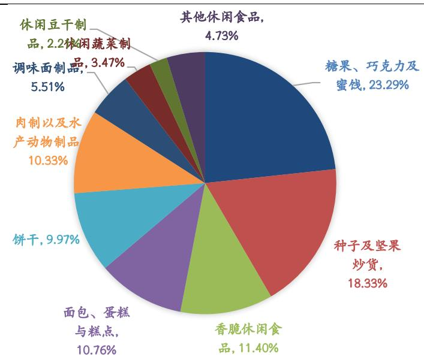  
资料来源：弗若斯特沙利文报告，卫龙招股说明书，万和证券研究所

图 41 2022年零食行业公司份额  
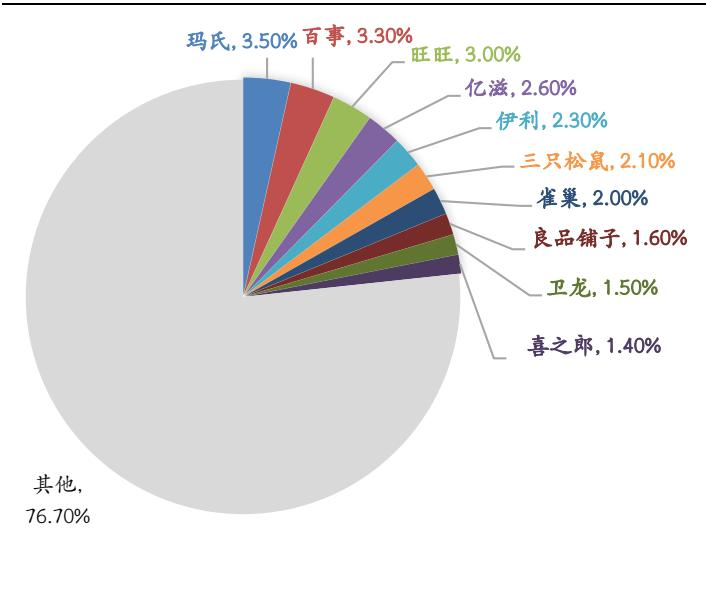  
资料来源：《中国零食硬折扣白皮书》，万和证券研究所

## 2、 渠道：迎合“性价比”需求的零食量贩业态快速兴起

复盘中国休闲零食发展历史，迎合“性价比”需求量贩零食带来第 5 次渠道变迁。《罗兰贝格：预见2023 中国行业趋势报告》中提出，2023 年消费品与零售行业将呈现“高端与性价比共舞”的格局，认为高端化和高性价比是消费企业发展的两个主要方向。一部分消费者将以更积极的态度比较价格，更冷静的心态面对需求，进而对高性价比产品和渠道的需求与日俱增。近几年，量贩零食业态切准“多快好省”的底层消费需求，凭借更丰富的零食品类、更实惠的产品价格实现快速兴起，将高效承接来自传统卖场商超的流量转移。消费者多样化、多变、爱尝鲜、冲动购买等特征使得休闲食品行业产品更迭和渠道变迁速度较快，而每一轮大的产品更迭和渠道变迁都对应大的产业发展机会。

表 6 休闲零食的发展历程

<table><tr><td>阶段</td><td>大流通主导品类消费时代-1990年</td><td>外资商超进入品牌消费开启1990-2000年</td><td>商超成为主流专营品牌出现2000-2010年</td><td>电商发展线上品牌崛起2010-2018年</td><td>量贩零食发展自有品牌启动2018年-</td></tr><tr><td>供给/需求</td><td>物资匮乏,供给端不丰富,零食作为非刚需品类,居民消费意愿不高</td><td>零食品类拓宽、品牌出现,开始满足居民收入提高下的冲动性消费</td><td>经济高速发展,供给和需求端两旺,专营品牌主打安全、质量,满足高端零食需求</td><td>供应链发展支撑线上品牌通过代工生产,以丰富品类,满足个性需求</td><td>专营和线上品牌倒逼供应端进入成熟阶段,且产能过剩,大众消费注重性价比</td></tr><tr><td>渠道/变革</td><td>改革开放,市场逐步放开,零食主要通过批发市场和路边摊售卖</td><td>家乐福、沃尔玛为代表的国外商超进入中国,商超业态出现</td><td>外资和本土商超同步发展,商超成为主流渠道</td><td>淘宝、京东等电商蓬勃发展,快递物流行业迅速成长,网购兴起</td><td>传统电商流量红利消失,抖音、快手等兴趣电商的兴起;零食硬折扣模式快速发展</td></tr><tr><td>品类/品牌</td><td>品类消费,以瓜子、糕点、果脯等为主</td><td>1国外零食品牌进入中国,形成很多大单品,比如“德芙巧克力”、“乐事薯片”、“好丽友派”等2外资商超兴起带来渠道红利,国内零食公司如达利园、喜之郎快速发展</td><td>1洽洽、有友等食品公司借势迅速发展2来伊份、良品铺子等零食专营店,在商超附近开店,实现客群精准分流,通过流量汇聚完成消费者教育</td><td>1没有线下场景,但价格优势激发增长,线上渠道的流量红利,带动三只松鼠、百草味等线上品牌的高速发展2量贩零食店出现</td><td>1盐津铺子、劲仔、甘源等抓住兴趣电商和零食折扣店红利,快速增长2散称零食、白牌依托量贩零食店快速增长,与强势渠道伴随的,是联名品牌,自有品牌发展</td></tr></table>

资料来源：《中国零食硬折扣白皮书》，万和证券研究所

零食量贩行业则正处于加速成长期。零食量贩核心是“硬折扣”经营模式，体现在品质是前提、低价是目标、销售是核心，一方面体现在需求侧，宏观经济周期下的消费力产生结构性分化，大众对更具质价比的商品需求变大，必然会有新渠道承接新需；另一方面体现在供给侧，量贩零食是垂直于零食品类的硬折扣经营模式，深入社区，依托高效供应链，为消费者提供更具质价比的商品。行业历经萌芽（2010-2017）、启动（2017-2022），在资本的加注下，量贩零食2022年底以来加速扩张，兼并整合开启，目前处于加速成长期。

表 7 零食量贩的发展历程

<table><tr><td>发展阶段</td><td>特点</td><td>标志性事件</td></tr><tr><td>萌芽期:零食量贩模式出现(2010-2017)</td><td>早期资本未介入属于区域的零售模式创新占整体市场规模较小未引发主流品和经销商注意</td><td>2010年老婆大人在浙江成立,中国量贩零食第一家行业模仿者不断,处于初级的探索阶段部分区域厂商留存下来,模式得到完整验证</td></tr><tr><td>启动期:南方省市多点开花(2017-2022)</td><td>资本在诸多品牌成立时即参与主要在南方区域拓展一线品牌商严控供货经销商是重要货品来源</td><td>2017年零食很忙在湖南成立硬折扣模式从湖南往全国各地推广</td></tr><tr><td>成长期:资本加注全国拓展(2022年以来)</td><td>资本持续加注,头部进军北方兼并整合开启,区域企业涌现品牌商纷纷开始重视该渠道去中间化导致经销商生意下滑</td><td>2022年上市公司万辰生物通过并购,进入赛道2023年9月万辰生物将旗下的“来优品”“好想来”“吖嘀吖嘀”“陆小馋”正式合并为“好想来品牌零食”,并收购“老婆大人”,其中根据官网显示,目前好想来全国在营门店突破4000,预计2024年底,全国门店数量突破10000。2023年11月零食很忙和赵一鸣与赵一鸣零食合并,根据双方官网,2023年10月,零食很忙门店突破4000家,赵一鸣零食门店突破2500家。</td></tr></table>

资料来源：《中国零食硬折扣白皮书》，万和证券研究所

图 42 量贩零食的发展阶段  
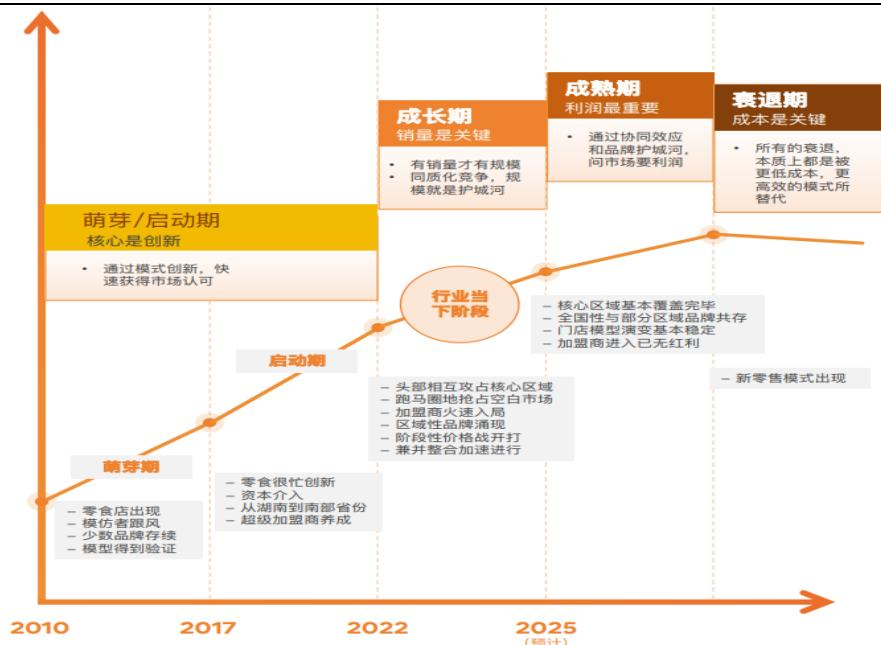  
资料来源：《中国零食硬折扣白皮书》，万和证券研究所

## 3、 产品：中国特色口味零食行业增速高，仍处于行业红利期

据弗若斯特沙利文报告，中国休闲食品品类中具有中国特色口味特征的肉质及水产动物、调味面、休闲蔬菜（海带、魔芋、海苔、藕片等蔬菜制成的休闲食品）、豆干制品2021-2026 年复合增速分别为7.5%、8.9%、17.0%、7.1%，均高于休闲食品平均增速（6.8%），是休闲零食高增长的细分赛道。以中国特色的辣味食品为例，弗若斯特沙利文报告显示，中国辣味休闲食品在整体休闲食品行业中的份额由2016 年的18.6%增至2021年的 21.0%，并预计中国辣味休闲食品行业2021年至2026年的零售额将以9.6%的年复合增长率增长，至2026年将达到人民币2,737亿元；而预计同期中国非辣味休闲食品行业的零售额将以6.0%的年复合增长率增长。

图 43 中国休闲食品行业按口味划分的零售额  
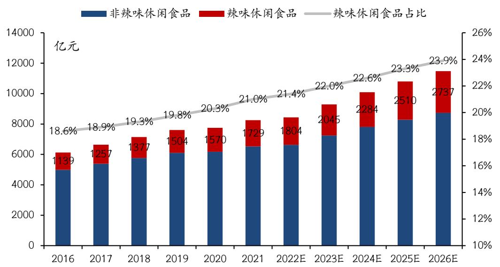  
资料来源：卫龙招股说明书，弗若斯特沙利文，万和证券研究所

## 4、 渠道变迁+产品红利，差异化布局助推企业盈利增长

休闲食品行业每一轮大的产品更迭和渠道变迁都对应大的产业发展机会。渠道方面，目前迎合“性价比”需求的零食量贩式业态快速发展，与此同时线上兴趣电商渠道的兴起；产品方面，具有中国特色口味特征的咸辣零食保持较高速增长，行业红利依旧存在。在渠道变迁以及产品红利背景下，盐津铺子、劲仔食品和甘源食品等企业抓住渠道红利，进行产品的合理销售布局，

2022 年以来实现盈利的持续增长。如盐津铺子 2023 年半年度公告，公司经历 2021 年转型升级之后，2022年第二季度起转型升级效果逐步显现，公司产品从“高成本下的高品质+高性价比”逐渐升级成为“低成本之上的高品质+高性价比”，由渠道驱动增长升级为【产品+渠道】双轮驱动增长，产品端，聚焦辣卤零食、深海零食、休闲烘焙、薯类零食、蛋类零食、蒟蒻果冻、果干坚果等七大核心品类；渠道端，全渠道覆盖，在保持原有 KA、AB 类超市优势外，重点发展电商、CVS、零食专卖店、校园店等，与当下热门零食量贩品牌零食很忙、零食有鸣、赵一鸣等深度合作，在抖音平台与主播种草引流，持续打造新的爆品，品牌影响力和渠道势能持续增强。

表 8 休闲食品部分上市公司 2020-2023Q1-3 业绩

<table><tr><td rowspan="2"></td><td colspan="2">2023Q1-3(亿元)</td><td colspan="4">营业收入同比增速(%)</td><td colspan="4">归母净利润同比增速(%)</td></tr><tr><td>营业收入</td><td>归母净利润</td><td>2020</td><td>2021</td><td>2022</td><td>2023Q1-3</td><td>2020</td><td>2021</td><td>2022</td><td>2023Q1-3</td></tr><tr><td>良品铺子</td><td>59.99</td><td>1.91</td><td>2.32</td><td>18.11</td><td>1.24</td><td>(14.33)</td><td>0.95</td><td>(18.06)</td><td>19.16</td><td>(33.43)</td></tr><tr><td>三只松鼠</td><td>45.82</td><td>1.70</td><td>(3.72)</td><td>(0.24)</td><td>(25.35)</td><td>(14.07)</td><td>26.21</td><td>36.43</td><td>(68.61)</td><td>81.42</td></tr><tr><td>洽洽食品</td><td>44.78</td><td>5.06</td><td>9.35</td><td>13.15</td><td>15.01</td><td>2.16</td><td>30.73</td><td>15.35</td><td>5.10</td><td>(19.28)</td></tr><tr><td>盐津铺子</td><td>30.05</td><td>3.96</td><td>39.99</td><td>16.47</td><td>26.83</td><td>52.54</td><td>88.83</td><td>(37.65)</td><td>100.01</td><td>81.08</td></tr><tr><td>劲仔食品</td><td>14.93</td><td>1.33</td><td>1.60</td><td>22.21</td><td>31.59</td><td>47.85</td><td>(12.78)</td><td>(17.76)</td><td>46.77</td><td>47.49</td></tr><tr><td>甘源食品</td><td>13.14</td><td>2.14</td><td>5.70</td><td>10.38</td><td>12.11</td><td>35.56</td><td>6.71</td><td>(14.29)</td><td>3.03</td><td>139.21</td></tr></table>

资料来源：Wind，万和证券研究所

## （四） 调味品：成本改善、消费场景修复，盈利能力逐步恢复

## 1、 基础调味品低速稳定增长，复合调味品前景广阔

调味品按产品成分分类，可分为基础调味品和复合调味品，基础调味品主要包括酱油、食醋、盐、糖等；复合调味品通常以两种以上调味料为原料复合制作而成的调味品。我国调味品行业发展历史悠久，主要经历了5个阶段，具体包括2000 年以前散装时代；2001-2011 年调味品标准化，以酱油为代表的基础调味品以标准化产品的形态进入市场；2012-2017年调味品分化期，头部品牌从单一品类到多元品类迈进；2018-2021 年调味品消费者升级，产品逐渐往功能化、高端化、健康化发展，火锅底料和中式复合调味品增长；2022 年至今调味品后疫情时代，复合调味品加速革新。

图 44 中国调味品发展趋势  
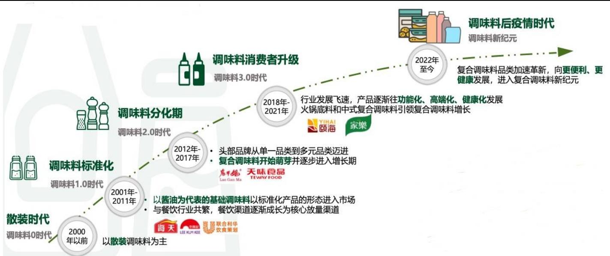  
资料来源：《2023复合调味料趋势白皮书》，万和证券研究所

复合调味品市场前景广阔。基础调味品属于消费刚需产品，行业步入发展成熟期，竞争格局逐渐稳定，年复合增长率开始变缓，根据共研产业咨询数据，中国基础调味料行业的市场规模由2018 年的 1996.3 亿元增长到 2022 年的 2751.0 亿元，年复合增长率为 8.3%；预计 2027 年市场规模为 3377.2 亿元，2022 年至 2027 年的年复合增长率为 4.2%。复合调味品具有便捷化、口味稳定等特点，近年来随着国内的消费升级，复合调味品发展速度快于整体市场。B端餐饮连锁化趋势对复合调味品需求、C 端家庭人口数量缩小带来的“核心家庭化”等，导致了“做饭不经济”现象，复合调味品市场发展前景广阔，预计2022 年中国复合调味料市场规模同比增长13.0%。

图 45 2016-2022E 中国复合调味料市场规模  
  
资料来源：《2023复合调味料趋势白皮书》，万和证券研究所

## 2、 原材料成本有望持续改善，毛利率预计底部企稳

在调味品行业产业链中，上游主要包括粮食原材料和包装原材料的供应；中游主要为调味品的生产制造过程；下游则主要通过各种渠道实现销售，终端渠道分为 B 端的消费者包括餐饮业和食品加工业，C 端的消费者主要为家庭消费，其中餐饮是调味品最主要的渠道。以调味品行业龙头海天味业成本结构为例，原材料及包装材料占比分别为 53.1%、33.5%，其中原材料则主要以大豆和白砂糖为主。2023 年以来原材料及包材价格涨跌互现，核心原材料大豆价格持续回落，食糖价格则于10月初高位回落，年底随着国内外产能的释放，供需压力趋于缓解，价格有望持续回落；包材方面玻璃价格有所反弹，但是塑料价格则趋于稳定。

图 46 调味品行业产业链  
  
资料来源：华经产业研究院，万和证券研究所

图 47 海天味业成本结构（2012）  
  
资料来源：海天味业招股说明书，万和证券研究所

图 48 期货收盘价：黄大豆 1号（元/吨）  
  
资料来源：Wind，万和证券研究所

图 49 食糖价格指数（元/吨）  
  
资料来源：Wind，万和证券研究所

图 50 苯二甲酸与乙二醇价格走势  
  
资料来源：Wind，万和证券研究所（备注：PET是 PTA 和乙二醇的缩聚物）

图 51 玻璃价格走势  
  
资料来源：Wind，万和证券研究所

图 52 瓦楞纸价格走势（元/吨）  
  
资料来源：Wind，万和证券研究所

单季度毛利率较上期明显改善。2023 前三季度部分调味品企业海天味业、中炬高新、千禾味业、 安琪酵母、天味食品毛利率分别为 35.5%/32.6%/37.8%/24.7%/36.9%，Q3 毛利率分别为 34.5%/33.9%/36.9%/25.0%/38.1%，较上年同期-0.8pct/+2.7pct/+3.3pct/+3.0pct/+5.4pct，原材料 涨跌互现，随着近期食糖价格的回落，毛利率有望持续改善。

表 9 调味品部分上市公司 2020Q1-2023Q3毛利率趋势（%）

<table><tr><td></td><td>20Q1</td><td>20Q2</td><td>20Q3</td><td>20Q4</td><td>21Q1</td><td>21Q2</td><td>21Q3</td><td>21Q4</td><td>22Q1</td><td>22Q2</td><td>22Q3</td><td>22Q4</td><td>23Q1</td><td>23Q2</td><td>22Q3</td><td>毛利率趋势</td><td>较上年同期</td></tr><tr><td>海天味业</td><td>45.8</td><td>40.0</td><td>40.9</td><td>41.9</td><td>40.9</td><td>37.1</td><td>37.9</td><td>38.1</td><td>38.2</td><td>34.9</td><td>35.3</td><td>34.0</td><td>36.9</td><td>34.7</td><td>34.5</td><td></td><td>-0.7</td></tr><tr><td>中炬高新</td><td>38.2</td><td>40.1</td><td>37.2</td><td>37.4</td><td>35.5</td><td>32.7</td><td>30.6</td><td>38.5</td><td>32.3</td><td>31.7</td><td>31.2</td><td>31.7</td><td>31.4</td><td>32.5</td><td>33.9</td><td></td><td>2.7</td></tr><tr><td>千禾味业</td><td>49.2</td><td>50.2</td><td>48.9</td><td>29.3</td><td>43.3</td><td>40.9</td><td>40.0</td><td>37.9</td><td>35.0</td><td>35.7</td><td>33.5</td><td>39.8</td><td>39.0</td><td>37.4</td><td>36.9</td><td></td><td>3.3</td></tr><tr><td>天味食品</td><td>40.4</td><td>43.5</td><td>43.8</td><td>38.8</td><td>37.7</td><td>30.7</td><td>33.5</td><td>28.1</td><td>36.0</td><td>34.5</td><td>32.7</td><td>34.0</td><td>40.6</td><td>31.1</td><td>38.1</td><td></td><td>5.4</td></tr><tr><td>恒顺醋业</td><td>40.5</td><td>41.1</td><td>41.8</td><td>39.8</td><td>39.4</td><td>37.0</td><td>42.6</td><td>33.4</td><td>37.9</td><td>33.2</td><td>33.9</td><td>32.0</td><td>35.1</td><td>36.5</td><td>26.1</td><td></td><td>-7.8</td></tr><tr><td>安琪酵母</td><td>37.9</td><td>42.9</td><td>39.3</td><td>18.2</td><td>33.2</td><td>30.4</td><td>24.6</td><td>21.8</td><td>26.7</td><td>26.8</td><td>21.9</td><td>23.9</td><td>25.4</td><td>23.6</td><td>25.0</td><td></td><td>3.0</td></tr><tr><td>涪陵榨菜</td><td>57.6</td><td>57.2</td><td>58.9</td><td>59.7</td><td>60.1</td><td>58.8</td><td>51.6</td><td>36.1</td><td>52.4</td><td>57.7</td><td>53.4</td><td>47.3</td><td>56.3</td><td>48.8</td><td>45.7</td><td></td><td>-7.7</td></tr><tr><td>仲景食品</td><td>41.8</td><td>42.8</td><td>44.4</td><td>35.8</td><td>42.4</td><td>39.1</td><td>42.3</td><td>31.8</td><td>38.0</td><td>37.5</td><td>37.5</td><td>34.7</td><td>40.1</td><td>41.1</td><td>43.2</td><td></td><td>5.6</td></tr><tr><td>安记食品</td><td>26.4</td><td>27.8</td><td>29.4</td><td>17.8</td><td>24.2</td><td>21.6</td><td>17.9</td><td>22.9</td><td>18.8</td><td>16.3</td><td>15.2</td><td>15.8</td><td>17.8</td><td>15.9</td><td>13.9</td><td></td><td>-1.3</td></tr><tr><td>日辰股份</td><td>47.8</td><td>49.1</td><td>50.1</td><td>41.4</td><td>43.6</td><td>44.7</td><td>42.2</td><td>43.5</td><td>39.4</td><td>39.1</td><td>40.7</td><td>38.1</td><td>38.7</td><td>40.5</td><td>38.4</td><td></td><td>-2.3</td></tr><tr><td>佳隆股份</td><td>36.0</td><td>30.2</td><td>41.8</td><td>30.3</td><td>33.5</td><td>38.7</td><td>27.8</td><td>29.2</td><td>27.1</td><td>23.6</td><td>27.6</td><td>19.6</td><td>20.2</td><td>28.3</td><td>27.0</td><td></td><td>-0.7</td></tr></table>

资料来源：Wind，万和证券研究所

## 3、 消费场景积极修复，盈利能力逐步恢复

受益于餐饮、旅游行业的恢复，消费场景呈现积极恢复态势，Q3 市场动销较上半年有了明显的提升，多数企业单季度营收增速有所企稳。其中，2023 年前三季度酱油上市公司海天味业、中炬高新、千禾味业分别实现营业收入 186.5/39.5/23.3 亿元，分别同比增长-2.3%/-0.1%/50.0%；

单季度看，2023Q3 分别实现营业收入 56.8/13.0/8.0 亿元，分别同比增长 2.2%/-0.4%/48.4%，增速较 Q2 +7.5pct/+1.0pct/+14.7pct。2023 年前三季度恒顺醋业、安琪酵母、涪陵榨菜、天味食品分别实现营收 16.4/96.5/19.5/22.3 亿元，分别同比增长-2.6%/7.5%/-4.6%/17.0%；单季度看，2023Q3 分别实现营业收入 5.0/29.4/6.1/8.1 亿元，同比增速分别为 0.0%/1.6%/-1.5%/16.4%，增速较 Q2+13.9pct/-6.8pct/+19.8pct/+3.7pct，多数企业单季度营收增速有所企稳。

表 10 调味品行业上市公司单季度营业收入及同比增速（亿元）

<table><tr><td></td><td></td><td></td><td>21Q1</td><td>21Q2</td><td>21Q3</td><td>21Q4</td><td>22Q1</td><td>22Q2</td><td>22Q3</td><td>22Q4</td><td>23Q1</td><td>23Q2</td><td>22Q3</td><td>变化趋势</td></tr><tr><td rowspan="8">传统调味品</td><td rowspan="2">海天味业</td><td>营业收入</td><td>71.6</td><td>51.7</td><td>56.6</td><td>70.1</td><td>72.1</td><td>63.2</td><td>55.6</td><td>65.2</td><td>69.8</td><td>59.8</td><td>56.8</td><td></td></tr><tr><td>同比增速(%)</td><td>21.7</td><td>(9.4)</td><td>3.1</td><td>22.9</td><td>0.7</td><td>22.2</td><td>(1.8)</td><td>(7.1)</td><td>(3.2)</td><td>(5.3)</td><td>2.2</td><td></td></tr><tr><td rowspan="2">中炬高新</td><td>营业收入</td><td>12.6</td><td>10.5</td><td>11.0</td><td>17.0</td><td>13.5</td><td>13.1</td><td>13.0</td><td>13.9</td><td>13.7</td><td>12.9</td><td>13.0</td><td></td></tr><tr><td>同比增速(%)</td><td>9.5</td><td>(24.9)</td><td>(12.7)</td><td>29.7</td><td>6.6</td><td>24.0</td><td>19.0</td><td>(18.7)</td><td>1.5</td><td>(1.4)</td><td>(0.4)</td><td></td></tr><tr><td rowspan="2">千禾味业</td><td>营业收入</td><td>4.8</td><td>4.1</td><td>4.7</td><td>5.7</td><td>4.8</td><td>5.3</td><td>5.4</td><td>8.8</td><td>8.2</td><td>7.1</td><td>8.0</td><td></td></tr><tr><td>同比增速</td><td>32.9</td><td>(7.2)</td><td>11.1</td><td>21.0</td><td>0.9</td><td>30.5</td><td>14.8</td><td>54.9</td><td>69.8</td><td>33.8</td><td>48.4</td><td></td></tr><tr><td rowspan="2">恒顺醋业</td><td>营业收入</td><td>5.2</td><td>5.2</td><td>3.2</td><td>5.3</td><td>5.7</td><td>6.1</td><td>5.0</td><td>4.6</td><td>6.1</td><td>5.3</td><td>5.0</td><td></td></tr><tr><td>同比增速(%)</td><td>11.0</td><td>6.3</td><td>(35.0)</td><td>(6.6)</td><td>10.4</td><td>18.1</td><td>53.9</td><td>(14.3)</td><td>7.1</td><td>(13.9)</td><td>0.0</td><td></td></tr><tr><td rowspan="2">酵母</td><td rowspan="2">安琪酵母</td><td>营业收入</td><td>26.6</td><td>25.8</td><td>23.6</td><td>30.8</td><td>30.3</td><td>30.6</td><td>28.9</td><td>38.6</td><td>34.0</td><td>33.2</td><td>29.4</td><td></td></tr><tr><td>同比增速(%)</td><td>29.6</td><td>12.5</td><td>13.2</td><td>22.9</td><td>14.1</td><td>18.7</td><td>22.5</td><td>25.3</td><td>12.0</td><td>8.4</td><td>1.6</td><td></td></tr><tr><td rowspan="2">榨菜</td><td rowspan="2">涪陵榨菜</td><td>营业收入</td><td>7.1</td><td>6.4</td><td>6.1</td><td>5.6</td><td>6.9</td><td>7.3</td><td>6.2</td><td>5.0</td><td>7.6</td><td>5.8</td><td>6.1</td><td></td></tr><tr><td>同比增速(%)</td><td>46.9</td><td>(10.8)</td><td>1.3</td><td>18.7</td><td>(2.9)</td><td>15.0</td><td>2.5</td><td>(10.8)</td><td>10.4</td><td>(21.3)</td><td>(1.5)</td><td></td></tr><tr><td rowspan="2">复调</td><td rowspan="2">天味食品</td><td>营业收入</td><td>5.2</td><td>4.9</td><td>3.8</td><td>6.3</td><td>6.3</td><td>5.8</td><td>6.9</td><td>7.8</td><td>7.7</td><td>6.6</td><td>8.1</td><td></td></tr><tr><td>同比增速</td><td>56.2</td><td>(15.4)</td><td>(37.1)</td><td>(25.2)</td><td>20.6</td><td>18.2</td><td>82.3</td><td>24.5</td><td>21.8</td><td>12.7</td><td>16.4</td><td></td></tr></table>

资料来源：Wind，万和证券研究所

2023 年前三个季度酱油上市公司海天味业、中炬高新、千禾味业分别实现归母净利润 43.3/-12.7/3.9 亿元，分别同比-7.2%/-403.9%/+106.6%；单季度看，2023Q3 分别实现归母净利润12.3/1.7/1.3 亿 元 ， 同 比 增 速 分 别 为 -3.2%/+61.3%/+90.4% ， 较 2023Q2+8.5pct/+1190.8pct/+15.3pct。2023 年前三季度安琪酵母、涪陵榨菜、天味食品分别实现归母净利润 9.1/6.6/3.2 亿元，分别同比增长+1.6%/-5.3%/+31.2%；单季度看，2023Q3 分别实现归母净利润 2.4/1.9/1.1 亿元，同比增速分别为 6.0%/4.8%/44.1%，较 2023Q2 +16.7pct/+35.6pct/+23.0pct，Q3 盈利能力环比均出现明显改善。

表 11 调味品行业龙头上市公司单季度归母净利润及同比增速（亿元）

<table><tr><td></td><td></td><td></td><td>21Q1</td><td>21Q2</td><td>21Q3</td><td>21Q4</td><td>22Q1</td><td>22Q2</td><td>22Q3</td><td>22Q4</td><td>23Q1</td><td>23Q2</td><td>22Q3</td><td>变化趋势</td></tr><tr><td rowspan="8">传统调味品</td><td rowspan="2">海天味业</td><td>归母净利润</td><td>19.5</td><td>14.0</td><td>13.6</td><td>19.6</td><td>18.3</td><td>15.6</td><td>12.7</td><td>15.3</td><td>17.2</td><td>13.8</td><td>12.3</td><td></td></tr><tr><td>同比增速(%)</td><td>21.1</td><td>(14.7)</td><td>2.8</td><td>7.2</td><td>(6.4)</td><td>11.8</td><td>(6.0)</td><td>(22.0)</td><td>(6.2)</td><td>(11.7)</td><td>(3.2)</td><td></td></tr><tr><td rowspan="2">中炬高新</td><td>归母净利润</td><td>1.7</td><td>1.0</td><td>0.9</td><td>3.8</td><td>1.6</td><td>1.5</td><td>1.1</td><td>(10.1)</td><td>1.5</td><td>(15.9)</td><td>1.7</td><td></td></tr><tr><td>同比增速(%)</td><td>(15.2)</td><td>(57.9)</td><td>(59.2)</td><td>68.9</td><td>(9.5)</td><td>47.6</td><td>21.5</td><td>(369.4)</td><td>(5.5)</td><td>(1129.4)</td><td>61.3</td><td></td></tr><tr><td rowspan="2">千禾味业</td><td>归母净利润</td><td>0.4</td><td>0.3</td><td>0.7</td><td>0.9</td><td>0.6</td><td>0.6</td><td>0.7</td><td>1.6</td><td>1.5</td><td>1.1</td><td>1.3</td><td></td></tr><tr><td>同比增速</td><td>(43.3)</td><td>(70.1)</td><td>(1.2)</td><td>594.2</td><td>38.5</td><td>145.3</td><td>3.7</td><td>75.0</td><td>162.9</td><td>75.1</td><td>90.4</td><td></td></tr><tr><td rowspan="2">恒顺醋业</td><td>归母净利润</td><td>0.8</td><td>0.5</td><td>0.1</td><td>(0.2)</td><td>0.8</td><td>0.5</td><td>0.3</td><td>(0.2)</td><td>0.5</td><td>0.3</td><td>(0.2)</td><td></td></tr><tr><td>同比增速(%)</td><td>3.9</td><td>(33.8)</td><td>(91.2)</td><td>(118.7)</td><td>(0.8)</td><td>3.6</td><td>236.1</td><td>(4.6)</td><td>(5.7)</td><td>(0.0)</td><td>(44.6)</td><td></td></tr><tr><td rowspan="2">酵母</td><td rowspan="2">安琪酵母</td><td>归母净利润</td><td>4.4</td><td>3.9</td><td>1.9</td><td>2.9</td><td>3.1</td><td>3.6</td><td>2.3</td><td>4.2</td><td>3.5</td><td>3.2</td><td>2.4</td><td></td></tr><tr><td>同比增速(%)</td><td>45.7</td><td>(7.2)</td><td>(35.2)</td><td>(19.1)</td><td>(29.3)</td><td>(7.9)</td><td>20.6</td><td>46.0</td><td>12.8</td><td>(11.0)</td><td>6.0</td><td></td></tr><tr><td rowspan="2">榨菜</td><td rowspan="2">涪陵榨菜</td><td>归母净利润</td><td>2.0</td><td>1.7</td><td>1.3</td><td>2.4</td><td>2.1</td><td>3.0</td><td>1.8</td><td>2.0</td><td>2.6</td><td>2.1</td><td>1.9</td><td></td></tr><tr><td>同比增速(%)</td><td>22.7</td><td>(27.6)</td><td>(39.1)</td><td>45.7</td><td>5.4</td><td>74.7</td><td>41.4</td><td>(15.1)</td><td>22.0</td><td>(30.8)</td><td>4.8</td><td></td></tr><tr><td rowspan="2">复调</td><td rowspan="2">天味食品</td><td>归母净利润</td><td>0.8</td><td>(0.0)</td><td>0.0</td><td>1.0</td><td>1.0</td><td>0.7</td><td>0.8</td><td>1.0</td><td>1.3</td><td>0.8</td><td>1.1</td><td></td></tr><tr><td>同比增速</td><td>4.1</td><td>(103.7)</td><td>(96.2)</td><td>136.8</td><td>25.3</td><td>1554.3</td><td>1629.3</td><td>(6.7)</td><td>27.7</td><td>21.0</td><td>44.1</td><td></td></tr></table>

资料来源：Wind，万和证券研究所

## 投资建议：白酒持续分化，大众品盈利修复可期

维持行业“同步大市”评级。展望 2024 年消费整体有望实现内生修复，白酒行业集中度提升，头部企业经营韧性强；大众品原材料成本改善，盈利能力有望持续修复。估值方面，截止到 12月14 日，食品饮料行业 PE 估值为24倍，处于近十年 13.8%的估值分位数水平，已经具备较强的估值吸引力，建议积极关注行业的整体投资机会。

白酒：行业盈利能力持续分化，或临近底部。2023年消费弱复苏的背景下，白酒整体需求不振，批价下行，行业仍处于调整期；与此同时，规模以上白酒企业数量减少，但白酒行业的营收依旧在上升，白酒行业的市场集中度有所提升，疫情过后上市龙头酒企依旧经营稳健有韧性，11 月1 日贵州茅台公告上调 53%vol 贵州茅台酒（飞天、五星）出厂价格，平均上调幅度约为 20%，具体来看不同价格带分化加剧，区域酒〉高端酒〉次高端；估值方面，截止到 2023 年 12 月 14日，行业估值水平 PE(TTM)已回落至24倍，茅台受益于稳定的盈利能力和品牌议价能力等估值为 29 倍，但如五粮液、泸州老窖等酒企估值已回落至 20 倍以下，或临近底部。建议重点关注业绩稳健的头部白酒企业贵州茅台；高端低估值酒企五粮液、泸州老窖；积极全国化的清香型龙头企业山西汾酒；受益于当地经济增速较快，白酒消费升级的区域龙头古井贡酒（安徽）、今世缘（江苏）等。

啤酒：高端化趋势延续，成本改善业绩弹性凸显。疫情过峰消费场景逐步修复，啤酒产量呈阶段性企稳；高端化仍在推进；2023 年以来原材料及包材价格走低，啤酒企业的业绩弹性有望进一步凸显，建议重点关注高端化稳步推进的龙头企业青岛啤酒等。

食品加工：预制菜方兴未艾，成长空间大。需求端，B 端餐饮行业连锁化率提升和降本增效双重驱动，C 端人群结构变化，需求提升；供给产品端，研发水平和冷冻技术快速进步，品类扩充空间广阔；物流端，冷链物流快速发展；政策端，政策引导助力行业稳健发展，多重因素驱动预制菜市场规模稳健增长。建议关注拥有大批优质餐饮大客户（百胜中国、海底捞、华莱士、真功夫、老乡鸡、瑞幸咖啡等）布局 2B 端餐饮产业链的千味央厨，BC 兼顾、全渠发力积极布局第二增长曲线预制菜的安井食品等。

休闲食品：渠道变化+产品红利，助推企业盈利增长。渠道方面，目前迎合“性价比”需求的零食量贩式业态快速发展，与此同时线上兴趣电商渠道的兴起；产品方面，具有中国特色口味特征的咸辣零食保持较高速增长，行业红利依旧存在。在渠道变迁以及产品红利背景下，建议重点关注休闲零食类渠道和品类双重提升的企业劲仔食品等。

调味品：成本改善、消费场景修复，盈利能力逐步恢复。受益于餐饮、旅游行业的恢复，消费场景呈现积极恢复态势，Q3 市场动销较上半年有了明显的提升；原材料方面，随着近期食糖价格的回落，毛利率有望预计底部企稳，行业盈利能力有望逐步恢复。

## 风险提示

宏观经济复苏不及预期，整体消费低迷风险；地缘政治风险；原材料成本抬升风险；行业竞争加剧、食品安全负面舆情等风险。

## 本公司具有中国证监会核准的证券投资咨询业务资格

证券投资咨询业务是指取得监管部门颁发的相关资格的机构及其咨询人员为证券投资者或客户提供证券投资的相关信息、分析、预测或建议，并直接或间接收取服务费用的活动。

证券研究报告是证券投资咨询业务的一种基本形式，指证券公司、证券投资咨询机构对证券及证券相关产品的价值、市场走势或者相关影响因素进行分析，形成证券估值、投资评级等投资分析意见，制作证券研究报告，并向客户发布的行为。

分析师声明：本研究报告作者具有中国证券业协会授予的证券投资咨询执业资格或相当的专业胜任能力，保证报告所采用的数据均来自合规渠道，分析逻辑基于作者的职业理解，本报告清晰准确的反映了作者的研究观点，力求独立、客观和公正，结论不受任何第三方的授意或影响。本研究报告作者与本文所涉及的上市公司不存在利益冲突，且作者配偶、子女、父母未担任上市公司董监高等职务。

## 投资评级标准：

行业投资评级：自报告发布日后的 12 个月内，以行业指数的涨跌幅相对于同期沪深 300 指数的涨跌幅为基准，投资建议的评级标准为：

强于大市：相对沪深 300 指数涨幅 10%以上；

同步大市：相对沪深 300 指数涨幅介于-10%—10%之间；

弱于大市：相对沪深 300 指数跌幅 10%以上。

股票投资评级：自报告发布日后的 12 个月内，以公司股价涨跌幅相对于同期沪深 300 指数的涨跌幅为基准，投资建议的评级标准为：

买入：相对沪深 300 指数涨幅 15%以上；

增持：相对沪深 300 指数涨幅介于 5%—15%之间；

中性：相对沪深 300 指数涨幅介于-5%—5%之间；

回避：相对沪深 300 指数跌幅 5%以上。

免责声明：本研究报告仅供万和证券股份有限公司（以下简称“本公司”）客户使用。若本报告的接受人非本公司的客户，应在基于本报告作出任何投资决定或就本报告要求任何解释前咨询独立投资顾问。本公司不因接收人收到本报告而视其为客户，与本公司无业务关系的阅读者不是本公司客户，本公司不承担适当性职责。

本报告由本公司研究所撰写，报告根据国际和行业通行的准则，以合法渠道获得这些信息。本报告基于已公开的资料或信息撰写，但不保证该资料及信息的完整性、准确性。本报告不能作为投资研究决策的依据，不能作为道义的、责任的和法律的依据或者凭证，无论是否已经明示或者暗示。

本研究所将随时补充、更正和修订有关信息，但不保证及时发布。对于本报告所提供信息所导致的任何直接的或者间接的投资盈亏后果不承担任何责任。本报告版权仅为万和证券股份有限公司研究所所有，未经书面许可，任何机构和个人不得以任何形式翻版、复制和发布。任何媒体公开刊登本研究报告必须同时刊登本公司授权书，且不得对本报告进行有悖原意的引用、删节和修改，并自行承担向其读者、受众解释、解读的责任，因其读者、受众使用本报告所产生的一切法律后果由该媒体承担。本公司对于本免责申明条款具有修改权和最终解释权。

投资者应注意，在法律许可的情况下，本公司及本公司的关联机构可能会持有本报告中涉及的公司所发行的证券并进行交易，也可能为这些公司正在提供或争取提供投资银行、财务顾问和金融产品等各种金融服务。

市场有风险，投资需谨慎。

万和证券股份有限公司

深圳市福田区深南大道 7028 号时代科技大厦西座 20 楼

电话：0755-82830333 传真：0755-25170093

邮编：518040 公司网址：http://www.vanho.cn