# 复苏进行时，配置价值显

## ——白酒行业中期策略报告

## [Table\_Sum报告要点：

消费正在以一种新的结构持续复苏，白酒的消费粘性有目共睹，而白酒板块估值正处于高性价比区间，配置价值凸显。

## 白酒企业穿越周期，业绩韧性强

1）消费市场持续复苏，白酒库存消化进入正循环。2022 年 12 月短期消费场景波动影响开瓶率，导致社会库存增加，影响白酒批价及经销商渠道利润和周转周期；而随着社会经济在 2023 年下半年逐步恢复常态，白酒社会库存逐步进入正循环消化过程，2023 年，我国社零总额同比+7.2%，其中烟酒社零同比+10.6%，本轮周期已进入筑底回升过程。2024 年 1-4月，随着消费市场持续复苏，我国烟酒社零增速领先于整体社零增速，同比增长 11.7%。

2）白酒估值处于历史低位，白酒板块基金持仓占比环比回升。目前，白酒板块 PE 估值 22.70X（2024/5/31），处于 2019 年以来的 9%分位数，近 3 年以来的 2%分位数。白酒板块基金重仓占比从 23H1 开始触底回升，截至 24Q1 末，白酒行业基金重仓总市值为 3415.47 亿元，占基金总重仓的比例为 12.54%，同比-0.66pct，环比+0.63pct；从基金超配比例看，截至 24Q1 末，白酒行业基金超配比率为 8.90pct，同比-0.47pct，环比+0.65pct。从上市公司看，24Q1，贵州茅台、五粮液、山西汾酒、古井贡酒、今世缘的基金重仓占比及基金超配比例环比上升。

##  集中度持续提升，业绩兑现能力强

全国名酒和区域名酒各自占据对应圈层的头部，无论是在品牌势能层面，还是在经销商粘性层面，都拥有更强的安全边际，在白酒消费粘性支撑的空间中，在行业调整期的横向挤压式增长中，名酒的市占率正在持续提升。本轮库存消化周期中，从行业内部看，各上市酒企业绩已有所分化，高端酒企、部分区域领先酒企收入维持双位数增长（贵州茅台、五粮液、山西汾酒、古井贡酒、今世缘、迎驾贡酒 2022 年至今每个季度均保持正增长，贵州茅台、今世缘 2022 年至今每个季度均保持双位数增长），部分酒企已主动消化库存。

## 白酒板块现金流稳健，估值低位凸显股息优势

白酒企业现金流稳健，领先上市酒企业绩兑现能力强，随着上市酒企扩产高峰期进入尾声，白酒企业近 2 年分红比例提升，叠加白酒板块估值低位，在降息背景下，白酒板块凸显性价比，股息回报率表现较优异。截至2024/5/31 收盘市值，使用 2023 年分红率及 2024 年归母净利一致预期估算可得，2024 年，白酒板块整体股息率约为 3.44%，其中，10 家上市白酒公司的预计股息率超过中国地方政府债券平均发行利率 2.47%（2024 年 4 月），17 家上市白酒公司的预计股息率超过中债 1 年期国债到期收益率 1.64%（2024/5/31）。

##  投资建议

三条主线：1）高端白酒：高端白酒企业护城河宽阔，持续受益集中度提升，业绩韧性强，同时在强品牌力及规模优势下，盈利能力及现金流表现优异，分红率及股息率领先，推荐贵州茅台、泸州老窖、五粮液；2）势能向上的区域领先酒企：推荐迎驾贡酒、山西汾酒、古井贡酒、今世缘；3）低估值、边际有望改善标的：口子窖、水井坊、天佑德酒、老白干酒。

##  风险提示

消费复苏不及预期风险、市场竞争过剧风险、政策风险。

推荐|维持

## [Table\_ 过去一年PicQuote 市场行情]

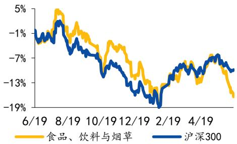  
资料来源：Wind

## [Table\_ 相关研究报告 DocRe

《国元证券行业研究-食品饮料行业 2024年度策略报告：食饮消费韧性强，长期布局价值高》2023.12.04

## [Table\_ 报告作者Au

分析师 邓晖

执业证书编号 S0020522030002

电话 021-51097188

邮箱 denghui1@gyzq.com.cn

分析师 朱宇昊

执业证书编号 S0020522090001

电话 021-51097188

邮箱 zhuyuhao@gyzq.com.cn

联系人 单蕾

电话 021-51097188

邮箱 shanlei@gyzq.com.cn

## 目 录

1.白酒企业穿越周期，业绩韧性强....4  
1.1基本面：消费市场持续复苏，白酒库存消化进入正循环....4  
1.2估值水平：白酒估值处于历史低位....9  
1.3基金重仓：白酒板块基金重仓占比环比回升....10  
2.集中度持续提升，业绩兑现能力强....12  
3.白酒板块现金流稳健，估值低位凸显股息优势....16  
4.重点公司盈利预测及估值....19  
5.风险提示....19

## 图表目录

图1：中国GDP及增速....4  
图2：中国M2及增速....4  
图3：中国社零总额及烟酒零售额增长情况（%）....4  
图4：飞天茅台批价变动（元）....5  
图5：代表性高端白酒批价变动（元）....5  
图6：600-800元代表性次高端白酒批价变动（元）....6  
图7：300-500元代表性次高端白酒批价变动（元）....6  
图8：上市白酒板块经营现金流净额/净利润情况....7  
图9：上市白酒板块经营现金流净额/净利润（剔除极端值）....7  
图10：近年上市白酒板块合同负债情况....7  
图11：近年一季度末上市白酒板块合同负债情况....7  
图12：近年上市白酒板块存货情况....8  
图13：近年一季度末上市白酒板块存货情况....8  
图14：中国白酒板块PE估值情况（TTM，整体法，剔除负值）....9  
图15：白酒行业基金重仓占比....11  
图16：白酒行业基金超配比率....11  
图17：中国规上白酒企业收入、利润及增速....13  
图18：中国上市白酒企业收入、利润总额及增速....13  
图19：2023年白酒上市酒企收入增速（%）....13  
图20：中国上市白酒公司单季度总收入、归母净利润同比增长率情况（%）14  
图21：中国规上白酒企业收入增速及烟酒零售额增速对比....14  
图22：中国规上白酒产量及增速....14  
图23：上市白酒企业分季度总收入增速（%）....15  
图24：2023年白酒企业市占率情况（%）....15  
图25：白酒企业集中度情况（%）....15  
图26：上市白酒企业市占率变动情况....16  
图27：白酒行业分红率情况（%）....17  
图28：白酒行业市场年度股息率情况（%）....17

图29：上市白酒企业分红率情况（2023年）（%）....17  
图30：上市白酒企业股息率情况（2023年）（%）....17  
图31：中债1年期国债到期收益率（%）....18  
图32：中国地方政府债券平均发行利率（%）....18

表1：茅台提价以来领先酒企提价情况....5  
表2：各酒企预收货款情况（亿元）....8  
表3：上市白酒企业市值、市盈率（截至24/5/31）....10  
表4：白酒公司基金重仓占比....11  
表5：白酒公司基金超配比率（PCT）....12  
表6：核心上市酒企增长目标....16  
表7：上市酒企股息率及增速情况....18  
表8：重点公司估值表....19

## 1.白酒企业穿越周期，业绩韧性强

1.1 基本面：消费市场持续复苏，白酒库存消化进入正循环

2024 年第一季度我国 GDP（现价）同增 3.97%；2024 年 4 月末，我国 M2 同增7.20%。2023 年，我国 GDP（现价）为 126.06 万亿元，同比增长 4.16%，以 GDP不变价计算同比增长 5.20%；2024 年第一季度，我国 GDP（现价）为 29.63 万亿元，同比增长 3.97%，以GDP不变价计算同比增长5.30%。2023年末，我国M2 为292.27 万亿元，同比增长 9.70%，2018-2023 年 CAGR 为 9.85%。2024 年 4 月末，我国 M2 为 301.19 万亿元，同比增长 7.20%。

图 1：中国 GDP及增速  
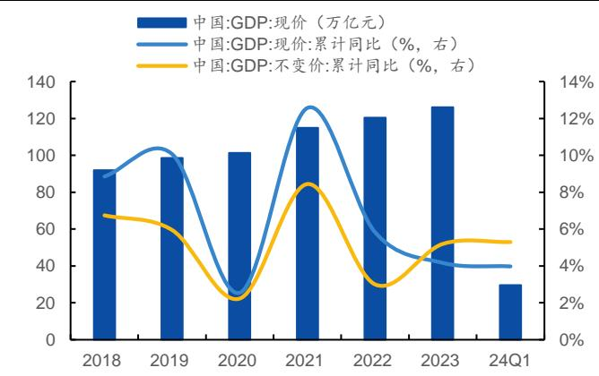  
资料来源：国家统计局、国元证券研究所整理

图 2：中国 M2及增速  
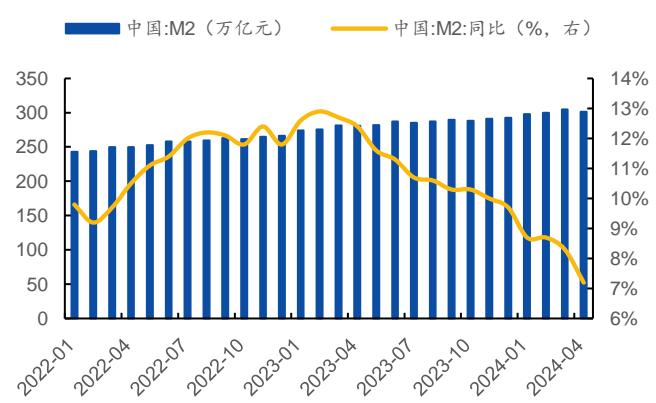  
资料来源：中国人民银行、国元证券研究所整理

烟酒社零2024年1-4月同比+11.7%。2022年12月短期消费场景波动影响开瓶率，导致社会库存增加，影响白酒批价及经销商渠道利润和周转周期；而随着社会经济在2023年下半年逐步恢复常态，白酒社会库存逐步进入正循环消化过程，2023年，我国社零总额同比+7.2%，其中烟酒社零同比+10.6%，本轮周期已进入筑底回升过程。2024 年 1-4 月，随着消费市场持续复苏，我国烟酒社零增速领先于整体社零增速，同比增长11.7%。（整体社零增速为 4.1%）。

图 3：中国社零总额及烟酒零售额增长情况（%）  
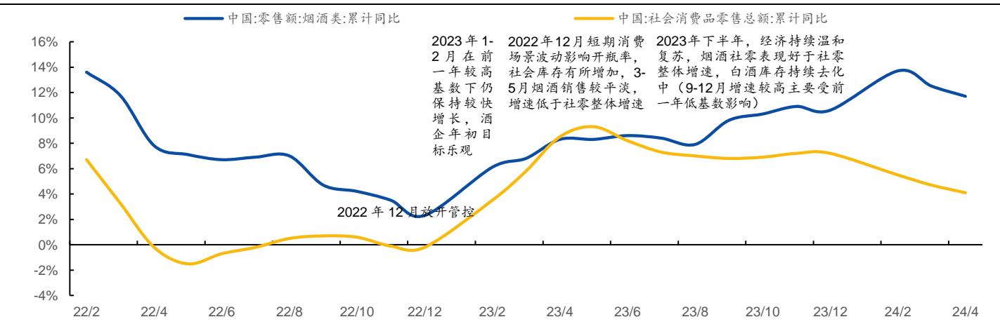  
资料来源：国家统计局、Wind、国元证券研究所整理

茅台提价以来，部分领先酒企对其核心大单品相继进行提价。2023 年 11 月 1 日，茅台时隔 6 年，上调飞天茅台出厂价，提价幅度约 20%；茅台提价以来，部分领先酒企——五粮液（八代普五）、剑南春（水晶剑）、今世缘（国缘开系产品）、汾酒（青花20、老白汾）、郎酒（红花郎）、舍得（品味舍得）对其核心大单品相继进行提价。

表 1：茅台提价以来领先酒企提价情况

<table><tr><td>酒企名称</td><td>提价情况</td></tr><tr><td>贵州茅台</td><td>自2023年11月1日起,公司上调53%vol贵州茅台酒(飞天、五星)出厂价格,平均上调幅度约为20%。</td></tr><tr><td>泸州老窖</td><td>自2023年11月2日起,52度、43度、38度泸州老窖60版特曲(500ml*6)经销商结算价分别提升20元至478元/瓶、438元/瓶和428元/瓶。</td></tr><tr><td>舍得酒业</td><td>自2024年1月1日起,500ml品味舍得(包含第五代及庆典装)经销商出厂价上调20元/瓶。</td></tr><tr><td>顺鑫农业</td><td>自2024年2月1日起,42°125ml、42°265ml、42°500ml、52°500ml牛栏山陈酿每箱上涨6元。</td></tr><tr><td>五粮液</td><td>自2024年2月5日起,第八代五粮液出厂价从969元/瓶提高至1019元/瓶,上调幅度为50元/瓶,涨价幅度约5%。</td></tr><tr><td>剑南春</td><td>自2024年3月1日起,剑南春水晶剑出厂价每瓶上调15元至约410元。</td></tr><tr><td>今世缘</td><td>自2024年3月1日起,五代国缘四开、对开、单开在四代版本基础上,出厂价分别上调20元/瓶、10元/瓶、8元/瓶。国缘四开严格执行配额机制,计划内配额执行当期出厂价,计划外配额在当期出厂价基础上上调10元/瓶。</td></tr><tr><td>山西汾酒</td><td>自2024年3月15日起,汾酒青花20出厂价每瓶上涨20元。2024年6月4日,汾酒宣布,旗下老白汾产品全系提价5元/瓶。</td></tr><tr><td>郎酒</td><td>自2024年4月1日起,郎酒旗下核心产品红花郎10年、红花郎15年供货价分别提高20元/瓶和30元/瓶。</td></tr></table>

资料来源：公司公告、酒说、财联社、新京报、中国证券报、云酒头条、国元证券研究所整理

2022Q4以来，部分名酒批价有所波动，分档次来看：

1）超高端白酒：飞天茅台 23年批价较稳健，淡旺季批价波动符合历史规律；24年4 月以来飞天茅台批价短期有所下滑，主要跟4、5 月淡季出货节奏、淡季消费需求较弱等因素相关，而茅台渠道管控力较强，控制发货节奏、加强大商价格管控有望维稳批价波动。

2）高端白酒：22Q4及 23年普五、国窖 1573批价有所波动；24 年以来，五粮液控量挺价，5 月以来批价已有所提升；24 年以来，国窖 1573 批价较稳健，公司保持“在良性发展的基础上能跑多快跑多快”的策略，24Q1 收入同增 21%，24 年全年目标增速不低于 15%。

图 4：飞天茅台批价变动（元）  
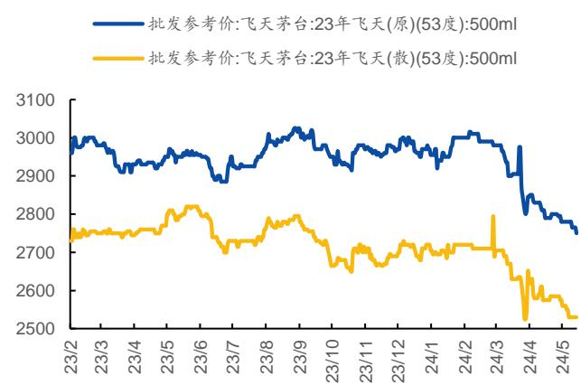  
资料来源： 、国元证券研究所整理

图 5：代表性高端白酒批价变动（元）  
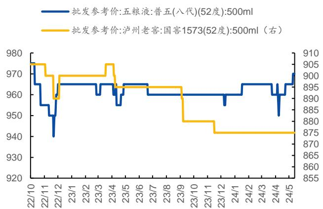  
资料来源： 、国元证券研究所整理

3）次高端白酒：300-500元白酒市场扩容，600-800元白酒市场增速短期有所放缓。2018-2022 年，名酒涨价潮下，次高端白酒市场扩容，中国次高端白酒市场规模增长领先，根据珍酒李渡招股书数据，2017-2021 年次高端白酒市场规模年复合增速达10.6%，高于中国白酒市场整体增速 1.6%。而 2023 年以来，中国 600-800 元白酒市场增速短期有所放缓，300-500元白酒成为部分名酒企战略发力的价位带（水晶梦、古 16、国缘四开、青花 20、水晶剑、红花郎等），同时 300-500 元也是部分省酒龙头结构升级的核心价位带，带动300-500 元白酒市场扩容。

凸显性价比优势，300-500元价位带扩容。300-500元价位带扩容，一方面是性价比消费兴起，300-500元次高端的名酒产品价格亲民，具有性价比优势，也是多个省份宴请的主流价位带；另一方面，600-800 元次高端白酒的消费群体以中小企业为主（根据《国有企业商务招待管理规定》，国有企业商务宴请接待用白酒每500毫升售价不得超过500 元），中小企业抗风险能力较弱，业务受到经济环境的影响较大。

图 6：600-800 元代表性次高端白酒批价变动（元）  
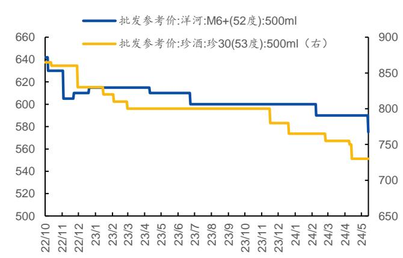  
资料来源：Ifind、国元证券研究所整理

图 7：300-500 元代表性次高端白酒批价变动（元）  
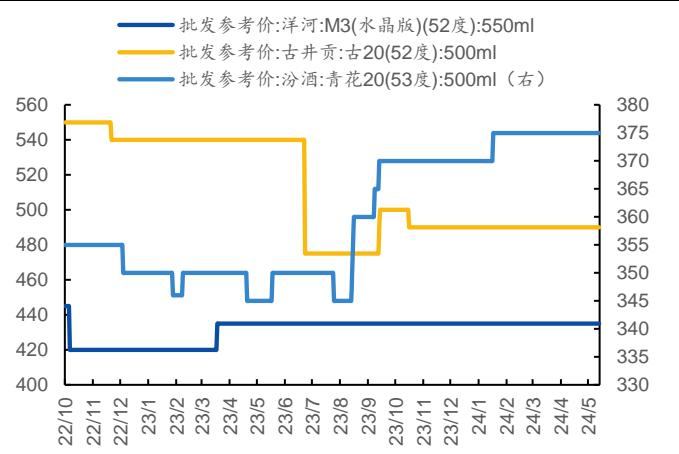  
资料来源： 、国元证券研究所整理

酒企经营现金流较平稳。2023年，上市白酒板块经营现金流净额/净利润（剔除极端值）为 0.75，较2022 年基本持平。从经营现金流净额数据看，本轮库存周期对白酒行业的冲击较 2012 年的冲击小，整体呈现平稳过渡态势。经营现金流与净利润的差额主要受存货、经营性应收项目（应收账款、应收票据、预付账款、其他应收款等）、经营性应付项目（应付账款、应付票据、其他应付款、预收账款、合同负债等）等因素影响。

图 8：上市白酒板块经营现金流净额/净利润情况  
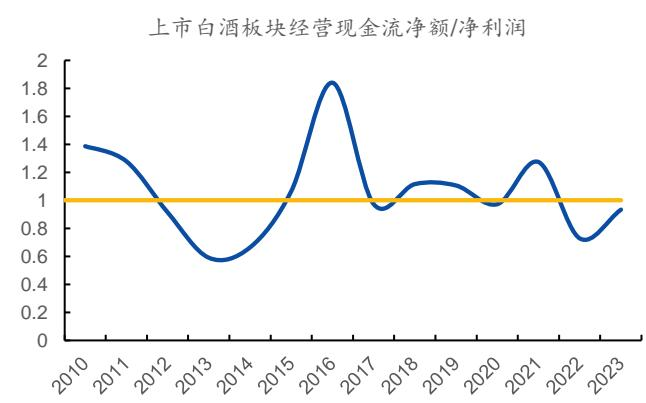  
资料来源：公司公告、Wind、国元证券研究所整理

图 9：上市白酒板块经营现金流净额/净利润（剔除极端值）  
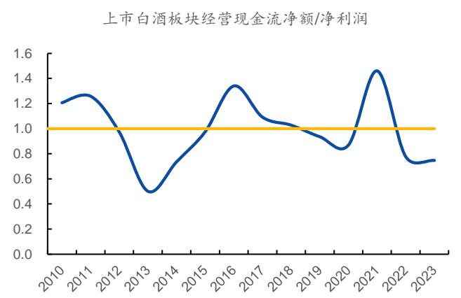  
资料来源：公司公告、 、国元证券研究所整理

注：考虑到顺鑫农业无法拆分白酒数据，因此剔除顺鑫农业；考虑到贵州茅台渠道利润率较高，一批商拿货积极性短期看不受库存及批价波动影响，因此剔除贵州茅台；考虑到五粮液 2023 年数据变化较大，影响整体走势，因此剔除五粮液。

近3年 Q1末合同负债较稳健。2023年末，上市酒企合同负债 511.00 亿元，同比下降13.82%，酒企的合同负债一般由预收经销商的货款及对经销商的未结算折扣构成，2023年末，上市酒企预收货款为 319.53亿元，同比下降16.68%。从合同负债（预收账款）历史情况来看，上市酒企的合同负债的变动主要与经销商打款的积极性、打款发货节奏（与春节等假期时点早晚、酒企控货节奏）等因素相关。剔除春节因素来看，24Q1末，上市酒企合同负债400.63亿元，同比+3.00%，在白酒行业深度调整背景下，近 3 年上市酒企的合同负债数据仍较稳健，主要由于名酒企的代理权是较稀缺的资源，在行业深度调整期，名酒企的经销商拥有更多的实力及动力穿越周期。

图 10：近年上市白酒板块合同负债情况  
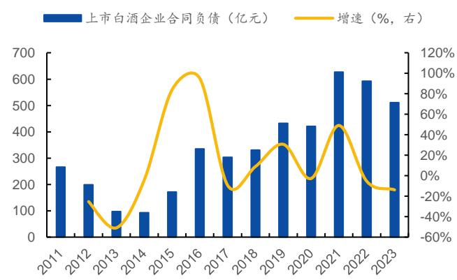  
资料来源：公司公告、Wind、国元证券研究所整理

图 11：近年一季度末上市白酒板块合同负债情况  
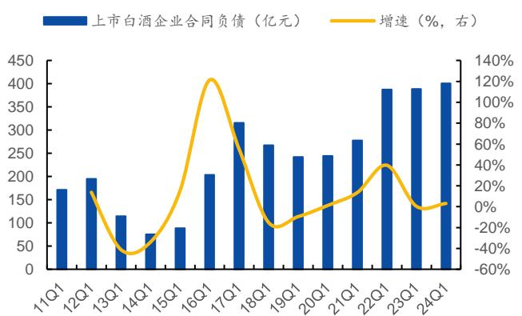  
资料来源：公司公告、Wind、国元证券研究所整理

注：1）考虑到顺鑫农业无法拆分白酒数据，因此剔除顺鑫农业。2）2021 年以后使注：1）考虑到顺鑫农业无法拆分白酒数据，因此剔除顺鑫农业。2）2021 年以后使用合同负债，2021 年以前使用预收账款。3）由于港股报表无合同负债科目，此图数用合同负债，2021 年以前使用预收账款。3）由于港股报表无合同负债科目，此图数据不含珍酒查渡 据不含珍酒李渡。

表 2：各酒企预收货款情况（亿元）

<table><tr><td>序号</td><td>公司名称</td><td>2020</td><td>2021</td><td>2022</td><td>2023</td></tr><tr><td>1</td><td>贵州茅台</td><td>133.22</td><td>127.18</td><td>154.72</td><td>141.26</td></tr><tr><td>2</td><td>五粮液</td><td>86.19</td><td>130.59</td><td>123.79</td><td>68.64</td></tr><tr><td>3</td><td>洋河股份</td><td>61.91</td><td>116.45</td><td>92.97</td><td>75.17</td></tr><tr><td>4</td><td>山西汾酒</td><td>31.07</td><td>73.76</td><td>69.08</td><td>70.29</td></tr><tr><td>5</td><td>泸州老窖</td><td>16.79</td><td>35.10</td><td>25.66</td><td>26.73</td></tr><tr><td>6</td><td>今世缘</td><td>10.96</td><td>20.67</td><td>20.40</td><td>24.00</td></tr><tr><td>7</td><td>老白干酒</td><td>7.07</td><td>13.58</td><td>14.91</td><td>15.21</td></tr><tr><td>8</td><td>口子窖</td><td>7.70</td><td>6.77</td><td>5.63</td><td>3.97</td></tr><tr><td>9</td><td>古井贡酒</td><td>12.07</td><td>18.25</td><td>8.27</td><td>14.01</td></tr><tr><td>10</td><td>迎驾贡酒</td><td>3.07</td><td>3.45</td><td>4.16</td><td>3.91</td></tr><tr><td>11</td><td>水井坊</td><td>2.36</td><td>3.39</td><td>2.86</td><td>2.27</td></tr><tr><td>12</td><td>舍得酒业</td><td>3.68</td><td>6.58</td><td>2.98</td><td>2.77</td></tr><tr><td>13</td><td>金徽酒</td><td>2.01</td><td>3.58</td><td>5.10</td><td>5.75</td></tr><tr><td>14</td><td>酒鬼酒</td><td>7.19</td><td>13.82</td><td>4.33</td><td>2.85</td></tr><tr><td>15</td><td>金种子酒</td><td>1.29</td><td>0.98</td><td>1.10</td><td>1.08</td></tr><tr><td>16</td><td>伊力特</td><td>0.89</td><td>0.84</td><td>0.80</td><td>0.73</td></tr><tr><td>17</td><td>天佑德酒</td><td>0.31</td><td>0.62</td><td>0.58</td><td>0.81</td></tr><tr><td>18</td><td>岩石股份</td><td>0.14</td><td>0.81</td><td>0.82</td><td>1.31</td></tr><tr><td>19</td><td>皇台酒业</td><td>0.03</td><td>0.11</td><td>0.02</td><td>0.02</td></tr><tr><td>20</td><td>预收货款合计</td><td>254.74</td><td>449.36</td><td>383.47</td><td>319.53</td></tr><tr><td>21</td><td>预计货款合计/营业总收入合计</td><td>17%</td><td>24%</td><td>18%</td><td>13%</td></tr></table>

资料来源：公司公告、国元证券研究所整理  
注：洋河股份、迎驾贡酒、水井坊、岩石股份的合同负债由预收货款及未结算折扣两部分构成，其他酒企合同负债均为预收货款。

上市酒企加大基酒战略储备，存货逐年增长。近年来上市酒企存货逐年增长，主要是酒企扩大基酒生产量及增加优质老酒储备，来满足未来高端酒的增长需求。

图 12：近年上市白酒板块存货情况  
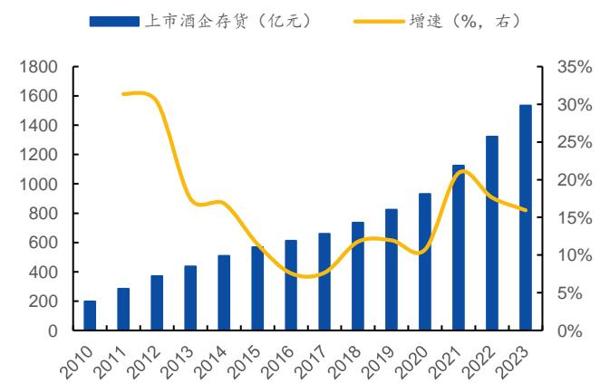

资料来源：公司公告、Wind、国元证券研究所整理

注：考虑到顺鑫农业无法拆分白酒数据，因此剔除顺鑫农业。

图 13：近年一季度末上市白酒板块存货情况  
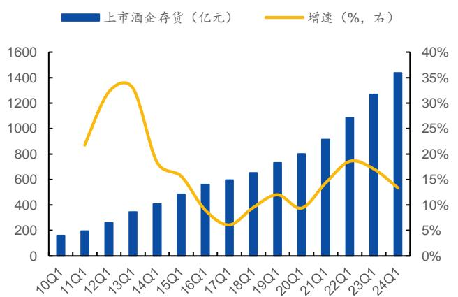

资料来源：公司公告、Wind、国元证券研究所整理

注：考虑到顺鑫农业无法拆分白酒数据，因此剔除顺鑫农业。

## 1.2 估值水平：白酒估值处于历史低位

白酒估值处于历史低位。目前，白酒板块 PE估值 22.70X（2024/5/31），处于2019年以来的 9%分位数，近3 年以来的 2%分位数。

图 14：中国白酒板块 PE估值情况（TTM，整体法，剔除负值）  
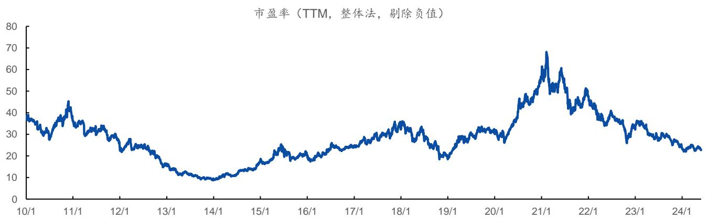  
资料来源：Ifind、国元证券研究所整理  
注：本图使用SW白酒指标数据。

截至2024/5/31，从上市公司看：

1）高端白酒企业：贵州茅台 PE（TTM）27X，处于 2019 年至今 11%分位数水平，茅台作为白酒市占率第一的企业，品牌、产品、渠道护城河稳固；五粮液、泸州老窖PE（TTM）在18X左右，估值已处于 2019年以来的低位；

2）次高端及领先地产酒企业：

a）汾酒作为布局全价位带的清香领先企业，批价及动销稳健，增长驱动力较强，目前PE（TTM）25X，处于2019年至今 5%分位数水平；

b）洋河股份去库存周期下，目前估值 PE（TTM）14X，处于2019年至今估值底部；

c）古井贡酒（PE（TTM）26X）、迎驾贡酒（PE（TTM）22X）、今世缘（PE（TTM）19X）品牌势能向上，业绩增长驱动力强；

d）口子窖（PE（TTM）14X）、舍得酒业（PE（TTM）14X）、水井坊（PE（TTM）17X）去库存持续深化，目前处于估值低位；

e）老白干酒（PE（TTM）29X）利润率已现改善，业绩提升有望加速；

f）金徽酒（PE（TTM）28X）在甘肃基地市场消费升级背景下，深耕基地，放眼全国，产品结构升级持续。

表 3：上市白酒企业市值、市盈率（截至 24/5/31）

<table><tr><td>序号</td><td>公司名称</td><td>总市值(亿元)</td><td>市盈率 (TTM)</td><td>2019年至今最低市盈率 (TTM,剔除负值)</td><td>2019年至今最高市盈 率(TTM)</td><td>目前估值所处2019年至今分 位水平</td></tr><tr><td>1</td><td>贵州茅台</td><td>20708</td><td>26.55</td><td>21.05</td><td>69.97</td><td>11.23%</td></tr><tr><td>2</td><td>五粮液</td><td>5694</td><td>17.96</td><td>14.20</td><td>66.99</td><td>7.12%</td></tr><tr><td>3</td><td>山西汾酒</td><td>2944</td><td>24.78</td><td>19.53</td><td>129.06</td><td>4.80%</td></tr><tr><td>4</td><td>泸州老窖</td><td>2574</td><td>18.24</td><td>16.02</td><td>76.58</td><td>3.67%</td></tr><tr><td>5</td><td>洋河股份</td><td>1406</td><td>13.64</td><td>13.64</td><td>53.11</td><td>0.00%</td></tr><tr><td>6</td><td>古井贡酒</td><td>1325</td><td>26.06</td><td>15.10</td><td>79.29</td><td>17.07%</td></tr><tr><td>7</td><td>今世缘</td><td>665</td><td>19.49</td><td>14.96</td><td>53.23</td><td>11.85%</td></tr><tr><td>8</td><td>迎驾贡酒</td><td>557</td><td>22.26</td><td>12.71</td><td>44.08</td><td>30.43%</td></tr><tr><td>9</td><td>珍酒李渡</td><td>320</td><td>13.82</td><td>9.83</td><td>26.67</td><td>23.67%</td></tr><tr><td>10</td><td>口子窖</td><td>252</td><td>14.20</td><td>12.70</td><td>36.78</td><td>6.23%</td></tr><tr><td>11</td><td>舍得酒业</td><td>240</td><td>13.69</td><td>13.04</td><td>100.06</td><td>0.75%</td></tr><tr><td>12</td><td>水井坊</td><td>221</td><td>17.05</td><td>16.21</td><td>74.37</td><td>1.44%</td></tr><tr><td>13</td><td>老白干酒</td><td>205</td><td>29.23</td><td>18.40</td><td>101.32</td><td>13.06%</td></tr><tr><td>14</td><td>酒鬼酒</td><td>173</td><td>53.89</td><td>22.76</td><td>150.95</td><td>24.28%</td></tr><tr><td>15</td><td>金徽酒</td><td>104</td><td>28.31</td><td>15.69</td><td>103.39</td><td>14.38%</td></tr><tr><td>16</td><td>金种子酒</td><td>95</td><td>259.45</td><td>25.04</td><td>490.87</td><td>50.32%</td></tr><tr><td>17</td><td>伊力特</td><td>95</td><td>27.12</td><td>12.10</td><td>86.84</td><td>20.09%</td></tr><tr><td>18</td><td>天佑德酒</td><td>58</td><td>47.77</td><td>39.11</td><td>313.72</td><td>3.15%</td></tr><tr><td>19</td><td>岩石股份</td><td>34</td><td>93.42</td><td>38.64</td><td>1119.81</td><td>5.07%</td></tr></table>

资料来源：Ifind、公司公告、国元证券研究所整理  
注：顺鑫农业、皇台酒业 PE 为负，暂未显示；珍酒李渡最低、最高市盈率及市盈率分位数使用 2023 年 4 月 27 日至今的数据计算得到。

## 1.3 基金重仓：白酒板块基金重仓占比环比回升

白酒行业基金重仓占比 12.54%。白酒板块基金重仓占比从23H1 开始触底回升，截至 24Q1 末，白酒行业基金重仓总市值为 3415.47 亿元，占基金总重仓的比例为12.54%，同比-0.66pct，环比+0.63pct；从基金超配比例看，白酒板块一直处于超配状态，截至 24Q1 末，白酒行业基金超配比率为 8.90pct，同比-0.47pct，环比+0.65pct。

图 15：白酒行业基金重仓占比  
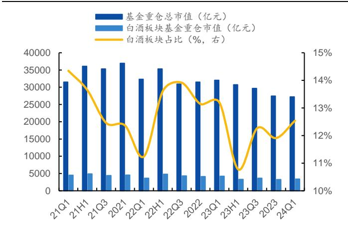  
资料来源：Wind、国元证券研究所整理

图 16：白酒行业基金超配比率  
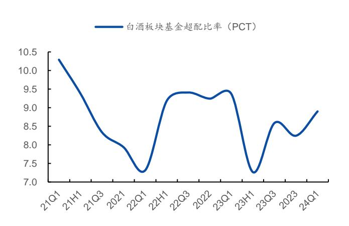  
资料来源：Wind、国元证券研究所整理

注：考虑到基金持有部分港股，而市值占比使用 股数据，因此在计算超配比例时，使用剔除港股后的基金重仓比例计算得到。

从上市酒企来看，基金超配集中在市占率领先酒企。24Q1，A股上市酒企中，市占率排名前 11 家的酒企中，10家处于基金超配状态。24Q1，贵州茅台、五粮液、山西汾酒、古井贡酒、今世缘的基金重仓占比及基金超配比例环比上升。

表 4：白酒公司基金重仓占比

<table><tr><td>序号</td><td>公司名称</td><td>22Q1</td><td>22H1</td><td>22Q3</td><td>2022</td><td>23Q1</td><td>23H1</td><td>23Q3</td><td>2023</td><td>24Q1</td></tr><tr><td>1</td><td>贵州茅台</td><td>4.99%</td><td>5.47%</td><td>5.71%</td><td>5.00%</td><td>4.70%</td><td>4.31%</td><td>4.99%</td><td>5.11%</td><td>5.43%</td></tr><tr><td>2</td><td>五粮液</td><td>1.68%</td><td>2.38%</td><td>2.16%</td><td>2.33%</td><td>2.42%</td><td>2.01%</td><td>1.94%</td><td>1.92%</td><td>2.29%</td></tr><tr><td>3</td><td>泸州老窖</td><td>1.61%</td><td>1.99%</td><td>2.19%</td><td>2.10%</td><td>2.29%</td><td>1.89%</td><td>2.07%</td><td>1.77%</td><td>1.70%</td></tr><tr><td>4</td><td>山西汾酒</td><td>1.19%</td><td>1.55%</td><td>1.61%</td><td>1.37%</td><td>1.17%</td><td>0.60%</td><td>1.04%</td><td>1.20%</td><td>1.30%</td></tr><tr><td>5</td><td>古井贡酒</td><td>0.26%</td><td>0.44%</td><td>0.73%</td><td>0.68%</td><td>0.71%</td><td>0.61%</td><td>0.79%</td><td>0.68%</td><td>0.75%</td></tr><tr><td>6</td><td>洋河股份</td><td>0.78%</td><td>0.96%</td><td>0.93%</td><td>0.88%</td><td>0.81%</td><td>0.63%</td><td>0.63%</td><td>0.53%</td><td>0.41%</td></tr><tr><td>7</td><td>今世缘</td><td>0.15%</td><td>0.16%</td><td>0.18%</td><td>0.20%</td><td>0.24%</td><td>0.21%</td><td>0.30%</td><td>0.25%</td><td>0.34%</td></tr><tr><td>8</td><td>迎驾贡酒</td><td>0.05%</td><td>0.03%</td><td>0.07%</td><td>0.04%</td><td>0.05%</td><td>0.08%</td><td>0.14%</td><td>0.17%</td><td>0.15%</td></tr><tr><td>9</td><td>舍得酒业</td><td>0.14%</td><td>0.18%</td><td>0.10%</td><td>0.23%</td><td>0.34%</td><td>0.18%</td><td>0.16%</td><td>0.12%</td><td>0.08%</td></tr><tr><td>10</td><td>口子窖</td><td>0.06%</td><td>0.06%</td><td>0.05%</td><td>0.06%</td><td>0.06%</td><td>0.02%</td><td>0.07%</td><td>0.06%</td><td>0.04%</td></tr><tr><td>11</td><td>老白干酒</td><td>0.00%</td><td>0.04%</td><td>0.06%</td><td>0.09%</td><td>0.20%</td><td>0.08%</td><td>0.04%</td><td>0.03%</td><td>0.01%</td></tr><tr><td>12</td><td>伊力特</td><td>0.01%</td><td>0.003%</td><td>0.002%</td><td>0.01%</td><td>0.02%</td><td>0.01%</td><td>0.01%</td><td>0.01%</td><td>0.01%</td></tr><tr><td>13</td><td>珍酒李渡</td><td>-</td><td>-</td><td>-</td><td>-</td><td>-</td><td>-</td><td>0.01%</td><td>0.01%</td><td>0.005%</td></tr><tr><td>14</td><td>金种子酒</td><td>0.00001%</td><td>0.0005%</td><td>0.00001%</td><td>0.01%</td><td>0.02%</td><td>0.01%</td><td>0.01%</td><td>0.01%</td><td>0.004%</td></tr><tr><td>15</td><td>酒鬼酒</td><td>0.25%</td><td>0.28%</td><td>0.14%</td><td>0.14%</td><td>0.10%</td><td>0.05%</td><td>0.05%</td><td>0.02%</td><td>0.004%</td></tr><tr><td>16</td><td>顺鑫农业</td><td>0.003%</td><td>0.0004%</td><td>-</td><td>0.01%</td><td>0.07%</td><td>0.07%</td><td>0.004%</td><td>0.01%</td><td>0.004%</td></tr><tr><td>17</td><td>水井坊</td><td>0.06%</td><td>0.06%</td><td>0.001%</td><td>0.01%</td><td>0.01%</td><td>0.004%</td><td>0.01%</td><td>0.01%</td><td>0.001%</td></tr><tr><td>18</td><td>金徽酒</td><td>-</td><td>-</td><td>0.0001%</td><td>0.0001%</td><td>0.00001%</td><td>0.001%</td><td>0.003%</td><td>0.003%</td><td>0.001%</td></tr><tr><td>19</td><td>天佑德酒</td><td>-</td><td>0.000005%</td><td>-</td><td>0.0001%</td><td>-</td><td>-</td><td>0.0001%</td><td>0.0007%</td><td>0.00001%</td></tr><tr><td>20</td><td>岩石股份</td><td>-</td><td>-</td><td>-</td><td>-</td><td>-</td><td>-</td><td>0.00001%</td><td>-</td><td>-</td></tr></table>

资料来源： 、国元证券研究所整理

表 5：白酒公司基金超配比率（PCT）

<table><tr><td>序号</td><td>公司名称</td><td>22Q1</td><td>22H1</td><td>22Q3</td><td>2022</td><td>23Q1</td><td>23H1</td><td>23Q3</td><td>2023</td><td>24Q1</td></tr><tr><td>1</td><td>贵州茅台</td><td>2.80</td><td>3.05</td><td>3.20</td><td>2.89</td><td>2.63</td><td>2.31</td><td>2.84</td><td>2.92</td><td>3.29</td></tr><tr><td>2</td><td>五粮液</td><td>1.09</td><td>1.70</td><td>1.50</td><td>1.71</td><td>1.80</td><td>1.47</td><td>1.42</td><td>1.42</td><td>1.75</td></tr><tr><td>3</td><td>泸州老窖</td><td>1.39</td><td>1.73</td><td>1.92</td><td>1.90</td><td>2.08</td><td>1.70</td><td>1.90</td><td>1.60</td><td>1.51</td></tr><tr><td>4</td><td>山西汾酒</td><td>0.90</td><td>1.23</td><td>1.26</td><td>1.08</td><td>0.92</td><td>0.40</td><td>0.80</td><td>0.96</td><td>1.05</td></tr><tr><td>5</td><td>古井贡酒</td><td>0.19</td><td>0.35</td><td>0.62</td><td>0.59</td><td>0.63</td><td>0.53</td><td>0.71</td><td>0.61</td><td>0.67</td></tr><tr><td>6</td><td>洋河股份</td><td>0.59</td><td>0.73</td><td>0.70</td><td>0.68</td><td>0.61</td><td>0.46</td><td>0.46</td><td>0.38</td><td>0.27</td></tr><tr><td>7</td><td>今世缘</td><td>0.10</td><td>0.10</td><td>0.12</td><td>0.14</td><td>0.17</td><td>0.16</td><td>0.25</td><td>0.20</td><td>0.28</td></tr><tr><td>8</td><td>迎驾贡酒</td><td>0.00</td><td>-0.02</td><td>0.02</td><td>-0.02</td><td>-0.01</td><td>0.03</td><td>0.09</td><td>0.12</td><td>0.10</td></tr><tr><td>9</td><td>舍得酒业</td><td>0.09</td><td>0.12</td><td>0.05</td><td>0.19</td><td>0.29</td><td>0.15</td><td>0.13</td><td>0.09</td><td>0.06</td></tr><tr><td>10</td><td>口子窖</td><td>0.03</td><td>0.02</td><td>0.02</td><td>0.02</td><td>0.02</td><td>-0.01</td><td>0.04</td><td>0.03</td><td>0.02</td></tr><tr><td>11</td><td>老白干酒</td><td>-0.02</td><td>0.01</td><td>0.03</td><td>0.07</td><td>0.18</td><td>0.06</td><td>0.02</td><td>0.01</td><td>0.00</td></tr><tr><td>12</td><td>伊力特</td><td>-0.01</td><td>-0.01</td><td>-0.01</td><td>-0.01</td><td>0.00</td><td>0.00</td><td>0.00</td><td>0.00</td><td>0.00</td></tr><tr><td>13</td><td>金种子酒</td><td>-0.02</td><td>-0.02</td><td>-0.02</td><td>-0.01</td><td>0.00</td><td>0.00</td><td>0.00</td><td>0.00</td><td>-0.01</td></tr><tr><td>14</td><td>酒鬼酒</td><td>0.21</td><td>0.24</td><td>0.09</td><td>0.10</td><td>0.06</td><td>0.02</td><td>0.02</td><td>-0.01</td><td>-0.02</td></tr><tr><td>15</td><td>顺鑫农业</td><td>-0.02</td><td>-0.02</td><td>-0.02</td><td>-0.02</td><td>0.04</td><td>0.05</td><td>-0.02</td><td>-0.01</td><td>-0.01</td></tr><tr><td>16</td><td>水井坊</td><td>0.02</td><td>0.01</td><td>-0.04</td><td>-0.04</td><td>-0.03</td><td>-0.03</td><td>-0.02</td><td>-0.03</td><td>-0.03</td></tr><tr><td>17</td><td>金徽酒</td><td>-0.02</td><td>-0.02</td><td>-0.02</td><td>-0.02</td><td>-0.02</td><td>-0.01</td><td>-0.01</td><td>-0.01</td><td>-0.01</td></tr><tr><td>18</td><td>天佑德酒</td><td>-0.01</td><td>-0.01</td><td>-0.01</td><td>-0.01</td><td>-0.01</td><td>-0.01</td><td>-0.01</td><td>-0.01</td><td>-0.01</td></tr><tr><td>19</td><td>岩石股份</td><td>-0.01</td><td>-0.01</td><td>-0.01</td><td>-0.01</td><td>-0.01</td><td>-0.01</td><td>-0.01</td><td>-0.01</td><td>-0.01</td></tr></table>

资料来源：Wind、国元证券研究所整理  
注：考虑到基金持有部分港股，而市值占比使用 A 股数据，因此在计算超配比例时，使用剔除港股后的基金重仓比例计算得到。

## 2.集中度持续提升，业绩兑现能力强

上市酒企表现优异，集中度持续提升。2023年，中国规上白酒企业收入 7563 亿元，同比增长 9.70%，利润总额 2328 亿元，同比增长 7.50%，上市白酒企业收入 4154亿元，同比增长 15.82%，占规上白酒企业收入的比例约为55%，上市白酒企业利润总额2163 亿元，同比增长18.57%，占规上白酒企业利润总额的比例约为 93%，上市白酒企业业绩韧性强，多数上市白酒企业收入增速高于规上白酒企业整体增速，行业集中度持续提升。

图 17：中国规上白酒企业收入、利润及增速  
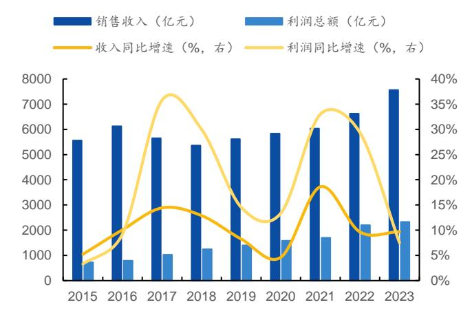  
资料来源：中国酒业协会、国元证券研究所整理

图 18：中国上市白酒企业收入、利润总额及增速  
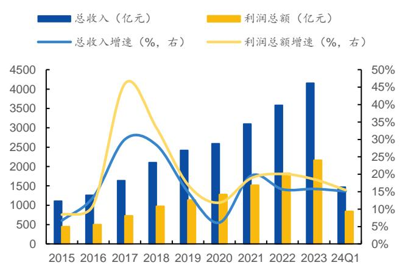  
资料来源：公司公告、Wind、Ifind、国元证券研究所整理  
注：顺鑫农业使用白酒收入增速数据，其他酒企均使用总收入增速数据；利润总额中剔除顺鑫农业数据。

图 19：2023 年白酒上市酒企收入增速（%）  
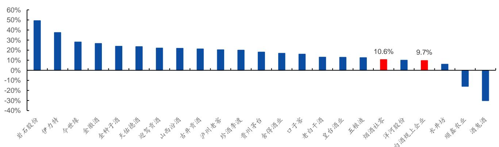  
资料来源：公司公告、国家统计局、中国酒业协会、 、国元证券研究所整理  
注：顺鑫农业使用白酒收入增速数据，其他酒企均使用总收入增速数据。

## 本轮去库存周期呈现温和过渡态势，名酒市占率持续提升：

1）2012年塑化剂事件和限酒令的出台导致白酒行业较快下行，2012 年-2014年间，白酒行业经历了 个季度的去库存后，白酒行业收入、归母净利恢复较稳健的正增长态势。通过历史看本轮去库存情况，在无类似2012 年行业事件的冲击下，本轮去库存呈现温和过渡的态势，但不同酒企业绩有所分化。

图 20：中国上市白酒公司单季度总收入、归母净利润同比增长率情况（%）  
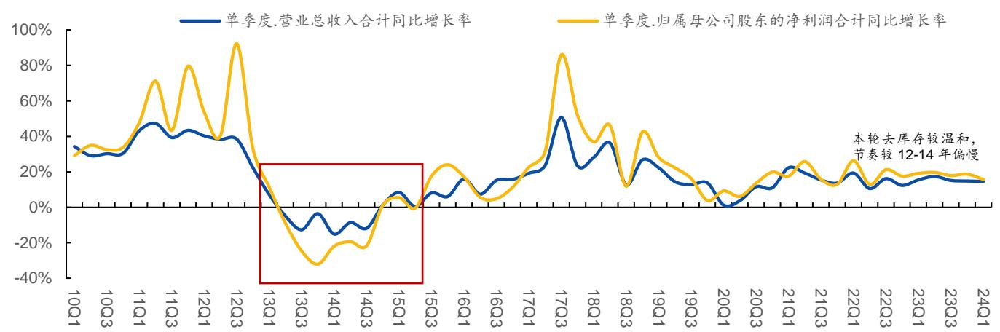  
资料来源：Ifind、国元证券研究所整理  
注：本图使用 SW 白酒指标数据。

消费温和复苏，白酒渠道库存持续去化中。2022 年，受消费场景波动等因素影响，中国烟酒零售额增速放缓，酒厂在“缓释垫”一批商的过渡下，业绩仍较坚挺，但22年消费量的减少导致社会及渠道库存增加，白酒行业进入库存去化周期；2023 年，中国烟酒零售额增速回升（+10.6%），略快于规上白酒企业收入增速（+9.7%），白酒社会及渠道库存周期逐步触底；2024年前4 个月，中国烟酒零售额增速保持双位数增速（+11.7%），有望带动白酒渠道库存继续去化。

图 21：中国规上白酒企业收入增速及烟酒零售额增速对比图 22：中国规上白酒产量及增速  
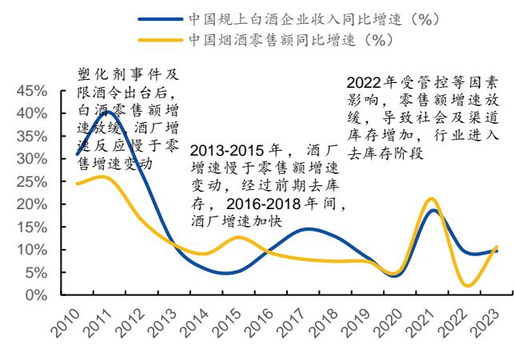

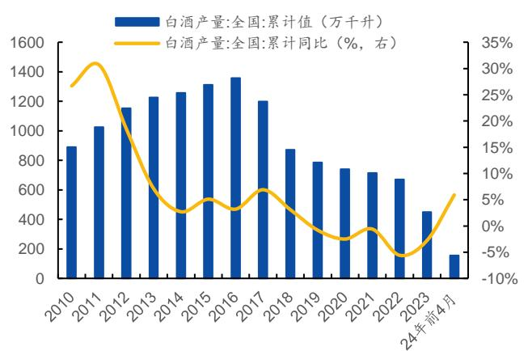  
资料来源：中国酒业协会、国家统计局、国元证券研究所整理  
资料来源：国家统计局、国元证券研究所整理

2）酒企业绩有所分化，集中度继续提升。全国名酒和区域名酒各自占据对应圈层的头部，无论是在品牌势能层面，还是在经销商粘性层面，都拥有更强的安全边际，在白酒消费粘性支撑的空间中，在行业调整期的横向挤压式增长中，名酒的市占率正在持续提升。本轮库存消化周期中，从行业内部看，各上市酒企业绩已有所分化，高端酒企、部分区域领先酒企收入维持双位数增长（贵州茅台、五粮液、山西汾酒、古井贡酒、今世缘、迎驾贡酒 2022 年至今每个季度均保持正增长，贵州茅台、今世缘2022年至今每个季度均保持双位数增长），部分酒企已主动消化库存。

图 23：上市白酒企业分季度总收入增速（%）

<table><tr><td>证券简称</td><td>22Q1</td><td>22Q2</td><td>22Q3</td><td>22Q4</td><td>23Q1</td><td>23Q2</td><td>23Q3</td><td>23Q4</td><td>24Q1</td></tr><tr><td>贵州茅台</td><td>18%</td><td>16%</td><td>15%</td><td>17%</td><td>19%</td><td>20%</td><td>13%</td><td>20%</td><td>18%</td></tr><tr><td>五粮液</td><td>13%</td><td>10%</td><td>12%</td><td>10%</td><td>13%</td><td>5%</td><td>17%</td><td>14%</td><td>12%</td></tr><tr><td>山西汾酒</td><td>44%</td><td>0%</td><td>33%</td><td>50%</td><td>20%</td><td>32%</td><td>14%</td><td>27%</td><td>21%</td></tr><tr><td>泸州老窖</td><td>26%</td><td>24%</td><td>22%</td><td>16%</td><td>21%</td><td>30%</td><td>25%</td><td>9%</td><td>21%</td></tr><tr><td>洋河股份</td><td>24%</td><td>17%</td><td>18%</td><td>6%</td><td>16%</td><td>16%</td><td>11%</td><td>-22%</td><td>8%</td></tr><tr><td>古井贡酒</td><td>28%</td><td>30%</td><td>22%</td><td>25%</td><td>25%</td><td>27%</td><td>23%</td><td>9%</td><td>26%</td></tr><tr><td>今世缘</td><td>25%</td><td>14%</td><td>26%</td><td>28%</td><td>27%</td><td>31%</td><td>28%</td><td>27%</td><td>23%</td></tr><tr><td>迎驾贡酒</td><td>37%</td><td>0%</td><td>23%</td><td>15%</td><td>21%</td><td>29%</td><td>22%</td><td>19%</td><td>21%</td></tr><tr><td>口子窖</td><td>12%</td><td>-8%</td><td>6%</td><td>部分酒企</td><td>-2%</td><td>21%</td><td>34%</td><td>5%</td><td>10%</td></tr><tr><td>舍得酒业</td><td>83%</td><td>-16%</td><td>31%</td><td rowspan="8">22Q4主动去库存,理清渠道,轻装上阵</td><td>6%</td><td>7%</td><td>32%</td><td>8%</td><td>28%</td></tr><tr><td>水井坊</td><td>14%</td><td>10%</td><td>7%</td><td>-25%</td><td>-40%</td><td>2%</td><td>21%</td><td>51%</td></tr><tr><td>老白干酒</td><td>20%</td><td>25%</td><td>28%</td><td>-5%</td><td>10%</td><td>10%</td><td>13%</td><td>18%</td></tr><tr><td>酒鬼酒</td><td>86%</td><td>5%</td><td>2%</td><td>-27%</td><td>-43%</td><td>-32%</td><td>-37%</td><td>22%</td></tr><tr><td>金徽酒</td><td>39%</td><td>12%</td><td>-9%</td><td>1%</td><td>27%</td><td>21%</td><td>48%</td><td>17%</td></tr><tr><td>伊力特</td><td>15%</td><td>5%</td><td>-60%</td><td>-33%</td><td>19%</td><td>-6%</td><td>144%</td><td>86%</td></tr><tr><td>金种子酒</td><td>17%</td><td>3%</td><td>-19%</td><td>-8%</td><td>25%</td><td>31%</td><td>43%</td><td>7%</td></tr><tr><td>天佑德酒</td><td>11%</td><td>-14%</td><td>-23%</td><td>-14%</td><td>-6%</td><td>53%</td><td>44%</td><td>42%</td></tr><tr><td>岩石股份</td><td>161%</td><td>92%</td><td>29%</td><td>102%</td><td>70%</td><td>69%</td><td>76%</td><td>-10%</td><td>-72%</td></tr><tr><td>皇台酒业</td><td>183%</td><td>176%</td><td>194%</td><td>-40%</td><td>14%</td><td>-2%</td><td>15%</td><td>27%</td><td>-6%</td></tr></table>

资料来源：公司公告、国元证券研究所整理  
注：顺鑫农业没有分季度的白酒收入数据，因此未在图中显示。

集中度提升逻辑明晰，领先酒企有望受益。2024 年，中国上市白酒企业目标增速仍保持较快增长，集中度提升逻辑持续，全国化领先的高端白酒企业、区域领先企业在品牌、产品、资金、团队等方面具有领先的竞争优势，有望持续受益集中度提升。

图 24：2023 年白酒企业市占率情况（%）  
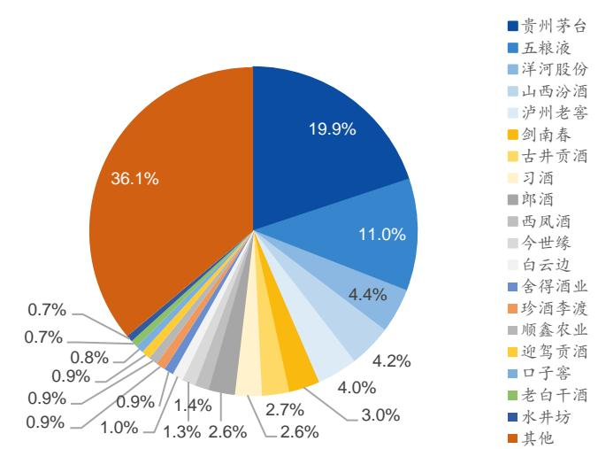  
图 25：白酒企业集中度情况（%）

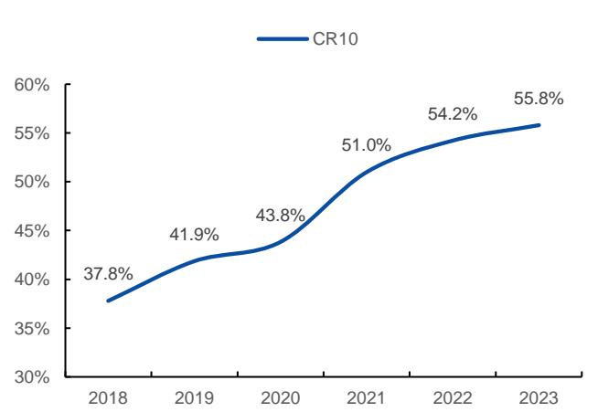  
资料来源：中国酒业协会、公司公告、微酒、21 世纪经济报、时代周报、国际金融资料来源：中国酒业协会、公司公告、微酒、21 世纪经济报、时代周报、国际金融报、中国经济报、国际在线、云酒头条、华夏酒报、21 世纪商业评论、酒类内参、报、中国经济报、国际在线、云酒头条、华夏酒报、21 世纪商业评论、酒类内参、国元证券研究所整理 国元证券研究所整理

图 26：上市白酒企业市占率变动情况  
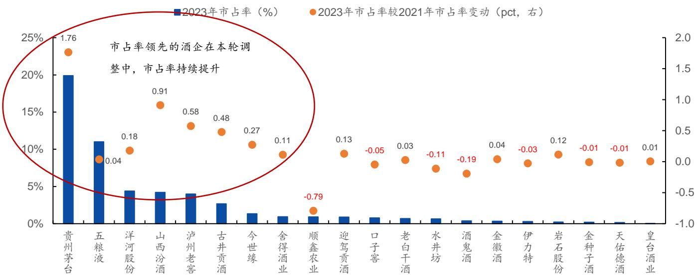  
资料来源：中国酒业协会、公司公告、国元证券研究所整理

表 6：核心上市酒企增长目标

<table><tr><td>序号</td><td>公司名称</td><td>2023年目标</td><td>达成情况</td><td>2024年目标</td></tr><tr><td>1</td><td>贵州茅台</td><td>营业总收入同比增长15%左右</td><td>营业总收入同比增长18.04%</td><td>营业总收入同比增长15%左右</td></tr><tr><td>2</td><td>五粮液</td><td>营业总收入双位数增长</td><td>营业总收入同比增长12.58%</td><td>营业总收入双位数增长</td></tr><tr><td>3</td><td>泸州老窖</td><td>营业收入同比增长不低于15%</td><td>营业收入同比增长20.34%</td><td>营业收入同比增长不低于15%</td></tr><tr><td>4</td><td>洋河股份</td><td>营业收入同比增长15%</td><td>营业收入同比增长10.04%</td><td>营业收入同比增长5%-10%</td></tr><tr><td>5</td><td>山西汾酒</td><td>营业收入较上年增长20%左右</td><td>营业收入同比增长21.80%</td><td>营业收入同比增长20%左右</td></tr><tr><td>6</td><td>古井贡酒</td><td>营业收入201亿元,同比增长20.26%,利润总额60亿元,同比增长34.21%</td><td>营业收入202.54亿元,同比增长21.18%,利润总额63.32亿元,同比增长41.64%</td><td>营业收入244.50亿元,同比增长20.72%,利润总额79.50亿元,同比增长25.55%</td></tr><tr><td>7</td><td>今世缘</td><td>总营收100亿元左右,净利润31亿元左右</td><td>总营收101亿元,净利润31亿元</td><td>总营收122亿元左右,净利润37亿元左右</td></tr><tr><td>8</td><td>金徽酒</td><td>营业收入25亿元、净利润4亿元</td><td>营业收入25.48亿元、净利润3.23亿元</td><td>营业收入30亿元、净利润4亿元</td></tr><tr><td>9</td><td>水井坊</td><td>收入、净利润同比保持增长</td><td>营业收入同比增长6.00%,净利润同比增长4.36%</td><td>收入、净利润同比保持增长</td></tr></table>

资料来源：公司公告、国元证券研究所整理

## 3.白酒板块现金流稳健，估值低位凸显股息优势

白酒板块估值低位，凸显股息优势。白酒企业现金流稳健，领先上市酒企业绩兑现能力强，随着上市酒企扩产高峰期进入尾声，白酒企业近2 年分红比例提升，叠加白酒板块估值低位，在降息背景下，白酒板块凸显性价比，股息回报率表现较优异。

图 27：白酒行业分红率情况（%）  
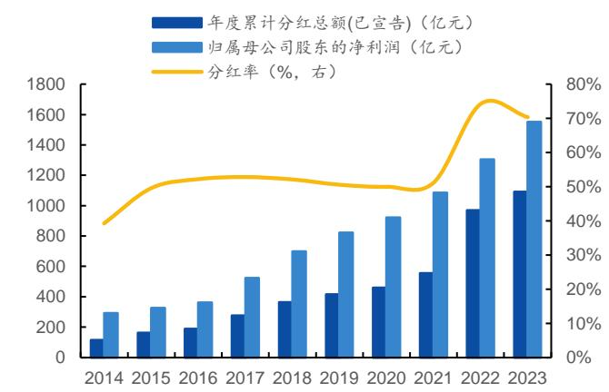  
资料来源：公司公告、 、国元证券研究所整理

图 28：白酒行业市场年度股息率情况（%）  
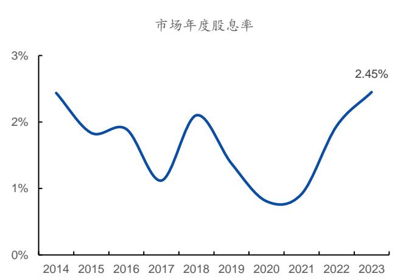  
资料来源：公司公告、 、国元证券研究所整理

高端白酒“茅五泸”、估值低位标的（洋河、口子、舍得）的股息率领先。从上市公司看，21 家上市白酒企业中，17家于2023 年进行了现金分红，2023 年，整体白酒板块分红率达 70%，其中，贵州茅台分红率最高，达84%。从股息率看，2023 年，整体白酒板块股息率为 2.45%，其中全国性高端白酒公司“茅五泸”及估值低位的白酒标的（截至 2024/5/31，洋河股份、口子窖、舍得PE（TTM）分别为 13.64、14.20、13.69X，位于 2019 年至今的 0.00%、6.23%、0.75%分位数水平）的股息率领先，股息率前六的白酒企业分别为洋河股份、五粮液、口子窖、泸州老窖、贵州茅台、舍得酒业，股息率分别为 4.24%、3.33%、3.31%、3.01%、2.90%、2.22%。

图 29：上市白酒企业分红率情况（2023 年）（%）  
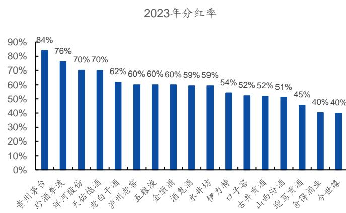  
资料来源：公司公告、Wind、国元证券研究所整理

图 30：上市白酒企业股息率情况（2023 年）（%）  
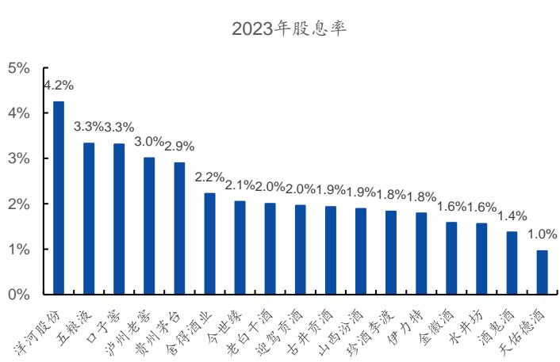  
资料来源：公司公告、Wind、国元证券研究所整理

图 31：中债 1年期国债到期收益率（%）  
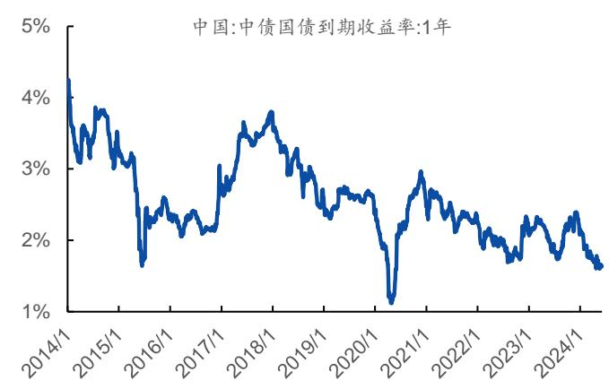  
资料来源：中债估值中心、Wind、国元证券研究所整理

图 32：中国地方政府债券平均发行利率（%）  
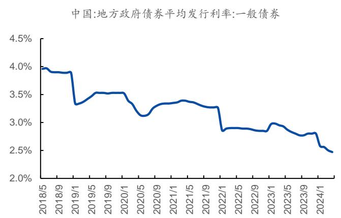  
资料来源：财政部、Wind、国元证券研究所整理

估值低位凸显股息性价比。使用 2024/5/31 收盘市值、2023 年分红率及 2024 年归母净利一致预期估算可得，2024 年，白酒板块整体股息率约为 3.44%，其中，9 家上市白酒公司的预计股息率超过中国地方政府债券平均发行利率 2.47%（2024 年 4月），17 家上市白酒公司的预计股息率超过中债 1 年期国债到期收益率 1.64%（2024/5/31）。

表 7：上市酒企股息率及增速情况

<table><tr><td>序号</td><td>公司名称</td><td>2024 年预计分红率</td><td>2024 年预计股息率</td><td>2024 年归母净利预计增长率</td><td>2024 年预测 PE</td></tr><tr><td>1</td><td>洋河股份</td><td>70%</td><td>5.38%</td><td>8%</td><td>13</td></tr><tr><td>2</td><td>珍酒李渡</td><td>76%</td><td>4.63%</td><td>-16%</td><td>16</td></tr><tr><td>3</td><td>口子窖</td><td>52%</td><td>4.11%</td><td>15%</td><td>13</td></tr><tr><td>4</td><td>水井坊</td><td>59%</td><td>3.87%</td><td>13%</td><td>15</td></tr><tr><td>5</td><td>泸州老窖</td><td>60%</td><td>3.77%</td><td>22%</td><td>16</td></tr><tr><td>6</td><td>五粮液</td><td>60%</td><td>3.58%</td><td>12%</td><td>17</td></tr><tr><td>7</td><td>贵州茅台</td><td>84%</td><td>3.56%</td><td>17%</td><td>24</td></tr><tr><td>8</td><td>舍得酒业</td><td>40%</td><td>3.34%</td><td>13%</td><td>12</td></tr><tr><td>9</td><td>老白干酒</td><td>62%</td><td>2.59%</td><td>29%</td><td>24</td></tr><tr><td>10</td><td>伊力特</td><td>54%</td><td>2.47%</td><td>27%</td><td>22</td></tr><tr><td>11</td><td>迎驾贡酒</td><td>45%</td><td>2.37%</td><td>27%</td><td>19</td></tr><tr><td>12</td><td>金徽酒</td><td>60%</td><td>2.36%</td><td>25%</td><td>25</td></tr><tr><td>13</td><td>古井贡酒</td><td>52%</td><td>2.31%</td><td>29%</td><td>22</td></tr><tr><td>14</td><td>今世缘</td><td>40%</td><td>2.29%</td><td>22%</td><td>17</td></tr><tr><td>15</td><td>山西汾酒</td><td>51%</td><td>2.28%</td><td>26%</td><td>22</td></tr><tr><td>16</td><td>酒鬼酒</td><td>59%</td><td>1.93%</td><td>3%</td><td>31</td></tr><tr><td>17</td><td>天佑德酒</td><td>70%</td><td>1.77%</td><td>63%</td><td>40</td></tr></table>

资料来源：公司公告、国元证券研究所整理

注：1）假设 2024 年按照 2023 年的分红率进行分红，2024 年归母净利均使用 wind 一致预期（180 天），股息率使用 2024/5/31 市值计算得到；2）珍酒李渡 2024年归母净利预计增长率为负，主要受非经因素影响。

## 4.重点公司盈利预测及估值

三条主线：1）高端白酒：高端白酒企业护城河宽阔，持续受益集中度提升，业绩韧性强，同时在强品牌力及规模优势下，盈利能力及现金流表现优异，分红率及股息率领先，推荐贵州茅台、泸州老窖、五粮液；2）势能向上的区域领先酒企：推荐迎驾贡酒、山西汾酒、古井贡酒、今世缘；3）低估值、边际有望改善标的：口子窖、水井坊、天佑德酒、老白干酒。

表 8：重点公司估值表

<table><tr><td rowspan="2">序号</td><td rowspan="2">股票代码</td><td rowspan="2">公司名称</td><td rowspan="2">投资评级</td><td colspan="4">归母净利(亿元,%)</td><td colspan="2">PE 估值</td></tr><tr><td>2024E</td><td>增速</td><td>2025E</td><td>增速</td><td>2024E</td><td>2025E</td></tr><tr><td>1</td><td>600519.SH</td><td>贵州茅台</td><td>买入</td><td>875.93</td><td>17.21%</td><td>1017.82</td><td>16.20%</td><td>21.82</td><td>18.78</td></tr><tr><td>2</td><td>000858.SZ</td><td>五粮液</td><td>买入</td><td>337.02</td><td>11.56%</td><td>375.31</td><td>11.36%</td><td>15.42</td><td>13.85</td></tr><tr><td>3</td><td>000568.SZ</td><td>泸州老窖</td><td>买入</td><td>162.71</td><td>22.83%</td><td>195.34</td><td>20.05%</td><td>13.95</td><td>11.62</td></tr><tr><td>4</td><td>600809.SH</td><td>山西汾酒</td><td>买入</td><td>130.84</td><td>25.35%</td><td>157.68</td><td>20.51%</td><td>21.25</td><td>17.63</td></tr><tr><td>5</td><td>000596.SZ</td><td>古井贡酒</td><td>买入</td><td>58.32</td><td>27.08%</td><td>72.24</td><td>23.88%</td><td>20.91</td><td>16.88</td></tr><tr><td>6</td><td>603369.SH</td><td>今世缘</td><td>买入</td><td>38.24</td><td>21.94%</td><td>46.33</td><td>21.16%</td><td>15.90</td><td>13.13</td></tr><tr><td>7</td><td>603589.SH</td><td>口子窖</td><td>买入</td><td>20.05</td><td>16.46%</td><td>23.12</td><td>15.32%</td><td>12.11</td><td>10.50</td></tr><tr><td>8</td><td>600779.SH</td><td>水井坊</td><td>增持</td><td>14.21</td><td>12.00%</td><td>16.47</td><td>15.93%</td><td>14.53</td><td>12.53</td></tr><tr><td>9</td><td>603198.SH</td><td>迎驾贡酒</td><td>买入</td><td>28.90</td><td>26.34%</td><td>35.72</td><td>23.58%</td><td>16.75</td><td>13.55</td></tr><tr><td>10</td><td>600559.SH</td><td>老白干酒</td><td>买入</td><td>8.55</td><td>28.40%</td><td>10.76</td><td>25.82%</td><td>21.94</td><td>17.44</td></tr><tr><td>11</td><td>603919.SH</td><td>金徽酒</td><td>增持</td><td>4.04</td><td>22.97%</td><td>4.94</td><td>22.15%</td><td>24.47</td><td>20.03</td></tr><tr><td>12</td><td>002646.SZ</td><td>天佑德酒</td><td>买入</td><td>1.45</td><td>61.46%</td><td>2.10</td><td>44.96%</td><td>36.56</td><td>25.22</td></tr><tr><td>13</td><td>300755.SZ</td><td>华致酒行</td><td>买入</td><td>2.83</td><td>20.39%</td><td>3.39</td><td>19.51%</td><td>22.21</td><td>18.58</td></tr></table>

资料来源：Wind、Ifind、国元证券研究所整理  
注： 估值数据使用 年 月 日收盘价计算。

## 5.风险提示

消费复苏不及预期风险、市场竞争过剧风险、政策风险。

## 投资评级说明：

<table><tr><td colspan="2">(1)公司评级定义</td><td colspan="2">(2)行业评级定义</td></tr><tr><td>买入</td><td>预计未来6个月内,股价涨跌幅优于上证指数20%以上</td><td>推荐</td><td>预计未来6个月内,行业指数表现优于市场指数10%以上</td></tr><tr><td>增持</td><td>预计未来6个月内,股价涨跌幅优于上证指数5-20%之间</td><td>中性</td><td>预计未来6个月内,行业指数表现介于市场指数±10%之间</td></tr><tr><td>持有</td><td>预计未来6个月内,股价涨跌幅介于上证指数±5%之间</td><td>回避</td><td>预计未来6个月内,行业指数表现劣于市场指数10%以上</td></tr><tr><td>卖出</td><td>预计未来6个月内,股价涨跌幅劣于上证指数5%以上</td><td></td><td></td></tr></table>

## 分析师声明

作者具有中国证券业协会授予的证券投资咨询执业资格或相当的专业胜任能力，以勤勉的职业态度，独立、客观地出具本报告。本人承诺报告所采用的数据均来自合规渠道，分析逻辑基于作者的职业操守和专业能力，本报告清晰准确地反映了本人的研究观点并通过合理判断得出结论，结论不受任何第三方的授意、影响。

## 证券投资咨询业务的说明

根据中国证监会颁发的《经营证券业务许可证》(Z23834000)，国元证券股份有限公司具备中国证监会核准的证券投资咨询业务资格。证券投资咨询业务是指取得监管部门颁发的相关资格的机构及其咨询人员为证券投资者或客户提供证券投资的相关信息、分析、预测或建议，并直接或间接收取服务费用的活动。证券研究报告是证券投资咨询业务的一种基本形式，指证券公司、证券投资咨询机构对证券及证券相关产品的价值、市场走势或者相关影响因素进行分析，形成证券估值、投资评级等投资分析意见，制作证券研究报告，并向客户发布的行为。

## 一般性声明

本报告由国元证券股份有限公司（以下简称“本公司”）在中华人民共和国内地（香港、澳门、台湾除外）发布、仅供本公司的客户使用。本公司不会因接收人收到本报告而视其为客户。若国元证券以外的金融机构或任何第三方机构发送本报告，则由该金融机构或第三方机构独自为此发送行为负责。本报告不构成国元证券向发送本报告的金融机构或第三方机构之客户提供的投资建议，国元证券及其员工亦不为上述金融机构或第三方机构之客户因使用本报告或报告载述的内容引起的直接或连带损失承担任何责任。本报告是基于本公司认为可靠的已公开信息，但本公司不保证该等信息的准确性或完整性。本报告所载的信息、资料、分析工具、意见及推测只提供给客户作参考之用，并非作为或被视为出售或购买证券或其他投资标的的投资建议或要约邀请。本报告所指的证券或投资标的的价格、价值及投资收入可能会波动。在不同时期，本公司可发出与本报告所载资料、意见及推测不一致的报告。本公司建议客户应考虑本报告的任何意见或建议是否符合其特定状况，以及（若有必要）咨询独立投资顾问。在法律许可的情况下，本公司及其所属关联机构可能会持有本报告中所提到的公司所发行的证券头寸并进行交易，还可能为这些公司提供或争取投资银行业务服务或其他服务。

## 免责条款

本报告是为特定客户和其他专业人士提供的参考资料。文中所有内容均代表个人观点。本公司力求报告内容的准确可靠，但并不对报告内容及所引用资料的准确性和完整性作出任何承诺和保证。本公司不会承担因使用本报告而产生的法律责任，本报告版权归国元证券所有，未经授权不得复印，转发或向特定读者群以外的人士传阅，如需引用或转载本报告，务必与本公司研究所联系。网址：www.gyzq.com.cn

## 国元证券研究所

<table><tr><td>合肥</td><td>上海</td></tr><tr><td>地址:安徽省合肥市梅山路18号安徽国际金融中心A座国元证券</td><td>地址:上海市浦东新区民生路1199号证大五道口广场16楼国元证券</td></tr><tr><td>邮编:230000</td><td>邮编:200135</td></tr><tr><td>传真:(0551)62207952</td><td>传真:(021)68869125</td></tr><tr><td></td><td>电话:(021)51097188</td></tr></table>