# 行业年度策略报告

# 白酒篇：筑牢基石，坐看云起

强于大市（维持）

行情走势图  
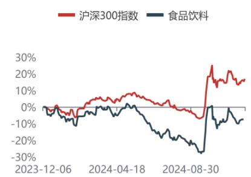

## 相关研究报告

【平安证券】行业周报\*食品饮料\*注重良性发展，分红回馈股东\*强于大市 20241202

【平安证券】行业周报\*食品饮料\*社零数据回暖，关注板块分化\*强于大市20241117

## 证券分析师

张晋溢 投资咨询资格编号 S1060521030001 ZHANGJINYI112@pingan.com.cn

王萌 投资咨询资格编号 S106052203000 WANGMENG917@pingan.com.cn

王星云 投资咨询资格编号S1060523100001wangxingy un937@pingan.com.cn

## 平安观点：

 年白酒承压，筹码持续出清。 年受宏观消费大环境影响，白酒表现承压，年初以来（截至 12.6）白酒板块下跌 10.8%，跑输沪深 300 指数 26.6pct。从节奏上看，1Q春节走亲访友需求较为刚性，白酒动销有所回暖；2Q白酒需求转弱，茅台批价下跌，市场情绪回落；3Q酒企控货挺价，更加注重渠道健康，弱现实逐渐传导到报表，1Q/2Q/3Q24 白酒板块营收同比分别为+15%/+11/+1%，增速环比回落。受制于弱现实，3Q末白酒重仓市值/全行业基金重仓市值较年初回落 1.65pct至 10.3%。

 我们对 2025 年白酒估值/基本面/业绩展望如下：1）第一波估值修复基本完成，期待后续政策加码：9.24 一揽子政策叠加 9.26 政治局会议表述积极，白酒板块迎来第一波估值修复，后续估值表现取决于 25 年刺激政策的总量与方向。 ）基本面渐进修复，延续分化：我们预计 年整体延续渐进式复苏。分场景看，我们预计 年大众流通渠道维持韧性，宴席低基数下有望迎来修复，期待商务需求回暖；分价格看，25 年大众价格带或延续增长，高端稳健，次高端取决于经济复苏进度；分品牌看，25 年马太效应或更加明显。 ）淡化业绩目标，分红回馈股东： 年厂家任务量增加+动销较弱，目前经销商库存普遍同比增加。我们预计 25 年厂家将淡化回款与业绩增长目标，更加注重实际动销与库存去化，业绩增速同比有所回落。但与此同时，厂家持续提高分红比例回馈股东，我们测算贵州茅台/五粮液/洋河股份 24 年股息率分别达 3.4/4.1/5.4%，已具备吸引力。

关注库存去化及动销拐点：虽然 2025 年白酒业绩降速，但一方面市场容忍度较高，更加关注实际动销与批价稳定性，另一方面白酒格局稳定，马太效应明显，龙头仍有红利，与此同时，高端酒股息率亦形成支撑。后续建议关注库存去化及动销拐点，相关标的：1）业绩确定强，库存良性，享受集中度提升的酒企，推荐贵州茅台、五粮液、山西汾酒、古井贡酒、迎驾贡酒、今世缘；2）虽短期承压，但向上弹性充足，更加受益于政策与基本面反转的酒企：推荐泸州老窖、舍得酒业，关注水井坊、酒鬼酒。

 风险提示： ）宏观经济波动影响：白酒受宏观经济影响较大，如果宏观经济下行对行业需求有较大影响；2） 消费刺激政策不及预期：白酒估值受政策影响较大，若消费刺激政策不及预期，会导致短期估值回落；3）消费复苏不及预期：宏观经济增速放缓下，国民收入和就业都受到一定影响，短期内居民消费能力及意愿复苏可能不及预期，从而影响白酒板块复苏；4）行业竞争加剧：竞争格局恶化会一定程度扰乱影响白酒行业定价，对行业造成不良影响；5）食品安全问题：食品安全是行业发展的红线，一旦出现食品安全问题，对行业将产生巨大的负面影响，行业恢复或将需要较长时间。

## 正文目录

一、市场回顾：表现承压，资金流出 4  
1.1 白酒跑输大盘，估值不断回调 4  
1.2 持仓比例下降，筹码持续出清 6  
二、业绩回顾：控量挺价，主动降速 9  
2.1 收入增速环比回落，注重良性发展 9  
2.2 盈利整体稳定，个股有所分化 10  
三、25年展望：渐进复苏，回归理性 12  
3.1 复盘2018-19年：估值先行，基本面随后复苏，报表改善滞后 12  
3.2 基本面展望：筑底后渐进式修复，场景/价格带/品牌延续分化 13  
3.3 业绩展望：淡化目标与业绩，加大股东回馈 15  
四、投资建议 17  
五、风险提示 18

## 图表目录

图表1 食品饮料指数年初以来下跌6.7%，排名靠后（截至12.6）……4
图表2 白酒及沪深300指数1-12月当月涨跌幅……4
图表3 白酒子板块年初至今涨跌幅（市值加权）……5
图表4 白酒上市公司年初至今涨跌幅……5
图表5 白酒板块PE（TTM）情况（市值加权，分板块）……5
图表6 白酒分公司/板块PE（TTM）变动情况（分公司）……5
图表7 2022年以来食品饮料基金重仓情况……6
图表8 白酒公司基金重仓市值/自由流通市值……7
图表9 食品饮料板块沪（深）股通持股情况……8
图表10 白酒上市公司营业收入与同比增速……9
图表11 白酒上市公司归母净利与同比增速……9
图表12 白酒上市公司收入同比增速……10
图表13 白酒毛利率情况……10
图表14 白酒毛利率同比变动情况（pct）……10
图表15 白酒销售费用率情况……11
图表16 白酒销售费用率同比变动情况（pct）……11
图表17 白酒归母净利率情况……11
图表18 白酒归母净利率同比变化情况（pct）……11
图表19 2018-19白酒PE估值（TTM）……12
图表20 飞天茅台批价及渠道利润（元）……12
图表21 普五批价及渠道利润（元）……12
图表22 白酒板块收入增速……13
图表23 白酒板块利润增速……13
图表24 中国:社会消费品零售总额:当月同比……13
图表25 中国限额以上烟酒类销售当月同比增速……13
图表26 中国婚姻登记结婚数量……14
图表27 中国中小企业信心指数……14
图表28 社会零售总额累计增速对比……14
图表29 餐饮及规模以上餐饮当月收入增速对比……14
图表30 白酒公司普遍下调业绩预期（亿元）……15
图表31 白酒板块分红比例（包含特殊分红）……16
图表32 白酒公司估值表……17

## 一、 市场回顾：表现承压，资金流出

## 1.1 白酒跑输大盘，估值不断回调

白酒需求承压，跑输沪深大盘。自年初以来（截止至 12 月6 日），食品饮料板块下跌 6.7%，跑输沪深 300 指数 22.5pct，在31个申万一级子行业中排名第29名；白酒板块下跌10.8%，跑输沪深300指数26.6pct。节前市场对于宏观与春节白酒消费预期悲观，而春节走亲访友需求稳定，白酒实际动销好于预期，节后股市回补，1Q白酒指数上涨0.3%，跑输沪深300指数2.8pct；2Q消费数据转弱，茅台批价持续下跌，引发市场对需求的担忧，白酒指数下跌15.5%，跑输沪深300指数13.4pct；月 日一揽子政策超预期，月 日中央政治局会议召开提振市场信心，顺周期板块持续回暖， 白酒指数上涨 ，跑赢沪深 300 指数 1.8pct；10-12 月白酒动销淡季有所承压，3Q白酒业绩发布显示白酒企业营收普遍降速，酒企更加注重市场高质量发展，4Q至今白酒指数下跌3.2%，跑输沪深300指数10.5pct。

图表1 食品饮料指数年初以来下跌6.7%，排名靠后（截至12.6）  
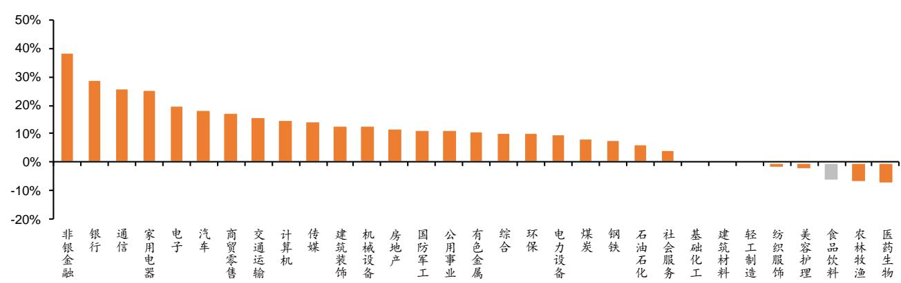  
资料来源：Wind，平安证券研究所

图表2 白酒及沪深300指数1-12月当月涨跌幅  
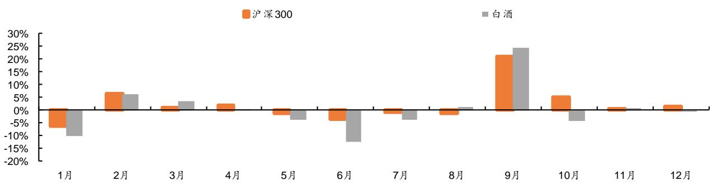  
资料来源：Wind，平安证券研究所

白酒各子板块均出现回撤，五粮液表现较优。年初以来（截止至12月6日），按照市值加权，高端/次高端/地产名酒/中端及大众酒涨跌幅分别为-12.0%/-12.1%/-18.4%/-11.6%，各个子版块均出现回撤；从弹性维度看，次高端>地产名酒>中端及大众酒 高端酒。分公司看，表现排名前五的酒企为五粮液（ ）、水井坊（ ）、今世缘（ ）、老白干酒（ ）、迎驾贡酒（-7.3%）；表现排名后五的酒企分别为古井贡酒（-18.5%）、天佑德酒（-19.2%）、泸州老窖（-19.4%）、舍得酒业（-20.8%）、金种子酒（-21.7%）。

图表3 白酒子板块年初至今涨跌幅（市值加权）  
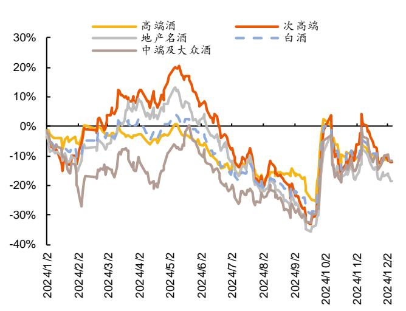  
资料来源：Wind，平安证券研究所

图表4 白酒上市公司年初至今涨跌幅  
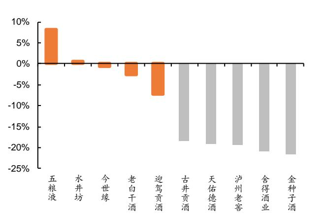  
资料来源：Wind，平安证券研究所

白酒估值持续回调，处于近五年低位。白酒需求偏刚性、抗风险能力较强，且具备持续增长的能力，在经历3年多的回调后截至2024年12月5日，白酒板块（申万）PE（TTM）为20X，同比-5X。分板块看，截至12月5日，高端/次高端/地产酒的 PE（TTM）分别为 21/28/17X，同比分别-6/+1/-4X。分公司看，截至 12 月 5 日，酒鬼酒/舍得酒业PE（TTM）为 152/22，同比+109/+4X，其余白酒公司估值均有回落。

图表5 白酒板块PE（TTM）情况（市值加权，分板块）  
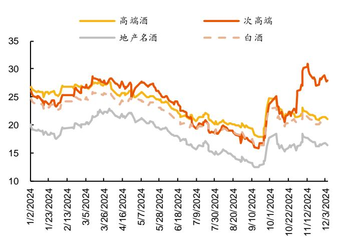  
资料来源：Wind，平安证券研究所

图表6 白酒分公司/板块 PE（TTM）变动情况（分公司）

<table><tr><td></td><td colspan="5">PE(TTM)</td><td colspan="6">PE(变动)</td></tr><tr><td>公司/板块</td><td>2020</td><td>2021</td><td>2022</td><td>2023</td><td>2024</td><td>2019</td><td>2020</td><td>2021</td><td>2022</td><td>2023</td><td>2024</td></tr><tr><td>贵州茅台</td><td>56</td><td>51</td><td>36</td><td>30</td><td>23</td><td>13</td><td>20</td><td>-5</td><td>-15</td><td>-6</td><td>-7</td></tr><tr><td>五粮液</td><td>58</td><td>38</td><td>27</td><td>18</td><td>17</td><td>15</td><td>27</td><td>-20</td><td>-11</td><td>-8</td><td>-1</td></tr><tr><td>泸州老窖</td><td>59</td><td>50</td><td>33</td><td>21</td><td>14</td><td>10</td><td>30</td><td>-9</td><td>-16</td><td>-13</td><td>-7</td></tr><tr><td>山西汾酒</td><td>121</td><td>70</td><td>46</td><td>27</td><td>20</td><td>20</td><td>80</td><td>-51</td><td>-24</td><td>-19</td><td>-7</td></tr><tr><td>水井坊</td><td>59</td><td>48</td><td>33</td><td>24</td><td>20</td><td>6</td><td>25</td><td>-11</td><td>-15</td><td>-9</td><td>-4</td></tr><tr><td>舍得酒业</td><td>56</td><td>61</td><td>36</td><td>18</td><td>22</td><td>3</td><td>28</td><td>5</td><td>-25</td><td>-18</td><td>4</td></tr><tr><td>酒鬼酒</td><td>114</td><td>78</td><td>39</td><td>43</td><td>152</td><td>24</td><td>67</td><td>-36</td><td>-39</td><td>4</td><td>109</td></tr><tr><td>迎驾贡酒</td><td>32</td><td>40</td><td>31</td><td>25</td><td>18</td><td>3</td><td>14</td><td>8</td><td>-9</td><td>-6</td><td>-6</td></tr><tr><td>古井贡酒</td><td>72</td><td>56</td><td>48</td><td>28</td><td>18</td><td>14</td><td>41</td><td>-16</td><td>-9</td><td>-19</td><td>-11</td></tr><tr><td>口子窖</td><td>32</td><td>27</td><td>19</td><td>16</td><td>14</td><td>4</td><td>13</td><td>-5</td><td>-8</td><td>-3</td><td>-2</td></tr><tr><td>洋河股份</td><td>48</td><td>33</td><td>26</td><td>16</td><td>15</td><td>3</td><td>28</td><td>-15</td><td>-7</td><td>-10</td><td>-0</td></tr><tr><td>今世缘</td><td>49</td><td>35</td><td>26</td><td>20</td><td>17</td><td>13</td><td>20</td><td>-14</td><td>-8</td><td>-6</td><td>-3</td></tr><tr><td>老白干酒</td><td>77</td><td>76</td><td>37</td><td>35</td><td>24</td><td>-2</td><td>50</td><td>-1</td><td>-39</td><td>-3</td><td>-11</td></tr><tr><td>金徽酒</td><td>77</td><td>47</td><td>46</td><td>37</td><td>27</td><td>9</td><td>50</td><td>-30</td><td>-1</td><td>-9</td><td>-10</td></tr><tr><td>伊力特</td><td>35</td><td>32</td><td>62</td><td>40</td><td>24</td><td>1</td><td>19</td><td>-4</td><td>31</td><td>-22</td><td>-16</td></tr><tr><td>高端酒</td><td>57</td><td>48</td><td>34</td><td>27</td><td>21</td><td>13</td><td>22</td><td>-9</td><td>-14</td><td>-7</td><td>-6</td></tr><tr><td>次高端</td><td>110</td><td>68</td><td>43</td><td>27</td><td>28</td><td>15</td><td>71</td><td>-43</td><td>-24</td><td>-16</td><td>1</td></tr><tr><td>地产酒</td><td>51</td><td>39</td><td>31</td><td>21</td><td>17</td><td>6</td><td>28</td><td>-12</td><td>-7</td><td>-10</td><td>-4</td></tr><tr><td>白酒</td><td>52</td><td>48</td><td>34</td><td>25</td><td>20</td><td>11</td><td>22</td><td>-5</td><td>-14</td><td>-9</td><td>-5</td></tr><tr><td>食品饮料</td><td>54</td><td>44</td><td>34</td><td>25</td><td>21</td><td>10</td><td>21</td><td>-9</td><td>-10</td><td>-9</td><td>-4</td></tr><tr><td>沪深300</td><td>16</td><td>14</td><td>11</td><td>11</td><td>13</td><td>2</td><td>4</td><td>-2</td><td>-3</td><td>-0</td><td>2</td></tr></table>

注：2024年市盈率数据截至2024年12月5日  
资料来源：Wind，平安证券研究所

## 1.2 持仓比例下降，筹码持续出清

3Q白酒板块资金回流，但全年仍净流出。得益于春节旺季超预期，1Q24 基金加仓白酒，季度末持仓占比（白酒重仓市值全行业基金重仓市值）达 12.5%，环比+0.63pct；2Q 茅台批价下滑引发担忧，白酒消费转弱，基金呈净流出状态，季度末持仓占比9.9%，环比-2.67pct；3Q24得益于政策出台，市场信心回暖，季度末持仓占比10.3%，环比+0.39pct。但受到消费环境影响，年初至今白酒板块基金整体呈净流出态势，3Q24末持仓占比较年初下滑1.65pct，筹码持续出清。

图表7 2022年以来食品饮料基金重仓情况

<table><tr><td></td><td>1Q22</td><td>2Q22</td><td>3Q22</td><td>4Q22</td><td>1Q23</td><td>2Q23</td><td>3Q23</td><td>4Q23</td><td>1Q24</td><td>2Q24</td><td>3Q24</td></tr><tr><td colspan="12">板块重仓市值(亿元)</td></tr><tr><td>白酒</td><td>3,632</td><td>4,808</td><td>4,308</td><td>4,142</td><td>4,230</td><td>3,308</td><td>3,636</td><td>3,271</td><td>3,414</td><td>2,623</td><td>3,236</td></tr><tr><td>乳品</td><td>311</td><td>295</td><td>240</td><td>201</td><td>170</td><td>163</td><td>118</td><td>135</td><td>129</td><td>72</td><td>69</td></tr><tr><td>啤酒</td><td>97</td><td>129</td><td>149</td><td>144</td><td>156</td><td>115</td><td>80</td><td>52</td><td>64</td><td>41</td><td>42</td></tr><tr><td>调味发酵品</td><td>56</td><td>78</td><td>61</td><td>73</td><td>62</td><td>57</td><td>50</td><td>47</td><td>39</td><td>29</td><td>38</td></tr><tr><td>预加工食品</td><td>32</td><td>76</td><td>76</td><td>80</td><td>74</td><td>73</td><td>53</td><td>43</td><td>19</td><td>17</td><td>31</td></tr><tr><td>软饮料</td><td>9</td><td>14</td><td>13</td><td>20</td><td>21</td><td>24</td><td>28</td><td>23</td><td>27</td><td>26</td><td>28</td></tr><tr><td>零食</td><td>15</td><td>11</td><td>13</td><td>24</td><td>31</td><td>27</td><td>21</td><td>26</td><td>31</td><td>15</td><td>21</td></tr><tr><td>肉制品</td><td>28</td><td>24</td><td>20</td><td>10</td><td>17</td><td>16</td><td>16</td><td>34</td><td>31</td><td>20</td><td>17</td></tr><tr><td>其他酒类</td><td>28</td><td>37</td><td>33</td><td>58</td><td>56</td><td>43</td><td>32</td><td>30</td><td>15</td><td>11</td><td>15</td></tr><tr><td>烘焙食品</td><td>5</td><td>9</td><td>9</td><td>10</td><td>12</td><td>8</td><td>8</td><td>7</td><td>3</td><td>2</td><td>3</td></tr><tr><td>熟食</td><td>6</td><td>18</td><td>24</td><td>31</td><td>11</td><td>8</td><td>12</td><td>7</td><td>4</td><td>3</td><td>1</td></tr><tr><td>保健品</td><td>11</td><td>12</td><td>11</td><td>16</td><td>18</td><td>18</td><td>13</td><td>13</td><td>12</td><td>8</td><td>0</td></tr><tr><td>食品饮料</td><td>4,231</td><td>5,511</td><td>4,956</td><td>4,809</td><td>4,857</td><td>3,862</td><td>4,068</td><td>3,688</td><td>3,787</td><td>2,864</td><td>3,502</td></tr><tr><td>基金整体</td><td>32,310</td><td>35,323</td><td>30,952</td><td>31,518</td><td>32,055</td><td>30,719</td><td>29,664</td><td>27,479</td><td>27,238</td><td>26,591</td><td>31,568</td></tr><tr><td colspan="12">板块重仓市值/基金总仓总市值</td></tr><tr><td>白酒</td><td>11.2%</td><td>13.6%</td><td>13.9%</td><td>13.1%</td><td>13.2%</td><td>10.8%</td><td>12.3%</td><td>11.9%</td><td>12.5%</td><td>9.9%</td><td>10.3%</td></tr><tr><td>乳品</td><td>0.96%</td><td>0.84%</td><td>0.78%</td><td>0.64%</td><td>0.53%</td><td>0.53%</td><td>0.40%</td><td>0.49%</td><td>0.48%</td><td>0.27%</td><td>0.22%</td></tr><tr><td>啤酒</td><td>0.30%</td><td>0.37%</td><td>0.48%</td><td>0.46%</td><td>0.49%</td><td>0.37%</td><td>0.27%</td><td>0.19%</td><td>0.23%</td><td>0.15%</td><td>0.13%</td></tr><tr><td>调味发酵品</td><td>0.17%</td><td>0.22%</td><td>0.20%</td><td>0.23%</td><td>0.19%</td><td>0.19%</td><td>0.17%</td><td>0.17%</td><td>0.14%</td><td>0.11%</td><td>0.12%</td></tr><tr><td>预加工食品</td><td>0.10%</td><td>0.22%</td><td>0.25%</td><td>0.25%</td><td>0.23%</td><td>0.24%</td><td>0.18%</td><td>0.16%</td><td>0.07%</td><td>0.06%</td><td>0.10%</td></tr><tr><td>软饮料</td><td>0.03%</td><td>0.04%</td><td>0.04%</td><td>0.06%</td><td>0.06%</td><td>0.08%</td><td>0.10%</td><td>0.08%</td><td>0.10%</td><td>0.10%</td><td>0.09%</td></tr><tr><td>零食</td><td>0.05%</td><td>0.03%</td><td>0.04%</td><td>0.08%</td><td>0.10%</td><td>0.09%</td><td>0.07%</td><td>0.10%</td><td>0.11%</td><td>0.06%</td><td>0.07%</td></tr><tr><td>肉制品</td><td>0.09%</td><td>0.07%</td><td>0.06%</td><td>0.03%</td><td>0.05%</td><td>0.05%</td><td>0.05%</td><td>0.12%</td><td>0.11%</td><td>0.07%</td><td>0.05%</td></tr><tr><td>其他酒类</td><td>0.09%</td><td>0.10%</td><td>0.11%</td><td>0.18%</td><td>0.18%</td><td>0.14%</td><td>0.11%</td><td>0.11%</td><td>0.05%</td><td>0.04%</td><td>0.05%</td></tr><tr><td>烘焙食品</td><td>0.01%</td><td>0.03%</td><td>0.03%</td><td>0.03%</td><td>0.04%</td><td>0.03%</td><td>0.03%</td><td>0.03%</td><td>0.01%</td><td>0.01%</td><td>0.01%</td></tr><tr><td>熟食</td><td>0.02%</td><td>0.05%</td><td>0.08%</td><td>0.10%</td><td>0.03%</td><td>0.03%</td><td>0.04%</td><td>0.03%</td><td>0.01%</td><td>0.01%</td><td>0.00%</td></tr><tr><td>保健品</td><td>0.03%</td><td>0.03%</td><td>0.04%</td><td>0.05%</td><td>0.05%</td><td>0.06%</td><td>0.04%</td><td>0.05%</td><td>0.04%</td><td>0.03%</td><td>0.00%</td></tr><tr><td>食品饮料</td><td>13.1%</td><td>15.6%</td><td>16.0%</td><td>15.3%</td><td>15.2%</td><td>12.6%</td><td>13.7%</td><td>13.4%</td><td>13.9%</td><td>10.8%</td><td>11.1%</td></tr><tr><td colspan="12">环比(pct)</td></tr><tr><td>白酒</td><td></td><td>2.37</td><td>0.31</td><td>-0.77</td><td>0.05</td><td>-2.43</td><td>1.49</td><td>-0.36</td><td>0.63</td><td>-2.67</td><td>0.39</td></tr><tr><td>乳品</td><td></td><td>-0.13</td><td>-0.06</td><td>-0.14</td><td>-0.11</td><td>0.00</td><td>-0.13</td><td>0.09</td><td>-0.01</td><td>-0.21</td><td>-0.05</td></tr><tr><td>啤酒</td><td></td><td>0.07</td><td>0.12</td><td>-0.02</td><td>0.03</td><td>-0.11</td><td>-0.10</td><td>-0.08</td><td>0.05</td><td>-0.08</td><td>-0.02</td></tr><tr><td>调味发酵品</td><td></td><td>0.05</td><td>-0.02</td><td>0.04</td><td>-0.04</td><td>-0.01</td><td>-0.02</td><td>0.00</td><td>-0.03</td><td>-0.03</td><td>0.01</td></tr><tr><td>预加工食品</td><td></td><td>0.12</td><td>0.03</td><td>0.01</td><td>-0.02</td><td>0.01</td><td>-0.06</td><td>-0.02</td><td>-0.09</td><td>-0.00</td><td>0.03</td></tr><tr><td>软饮料</td><td></td><td>0.01</td><td>0.00</td><td>0.02</td><td>0.00</td><td>0.01</td><td>0.02</td><td>-0.01</td><td>0.02</td><td>-0.00</td><td>-0.01</td></tr><tr><td>零食</td><td></td><td>-0.02</td><td>0.01</td><td>0.03</td><td>0.02</td><td>-0.01</td><td>-0.02</td><td>0.03</td><td>0.02</td><td>-0.06</td><td>0.01</td></tr><tr><td>肉制品</td><td></td><td>-0.02</td><td>-0.00</td><td>-0.03</td><td>0.02</td><td>-0.00</td><td>0.00</td><td>0.07</td><td>-0.01</td><td>-0.04</td><td>-0.02</td></tr><tr><td>其他酒类</td><td></td><td>0.02</td><td>0.00</td><td>0.08</td><td>-0.01</td><td>-0.03</td><td>-0.03</td><td>0.00</td><td>-0.06</td><td>-0.01</td><td>0.01</td></tr><tr><td>烘焙食品</td><td></td><td>0.01</td><td>0.00</td><td>0.00</td><td>0.01</td><td>-0.01</td><td>0.00</td><td>-0.00</td><td>-0.01</td><td>-0.01</td><td>0.00</td></tr><tr><td>熟食</td><td></td><td>0.03</td><td>0.02</td><td>0.02</td><td>-0.07</td><td>-0.01</td><td>0.01</td><td>-0.02</td><td>-0.01</td><td>-0.00</td><td>-0.01</td></tr><tr><td>保健品</td><td></td><td>-0.00</td><td>0.00</td><td>0.01</td><td>0.00</td><td>0.00</td><td>-0.02</td><td>0.00</td><td>-0.00</td><td>-0.01</td><td>-0.03</td></tr><tr><td>食品饮料</td><td></td><td>2.51</td><td>0.41</td><td>-0.75</td><td>-0.11</td><td>-2.58</td><td>1.14</td><td>-0.29</td><td>0.48</td><td>-3.13</td><td>0.32</td></tr></table>

资料来源：Wind，平安证券研究所（注：统计申万食品饮料三级行业）

内资围绕基本面布局，次高端流出明显。分板块看，高端酒中，3Q24贵州茅台/五粮液获基金加仓，基金重仓比例（基金重仓市值/自由流通市值）分别为16.86%/23.15%，环比分别+2.15/+2.07pct，泸州老窖受基金减持，占比环比-4.98pct。次高端中，3Q24舍得酒业、水井坊、酒鬼酒基金重仓比例较低，其中舍得酒业减持较明显，山西汾酒基金重仓比例达32.97%，环比略下滑 0.25pct。地产名酒中，迎驾贡酒基金加仓明显，基金重仓比例环比+5.44pct，今世缘/古井贡酒受基金减仓，基金重仓比例环比分别-5.39/-4.04pct。中端及大众酒中，老白干酒、顺鑫农业获基金加仓，基金重仓比例环比分别+8.38/+6.88pct，金徽酒、伊力特、金种子酒基金占比较低。

图表8 白酒公司基金重仓市值/自由流通市值

<table><tr><td></td><td>1Q22</td><td>2Q22</td><td>3Q22</td><td>4Q22</td><td>1Q23</td><td>2Q23</td><td>3Q23</td><td>4Q23</td><td>1Q24</td><td>2Q24</td><td>3Q24</td></tr><tr><td colspan="12">基金重仓市值/自由流通市值</td></tr><tr><td>贵州茅台</td><td>17.04%</td><td>17.17%</td><td>17.17%</td><td>16.58%</td><td>15.08%</td><td>14.27%</td><td>14.97%</td><td>14.81%</td><td>15.81%</td><td>14.71%</td><td>16.86%</td></tr><tr><td>五粮液</td><td>20.02%</td><td>23.79%</td><td>22.54%</td><td>23.19%</td><td>22.47%</td><td>21.49%</td><td>21.03%</td><td>21.44%</td><td>23.15%</td><td>21.08%</td><td>23.15%</td></tr><tr><td>泸州老窖</td><td>38.96%</td><td>39.71%</td><td>40.95%</td><td>41.23%</td><td>40.10%</td><td>38.54%</td><td>39.59%</td><td>37.88%</td><td>34.91%</td><td>29.95%</td><td>24.97%</td></tr><tr><td>山西汾酒</td><td>39.49%</td><td>43.99%</td><td>43.00%</td><td>39.72%</td><td>36.29%</td><td>25.91%</td><td>33.43%</td><td>37.08%</td><td>37.51%</td><td>33.21%</td><td>32.97%</td></tr><tr><td>水井坊</td><td>13.10%</td><td>12.07%</td><td>0.20%</td><td>1.34%</td><td>1.34%</td><td>1.18%</td><td>2.61%</td><td>1.97%</td><td>0.29%</td><td>0.02%</td><td>0.04%</td></tr><tr><td>舍得酒业</td><td>12.59%</td><td>13.93%</td><td>9.89%</td><td>19.75%</td><td>23.72%</td><td>19.66%</td><td>16.91%</td><td>14.43%</td><td>12.61%</td><td>8.96%</td><td>0.43%</td></tr><tr><td>酒鬼酒</td><td>24.57%</td><td>24.15%</td><td>14.89%</td><td>14.43%</td><td>11.02%</td><td>7.14%</td><td>7.34%</td><td>2.88%</td><td>0.78%</td><td>0.07%</td><td>0.07%</td></tr><tr><td>古井贡酒</td><td>35.70%</td><td>45.70%</td><td>60.07%</td><td>57.88%</td><td>55.78%</td><td>54.34%</td><td>61.98%</td><td>58.57%</td><td>57.42%</td><td>54.79%</td><td>50.75%</td></tr><tr><td>迎驾贡酒</td><td>14.44%</td><td>8.63%</td><td>18.32%</td><td>9.28%</td><td>11.26%</td><td>18.48%</td><td>27.97%</td><td>31.08%</td><td>28.40%</td><td>24.34%</td><td>29.78%</td></tr><tr><td>洋河股份</td><td>32.19%</td><td>32.05%</td><td>31.52%</td><td>30.13%</td><td>27.12%</td><td>25.46%</td><td>25.00%</td><td>23.14%</td><td>19.99%</td><td>19.88%</td><td>20.47%</td></tr><tr><td>今世缘</td><td>16.59%</td><td>15.96%</td><td>17.29%</td><td>17.76%</td><td>17.22%</td><td>17.84%</td><td>22.12%</td><td>20.64%</td><td>22.60%</td><td>19.70%</td><td>14.31%</td></tr><tr><td>口子窖</td><td>10.84%</td><td>9.31%</td><td>8.93%</td><td>8.87%</td><td>7.45%</td><td>4.08%</td><td>10.78%</td><td>9.56%</td><td>8.13%</td><td>10.64%</td><td>11.76%</td></tr><tr><td>老白干酒</td><td>0.21%</td><td>7.32%</td><td>11.13%</td><td>15.05%</td><td>25.95%</td><td>15.45%</td><td>7.07%</td><td>6.33%</td><td>3.31%</td><td>7.59%</td><td>15.97%</td></tr><tr><td>金徽酒</td><td>0.00%</td><td>0.00%</td><td>0.04%</td><td>0.05%</td><td>0.01%</td><td>0.53%</td><td>1.41%</td><td>1.91%</td><td>0.43%</td><td>0.24%</td><td>0.28%</td></tr><tr><td>顺鑫农业</td><td>0.90%</td><td>0.10%</td><td>0.00%</td><td>1.38%</td><td>13.07%</td><td>14.44%</td><td>1.08%</td><td>2.05%</td><td>1.20%</td><td>0.90%</td><td>7.78%</td></tr><tr><td>伊力特</td><td>3.48%</td><td>1.08%</td><td>1.18%</td><td>3.65%</td><td>7.42%</td><td>5.87%</td><td>5.54%</td><td>4.56%</td><td>4.94%</td><td>4.50%</td><td>1.99%</td></tr><tr><td>金种子酒</td><td>0.00%</td><td>0.12%</td><td>0.00%</td><td>2.58%</td><td>4.08%</td><td>3.25%</td><td>3.56%</td><td>3.05%</td><td>1.54%</td><td>0.52%</td><td>0.00%</td></tr><tr><td colspan="12">基金重仓比例环比(pct)</td></tr><tr><td>贵州茅台</td><td>1.04</td><td>0.13</td><td>-0.01</td><td>-0.59</td><td>-1.49</td><td>-0.81</td><td>0.71</td><td>-0.16</td><td>0.99</td><td>-1.10</td><td>2.15</td></tr><tr><td>五粮液</td><td>-1.83</td><td>3.77</td><td>-1.25</td><td>0.65</td><td>-0.72</td><td>-0.98</td><td>-0.47</td><td>0.41</td><td>1.71</td><td>-2.07</td><td>2.07</td></tr><tr><td>泸州老窖</td><td>0.08</td><td>0.75</td><td>1.24</td><td>0.27</td><td>-1.13</td><td>-1.56</td><td>1.05</td><td>-1.72</td><td>-2.97</td><td>-4.96</td><td>-4.98</td></tr><tr><td>山西汾酒</td><td>1.45</td><td>4.50</td><td>-0.99</td><td>-3.28</td><td>-3.43</td><td>-10.38</td><td>7.52</td><td>3.66</td><td>0.43</td><td>-4.30</td><td>-0.25</td></tr><tr><td>水井坊</td><td>-0.34</td><td>-1.03</td><td>-11.88</td><td>1.15</td><td>0.00</td><td>-0.17</td><td>1.43</td><td>-0.64</td><td>-1.69</td><td>-0.27</td><td>0.03</td></tr><tr><td>舍得酒业</td><td>3.27</td><td>1.34</td><td>-4.05</td><td>9.86</td><td>3.97</td><td>-4.06</td><td>-2.75</td><td>-2.48</td><td>-1.82</td><td>-3.65</td><td>-8.53</td></tr><tr><td>酒鬼酒</td><td>-2.61</td><td>-0.43</td><td>-9.26</td><td>-0.45</td><td>-3.41</td><td>-3.88</td><td>0.20</td><td>-4.46</td><td>-2.11</td><td>-0.71</td><td>0.00</td></tr><tr><td>古井贡酒</td><td>-22.28</td><td>10.00</td><td>14.37</td><td>-2.19</td><td>-2.10</td><td>-1.44</td><td>7.64</td><td>-3.41</td><td>-1.16</td><td>-2.62</td><td>-4.04</td></tr><tr><td>迎驾贡酒</td><td>7.06</td><td>-5.80</td><td>9.68</td><td>-9.04</td><td>1.98</td><td>7.22</td><td>9.50</td><td>3.11</td><td>-2.68</td><td>-4.07</td><td>5.44</td></tr><tr><td>洋河股份</td><td>2.06</td><td>-0.14</td><td>-0.53</td><td>-1.39</td><td>-3.01</td><td>-1.67</td><td>-0.45</td><td>-1.87</td><td>-3.15</td><td>-0.11</td><td>0.59</td></tr><tr><td>今世缘</td><td>3.53</td><td>-0.63</td><td>1.33</td><td>0.47</td><td>-0.54</td><td>0.62</td><td>4.28</td><td>-1.48</td><td>1.95</td><td>-2.90</td><td>-5.39</td></tr><tr><td>口子窖</td><td>-0.25</td><td>-1.53</td><td>-0.38</td><td>-0.06</td><td>-1.42</td><td>-3.37</td><td>6.70</td><td>-1.23</td><td>-1.42</td><td>2.50</td><td>1.12</td></tr><tr><td>老白干酒</td><td>-0.00</td><td>7.11</td><td>3.81</td><td>3.92</td><td>10.90</td><td>-10.50</td><td>-8.38</td><td>-0.74</td><td>-3.02</td><td>4.28</td><td>8.38</td></tr><tr><td>金徽酒</td><td>-</td><td>-</td><td>0.04</td><td>0.01</td><td>-0.04</td><td>0.53</td><td>0.87</td><td>0.51</td><td>-1.49</td><td>-0.18</td><td>0.03</td></tr><tr><td>顺鑫农业</td><td>-0.12</td><td>-0.80</td><td>-0.10</td><td>1.38</td><td>11.69</td><td>1.37</td><td>-13.36</td><td>0.97</td><td>-0.85</td><td>-0.30</td><td>6.88</td></tr><tr><td>伊力特</td><td>2.79</td><td>-2.40</td><td>0.10</td><td>2.47</td><td>3.77</td><td>-1.55</td><td>-0.33</td><td>-0.97</td><td>0.38</td><td>-0.45</td><td>-2.51</td></tr><tr><td>金种子酒</td><td>0.00</td><td>0.12</td><td>-0.12</td><td>2.58</td><td>1.50</td><td>-0.83</td><td>0.31</td><td>-0.51</td><td>-1.51</td><td>-1.02</td><td>-0.52</td></tr></table>

资料来源：Wind，平安证券研究所

3Q外资回补，兼顾基本面与弹性。截至3Q24，白酒板块沪（深）港通持仓总金额为2062亿元，占到板块流通市值的12.3%，较年初 ，全年呈现小幅净流入态势， 环比分别 ， 回落后， 有所回补。分板块看，3Q 高端酒中贵州茅台、泸州老窖获外资增持，占比（陆股通持仓市值/自由流通市值）环比+0.57/+0.77pct，五粮液受外资减持，占比环比-0.67pct；次高端中，3Q 舍得酒业/酒鬼酒占比环比+0.44/+0.77pct，山西汾酒/水井坊占比环比-1.01/-1.83pct。地产名酒中，除口子窖获增持外，古井贡酒、迎驾贡酒、洋河股份均受减持。大众酒中，顺鑫农业、金种子酒获基金增持，其余公司受基金减持。整体来看，3Q外资在加仓标的上兼顾基本面与弹性。

图表9 食品饮料板块沪（深）股通持股情况

<table><tr><td></td><td>2019</td><td>2020</td><td>2021</td><td>2022</td><td>2023</td><td>1Q24</td><td>2Q24</td><td>3Q24</td></tr><tr><td colspan="9">陆股通持仓市值/自由流通市值</td></tr><tr><td>贵州茅台</td><td>20.5%</td><td>19.0%</td><td>16.3%</td><td>15.4%</td><td>15.7%</td><td>16.5%</td><td>15.2%</td><td>15.8%</td></tr><tr><td>五粮液</td><td>20.1%</td><td>14.4%</td><td>12.8%</td><td>13.0%</td><td>10.0%</td><td>11.7%</td><td>10.6%</td><td>10.0%</td></tr><tr><td>泸州老窖</td><td>5.7%</td><td>4.6%</td><td>4.9%</td><td>6.4%</td><td>6.6%</td><td>6.8%</td><td>5.9%</td><td>6.7%</td></tr><tr><td>山西汾酒</td><td>9.6%</td><td>8.9%</td><td>10.3%</td><td>8.6%</td><td>6.3%</td><td>8.6%</td><td>10.4%</td><td>9.4%</td></tr><tr><td>水井坊</td><td>21.6%</td><td>17.7%</td><td>18.9%</td><td>17.1%</td><td>8.7%</td><td>10.4%</td><td>8.0%</td><td>6.1%</td></tr><tr><td>舍得酒业</td><td>2.2%</td><td>0.2%</td><td>0.0%</td><td>0.0%</td><td>3.5%</td><td>2.1%</td><td>1.7%</td><td>2.1%</td></tr><tr><td>酒鬼酒</td><td>0.5%</td><td>3.3%</td><td>6.3%</td><td>5.3%</td><td>2.5%</td><td>2.1%</td><td>0.8%</td><td>1.6%</td></tr><tr><td>古井贡酒</td><td>7.7%</td><td>5.7%</td><td>7.1%</td><td>5.2%</td><td>5.1%</td><td>5.6%</td><td>5.8%</td><td>5.1%</td></tr><tr><td>迎驾贡酒</td><td>3.3%</td><td>2.6%</td><td>9.5%</td><td>5.3%</td><td>5.3%</td><td>4.9%</td><td>5.6%</td><td>4.7%</td></tr><tr><td>洋河股份</td><td>23.0%</td><td>8.5%</td><td>5.8%</td><td>6.5%</td><td>6.7%</td><td>8.0%</td><td>6.8%</td><td>6.5%</td></tr><tr><td>今世缘</td><td>6.7%</td><td>4.4%</td><td>6.0%</td><td>5.5%</td><td>5.1%</td><td>7.5%</td><td>7.6%</td><td>7.5%</td></tr><tr><td>口子窖</td><td>8.5%</td><td>8.6%</td><td>8.7%</td><td>5.6%</td><td>5.9%</td><td>6.1%</td><td>3.6%</td><td>4.3%</td></tr><tr><td>老白干酒</td><td>0.7%</td><td>1.8%</td><td>3.6%</td><td>5.1%</td><td>1.9%</td><td>2.4%</td><td>3.0%</td><td>1.5%</td></tr><tr><td>金徽酒</td><td>0.0%</td><td>0.0%</td><td>0.6%</td><td>0.9%</td><td>1.7%</td><td>2.3%</td><td>2.1%</td><td>1.5%</td></tr><tr><td>顺鑫农业</td><td>6.6%</td><td>6.1%</td><td>2.9%</td><td>5.7%</td><td>0.9%</td><td>1.8%</td><td>1.3%</td><td>1.5%</td></tr><tr><td>伊力特</td><td>0.0%</td><td>0.0%</td><td>0.6%</td><td>1.3%</td><td>2.3%</td><td>1.8%</td><td>2.5%</td><td>1.4%</td></tr><tr><td>金种子酒</td><td>0.0%</td><td>0.0%</td><td>0.0%</td><td>0.0%</td><td>1.6%</td><td>2.0%</td><td>1.9%</td><td>2.7%</td></tr><tr><td>白酒整体</td><td>16.2%</td><td>13.0%</td><td>11.7%</td><td>11.4%</td><td>11.7%</td><td>12.6%</td><td>12.0%</td><td>12.3%</td></tr><tr><td colspan="9">年度/季度环比(pct)</td></tr><tr><td>贵州茅台</td><td></td><td></td><td></td><td></td><td></td><td>0.75</td><td>-1.22</td><td>0.57</td></tr><tr><td>五粮液</td><td></td><td></td><td></td><td></td><td></td><td>1.73</td><td>-1.09</td><td>-0.67</td></tr><tr><td>泸州老窖</td><td></td><td></td><td></td><td></td><td></td><td>0.20</td><td>-0.88</td><td>0.77</td></tr><tr><td>山西汾酒</td><td></td><td></td><td></td><td></td><td></td><td>2.26</td><td>1.81</td><td>-1.01</td></tr><tr><td>水井坊</td><td></td><td></td><td></td><td></td><td></td><td>1.72</td><td>-2.42</td><td>-1.83</td></tr><tr><td>舍得酒业</td><td></td><td></td><td></td><td></td><td></td><td>-1.33</td><td>-0.48</td><td>0.44</td></tr><tr><td>酒鬼酒</td><td></td><td></td><td></td><td></td><td></td><td>-0.43</td><td>-1.29</td><td>0.77</td></tr><tr><td>古井贡酒</td><td></td><td></td><td></td><td></td><td></td><td>0.48</td><td>0.28</td><td>-0.71</td></tr><tr><td>迎驾贡酒</td><td></td><td></td><td></td><td></td><td></td><td>-0.41</td><td>0.67</td><td>-0.82</td></tr><tr><td>洋河股份</td><td></td><td></td><td></td><td></td><td></td><td>1.31</td><td>-1.17</td><td>-0.37</td></tr><tr><td>今世缘</td><td></td><td></td><td></td><td></td><td></td><td>2.47</td><td>0.04</td><td>-0.11</td></tr><tr><td>口子窖</td><td></td><td></td><td></td><td></td><td></td><td>0.20</td><td>-2.48</td><td>0.66</td></tr><tr><td>老白干酒</td><td></td><td></td><td></td><td></td><td></td><td>0.53</td><td>0.56</td><td>-1.51</td></tr><tr><td>金徽酒</td><td></td><td></td><td></td><td></td><td></td><td>0.56</td><td>-0.19</td><td>-0.60</td></tr><tr><td>顺鑫农业</td><td></td><td></td><td></td><td></td><td></td><td>0.94</td><td>-0.55</td><td>0.21</td></tr><tr><td>伊力特</td><td></td><td></td><td></td><td></td><td></td><td>-0.49</td><td>0.63</td><td>-1.04</td></tr><tr><td>金种子酒</td><td></td><td></td><td></td><td></td><td></td><td>0.35</td><td>-0.04</td><td>0.74</td></tr><tr><td>白酒整体</td><td></td><td></td><td></td><td></td><td></td><td>0.92</td><td>-0.58</td><td>0.34</td></tr></table>

资料来源：Wind，平安证券研究所（数据截至3Q24）

## 二、 业绩回顾：控量挺价，主动降速

## 2.1 收入增速环比回落，注重良性发展

白酒低端产能出清多年后，产量已逐渐企稳。据中国酒业协会数据，2021/2022/2023 中国白酒产量分别同比-0.6%/-5.6%/-2.8%。而在经历多年产能出清后，1-3Q24白酒产量同比增长2.3%，低基数下温和增长。

3Q24白酒业绩增速环比回落，酒企更加重视健康发展。据各公司财报，3Q24白酒A 股上市公司（统计剔除岩石股份、天佑德酒和皇台酒业后加总）实现营业收入953亿元，同比+1%（1Q/2Q24：+15%/+11%）；归母净利同比+2%（1Q/2Q24：+16%/+12%），利润增速基本与收入匹配。受宏观消费环境影响，2Q以来白酒消费转弱，3Q酒企控制发货节奏，更加注重渠道健康与库存良性，增速环比回落。

图表10 白酒上市公司营业收入与同比增速  
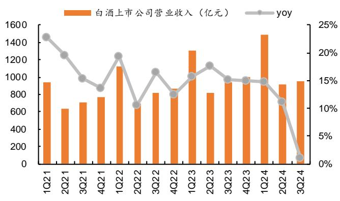  
注：统计剔除岩石股份、天佑德酒和皇台酒业，后同

图表11 白酒上市公司归母净利与同比增速  
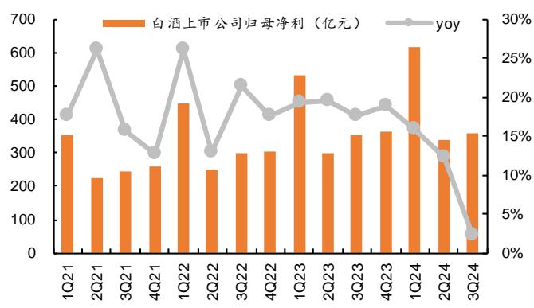  
资料来源：Wind，平安证券研究所  
资料来源：Wind，平安证券研究所

茅台稳健增长，五泸环比降速。3Q24高端酒营收635亿元，同比增长9%，增速环比-5pct，宏观消费压力下，酒企放缓增长，注重渠道良性。分公司看，贵州茅台在手工具充足，飞天挺价控量，直营渠道+非标产品+系列酒放量带动增长，3Q24实现营业收入 388亿元，同比+15%，依然维持较强韧性；五粮液普五减量后，1618和低度贡献增量，动销维持良性，3Q实现营收173亿元，同比+1%，增速环比-9pct，控货维护渠道健康；国窖1573动销仍有压力，泸州老窖通过挖井计划持续下沉渠道，控货挺价保障经销商利润，3Q24营收74亿元，同比+1%，增速环比-10pct。

泛全国化次高端分化，汾酒表现较优。3Q24泛全国化次高端实现营收121亿元，同比-0.4%，增速环比-8.9pct。分公司看，山西汾酒3Q青花提速，长江以南市场持续突破，动销势头良好，单季度实现营收86亿元，同比增长11%，环比虽有降速但韧性较强：水井坊珍酿八号动销良性 新财年平稳过度 3Q24实现营收21.亿元 同比+0.4%：舍得酒业核心单品品味舍得控货挺价，沱牌T68等产品维持增长，3Q24营收同比下降31%；酒鬼酒持续推进渠道改革，业绩短期承压。

地产酒收入环比降速，洋河、口子窖阶段性承压。 地产酒实现营收 亿元，同比 ，剔除洋河后同比增长 ，环比有所降速。分公司看，古井贡酒古 5/8基本盘稳固，古 16 承接省内宴席升级红利持续放量，3Q24 实现营收 53 亿元，同比增长 ；迎驾贡酒洞藏系列自点率持续提升，洞 延续增长势头，产品结构持续提升， 收入 亿元，同比增长 4%；今世缘对开、四开稳健增长，V 系列低基数下成长性较高，柔雅、淡雅渠道持续铺设，3Q24 实现营收 26 亿元，同比增长10%：洋河股份，口子窖阶段性承压，3Q24分别实现营收46/12亿元，同比分别-45%/-22%

中端及大众酒收入波动较大。3Q24 中端及大众酒实现营收 43亿元，同比-21% 降幅较 2Q24（-8%）进一步加深。分公司看，金徽酒年份系列快速增长，省外市场持续拓展，3Q24实现营收5.7亿元，同比增长16%；老白干酒产品结构持续优化，收入稳健增长，3Q24实现营收16亿元，同比增长0.3%；顺鑫农业、伊力特等其他酒企则阶段性承压。

图表12 白酒上市公司收入同比增速

<table><tr><td>分类</td><td>公司名称</td><td>2018</td><td>2019</td><td>2020</td><td>2021</td><td>2022</td><td>2023</td><td>1Q23</td><td>2Q23</td><td>3Q23</td><td>4Q23</td><td>1Q24</td><td>2Q24</td><td>3Q24</td></tr><tr><td rowspan="3">高端酒</td><td>贵州茅台</td><td>26%</td><td>16%</td><td>11%</td><td>12%</td><td>17%</td><td>19%</td><td>20%</td><td>22%</td><td>14%</td><td>20%</td><td>18%</td><td>17%</td><td>15%</td></tr><tr><td>五粮液</td><td>33%</td><td>25%</td><td>14%</td><td>16%</td><td>12%</td><td>13%</td><td>13%</td><td>5%</td><td>17%</td><td>14%</td><td>12%</td><td>10%</td><td>1%</td></tr><tr><td>泸州老窖</td><td>26%</td><td>21%</td><td>5%</td><td>24%</td><td>22%</td><td>20%</td><td>21%</td><td>30%</td><td>25%</td><td>9%</td><td>21%</td><td>11%</td><td>1%</td></tr><tr><td rowspan="4">泛全国化次高端</td><td>山西汾酒</td><td>55%</td><td>27%</td><td>18%</td><td>43%</td><td>31%</td><td>22%</td><td>20%</td><td>32%</td><td>14%</td><td>27%</td><td>21%</td><td>17%</td><td>11%</td></tr><tr><td>舍得酒业</td><td>35%</td><td>20%</td><td>2%</td><td>84%</td><td>22%</td><td>17%</td><td>7%</td><td>32%</td><td>8%</td><td>28%</td><td>4%</td><td>-23%</td><td>-31%</td></tr><tr><td>酒鬼酒</td><td>35%</td><td>27%</td><td>21%</td><td>87%</td><td>19%</td><td>-30%</td><td>-43%</td><td>-32%</td><td>-37%</td><td>22%</td><td>-49%</td><td>-13%</td><td>-67%</td></tr><tr><td>水井坊</td><td>38%</td><td>26%</td><td>-15%</td><td>54%</td><td>1%</td><td>6%</td><td>-40%</td><td>2%</td><td>21%</td><td>51%</td><td>9%</td><td>17%</td><td>0.4%</td></tr><tr><td rowspan="5">地产酒</td><td>洋河股份</td><td>21%</td><td>-4%</td><td>-9%</td><td>20%</td><td>19%</td><td>10%</td><td>16%</td><td>16%</td><td>11%</td><td>-22%</td><td>8%</td><td>-3%</td><td>-45%</td></tr><tr><td>今世缘</td><td>27%</td><td>30%</td><td>5%</td><td>25%</td><td>23%</td><td>28%</td><td>27%</td><td>31%</td><td>28%</td><td>27%</td><td>23%</td><td>22%</td><td>10%</td></tr><tr><td>古井贡酒</td><td>25%</td><td>20%</td><td>-1%</td><td>29%</td><td>26%</td><td>21%</td><td>25%</td><td>27%</td><td>23%</td><td>9%</td><td>26%</td><td>17%</td><td>13%</td></tr><tr><td>口子窖</td><td>18%</td><td>9%</td><td>-14%</td><td>25%</td><td>2%</td><td>16%</td><td>21%</td><td>34%</td><td>5%</td><td>10%</td><td>11%</td><td>6%</td><td>-22%</td></tr><tr><td>迎驾贡酒</td><td>11%</td><td>8%</td><td>-9%</td><td>33%</td><td>20%</td><td>22%</td><td>22%</td><td>29%</td><td>22%</td><td>19%</td><td>21%</td><td>19%</td><td>4%</td></tr><tr><td rowspan="8">中端及大众酒</td><td>顺鑫农业</td><td>3%</td><td>23%</td><td>4%</td><td>-4%</td><td>-21%</td><td>-9%</td><td>5%</td><td>-19%</td><td>0%</td><td>-31%</td><td>-1%</td><td>-23%</td><td>-37%</td></tr><tr><td>金徽酒</td><td>10%</td><td>12%</td><td>6%</td><td>3%</td><td>12%</td><td>27%</td><td>27%</td><td>21%</td><td>48%</td><td>17%</td><td>20%</td><td>8%</td><td>16%</td></tr><tr><td>伊力特</td><td>11%</td><td>8%</td><td>-22%</td><td>8%</td><td>-16%</td><td>37%</td><td>19%</td><td>-6%</td><td>144%</td><td>86%</td><td>12%</td><td>4%</td><td>-23%</td></tr><tr><td>老白干酒</td><td>41%</td><td>12%</td><td>-11%</td><td>12%</td><td>16%</td><td>13%</td><td>10%</td><td>10%</td><td>13%</td><td>18%</td><td>13%</td><td>9%</td><td>0.3%</td></tr><tr><td>金种子酒</td><td>2%</td><td>-30%</td><td>14%</td><td>17%</td><td>-2%</td><td>24%</td><td>25%</td><td>31%</td><td>43%</td><td>7%</td><td>-3%</td><td>-26%</td><td>-54%</td></tr><tr><td>天佑德酒</td><td>2%</td><td>-7%</td><td>-39%</td><td>38%</td><td>-7%</td><td>24%</td><td>-6%</td><td>53%</td><td>44%</td><td>42%</td><td>33%</td><td>-12%</td><td>-19%</td></tr><tr><td>岩石股份</td><td>529%</td><td>-90%</td><td>-27%</td><td>657%</td><td>81%</td><td>49%</td><td>70%</td><td>69%</td><td>76%</td><td>-10%</td><td>-72%</td><td>-82%</td><td>-92%</td></tr><tr><td>皇台酒业</td><td>-46%</td><td>289%</td><td>3%</td><td>-10%</td><td>50%</td><td>13%</td><td>14%</td><td>-2%</td><td>15%</td><td>27%</td><td>-6%</td><td>-19%</td><td>25%</td></tr><tr><td colspan="15"></td></tr><tr><td>高端酒</td><td></td><td>28%</td><td>19%</td><td>12%</td><td>14%</td><td>16%</td><td>17%</td><td>17%</td><td>18%</td><td>16%</td><td>17%</td><td>16%</td><td>14%</td><td>9%</td></tr><tr><td>泛全国化次高端</td><td></td><td>47%</td><td>26%</td><td>10%</td><td>53%</td><td>24%</td><td>14%</td><td>6%</td><td>22%</td><td>10%</td><td>30%</td><td>14%</td><td>8%</td><td>-0.4%</td></tr><tr><td>地产酒</td><td></td><td>21%</td><td>6%</td><td>-6%</td><td>24%</td><td>20%</td><td>17%</td><td>20%</td><td>23%</td><td>16%</td><td>3%</td><td>15%</td><td>8%</td><td>-17%</td></tr><tr><td>中端及大众酒</td><td></td><td>9%</td><td>16%</td><td>0%</td><td>1%</td><td>-11%</td><td>4%</td><td>10%</td><td>-4%</td><td>15%</td><td>-4%</td><td>5%</td><td>-8%</td><td>-21%</td></tr><tr><td>白酒整体</td><td></td><td>26%</td><td>17%</td><td>7%</td><td>18%</td><td>15%</td><td>16%</td><td>16%</td><td>18%</td><td>15%</td><td>15%</td><td>15%</td><td>11%</td><td>1%</td></tr></table>

资料来源：Wind，平安证券研究所

## 2.2 盈利整体稳定，个股有所分化

高端酒整体稳定，次高端酒及地产酒结构略下滑。3Q24高端酒手利率87.6%，同比+0.8pct.整体较稳定：泛全国化次高端毛利率 74.8%，同比-1.6pct，其中舍得酒业/酒鬼酒毛利率同比分别-11.0/-11.6pct，受消费大环境影响，产品结构略下沉，而山西汾酒、水井坊相对保持稳定；地产酒毛利率 73.3%，同比-3.5pct，除迎驾贡酒外，其余酒企产品结构均有一定回落，今世缘/古井贡酒/洋河股份毛利率同比分别-5.1/-1.6/-8.6pct；中端及大众酒毛利率52.2%，同比+9.2pct，毛利率水平与其他品类仍有差距，波动幅度较大。

图表13 白酒毛利率情况  
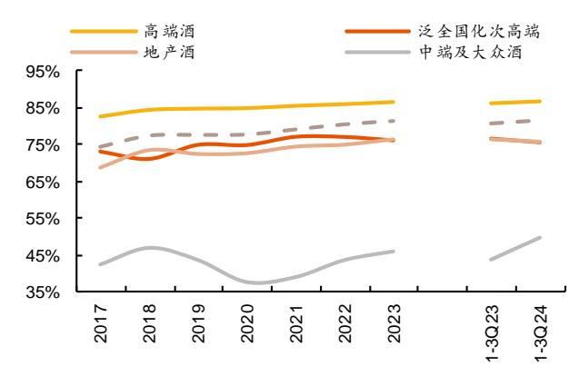  
资料来源：Wind，平安证券研究所

图表14 白酒毛利率同比变动情况（pct）

<table><tr><td>分类</td><td>公司名称</td><td>2018</td><td>2019</td><td>2020</td><td>2021</td><td>2022</td><td>2023</td><td>1Q23</td><td>2Q23</td><td>3Q23</td><td>4Q23</td><td>1Q24</td><td>2Q24</td><td>3Q24</td></tr><tr><td rowspan="2">高端酒</td><td>贵州茅台</td><td>1.3</td><td>0.2</td><td>0.1</td><td>0.1</td><td>0.3</td><td>0.1</td><td>0.2</td><td>-1.0</td><td>0.1</td><td>0.7</td><td>0.0</td><td>-0.1</td><td>-0.5</td></tr><tr><td>五粮液</td><td>1.8</td><td>0.7</td><td>-0.3</td><td>1.2</td><td>0.1</td><td>0.4</td><td>-0.0</td><td>-0.6</td><td>0.1</td><td>1.9</td><td>0.0</td><td>1.7</td><td>2.8</td></tr><tr><td rowspan="5">泛全国化次高端</td><td>泸州老窖</td><td>5.6</td><td>3.1</td><td>2.4</td><td>2.7</td><td>0.9</td><td>1.7</td><td>1.7</td><td>3.3</td><td>0.2</td><td>1.8</td><td>0.3</td><td>0.2</td><td>-0.5</td></tr><tr><td>山西汾酒</td><td>-3.6</td><td>5.7</td><td>0.2</td><td>2.8</td><td>0.4</td><td>-0.1</td><td>0.8</td><td>-0.6</td><td>-2.9</td><td>3.0</td><td>1.9</td><td>-2.7</td><td>-0.7</td></tr><tr><td>舍得酒业</td><td>-2.0</td><td>3.6</td><td>-0.3</td><td>1.9</td><td>-0.1</td><td>-3.2</td><td>-2.5</td><td>-1.9</td><td>-4.0</td><td>-3.5</td><td>-4.2</td><td>-11.0</td><td>-11.0</td></tr><tr><td>酒鬼酒</td><td>0.9</td><td>-1.1</td><td>1.1</td><td>1.1</td><td>-0.3</td><td>-1.3</td><td>1.8</td><td>0.0</td><td>-6.0</td><td>-1.8</td><td>-10.5</td><td>-2.2</td><td>-11.6</td></tr><tr><td>水井坊</td><td>2.8</td><td>1.0</td><td>1.3</td><td>0.3</td><td>-0.0</td><td>-1.3</td><td>-1.7</td><td>-3.0</td><td>-0.7</td><td>-0.7</td><td>-2.7</td><td>-0.0</td><td>0.9</td></tr><tr><td rowspan="5">地产酒</td><td>洋河股份</td><td>7.2</td><td>-2.4</td><td>0.9</td><td>3.1</td><td>-0.7</td><td>0.6</td><td>-0.7</td><td>8.6</td><td>-1.2</td><td>-5.5</td><td>-0.6</td><td>-1.4</td><td>-8.6</td></tr><tr><td>今世缘</td><td>1.2</td><td>-0.1</td><td>-1.7</td><td>3.5</td><td>2.0</td><td>1.7</td><td>1.1</td><td>3.7</td><td>1.1</td><td>1.9</td><td>-1.2</td><td>0.2</td><td>-5.1</td></tr><tr><td>古井贡酒</td><td>1.3</td><td>-1.0</td><td>-1.5</td><td>-0.1</td><td>2.1</td><td>1.9</td><td>1.8</td><td>0.8</td><td>5.7</td><td>-0.5</td><td>0.7</td><td>2.7</td><td>-1.6</td></tr><tr><td>口子窖</td><td>1.5</td><td>0.6</td><td>0.2</td><td>-1.3</td><td>0.3</td><td>1.0</td><td>-1.4</td><td>-1.5</td><td>5.0</td><td>1.7</td><td>-0.2</td><td>4.5</td><td>-5.9</td></tr><tr><td>迎驾贡酒</td><td>0.3</td><td>3.4</td><td>2.8</td><td>0.4</td><td>0.5</td><td>3.3</td><td>-0.2</td><td>7.4</td><td>3.9</td><td>4.0</td><td>3.9</td><td>0.6</td><td>2.9</td></tr><tr><td rowspan="8">中端及大众酒</td><td>顺鑫农业</td><td>6.0</td><td>-3.8</td><td>-7.8</td><td>-0.5</td><td>3.8</td><td>0.1</td><td>4.9</td><td>-6.7</td><td>-7.7</td><td>8.7</td><td>-0.6</td><td>12.6</td><td>13.5</td></tr><tr><td>金徽酒</td><td>-0.7</td><td>-1.6</td><td>1.8</td><td>1.2</td><td>-1.0</td><td>-0.3</td><td>-1.4</td><td>3.3</td><td>2.1</td><td>-5.1</td><td>0.4</td><td>2.6</td><td>-1.5</td></tr><tr><td>伊力特</td><td>1.3</td><td>2.4</td><td>-2.8</td><td>2.8</td><td>-3.4</td><td>0.2</td><td>0.4</td><td>1.7</td><td>9.6</td><td>-10.8</td><td>0.4</td><td>6.1</td><td>9.2</td></tr><tr><td>老白干酒</td><td>-1.3</td><td>0.3</td><td>3.3</td><td>2.6</td><td>1.0</td><td>-1.2</td><td>-4.8</td><td>2.0</td><td>-1.0</td><td>-1.7</td><td>-2.7</td><td>-0.1</td><td>0.6</td></tr><tr><td>金种子酒</td><td>-1.5</td><td>-13.4</td><td>-10.1</td><td>1.1</td><td>-2.4</td><td>13.9</td><td>-7.4</td><td>2.4</td><td>30.2</td><td>33.4</td><td>17.3</td><td>7.9</td><td>-34.4</td></tr><tr><td>天佑德酒</td><td>0.9</td><td>-2.2</td><td>-0.4</td><td>-1.0</td><td>-1.0</td><td>1.0</td><td>-4.5</td><td>2.0</td><td>6.6</td><td>6.9</td><td>-0.6</td><td>-10.6</td><td>-6.4</td></tr><tr><td>岩石股份</td><td>-7.7</td><td>30.8</td><td>18.2</td><td>9.5</td><td>3.5</td><td>7.6</td><td>6.3</td><td>11.8</td><td>10.6</td><td>3.5</td><td>-5.7</td><td>-11.6</td><td>-10.8</td></tr><tr><td>皇台酒业</td><td>-12.0</td><td>50.9</td><td>-8.2</td><td>-7.7</td><td>4.8</td><td>-2.6</td><td>-1.9</td><td>-6.4</td><td>-1.8</td><td>-0.4</td><td>0.2</td><td>5.8</td><td>8.2</td></tr><tr><td colspan="15"></td></tr><tr><td>高端酒</td><td></td><td>1.8</td><td>0.3</td><td>0.1</td><td>0.6</td><td>0.5</td><td>0.6</td><td>0.5</td><td>0.2</td><td>0.1</td><td>1.3</td><td>0.2</td><td>0.6</td><td>0.8</td></tr><tr><td>泛全国化次高端</td><td></td><td>-2.1</td><td>4.0</td><td>-0.1</td><td>2.3</td><td>-0.0</td><td>-1.0</td><td>-0.3</td><td>-1.1</td><td>-2.9</td><td>1.0</td><td>0.4</td><td>-3.1</td><td>-1.6</td></tr><tr><td>地产酒</td><td></td><td>4.6</td><td>-1.0</td><td>0.2</td><td>1.7</td><td>0.5</td><td>1.4</td><td>0.1</td><td>4.9</td><td>1.8</td><td>-0.1</td><td>0.0</td><td>0.8</td><td>-3.5</td></tr><tr><td>中端及大众酒</td><td></td><td>4.4</td><td>-3.2</td><td>-5.8</td><td>1.3</td><td>4.5</td><td>2.3</td><td>2.2</td><td>0.5</td><td>-0.6</td><td>7.5</td><td>1.3</td><td>9.5</td><td>9.2</td></tr><tr><td>白酒整体</td><td></td><td>2.9</td><td>0.2</td><td>0.1</td><td>1.3</td><td>1.3</td><td>0.9</td><td>0.5</td><td>1.4</td><td>0.0</td><td>1.8</td><td>0.5</td><td>1.2</td><td>1.1</td></tr></table>

资料来源：Wind，平安证券研究所

剔除个股影响后，3Q费用投放环比收窄。3Q24高端酒销售费用率为7.7%，同比+0.6pct，波动幅度相对较小；泛全国化次高端销售费用率 12.5%，同比-1.2pct，山西汾酒、水井坊费用持续优化，而舍得酒业、酒鬼酒持续推进费用改革、加大 C端投入，销售费用率同比提升；地产酒销售费用率21.6%，同比+2.4pct，其中今世缘/古井贡酒/口子窖销售费用率同比分别-3.9/-5.3/-3.0pct，迎驾贡酒同比略增；中端及大众酒销售费用率21.2%，同比+3.2pct，不同酒企有所分化，其中顺鑫农业伊力特销售费用率同比分别+2.5/+4.5pct，而金徽酒销售费用率同比-3.2pct，老白干酒销售费用率同比基本持平。

图表15 白酒销售费用率情况  
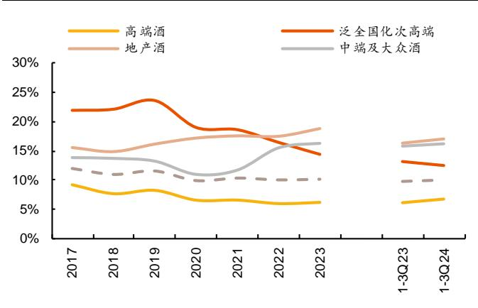  
资料来源：Wind，平安证券研究所

图表16 白酒销售费用率同比变动情况（pct）

<table><tr><td>分类</td><td>公司名称</td><td>2018</td><td>2019</td><td>2020</td><td>2021</td><td>2022</td><td>2023</td><td>1Q23</td><td>2Q23</td><td>3Q23</td><td>4Q23</td><td>1Q24</td><td>2Q24</td><td>3Q24</td></tr><tr><td rowspan="2">高端酒</td><td>贵州茅台</td><td>-1.6</td><td>0.3</td><td>-1.2</td><td>-0.1</td><td>0.1</td><td>0.5</td><td>0.3</td><td>-0.5</td><td>0.7</td><td>1.2</td><td>0.5</td><td>0.7</td><td>0.4</td></tr><tr><td>五粮液</td><td>-2.6</td><td>0.5</td><td>-0.2</td><td>0.1</td><td>-0.6</td><td>0.1</td><td>-0.6</td><td>-0.6</td><td>-0.3</td><td>2.3</td><td>0.8</td><td>2.0</td><td>2.8</td></tr><tr><td rowspan="3">泛全国化次高端</td><td>泸州老窖</td><td>2.8</td><td>0.5</td><td>-7.9</td><td>-1.1</td><td>-3.7</td><td>-0.6</td><td>-1.6</td><td>1.0</td><td>-0.8</td><td>0.0</td><td>-1.2</td><td>0.7</td><td>-1.1</td></tr><tr><td>山西汾酒</td><td>-0.6</td><td>4.4</td><td>-5.5</td><td>-0.4</td><td>-2.8</td><td>-2.9</td><td>-3.2</td><td>-4.9</td><td>-5.8</td><td>4.7</td><td>-0.5</td><td>0.5</td><td>-0.1</td></tr><tr><td>舍得酒业</td><td>-1.7</td><td>-5.9</td><td>-1.8</td><td>-2.2</td><td>-0.8</td><td>1.4</td><td>0.8</td><td>-0.4</td><td>2.8</td><td>3.0</td><td>-2.9</td><td>11.8</td><td>3.4</td></tr><tr><td rowspan="7">地产酒</td><td>酒鬼酒</td><td>5.8</td><td>-3.8</td><td>-2.2</td><td>2.0</td><td>0.1</td><td>6.9</td><td>4.2</td><td>2.7</td><td>9.6</td><td>8.6</td><td>7.9</td><td>5.7</td><td>30.2</td></tr><tr><td>水井坊</td><td>3.4</td><td>-0.2</td><td>-2.1</td><td>-1.5</td><td>0.9</td><td>-1.0</td><td>2.9</td><td>-2.2</td><td>-0.8</td><td>-2.9</td><td>3.2</td><td>-8.9</td><td>-4.0</td></tr><tr><td>洋河股份</td><td>-1.4</td><td>1.0</td><td>0.7</td><td>1.6</td><td>-0.1</td><td>2.4</td><td>0.8</td><td>6.1</td><td>1.5</td><td>19.0</td><td>1.1</td><td>1.8</td><td>12.3</td></tr><tr><td>今世缘</td><td>1.2</td><td>1.8</td><td>-0.4</td><td>-2.0</td><td>2.5</td><td>3.1</td><td>2.9</td><td>3.0</td><td>4.5</td><td>2.3</td><td>-1.8</td><td>-0.9</td><td>-3.9</td></tr><tr><td>古井贡酒</td><td>-0.3</td><td>-0.3</td><td>-0.3</td><td>-0.1</td><td>-2.3</td><td>-1.1</td><td>-1.3</td><td>-2.6</td><td>1.0</td><td>-1.5</td><td>-1.7</td><td>0.3</td><td>-5.3</td></tr><tr><td>口子窖</td><td>-1.0</td><td>0.6</td><td>5.1</td><td>-0.9</td><td>0.9</td><td>0.2</td><td>-2.3</td><td>0.0</td><td>3.3</td><td>-0.4</td><td>-0.6</td><td>3.9</td><td>-3.0</td></tr><tr><td>迎驾贡酒</td><td>-0.0</td><td>-0.7</td><td>-0.1</td><td>-2.4</td><td>-0.6</td><td>-0.5</td><td>-1.4</td><td>0.1</td><td>-0.5</td><td>-0.2</td><td>0.3</td><td>-2.0</td><td>0.7</td></tr><tr><td rowspan="8">中端及大众酒</td><td>顺鑫农业</td><td>0.3</td><td>-0.5</td><td>-3.3</td><td>-0.5</td><td>2.9</td><td>2.6</td><td>-0.2</td><td>6.2</td><td>0.3</td><td>7.7</td><td>-3.0</td><td>3.1</td><td>2.5</td></tr><tr><td>金徽酒</td><td>1.8</td><td>-0.7</td><td>-2.1</td><td>2.7</td><td>5.3</td><td>0.1</td><td>2.1</td><td>4.7</td><td>3.9</td><td>-11.9</td><td>0.2</td><td>-0.5</td><td>-3.2</td></tr><tr><td>伊力特</td><td>1.2</td><td>1.2</td><td>1.0</td><td>0.9</td><td>4.1</td><td>-2.8</td><td>-0.5</td><td>2.6</td><td>0.8</td><td>-16.9</td><td>-0.0</td><td>5.0</td><td>4.5</td></tr><tr><td>老白干酒</td><td>-5.1</td><td>-1.1</td><td>2.6</td><td>2.3</td><td>-0.4</td><td>-3.2</td><td>-10.9</td><td>4.4</td><td>-1.6</td><td>-5.9</td><td>-3.0</td><td>-4.7</td><td>0.1</td></tr><tr><td>金种子酒</td><td>-7.4</td><td>10.3</td><td>-8.1</td><td>-3.5</td><td>-2.0</td><td>-4.6</td><td>-1.0</td><td>-19.9</td><td>-8.1</td><td>3.2</td><td>-1.4</td><td>15.9</td><td>28.6</td></tr><tr><td>天佑德酒</td><td>-2.8</td><td>5.2</td><td>8.3</td><td>-15.5</td><td>-0.2</td><td>-1.0</td><td>1.1</td><td>-4.4</td><td>-7.2</td><td>-4.2</td><td>0.3</td><td>7.3</td><td>2.5</td></tr><tr><td>岩石股份</td><td>-0.8</td><td>2.6</td><td>10.1</td><td>10.4</td><td>18.2</td><td>2.7</td><td>4.0</td><td>7.5</td><td>-2.6</td><td>10.7</td><td>-4.3</td><td>25.3</td><td>-40.7</td></tr><tr><td>皇台酒业</td><td>-26.3</td><td>-5.7</td><td>4.8</td><td>7.7</td><td>-4.1</td><td>4.6</td><td>-0.1</td><td>-2.2</td><td>2.9</td><td>18.0</td><td>5.3</td><td>14.6</td><td>-5.0</td></tr><tr><td colspan="15"></td></tr><tr><td>高端酒</td><td></td><td>-1.4</td><td>0.5</td><td>-1.6</td><td>0.0</td><td>-0.6</td><td>0.2</td><td>-0.3</td><td>-0.6</td><td>0.4</td><td>1.2</td><td>0.4</td><td>0.9</td><td>0.6</td></tr><tr><td>泛全国化次高端</td><td></td><td>0.2</td><td>1.5</td><td>-4.6</td><td>-0.4</td><td>-2.2</td><td>-2.0</td><td>-3.2</td><td>-4.4</td><td>-3.4</td><td>4.0</td><td>-1.1</td><td>1.1</td><td>-1.2</td></tr><tr><td>地产酒</td><td></td><td>-0.7</td><td>1.3</td><td>1.0</td><td>0.4</td><td>-0.1</td><td>1.3</td><td>0.6</td><td>2.4</td><td>2.0</td><td>2.5</td><td>0.4</td><td>0.8</td><td>2.4</td></tr><tr><td>中端及大众酒</td><td></td><td>-0.1</td><td>-0.5</td><td>-2.2</td><td>0.7</td><td>3.8</td><td>0.8</td><td>-1.3</td><td>4.9</td><td>-0.0</td><td>0.5</td><td>-1.8</td><td>2.6</td><td>3.2</td></tr><tr><td>白酒整体</td><td></td><td>-1.0</td><td>0.6</td><td>-1.6</td><td>0.4</td><td>-0.3</td><td>0.1</td><td>-0.6</td><td>-0.1</td><td>0.1</td><td>1.2</td><td>0.1</td><td>0.8</td><td>0.2</td></tr></table>

资料来源：Wind，平安证券研究所

盈利整体稳定，个股有所分化。 高端酒归母净利率 ，同比 ，整体较稳定；泛全国化次高端归母净利率 ，同比-0.5pct，其中山西汾酒同比基本持平，水井坊同比+2.9pct，舍得酒业/酒鬼酒受结构降级影响下滑较多，同比分别-15.3/-42.4pct：地产酒归母净利率 22.1% 同比-0.5pct 主要受洋河股份盈利能力下滑所影响 今世缘，古井贡酒，迎驾贡酒盈利能力基本稳定；终端及大众酒归母净利率4.2%，同比+3.1pct。

图表17 白酒归母净利率情况  
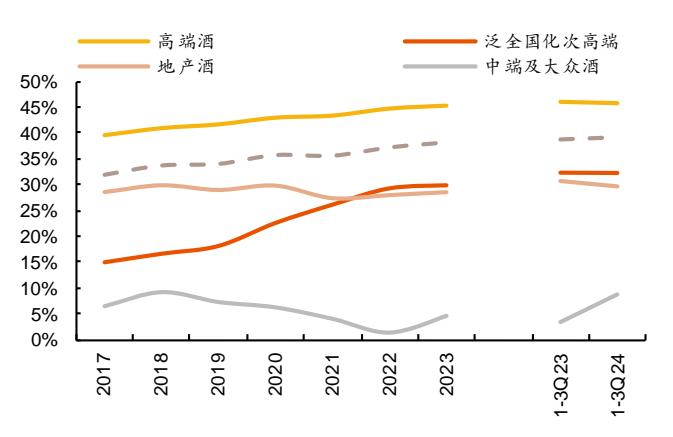  
资料来源：Wind，平安证券研究所

图表18 白酒归母净利率同比变化情况（pct）

<table><tr><td>分类</td><td>公司名称</td><td>2018</td><td>2019</td><td>2020</td><td>2021</td><td>2022</td><td>2023</td><td>1Q23</td><td>2Q23</td><td>3Q23</td><td>4Q23</td><td>1Q24</td><td>2Q24</td><td>3Q24</td></tr><tr><td rowspan="3">高端酒</td><td>贵州茅台</td><td>1.3</td><td>0.4</td><td>1.0</td><td>0.2</td><td>1.1</td><td>0.1</td><td>0.3</td><td>-0.3</td><td>0.7</td><td>-0.4</td><td>-1.1</td><td>-0.5</td><td>-0.9</td></tr><tr><td>五粮液</td><td>1.4</td><td>1.3</td><td>0.1</td><td>0.5</td><td>0.8</td><td>0.2</td><td>1.0</td><td>0.0</td><td>0.4</td><td>-1.3</td><td>0.0</td><td>0.4</td><td>-0.0</td></tr><tr><td>泸州老窖</td><td>2.0</td><td>2.7</td><td>6.7</td><td>2.5</td><td>2.7</td><td>2.6</td><td>3.2</td><td>-1.3</td><td>1.5</td><td>4.1</td><td>1.0</td><td>-3.6</td><td>0.9</td></tr><tr><td rowspan="4">泛全国化次高端</td><td>山西汾酒</td><td>-0.0</td><td>0.7</td><td>5.7</td><td>4.6</td><td>4.3</td><td>1.8</td><td>2.8</td><td>3.7</td><td>3.7</td><td>-4.8</td><td>2.8</td><td>-1.8</td><td>-0.3</td></tr><tr><td>舍得酒业</td><td>6.7</td><td>3.7</td><td>2.3</td><td>3.6</td><td>2.8</td><td>-2.8</td><td>0.0</td><td>-3.5</td><td>-1.0</td><td>-7.8</td><td>-2.0</td><td>-19.7</td><td>-15.3</td></tr><tr><td>酒鬼酒</td><td>-1.3</td><td>1.0</td><td>7.1</td><td>-0.8</td><td>-0.3</td><td>-6.5</td><td>0.3</td><td>-2.1</td><td>-17.3</td><td>-3.6</td><td>-16.3</td><td>-11.6</td><td>-42.2</td></tr><tr><td>水井坊</td><td>4.2</td><td>2.8</td><td>1.0</td><td>1.6</td><td>0.1</td><td>-0.4</td><td>-6.9</td><td>5.4</td><td>-0.6</td><td>0.2</td><td>1.3</td><td>0.7</td><td>2.9</td></tr><tr><td rowspan="5">地产酒</td><td>洋河股份</td><td>0.3</td><td>-1.7</td><td>3.5</td><td>-5.8</td><td>1.5</td><td>-0.9</td><td>0.1</td><td>-1.7</td><td>-0.9</td><td>-15.0</td><td>-1.1</td><td>-2.1</td><td>-14.2</td></tr><tr><td>今世缘</td><td>0.5</td><td>-0.9</td><td>0.7</td><td>1.1</td><td>0.1</td><td>-0.7</td><td>-0.5</td><td>-0.4</td><td>-0.3</td><td>-1.9</td><td>-0.2</td><td>-1.4</td><td>-0.8</td></tr><tr><td>古井贡酒</td><td>3.0</td><td>0.6</td><td>-2.1</td><td>-0.7</td><td>1.5</td><td>3.9</td><td>3.0</td><td>3.6</td><td>3.5</td><td>4.9</td><td>1.1</td><td>1.7</td><td>0.0</td></tr><tr><td>口子窖</td><td>5.0</td><td>0.9</td><td>-5.0</td><td>2.5</td><td>-4.2</td><td>-1.3</td><td>-3.3</td><td>-2.2</td><td>1.1</td><td>-0.8</td><td>-0.3</td><td>2.1</td><td>-2.4</td></tr><tr><td>迎驾贡酒</td><td>1.1</td><td>2.3</td><td>3.0</td><td>2.6</td><td>0.8</td><td>3.1</td><td>1.6</td><td>5.7</td><td>4.5</td><td>1.9</td><td>2.7</td><td>2.2</td><td>0.7</td></tr><tr><td rowspan="8">中端及大众酒</td><td>顺鑫农业</td><td>2.4</td><td>-0.7</td><td>-2.7</td><td>-2.0</td><td>-6.5</td><td>3.0</td><td>5.4</td><td>-16.8</td><td>-7.7</td><td>27.1</td><td>3.1</td><td>17.5</td><td>5.7</td></tr><tr><td>金徽酒</td><td>-1.3</td><td>-1.1</td><td>2.6</td><td>-1.0</td><td>-4.2</td><td>-1.0</td><td>-3.0</td><td>2.5</td><td>3.1</td><td>-4.1</td><td>0.2</td><td>-0.6</td><td>3.0</td></tr><tr><td>伊力特</td><td>1.7</td><td>-0.7</td><td>-0.4</td><td>-2.8</td><td>-5.9</td><td>5.0</td><td>2.7</td><td>1.9</td><td>5.9</td><td>10.7</td><td>-0.9</td><td>2.0</td><td>0.9</td></tr><tr><td>老白干酒</td><td>3.3</td><td>0.3</td><td>-1.3</td><td>1.0</td><td>5.5</td><td>-2.5</td><td>-19.1</td><td>0.7</td><td>0.5</td><td>3.0</td><td>1.8</td><td>3.2</td><td>3.1</td></tr><tr><td>金种子酒</td><td>7.1</td><td>-30.1</td><td>29.1</td><td>-20.4</td><td>-2.0</td><td>14.3</td><td>-5.9</td><td>17.6</td><td>38.8</td><td>17.1</td><td>13.7</td><td>-3.6</td><td>-80.4</td></tr><tr><td>天佑德酒</td><td>15.1</td><td>-5.1</td><td>-17.9</td><td>21.1</td><td>1.7</td><td>-0.3</td><td>-6.5</td><td>13.2</td><td>3.2</td><td>6.9</td><td>1.1</td><td>-19.7</td><td>-13.1</td></tr><tr><td>岩石股份</td><td>-8.6</td><td>9.6</td><td>-1.1</td><td>-0.0</td><td>-6.9</td><td>1.9</td><td>3.5</td><td>-4.8</td><td>9.3</td><td>-8.6</td><td>-26.0</td><td>-75.2</td><td>-8.4</td></tr><tr><td>皇台酒业</td><td>-125.9</td><td>443.6</td><td>-35.9</td><td>-47.8</td><td>20.3</td><td>-15.1</td><td>1.7</td><td>-2.2</td><td>-0.9</td><td>-56.2</td><td>-4.0</td><td>-18.2</td><td>54.2</td></tr><tr><td colspan="15"></td></tr><tr><td>高端酒</td><td></td><td>1.3</td><td>0.7</td><td>1.2</td><td>0.4</td><td>1.3</td><td>0.5</td><td>1.0</td><td>0.3</td><td>0.7</td><td>0.1</td><td>-0.3</td><td>-0.5</td><td>-0.1</td></tr><tr><td>泛全国化次高端</td><td></td><td>1.7</td><td>1.5</td><td>4.4</td><td>3.5</td><td>3.2</td><td>0.6</td><td>2.4</td><td>2.8</td><td>1.6</td><td>-4.7</td><td>2.1</td><td>-3.9</td><td>-0.5</td></tr><tr><td>地产酒</td><td></td><td>1.4</td><td>-0.9</td><td>0.9</td><td>-2.5</td><td>0.6</td><td>0.6</td><td>0.4</td><td>0.4</td><td>0.7</td><td>-0.6</td><td>-0.5</td><td>-0.1</td><td>-5.0</td></tr><tr><td>中端及大众酒</td><td></td><td>2.7</td><td>-1.9</td><td>-1.0</td><td>-2.2</td><td>-2.7</td><td>3.2</td><td>0.3</td><td>-5.1</td><td>-0.7</td><td>18.9</td><td>3.1</td><td>9.6</td><td>3.1</td></tr><tr><td>白酒整体</td><td></td><td>1.8</td><td>0.3</td><td>1.7</td><td>-0.1</td><td>1.6</td><td>1.0</td><td>1.2</td><td>0.6</td><td>0.8</td><td>1.2</td><td>0.3</td><td>0.3</td><td>0.4</td></tr></table>

资料来源：Wind，平安证券研究所

## 三、 25 年展望：渐进复苏，回归理性

## 3.1 复盘 2018-19 年：估值先行，基本面随后复苏，报表改善滞后

贸易战叠加动销疲软，2018年白酒估值快速回落。2018年，在中美贸易摩擦、金融结构性去杠杆等因素的影响下，国内经济面临下行压力，据国家统计局，2018年GDP 同比增长6.6%，为2000-2018年最低增速。2018年8月开始，白酒出现库存增加、批价回落、动销不畅的情况，10月秋糖渠道反馈比较消极，茅台3季报业绩低预期，股价进一步回落。2018年10月底，高端酒/次高端/地产名酒/白酒整体 （ ）分别为19/21/16/1 ，较年初分别回落 0%/ 0%/ %/ %。

刺激政策出台，估值快速修复。2018 年末以来，国家货币与信用转宽，债券、信贷、股权“三支箭”助力民营企业融资，受政策转向提振，白酒估值快速修复，2019年4月底高端酒/次高端/地产名酒/白酒整体PE（TTM）分别为31/33/23/32X，较 2019 年初分别+43%/+37%/+35%/+69%，白酒指数估值 1 月/2 月/3 月/4 月涨幅分别为+14%/+13%/+20%/+9%，5 月后震荡为主。基本面偏弱的背景下，受政策刺激，估值率先完成修复。

图表19 2018-19 白酒 PE 估值（TTM）  
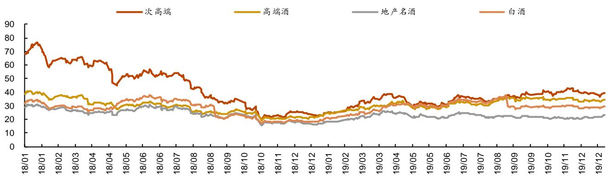  
资料来源：Wind，平安证券研究所

刺激政策落地，基本面复苏，白酒批价回暖。2019 年随着支持性政策落地，民营企业经营向好，白酒需求随之回暖，基本面持续上行，以茅台、五粮液为代表的白酒企业批价不断攀升。与此同时，五粮液在 年年初推出全新第八代五粮液产品（出厂价由原来 元提升至 元），原有第七代产品全部停货，在产品更新换代下五粮液批价快速提升，从 年1月的810元提升至2019年9月的970元，经销利润也是近五年的新高。飞天茅台的一批价也从2019年1月的1800元攀升至 2019 年 8 月 2550 元。

图表20 飞天茅台批价及渠道利润（元）  
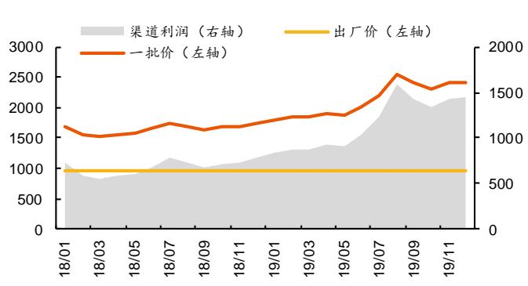  
资料来源：今日酒价，国酒财经，平安证券研究所

图表21 普五批价及渠道利润（元）  
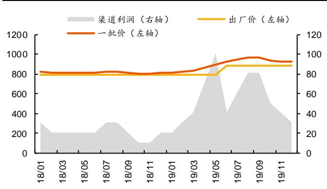  
资料来源：今日酒价，国酒财经，平安证券研究所

加速去库存，业绩改善滞后。2018年白酒动销转弱，经销商及渠道库存明显增加，2019年需求回暖，但酒企以去库存、维护渠道健康为主，收入与利润增速实际较2018年回落：

1）2019 年白酒板块收入同比+17%，其中高端酒/泛全国化次高端/地产名酒/大众酒收入同比分别+19%/+26%/+6%/+16%；2018年白酒板块收入同比+26%，其中高端酒/泛全国化次高端/地产名酒/大众酒收入同比分别+28%/+47%/+21%/+9%；

2）2019年白酒板块归母净利同比+18%，其中高端酒/泛全国化次高端/地产名酒/大众酒收入同比分别+21%/+37%/+2%/-8%；2018年白酒板块归母净利同比+33%，其中高端酒/泛全国化次高端/地产名酒/大众酒收入同比分别+32%/+63%/+27%/+55%。

图表22 白酒板块收入增速  
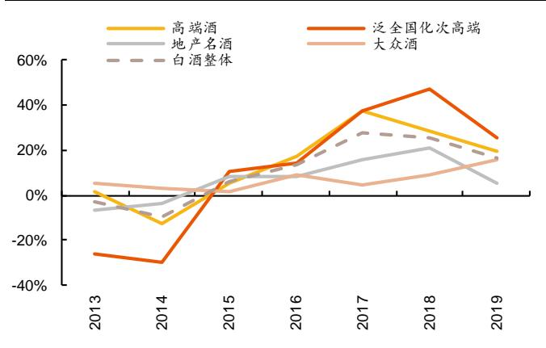  
资料来源：Wind，平安证券研究所

图表23 白酒板块利润增速  
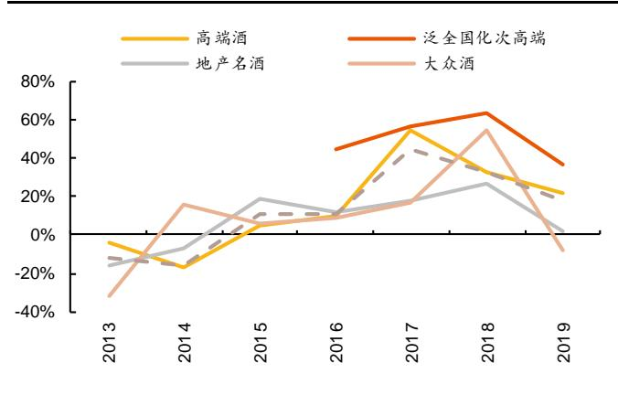  
资料来源：Wind，平安证券研究所

## 3.2 基本面展望：筑底后渐进式修复，场景/价格带/品牌延续分化

宏观消费数据 8-9 月筑底，10 月渐进式回暖。据国家统计局数据，1Q24 社零数据录得开门红后，2Q24 环比转弱，5/6/7月社零同比增速分别为3.7%/2.0%/2.7%，8月增速环比下滑至2.1%，但9月以来持续回暖，9/10月社零同比增长3.2%/4.8%；2024年7/8/9月中国限额以上烟酒类商品零售额同比增速分别为-0.1%/+3.1%/-0.7%，但10月增速环比略回暖至-0.1%。

白酒中秋终端动销承压，国庆环比好转。2024年中秋开启时间较晚，消费者更加理性，产业及资本市场预期较悲观，我们预计白酒动销量同比下滑20%且结构有一定下移；国庆后白酒宴席及大众消费回补，降幅同比有所收窄，若考虑中秋+国庆，双节动销同比降幅收窄至10%。从节奏上看，白酒1Q24动销超预期后，2Q24白酒环比转弱，中秋或为阶段性底部，国庆后虽仍有压力，但下滑幅度收窄，基本与宏观消费数据节奏一致。

图表24 中国:社会消费品零售总额:当月同比  
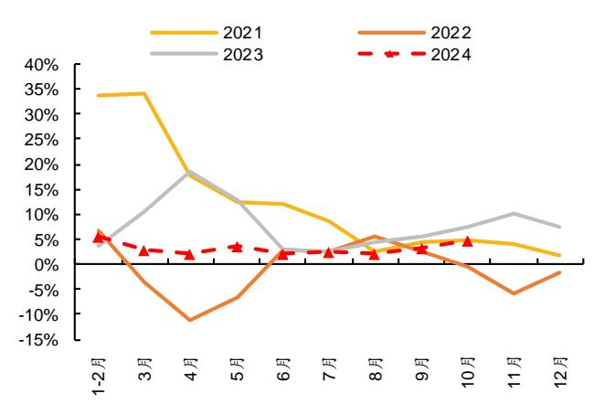  
资料来源：Wind，平安证券研究所

图表25 中国限额以上烟酒类销售当月同比增速  
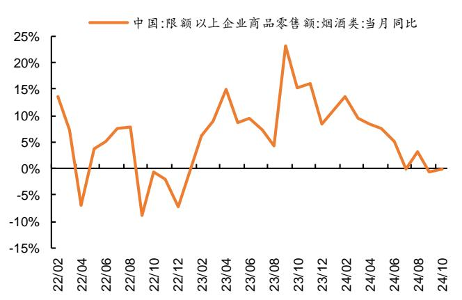  
资料来源：Wind，平安证券研究所

分场景：宴席基数平稳，期待商务回暖。 年白酒消费场景分化较明显，得益于节假日返乡数据稳定增长，走亲访友场景偏刚性，大众流通渠道相对具备韧性； 年婚宴场景集中回补， 年高基数下有所回落，据民政局数据，中国婚姻登记结婚数量为475万，同比下滑17%，宝宝宴、寿宴、升学宴虽然有所增长，但仍然难以弥补婚宴缺口；2024年受宏观环境影响，中小企业信心指数较2019-21年有一定下滑，白酒商务需求仍然磨底。展望2025年，我们认为大众流通渠道依然有望维持韧性；受地区习俗影响，部分宴席有望推迟至 25 年补办，宴席场景或迎来修复；商务需求与经济活动相关性较高，期待后续回暖。

图表26 中国婚姻登记结婚数量

<table><tr><td></td><td>2019</td><td>2020</td><td>2021</td><td>2022</td><td>2023</td><td>2024</td></tr><tr><td colspan="7">结婚登记对数(万对)</td></tr><tr><td>1Q</td><td>213</td><td>156</td><td>213</td><td>211</td><td>215</td><td>197</td></tr><tr><td>2Q</td><td>156</td><td>232</td><td>203</td><td>163</td><td>178</td><td>146</td></tr><tr><td>3Q</td><td>232</td><td>202</td><td>172</td><td>171</td><td>176</td><td>132</td></tr><tr><td>4Q</td><td>202</td><td>224</td><td>175</td><td>139</td><td>199</td><td></td></tr><tr><td colspan="7">结婚登记对数同比增速</td></tr><tr><td>1Q</td><td>-7%</td><td>-45%</td><td>37%</td><td>-1%</td><td>2%</td><td>-8%</td></tr><tr><td>2Q</td><td>-9%</td><td>7%</td><td>-12%</td><td>-20%</td><td>10%</td><td>-18%</td></tr><tr><td>3Q</td><td>-4%</td><td>-6%</td><td>-15%</td><td>0%</td><td>3%</td><td>-25%</td></tr><tr><td>4Q</td><td>-13%</td><td>5%</td><td>-22%</td><td>-21%</td><td>43%</td><td></td></tr></table>

资料来源：民政部，平安证券研究所

图表27 中国中小企业信心指数

<table><tr><td></td><td>2019</td><td>2020</td><td>2021</td><td>2022</td><td>2023</td><td>2024</td></tr><tr><td>1月</td><td>54.9</td><td>55.0</td><td>52.3</td><td>52.1</td><td>49.9</td><td>51.2</td></tr><tr><td>2月</td><td>55.1</td><td>40.5</td><td>51.5</td><td>53.0</td><td>51.4</td><td>50.9</td></tr><tr><td>3月</td><td>57.1</td><td>49.6</td><td>53.6</td><td>53.2</td><td>53.7</td><td>51.6</td></tr><tr><td>4月</td><td>56.8</td><td>50.9</td><td>55.6</td><td>49.4</td><td>53.3</td><td>52.0</td></tr><tr><td>5月</td><td>54.7</td><td>51.7</td><td>54.4</td><td>48.5</td><td>52.7</td><td>51.3</td></tr><tr><td>6月</td><td>54.0</td><td>53.3</td><td>54.4</td><td>51.7</td><td>51.5</td><td>49.9</td></tr><tr><td>7月</td><td>53.8</td><td>53.9</td><td>53.9</td><td>52.2</td><td>50.7</td><td>50.4</td></tr><tr><td>8月</td><td>54.5</td><td>54.1</td><td>53.3</td><td>51.3</td><td>50.8</td><td>49.6</td></tr><tr><td>9月</td><td>53.1</td><td>54.0</td><td>53.4</td><td>50.9</td><td>51.3</td><td>49.7</td></tr><tr><td>10月</td><td>54.5</td><td>52.6</td><td>52.2</td><td>49.9</td><td>51.0</td><td>50.7</td></tr><tr><td>11月</td><td>54.7</td><td>52.9</td><td>52.5</td><td>49.2</td><td>50.9</td><td></td></tr><tr><td>12月</td><td>55.8</td><td>52.7</td><td>53.4</td><td>49.3</td><td>50.4</td><td></td></tr></table>

资料来源：《渣打中国中小企业信心指数》平安证券研究所

分价格：高端稳健，中高端延续增长，次高端取决于经济复苏节奏。 年 元大众价格带相对表现较好，我们认为主要原因包括： ） 元价格带承接了次高端降级需求，以及低端酒升级需求； ）中国不同线级的城市消费分化，一线城市受房价下跌的财富效应、工资收入预期等因素影响，整体消费承压，而三四线城市消费具备韧性，对应的100\~300元大众价格带动销势头良好。展望 年，我们认为消费者仍将注重质价比， 元价格带的稳定增长有望延续，次高端的恢复取决于经济复苏节奏，高端酒由于高端宴席、礼赠偏刚性仍将具备韧性。

分品牌：马太效应明显，集中度进一步提升。弱周期下，经销商回笼资金意愿较强，倾向于打款和销售流速更快的头部品牌，马太效应更加明显。地产酒凭借强大的渠道网络依然维持韧性，茅台、五粮液、剑南春等全国性名酒需求刚性，而过往依靠招商和利润驱动的次高端品牌或仍然承压。

图表28 社会零售总额累计增速对比  
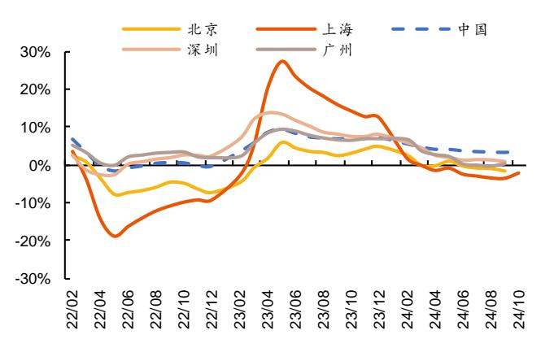  
资料来源：国家统计局，平安证券研究所

图表29 餐饮及规模以上餐饮当月收入增速对比  
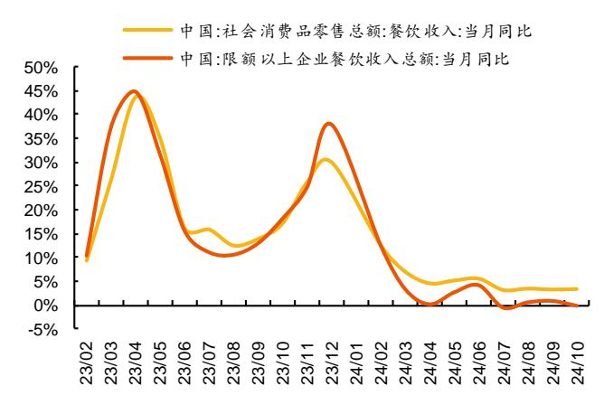  
资料来源：国家统计局，平安证券研究所

## 3.3 业绩展望：淡化目标与业绩，加大股东回馈

终端备货谨慎，经销商库存压力较大。一方面白酒整体消费较弱、流速减慢，价盘预期不稳，另一方面经销商库存较高、市场货源充足，去年以来，终端备货意愿下降，呈现按需采购的特征。受厂家任务量需求+终端备货意愿较低影响，渠道调研经销商库存普遍同比有所增加。整体来看，团购资源较好的渠道商仍能实现不错表现，而主流通的渠道商则面临压力。

淡化目标与业绩，去库存、促动销。展望 年，面临宏观消费压力与经销商较高的库存，我们预计酒厂将淡化回款与业绩增长目标，而更加注重实际的动销与库存去化，目标长期健康发展。资本市场对此也有预期，普遍下调了白酒公司2024-26年的业绩增速，短期对于弱报表的容忍度增加。

图表30 白酒公司普遍下调业绩预期（亿元）

<table><tr><td colspan="13">业绩前一致预期(24/9/30)</td></tr><tr><td></td><td></td><td colspan="4">归母净利</td><td colspan="4">PE</td><td colspan="3">净利增速</td></tr><tr><td>代码</td><td>公司名称</td><td>2023</td><td>2024E</td><td>2025E</td><td>2026E</td><td>2023</td><td>2024E</td><td>2025E</td><td>2026E</td><td>2024E</td><td>2025E</td><td>2026E</td></tr><tr><td>600519.SH</td><td>贵州茅台</td><td>747</td><td>869</td><td>993</td><td>1,125</td><td>25</td><td>22</td><td>19</td><td>17</td><td>16%</td><td>14%</td><td>13%</td></tr><tr><td>000858.SZ</td><td>五粮液</td><td>302</td><td>338</td><td>377</td><td>420</td><td>19</td><td>17</td><td>15</td><td>13</td><td>12%</td><td>12%</td><td>11%</td></tr><tr><td>000568.SZ</td><td>泸州老窖</td><td>132</td><td>153</td><td>175</td><td>201</td><td>15</td><td>13</td><td>11</td><td>10</td><td>15%</td><td>15%</td><td>15%</td></tr><tr><td>002304.SZ</td><td>洋河股份</td><td>100</td><td>103</td><td>109</td><td>117</td><td>13</td><td>12</td><td>12</td><td>11</td><td>3%</td><td>6%</td><td>8%</td></tr><tr><td>600809.SH</td><td>山西汾酒</td><td>104</td><td>129</td><td>154</td><td>181</td><td>23</td><td>19</td><td>16</td><td>13</td><td>23%</td><td>19%</td><td>18%</td></tr><tr><td>000596.SZ</td><td>古井贡酒</td><td>46</td><td>59</td><td>72</td><td>87</td><td>19</td><td>15</td><td>12</td><td>10</td><td>28%</td><td>23%</td><td>20%</td></tr><tr><td>603369.SH</td><td>今世缘</td><td>31</td><td>38</td><td>46</td><td>55</td><td>19</td><td>16</td><td>13</td><td>11</td><td>21%</td><td>21%</td><td>19%</td></tr><tr><td>603198.SH</td><td>迎驾贡酒</td><td>23</td><td>29</td><td>36</td><td>43</td><td>21</td><td>17</td><td>13</td><td>11</td><td>27%</td><td>23%</td><td>20%</td></tr><tr><td>600702.SH</td><td>舍得酒业</td><td>18</td><td>14</td><td>15</td><td>18</td><td>14</td><td>18</td><td>16</td><td>14</td><td>-21%</td><td>10%</td><td>15%</td></tr><tr><td>603589.SH</td><td>口子窖</td><td>17</td><td>19</td><td>22</td><td>24</td><td>14</td><td>12</td><td>11</td><td>10</td><td>13%</td><td>12%</td><td>11%</td></tr><tr><td>600779.SH</td><td>水井坊</td><td>13</td><td>14</td><td>16</td><td>18</td><td>22</td><td>20</td><td>18</td><td>16</td><td>10%</td><td>12%</td><td>14%</td></tr><tr><td>000799.SZ</td><td>酒鬼酒</td><td>5</td><td>4</td><td>4</td><td>5</td><td>35</td><td>52</td><td>44</td><td>38</td><td>-32%</td><td>17%</td><td>16%</td></tr><tr><td>600559.SH</td><td>老白干酒</td><td>7</td><td>9</td><td>11</td><td>13</td><td>29</td><td>22</td><td>18</td><td>15</td><td>31%</td><td>25%</td><td>21%</td></tr><tr><td>603919.SH</td><td>金徽酒</td><td>3</td><td>4</td><td>5</td><td>6</td><td>32</td><td>26</td><td>21</td><td>18</td><td>22%</td><td>22%</td><td>21%</td></tr><tr><td>600197.SH</td><td>伊力特</td><td>3</td><td>4</td><td>5</td><td>5</td><td>25</td><td>21</td><td>18</td><td>16</td><td>15%</td><td>18%</td><td>17%</td></tr><tr><td colspan="13">业绩后一致预期(24/12/6)</td></tr><tr><td>代码</td><td>公司名称</td><td>2023</td><td>2024E</td><td>2025E</td><td>2026E</td><td>2023</td><td>2024E</td><td>2025E</td><td>2026E</td><td>2024E</td><td>2025E</td><td>2026E</td></tr><tr><td>600519.SH</td><td>贵州茅台</td><td>747</td><td>861</td><td>963</td><td>1,072</td><td>25</td><td>22</td><td>20</td><td>18</td><td>15%</td><td>12%</td><td>11%</td></tr><tr><td>000858.SZ</td><td>五粮液</td><td>302</td><td>330</td><td>361</td><td>396</td><td>19</td><td>17</td><td>16</td><td>14</td><td>9%</td><td>9%</td><td>10%</td></tr><tr><td>000568.SZ</td><td>泸州老窖</td><td>132</td><td>143</td><td>157</td><td>175</td><td>15</td><td>14</td><td>13</td><td>11</td><td>8%</td><td>9%</td><td>11%</td></tr><tr><td>002304.SZ</td><td>洋河股份</td><td>100</td><td>88</td><td>87</td><td>93</td><td>13</td><td>15</td><td>15</td><td>14</td><td>-13%</td><td>0%</td><td>6%</td></tr><tr><td>600809.SH</td><td>山西汾酒</td><td>104</td><td>125</td><td>144</td><td>165</td><td>23</td><td>19</td><td>17</td><td>15</td><td>20%</td><td>15%</td><td>15%</td></tr><tr><td>000596.SZ</td><td>古井贡酒</td><td>46</td><td>57</td><td>66</td><td>77</td><td>19</td><td>15</td><td>13</td><td>11</td><td>24%</td><td>17%</td><td>16%</td></tr><tr><td>603369.SH</td><td>今世缘</td><td>31</td><td>37</td><td>42</td><td>48</td><td>19</td><td>16</td><td>14</td><td>12</td><td>17%</td><td>14%</td><td>14%</td></tr><tr><td>603198.SH</td><td>迎驾贡酒</td><td>23</td><td>27</td><td>32</td><td>38</td><td>21</td><td>17</td><td>15</td><td>13</td><td>20%</td><td>17%</td><td>17%</td></tr><tr><td>600702.SH</td><td>舍得酒业</td><td>18</td><td>10</td><td>11</td><td>12</td><td>14</td><td>25</td><td>23</td><td>20</td><td>-45%</td><td>8%</td><td>14%</td></tr><tr><td>603589.SH</td><td>口子窖</td><td>17</td><td>17</td><td>19</td><td>20</td><td>14</td><td>14</td><td>13</td><td>12</td><td>1%</td><td>8%</td><td>8%</td></tr><tr><td>600779.SH</td><td>水井坊</td><td>13</td><td>14</td><td>15</td><td>16</td><td>22</td><td>20</td><td>19</td><td>17</td><td>9%</td><td>9%</td><td>10%</td></tr><tr><td>000799.SZ</td><td>酒鬼酒</td><td>5</td><td>2</td><td>2</td><td>3</td><td>35</td><td>99</td><td>79</td><td>64</td><td>-65%</td><td>25%</td><td>22%</td></tr><tr><td>600559.SH</td><td>老白干酒</td><td>7</td><td>9</td><td>10</td><td>12</td><td>29</td><td>23</td><td>19</td><td>16</td><td>28%</td><td>21%</td><td>18%</td></tr><tr><td>603919.SH</td><td>金徽酒</td><td>3</td><td>4</td><td>5</td><td>6</td><td>32</td><td>26</td><td>22</td><td>18</td><td>22%</td><td>20%</td><td>20%</td></tr><tr><td>600197.SH</td><td>伊力特</td><td>3</td><td>4</td><td>4</td><td>5</td><td>25</td><td>23</td><td>20</td><td>17</td><td>7%</td><td>15%</td><td>16%</td></tr><tr><td colspan="13">变动(%, pct)</td></tr><tr><td>代码</td><td>公司名称</td><td>2023</td><td>2024E</td><td>2025E</td><td>2026E</td><td>2023</td><td>2024E</td><td>2025E</td><td>2026E</td><td>2024E</td><td>2025E</td><td>2026E</td></tr><tr><td>600519.SH</td><td>贵州茅台</td><td></td><td>-1%</td><td>-3%</td><td>-5%</td><td></td><td></td><td></td><td></td><td>-1.1</td><td>-2.4</td><td>-2.1</td></tr><tr><td>000858.SZ</td><td>五粮液</td><td></td><td>-2%</td><td>-4%</td><td>-6%</td><td></td><td></td><td></td><td></td><td>-2.4</td><td>-2.5</td><td>-1.7</td></tr><tr><td>000568.SZ</td><td>泸州老窖</td><td></td><td>-6%</td><td>-11%</td><td>-13%</td><td></td><td></td><td></td><td></td><td>-6.8</td><td>-5.8</td><td>-3.4</td></tr><tr><td>002304.SZ</td><td>洋河股份</td><td></td><td>-15%</td><td>-20%</td><td>-21%</td><td></td><td></td><td></td><td></td><td>-15.2</td><td>-6.3</td><td>-1.4</td></tr><tr><td>600809.SH</td><td>山西汾酒</td><td></td><td>-3%</td><td>-6%</td><td>-9%</td><td></td><td></td><td></td><td></td><td>-3.7</td><td>-4.3</td><td>-3.1</td></tr><tr><td>000596.SZ</td><td>古井贡酒</td><td></td><td>-3%</td><td>-8%</td><td>-11%</td><td></td><td></td><td></td><td></td><td>-4.1</td><td>-5.8</td><td>-4.6</td></tr><tr><td>603369.SH</td><td>今世缘</td><td></td><td>-4%</td><td>-9%</td><td>-12%</td><td></td><td></td><td></td><td></td><td>-4.4</td><td>-6.4</td><td>-4.6</td></tr><tr><td>603198.SH</td><td>迎驾贡酒</td><td></td><td>-6%</td><td>-10%</td><td>-13%</td><td></td><td></td><td></td><td></td><td>-7.0</td><td>-5.8</td><td>-3.6</td></tr><tr><td>600702.SH</td><td>舍得酒业</td><td></td><td>-30%</td><td>-31%</td><td>-32%</td><td></td><td></td><td></td><td></td><td>-23.9</td><td>-1.7</td><td>-0.7</td></tr><tr><td>603589.SH</td><td>口子窖</td><td></td><td>-11%</td><td>-14%</td><td>-17%</td><td></td><td></td><td></td><td></td><td>-12.1</td><td>-4.6</td><td>-2.9</td></tr><tr><td>600779.SH</td><td>水井坊</td><td></td><td>-1%</td><td>-4%</td><td>-7%</td><td></td><td></td><td></td><td></td><td>-1.2</td><td>-3.8</td><td>-3.5</td></tr><tr><td>000799.SZ</td><td>酒鬼酒</td><td></td><td>-48%</td><td>-44%</td><td>-41%</td><td></td><td></td><td></td><td></td><td>-32.2</td><td>8.6</td><td>6.4</td></tr><tr><td>600559.SH</td><td>老白干酒</td><td></td><td>-2%</td><td>-5%</td><td>-7%</td><td></td><td></td><td></td><td></td><td>-2.9</td><td>-3.5</td><td>-2.8</td></tr><tr><td>603919.SH</td><td>金徽酒</td><td></td><td>0%</td><td>-2%</td><td>-3%</td><td></td><td></td><td></td><td></td><td>-0.3</td><td>-1.9</td><td>-1.7</td></tr><tr><td>600197.SH</td><td>伊力特</td><td></td><td>-7%</td><td>-9%</td><td>-10%</td><td></td><td></td><td></td><td></td><td>-7.5</td><td>-2.8</td><td>-1.1</td></tr></table>

资料来源：Wind一致预期，平安证券研究所

酒企持续提高分红，加大股东回馈。各大酒厂相继提高分红比例，加大投资者回馈：1）洋河股份：2024 年度-2026 年度，公司每年度的现金分红总额不低于当年实现归属于上市公司股东净利润的70%且不低于人民币70亿元（含税）（以2024年分红70亿计算股息率：5.4%）；2）贵州茅台:2024－2026年度，公司每年度分配的现金红利总额不低于当年实现归属于上市公司股东的净利润的 75%，每年度的现金分红分两次（年度和中期分红）实施（以 2024 年一致预期分红 75%分红计算股息率：3.4%）；3）五粮液：2024-2026 年度，公司每年度现金分红总额占当年归母净利润的比例不低于 70%，且不低于200亿元（含税）(以2024年一致预期分红70%分红计算股息率：4.1%)。

图表31 白酒板块分红比例（包含特殊分红）

<table><tr><td></td><td>2015</td><td>2016</td><td>2017</td><td>2018</td><td>2019</td><td>2020</td><td>2021</td><td>2022</td><td>2023</td></tr><tr><td>泸州老窖</td><td>76%</td><td>70%</td><td>72%</td><td>65%</td><td>50%</td><td>50%</td><td>60%</td><td>60%</td><td>60%</td></tr><tr><td>五粮液</td><td>49%</td><td>50%</td><td>52%</td><td>49%</td><td>49%</td><td>50%</td><td>50%</td><td>55%</td><td>60%</td></tr><tr><td>洋河股份</td><td>51%</td><td>54%</td><td>58%</td><td>59%</td><td>61%</td><td>60%</td><td>60%</td><td>60%</td><td>70%</td></tr><tr><td>古井贡酒</td><td>7%</td><td>36%</td><td>44%</td><td>45%</td><td>36%</td><td>41%</td><td>51%</td><td>50%</td><td>52%</td></tr><tr><td>贵州茅台</td><td>50%</td><td>51%</td><td>51%</td><td>52%</td><td>52%</td><td>52%</td><td>52%</td><td>96%</td><td>84%</td></tr><tr><td>金徽酒</td><td>0%</td><td>30%</td><td>35%</td><td>34%</td><td>35%</td><td>37%</td><td>34%</td><td>54%</td><td>60%</td></tr><tr><td>迎驾贡酒</td><td>75%</td><td>70%</td><td>84%</td><td>72%</td><td>60%</td><td>59%</td><td>52%</td><td>52%</td><td>45%</td></tr><tr><td>水井坊</td><td>42%</td><td>100%</td><td>90%</td><td>96%</td><td>86%</td><td>80%</td><td>30%</td><td>30%</td><td>35%</td></tr><tr><td>口子窖</td><td>35%</td><td>34%</td><td>40%</td><td>59%</td><td>52%</td><td>56%</td><td>52%</td><td>58%</td><td>52%</td></tr><tr><td>山西汾酒</td><td>53%</td><td>79%</td><td>55%</td><td>45%</td><td>40%</td><td>6%</td><td>41%</td><td>50%</td><td>51%</td></tr><tr><td>老白干酒</td><td>70%</td><td>59%</td><td>58%</td><td>39%</td><td>33%</td><td>43%</td><td>35%</td><td>39%</td><td>62%</td></tr><tr><td>伊力特</td><td>63%</td><td>40%</td><td>31%</td><td>36%</td><td>43%</td><td>56%</td><td>62%</td><td>117%</td><td>54%</td></tr><tr><td>今世缘</td><td>30%</td><td>32%</td><td>35%</td><td>36%</td><td>35%</td><td>36%</td><td>36%</td><td>36%</td><td>40%</td></tr><tr><td>舍得酒业</td><td>47%</td><td>30%</td><td>10%</td><td>10%</td><td>0%</td><td>26%</td><td>21%</td><td>30%</td><td>40%</td></tr><tr><td>金种子酒</td><td>32%</td><td>0%</td><td>68%</td><td>10%</td><td>0%</td><td>0%</td><td>0%</td><td>0%</td><td>0%</td></tr><tr><td>酒鬼酒</td><td>0%</td><td>33%</td><td>28%</td><td>22%</td><td>22%</td><td>46%</td><td>47%</td><td>40%</td><td>59%</td></tr></table>

资料来源：Wind，平安证券研究所

## 四、 投资建议

关注库存去化及动销拐点。虽然 2025 年白酒业绩整体降速，但一方面市场容忍度较高，更加关注实际动销与批价稳定性，另一方面白酒格局稳定，马太效应明显，龙头仍有红利，与此同时，高端酒股息率亦形成支撑。后续建议关注两条主线：1）业绩确定强，库存良性，能够享受集中度提升的标的，推荐贵州茅台、五粮液、山西汾酒、古井贡酒、迎驾贡酒、今世缘；2）虽短期承压，但向上弹性充足，更加受益于政策与基本面反转的标的：推荐泸州老窖、舍得酒业，关注水井坊、酒鬼酒。

图表32 白酒公司估值表

<table><tr><td rowspan="2">股票代码</td><td rowspan="2">股票简称</td><td>12月12日</td><td colspan="3">EPS(元)</td><td colspan="3">PE(倍)</td><td rowspan="2">评级</td></tr><tr><td>收盘价(元)</td><td>2024E</td><td>2025E</td><td>2026E</td><td>2024E</td><td>2025E</td><td>2026E</td></tr><tr><td>600519.SH</td><td>贵州茅台</td><td>1565.80</td><td>68.43</td><td>75.03</td><td>81.24</td><td>22.9</td><td>20.9</td><td>19.3</td><td>推荐</td></tr><tr><td>000858.SZ</td><td>五粮液</td><td>151.82</td><td>8.42</td><td>8.96</td><td>9.46</td><td>18.0</td><td>17.0</td><td>16.0</td><td>推荐</td></tr><tr><td>600809.SH</td><td>山西汾酒</td><td>209.98</td><td>10.21</td><td>11.64</td><td>13.11</td><td>20.6</td><td>18.0</td><td>16.0</td><td>推荐</td></tr><tr><td>000568.SZ</td><td>泸州老窖</td><td>144.91</td><td>9.75</td><td>10.29</td><td>10.81</td><td>14.9</td><td>14.1</td><td>13.4</td><td>推荐</td></tr><tr><td>002304.SZ</td><td>洋河股份</td><td>86.95</td><td>5.44</td><td>5.55</td><td>5.83</td><td>16.0</td><td>15.7</td><td>14.9</td><td>推荐</td></tr><tr><td>000596.SZ</td><td>古井贡酒</td><td>205.22</td><td>10.63</td><td>12.23</td><td>13.85</td><td>19.3</td><td>16.8</td><td>14.8</td><td>推荐</td></tr><tr><td>603369.SH</td><td>今世缘</td><td>50.85</td><td>2.90</td><td>3.25</td><td>3.58</td><td>17.5</td><td>15.7</td><td>14.2</td><td>推荐</td></tr><tr><td>603198.SH</td><td>迎驾贡酒</td><td>65.20</td><td>3.36</td><td>3.97</td><td>4.65</td><td>19.4</td><td>16.4</td><td>14.0</td><td>推荐</td></tr><tr><td>600702.SH</td><td>舍得酒业</td><td>78.47</td><td>2.80</td><td>2.95</td><td>3.26</td><td>28.0</td><td>26.6</td><td>24.1</td><td>推荐</td></tr><tr><td>603919.SH</td><td>金徽酒</td><td>21.67</td><td>0.79</td><td>0.93</td><td>1.10</td><td>27.4</td><td>23.2</td><td>19.6</td><td>推荐</td></tr><tr><td>600559.SH</td><td>老白干酒</td><td>23.40</td><td>0.95</td><td>1.15</td><td>1.36</td><td>24.7</td><td>20.4</td><td>17.2</td><td>推荐</td></tr><tr><td>600197.SH</td><td>伊力特</td><td>19.20</td><td>0.75</td><td>0.84</td><td>0.94</td><td>25.6</td><td>22.9</td><td>20.5</td><td>推荐</td></tr></table>

资料来源：Wind，平安证券研究所预测

## 五、 风险提示

1）宏观经济波动影响：白酒受宏观经济影响较大，如果宏观经济下行对行业需求有较大影响；

2）消费刺激政策不及预期：白酒估值受政策影响较大，若消费刺激政策不及预期，会导致短期估值回落；

3）消费复苏不及预期：宏观经济增速放缓下，国民收入和就业都受到一定影响，短期内居民消费能力及意愿复苏可能不及预期，从而影响白酒板块复苏；

4）行业竞争加剧：竞争格局恶化会一定程度扰乱影响白酒行业定价，对行业造成不良影响；

5）食品安全问题：食品安全是行业发展的红线，一旦出现食品安全问题，对行业将产生巨大的负面影响，行业恢复或将需要较长时间。

## 平安证券研究所投资评级：

## 股票投资评级:

强烈推荐 （预计6个月内，股价表现强于市场表现 20%以上）

推 荐 （预计6个月内，股价表现强于市场表现 10%至20%之间）

中 性 （预计6个月内，股价表现相对市场表现在±10%之间）

避 （预计6个月内，股价表现弱于市场表现 10%以上）

## 行业投资评级:

强于大市 （预计6个月内，行业指数表现强于市场表现5%以上）

中 性 （预计6个月内，行业指数表现相对市场表现在±5%之间）

弱于大市 （预计6个月内，行业指数表现弱于市场表现5%以上）

## 公司声明及风险提示：

负责撰写此报告的分析师（一人或多人）就本研究报告确认：本人具有中国证券业协会授予的证券投资咨询执业资格。

平安证券股份有限公司具备证券投资咨询业务资格。 本公司研究报告是针对与公司签署服务协议的签约客户的专属研究产品，为该类客户进行投资决策时提供辅助和参考，双方对权利与义务均有严格约定。本公司研究报告仅提供给上述特定客户，并不面向公众发布。未经书面授权刊载或者转发的，本公司将采取维权措施追究其侵权责任。

证券市场是一个风险无时不在的市场。您在进行证券交易时存在赢利的可能，也存在亏损的风险。请您务必对此有清醒的认识，认真考虑是否进行证券交易。

市场有风险，投资需谨慎。

## 免责条款：

此报告旨为发给平安证券股份有限公司（以下简称“平安证券”）的特定客户及其他专业人士。未经平安证券事先书面明文批准，不得更改或以任何方式传送、复印或派发此报告的材料、内容及其复印本予任何其他人。

此报告所载资料的来源及观点的出处皆被平安证券认为可靠，但平安证券不能担保其准确性或完整性，报告中的信息或所表达观点不构成所述证券买卖的出价或询价，报告内容仅供参考。平安证券不对因使用此报告的材料 而引致的损失而负上任何责任，除非法律法规有明确规定。客户并不能仅依靠此报告而取代行使独立判断。

平安证券可发出其它与本报告所载资料不一致及有不同结论的报告。本报告及该等报告反映编写分析员的不同设想、见解及分析方法。报告所载资料、意见及推测仅反映分析员于发出此报告日期当日的判断，可随时更改。此报告所指的证券价格、价值及收入 可跌可升。为免生疑问，此报告所载观点并不代表平安证券的立场。

平安证券在法律许可的情况下可能参与此报告所提及的发行商的投资银行业务或投资其发行的证券。

平安证券股份有限公司2024版权所有。保留一切权利。

平安证券研究所  
电话：4008866338

<table><tr><td>深圳</td><td>上海</td><td>北京</td></tr><tr><td>深圳市福田区益田路 5023 号平安金融中心 B 座 25 层</td><td>上海市陆家嘴环路 1333 号平安金融大厦 26 楼</td><td>北京市丰台区金泽西路 4 号院 1 号楼丽泽平安金融中心 B 座 25 层</td></tr></table>