# 食品饮料行业 2025 年度策略报告（二）

# 白酒：积极因素增加，曙光渐现

## 核心观点

回顾2024年：复苏放缓，估值承压。2024年宏观经济复苏节奏缓慢，居民和企业采购更加理性，白酒需求总量少于2023年，尤其是宴席和礼赠场景降频明显。酒企基于年初增长目标约束，市场投放节奏调整快于需求，白酒行业供需阶段性失衡，渠道出现库存上升和价格下跌，而电商渠道低质、低价现象频发，扰乱价格体系；多重因素造成飞天茅台酒价格年内几次急跌，放大了市场悲观情绪。年初至今（2024/12/11）申万白酒指数下跌6.6%，其中24年预测净利润增速下降7.2%，预测PE上涨2.2%，跑输沪深300指数24pcts。

展望2025年：积极因素增加，曙光渐现。展望2025年，虽然需求复苏节奏仍有不确定性，但当前白酒板块 PE(TTM)处于 2019/2014 年以来 5.1%/23.1%分位数，处于历史较低水位，估值对业绩降速的预期消费较为充分，也不必过度悲观，建议多关注长期和积极因素：

 行业或将进入供需均衡阶段，茅五价格具备企稳基础。一方面，在内需政策刺激及“双春”等日历效应的共振下，行业需求或将出现向上拐点；另一方面，需求仍在磨底，多数酒厂增长工具减少，为保护战略性单品和长期发展质量，2025年降速共识将进一步强化，供给端出现改善。

 贵州茅台增长目标环比降低，积极解决供需适配问题。公司增强消费需求培育，其中国内市场加强对新需求、新场景、新人群的触达和转化，国际市场从“产品出口”到“品牌出海”，我们预计2025年将会初见成效。

 行业竞争仍然激烈，酒企或聚焦提品质、增费用，优质产能将获取更多市场份额。酒企产能仍在逐步释放，需求压力下，提升产品品质和增加费用投入仍是酒企保存量的一致性竞争焦点。供给端驱动下，我们预计2025年多数酒企开始局部600元价位，该价格带或将成为加速扩容。

投资策略：行业景气度仍需关注飞天茅台批价，我们自下而上梳理出三条投资主线：1）品牌基因深厚、当前渠道风险较小、能够穿越本轮周期的稳健标的，如贵州茅台、五粮液、山西汾酒等。2）顺周期属性较强，伴随渠道库存加速去化、需求磨底回暖，EPS修复空间较大的弹性标的。3）短期积极调整组织、渠道、产品的改革预期标的，如口子窖等。对标海外奢侈品及烈酒龙头公司，高端白酒有能力保持业绩正增长、分红率指引积极，当前估值安全垫高。

风险提示：1）经济增速持续放缓，商务需求承压；2）消费税税收政策调整；3）食品安全问题等。

重点公司盈利预测及投资评级

<table><tr><td rowspan="2">公司代码</td><td rowspan="2">公司名称</td><td rowspan="2">投资评级</td><td rowspan="2">收盘价(元)</td><td rowspan="2">总市值(亿元)</td><td colspan="2">归母净利润</td><td colspan="2">PE</td></tr><tr><td>2024E</td><td>2025E</td><td>2024E</td><td>2025E</td></tr><tr><td>600519.SH</td><td>贵州茅台</td><td>买入</td><td>1,546.6</td><td>19,428</td><td>852.0</td><td>928.6</td><td>22.8</td><td>20.9</td></tr><tr><td>000858.SZ</td><td>五粮液</td><td>买入</td><td>149.1</td><td>5,787</td><td>326.6</td><td>349.4</td><td>17.7</td><td>16.6</td></tr><tr><td>000568.SZ</td><td>泸州老窖</td><td>买入</td><td>141.7</td><td>2,086</td><td>138.8</td><td>143.0</td><td>15.0</td><td>14.6</td></tr><tr><td>600809.SH</td><td>山西汾酒</td><td>买入</td><td>205.0</td><td>2,501</td><td>122.1</td><td>134.3</td><td>20.5</td><td>18.6</td></tr><tr><td>600702.SH</td><td>舍得酒业</td><td>买入</td><td>75.7</td><td>252</td><td>10.7</td><td>10.7</td><td>23.6</td><td>23.6</td></tr><tr><td>000799.SZ</td><td>酒鬼酒</td><td>买入</td><td>59.1</td><td>192</td><td>2.9</td><td>2.9</td><td>66.2</td><td>66.2</td></tr><tr><td>002304.SZ</td><td>洋河股份</td><td>买入</td><td>85.6</td><td>1,290</td><td>85.2</td><td>76.7</td><td>15.1</td><td>16.8</td></tr><tr><td>000596.SZ</td><td>古井贡酒</td><td>买入</td><td>192.5</td><td>913</td><td>56.0</td><td>63.3</td><td>16.3</td><td>14.4</td></tr><tr><td>603198.SH</td><td>迎驾贡酒</td><td>买入</td><td>61.5</td><td>492</td><td>27.0</td><td>30.6</td><td>18.2</td><td>16.1</td></tr><tr><td>603369.SH</td><td>今世缘</td><td>买入</td><td>49.7</td><td>623</td><td>35.5</td><td>39.8</td><td>17.5</td><td>15.7</td></tr><tr><td>603589.SH</td><td>口子窖</td><td>买入</td><td>40.6</td><td>243</td><td>17.1</td><td>18.3</td><td>14.2</td><td>13.3</td></tr></table>

资料来源：Wind、国信证券经济研究所预测

## 行业研究·行业投资策略

食品饮料·白酒Ⅱ

优于大市·维持

证券分析师：张向伟 联系人：张未艾 021-61761031 zhangxiangwei@guosen.com.cn zhangweiai@guosen.com.cn S0980523090001

## 市场走势

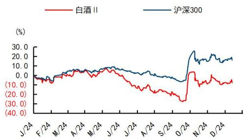  
资料来源：Wind、国信证券经济研究所整理

## 相关研究报告

《白酒板块事件点评报告-积极性政策持续加码，板块底部信号增多》 ——2024-09-29

《食品饮料周报（24年第 20 周）-白酒淡季聚焦市场秩序管控，啤酒短期催化因素增多》 ——2024-05-27

《2024年春节白酒动销总结： 消费倾向随人口返乡而提高，氛围好于节前跟踪》 ——2024-02-19

《食品饮料2024 年度策略报告（二）-白酒：需求扰动因素减少，在复苏中分化》 ——2024-01-02

《白酒行业专题研究1-长坡厚雪好赛道，底部静待价值回归》——2023-10-23

## 内容目录

前言 5  
1、回顾2024年：多场景需求承压，降速成为行业共识 6  
1.1 白酒行业增速放缓，板块跑输沪深300 6  
1.2 厂商分歧加大，渠道主动降库存，降速共识正在形成 7  
1.3 机构持仓处于历史低位，茅台、五粮液合计重仓比例提升 10  
2、展望2025年：供需两端改善，曙光渐现 11  
2.1 研判一：供需两端改善，2025年春节旺季动销或好于悲观预期 11  
2.2 研判二：贵州茅台降速后，或率先实现供需平衡，行业进入新稳态 12  
2.3 研判三：酒企、渠道商均向头部集中，厂商相互强化 15  
2.4 研判四：名酒产能仍在逐步释放，优质供给将持续获取更多份额 17  
2.5 研判五：同质化竞争下，销售费用率或延续高位 20  
2.6 研判六：600元价位或加速成熟，成为白酒行业新“战场” 21  
3、2025年投资主线及推荐标的 24  
投资主线1：基本面表现稳健、品牌基因深厚的贵州茅台、五粮液、山西汾酒 24  
投资主线2：顺周期属性较强、EPS修复弹性大的泸州老窖及次高端龙头 27  
投资主线3：加速经营管理调整的改革预期标的，关注口子窖等 27  
可比公司估值及海外公司估值 28  
风险提示 31

## 图表目录

图1：2024年白酒指数波动下行，整体跑输沪深300. 6  
图2：2024年茅台、五粮液价格压力进一步凸显. 8  
图3：2023Q3以来板块销售费用率同比持续增加. 8  
图4：2024年全年白酒动销前高后低，消费需求进一步向春节集中. 8  
图5：2024年主流白酒公司单品分季度收入增速示意图. 8  
图6：100-300元价位产品的批价较为稳定. 9  
图7：2024年1-9月我国各省累计GDP同比增速. 9  
图8：白酒板块基金重仓比例变化. 10  
图9：白酒板块（剔除茅台）基金重仓比例变化. 10  
图10：2024年主流白酒公司单品分季度收入增速示意图. 10  
图11：2024年10月M2-M1剪刀差环比收窄. 12  
图12：10月国内消费增速环比抬升. 12  
图13：2024年箱装飞天茅台批价表现. 12  
图14：民间需求尚未出现明显拐点，复苏仍需时间. 13  
图15：飞天茅台各场景需求占比及影响因素. 13  
图16：城镇居民月度可支配收入与飞天茅台批价之比. 13  
图17：贵州茅台对贵州省GDP贡献较大. 14  
图18：年初至今贵州政府再融资债发行规模位于全国前列. 14  
图19：本轮茅台批价演绎路径推测. 14  
图20：经销商拥抱电商本质是供需矛盾转移的结果. 16  
图21：2000-2023年白酒品牌CR10从 $23\%$ 提升至 $55\%$ ，2016年后集中度提升趋势加快. 16  
图22：2023年流通企业白酒销售体量占比. 17  
图23：2023年主要酒企国内经销商平均体量及数量. 17  
图24：2001年从量消费税出台后白酒行业产能出清. 17  
图25：白酒行业消费税占比在2001年显著提升. 17  
图26：预计主要公司产量占行业比例超过 $40\%$ . 18  
图27：2021年上市公司成品酒库存明显增加. 18  
图28：白酒消费者更加重视商品品质. 19  
图29：长期白酒产品质价比提升趋势确定. 19  
图30：茅台部分产品勾调所使用基酒酒龄. 19  
图31：白酒上市公司单季度销售费用率同比增减. 20  
图32：各公司促销费用情况. 20  
图33：白酒上市公司单季度归母净利率同比增减. 21  
图34：2023年500-800元价位收入增速放缓，主要酒企提前布局产品. 21  
图35：2019-2023年500-800元高线次高端价位竞争格局演变. 22  
图36：白酒行业将社会财富内化为产品价格的能力较强. 22  
图37：千元价位酱酒大单品批价跌至800元以下（元）. 23

图38：500-800元价位主流大单品批价（元） 23  
图39：主流白酒公司分价位带产品布局情况，部分酒企600-800元价位带占比较小 23  
图40：历史分板块和价位带股价涨跌情况 24  
图41：贵州茅台渠道结构多元、完善，有利于产品精准化投放 25  
图42：五粮液分产品收入占比情况 26  
图43：2024E千元价位带竞争格局 26  
图44：玻汾、青花20价格有所下降，终端动销较好 26  
图45：汾酒产品结构纵深，全国化扩张有空间 26  
图46：老窖产品结构纵深、营销模式精细化 27  
图47：2023年公司分地区收入结构，西南、华北优势突出 27  
图48：合肥地区200元价位带市场格局演变 28  
图49：口子窖合肥地区营销模式更精细化 28  
图50：白酒上市公司2019年以来PE(TTM)分位数 28  
图51：白酒上市公司2014年以来PE(TTM)分位数 28

表1：2024Q1-3白酒上市公司基本面及股价变动情况....6  
表2：2024年初至今板块股价 $-6.6\%$ ，其中EPS(FY24) $-7.2\%$ ，PE(FY24) $+2.2\%$ ...7  
表3：主要上市公司历年收入目标完成情况及2025年目标展望....11  
表4：白酒头部上市公司产能情况梳理....18  
表5：2024年部分品牌对产品焕新升级....19  
表6：酒企2025年费用投入指引积极，重视渠道反哺、消费者教育、品牌建设....20  
表7：可比公司估值表....29  
表8：海外奢侈品龙头公司财务指标及估值....29  
表9：海外烈酒龙头公司财务指标及估值....30

## 前言

过去几年白酒行业需求因经济活跃度下降而承压，而供给受制于内外部刚性因素、仍在扩张。渠道动销放缓和利润下降后，部分经销商寻找新的增长点，流量思维下，积极拥抱新渠道，如电商、即时零售等，产品乱价、低质现象频发，又进一步放大了行业供需矛盾。目前白酒行业处于惯性调整阶段，长期问题和短期问题交织，酒企竞争进入战略相持阶段。于投资而言，估值已反映大部分悲观情绪，自下而上关注回款、动销、批价等短期问题，已无太大意义；我们建议要关注行业长期问题的解题能力，如短期速度和长期发展质量的平衡、重要的人事变化、组织架构调整等，这也是板块估值修复核心指标。

展望 2025 年，行业复苏不会一帆风顺，但也不必过度悲观，我们预计白酒板块将会出现一些积极的变化：（1）行业将进入供需均衡阶段，茅五价格具备企稳基础，一方面在宏观内需政策刺激及“双春”等日历效应的共振下，行业需求或将出现向上拐点；另一方面，过去几年白酒需求持续承压，多数酒厂增长工具减少，为保护战略性单品和长期发展质量，2025年降速共识将进一步强化，供给端出现改善。（2）贵州茅台主动担当，积极解决供需适配问题，放缓增速要求，增强消费需求培育，其中国内市场加强对新需求、新场景、新人群的触达和转化，海外市场从“产品出口”到“品牌出海”，我们预计 2025年将会初见成效。（3）行业竞争仍然激烈，提品质和增费用预计是酒企保存量的一致性竞争焦点：与1998-2004 年类似，劣质产能将加速出清，2025 年品质升级将成为酒企的共识，也是头部品牌收割市场份额的重要抓手；考虑到增长压力，预计酒企或继续增投费用保市场份额；供给端驱动下，我们预计 2025 年多数酒企开始局部 600元价位，该价格带或将加速扩容。

## 本篇报告主要回答以下三个问题：

 白酒行业处于什么发展阶段？2O24 年 5 月份以来白酒板块持续跑输大盘，从产业发展看，目前白酒行业处于什么阶段？行业面临最大的问题是什么？又孕育着哪些机会？

 增长速度VS质量？2024年第三季度白酒板块表观收入增长速度降至本轮行业（2016年开始）最低水平，多家酒企释放降速预期，追求高质量发展，如何看待降速后的白酒板块？

 板块投资机会判断？哪些公司具有投资价值？在需求稀缺、增速放缓的阶段，哪些公司能跑赢板块？我们如何看待未来白酒行业的成长性？

## 1、回顾 2024 年：多场景需求承压，降速成为行业共识

## 1.1 白酒行业增速放缓，板块跑输沪深 300

2024年多场景需求承压，白酒板块跑输沪深 300。2024年宏观经济复苏节奏弱于我们年初预期（见 2024 年年度策略），居民和企业采购行为更加理性，白酒需求总量少于 2023 年，尤其是宴席和礼赠场景降频明显，而茅台酒价格的下跌放大了渠道和投资人悲观情绪。年初至今（2024/12/11）申万白酒指数下跌 6.6%，其中预测 2024 年归母净利润增速下降 7.2%，预测 PE(FY24)上升 2.2%，跑输沪深300 指数 24.0pcts。

从节奏上看，板块股价经历季度波动，9 月底以来有所修复。2024Q1春节动销稳健过渡，渠道及市场信心增加，板块股价上涨；4 月以来宏观指标及消费数据走弱，白酒动销呈现“淡季更淡”的特点，飞天茅台批价经历 2 次快速下跌，Q2 估值承压明显；Q3 股价进一步下探，主因 1）中报反应需求压力逐步传导至品牌侧，2）中秋国庆双节动销同比下降较多；9 月 24日以来积极性政策相继出台，股价在市场情绪修复和三季报降速中震荡上行。

 从结构上看，基本面及估值表现延续分化趋势，强品牌力龙头展现穿越周期的韧性。贵州茅台、五粮液基本面韧性凸显，报表反应经营质量延续稳健；区域龙头酒企的股价超额源于成长性，伴随增速下修预期，估值和持仓均回调较多，但山西汾酒、古井贡酒、今世缘等前三季度仍实现高于板块整体的收入和净利润增速；次高端酒企在需求压力下业绩承压明显，估值端自 2023 年以来持续下修，9月底以来随政策预期升温，股价展现较大的修复弹性。

图1：2024年白酒指数波动下行，整体跑输沪深 300

<table><tr><td>2024</td><td>1月</td><td>2月</td><td>3月</td><td>4月</td><td>5月</td><td>6月</td><td>7月</td><td>8月</td><td>9月</td><td>10月</td><td>11月</td><td>12月</td></tr><tr><td>涨跌</td><td>-10.30%</td><td>+9.02%</td><td>+0.90%</td><td>+1.20%</td><td>-2.70%</td><td>-15.00%</td><td>-2.70%</td><td>-6.94%</td><td>+31.75%</td><td>-9.80%</td><td>+8.49%</td><td></td></tr><tr><td>30%因-10%-20%-30%-40%</td><td>·市场对宏观经济增速更加悲观·白酒春节渠道备货慢于预期·五粮液增加3%费用·五粮液、汾酒产品等批价下跌</td><td>·春节旅游、返乡数据好于预期·春节反馈超预期·主流酒企批价回升</td><td>·淡季多家酒企(今世缘、汾酒、舍得、剑南春、郎酒等)释放提价信号·3月成都捕酒会在低预期下平稳渡过,主流产品批价回升</td><td>·3月CPI/PPI同比分别+0.1%/-2.8%;清明消费数据表现较好·酒企陆续发布2023年及24Q1财报,整体收入/净利润仍保持双位数增长</td><td>·4月CPI/PPI同比分别+3.0%/-2.5%,5月PMI回落至49.5%。·白酒淡季消费需求走弱,酒企动销压力较大·酒企股东大会密集召开</td><td>·5月份M1同比下滑·渠道反馈消费品6月份仍然延续下滑·端午节比较淡,大型宴席下滑30%,商务下滑20%左右·茅台批价持续下跌</td><td>·6月制造业PMI为49.5%仍处于荣枯线以下·白酒市场悲观预期充分释放(消费税预期逐步消化、茅台批价企稳)·月底政治局会议指出提振消费</td><td>·8月份制造业PMI49.1%CPI 0.6%低预期·八月份天气炎热,不利白酒销售。</td><td>·中秋节消费氛围较弱,白酒行业量价均有一定压力。·茅台上市以来首次实施注销式回购·月末积极性政策相继出台,货币政策力度加强。</td><td>·9月制造业PMI为49.8%·国庆节后白酒消费需求进一步走弱,利赠、商务场景下滑明显·估值消化三季报降速预期</td><td>·10月制造业PMI重回50%以上,市场情绪有所修复·双十一后茅台批价持续下跌;酒企以去库和春节备货为主</td><td>沪深300白酒指数</td></tr></table>

资料来源：Wind，国信证券经济研究所整理；注：数据截至2024/12/11

表1：2024Q1-3白酒上市公司基本面及股价变动情况

<table><tr><td rowspan="2">公司</td><td colspan="4">2024Q1</td><td colspan="4">2024Q2</td><td colspan="4">2024Q3</td></tr><tr><td>收入同比</td><td>归母净利润同比</td><td>区间涨跌幅</td><td>区间PE(ttm)变化</td><td>收入同比</td><td>归母净利润同比</td><td>区间涨跌幅</td><td>区间PE(ttm)变化</td><td>收入同比</td><td>归母净利润同比</td><td>区间涨跌幅</td><td>区间PE(ttm)变化</td></tr><tr><td>贵州茅台</td><td>18.0%</td><td>15.7%</td><td>5.4%</td><td>-1.3%</td><td>17.0%</td><td>16.1%</td><td>-7.1%</td><td>-21.4%</td><td>15.6%</td><td>13.2%</td><td>6.4%</td><td>15.5%</td></tr><tr><td>五粮液</td><td>11.9%</td><td>12.0%</td><td>40.4%</td><td>9.4%</td><td>10.1%</td><td>11.5%</td><td>-17.0%</td><td>-22.3%</td><td>1.4%</td><td>1.3%</td><td>-4.6%</td><td>24.9%</td></tr><tr><td>泸州老窖</td><td>20.7%</td><td>23.2%</td><td>42.0%</td><td>2.9%</td><td>10.5%</td><td>2.2%</td><td>-17.7%</td><td>-29.9%</td><td>0.7%</td><td>2.6%</td><td>3.4%</td><td>3.8%</td></tr><tr><td>全国化高端</td><td>15.8%</td><td>15.2%</td><td>15.1%</td><td>-0.7%</td><td>14.2%</td><td>13.2%</td><td>-10.5%</td><td>-22.0%</td><td>9.6%</td><td>9.2%</td><td>3.8%</td><td>16.7%</td></tr><tr><td>山西汾酒</td><td>20.9%</td><td>30.0%</td><td>18.1%</td><td>6.2%</td><td>17.1%</td><td>10.2%</td><td>-32.1%</td><td>-24.5%</td><td>11.4%</td><td>10.4%</td><td>29.4%</td><td>2.1%</td></tr><tr><td>水井坊</td><td>9.4%</td><td>16.8%</td><td>28.2%</td><td>-18.5%</td><td>16.6%</td><td>29.6%</td><td>-21.7%</td><td>-28.3%</td><td>0.4%</td><td>7.7%</td><td>2.3%</td><td>20.9%</td></tr><tr><td>舍得酒业</td><td>4.2%</td><td>-3.4%</td><td>103.7%</td><td>-20.1%</td><td>-22.7%</td><td>-88.4%</td><td>-37.1%</td><td>-25.5%</td><td>-30.7%</td><td>-79.2%</td><td>0.8%</td><td>28.3%</td></tr><tr><td>酒鬼酒</td><td>-48.8%</td><td>-75.6%</td><td>76.8%</td><td>-22.6%</td><td>-13.3%</td><td>-60.9%</td><td>-30.3%</td><td>34.1%</td><td>-67.2%</td><td>-213.7%</td><td>-2.2%</td><td>53.2%</td></tr><tr><td>全国化次高端</td><td>14.2%</td><td>20.9%</td><td>30.2%</td><td>-5.7%</td><td>8.5%</td><td>-7.0%</td><td>-31.8%</td><td>-22.5%</td><td>-0.4%</td><td>-2.0%</td><td>20.5%</td><td>11.2%</td></tr><tr><td>洋河股份</td><td>8.0%</td><td>5.0%</td><td>50.6%</td><td>-11.1%</td><td>-3.0%</td><td>-9.7%</td><td>-20.6%</td><td>-15.7%</td><td>-44.8%</td><td>-73.0%</td><td>-1.5%</td><td>25.3%</td></tr><tr><td>古井贡酒</td><td>25.9%</td><td>31.6%</td><td>27.1%</td><td>11.7%</td><td>16.8%</td><td>24.6%</td><td>-16.4%</td><td>-30.8%</td><td>13.4%</td><td>13.6%</td><td>9.9%</td><td>-9.1%</td></tr><tr><td>今世缘</td><td>22.8%</td><td>22.1%</td><td>33.0%</td><td>20.3%</td><td>21.5%</td><td>16.9%</td><td>-18.6%</td><td>-29.5%</td><td>10.1%</td><td>6.6%</td><td>11.1%</td><td>7.3%</td></tr><tr><td>迎驾贡酒</td><td>21.3%</td><td>30.4%</td><td>0.5%</td><td>-1.3%</td><td>19.0%</td><td>28.0%</td><td>-4.2%</td><td>-24.2%</td><td>4.0%</td><td>6.2%</td><td>15.3%</td><td>21.9%</td></tr><tr><td>口子窖</td><td>11.1%</td><td>10.0%</td><td>55.4%</td><td>-10.8%</td><td>5.9%</td><td>15.1%</td><td>-29.9%</td><td>-7.2%</td><td>-22.0%</td><td>-27.7%</td><td>4.9%</td><td>19.2%</td></tr><tr><td>区域性次高端</td><td>15.1%</td><td>13.5%</td><td>35.5%</td><td>-5.8%</td><td>8.4%</td><td>7.9%</td><td>-18.4%</td><td>-19.3%</td><td>-17.0%</td><td>-32.3%</td><td>5.6%</td><td>15.1%</td></tr><tr><td>老白干酒</td><td>12.7%</td><td>33.0%</td><td>64.3%</td><td>-18.6%</td><td>9.0%</td><td>46.7%</td><td>-33.9%</td><td>-16.2%</td><td>0.3%</td><td>25.2%</td><td>-5.3%</td><td>18.6%</td></tr><tr><td>伊力特</td><td>12.4%</td><td>7.1%</td><td>25.0%</td><td>-2.3%</td><td>3.6%</td><td>38.9%</td><td>0.0%</td><td>-39.1%</td><td>-23.3%</td><td>-17.8%</td><td>-15.1%</td><td>4.0%</td></tr><tr><td>金种子酒</td><td>-3.0%</td><td>转正</td><td>49.8%</td><td>负值</td><td>-26.2%</td><td>-295.6%</td><td>-14.5%</td><td>亏损</td><td>-54.4%</td><td>-3843.2%</td><td>-0.9%</td><td>亏损</td></tr><tr><td>金徽酒</td><td>20.4%</td><td>21.6%</td><td>10.9%</td><td>-16.5%</td><td>7.7%</td><td>1.9%</td><td>-14.0%</td><td>-18.6%</td><td>15.8%</td><td>108.8%</td><td>20.9%</td><td>20.5%</td></tr><tr><td>区域性中低端</td><td>12.6%</td><td>36.4%</td><td>41.9%</td><td>-14.4%</td><td>3.3%</td><td>25.6%</td><td>-20.4%</td><td>-28.4%</td><td>-6.4%</td><td>-19.1%</td><td>-1.3%</td><td>17.1%</td></tr><tr><td>总计</td><td>15.4%</td><td>15.7%</td><td>19.2%</td><td>-2.6%</td><td>12.1%</td><td>10.8%</td><td>-13.9%</td><td>-21.4%</td><td>2.4%</td><td>1.8%</td><td>5.3%</td><td>15.8%</td></tr></table>

资料来源：公司公告，国信证券经济研究所整理

表2：2024 年初至今板块股价-6.6%，其中 EPS(FY24)-7.2%，PE(FY24）+2.2%

<table><tr><td>公司简称</td><td>年初预测净利润 (2024,亿元)</td><td>年初PE(FY24)</td><td>年末预测净利润 (2024,亿元)</td><td>年末PE(FY24)</td><td>盈利预测 调整幅度</td><td>估值变化</td><td>年初至今 股价涨跌幅</td><td>年末PE(FY25)</td></tr><tr><td>贵州茅台</td><td>879.8</td><td>24.6</td><td>860.9</td><td>22.4</td><td>-2.1%</td><td>-9.1%</td><td>-9.2%</td><td>20.0</td></tr><tr><td>五粮液</td><td>343.3</td><td>15.9</td><td>330.5</td><td>17.5</td><td>-3.7%</td><td>10.6%</td><td>10.4%</td><td>16.1</td></tr><tr><td>泸州老窖</td><td>162.7</td><td>16.2</td><td>143.5</td><td>14.5</td><td>-11.8%</td><td>-10.7%</td><td>-17.6%</td><td>13.3</td></tr><tr><td>山西汾酒</td><td>130.6</td><td>21.5</td><td>124.8</td><td>20.0</td><td>-4.5%</td><td>-7.1%</td><td>-9.2%</td><td>17.4</td></tr><tr><td>水井坊</td><td>15.2</td><td>18.9</td><td>13.8</td><td>20.8</td><td>-9.1%</td><td>10.0%</td><td>2.7%</td><td>19.2</td></tr><tr><td>舍得酒业</td><td>22.3</td><td>14.5</td><td>9.8</td><td>26.1</td><td>-55.9%</td><td>80.5%</td><td>-18.2%</td><td>24.1</td></tr><tr><td>酒鬼酒</td><td>9.3</td><td>25.4</td><td>1.9</td><td>100.3</td><td>-79.3%</td><td>294.3%</td><td>-16.3%</td><td>80.0</td></tr><tr><td>洋河股份</td><td>124.8</td><td>13.3</td><td>87.6</td><td>14.8</td><td>-29.8%</td><td>11.3%</td><td>-17.5%</td><td>14.8</td></tr><tr><td>古井贡酒</td><td>57.1</td><td>21.6</td><td>56.7</td><td>18.2</td><td>-0.7%</td><td>-15.6%</td><td>-14.5%</td><td>15.5</td></tr><tr><td>今世缘</td><td>39.1</td><td>15.6</td><td>36.5</td><td>17.3</td><td>-6.6%</td><td>10.6%</td><td>5.4%</td><td>15.2</td></tr><tr><td>迎驾贡酒</td><td>28.2</td><td>18.8</td><td>27.4</td><td>18.7</td><td>-2.9%</td><td>-0.3%</td><td>-1.3%</td><td>16.0</td></tr><tr><td>口子窖</td><td>21.2</td><td>12.8</td><td>17.4</td><td>14.2</td><td>-18.0%</td><td>11.0%</td><td>-5.4%</td><td>13.2</td></tr><tr><td>老白干酒</td><td>8.5</td><td>24.3</td><td>8.5</td><td>24.2</td><td>0.1%</td><td>-0.4%</td><td>2.1%</td><td>19.9</td></tr><tr><td>伊力特</td><td>4.4</td><td>23.6</td><td>3.6</td><td>24.1</td><td>-16.2%</td><td>2.0%</td><td>-12.5%</td><td>20.8</td></tr><tr><td>金徽酒</td><td>5.0</td><td>25.2</td><td>4.0</td><td>26.7</td><td>-19.3%</td><td>6.0%</td><td>-12.9%</td><td>22.2</td></tr><tr><td>白酒板块</td><td>1,865.0</td><td>19.7</td><td>1730.2</td><td>20.2</td><td>-7.2%</td><td>2.2%</td><td>-6.6%</td><td>18.1</td></tr></table>

资料来源：Wind，国信证券经济研究所整理；注：数据截至2024/12/11，预测净利润采用Wind一致预期

## 1.2 厂商分歧加大，渠道主动降库存，降速共识正在形成

整体看，行业供需矛盾有所加剧，“以价换量”特征进一步凸显。库存层面，2023年中秋节以来白酒需求“退频降次”的压力进一步传导至渠道侧，而上市公司增长目标具有刚性，库存同环比垒高，渠道蓄水池累积了一定风险，行业供需矛盾有所加剧。价格层面，高端酒飞天茅台、第八代五粮液价格表现延续压力，区域酒大单品批价也有不同程度下滑，渠道利润进一步收缩；品牌力较弱的次高端单品出现“无动销量支撑下的价格平稳”现象。费用层面，2024Q2 以来酒企加快主动去库存步伐，除了延续在消费者端加大费投力度促进动销外，同步加强渠道侧的补贴以保证经销商合理利润，板块单季度销售费用率同比持续增加，行业“以价换量”特征进一步凸显。

图2：2024年茅台、五粮液价格压力进一步凸显  
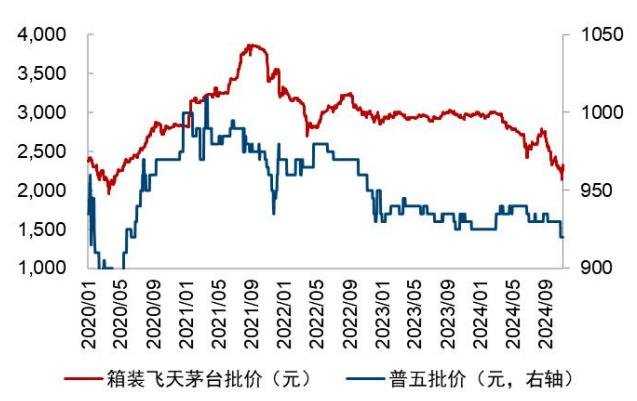  
资料来源：今日酒价、百荣酒价，国信证券经济研究所整理

图3：2023Q3以来板块销售费用率同比持续增加  
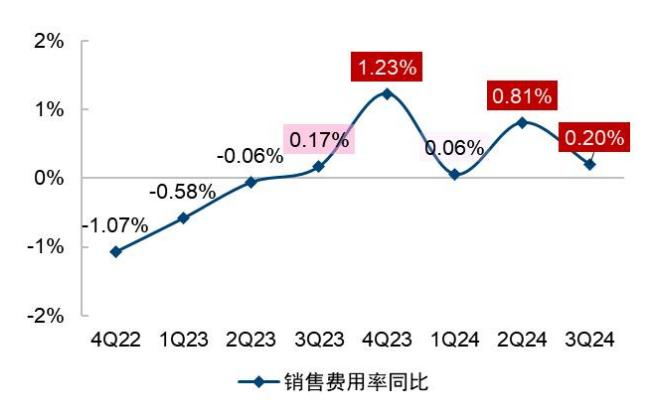  
资料来源：公司公告，国信证券经济研究所整理

 从消费氛围看，动销呈现“脉冲式”，需求进一步向春节集中。作为常态化社交的首个正常化春节，返乡人口多于往年，2024年春节白酒动销“低预期、低实现”，动销总量预计同比持平，头部大单品实现增长，主要公司回款进度符合经营节奏。进入 Q2 淡季，需求较快下滑，商务场景复苏缓慢、宴席场景高基数下回落；而消费氛围在中秋&国庆双节并未出现明显好转，礼赠及商务用酒需求进一步下降，大众宴席降频降级现象增加，整体动销预计双位数下滑。在消费需求逐步向春节集中的过程中，我们预计 2024Q4 酒企仍将放缓增长要求，聚焦市场秩序维护，蓄力 2025 年春节动销窗口。

图4：2024年全年白酒动销前高后低，消费需求进一步向春节集中  
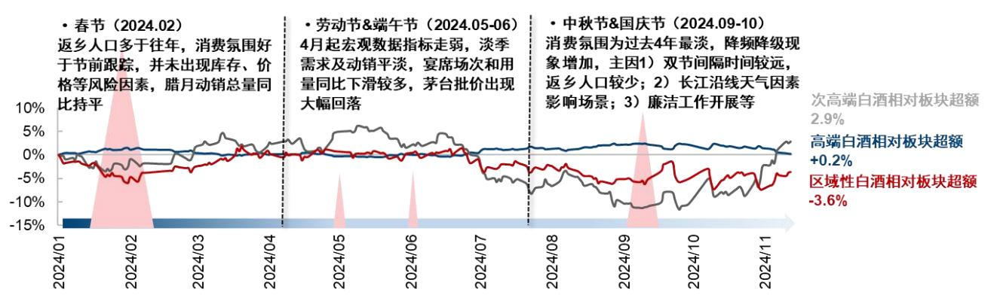  
资料来源：Wind，国信证券经济研究所整理；注：数据截至2023/11/13

从品牌及产品表现看，缩量竞争中强品牌、强渠道的单品实现挤压式增长。不同于 2023年宴席消费量仍有回补红利，2024年受制于宏观经济增速的放缓和监管环境趋严的影响，消费者用酒行为理性、对性价比诉求进一步提升，各消费场景均出现降频与降级共存的现象，致终端和渠道对周转和利润诉求进一步提升。1）强品牌议价力的单品实现对竞品挤压明显，如茅台 1935、五粮液 1618、玻汾等受益于主品品牌辐射，放量效果较好，对同价位其他产品动销产生明显压制；2）高渠道利润率的单品终端推力仍然较高，如水井坊·臻酿 8 号、口子窖·兼 8等市场反馈较好，产品动销温和，酒企能够保持相对良性的渠道库存水平。

图5：2024年主流白酒公司单品分季度收入增速示意图 从区域分布看，拥有强基地市场的酒企基本面韧性凸显。强基地市场的酒企在缩量竞争背景下业绩调节工具相对充足，通过灵活调整产品结构、精细化运作渠道、加压蓄水池、开展终端活动等方式平滑收入增速，展现出相对较强的业绩抗风险能力。我们认为当基地市场竞争格局、省内收入占比、当地经济增速三者共振时（贡献度依次递减），酒企基本面表现更优，如山西汾酒、古井贡酒、今世缘前三季度动销端相对好于竞对，报表端均兑现稳健增长，其中省内市场贡献较多。

<table><tr><td>公司</td><td>产品</td><td colspan="2">1Q24</td><td colspan="2">2Q24</td><td colspan="2">3Q24</td></tr><tr><td rowspan="2">贵州茅台</td><td>茅台酒</td><td></td><td></td><td></td><td></td><td></td><td></td></tr><tr><td>系列酒</td><td></td><td></td><td></td><td></td><td></td><td></td></tr><tr><td rowspan="3">五粮液</td><td>普五</td><td></td><td></td><td></td><td></td><td></td><td></td></tr><tr><td>五粮液1618</td><td></td><td></td><td></td><td></td><td></td><td></td></tr><tr><td>39度五粮液</td><td></td><td></td><td></td><td></td><td></td><td></td></tr><tr><td rowspan="5">泸州老窖</td><td>高度国窖</td><td></td><td></td><td></td><td></td><td></td><td></td></tr><tr><td>低度国窖</td><td></td><td></td><td></td><td></td><td></td><td></td></tr><tr><td>特曲60版</td><td></td><td></td><td></td><td></td><td></td><td></td></tr><tr><td>特曲老字号</td><td></td><td></td><td></td><td></td><td></td><td></td></tr><tr><td>窖龄酒</td><td></td><td></td><td></td><td></td><td></td><td></td></tr><tr><td rowspan="3">山西汾酒</td><td>青花</td><td></td><td></td><td></td><td></td><td></td><td></td></tr><tr><td>玻汾</td><td></td><td></td><td></td><td></td><td></td><td></td></tr><tr><td>老白汾、巴拿马</td><td></td><td></td><td></td><td></td><td></td><td></td></tr><tr><td rowspan="4">洋河股份</td><td>海之蓝</td><td></td><td></td><td></td><td></td><td></td><td></td></tr><tr><td>天之蓝</td><td></td><td></td><td></td><td></td><td></td><td></td></tr><tr><td>水晶梦</td><td></td><td></td><td></td><td></td><td></td><td></td></tr><tr><td>梦6+</td><td></td><td></td><td></td><td></td><td></td><td></td></tr><tr><td rowspan="4">古井贡酒</td><td>古5</td><td></td><td></td><td></td><td></td><td></td><td></td></tr><tr><td>古8</td><td></td><td></td><td></td><td></td><td></td><td></td></tr><tr><td>古16</td><td></td><td></td><td></td><td></td><td></td><td></td></tr><tr><td>古20</td><td></td><td></td><td></td><td></td><td></td><td></td></tr><tr><td rowspan="2">迎驾贡酒</td><td>洞6</td><td></td><td></td><td></td><td></td><td></td><td></td></tr><tr><td>洞9</td><td></td><td></td><td></td><td></td><td></td><td></td></tr><tr><td rowspan="2">舍得酒业</td><td>品味舍得</td><td></td><td></td><td></td><td></td><td></td><td></td></tr><tr><td>舍之道</td><td></td><td></td><td></td><td></td><td></td><td></td></tr><tr><td rowspan="2">今世缘</td><td>今世缘四开</td><td></td><td></td><td></td><td></td><td></td><td></td></tr><tr><td>对开</td><td></td><td></td><td></td><td></td><td></td><td></td></tr></table>

资料来源：Wind，国信证券经济研究所测算

图6：100-300元价位产品的批价较为稳定  
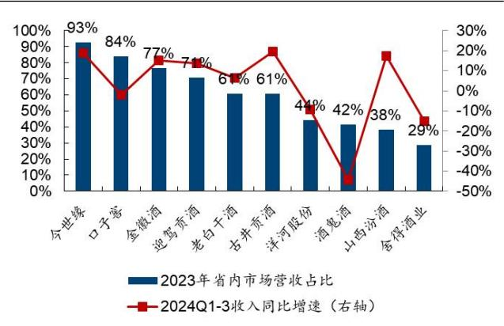

图7：2024年 1-9月我国各省累计 GDP同比增速  
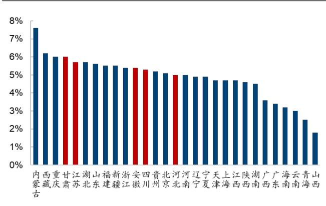

资料来源：公司公告，国信证券经济研究所整理；注：其中酒鬼酒为24H1数据，中报变更分地区收入披露口径

资料来源：Wind，国信证券经济研究所整理

## 1.3 机构持仓处于历史低位，茅台、五粮液合计重仓比例提升

当前白酒板块基金重仓持股比例位于 2018 年以来最低水平。截至 2024Q3，白酒板块基金重仓持股比例环比下降 0.67pcts至 7.89%，超配比例环比下降 0.7pcts至 3.46% 。2024Q3 白酒（剔除茅台）板块基金重仓持股比例环比下降 0.62pcts至 5.17%，超配比例环比下降 0.61pcts 至 3.29%。

图8：白酒板块基金重仓比例变化  
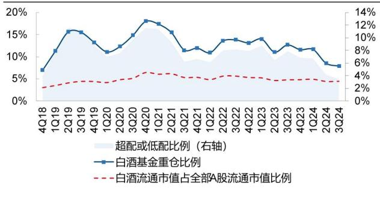  
资料来源：Wind，国信证券经济研究所整理

图9：白酒板块（剔除茅台）基金重仓比例变化  
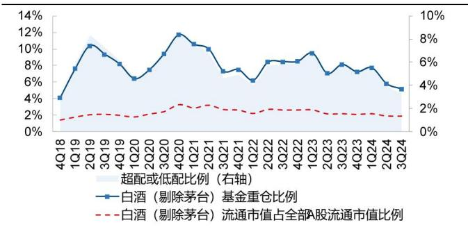  
资料来源：Wind，国信证券经济研究所整理

贵州茅台、五粮液仍有较高持仓，成长性标的卖出较多，反应市场对板块中期增长的担忧。2024Q3五粮液基金重仓比例环比增加 0.18pcts，泸州老窖/山西汾酒/古井贡酒/今世缘重仓持股比例环比均有明显下降。

图10：2024年主流白酒公司单品分季度收入增速示意图

<table><tr><td rowspan="2">排名</td><td rowspan="2">代码</td><td rowspan="2">证券名称</td><td rowspan="2">市值(亿元)</td><td rowspan="2">期间涨跌幅</td><td colspan="3">持有基金数量</td><td colspan="3">重仓持股比例</td></tr><tr><td>2Q24</td><td>3Q24</td><td>环比变化</td><td>2Q24</td><td>3Q24</td><td>环比变化(pct)</td></tr><tr><td>1</td><td>600519.SH</td><td>贵州茅台</td><td>19,582</td><td>19.12%</td><td>481</td><td>486</td><td>5</td><td>2.77%</td><td>2.72%</td><td></td></tr><tr><td>2</td><td>000858.SZ</td><td>五粮液</td><td>5,749</td><td>31.63%</td><td>208</td><td>258</td><td>50</td><td>1.52%</td><td>1.70%</td><td></td></tr><tr><td>3</td><td>000568.SZ</td><td>泸州老窖</td><td>2,011</td><td>9.14%</td><td>191</td><td>111</td><td>-80</td><td>1.48%</td><td>1.03%</td><td></td></tr><tr><td>4</td><td>600809.SH</td><td>山西汾酒</td><td>2,379</td><td>6.10%</td><td>172</td><td>121</td><td>-51</td><td>1.16%</td><td>1.01%</td><td></td></tr><tr><td>5</td><td>000596.SZ</td><td>古井贡酒</td><td>1,021</td><td>-3.81%</td><td>107</td><td>70</td><td>-37</td><td>0.89%</td><td>0.70%</td><td></td></tr><tr><td>6</td><td>002304.SZ</td><td>洋河股份</td><td>1,301</td><td>22.85%</td><td>13</td><td>27</td><td>14</td><td>0.30%</td><td>0.32%</td><td></td></tr><tr><td>7</td><td>603198.SH</td><td>迎驾贡酒</td><td>528</td><td>26.82%</td><td>60</td><td>77</td><td>17</td><td>0.12%</td><td>0.18%</td><td></td></tr><tr><td>8</td><td>603345.SH</td><td>安井食品</td><td>258</td><td>36.12%</td><td>23</td><td>34</td><td>11</td><td>0.10%</td><td>0.17%</td><td></td></tr><tr><td>9</td><td>0168.HK</td><td>青岛啤酒股份</td><td>739</td><td>22.02%</td><td>30</td><td>34</td><td>4</td><td>0.14%</td><td>0.14%</td><td></td></tr><tr><td>10</td><td>605499.SH</td><td>东鹏饮料</td><td>1,154</td><td>25.60%</td><td>39</td><td>51</td><td>12</td><td>0.16%</td><td>0.13%</td><td></td></tr><tr><td>11</td><td>600600.SH</td><td>青岛啤酒</td><td>946</td><td>10.84%</td><td>38</td><td>22</td><td>-16</td><td>0.13%</td><td>0.12%</td><td></td></tr><tr><td>12</td><td>600887.SH</td><td>伊利股份</td><td>1,698</td><td>12.50%</td><td>60</td><td>57</td><td>-3</td><td>0.09%</td><td>0.09%</td><td></td></tr><tr><td>13</td><td>0291.HK</td><td>华润啤酒</td><td>973</td><td>31.77%</td><td>12</td><td>11</td><td>-1</td><td>0.09%</td><td>0.09%</td><td></td></tr><tr><td>14</td><td>603369.SH</td><td>今世缘</td><td>590</td><td>11.56%</td><td>61</td><td>41</td><td>-20</td><td>0.21%</td><td>0.09%</td><td></td></tr><tr><td>15</td><td>600559.SH</td><td>老白干酒</td><td>191</td><td>27.72%</td><td>33</td><td>27</td><td>-6</td><td>0.07%</td><td>0.08%</td><td></td></tr><tr><td>16</td><td>2319.HK</td><td>蒙牛乳业</td><td>653</td><td>33.57%</td><td>5</td><td>22</td><td>17</td><td>0.03%</td><td>0.08%</td><td></td></tr><tr><td>17</td><td>002568.SZ</td><td>百润股份</td><td>231</td><td>36.96%</td><td>13</td><td>18</td><td>5</td><td>0.06%</td><td>0.08%</td><td></td></tr><tr><td>18</td><td>000860.SZ</td><td>顺鑫农业</td><td>135</td><td>19.83%</td><td>3</td><td>2</td><td>-1</td><td>0.00%</td><td>0.05%</td><td></td></tr><tr><td>19</td><td>002847.SZ</td><td>盐津铺子</td><td>151</td><td>25.73%</td><td>18</td><td>22</td><td>4</td><td>0.04%</td><td>0.05%</td><td></td></tr><tr><td>20</td><td>600132.SH</td><td>重庆啤酒</td><td>289</td><td>15.54%</td><td>18</td><td>20</td><td>2</td><td>0.05%</td><td>0.04%</td><td></td></tr></table>

资料来源：Wind，国信证券经济研究所测算

## 2、展望 2025 年：供需两端改善，曙光渐现

2024年经济增速放缓和需求减少的压力已逐步从渠道侧传导至上市公司表内，品牌力突出、基地市场扎实的酒企业绩表现稳健。展望 2025年，需求复苏与宏观经济的相关性进一步增强，行业集中分化、份额持续集中的趋势不变。微观视角看，2025H1 酒企仍将以去化库存、出清风险为主线，供给端的约束或有减小，降速共识将进一步强化；下半年在低基数下基本面预计逐步改善。中观视角看，本轮周期与 2013-2015 年阶段异同共存，调整进入后半段，景气度指标、行业格局、酒企长期战略等或呈现新的特点。基于此，我们对 2025年行业及板块作出 6 点研判：

## 2.1 研判一：供需两端改善，2025 年春节旺季动销或好于悲观预期

供给端看，酒企报表端约束减小，降速共识强化。2024年前三季度仅贵州茅台、水井坊累计收入增速达成年初目标，目前降速已成为酒企共识。考虑到渠道库存处于较高水位、需求处于弱复苏阶段，2024Q4 及 2025Q1 酒企仍将以去库存为主，叠加 2024Q1 基数因素，我们预计 2025年报表目标将明显低于 2024年，业绩约束或将边际趋缓：我们认为全国性高端龙头、区域绝对份额龙头目标增速有较高置信度，贵州茅台、五粮液降至中高个位数，山西汾酒、古井贡酒目标 10%左右。

表3：主要上市公司历年收入目标完成情况及 2025年目标展望

<table><tr><td>公司</td><td>目标</td><td>2012年</td><td>2013年</td><td>2014年</td><td>2015年</td><td>2016年</td><td>2017年</td><td>2018年</td><td>2019年</td><td>2020年</td><td>2021年</td><td>2022年</td><td>2023年</td><td>2024E</td><td>2025E</td></tr><tr><td rowspan="3">贵州茅台</td><td>报表目标</td><td></td><td>20%</td><td>3%</td><td>1%</td><td>4%</td><td>15%</td><td>15%</td><td>14%</td><td>10%</td><td>11%</td><td>15%</td><td>15%</td><td>15%</td><td>5-10%</td></tr><tr><td>实际完成</td><td></td><td>17%</td><td>4%</td><td>4%</td><td>20%</td><td>52%</td><td>26%</td><td>15%</td><td>10%</td><td>12%</td><td>17%</td><td>18%</td><td>15.5%</td><td></td></tr><tr><td>完成情况</td><td></td><td>x</td><td>x</td><td>√</td><td>√</td><td>√</td><td>√</td><td>√</td><td>√</td><td>√</td><td>√</td><td>√</td><td>√</td><td></td></tr><tr><td rowspan="4">五粮液</td><td>报表目标</td><td>20%</td><td>15%</td><td>正增长</td><td>业绩平稳</td><td>10%</td><td>10%</td><td>26%</td><td>25%</td><td>10%</td><td>10%</td><td>10%</td><td>10%</td><td>10%</td><td>5-8%</td></tr><tr><td>实际完成</td><td>34%</td><td>-9%</td><td>-15%</td><td>3%</td><td>13%</td><td>23%</td><td>33%</td><td>25%</td><td>14%</td><td>16%</td><td>12%</td><td>13%</td><td>7.1%</td><td></td></tr><tr><td>完成情况</td><td>√</td><td>x</td><td>x</td><td>√</td><td>√</td><td>√</td><td>√</td><td>√</td><td>√</td><td>√</td><td>√</td><td>√</td><td>x</td><td></td></tr><tr><td>报表目标</td><td>32%</td><td>21%</td><td>12%</td><td>45%</td><td>16%</td><td>22%</td><td>25%</td><td>20%</td><td></td><td>15%</td><td>15%</td><td>15%</td><td>15%</td><td>0-5%</td></tr><tr><td rowspan="3">泸州老窖</td><td>实际完成</td><td>37%</td><td>-10%</td><td>-49%</td><td>29%</td><td>20%</td><td>25%</td><td>26%</td><td>21%</td><td>5%</td><td>24%</td><td>22%</td><td>20%</td><td>5.2%</td><td></td></tr><tr><td>完成情况</td><td>√</td><td>x</td><td>x</td><td>x</td><td>√</td><td>√</td><td>√</td><td>√</td><td>x</td><td>√</td><td>√</td><td>√</td><td>x</td><td></td></tr><tr><td>报表目标</td><td></td><td>25%</td><td>平稳增长</td><td>平稳增长</td><td>10%</td><td>30%</td><td>40%</td><td>20%</td><td>20%</td><td>30%</td><td>25%</td><td>20%</td><td>20%</td><td>5-10%</td></tr><tr><td rowspan="3">山西汾酒</td><td>实际完成</td><td></td><td>-6%</td><td>-36%</td><td>5%</td><td>7%</td><td>37%</td><td>47%</td><td>27%</td><td>18%</td><td>43%</td><td>31%</td><td>22%</td><td>16.9%</td><td></td></tr><tr><td>完成情况</td><td></td><td>x</td><td>x</td><td>√</td><td>x</td><td>√</td><td>√</td><td>√</td><td>x</td><td>√</td><td>√</td><td>√</td><td>x</td><td></td></tr><tr><td>报表目标</td><td>30%</td><td>10%</td><td>基本持平</td><td>5%</td><td>10%</td><td>10%</td><td>20%</td><td>12%</td><td>0%</td><td>10%</td><td>15%</td><td>15%</td><td>5-10%</td><td></td></tr><tr><td rowspan="3">洋河股份</td><td>实际完成</td><td>36%</td><td>-13%</td><td>-2%</td><td>9%</td><td>7%</td><td>16%</td><td>21%</td><td>-4%</td><td>-9%</td><td>20%</td><td>19%</td><td>10%</td><td>-9.4%</td><td>持平</td></tr><tr><td>完成情况</td><td>√</td><td>x</td><td>x</td><td>√</td><td>x</td><td>√</td><td>√</td><td>x</td><td>x</td><td>√</td><td>√</td><td>x</td><td>x</td><td></td></tr><tr><td>报表目标</td><td>20%</td><td>持平</td><td>3.35亿</td><td>扭亏为盈</td><td>10%</td><td>35%</td><td>40%</td><td>20%</td><td>0%</td><td>43%</td><td>15%</td><td>15%</td><td>正增长</td><td>正增长</td></tr><tr><td rowspan="3">水井坊</td><td>实际完成</td><td>10%</td><td>-70%</td><td>3.65</td><td>134%</td><td>38%</td><td>74%</td><td>38%</td><td>26%</td><td>-15%</td><td>54%</td><td>1%</td><td>6%</td><td>11.0%</td><td></td></tr><tr><td>完成情况</td><td>x</td><td>x</td><td>√</td><td>√</td><td>√</td><td>√</td><td>x</td><td>√</td><td>x</td><td>√</td><td>x</td><td>x</td><td>√</td><td></td></tr><tr><td>报表目标</td><td>18亿</td><td>22亿</td><td>17亿</td><td>18亿</td><td>73%</td><td>51%</td><td></td><td></td><td></td><td></td><td></td><td></td><td>正增长</td><td></td></tr><tr><td rowspan="3">舍得酒业</td><td>实际完成</td><td>19.59</td><td>14.19</td><td>14.45</td><td>11.56</td><td>25%</td><td>12%</td><td>35%</td><td>20%</td><td>2%</td><td>84%</td><td>22%</td><td>17%</td><td>-20.3%</td><td>争取持平</td></tr><tr><td>完成情况</td><td>√</td><td>x</td><td>x</td><td>x</td><td>x</td><td>x</td><td>x</td><td></td><td></td><td>√</td><td>x</td><td>x</td><td>x</td><td></td></tr><tr><td>报表目标</td><td></td><td></td><td></td><td>增长</td><td></td><td></td><td>14%</td><td>18%</td><td>11%</td><td>17%</td><td>15%</td><td>22%</td><td>21%</td><td>10%+</td></tr><tr><td rowspan="3">古井贡酒</td><td>实际完成</td><td></td><td></td><td></td><td>13%</td><td>15%</td><td>16%</td><td>25%</td><td>20%</td><td>-1%</td><td>29%</td><td>24%</td><td>21%</td><td>17.1%</td><td></td></tr><tr><td>完成情况</td><td></td><td></td><td></td><td>√</td><td></td><td></td><td>√</td><td>√</td><td>x</td><td>√</td><td>√</td><td>√</td><td>x</td><td></td></tr><tr><td>报表目标</td><td></td><td></td><td></td><td>26亿</td><td>11%</td><td>15%</td><td>19%</td><td>30%</td><td>10%</td><td>15%</td><td>17%</td><td>100亿元</td><td>122亿元</td><td>10%</td></tr><tr><td rowspan="2">今世缘</td><td>实际完成</td><td></td><td></td><td></td><td>24.25</td><td>5%</td><td>16%</td><td>27%</td><td>37%</td><td>5%</td><td>25%</td><td>23%</td><td>28%</td><td>15.2%</td><td></td></tr><tr><td>完成情况</td><td></td><td></td><td></td><td>x</td><td>x</td><td>√</td><td>√</td><td>√</td><td>x</td><td>√</td><td>√</td><td>√</td><td>x</td><td></td></tr></table>

资料来源：公司公告，国信证券经济研究所整理&测算；注：2024-2025年为预测值

需求端看，伴随增量政策落地，消费信心和消费场景有望修复。10月经济数据回暖，说明 9 月底以来政策发力效果显现：M2-M1 剪刀差 3 个月以来首次缩小，企业对经济预期开始改善；社会消费品零售总额当月同比+4.8%，较 9 月增速+1.6pcts，表明居民消费信心有所回升。内需实质性修复需要未来 2 个季度政策持续保驾护航，当前财政政策加码预期升温。我们认为政策刺激下，2025年礼赠、商务等场景将贡献增量，同时大众宴席在低基数下有望趋于平稳，其中婚宴需求在习俗压制消减后或迎来回补，全年动销预计呈现前低后高趋势。

图11：2024 年 10 月 M2-M1 剪刀差环比收窄  
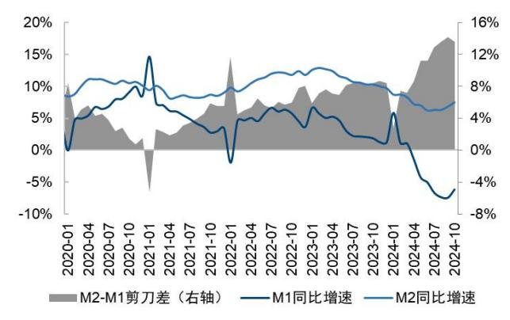  
资料来源：Wind，国信证券经济研究所整理

图12：10月国内消费增速环比抬升  
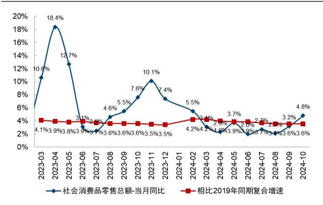  
资料来源：Wind，国信证券经济研究所整理

## 2.2 研判二：贵州茅台降速后，或率先实现供需平衡，行业进入 新稳态

2024 年飞天茅台批价波动反应需求较弱，公司终端价格话语权仍然很高。复盘2024年飞天茅台酒批价表现，年初至今（2024/11/15）箱装飞天批价下跌 710 元/瓶，跌幅为 24%，其中 6-7 月份和 9-11 月份价格波动较大。我们认为虽然需求导致价格波动，但茅台公司对终端价格仍有较高话语权，如 7 月、11 月在供给端政策的干预下，批价快速回升，从侧面也反应茅台酒渠道库存相对较低。

图13：2024年箱装飞天茅台批价表现  
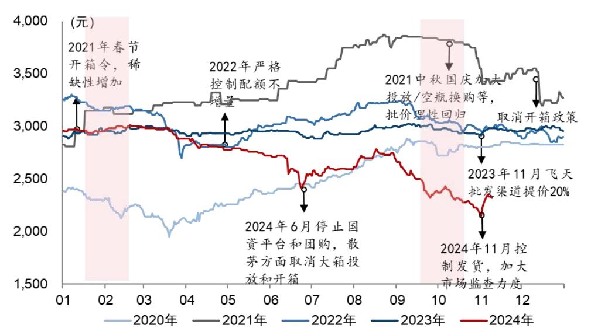  
资料来源：今日酒价，国信证券经济研究所测算

需求端看，政商务场景仍在磨底复苏阶段，居民消费场景具有韧性。本轮茅台批价波动与宏观经济周期同步性加强，高端酒商务需求复苏对政策刺激依赖度提高，但民间消费需求仍具有韧性，也为飞天价格提供支撑力。

 内需仍在磨底复苏阶段，礼品及商务开瓶需求或在 2025H2 转好。9 月底以来政策发力，部分经济指标回暖，虽然消费复苏节奏仍需验证，但需求磨底上行方向确定，当前飞天在经销商和家庭端库存较低，伴随消费信心提升、疤痕效应褪去，高端白酒需求也将稳步恢复。

图14：民间需求尚未出现明显拐点，复苏仍需时间  
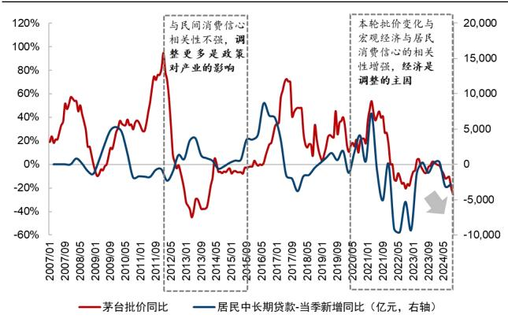  
资料来源：今日酒价、Wind，国信证券经济研究所整理

图15：飞天茅台各场景需求占比及影响因素  
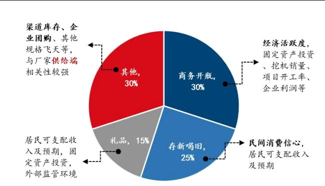  
资料来源：酒业家，国信证券经济研究所测算

 居民消费需求韧性较强，飞天茅台价格有较强支撑。按照历史经验数据，当城镇居民月可支配收入可以购买 2-3瓶飞天茅台时，茅台酒会大量进入老百姓餐桌或家庭端，终端动销加快。以 GDP 预测增速测算，我们预计 2024 年城镇居民每月可支配收入为 4500 元左右，按照城镇居民月可支配收入购买 2-3瓶飞天茅台计算，对应价格在 1511-2267 元，中枢值为 1890 元，我们认为飞天茅台价格价格有较强的支撑。

图16：城镇居民月度可支配收入与飞天茅台批价之比  
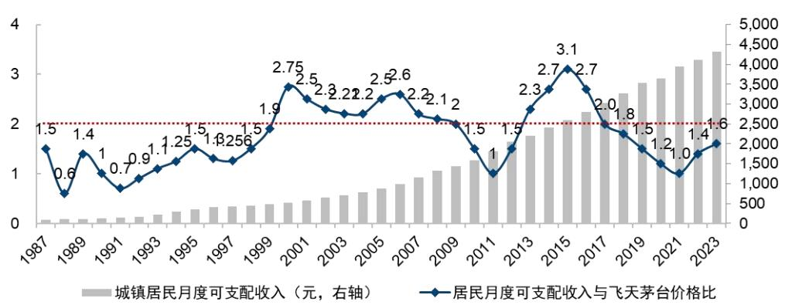  
资料来源：Wind、今日酒价，国信证券经济研究所测算

供给端看，出现系统性下跌风险的概率不大。一方面，增量化债政策利好贵州省政府修复资产负债表，贵州茅台的增长约束变少。另一方面，公司稳价意愿和能力较强。

 化债政策利好贵州政府资产负债表修复。9 月底政治局会议以来“一揽子化债措施”持续发力，11 月增量化债方案提出通过扩大特殊再融资债/特殊新增专项债发行规模来置换隐性债。付息成本减少或利好贵州政府资产负债表修复：根据企业预警通，当前贵州省城投债信用利差在 256bp，处于全国较高水平，以低成本法定债务利率置换相应高息债务，对贵州省政府利息降压效果更为明显。我们预计 2025年贵州茅台面临的外部约束减少。

图17：贵州茅台对贵州省 GDP贡献较大  
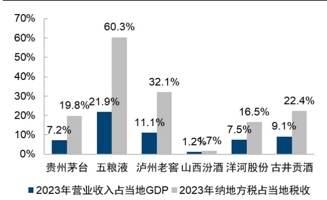  
资料来源：公司公告、Wind，国信证券经济研究所整理；注：其中茅台/汾酒为贵州/山西省属国资企业，其余公司为所在地级市

图18：年初至今贵州政府再融资债发行规模位于全国前列  
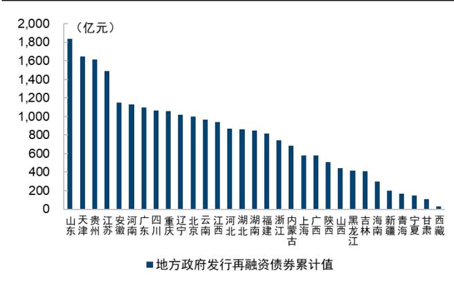  
资料来源：Wind，国信证券经济研究所整理

 茅台公司有较强的意愿维护飞天价盘稳定，且稳价工具丰富。飞天茅台的价格是贵州茅台价格体系及公司估值的锚，多条证据表明，茅台公司有较强的意愿和能力维护价格稳定：例如 2021 年双节加大投放量、年底调整开箱政策等引导批价理性回归，2022年严格控制配额稳定价格，2023年适时提价，2024 年在 6月、中秋节后批价急跌阶段，通过调节发货节奏和结构减缓价格下跌。经销商仍然是维护茅台市场秩序的重要力量：当前价盘水平下，经销商茅台酒产品综合渠道利润率在 10-20%，较大程度高于同业水平，部分大商以区域联谊会为单位，帮助公司维护渠道价格，如 11 月开展市场秩序检查，熨平购物节期间价盘表现。

综上，我们预计茅台批价在 2025H1 加速出清风险，而后筑底回升。借鉴上轮周期经验，茅台批价在经历去泡沫去黄牛、渠道重塑后进入新一轮上涨周期，调整历时 4 年。本轮价格周期自 2021H2开始由产业资本主导去化泡沫，但由于并未出现外部政策压制、公司调控渠道手段更强，去泡沫阶段时间相对上轮周期更长；2024年 3月以来进入去黄牛阶段，同时公司调整产品发货结构、加强渠道精细化管理、开拓新需求点、适当给经销商蓄水，缓冲需求对批价的影响。我们预计 2025年春节后渠道仍需消化库存和增长目标的压力，或确认本轮批价底部；下半年伴随多元化场景打开、需求逐步回暖、渠道结构改革，飞天批价有望企稳回升。

图19：本轮茅台批价演绎路径推测

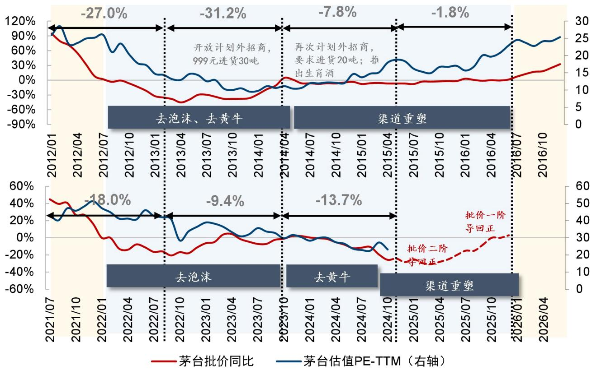  
资料来源：今日酒价、Wind，国信证券经济研究所测算

## 2.3 研判三：酒企、渠道商均向头部集中，厂商相互强化

渠道结构的转变进一步放大了行业供需矛盾。2024 年白酒消费需求因经济活跃度下降而承压，而白酒厂家因内外部刚性因素，仍有一定的增长要求，行业供需矛盾有所增加。同时，以拼多多、抖音为代表的电商渠道，率先转向“推荐型”零售终端，1）对于平台，流量集中后、获取大量稀缺需求；2）对于消费者，以更有性价比的方式获得名酒购买途径；3）对于经销商，基于多种原因（如去化库存、百亿补贴、监督弱化等），拥抱电商渠道。但由于线上渠道仍处于粗放式发展阶段，滋生了产品低质、乱价现象，进一步放大了供需矛盾，对传统经销商的利润产生挤压，也给厂家渠道秩序管理和消费者培育带来挑战。目前“价格是生命线”已成为酒厂的共识，因此我们认为电商渠道像一面镜子，是检验供需是否失衡、渠道秩序管理是否有效的工具，厂家应该适度引导，趋利弊害。

目前白酒行业发展进入无人区，我们认为白酒行业将持续向头部集中趋势不变，2025年经销商集中速度或将快于品牌，具体如下：

图20：经销商拥抱电商本质是供需矛盾转移的结果  
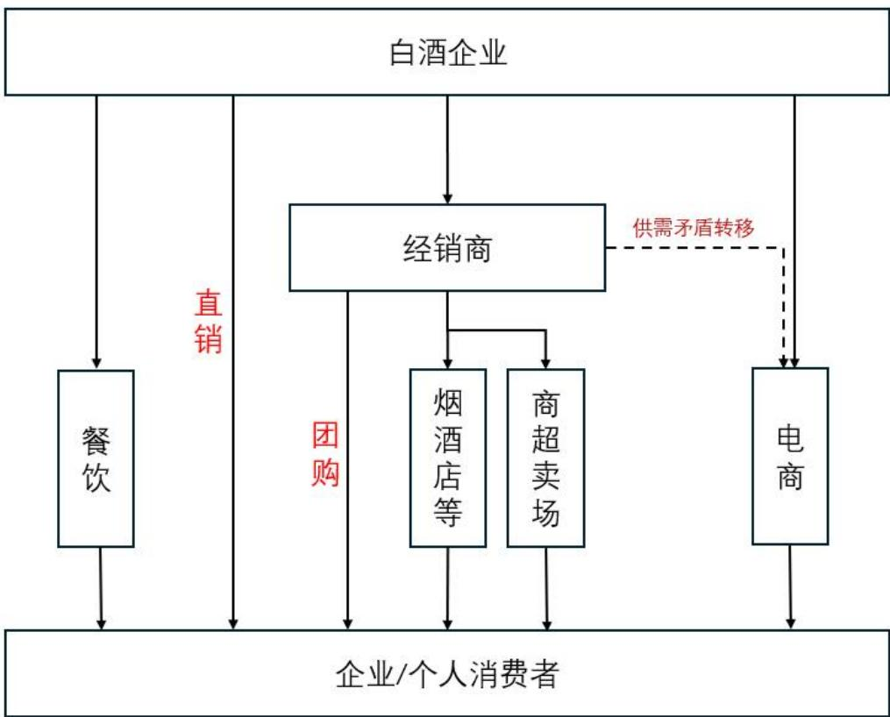  
资料来源：酒业家、名酒研究所，国信证券经济研究所绘制

 份额向头部品牌集中，格局逐渐固化。2000-2023年，白酒行业前十大品牌收入份额从 23.4%提升至 55%；2016 年后伴随中小酒厂产能出清、行业总产量下降、头部品牌销量仍在增长，产业集中度提升趋势加快。外围需求复苏不确定性下，渠道和终端资金倾向流入强势品牌，我们预计 2025年仍将延续向头部集中的趋势。

图21：2000-2023 年白酒品牌 CR10 从 23%提升至 55%，2016 年后集中度提升趋势加快  
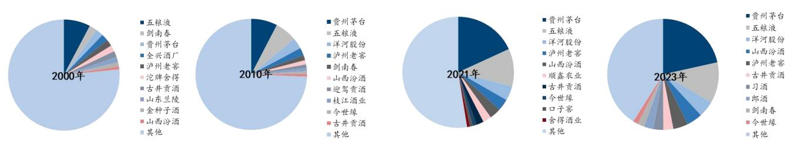  
资料来源：公司公告、公司官网、酒业家，国信证券经济研究所测算

 白酒渠道格局分散，2025 年或加速向头部经销商集中。相较于其他消费品，中国白酒渠道模式仍以传统经销商为主，经销商分销占比超过 90%，但渠道集中度较低，区域性明显，如北京·糖业烟酒、河北·乾坤福、安徽·百川名品、广东·粤强等，其中前 10家流通企业销售总额占行业销售总量的约 18.9%，若扣除京东、淘宝系、拼多多等电商平台，前 10家传统经销商占比约 9.4%。目前传统经销商生存状态较差，尤其是尾部经销商经营压力较大，面临高库存带来的现金流紧张和酒价下跌带来的利润下降/亏损双重问题，退出意愿较高。

我们预计 2025 年渠道整合速度加快，大型经销商通过收购名酒配额、区域扩张等方式，大型经销商占比较高的公司抗风险能力相对较高，如茅台、五粮液、水井坊等。

图22：2023年流通企业白酒销售体量占比  
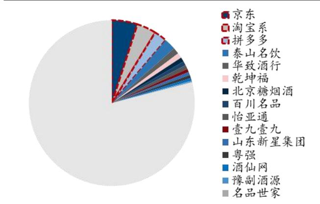  
资料来源：久谦、四川百强，国信证券经济研究所整理

图23：2023年主要酒企国内经销商平均体量及数量  
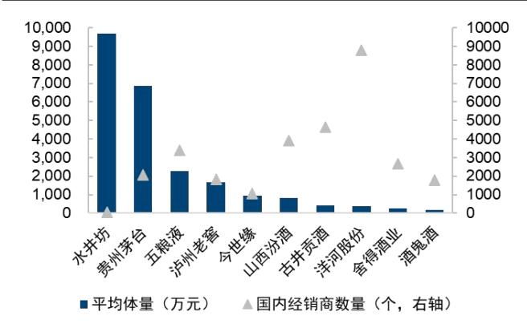  
资料来源：公司公告，国信证券经济研究所测算

## 2.4 研判四：名酒产能仍在逐步释放，优质供给将持续获取更多份额

行业盈利能力减弱后低端劣质产能出清，或进行一轮品质升级。与 1998-2004 年产能调整期类似，2001年白酒从量税出台，2002年取消先征后返 18%的所得税优惠政策，使大众价位酒企税负增加、盈利能力受损严重，劣质产能快速出清，包括五粮液尖庄、舍得沱牌、洋河大曲等名酒低端产能下滑幅度较大 2001-02年行业产量同比下降 9.3%/6.1%。我们预计本轮周期伴随中小酒企盈利能力下降，低端、劣质产能将逐步出清，行业或迎来下一轮的品质升级。

图24：2001年从量消费税出台后白酒行业产能出清  
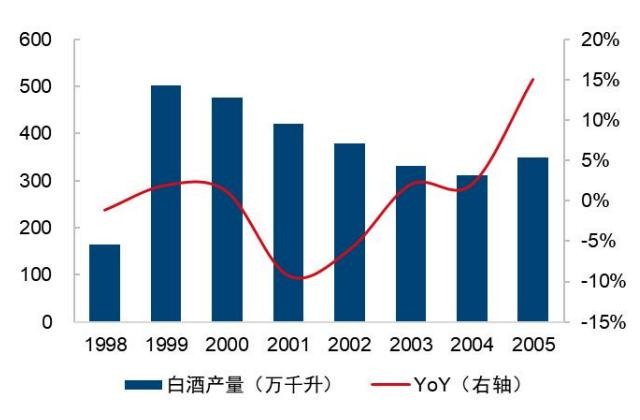  
资料来源：中国酒业协会，国信证券经济研究所整理

图25：白酒行业消费税占比在2001年显著提升  
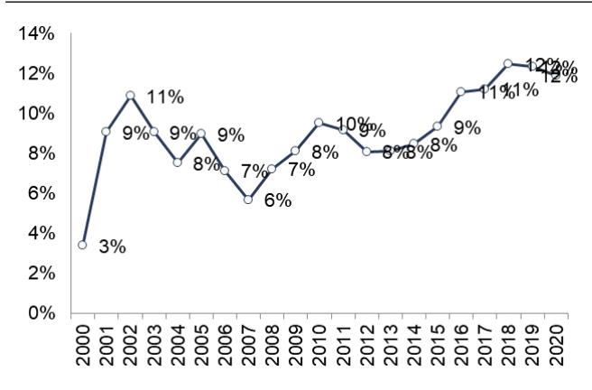  
资料来源：公司公告，国信证券经济研究所整理

头部酒企产能提升，行业仍存在产能供需错配的问题。虽然 2016 年后白酒行业产量见顶回落，但头部酒企仍在持续扩张产能。1）上轮周期后中小酒企产能逐步出清，同时名酒扩产工程仍在稳步推进，我们测算 2024年主流酒企产量占行业比例超过 40%，随头部酒企产能继续释放，供给端存量竞争将进一步加剧；2）2021年需求复苏下上市公司积极扩产，库存水平明显提升，当年主要公司期末成品酒量同比+50.3%，而 2022年以来外部环境的不确定性减缓了行业去库存的速度。我们认为在产能供给增加与需求变化的错配问题在未来 1-2 年时间内仍将延续，去化产能是长期需要关注的议题。

图26：预计主要公司产量占行业比例超过40%  
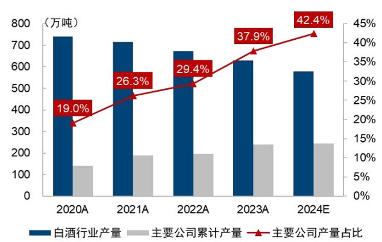  
资料来源：中国酒业协会、公司公告，国信证券经济研究所整理；注：主要公司包括白酒上市公司以及郎酒、习酒、国台、剑南春

图27：2021年上市公司成品酒库存明显增加  
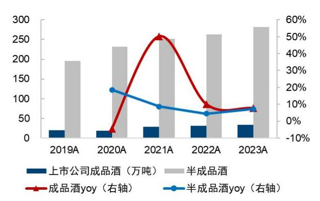  
资料来源：公司公告，国信证券经济研究所整理；注：数据为茅台、五粮液、老窖、汾酒、水井、酒鬼、舍得、洋河、古井、今世缘、迎驾、口子窖12家合计

表4：白酒头部上市公司产能情况梳理  
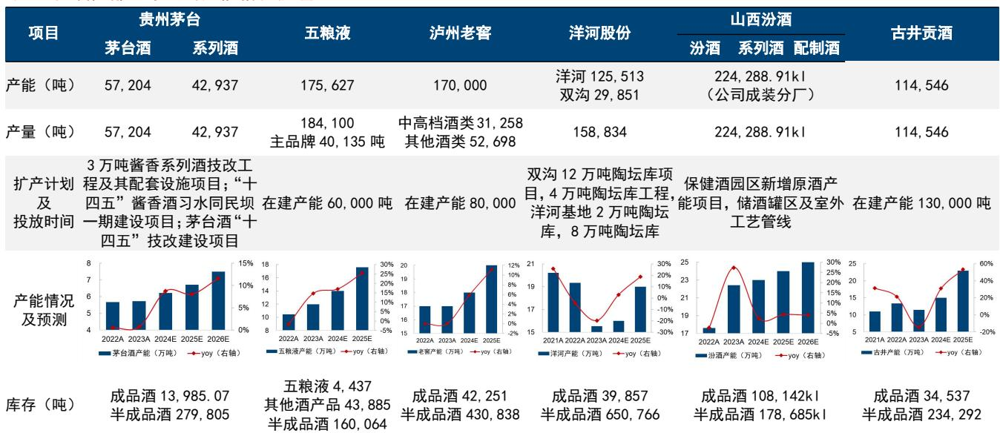  
资料来源：公司公告，国信证券经济研究所整理&测算

长期看，行业拥抱“质价比”的趋势明确。我们认为“消费降级”现象的本质是追求消费者剩余的最大化，在可支配收入增长承压背景下，消费者更加关注价值和价格的平衡，而不是单一地追求低价，因此 2023 年以来质价比突出的五粮液1618、汾酒玻汾、剑南春水晶剑等真实动销好于竞品。长期来看，以质价比为导向的产品升级仍是提高消费者剩余的关键：1）需求层面，疫情加深了消费者对健康和品质的诉求，同时流动性疤痕效应下决策更加理性；2）供给层面，供需错配和渠道去库倒逼酒企内卷品质，同时仍有补贴终端和渠道的动力以稳固市场份额。

图28：白酒消费者更加重视商品品质  
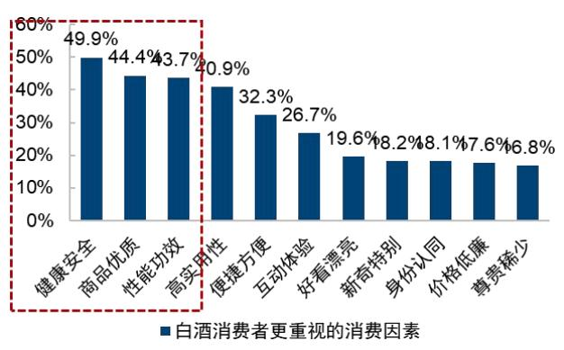  
资料来源：数字 100、云酒视界，国信证券经济研究所整理；注：数据为 2023年统计

图29：长期白酒产品质价比提升趋势确定

<table><tr><td colspan="2">质价比=</td><td>消费者</td><td>酒企</td></tr><tr><td rowspan="2"></td><td rowspan="2">产品价值-产品价格</td><td>疫情加深消费者对食品安全和品质的关注</td><td>产能供给增加,有效需求减少,内卷品质</td></tr><tr><td>经济增速及人均可支配收入增速放缓</td><td>渠道风险累积,以价换量降低库存水位</td></tr></table>

资料来源：清华管理评论、酒业家，国信证券经济研究所整理

基酒储备与产品品质呈正相关，预计未来更多酒企针对存量产品进行品质升级。由于酿造工艺的影响和酒体微生物的复杂性，白酒酒质通常与储酒时间呈正相关性，尤其对于酱香型和浓香型白酒，基酒酒龄越长、产品口感更佳，因此基酒质量和数量直接影响产品品质和市场供应。我们认为提升产品品质或是酒企未来重点战略方向：调整产量在储酒和制造上的分配，短期缓解产能冗余问题、提升产能利用率，长期有利于提升产品品质竞争力。2024年以来，今世缘·国缘四开、茅台 1935、汾酒·青花 20 完成换代升级，均在原有产品基础上升级勾调所用基酒，未来更多酒企将对存量产品进行品质提升。

图30：茅台部分产品勾调所使用基酒酒龄

<table><tr><td>系列</td><td>产品</td><td>图片</td><td>基酒酒龄</td></tr><tr><td rowspan="3">年份酒</td><td>15年</td><td rowspan="3"></td><td rowspan="3">不低于15年酒龄的基酒,按照30/50年陈年茅台的标准勾兑出后2款</td></tr><tr><td>30年</td></tr><tr><td>50年</td></tr><tr><td>珍品</td><td>彩釉珍品</td><td rowspan="2"></td><td>撷取近1000支不同酒龄基酒精华,均在8-10年以上</td></tr><tr><td>精品</td><td>精品茅台</td><td>10年以上</td></tr><tr><td rowspan="2">经典</td><td>53度飞天茅台</td><td rowspan="2"></td><td>5年</td></tr><tr><td>生肖茅台</td><td>5年</td></tr></table>

资料来源：公司公告、公司官网，国信证券经济研究所整理

表5：2024年部分品牌对产品焕新升级

<table><tr><td>品牌</td><td>时间</td><td>产品</td><td>详细内容</td></tr><tr><td>今世缘</td><td>2023/12/29</td><td>国缘·四开</td><td>2023年12月29日,“第五代国缘四开上市发布”启动仪式举行,品质上二次入坛缔合,酒体甜润净爽,口感醇厚丰满,饮后更加怡畅;2024年2月29日起,四代开系产品将不再接收销售订单,自3月1日起,五代国缘四开出厂价将上调20元/瓶,同时将严格执行配额制。</td></tr><tr><td>贵州茅台</td><td>2024/6/20</td><td>茅台1935</td><td>6月20日茅台1935“酒体升级鉴品会”举行,酒质升级主要包含3个方面:1)优化基酒结构,口味更醇厚;2)磨练勾兑技艺,在保留原有风味特点的基础上,各风味维度表现更加协调平衡;3)优化建构酒体关键理化指标,提升饮后舒适度。</td></tr><tr><td>山西汾酒</td><td>2024/6/4</td><td>青花20老白汾</td><td>1)酒体及口感进行升级:口感更加柔和,回味更加悠长,同时保留了汾酒一贯的清香风格;2)包装升级:瓶身和瓶盖的细节处理更加考究;3)数字化:全面五码合一,瓶盖内部嵌入了RFID芯片,并支持NFC读取功能。老白汾10年包装焕新升级,全系列提价5元/瓶,全面导入五码合一体系。</td></tr></table>

资料来源：各公司官方公众号，国信证券经济研究所整理

## 2.5 研判五：同质化竞争下，销售费用率或延续高位

以费用保份额，预计 2025 年酒企销售费用率仍延续高位。2023Q4 以来主要公司销售费用率同比走高，尤其市场促销费增加较多，除了延续过往在开平扫码红包上增加力度，2024年以来酒企逐步加大渠道侧的补贴力度，以维护厂商关系。我们认为费用“内卷”实质上是趋同性竞争，缩量竞争下“份额至上”，预计 2025年酒企竞争重心仍聚焦于费用投入。

图31：白酒上市公司单季度销售费用率同比增减

<table><tr><td>公司</td><td>3Q23</td><td>4Q23</td><td>1Q24</td><td>2Q24</td><td>3Q24</td></tr><tr><td>贵州茅台</td><td>0.76%</td><td>1.14%</td><td>0.53%</td><td>0.74%</td><td>0.36%</td></tr><tr><td>五粮液</td><td>-0.25%</td><td>2.26%</td><td>0.75%</td><td>1.97%</td><td>2.83%</td></tr><tr><td>泸州老窖</td><td>-0.79%</td><td>0.01%</td><td>-1.23%</td><td>0.73%</td><td>-1.08%</td></tr><tr><td>山西汾酒</td><td>-5.78%</td><td>4.69%</td><td>-0.48%</td><td>0.47%</td><td>-0.07%</td></tr><tr><td>洋河股份</td><td>1.53%</td><td>19.02%</td><td>1.11%</td><td>1.76%</td><td>12.27%</td></tr><tr><td>水井坊</td><td>-0.84%</td><td>-2.87%</td><td>3.15%</td><td>-8.90%</td><td>-3.99%</td></tr><tr><td>舍得酒业</td><td>2.83%</td><td>3.01%</td><td>-2.93%</td><td>11.80%</td><td>3.38%</td></tr><tr><td>酒鬼酒</td><td>9.61%</td><td>8.56%</td><td>7.90%</td><td>5.73%</td><td>30.21%</td></tr><tr><td>古井贡酒</td><td>0.98%</td><td>-1.48%</td><td>-1.66%</td><td>0.31%</td><td>-5.32%</td></tr><tr><td>今世缘</td><td>4.48%</td><td>2.31%</td><td>-1.76%</td><td>-0.91%</td><td>-3.90%</td></tr><tr><td>迎驾贡酒</td><td>-0.48%</td><td>-0.17%</td><td>0.31%</td><td>-1.99%</td><td>0.73%</td></tr><tr><td>口子窖</td><td>3.28%</td><td>-0.39%</td><td>-0.59%</td><td>3.90%</td><td>-3.03%</td></tr><tr><td>老白干酒</td><td>-1.57%</td><td>-5.92%</td><td>-2.97%</td><td>-4.71%</td><td>0.11%</td></tr><tr><td>伊力特</td><td>0.83%</td><td>-16.91%</td><td>0.00%</td><td>5.00%</td><td>4.53%</td></tr><tr><td>金种子酒</td><td>-8.13%</td><td>3.20%</td><td>-1.42%</td><td>15.95%</td><td>28.56%</td></tr><tr><td>金徽酒</td><td>3.94%</td><td>-11.93%</td><td>0.15%</td><td>-0.51%</td><td>-3.19%</td></tr><tr><td>顺鑫农业</td><td>0.30%</td><td>7.73%</td><td>-3.01%</td><td>3.11%</td><td>2.46%</td></tr></table>

资料来源：公司公告，国信证券经济研究所整理

图32：各公司促销费用情况

<table><tr><td>百万元</td><td>1H22</td><td>1H23</td><td>YoY</td><td>1H24</td><td>YoY</td><td>报表披露具体指标</td></tr><tr><td>贵州茅台</td><td>1,360</td><td>1,576</td><td>15.9%</td><td>2,334</td><td>48.1%</td><td>广告宣传及市场拓展费用</td></tr><tr><td>五粮液</td><td>2,485</td><td>2,613</td><td>5.2%</td><td>3,441</td><td>31.7%</td><td>促销费</td></tr><tr><td>泸州老窖</td><td>142</td><td>486</td><td>241.4%</td><td>771</td><td>58.5%</td><td>促销费</td></tr><tr><td>水井坊</td><td>527</td><td>414</td><td>-21.5%</td><td>396</td><td>-4.2%</td><td>广告费及促销费</td></tr><tr><td>酒鬼酒</td><td></td><td>156</td><td></td><td>256</td><td>63.8%</td><td>广宣及市场服务费</td></tr><tr><td>洋河股份</td><td>878</td><td>1,535</td><td>74.9%</td><td>1,836</td><td>19.6%</td><td>广告促销费</td></tr><tr><td>古井贡酒</td><td>1,057</td><td>1,334</td><td>26.2%</td><td>1,685</td><td>26.4%</td><td>综合促销费</td></tr><tr><td>老白干酒</td><td></td><td>232</td><td></td><td>169</td><td>-26.9%</td><td>促销费</td></tr><tr><td>今世缘</td><td>140</td><td>308</td><td>120.5%</td><td>312</td><td>1.2%</td><td>促销费</td></tr><tr><td>口子窖</td><td>134</td><td>189</td><td>41.3%</td><td>222</td><td>17.2%</td><td>促销及业务费</td></tr></table>

资料来源：公司公告，国信证券经济研究所整理

费用投入以反哺渠道和品牌建设为重心。2013-15 年调整中，茅台通过让利经销商、增补小商、增加飞天配额等，相对平稳地穿越周期。本轮调整头部酒企更有行业担当，预计 2025年在经销商利润维护、消费者品牌心智教育上维持积极的费用投入：1）渠道方面，五粮液、泸州老窖 2025年回款政策柔性，山西汾酒推动汾享礼遇分利模式的改良，提升资金回笼能力，二线名酒持续以 BC反向红包的方式促进开瓶消费；2）品牌方面，头部酒企眼光长远，茅台、汾酒积极开拓新人群、新场景，寻找出海增长空间。

表6：酒企 2025年费用投入指引积极，重视渠道反哺、消费者教育、品牌建设

<table><tr><td>公司</td><td>渠道费用/消费者投入/品牌建设</td></tr><tr><td>贵州茅台</td><td>➢ 渠道方面:开拓私域渠道;注重产品功能价值、体验价值、情绪价值,做服务转型➢ 产品营销:生肖及文创类产品做好新一轮筹划工作,增强产品绿色化和数字化➢ 产品出海:推动以53/43度飞天茅台酒为核心、高附加值产品为补充、系列酒和其他新品为增量的产品矩阵出海,从产品出海-品牌出海</td></tr><tr><td>五粮液</td><td>➢ 渠道方面:11月主动给予经销商返利政策,“1218”根据经销商任务完成情况另有奖励;2025年春节开门红打款分阶梯式温和给予政策,主动为经销商纾压</td></tr><tr><td>泸州老窖</td><td>➢ 渠道方面:延续2023年年底以来930元打款政策,“一商一策”给予返利和奖励,费用兑付及时、给予金融支持等方式提升经销商回款能力;➢ 数字化建设:持续推进全链路数字化改革,逐步解决渠道经销商、终端利润、线下消费者粘性培育的问题,部分区域找到优化迭代路径后正反馈或将逐步显现</td></tr><tr><td>山西汾酒</td><td>➢ 渠道方面:因地制宜调整汾享礼遇模式,经销商大会指出把经销商利益放在第一位,构建更加合理的利益分配机制➢ 品牌建设:2025年开启“年轻化1.0”和“国际化1.0”,把握年轻消费群体和海外市场空间</td></tr><tr><td>洋河股份</td><td>➢ 消费者投入:坚持以消费者为中i性能提升市场占有率➢ 渠道方面:经销商大会多次提出构建“厂商共同体”,设置合理的盈利目标,确保商家利润;将采取“召开定期常会议、组建大商议事委员会、搭建经销商意见反馈平台”</td></tr><tr><td>今世缘</td><td>➢ 费用投入:费用消耗战不可避免,将以积极的态度参与竞争,费用将以投入品牌建设、BC红包、业务人员增补为主要方面</td></tr><tr><td>水井坊</td><td>➢ 渠道方面:以BC联动(红包为主)刺激终端动销,改善渠道价值链;➢ 品牌建设:加强消费者培育活动,举办“白酒学坊”活动,围绕体育营销和文化营销打造IP</td></tr></table>

资料来源：公司公告、酒业家，国信证券经济研究所整理

2025年板块净利率提升幅度或一进步放缓。2025 年行业收入增长中枢逐步下移，而费用支出水平预计仍维持较高水平，板块净利率提升幅度或进一步放缓。分价格带看，高端酒预计持平，扩张性次高端及苏酒延续压力，净利率提升动力更多集中在价位升级势能较好、费用率仍有规模效应的徽酒龙头和区域中低端酒企。

图33：白酒上市公司单季度归母净利率同比增减

<table><tr><td>公司</td><td>3Q23</td><td>4Q23</td><td>1Q24</td><td>2Q24</td><td>3Q24</td></tr><tr><td>贵州茅台</td><td>1.08%</td><td>-0.19%</td><td>-1.04%</td><td>-0.35%</td><td>-0.99%</td></tr><tr><td>五粮液</td><td>0.44%</td><td>-1.26%</td><td>0.04%</td><td>0.41%</td><td>-0.02%</td></tr><tr><td>泸州老窖</td><td>1.47%</td><td>4.06%</td><td>0.99%</td><td>-3.62%</td><td>0.90%</td></tr><tr><td>山西汾酒</td><td>3.68%</td><td>-4.84%</td><td>2.83%</td><td>-1.80%</td><td>-0.31%</td></tr><tr><td>水井坊</td><td>-0.62%</td><td>0.22%</td><td>1.27%</td><td>0.72%</td><td>2.89%</td></tr><tr><td>舍得酒业</td><td>-1.03%</td><td>-7.80%</td><td>-2.04%</td><td>-19.74%</td><td>-15.31%</td></tr><tr><td>酒鬼酒</td><td>-17.33%</td><td>-3.55%</td><td>-16.26%</td><td>-11.59%</td><td>-42.22%</td></tr><tr><td>洋河股份</td><td>-0.92%</td><td>-15.04%</td><td>-1.07%</td><td>-2.13%</td><td>-14.23%</td></tr><tr><td>今世缘</td><td>-0.32%</td><td>-1.92%</td><td>-0.19%</td><td>-1.41%</td><td>-0.78%</td></tr><tr><td>古井贡酒</td><td>3.55%</td><td>4.87%</td><td>1.09%</td><td>1.70%</td><td>0.05%</td></tr><tr><td>迎驾贡酒</td><td>4.49%</td><td>1.90%</td><td>2.74%</td><td>2.22%</td><td>0.73%</td></tr><tr><td>口子窖</td><td>1.11%</td><td>-0.80%</td><td>-0.31%</td><td>2.06%</td><td>-2.38%</td></tr><tr><td>老白干酒</td><td>0.53%</td><td>3.01%</td><td>1.85%</td><td>3.22%</td><td>3.10%</td></tr><tr><td>伊力特</td><td>5.89%</td><td>10.74%</td><td>-0.95%</td><td>1.98%</td><td>0.90%</td></tr><tr><td>金种子酒</td><td>38.78%</td><td>17.09%</td><td>13.72%</td><td>-3.65%</td><td>-80.43%</td></tr><tr><td>金徽酒</td><td>3.12%</td><td>-4.13%</td><td>0.20%</td><td>-0.63%</td><td>2.95%</td></tr><tr><td>顺鑫农业</td><td>-7.66%</td><td>27.06%</td><td>3.09%</td><td>17.53%</td><td>5.66%</td></tr></table>

资料来源：公司公告，国信证券经济研究所整理&测算

## 2.6 研判六：600 元价位或加速成熟，成为白酒行业新“战场”

500-800 元白酒价位带受宏观经济影响，2022 年市场容量以来持续下降。复盘历史，500-800元属于高线次高端赛道，消费场景以商务为主，相较于其他价格带，顺周期属性更强：2018-21年收入规模 CAGR 为 25%，受益于高端酒提价打开次高端扩容空间，主流酒企加码布局 500-800元价位产品，行业迎来量价齐升；2022年以来受到经济降速的影响，以商务和高端宴请为主要消费场景的高线次高端价位承压明显，表现为存量产品的动销下滑和新进入者的减少，我们测算 2024 年500-800 元白酒市场规模为 1540 亿元，同比下降 3.3%，2022-24 年 CAGR 为 0.4%。

图34：2023年 500-800元价位收入增速放缓，主要酒企提前布局产品  
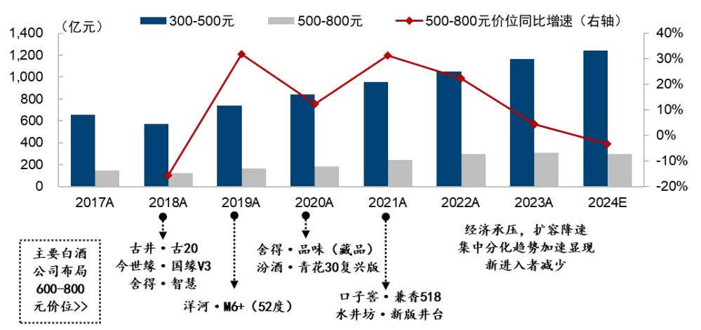  
资料来源：公司公告、中国酒业协会、酒业家，国信证券经济研究所整理&测算

## 竞争格局延续集中分化，名酒进入 500 元+价位竞争阶段。随着居民收入水平提

高和剑南春对宴席场景的培育，目前 500元以内产品的消费场景进入大众消费阶段，而非名酒品牌基于其较强的区域深耕能力，在该价位市场份额也在逐步提升，这意味着名酒基因不再是 300-500 元价位竞争的核心要素。对名酒品牌而言，布局 500-800 元已成为必选项。2018-2021 年 500-800 元价位加速扩容，主流酒企提价升级（如山西汾酒升级青花 30复兴版、洋河股份推出 M6+）或推出新品（古井贡酒推出年份原浆 20、今世缘推出国缘 V3），同时“酱酒热”背景下主流酱酒大单品也实现量价齐升，竞争格局百花齐放。2021 年以来 500-800元价位集中分化趋势加剧，CR10 从 2021 年的 89.5%提升至 2023 年的 98.0%，缩量竞争环境下头部大单品受益于品牌认知基础稳固、组织精细化运作能力突出等优势，低度国窖 1573、低度五粮液等仍实现份额提升，除名酒以外参与者基本出清。

图35：2019-2023 年 500-800 元高线次高端价位竞争格局演变  
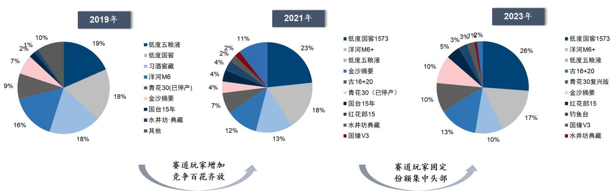  
资料来源：公司公告、中国酒业协会、酒业家，国信证券经济研究所整理&测算

我们研判 2025 年 500-800 元价位将迎来供给端驱动式的增长，或将加速成熟。基于我们的研究框架，龙头酒企推出战略性大单品并加大费用投放是价位成熟的必要条件之一，我们认为 2025年 500-800元元价位带或将实现规模增长，该价位也将成为白酒行业消费升级的重要引擎。

图36：白酒行业将社会财富内化为产品价格的能力较强  
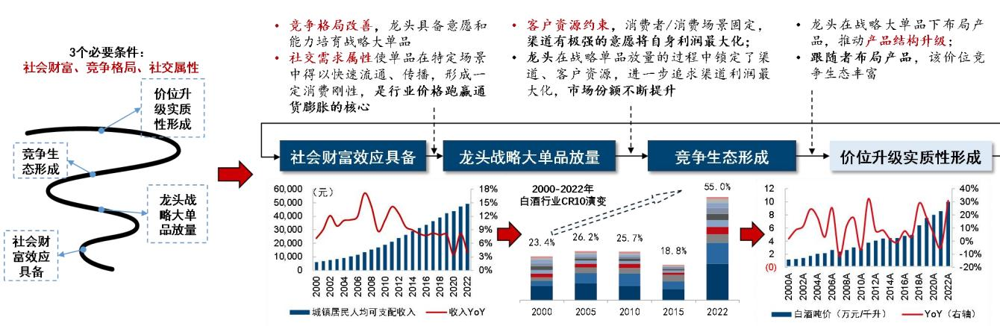  
资料来源：Wind、公司公告、酒业家，国信证券经济研究所整理；注：竞争格局口径为公司营业总收入

茅台 1935 价格下跌，多数单品生存空间被压缩到 800 元以内，名酒大单品性价比凸显。茅台 1935过去几年持续增量，市场流通价格从 1000+跌至 680元，品价比凸显，我们观察到在广西、广东、河南等地动销和开瓶率均在明显提升。

1935价格下跌对千元价位竞品产生挤压，酱酒大单品君品习酒、青花郎等也受到一些影响，市场价格较 2023年同期分别下跌 70/50元。我们预计在 2025 年飞天茅台批价磨底过程中，千元价位产品价差或进一步扩大，除普五和高度国窖外，多数产品价格将跌落至 800元以内，进入高线次高端价位的竞争。

图37：千元价位酱酒大单品批价跌至800 元以下（元）  
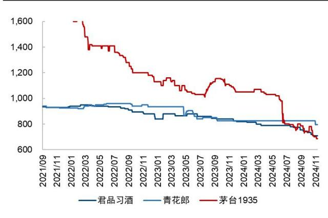  
资料来源：Wind，国信证券经济研究所整理

图38：500-800元价位主流大单品批价（元）  
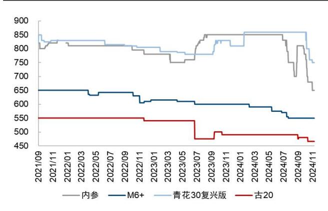  
资料来源：Wind，国信证券经济研究所整理

400 元价位成熟倒逼酒企运营 600 元价位，2025 年竞争或更为激烈。2022 年以来，大众宴席的价位升级和商务宴请的消费降级推动 300-500元白酒市场加速成熟，汾酒·青花 20、今世缘·国缘四开等产品已站稳 400 元价格带；向上运作 600元价格带成为提前布局下一轮周期的“必答题”，酒企对于 600元以上价位的操盘能力，也将辐射 400 元及以下产品的品牌认知度。我们认为 2025年 500-800元价位部分新品逐步贡献增量，如今世缘国缘 V3 于 2024年起逐步显现增长势能，山西汾酒在经销商大会上推出新品青花 26、古井在省外市场运作古 26 等。

图39：主流白酒公司分价位带产品布局情况，部分酒企 600-800元价位带占比较小

<table><tr><td colspan="2">价位</td><td>贵州茅台</td><td>五粮液</td><td>泸州老窖</td><td>山西汾酒</td><td>郎酒</td><td>习酒</td><td>舍得酒业</td><td>酒鬼酒</td><td>水井坊</td><td>古井贡酒</td><td>迎驾贡酒</td><td>口子窖</td><td>洋河股份</td><td>今世缘</td><td>老白干</td><td>剑南春</td><td>顺鑫农业</td></tr><tr><td rowspan="3">高端</td><td>2000+</td><td>53度飞天珍品精品等(占比85%)</td><td>经典五粮液</td><td></td><td>青花40中国龙</td><td>青运郎红云郎</td><td></td><td></td><td></td><td></td><td></td><td></td><td></td><td>手工班</td><td>国缘V9</td><td></td><td></td><td></td></tr><tr><td rowspan="2">800-2000</td><td rowspan="2">43度飞天</td><td rowspan="2">52度五粮液五粮液1618(占比</td><td rowspan="2">52度国窖(占比40%)</td><td rowspan="2">青花30复兴版</td><td rowspan="2">青花郎(占比40%)</td><td>君品习酒(占比)</td><td rowspan="2">藏品舍得</td><td rowspan="2">内参(占比20%+)</td><td rowspan="2">菁翠等</td><td rowspan="2"></td><td rowspan="2"></td><td rowspan="2"></td><td rowspan="2">M9</td><td rowspan="2">国缘V6</td><td rowspan="2"></td><td rowspan="2"></td><td rowspan="2"></td></tr><tr><td>窖藏15年</td></tr><tr><td rowspan="4">次高端</td><td>600-800</td><td>茅台1935</td><td>39度五粮液</td><td>38度国窖(占比25%)</td><td>青花26</td><td>红花郎15</td><td></td><td>智慧舍得</td><td></td><td>典藏大师</td><td>古26(占比小)</td><td></td><td></td><td>M6+(占比15%+)</td><td>国缘V3国缘六开(占比小)</td><td></td><td>珍藏级</td><td></td></tr><tr><td rowspan="3">300-600</td><td rowspan="2">汉酱赖茅</td><td rowspan="3"></td><td rowspan="3">特曲60窖龄30/60等</td><td rowspan="3">青花20(占比27%)</td><td rowspan="3">红花郎10</td><td rowspan="2">窖藏1988窖藏1998</td><td>品味舍得(占比约50%)</td><td rowspan="2">酒鬼红坛酒鬼黄坛等</td><td rowspan="3">井台臻酿8号(占比90%)</td><td rowspan="3">古20古16(占比27%+)</td><td>洞20/16(占比13%)</td><td rowspan="3">口子20&amp;30</td><td>M3天之蓝</td><td rowspan="3">国缘四开/对开/K3/K5(占比50%)</td><td rowspan="3">古法20</td><td>水晶剑(占比80%)</td><td rowspan="3"></td></tr><tr><td rowspan="2"></td><td rowspan="2"></td><td rowspan="2"></td><td rowspan="2"></td></tr><tr><td></td><td></td><td></td></tr><tr><td rowspan="2">中高端</td><td rowspan="2">100-300</td><td>王子迎宾</td><td rowspan="2">五粮春五粮特曲</td><td rowspan="2">特曲老字号</td><td>老白汾10巴拿马15</td><td rowspan="2">朗特系列</td><td>金质习酒</td><td rowspan="2">舍之道</td><td rowspan="2"></td><td rowspan="2"></td><td>古8古5(约30%)</td><td>洞6/9(占比38%)</td><td>口子5口子6口子10小池窖</td><td>海之蓝</td><td>国缘单开国缘淡雅今世缘典藏</td><td rowspan="2">十八酒坊系列</td><td rowspan="2">金剑南</td><td rowspan="2"></td></tr><tr><td></td><td></td><td>银质习酒</td><td></td><td></td><td></td><td></td><td></td></tr><tr><td>中低端</td><td>100-</td><td></td><td>五粮头曲五粮醇</td><td>黑盖</td><td></td><td></td><td></td><td>T68沱牌六粮</td><td></td><td></td><td>献礼</td><td>金银星(占比24%)</td><td>老口子口子坊</td><td>洋河大曲</td><td>高沟</td><td>老白干系列</td><td></td><td></td></tr><tr><td>光瓶</td><td>50-</td><td></td><td>尖庄</td><td></td><td>玻汾(30%)</td><td>小郎酒顺品郎</td><td></td><td>沱小九</td><td>湘泉</td><td></td><td>老玻贡</td><td>百年迎驾</td><td></td><td>洋河小海</td><td></td><td></td><td></td><td>42度陈酿</td></tr></table>

资料来源：公司公告、酒说、酒业家，国信证券经济研究所整理&测算

## 3、2025 年投资主线及推荐标的

自上而下判断行业β性机会，关注飞天茅台酒批价（行业景气度指标）。我们将食品饮料分为贵州茅台、白酒（剔除茅台）和其他食品，在 SW食品饮料中权重占比 36%、32%、32%，贵州茅台对白酒板块的影响举足轻重。在前文《2.4 研判四》中我们论述，飞天茅台批价底预计在 1800 元，将在 2025Q1达到同比最低值，批价企稳回升后可视作板块基本面见底。

分价格带交易策略看，周期磨底-复苏阶段优选高端、次高端。历次周期行业景气度复苏阶段高端、次高端跑出股价超额，如 2016-21 年高端白酒持续领先，2020-21 年次高端迅速获得估值溢价。高端酒消费结构中政商务场景占比较大，或率先感知产业链上游活跃度提升；扩张型次高端顺周期属性明显，伴随高端酒需求外溢打开自身价格带成长空间，主要标的在风险出清后反转弹性更大。

图40：历史分板块和价位带股价涨跌情况  
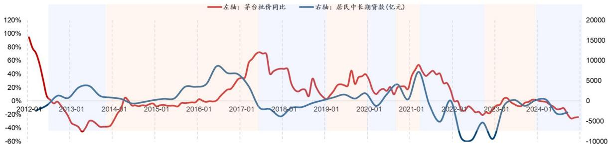

<table><tr><td>板块</td><td>2012年</td><td>2013年</td><td colspan="2">2014年</td><td colspan="2">2015年</td><td colspan="2">2016年</td><td colspan="2">2017年</td><td>2018年</td><td>2019年</td><td>2020年</td><td colspan="2">2021年</td><td>2022年</td><td>2023年</td><td>2024年</td></tr><tr><td>食品饮料</td><td>-0.74%</td><td>-7.36%</td><td colspan="2">16.03%</td><td colspan="2">26.58%</td><td colspan="2">7.43%</td><td colspan="2">53.85%</td><td>-21.95%</td><td>72.87%</td><td>84.97%</td><td colspan="2">-6.01%</td><td>-15.12%</td><td>-14.94%</td><td>-6.72%</td></tr><tr><td>白酒</td><td>2.00%</td><td>-42.30%</td><td colspan="2">42.50%</td><td colspan="2">22.80%</td><td colspan="2">28.40%</td><td colspan="2">93.10%</td><td>-23.40%</td><td>102.10%</td><td>96.40%</td><td colspan="2">-2.60%</td><td>-15.40%</td><td>-11.70%</td><td>-10.80%</td></tr><tr><td>贵州茅台</td><td>8.1%</td><td>-38.60%</td><td colspan="2">47.7%</td><td colspan="2">15.1%</td><td colspan="2">56.50%</td><td colspan="2">111.90%</td><td>-15.4%</td><td>103.50%</td><td>70.90%</td><td colspan="2">2.60%</td><td>-15.76%</td><td>-0.06%</td><td>-11.88%</td></tr><tr><td>白酒(扣除茅台)</td><td>-3.8%</td><td>-45.6%</td><td colspan="2">41.3%</td><td colspan="2">22.9%</td><td colspan="2">8.3%</td><td colspan="2">76.2%</td><td>-28.6%</td><td>100.4%</td><td>127.8%</td><td colspan="2">-7.2%</td><td>-12.7%</td><td>-21.1%</td><td>-9.8%</td></tr><tr><td>大众品</td><td>0.00%</td><td>69.90%</td><td colspan="2">12.30%</td><td colspan="2">36.00%</td><td colspan="2">-0.30%</td><td colspan="2">6.60%</td><td>1.80%</td><td>48.20%</td><td>83.00%</td><td colspan="2">-2.20%</td><td>-13.60%</td><td>-22.40%</td><td>6.40%</td></tr><tr><td rowspan="3">股价表现</td><td colspan="2">高端</td><td></td><td></td><td></td><td></td><td></td><td></td><td></td><td></td><td></td><td></td><td></td><td></td><td></td><td></td><td></td><td></td></tr><tr><td colspan="2">次高端</td><td></td><td></td><td></td><td></td><td></td><td></td><td></td><td></td><td></td><td></td><td></td><td></td><td></td><td></td><td></td><td></td></tr><tr><td colspan="2">地产酒</td><td></td><td></td><td></td><td></td><td></td><td></td><td></td><td></td><td></td><td></td><td></td><td></td><td></td><td></td><td></td><td></td></tr></table>

资料来源：Wind，国信证券经济研究所整理&测算；注：数据截至2024/12/2，其中下方色块为各价格带在该阶段内股价累计涨跌幅相较于SW白酒Ⅱ指数的超额收益，红色为相对跑赢、蓝色为相对跑输、灰色为相对横，高端包括贵州茅台/五粮液/泸州老窖，次高端包括山西汾酒/水井坊/舍得酒业/酒鬼酒，其余为地产酒

在 2025 年外部需求弱复苏、行业存量竞争分化加剧背景下，自下而上我们梳理出三条投资主线：1）品牌基因深厚、当前渠道风险较小、能够穿越本轮周期的稳健标的；2）顺周期属性较强，伴随渠道库存加速去化、需求磨底回暖，EPS修复空间较大的弹性标的；3）短期积极调整组织、渠道、产品的改革预期标的。

## 投资主线 1：基本面表现稳健、品牌基因深厚的贵州茅台、五粮液、山西汾酒

当前看内需的实质性修复需要政策持续保驾护航，因此景气度复苏仍是偏中性指标，本轮周期仍处于主动去化库存、报表业绩释放风险阶段，首选确定性强、能够穿越周期的品牌龙头：1）消费者对品价比诉求提升，理性决策下，强品牌力单品动销仍具有韧性；2）龙头公司经营底牌充足，目前渠道风险较小，仍有较多工具平滑周期尾段业绩表现；3）悲观假设下，若需求进一步变差，名酒受益于品牌力辐射，加码下沿价位带仍能实现对竞品份额的挤压。

 贵州茅台：2025 年增长工具充足，长期品牌溢价的商业模式不变。2024 年看，第四季度公司通过开放生肖整箱团购、补充公斤装飞天产品（接近 10%的渠道毛利率）等补充增量，全年 15%的收入增速目标达成确定性较强。财年转化视角下，公司作为龙头更具行业担当，2025年增长目标约束有望松绑；公司渠道结构完善且多元，仍可通非标增量、不同渠道精准化投放、品牌辐射文创、积极出海等补充业绩增长点。长期看，公司积极推动治理结构改善和市场化改革，渠道结构及消费者培育与时俱进，品牌溢价的商业模式不变，2025 年飞天批价有望磨底后企稳回升，飞天仍有长期提价期权。

盈利预测与估值：我们预计 2024-2026 年公司收入 1739.0/1916.3/2067.7 亿元，同 比 +15.5%/+10.2%/+7.9% ： 归 母 净 利 润 852.0/940.6/1023.3 亿 元 ， 同 比+14.0%/+10.4%/+8.8%；当前股价对应 22.2/20.1/18.5 倍 24-26 年 PE，维持“优于大市”评级。

图41：贵州茅台渠道结构多元、完善，有利于产品精准化投放  
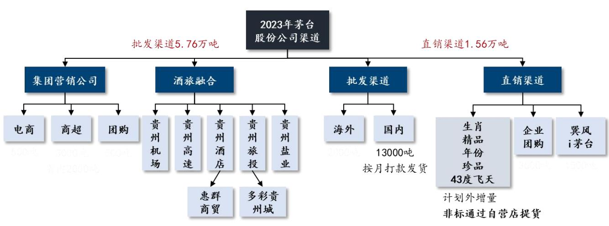  
资料来源：公司公告、公司官网，国信证券经济研究所整理

 五粮液：经营发展思路清晰，千元价位与对手拉开差距。2024 年看，五粮液1618及 39度五粮液快速增长缓解增长压力，前三季度报表质量良好，经销商普五库存处于安全水位。财年转化视角下，公司主动让利经销商、维护厂商关系，2025 年经销商仍有较高的回款意愿和市场配合度，同时 1618、低度及系列酒大单品仍有增长势能，预计报表端增速和质量均能保持稳健。当前普五批价虽有回落，但已逐步和竞品拉开差距，同时 1618 补充下，千元龙头地位进一步稳固，夯实长期价位发展基础。

盈利预测与估值：我们预计 2024-2026 年公司收入 891.8/965.9/1044.1 亿元，同比 +7.1%/+8.3%/+8.1% ； 归 母 净 利 润 326.6/358.6/395.2 亿 元 ， 同 比+8.1%/+9.8%/+10.2%；当前股价对应 17.2/15.7/14.2 倍 24-26 年 PE，维持“优于大市”评级。

图42：五粮液分产品收入占比情况  
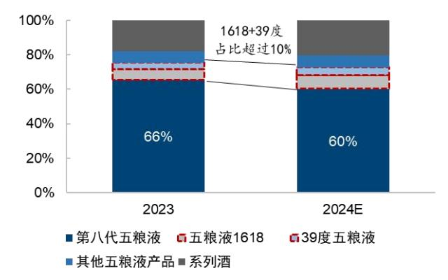  
资料来源：公司公告，国信证券经济研究所测算

图43：2024E千元价位带竞争格局  
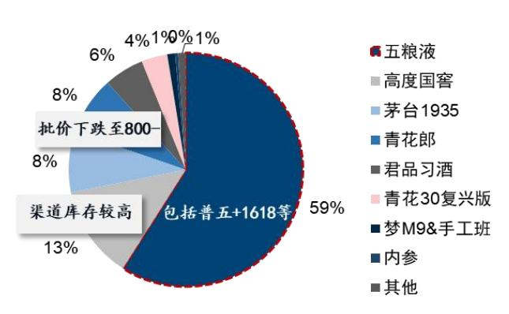  
资料来源：公司公告、酒业家、酒说，国信证券经济研究所测算

 山西汾酒：业绩增长攻守兼备，经营管理能力向上。2024 年看，前三季度公司业绩增速高于行业平均，且报表端质量较好、销售收现留有余力，山西省内市场蓄水池较厚，省外市场对渠道的透支不多，全年增速仍能达成板块较优序列。财年转化视角下，公司产品结构纵深，老白汾作为玻汾全国化的升级产品，预计承担主要增长贡献，青花 20产品势能平稳，30 复兴版搭配 600-700元青花 26有望补充增量，业绩增长工具充足。公司自 2023年以来积极补足组织和渠道短板，当前管理层稳定、渠道工具“汾享礼遇”有望在调整运作节奏后激发市场活力，看好公司经营管理能力向上。

盈利预测与估值：我们预计 2024-2026 年公司收入 373.2/422.5/474.5 亿元，同比 +16.9%/+13.2%/+12.3% ； 归 母 净 利 润 124.6/143.5/164.0 亿 元 ， 同 比+19.4%/+15.1%/+14.3%；当前股价对应 19.5/17.0/14.8 倍 24-26 年 PE，维持“优于大市”评级。

图44：玻汾、青花20价格有所下降，终端动销较好  
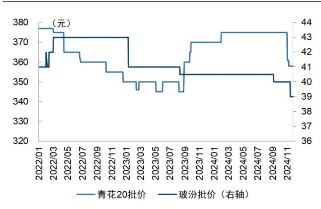  
资料来源：Wind，国信证券经济研究所整理

图45：汾酒产品结构纵深，全国化扩张有空间  
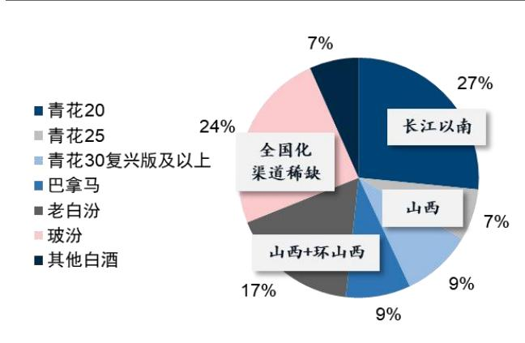  
资料来源：公司公告、酒业家、酒说，国信证券经济研究所测算

## 投资主线 2：顺周期属性较强、EPS 修复弹性大的泸州老窖及次高端龙头

乐观展望下，政策催化内需复苏，渠道库存加快去化，行业迎来新的周期，顺周期属性更强的标的业绩释放动力更强，估值端率先修复反映需求转好预期；同时我们坚持“股价持续性上涨需要基本面支撑”的观点，因此经济复苏条线首推公司质地突出、组织管理能力毋庸置疑的泸州老窖，推荐调整早于行业、目前已出现基本面边际转好迹象的水井坊，建议关注报表风险加速出清、重启弹性增长的舍得酒业、酒鬼酒。

 泸州老窖：管理禀赋突出，国窖或将率先受益于商务需求复苏。2024 年看，公司灵活调整产品和市场策略，全年国窖系列、西南及华北大区基本盘支撑下，仍能实现收入正增长。财年转化视角下，考虑到公司主要产品渠道库存水位较高，预计 2025H1 仍以去化库存、出清风险为主，业绩端或有压力；若需求加速复苏，国窖能够率先受益于政商务需求回暖、产品周期从被动去库过渡到主动补库。公司组织及管理禀赋不变，坚持推进数字化工程建设，我们认为公司率先于行业抓住本轮渠道变革契机，营销模式与时俱进，长期仍是板块中优质的管理α标的。

盈利预测与估值：我们预计 2024-2026 年公司收入 318.1/334.9/369.1 亿元，同比 +5.2%/+5.3%/+10.2% ； 归 母 净 利 润 138.8/148.1/166.2 亿 元 ， 同 比+4.8%/+6.7%/+12.2%；当前股价对应 14.5/13.5/12.1 倍 24-26 年 PE，维持“优于大市”评级。

图46：老窖产品结构纵深、营销模式精细化  
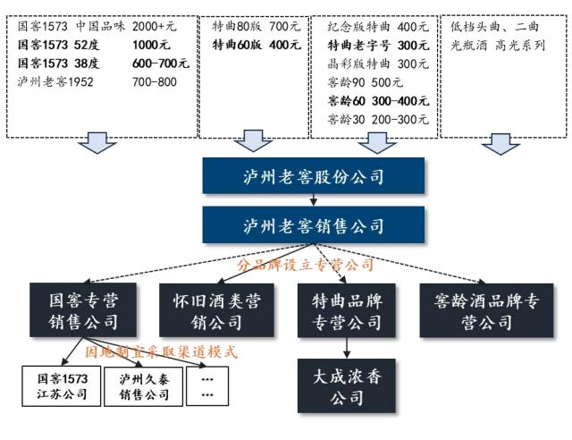  
资料来源：公司公告、京东商城，国信证券经济研究所整理

图47：2023年公司分地区收入结构，西南、华北优势突出  
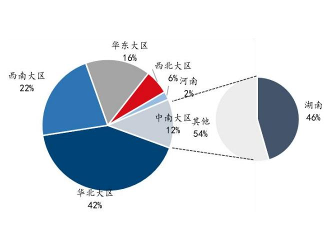  
资料来源：公司公告、酒业家、酒说，国信证券经济研究所测算

## 投资主线 3：加速经营管理调整的改革预期标的，关注口子窖等

改革是不变的主题，行业调整期部分酒企积极推动自身组织、渠道、产品等改革，补足经营短板。短期受制于发展阶段或外部环境扰动，市场秩序或业绩承压较重，但估值端消化充分；长期伴随外部需求转好、行业周期切换，改革红利有望加速释放。推荐业绩束缚较小、新品市场份额加速突破的口子窖，河北地区竞争格局改善、次高端大单品开始起量的老白干，关注报表风险加速出清、股息率已具备

性价比的洋河股份。

口子窖：产品定位逐步清晰，估值性价比凸显。2024 年看，公司主动降速为渠道纾压，报表质量及市场健康度较高；兼 8 在合肥 200 元价位带受益于高终端利润率推动、市场份额加速突破。财年转化视角下，公司通过兼 8 的上市进一步梳理清楚兼系列的定价结构，系列终端活动下消费者认知逐步打开；同时合肥地区开始运用新的营销模式，细化销售公司、咨询公司、业务员、大商的分工，加强厂家对终端的掌控力，渠道和市场活力被进一步激活，看好经济复苏及省内消费复苏下公司业绩增长能力。

盈利预测与估值：我们预计 2024-2026 年公司收入 59.7/64.5/69.9 亿元，同比+0.2%/+8.0%/+8.4% ； 归 母 净 利 润 17.1/18.8/20.8 亿 元 ， 同 比-0.5%/+9.9%/+10.4%。当前股价对应 13.9/12.7/11.5 倍 24-26 年 PE，假设维持分红率不变，对应 2024 年 3.8%的预测股息率，估值性价比凸显，维持“优于大市”评级。

图48：合肥地区200 元价位带市场格局演变  
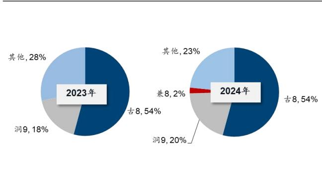  
资料来源：公司公告、酒业家、酒说，国信证券经济研究所测算

图49：口子窖合肥地区营销模式更精细化  
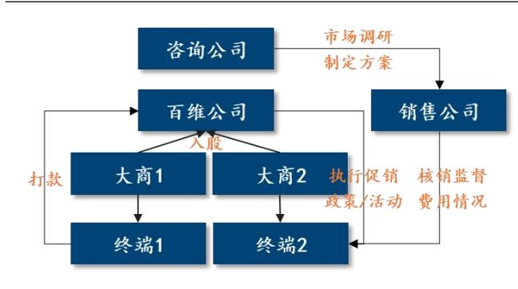  
资料来源：酒业家、酒说，国信证券经济研究所测算

## 可比公司估值及海外公司估值

板块整体看，当前白酒板块 PE(TTM)处于 2019/2014 年以来 5.1%/23.1%分位数，处于历史较低水位；当前估值对业绩降速的预期消费较为充分，政策加码内需方向确定，白酒板块作为顺周期优质资产，整体具有较大的估值修复空间。

图50：白酒上市公司2019年以来 PE(TTM)分位数  
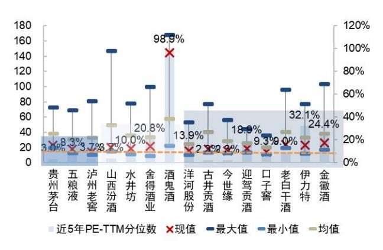

图51：白酒上市公司 2014年以来 PE(TTM)分位数  
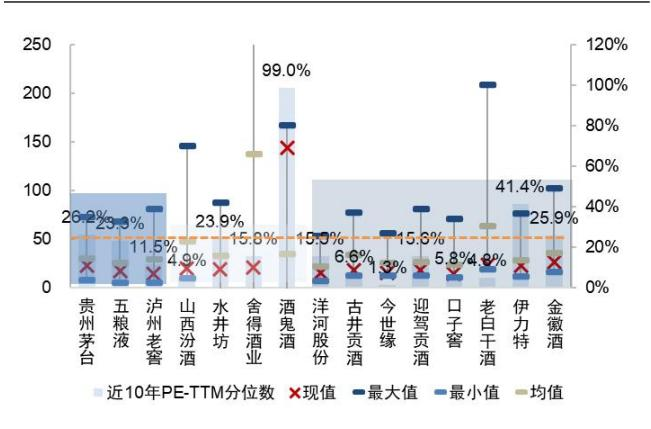

资料来源：Wind，国信证券经济研究所整理；注：数据截至 2024/11/22

资料来源：Wind，国信证券经济研究所整理；注：数据截至2024/11/22

表7：可比公司估值表

<table><tr><td rowspan="2">股票代码</td><td rowspan="2">公司简称</td><td rowspan="2">总市值 (亿元)</td><td colspan="3">营业总收入(亿元)</td><td colspan="2">收入同比增速</td><td colspan="3">归母净利润(亿元)</td><td colspan="2">净利润同比增速</td><td colspan="2">PE</td><td rowspan="2">PB (LF)</td></tr><tr><td>2023A</td><td>2024E</td><td>2025E</td><td>2024E</td><td>2025E</td><td>2023A</td><td>2024E</td><td>2025E</td><td>2024E</td><td>2025E</td><td>2024E</td><td>2025E</td></tr><tr><td>600519. SH</td><td>贵州茅台</td><td>18,941</td><td>1,505.6</td><td>1,739.0</td><td>1,916.3</td><td>15.5%</td><td>10.2%</td><td>747.3</td><td>852.0</td><td>940.6</td><td>14.0%</td><td>10.4%</td><td>22.2</td><td>20.1</td><td>8.0</td></tr><tr><td>000858. SZ</td><td>五粮液</td><td>5,624</td><td>832.7</td><td>891.8</td><td>965.9</td><td>7.1%</td><td>8.3%</td><td>302.1</td><td>326.6</td><td>358.6</td><td>8.1%</td><td>9.8%</td><td>17.2</td><td>15.7</td><td>4.1</td></tr><tr><td>000568. SZ</td><td>泸州老窖</td><td>2,006</td><td>302.3</td><td>318.1</td><td>334.9</td><td>5.2%</td><td>5.3%</td><td>132.5</td><td>138.8</td><td>148.1</td><td>4.8%</td><td>6.7%</td><td>14.5</td><td>13.5</td><td>4.4</td></tr><tr><td>600809. SH</td><td>山西汾酒</td><td>2,433</td><td>319.3</td><td>373.2</td><td>422.5</td><td>16.9%</td><td>13.2%</td><td>104.4</td><td>124.6</td><td>143.5</td><td>19.4%</td><td>15.1%</td><td>19.5</td><td>17.0</td><td>7.2</td></tr><tr><td>600702. SH</td><td>舍得酒业</td><td>243</td><td>70.8</td><td>56.4</td><td>61.0</td><td>-20.3%</td><td>8.0%</td><td>17.7</td><td>10.7</td><td>11.8</td><td>-39.6%</td><td>9.9%</td><td>22.7</td><td>20.6</td><td>3.4</td></tr><tr><td>000799. SZ</td><td>酒鬼酒</td><td>181</td><td>28.3</td><td>20.1</td><td>20.1</td><td>-29.0%</td><td>0.0%</td><td>5.5</td><td>2.9</td><td>2.9</td><td>-47.0%</td><td>0.0%</td><td>62.4</td><td>62.4</td><td>4.5</td></tr><tr><td>002304. SZ</td><td>洋河股份</td><td>1,273</td><td>331.3</td><td>300.1</td><td>284.2</td><td>-9.4%</td><td>-5.3%</td><td>100.2</td><td>85.2</td><td>79.7</td><td>-14.9%</td><td>-6.5%</td><td>14.9</td><td>16.0</td><td>2.4</td></tr><tr><td>603369. SH</td><td>今世缘</td><td>558</td><td>101.0</td><td>116.4</td><td>130.6</td><td>15.2%</td><td>12.2%</td><td>31.4</td><td>35.5</td><td>39.9</td><td>13.2%</td><td>12.4%</td><td>15.7</td><td>14.0</td><td>3.7</td></tr><tr><td>000596. SZ</td><td>古井贡酒</td><td>764</td><td>202.5</td><td>237.2</td><td>269.4</td><td>17.1%</td><td>13.6%</td><td>45.9</td><td>56.0</td><td>65.6</td><td>22.0%</td><td>17.2%</td><td>13.6</td><td>11.6</td><td>4.1</td></tr><tr><td>603198. SH</td><td>迎驾贡酒</td><td>479</td><td>67.2</td><td>75.4</td><td>85.2</td><td>12.2%</td><td>13.0%</td><td>22.9</td><td>27.0</td><td>31.4</td><td>18.2%</td><td>16.3%</td><td>17.7</td><td>15.2</td><td>5.2</td></tr><tr><td>603589. SH</td><td>口子窖</td><td>239</td><td>59.6</td><td>59.7</td><td>64.5</td><td>0.2%</td><td>8.0%</td><td>17.2</td><td>17.1</td><td>18.8</td><td>-0.5%</td><td>9.9%</td><td>13.9</td><td>12.7</td><td>2.3</td></tr><tr><td>603919. SH</td><td>金徽酒</td><td>102</td><td>25.5</td><td>29.6</td><td>34.2</td><td>16.3%</td><td>15.5%</td><td>3.3</td><td>3.9</td><td>4.6</td><td>18.1%</td><td>18.3%</td><td>26.3</td><td>22.2</td><td>3.1</td></tr><tr><td>600197. SH</td><td>伊力特</td><td>81</td><td>22.3</td><td>24.1</td><td>26.5</td><td>8.0%</td><td>10.0%</td><td>3.4</td><td>3.9</td><td>4.5</td><td>15.0%</td><td>15.0%</td><td>20.7</td><td>18.0</td><td>2.1</td></tr></table>

资料来源：Wind，国信证券经济研究所预测；注：总市值数据截至 2024/11/22

海外奢侈品看，爱马仕与其他品牌估值拉开差距。爱马仕当前 PE(TTM)在 54.4x，估值溢价来自 1）品牌高度稀缺性；2）业绩增长能力稳定性。LVMH/开云集团当前 PE(TTM)分别为 23.1x/14.7x，过去几年估值中枢下修较多主因消费人群中中产阶级占比较高，对宏观经济变化敏感，伴随 ROE下降 PE下杀较重。

贵州茅台估值下降与批价泡沫去化后市场担忧其品牌议价力有关，过去几年公司供给端投放增加、中产阶级消费茅台比例提升，商业模式从极致稀缺性向高端消费品回归，估值从爱马仕定价向 LVMH过渡。中长期看，茅台基本属性、基本需求并未改变，公司积极解决供需适配问题，深挖各渠道潜力解决消费者需求触达，支撑公司维持高个位数收入增速；同时茅台较奢侈品龙头分红率水平更高，当前估值具有较高安全垫。

表8：海外奢侈品龙头公司财务指标及估值

<table><tr><td>公司</td><td colspan="5">爱马仕</td><td colspan="5">LVMH</td><td colspan="5">开云集团</td></tr><tr><td>年份</td><td>收入增速</td><td>净利润增速</td><td>ROE</td><td>分红率</td><td>PE年均值</td><td>收入增速</td><td>净利润增速</td><td>ROE</td><td>分红率</td><td>PE年均值</td><td>收入增速</td><td>净利润增速</td><td>ROE</td><td>分红率</td><td>PE年均值</td></tr><tr><td>2018</td><td>7.50%</td><td>15.10%</td><td>26.80%</td><td>30.60%</td><td>43.44</td><td>9.80%</td><td>18.40%</td><td>21.70%</td><td>42.70%</td><td>26.17</td><td>108.00%</td><td>108.00%</td><td>23.40%</td><td>20.40%</td><td>39.77</td></tr><tr><td>2019</td><td>15.40%</td><td>8.70%</td><td>25.50%</td><td>31.60%</td><td>48.11</td><td>14.60%</td><td>12.90%</td><td>21.50%</td><td>43.50%</td><td>39.25</td><td>-37.90%</td><td>-37.90%</td><td>21.50%</td><td>57.20%</td><td>21.76</td></tr><tr><td>2020</td><td>-7.20%</td><td>-9.40%</td><td>19.90%</td><td>35.00%</td><td>52.41</td><td>-16.80%</td><td>-34.40%</td><td>12.80%</td><td>49.30%</td><td>29.99</td><td>-6.90%</td><td>-6.90%</td><td>19.50%</td><td>46.50%</td><td>22.84</td></tr><tr><td>2021</td><td>40.60%</td><td>76.50%</td><td>29.20%</td><td>19.80%</td><td>88.69</td><td>43.80%</td><td>156.00%</td><td>28.90%</td><td>29.30%</td><td>53.97</td><td>47.70%</td><td>47.70%</td><td>25.20%</td><td>31.40%</td><td>37.53</td></tr><tr><td>2022</td><td>29.20%</td><td>37.70%</td><td>30.90%</td><td>25.10%</td><td>60.09</td><td>23.30%</td><td>17.00%</td><td>28.00%</td><td>42.80%</td><td>66.86</td><td>13.80%</td><td>13.80%</td><td>26.10%</td><td>41.00%</td><td>22.65</td></tr><tr><td>2023</td><td>15.70%</td><td>28.00%</td><td>31.20%</td><td>32.20%</td><td>60.70</td><td>8.80%</td><td>7.70%</td><td>25.40%</td><td>42.80%</td><td>28.59</td><td>-17.50%</td><td>-17.50%</td><td>19.40%</td><td>57.40%</td><td>17.41</td></tr><tr><td>2024</td><td></td><td></td><td></td><td></td><td>53.37</td><td></td><td></td><td></td><td></td><td>23.43</td><td></td><td></td><td></td><td></td><td>14.98</td></tr></table>

资料来源：Wind，国信证券经济研究所整理

海外烈酒龙头看，三大烈酒巨头当前 PE(TTM)均落入 20倍以下。截至 2024/12/9，帝亚吉欧/保乐力加/人头马君度 PE(TTM)分别为 17.8/19.1/17.3 倍，位于 2018年以来最低分位数水平。我们认为中国白酒商业模式更优，可享估值溢价：1）白酒深植于我国社交属性，需求韧性和结构升级动力更强；2）白酒酒企以自建酒厂为主，而海外烈酒以收并购扩大规模，国内白酒盈利能力、ROE水平更高。

表9：海外烈酒龙头公司财务指标及估值

<table><tr><td>公司</td><td colspan="5">帝亚吉欧</td><td colspan="5">保乐力加</td><td colspan="5">人头马君度</td></tr><tr><td>年份</td><td>收入增速</td><td>净利润增速</td><td>ROE</td><td>分红率</td><td>PE年均值</td><td>收入增速</td><td>净利润增速</td><td>ROE</td><td>分红率</td><td>PE年均值</td><td>收入增速</td><td>净利润增速</td><td>ROE</td><td>分红率</td><td>PE年均值</td></tr><tr><td>2018</td><td>0.94%</td><td>13.52%</td><td>26.50%</td><td>52.30%</td><td>23.1</td><td>-3.20%</td><td>13.20%</td><td>11.10%</td><td>34.90%</td><td>25.3</td><td>2.93%</td><td>-22.12%</td><td>10.91%</td><td>16.67%</td><td>37.6</td></tr><tr><td>2019</td><td>5.79%</td><td>4.57%</td><td>30.50%</td><td>51.40%</td><td>25.1</td><td>5.30%</td><td>-7.70%</td><td>9.50%</td><td>44.30%</td><td>27.3</td><td>-0.10%</td><td>7.42%</td><td>11.22%</td><td>5.72%</td><td>40.3</td></tr><tr><td>2020</td><td>-8.67%</td><td>-55.41%</td><td>15.60%</td><td>116.80%</td><td>31.5</td><td>-8.00%</td><td>-77.40%</td><td>2.30%</td><td>258.10%</td><td>48.0</td><td>-8.98%</td><td>-28.77%</td><td>7.56%</td><td>72.48%</td><td>45.3</td></tr><tr><td>2021</td><td>8.35%</td><td>88.79%</td><td>33.20%</td><td>61.90%</td><td>50.7</td><td>4.50%</td><td>296.70%</td><td>9.00%</td><td>53.90%</td><td>120.6</td><td>-1.42%</td><td>27.43%</td><td>9.77%</td><td>6.64%</td><td>75.9</td></tr><tr><td>2022</td><td>21.35%</td><td>22.14%</td><td>37.20%</td><td>52.90%</td><td>27.9</td><td>21.30%</td><td>53.00%</td><td>13.00%</td><td>41.40%</td><td>37.0</td><td>29.96%</td><td>47.06%</td><td>13.22%</td><td>44.09%</td><td>77.4</td></tr><tr><td>2023</td><td>10.75%</td><td>14.93%</td><td>40.10%</td><td>47.20%</td><td>20.7</td><td>13.40%</td><td>13.30%</td><td>13.80%</td><td>47.40%</td><td>23.9</td><td>17.95%</td><td>38.26%</td><td>17.18%</td><td>24.52%</td><td>38.3</td></tr><tr><td>2024</td><td>-2.75%</td><td>-18.42%</td><td>25.10%</td><td>59.56%</td><td>18.1</td><td></td><td>-17.88%</td><td></td><td></td><td>17.0</td><td></td><td>-24.2%</td><td></td><td></td><td>22.1</td></tr></table>

资料来源：Wind，国信证券经济研究所整理

## 风险提示

1、经济增速持续放缓，商务需求承压。若未来经济活跃度恢复不及预期，礼品、商务宴请场景恢复缓慢，白酒需求进一步降低，酒企库存去化节奏缓慢，经营压力将进一步加大。

2、消费税税收政策调整。二十届三中全会提出消费税征收环节后移并逐步下放地方，酒企对渠道补贴进一步加大下，利润率或将承压。

3、食品安全问题等。若酒企生产经营不规范，导致食品安全问题，板块整体将受到突发事件的扰动，股价有下降风险。

## 免责声明

分析师声明

作者保证报告所采用的数据均来自合规渠道；分析逻辑基于作者的职业理解，通过合理判断并得出结论，力求独立、客观、公正，结论不受任何第三方的授意或影响；作者在过去、现在或未来未就其研究报告所提供的具体建议或所表述的意见直接或间接收取任何报酬，特此声明。

## 国信证券投资评级

<table><tr><td>投资评级标准</td><td>类别</td><td>级别</td><td>说明</td></tr><tr><td rowspan="7">报告中投资建议所涉及的评级(如有)分为股票评级和行业评级(另有说明的除外)。评级标准为报告发布日后6到12个月内的相对市场表现,也即报告发布日后的6到12个月内公司股价(或行业指数)相对同期相关证券市场代表性指数的涨跌幅作为基准。A股市场以沪深300指数(000300.SH)作为基准;新三板市场以三板成指(899001.CSI)为基准;香港市场以恒生指数(HSI.HI)作为基准;美国市场以标普500指数(SPX.GI)或纳斯达克指数(IXIC.GI)为基准。</td><td rowspan="4">股票投资评级</td><td>优于大市</td><td>股价表现优于市场代表性指数10%以上</td></tr><tr><td>中性</td><td>股价表现介于市场代表性指数±10%之间</td></tr><tr><td>弱于大市</td><td>股价表现弱于市场代表性指数10%以上</td></tr><tr><td>无评级</td><td>股价与市场代表性指数相比无明确观点</td></tr><tr><td rowspan="3">行业投资评级</td><td>优于大市</td><td>行业指数表现优于市场代表性指数10%以上</td></tr><tr><td>中性</td><td>行业指数表现介于市场代表性指数±10%之间</td></tr><tr><td>弱于大市</td><td>行业指数表现弱于市场代表性指数10%以上</td></tr></table>

## 重要声明

本报告由国信证券股份有限公司（已具备中国证监会许可的证券投资咨询业务资格）制作；报告版权归国信证券股份有限公司（以下简称“我公司”）所有。本报告仅供我公司客户使用，本公司不会因接收人收到本报告而视其为客户。未经书面许可，任何机构和个人不得以任何形式使用、复制或传播。任何有关本报告的摘要或节选都不代表本报告正式完整的观点，一切须以我公司向客户发布的本报告完整版本为准。

本报告基于已公开的资料或信息撰写，但我公司不保证该资料及信息的完整性、准确性。本报告所载的信息、资料、建议及推测仅反映我公司于本报告公开发布当日的判断，在不同时期，我公司可能撰写并发布与本报告所载资料、建议及推测不一致的报告。我公司不保证本报告所含信息及资料处于最新状态；我公司可能随时补充、更新和修订有关信息及资料，投资者应当自行关注相关更新和修订内容。我公司或关联机构可能会持有本报告中所提到的公司所发行的证券并进行交易，还可能为这些公司提供或争取提供投资银行、财务顾问或金融产品等相关服务。本公司的资产管理部门、自营部门以及其他投资业务部门可能独立做出与本报告中意见或建议不一致的投资决策。

本报告仅供参考之用，不构成出售或购买证券或其他投资标的要约或邀请。在任何情况下，本报告中的信息和意见均不构成对任何个人的投资建议。任何形式的分享证券投资收益或者分担证券投资损失的书面或口头承诺均为无效，投资者应结合自己的投资目标和财务状况自行判断是否采用本报告所载内容和信息并自行承担风险我公司及雇员对投资者使用本报告及其内容而造成的一切后果不承担任何法律责任。

## 证券投资咨询业务的说明

本公司具备中国证监会核准的证券投资咨询业务资格。证券投资咨询，是指从事证券投资咨询业务的机构及其投资咨询人员以下列形式为证券投资人或者客户提供证券投资分析、预测或者建议等直接或者间接有偿咨询服务的活动：接受投资人或者客户委托，提供证券投资咨询服务；举办有关证券投资咨询的讲座、报告会、分析会等；在报刊上发表证券投资咨询的文章、评论、报告，以及通过电台、电视台等公众传播媒体提供证券投资咨询服务；通过电话、传真、电脑网络等电信设备系统，提供证券投资咨询服务；中国证监会认定的其他形式。

发布证券研究报告是证券投资咨询业务的一种基本形式，指证券公司、证券投资咨询机构对证券及证券相关产品的价值、市场走势或者相关影响因素进行分析，形成证券估值、投资评级等投资分析意见，制作证券研究报告，并向客户发布的行为。

## 国信证券经济研究所

深圳深圳市福田区福华一路 125 号国信金融大厦 36 层邮编：518046 总机：0755-82130833

上海上海浦东民生路 1199 弄证大五道口广场 1 号楼 12 层邮编：200135

北京北京西城区金融大街兴盛街 6 号国信证券 9 层邮编：100032