食品饮料 | 证券研究报告 — 行业策略报告

2024 年 12 月 21 日

强于大市

## 相关研究报告

《食品饮料行业周报》20241118

《食品饮料行业周报》20241015

《食品饮料行业周报》20240930

中银国际证券股份有限公司

具备证券投资咨询业务资格

食品饮料

证券分析师：邓天娇

(8610)66229391

tianjiao.deng@bocichina.com

证券投资咨询业务证书编号：S1300519080002

联系人：周源

yuan.zhou\_bj@bocichina.com

一般证券业务证书编号：S1300123040013

# 食品饮料行业2025年度策略

## 把握景气回升下的结构性机会，精选优质个股

食品饮料板块估值 9 月触及历史低点后企稳回升，3Q24 基金持仓环比持续下降，板块仍为低配状态。2025 年酒企经营目标将更加务实，表端降速为渠道舒压。白酒商业模式优异，龙头分红意愿提升，随着渠道去库及需求端好转，企业盈利有望逐步恢复，走出谷底。2025年大众品景气向上，受益于餐饮复苏，行业整体呈现出结构性投资机会，建议关注不同子行业周期拐点，把握景气回升下的结构性机会，精选优质个股。

## 支撑评级的要点

◼ 食品饮料板块估值 9 月触及历史低点后企稳回升，3Q24 基金持仓环比持续下降，板块仍为低配状态。（1）估值方面，受经济环境变化、消费信心动力不足的影响，2024年食品饮料板块估值较去年同期有所回落。截至12月1日，食品饮料板块估值（PE-TTM）为 21.5X，市盈率相对沪深 300 倍数为 1.7X。板块估值自 9 月触及2016年以来的历史低点后企稳回升，从2024年9月20日的17.0X（对应近五年PE估值历史分位数0.3%）逐步回升至当前的21.5X（对应近五年PE估值历史分位数7.3%）。（2）基金持仓方面，从主动权益基金配置食品饮料比例变化来看，3Q24环比 1Q24、2Q24 分别下降 4.0pct、0.5pct 至 7.9%，横向对比其他行业，食品饮料当前处于低配状态。3Q24 前十大重仓股中食品饮料个股仅有贵州茅台，白酒持仓减少。在宏观经济承压背景下，消费需求疲软，行业供需矛盾凸显。2024年3季度以来，国家陆续出台一系列宏观政策组合拳，内需改善预期升温。食品饮料作为顺周期板块受益宏观环境改善，板块情绪有望回升。

◼ 年酒企经营目标将更加务实，表端降速为渠道舒压。白酒商业模式优异，龙头分红意愿提升，随着渠道去库及需求端好转，企业盈利有望逐步恢复，走出谷底。当前行业底部特征显现，龙头分红意愿提升，具备长期配置价值。（ ） 白酒板块营收及归母净利增速分别为 、 ，其中 营收及归母净利增速分别为0.5%、2.1%，板块业绩降速明显。我们预计4Q24业绩仍有承压，2025年春节受益旺季提振环比将有望改善，但考虑到去年同期高基数，我们判断1Q25同比增速或将表现平稳。（2）对比上轮白酒周期，行业底部特征显现，酒企在存量竞争背景下主动刹车减速，对来年目标制定更加务实。我们判断， 年行业仍以去库存、促动销为主旋律，随着渠道压力的不断释放，叠加酒企自身迈向精细化管理，企业盈利有望逐步恢复，走出周期谷底。（3）白酒独特的商业模式使其拥有较强的业绩兑现能力，特别是龙头酒企对产品品质升级及价格调控的能力仍然较强。在强集中、强分化、强挤压的行业现状下，龙头白酒优势明显。（ ）信心堪比黄金，龙头酒企百亿中期分红纷纷落地，同时承诺未来三年较高分红率。根据我们测算，茅台、五粮液股息率分别约为 3.4%、4.0%，均高于十年期国债收益率。我们认为，白酒资产优质，龙头经营韧性较强，叠加高分红政策加持，龙头具备长期配置价值。

◼ 年大众品景气向上，受益于餐饮复苏，行业整体呈现出结构性投资机会，建议关注不同子行业周期拐点。（1）啤酒： 2024 年啤酒行业量、价均承压，呈现出旺季不旺的特征。企业之间分化明显，燕京及珠江两大区域酒企受益大单品放量，表现优于其他企业。我们认为，从竞争格局改善、产能两个角度来看，啤酒企业结构升级进程仍具韧性，原材料成本红利有望延续至 2025 年，利润修复可期，重视低基数下啤酒龙头底部反转机会。（2）调味品：调味品行业调整渐近尾声，需求逐季回暖。参考马上赢监测的线下商超及零售终端数据，3Q24基础调味品及复调销售额降幅环比收窄。从不同企业业绩表现来看，整体呈现出龙头强者恒强的特点，海天收获渠道改革红利，对其他品牌市场份额形成挤压，业绩表现显著优于其他基础调味品。复调行业保持增长态势，成本红利下利润有所修复。龙头积极探寻多元化发展，消费赛道进一步细分。 为复调旺季，收入端有望逐季改善。（3）乳制品：2024年乳业整体压力较大，减值损失+毛销差恶化使得板块盈利整体承压。相对于前两轮周期，本轮原奶周期受产能出清慢、需求走弱加剧供需错配影响，调整时间更长。乳制品行业供需传导速度较快，上下游价格存在较强联动性。 各省份已开始调节产能，我们判断 年下半年原奶有望实现供需平衡。 随着龙头乳企渠道库存去化的结束，终端价盘逐步企稳，3季度表端业绩环比改善，经营周期向上趋势确立。（4）休闲食品：疫情后，受经济环境影响，国内休闲零食市场转为以消费者主导的“买方市场”，具有性价比特征的新兴零食渠道崛起。受渠道变革影响，不同类型企业表现不一，积极拥抱新兴渠道且渠道转型速度较快的企业业绩占优。2025 年春节提前，4Q24 休闲零食企业提前步入年货节备货阶段，业绩有望环比提速。从行业发展阶段来看，我们认为休闲零食短期仍能享受渠道改革红利及大单品放量红利。

## 投资建议

（1）白酒：推荐贵州茅台、五粮液、山西汾酒，建议关注泸州老窖、洋河股份；（2）大众品：推荐青岛啤酒、承德露露、颐海国际、中炬高新，建议关注伊利股份、新乳业、三只松鼠、安井食品、盐津铺子。评级面临的主要风险

◼ 宏观经济波动，渠道库存偏高，原料价格波动。

## 目录

市场回顾：食品饮料涨跌幅排名靠后，估值触底后企稳回升，……5

涨跌幅：在31个申万一级行业中排名倒数第3，部分大众品个股展现强ALPHA属性……5

板块估值：同比有所回落，9月触及历史低点后企稳回升。……6

基金持仓：食品饮料当前处于低配状态，3Q24持仓环比持续下降……8

白酒：行业降速去库，酒企主动调节，有望走出周期谷底……10

酒企主动调节，3季度报表业绩降速明显，渠道压力得到缓解……10

内需提振背景下，白酒基本面有望逐步回暖，走出周期谷底……13

白酒商业模式优异，龙头酒企分红意愿提升，具备配置价值……15

大众品：景气回升背景下，关注结构性投资机会……17

啤酒：量价承压，企业之间表现分化，后续利润修复可期……17

调味品：龙头强者恒强，率先走出调整，复调迎来销售旺季，基本面回暖……19

乳制品：3Q24乳企表现环比改善，奶粉行业逐步回暖……23

休闲零食：零食渠道持续变革，龙头企业抢抓渠道红利末期……24

投资思路：把握底部回升的结构性机会，精选景气赛道中的优质个股……27

风险提示……29

## 图表目录

图表1.2024年申万一级行业涨跌对比（截至12月1日）……5  
图表2.2024年食品饮料子行业涨跌对比（截至12月1日）……5  
图表3.2024年食品饮料个股涨跌排名（截至12月1日）……6  
图表4.2016年以来食品饮料各子板块PE（TTM）……6  
图表5.白酒行业市盈率（PE-TTM）……6  
图表6.白酒行业市盈率相对沪深300倍数……6  
图表7.食品饮料行业市盈率（PE-TTM）……7  
图表8.食品饮料行业市盈率相对沪深300倍数……7  
图表9.食品饮料子行业估值（PE-TTM）与归母净利润（TTM）变动情况……7  
图表10.2024年消费者信心指数持续承压……7  
图表11.3Q24主动权益基金重仓股配置比例……8  
图表12.3Q24主动权益基金重仓股配置比例……8  
图表13.2024年以来分季度主动权益基金前十重仓股……9  
图表14.白酒上市公司分季度营收及同比增速……10  
图表15.白酒上市公司分季度归母净利及同比增速……10  
图表16.餐饮类及限额以上餐饮类社零数据当月同比……10  
图表17.烟酒类社零数据当月同比……10  
图表18.白酒行业与上市公司营收增速对比……11  
图表19.白酒行业利润与上市公司归母净利润增速对比……11  
图表20.不同类白酒1-3Q24与3Q24收入、归母净利增速情况……12  
图表21.3Q24合同负债整体表现弱于营收端……13  
图表22.中国居民平均消费倾向仍处于较低位置……13  
图表23.居民储蓄意愿强烈……13  
图表24.白酒需求端及供给端传导路径……14  
图表25.社融存量期末同比与食品饮料板块营收同比增速（单位：%）……14  
图表26.飞天茅台出厂价及市场批价表现……15  
图表27.五粮液及国窖1573出厂价……15  
图表28.白酒板块归母净利同比增速……15  
图表29.年初至今，白酒股价涨跌幅……15  
图表30.2015年以来部分白酒上市公司PE估值分位数……15  
图表31.1-3Q24食品饮料不同子行业归母净利率……16  
图表32.1-3Q24食品饮料不同子行业毛利率表现……16  
图表33.部分白酒上市公司股息率……16  
图表34.大众品不同子行业1-3Q24与3Q24收入、归母净利润增速情况……17  
图表35.大众品不同子板块股价涨跌幅（2024.1.1-2024.11.30）……17  
图表36.啤酒累计产量、同比增速（截至24年10月）……18

图表37. 主要啤酒企业2024年量、价同比增速....18  
图表38. 主要啤酒企业1-3Q24营收表现....18  
图表39. 主要啤酒企业1-3Q24归母净利润表现....18  
图表40. 铝锭、玻璃价格变动（截至2024年11月30日）....18  
图表41. 瓦楞纸价格变动（截至2024年11月30日）....19  
图表42. 进口大麦价格变动（截至2024年10月）....19  
图表43. 餐饮社零总额及同比增速....20  
图表44. 不同调味品品类销售额及销售件数同比情况....20  
图表45. 调味品上市公司1-3Q24业绩概览....21  
图表46. 海天味业单季度营收及同比增速....21  
图表47. 海天味业单季度归母净利及同比增速....21  
图表48. 主要调味品企业营收同比增速（单季度）....21  
图表49. 主要调味品企业归母净利同比增速（单季度）....21  
图表50. 原材料成本价格同比增速（单位：%）....22  
图表51. 调味料及复合调味料行业规模及同比增速....22  
图表52. 中式复合调味料行业市场规模及同比增速....22  
图表53. 中国乳制品产量及同比增速....23  
图表54. 牛奶、酸奶零售价变化....23  
图表55. 生鲜乳价格变动（截至2024年11月29日）....23  
图表56. 1-3Q24乳制品板块费用率、利润率同比变化情况....23  
图表57. 奶粉行业主要企业1H24营收、同比增速....24  
图表58. 奶粉行业主要企业1H24归母净利润、同比增速....24  
图表59. 2023年休闲零食线上销售规模分布....25  
图表60. 2023年休闲零食行业线下销售规模分布....25  
图表61. 1-3Q24休闲食品上市公司业绩概览....26  
图表62. 零食板块季度销售毛利率....26  
附录图表63. 报告中提及上市公司估值表....28

## 市场回顾：食品饮料涨跌幅排名靠后，估值触底后企稳回升，

涨跌幅：在 31个申万一级行业中排名倒数第 3，部分大众品个股展现强 alpha 属性2024 年食品饮料板块整体承压，涨跌幅-6.9%（数据截至 12 月 1 日），在 31 个申万一级行业中排名倒数第 3位，跑输沪深 300。分子行业来看，软饮料、零食超额明显，涨跌幅分别为+20.2%、13.4%。乳品、调味发酵品、啤酒表现较好，涨跌幅分别为+5.3%、+3.5%、+1.8%。白酒、保健品、预加工食品表现较弱，涨跌幅分别为-10.4%、-11.5%、-16.7%。

图表 1. 2024 年申万一级行业涨跌对比（截至 12月 1日）  
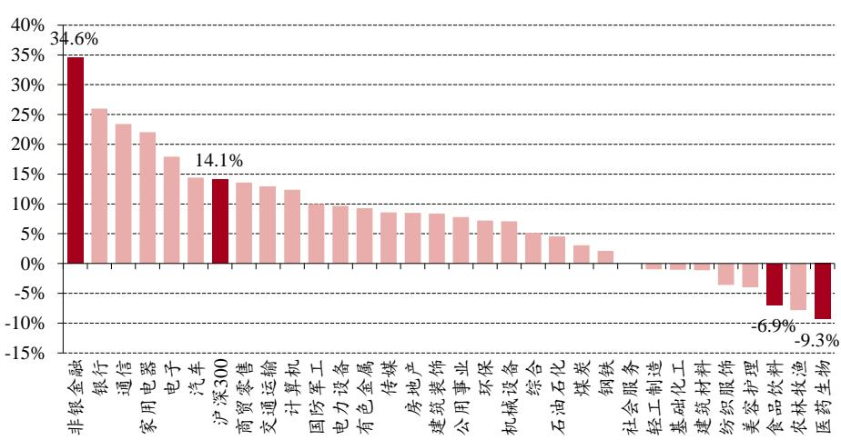  
资料来源：iFind.中银证券  
2024 12 1

图表 2. 2024 年食品饮料子行业涨跌对比（截至 12月 1日）  
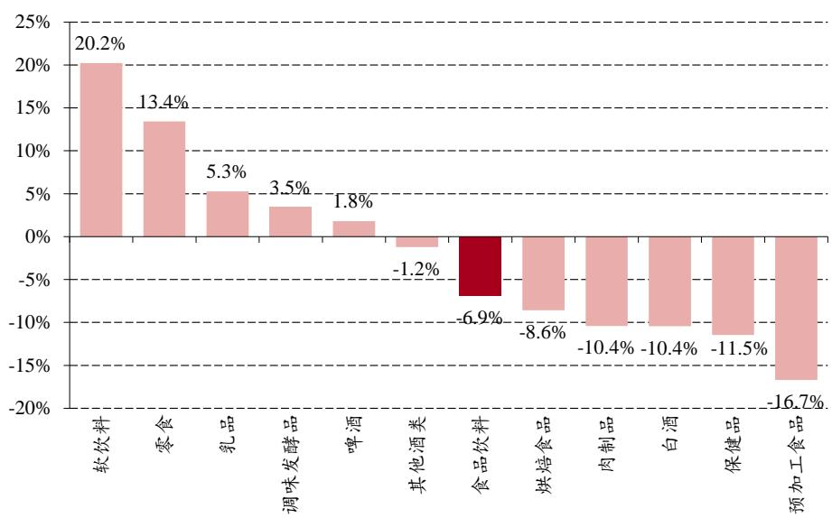  
资料来源：iFind，中银证券  
2024 12 1

从个股表现来看，部分大众品个股展现强 alpha属性。从 2024年上半年个股表现来看，涨幅排名前五的个股分别是品渥食品（+81.1%）、三只松鼠（+78.6%）、东鹏饮料（+55.4%）、桂发祥（+42.7%）、黑芝麻（+35.9%）。包括东鹏饮料、燕京啤酒在内的多只大众品个股业绩表现优异，展现出强 alpha属性。三只松鼠、有友食品两家零食企业受益于企业战略打法的进一步明确，股价表现同样优异。

图表 3. 2024年食品饮料个股涨跌排名（截至 12月 1日）

<table><tr><td>年涨幅前十名公司</td><td>涨幅(%)</td><td>涨幅后十名公司</td><td>涨幅(%)</td></tr><tr><td>品渥食品</td><td>81.1</td><td>ST春天</td><td>(60.3)</td></tr><tr><td>三只松鼠</td><td>78.6</td><td>良品铺子</td><td>(37.6)</td></tr><tr><td>东鹏饮料</td><td>55.4</td><td>华统股份</td><td>(35.4)</td></tr><tr><td>桂发祥</td><td>42.7</td><td>皇氏集团</td><td>(33.3)</td></tr><tr><td>黑芝麻</td><td>35.9</td><td>千味央厨</td><td>(31.0)</td></tr><tr><td>欢乐家</td><td>34.7</td><td>味知香</td><td>(29.5)</td></tr><tr><td>贝因美</td><td>33.4</td><td>泉阳泉</td><td>(28.0)</td></tr><tr><td>有友食品</td><td>31.5</td><td>春雪食品</td><td>(26.2)</td></tr><tr><td>交大昂立</td><td>30.1</td><td>海欣食品</td><td>(25.7)</td></tr><tr><td>好想你</td><td>29.9</td><td>惠发食品</td><td>(25.1)</td></tr></table>

资料来源：iFind.中银证券  
注：股价涨跌幅截至2024年12月1日，计算方式为前复权(再投资)

板块估值：同比有所回落，9月触及历史低点后企稳回升。

（1）整体来看，受经济环境变化、消费信心动力不足的影响，2024年食品饮料板块估值较去年同期有所回落。截至 12 月 1 日，食品饮料板块估值（PE-TTM）为 21.5X，市盈率相对沪深 300 倍数为1.7X，去年同期为 26.2X、2.4X。（2）分阶段来看，食品饮料板块估值自 9月触及 2016年以来的历史低点后企稳回升，从 2024 年 9 月 20 日的 17.0X（对应近五年 PE 估值历史分位数 0.3%）逐步回升至当前的 21.5X（对应近五年 PE估值历史分位数 7.3%）。（3）分行业来看，当前白酒、调味发酵品、啤酒 PE估值仍处于近五年较低水平，肉制品、软饮料 PE估值处于近五年较高水平。

图表 4. 2016年以来食品饮料各子板块 PE（TTM）

<table><tr><td></td><td>沪深300</td><td>食品饮料</td><td>白酒</td><td>啤酒</td><td>其他酒类</td><td>休闲食品</td><td>肉制品</td><td>调味发酵品</td><td>乳品</td><td>软饮料</td></tr><tr><td>最大值</td><td>16.8</td><td>63.0</td><td>63.3</td><td>93.1</td><td>186.7</td><td>81.4</td><td>42.6</td><td>79.5</td><td>47.8</td><td>47.8</td></tr><tr><td>最小值</td><td>10.3</td><td>17.2</td><td>16.4</td><td>19.4</td><td>24.0</td><td>17.5</td><td>14.8</td><td>22.2</td><td>13.1</td><td>19.7</td></tr><tr><td>现值</td><td>12.6</td><td>21.5</td><td>20.4</td><td>24.3</td><td>34.9</td><td>29.0</td><td>20.3</td><td>27.8</td><td>18.3</td><td>28.1</td></tr><tr><td>PE历史分位数(近五年、%)</td><td>61.2</td><td>7.3</td><td>6.7</td><td>10.1</td><td>17.3</td><td>20.0</td><td>79.0</td><td>8.7</td><td>11.6</td><td>62.8</td></tr></table>

资料来源：iFind.中银证券  
注：最大、最小值截至日期，现值计算日期均为2024年12月1日

图表 5. 白酒行业市盈率（PE-TTM）  
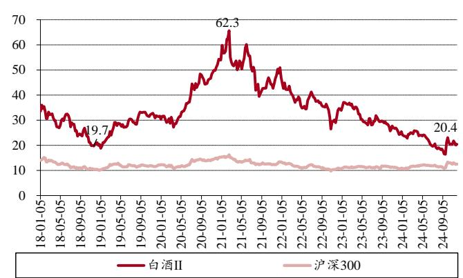  
资料来源：iFind.中银证券  
2024 12 1

图表 6. 白酒行业市盈率相对沪深 300倍数  
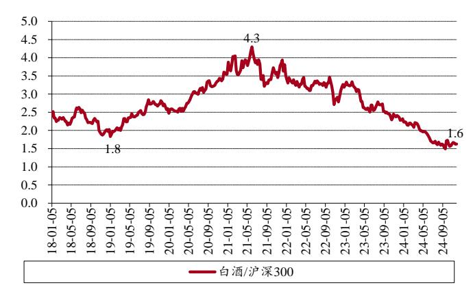  
资料来源：iFind.中银证券  
2024 12 1

图表 7. 食品饮料行业市盈率（PE-TTM）  
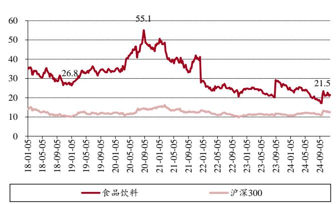  
资料来源：iFind，中银证券  
2024 12 1

图表 8. 食品饮料行业市盈率相对沪深 300倍数  
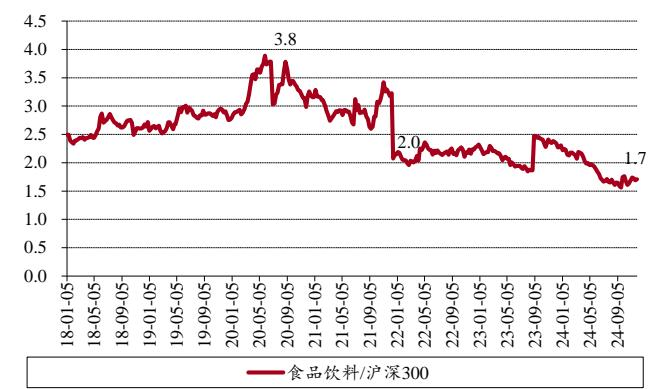  
资料来源：iFind，中银证券  
2024 12 1

图表 9. 食品饮料子行业估值（PE-TTM）与归母净利润（TTM）变动情况  
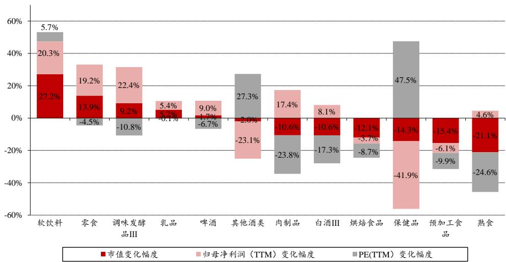  
资料来源：iFind，中银证券  
2024 12 1

图表 10. 2024年消费者信心指数持续承压  
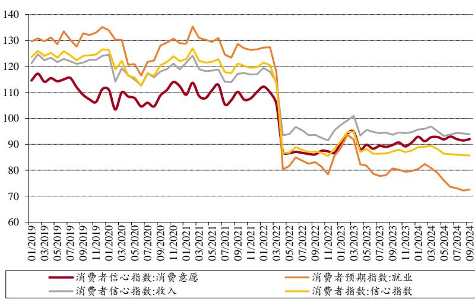  
资料来源：iFind.中银证券

## 基金持仓：食品饮料当前处于低配状态，3Q24持仓环比持续下降

食品饮料行业基金持仓环比持续下降，行业配置为近三年新低。（ ） 主动权益基金行业配置比例排名前五的行业分别是电子、港股、医药、电力设备新能源、食品饮料，配置比例分别为13.2%、12.3%、9.8%、9.8%、7.9%。从主动权益基金配置食品饮料比例变化来看，3Q24 环比 1Q24、2Q24 分别下降 4.0pct、0.5pct 至 7.9%，为三年以来最低比例。从过去八个季度平均配置比例来看，食品饮料平均配置比例为 11.9%，3 季度配置比例环比过去八个季度平均值下降 4.0pct, 横向对比其他行业，食品饮料当前处于低配状态，我们判断主要与市场对部分子板块业绩降速及短期消费数据未有明显改善有关。（2）从前十大重仓股变化来看，3Q24 前十大重仓股中食品饮料个股仅有贵州茅台，且持仓基金个数环比 2Q24减少，白酒持仓下滑。

图表 11. 3Q24 主动权益基金重仓股配置比例  
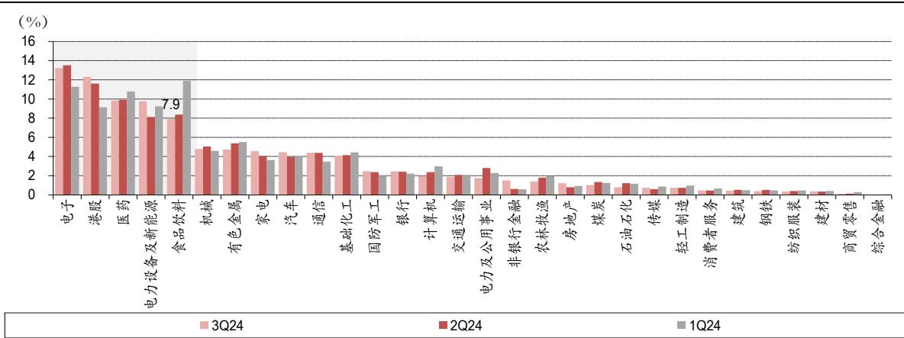  
资料来源：iFind，中银证券  
注：主动权益配置中包括30个中信一级行业及港股

图表 12. 3Q24 主动权益基金重仓股配置比例  
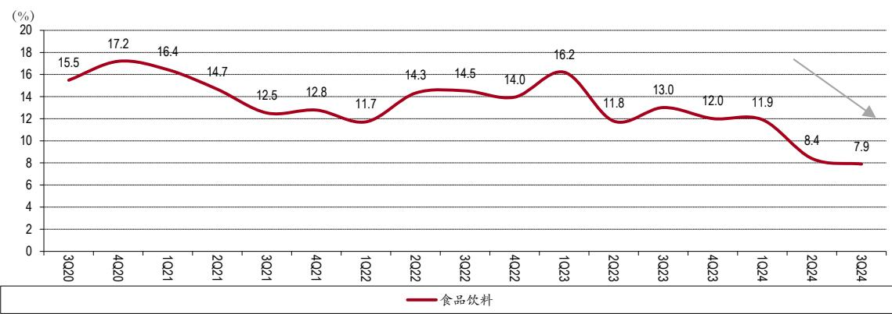  
资料来源：iFind，中银证券  
注：主动权益配置中包括30个中信一级行业及港股

图表 13. 2024年以来分季度主动权益基金前十重仓股

<table><tr><td rowspan="2">股票简称</td><td colspan="4">1Q24前十重仓股</td><td colspan="4">2Q24前十重仓股</td><td colspan="4">3Q24前十重仓股</td></tr><tr><td>重仓该股票基金个数</td><td>持股基金个数/主动股基金总数(%)</td><td>持股市值/基金重仓股市值(%)</td><td>股票简称</td><td>重仓该股票基金个数</td><td>持股基金个数/主动股基金总数(%)</td><td>持股市值/基金重仓股市值(%)</td><td>股票简称</td><td>重仓该股票基金个数</td><td>持股基金个数/主动股基金总数(%)</td><td>持股市值/基金重仓股市值(%)</td><td></td></tr><tr><td>贵州茅台</td><td>943</td><td>22.12</td><td>3.73</td><td>宁德时代</td><td>822</td><td>18.98</td><td>2.89</td><td>宁德时代</td><td>1079</td><td>24.72</td><td>3.77</td><td></td></tr><tr><td>宁德时代</td><td>915</td><td>21.46</td><td>3.21</td><td>立讯精密</td><td>796</td><td>18.38</td><td>2.00</td><td>立讯精密</td><td>824</td><td>18.88</td><td>2.10</td><td></td></tr><tr><td>泸州老窖</td><td>425</td><td>9.97</td><td>1.94</td><td>贵州茅台</td><td>721</td><td>16.65</td><td>2.62</td><td>美的集团</td><td>718</td><td>16.45</td><td>2.05</td><td></td></tr><tr><td>五粮液</td><td>455</td><td>10.67</td><td>1.93</td><td>紫金矿业</td><td>667</td><td>15.40</td><td>1.81</td><td>贵州茅台</td><td>705</td><td>16.15</td><td>2.58</td><td></td></tr><tr><td>紫金矿业</td><td>607</td><td>14.24</td><td>1.71</td><td>中际旭创</td><td>656</td><td>15.15</td><td>1.47</td><td>腾讯控股</td><td>651</td><td>14.91</td><td>2.53</td><td></td></tr><tr><td>美的集团</td><td>417</td><td>9.78</td><td>1.37</td><td>美的集团</td><td>532</td><td>12.28</td><td>1.66</td><td>中际旭创</td><td>634</td><td>14.52</td><td>1.50</td><td></td></tr><tr><td>恒瑞医药</td><td>363</td><td>8.52</td><td>1.34</td><td>腾讯控股</td><td>502</td><td>11.59</td><td>2.25</td><td>紫金矿业</td><td>579</td><td>13.26</td><td>1.53</td><td></td></tr><tr><td>山西汾酒</td><td>302</td><td>7.08</td><td>1.28</td><td>沪电股份</td><td>442</td><td>10.21</td><td>0.94</td><td>阳光电源</td><td>498</td><td>11.41</td><td>1.46</td><td></td></tr><tr><td>立讯精密</td><td>449</td><td>10.53</td><td>1.23</td><td>新易盛</td><td>434</td><td>10.02</td><td>0.92</td><td>新易盛</td><td>496</td><td>11.36</td><td>1.09</td><td></td></tr><tr><td>迈瑞医疗</td><td>246</td><td>5.77</td><td>1.23</td><td>工业富联</td><td>406</td><td>9.37</td><td>0.86</td><td>比亚迪</td><td>487</td><td>11.16</td><td>1.13</td><td></td></tr></table>

资料来源：iFind.中银证券

## 白酒：行业降速去库，酒企主动调节，有望走出周期谷底

酒企主动调节，3季度报表业绩降速明显，渠道压力得到缓解

3季度白酒板块业绩降速明显。（1）1-3Q24 白酒板块营收及归母净利增速分别为 9.2%、10.7%，其中 3Q24 营收及归母净利增速分别为 0.5%、2.1%。单 3 季度业绩环比 1H24 降速明显（1H24 营收、归母净利增速分别为 13.1%、14.3%），主要原因为白酒中秋旺季表现平淡，受动销放缓影响，渠道备货积极性同比去年下降，经销商主动去库，渠道压力传导至报表端，报表端降速明显。（2）结合社零数据，2024 年 1-10 月，餐饮类社零数据同比+5.9%，其中限额以上社零数据同比+3.2%，限额以上餐饮数据表现弱于整体餐饮社零数据，主要与商务消费恢复较慢有关。我们判断，二三线城市餐饮消费表现相对好于一线城市。2024年1-10月，烟酒类消费同比+6.1%，增速慢于1H24的+10.0%，3 季度表现平淡。

图表 14. 白酒上市公司分季度营收及同比增速  
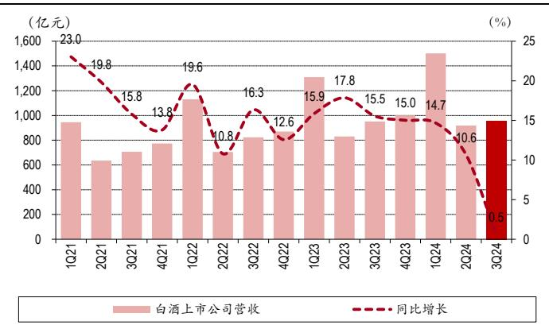  
资料来源：iFind，中银证券

图表 15. 白酒上市公司分季度归母净利及同比增速  
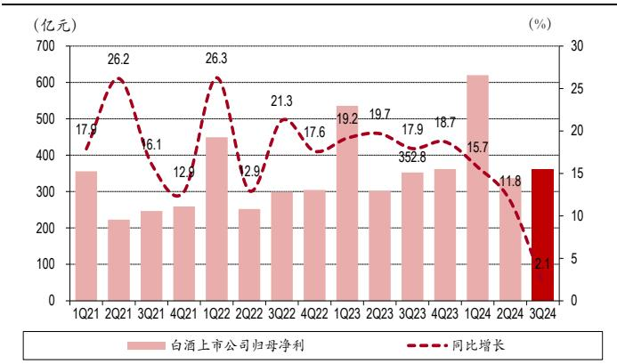  
iFind,

图表 16. 餐饮类及限额以上餐饮类社零数据当月同比  
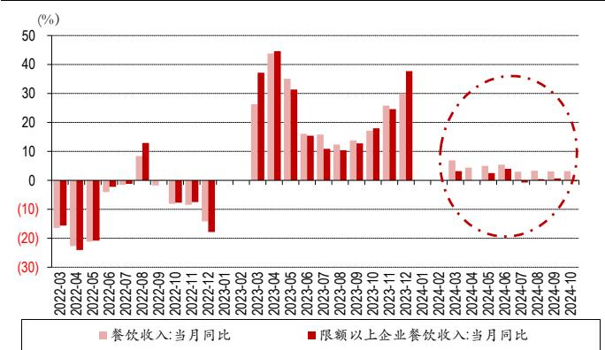  
资料来源：iFind，中银证券

图表 17. 烟酒类社零数据当月同比  
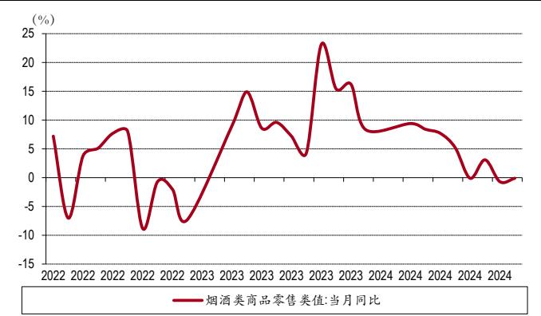  
iFind,

不同品牌、不同价格带之间出现分化，大众消费好于商务消费，品牌名酒表现好于其他非品牌白酒。根据酒业协会及国家统计局披露数据，2023年、1H24上市公司业绩增速快于白酒行业整体增速，结合当下的行业环境，我们判断 2H24 将延续此前趋势，品牌白酒表现好于其他非品牌白酒。从上市公司分不同类型企业来看，1-3Q24 高端酒、全国化扩张的次高端白酒、地产酒收入增速分别为+13.4%、+0.5%、+13.1%，归母净利增速分别为+12.8%、-2.9%、+17.2%，地产酒韧性相对较强。

（1） 一线高端酒：茅台韧性凸显，3Q24营收及归母净利增速分别为 15.3%、13.2%，五粮液、老窖 3季度业绩承压降速。3季度贵州茅台通过调整发货结构，茅台酒产品结构提升，叠加直销渠道占比提升，贡献整体增量。年初以来高端餐饮及商务消费场景萎缩，高端名酒在今年中秋礼赠场景中受阻，动销承压，结合公司自身的回款政策，五粮液、泸州老窖主动调整经营节奏，3季度收入及业绩环比上半年降速明显。

（2） 全国化扩张的次高端酒：3Q24 全国性次高端白酒营收、归母净利增速分别为-18.6%、-28.6%，利润增速低于收入增速，产品结构下移。受益于多价格带产品体系及省内基本盘稳固，山西汾酒表现优于其他全国化扩张的次高端白酒，3Q24营收增速分别为 11.4%、10.4%。水井坊坚持渠道良性控库存，前期出清较为彻底，3Q24 为公司内部第一个财年，整体业绩表现平稳，营收及归母净利增速均分别为+0.4%、+7.7%。舍得、酒鬼表端业绩下滑幅度较大，目前仍处于深度调整期。洋河主动放弃 2024 年经营目标（营收增速 5-10%），3季度业绩相较此前下滑幅度较大，营收及归母净利增速分别为-44.8%、-73.0%，公司主动去库，卸下包袱来年轻装上阵。

（3） 地产酒：在行业环境下行期，地产酒受益大本营大众价格带的升级及宴席消费提振，整体防御性较强，3Q24营收、归母净利增速分别为+2.7%、-0.2%。

◼ 徽酒内部分化明显，龙头古井业绩彰显韧性，营收、归母净利增速分别为+13.4%、+13.6%，省内维持强势表现，古 8、古 16 价格带产品表现较好。3Q24 迎驾贡酒收入环比降速，但仍保持中个位数增长，在动销偏弱背景下，公司主动调整节奏，给渠道减压。迎驾洞藏系列在省内品牌势能向上，洞 6、洞 9 延续放量趋势，产品结构持续升级。口子窖 3季度业绩增速由正转负， 主因 2季度新品铺货后，3季度步入动销验证期，叠加省内名酒竞争激烈，当前业绩承压。

◼ 西北白酒龙头中，金徽酒受益 2季度公司对渠道主动调控，中秋旺季经销商打款积极，带动整体营收增长，3 季度公司费用率优化释放利润弹性，归母净利率改善明显。伊力特、天佑德酒受大环境影响，3Q24 收入、利润增速均为负值，业绩短期承压。

◼ 今世缘 3 季度主动调整，营收环比上半年降速，受外部环境影响，公司产品结构下探，叠加货折投放力度加大，影响整体毛利率表现。老白干酒 3季度收入端表现平稳，归母净利润受益毛利率改善实现较快增长，增速为+25.2%。

图表 18. 白酒行业与上市公司营收增速对比  
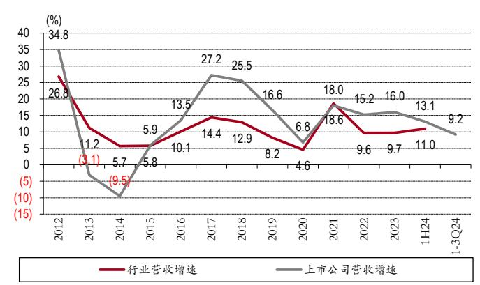  
资料来源：iFind、国家统计局、酒业协会、中银证券

图表 19. 白酒行业利润与上市公司归母净利润增速对比  
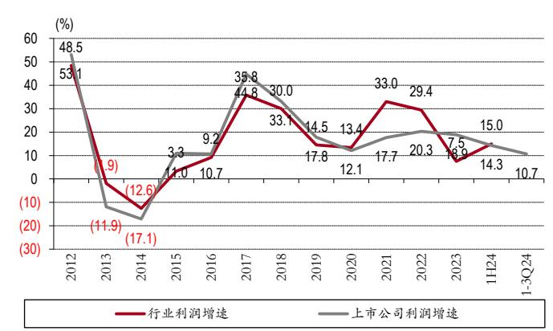  
资料来源：iFind、国家统计局、酒业协会、中银证券

图表 20. 不同类白酒 1-3Q24 与 3Q24 收入、归母净利增速情况

<table><tr><td rowspan="2">公司名称</td><td colspan="4">营业收入(亿元)</td><td colspan="4">归母净利润(亿元)</td></tr><tr><td>3Q24</td><td>YOY(%)</td><td>1-3Q24</td><td>YOY(%)</td><td>3Q24</td><td>YOY(%)</td><td>1-3Q24</td><td>YOY(%)</td></tr><tr><td colspan="9">高端酒</td></tr><tr><td>贵州茅台</td><td>388</td><td>15.3</td><td>1,208</td><td>17.0</td><td>191</td><td>13.2</td><td>608</td><td>15.0</td></tr><tr><td>五粮液</td><td>173</td><td>1.4</td><td>679</td><td>8.6</td><td>59</td><td>1.3</td><td>249</td><td>9.2</td></tr><tr><td>泸州老窖</td><td>74</td><td>0.7</td><td>243</td><td>10.8</td><td>36</td><td>2.6</td><td>116</td><td>9.7</td></tr><tr><td>合计</td><td>635</td><td>9.4</td><td>2,130</td><td>13.4</td><td>286</td><td>9.2</td><td>974</td><td>12.8</td></tr><tr><td colspan="9">全国化扩张的次高端</td></tr><tr><td>山西汾酒</td><td>86</td><td>11.4</td><td>314</td><td>17.2</td><td>29</td><td>10.4</td><td>113</td><td>20.3</td></tr><tr><td>洋河股份</td><td>46</td><td>(44.8)</td><td>275</td><td>(9.1)</td><td>6</td><td>(73.0)</td><td>86</td><td>(15.9)</td></tr><tr><td>水井坊</td><td>21</td><td>0.4</td><td>38</td><td>5.6</td><td>9</td><td>7.7</td><td>11</td><td>10.0</td></tr><tr><td>舍得酒业</td><td>12</td><td>(30.7)</td><td>45</td><td>(15.0)</td><td>1</td><td>(79.2)</td><td>7</td><td>(48.4)</td></tr><tr><td>酒鬼酒</td><td>2</td><td>(67.2)</td><td>12</td><td>(44.4)</td><td>(1)</td><td>(213.7)</td><td>1</td><td>(88.2)</td></tr><tr><td>合计</td><td>167</td><td>(18.6)</td><td>683</td><td>0.5</td><td>45</td><td>(28.6)</td><td>218</td><td>(2.9)</td></tr><tr><td colspan="9">地产酒</td></tr><tr><td>古井贡酒</td><td>53</td><td>13.4</td><td>191</td><td>19.5</td><td>12</td><td>13.6</td><td>47</td><td>24.5</td></tr><tr><td>口子窖</td><td>12</td><td>(22.0)</td><td>44</td><td>(1.9)</td><td>4</td><td>(27.7)</td><td>13</td><td>(2.8)</td></tr><tr><td>迎驾贡酒</td><td>17</td><td>4.0</td><td>55</td><td>14.8</td><td>6</td><td>6.2</td><td>20</td><td>21.2</td></tr><tr><td>今世缘</td><td>26</td><td>10.1</td><td>99</td><td>18.9</td><td>6</td><td>6.6</td><td>31</td><td>17.1</td></tr><tr><td>伊力特</td><td>3</td><td>(23.3)</td><td>17</td><td>0.6</td><td>0</td><td>(17.8)</td><td>2</td><td>5.3</td></tr><tr><td>金徽酒</td><td>6</td><td>15.8</td><td>23</td><td>15.3</td><td>0</td><td>108.8</td><td>3</td><td>22.2</td></tr><tr><td>老白干酒</td><td>16</td><td>0.3</td><td>41</td><td>6.3</td><td>3</td><td>25.2</td><td>6</td><td>33.0</td></tr><tr><td>天佑德酒</td><td>2</td><td>(18.8)</td><td>10</td><td>4.9</td><td>(0)</td><td>(334.4)</td><td>1</td><td>(45.8)</td></tr><tr><td>金种子酒</td><td>1</td><td>(54.4)</td><td>8</td><td>(24.9)</td><td>(1)</td><td>(3,837.2)</td><td>(1)</td><td>185.5</td></tr><tr><td>合计</td><td>137</td><td>2.7</td><td>487</td><td>13.1</td><td>30</td><td>(0.2)</td><td>122</td><td>17.2</td></tr></table>

资料来源：iFind，中银证券

我们预计 业绩仍有承压， 年春节受益旺季提振环比将有望改善，但考虑到去年同期高基数，我们判断 1Q25 同比增速或将表现平稳。（1）3Q24 白酒上市公司单季度营收及利润增速为近三年以来最低，且收入端压力传导至利润端， 白酒板块归母净利率同比 ，剔除茅台，板块归母净利率同比-0.2%，盈利能力下降。（2）从渠道回款指标来看，因白酒整体价盘承压，渠道回款积极性明显减弱。截至 3季度末，白酒板块合同负债为 380.2亿元，同比-6.5%，慢于 3Q24营收+合同负债同比增速（-1.5%）。受制于库存仍处于较高水平，不同层级渠道压货难度较大，我们判断酒厂将遵循行业发展规律，主动降低经营目标。（3）2025 年春节提前，各家酒厂现已陆续开展开门红回款工作，抢抓动销。从历年春节动销来看，整体表现较好，春节礼赠及亲友聚会场景刚性，有助于渠道去库。考虑到 1Q24 为高基数，1Q25 业绩将环比改善，但同比增速或将表现平稳。

图表 21. 3Q24合同负债整体表现弱于营收端

<table><tr><td>公司名称</td><td>1-3Q24 合同负债 (亿元)</td><td>同比(%)</td><td>环比 (亿元)</td><td>3Q24 营收+合同负 债(亿元)</td><td>同比(%)</td></tr><tr><td>贵州茅台</td><td>99.3</td><td>(12.8)</td><td>(0.6)</td><td>487.8</td><td>8.2</td></tr><tr><td>五粮液</td><td>70.7</td><td>79.1</td><td>(10.9)</td><td>243.4</td><td>16.0</td></tr><tr><td>山西汾酒</td><td>54.8</td><td>6.0</td><td>(2.5)</td><td>140.9</td><td>9.2</td></tr><tr><td>泸州老窖</td><td>26.5</td><td>(10.4)</td><td>3.1</td><td>100.5</td><td>(2.5)</td></tr><tr><td>古井贡酒</td><td>19.4</td><td>(41.6)</td><td>(2.8)</td><td>72.0</td><td>(9.5)</td></tr><tr><td>洋河股份</td><td>49.7</td><td>(10.0)</td><td>10.3</td><td>96.1</td><td>(31.0)</td></tr><tr><td>今世缘</td><td>5.4</td><td>(58.5)</td><td>(0.8)</td><td>31.8</td><td>(14.2)</td></tr><tr><td>水井坊</td><td>10.6</td><td>(5.9)</td><td>(0.2)</td><td>31.2</td><td>(1.8)</td></tr><tr><td>迎驾贡酒</td><td>4.0</td><td>(20.5)</td><td>(0.6)</td><td>21.3</td><td>(1.7)</td></tr><tr><td>顺鑫农业</td><td>6.6</td><td>(54.7)</td><td>0.8</td><td>22.9</td><td>(43.5)</td></tr><tr><td>老白干酒</td><td>17.5</td><td>(13.6)</td><td>(1.1)</td><td>33.7</td><td>(7.5)</td></tr><tr><td>口子窖</td><td>3.5</td><td>(7.5)</td><td>0.4</td><td>15.5</td><td>(19.1)</td></tr><tr><td>舍得酒业</td><td>1.7</td><td>(46.6)</td><td>0.1</td><td>13.6</td><td>(33.3)</td></tr><tr><td>金徽酒</td><td>4.8</td><td>10.3</td><td>(0.1)</td><td>10.5</td><td>13.2</td></tr><tr><td>伊力特</td><td>0.4</td><td>20.7</td><td>(0.2)</td><td>3.7</td><td>(19.8)</td></tr><tr><td>天佑德酒</td><td>0.8</td><td>(15.1)</td><td>0.1</td><td>3.1</td><td>(17.9)</td></tr><tr><td>酒鬼酒</td><td>2.1</td><td>(17.6)</td><td>(0.5)</td><td>4.0</td><td>(52.6)</td></tr><tr><td>金种子酒</td><td>1.0</td><td>4.0</td><td>0.4</td><td>2.4</td><td>(40.2)</td></tr><tr><td>皇台酒业</td><td>0.0</td><td>12.4</td><td>0.0</td><td>0.5</td><td>24.3</td></tr><tr><td>岩石股份</td><td>1.3</td><td>(59.1)</td><td>(0.2)</td><td>1.7</td><td>(79.6)</td></tr><tr><td>合计</td><td>380.2</td><td>(6.5)</td><td>(5.3)</td><td>1,336.6</td><td>(1.5)</td></tr></table>

资料来源：iFind.中银证券

## 内需提振背景下，白酒基本面有望逐步回暖，走出周期谷底

国家政策加大消费扶持力度，内需改善预期升温。近两年，随着地产及相关行业增速放缓，行业背后的经济驱动因素发生变化。在房地产市场低迷、城镇失业率上升、工业企业利润增速放缓等宏观因素影响下，市场呈现出有效需求不足，消费意愿低迷的特点。根据国家统计局数据，当前我国居民平均消费倾向仍处于较低位置，居民储蓄意愿及消费意愿“剪刀差”持续扩大。在此背景下，白酒行业受企业及居民消费意愿低迷影响，消费场景、消费动机趋缓，行业供需矛盾突出。 年 季度以来，国家陆续出台一系列宏观政策组合拳。在 9月 26 日召开的中央政治局会议上，强调要以提振消费为重点扩大国内需求，经济政策的着力点要更多转向惠民生、促消费，向地方安排 亿元左右超长期特别国债资金，加力支持地方实施消费品以旧换新。从后续陆续落地的货币政策及财政政策来看，市场经济恢复基础得到进一步巩固，内需改善预期升温。

图表 22. 中国居民平均消费倾向仍处于较低位置  
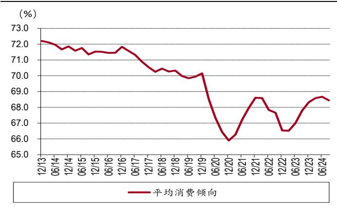  
资料来源：iFind、国家统计局、中银证券

图表 23. 居民储蓄意愿强烈  
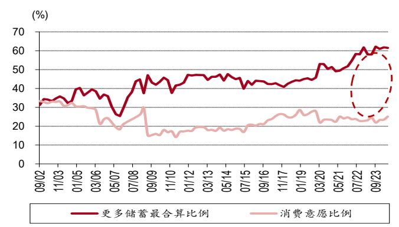  
资料来源：iFind、国家统计局、中银证券

名义增速回升传导至居民收入提升仍需时间，而白酒库存周期决定了宏观经济优先于板块基本面变化反应。白酒渠道链条较长，商业模式以分销为主，从经销商到分销商、团购商，再到终端商。报表端营收确认需要在渠道库存良性的基础上以发货确认为准，因此终端需求改善反馈到报表端需经历库存周期的调整。考虑到名义增速回升传导至居民收入提升，再到可选消费需求回升的传导顺序，我们判断宏观经济优先于板块基本面变化。参考社融存量同比数据，食品饮料板块盈利指标与社融存量同比基本趋同，但是收入指标表现落后于社融存量同比数据。

图表 24. 白酒需求端及供给端传导路径  
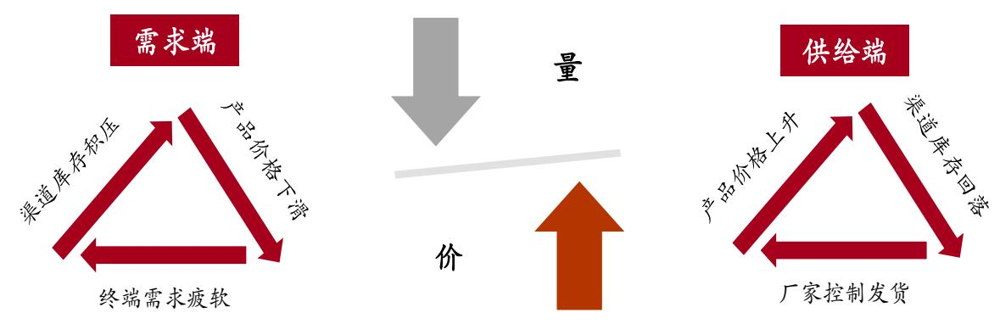  
资料来源：中银证券

图表 25. 社融存量期末同比与食品饮料板块营收同比增速（单位：%）  
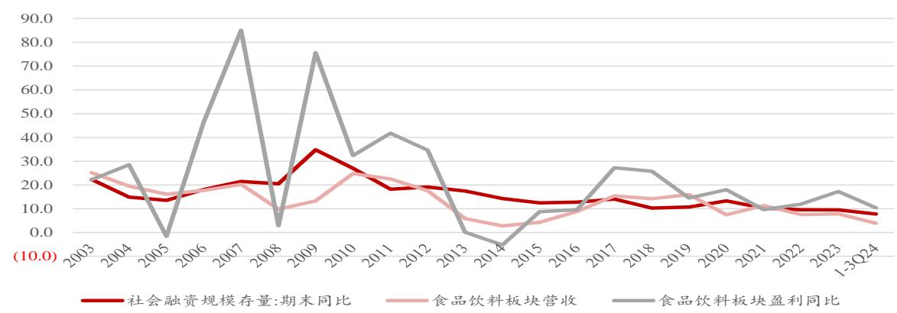  
资料来源：iFind，中银证券

行业底部特征显现，酒企在存量竞争背景下主动调整，对来年目标制定更加务实。我们判断，2025年行业仍以去库存、促动销为主旋律，基本面有望逐步回暖，走出周期谷底。白酒上市公司对地方利税贡献明显，因地方政府较高的考核目标，酒企多年追求的双位数增长目标使得行业库存不断累积，导致供需失配。参考上一轮行业周期底部特征：（1）茅台批价接近出厂价，经销商渠道利润缩减；（2）五粮液、国窖 1573 分别在行业调整期下调出厂价；（3）众多酒厂不再压货，酒企业绩下滑。我们认为当前行业底部特征已显现，从 2024年前三季度报表观察，上市酒企业绩增长动能放缓，主要体现在产品结构下移，营销费用加大但费用投放效果边际减弱等。而飞天批价作为行业价格的矛，年内波动较大，最低跌至 2100元。公司维护价格决心坚定，通过动态调整茅台酒发货结构稳定批价，当前飞天批价在 2300 元左右。虽然飞天批价与出厂价之间仍有利润价差，但渠道护城河厚度减少，经销商信心普遍不足。

受基本面表现影响，白酒股价出现较大跌幅，当前市盈率（TTM）分位点为 14.5%，为 10年以来低位。在此背景下，龙头酒企改革决心坚定，从增量市场的粗放型营销向存量市场的精细化营销转变。近日，茅台在临时股东大会上表态，茅台产品的基本属性和基本需求没有发生变化，公司在解决供需错配问题同时会进行内部改革，在客户群体、消费场景、消费者服务等方面进行转型，系统性规划品牌文化体验馆、形象店、专卖店、商超百货专柜等渠道，扩大消费者对产品的触达面。我们判断，随着供给端主动刹车减速，渠道压力释放，叠加自身营销迈向精细化管理，企业盈利能力有望逐步恢复，走出周期谷底。

图表 26. 飞天茅台出厂价及市场批价表现  
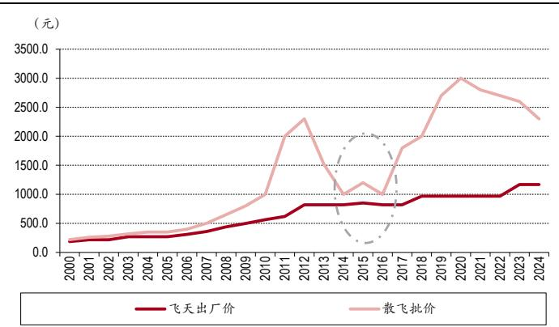  
资料来源：iFind，微酒，中银证券

图表 27. 五粮液及国窖 1573出厂价  
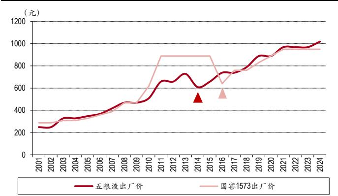  
资料来源：iFind.中银证券

图表 28. 白酒板块归母净利同比增速  
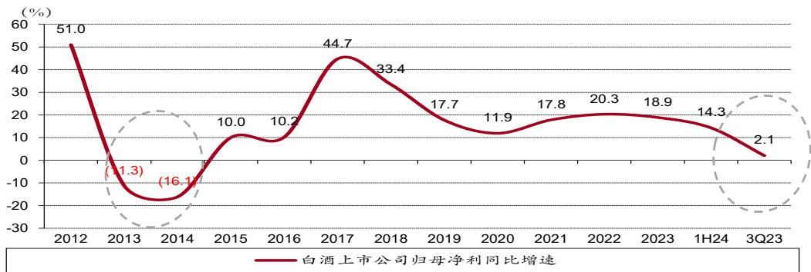  
资料来源：iFind，中银证券

图表 29. 年初至今，白酒股价涨跌幅  
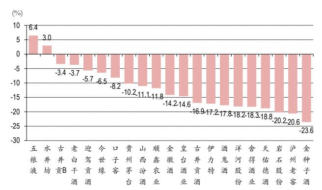  
资料来源：iFind，中银证券  
2024 11 28

图表 30. 2015年以来部分白酒上市公司 PE估值分位数  
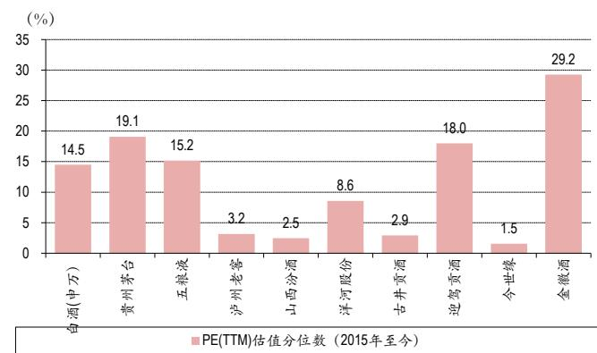  
iFind,  
2024 11 28

## 白酒商业模式优异，龙头酒企分红意愿提升，具备配置价值

白酒优异的商业模式护航其平稳穿越周期。建议关注周期底部具备抗风险能力及现金流稳定的龙头酒企，以及大众价格带升级逻辑顺畅、区域化扩张路径清晰的公司。（1）产品方面，我们认为消费者对产品品质的追求不变，参考过去十年玻汾的零售价及销售规模表现以及各区域主流价格带的演变，我们认为大众价格带产品持续升级的趋势未变。在外部环境疲软时，拥有大本营市场的地产酒受益春节返乡人数增加、宴席刚性需求和大本营大众价格带升级等因素，业绩表现更加稳健。（ ）渠道方面，名优酒企较强的经销网络使其拥有一定的商业护城河，蓄水池优势明显。相比食品饮料其他子板块，白酒盈利能力较强，归母净利率及毛利率均明显高于其他消费子板块。我们认为，白酒独特的商业模式使其拥有较强的业绩兑现能力，特别是龙头酒企对产品品质升级及价格调控的能力仍然较强。在强集中、强分化、强挤压的行业现状下，龙头白酒优势明显。

图表 31. 1-3Q24食品饮料不同子行业归母净利率  
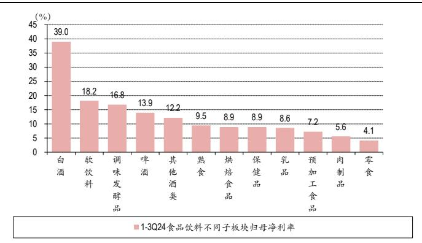  
资料来源：iFind，中银证券

图表 32. 1-3Q24食品饮料不同子行业毛利率表现  
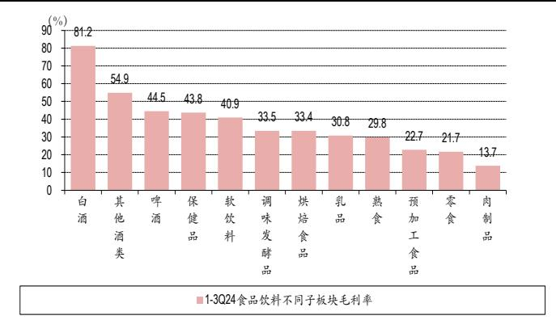  
iFind,

信心堪比黄金，龙头酒企百亿中期分红落地，股息率具备吸引力。“新国九条”指出要增强分红稳定性、持续性和可预期性，推动一年多次分红。白酒龙头积极响应政策号召，陆续公告中期分红方案，且分红力度较往年相比提升明显。贵州茅台、五粮液、洋河股份等酒企先后公告《2024-2026年股东回报规划》，承诺分红比例不低于 70%，其中茅台承诺分红比例不低于 75%。近日，茅台、五粮液分别公告《2024 年中期利润分配方案》，茅台中期分红金额 300 亿元，五粮液中期分红金额 100亿元，其中五粮液为近年来首次实现中期现金分红。根据我们测算，茅台、五粮液股息率分别约为 3.4%、4.0%，均高于十年期国债收益率。我们认为，白酒资产优质，龙头经营韧性较强，在高分红及回购政策逐一落地的加持下，白酒龙头具备长期配置价值。

图表 33. 部分白酒上市公司股息率  
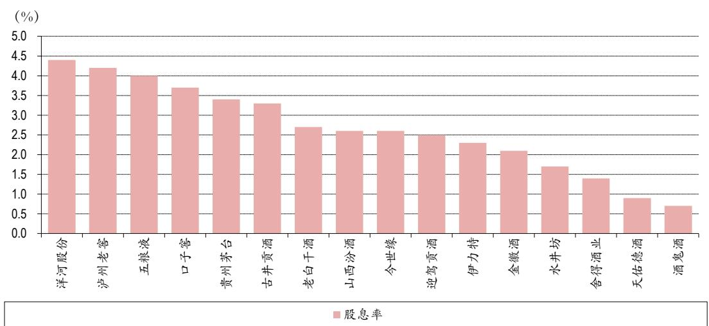  
资料来源：iFind.中银证券

注：日期为2024年11月29日，未覆盖公司归母净利为2024年市场一致盈利预测，分红率除已公告的茅台、五粮液、洋河，其他酒企按照2023年分红比例计算。

## 大众品：景气回升背景下，关注结构性投资机会

1-3Q24软饮料、零食、调味品业绩及股价表现均优于其他大众品。截至 11月 30日，2024年以来，大众品股价涨幅排名前三的子板块分别是软饮料、零食、调味品，涨幅分别为 37.2%、29.4%、13.8%。从 1-3Q24归母净利润表现来看，软饮料、零食、调味品增速领先于其他大众品子板块。

图表 34. 大众品不同子行业 1-3Q24与 3Q24收入、归母净利润增速情况

<table><tr><td rowspan="2">公司名称</td><td colspan="4">营业收入</td><td colspan="4">归母净利润</td></tr><tr><td>3Q24(亿元)</td><td>YOY(%)</td><td>1-3Q24(亿元)</td><td>YOY(%)</td><td>3Q24(亿元)</td><td>YOY(%)</td><td>1-3Q24(亿元)</td><td>YOY(%)</td></tr><tr><td>其他酒类</td><td>25.0</td><td>(7.8)</td><td>80.8</td><td>(4.3)</td><td>1.9</td><td>(45.0)</td><td>9.8</td><td>(27.8)</td></tr><tr><td>熟食</td><td>30.9</td><td>(10.1)</td><td>91.5</td><td>(8.7)</td><td>3.1</td><td>(5.0)</td><td>8.7</td><td>4.1</td></tr><tr><td>保健品</td><td>48.9</td><td>(16.4)</td><td>167.5</td><td>(8.9)</td><td>2.0</td><td>(65.4)</td><td>14.9</td><td>(38.6)</td></tr><tr><td>烘焙食品</td><td>73.3</td><td>(4.3)</td><td>183.8</td><td>(0.2)</td><td>9.0</td><td>(5.9)</td><td>16.3</td><td>(4.1)</td></tr><tr><td>软饮料</td><td>92.8</td><td>9.1</td><td>268.8</td><td>12.5</td><td>15.1</td><td>18.2</td><td>48.8</td><td>24.3</td></tr><tr><td>预加工食品</td><td>92.6</td><td>(3.3)</td><td>294.5</td><td>(2.0)</td><td>4.6</td><td>(30.0)</td><td>21.3</td><td>(7.5)</td></tr><tr><td>调味品</td><td>164.2</td><td>9.6</td><td>502.5</td><td>7.2</td><td>25.8</td><td>15.2</td><td>84.5</td><td>40.9</td></tr><tr><td>零食</td><td>199.2</td><td>58.0</td><td>514.3</td><td>58.0</td><td>7.7</td><td>60.2</td><td>21.2</td><td>26.9</td></tr><tr><td>啤酒</td><td>202.1</td><td>(3.3)</td><td>608.2</td><td>(1.9)</td><td>26.5</td><td>(2.1)</td><td>84.8</td><td>7.7</td></tr><tr><td>肉制品</td><td>279.0</td><td>0.5</td><td>791.0</td><td>(5.3)</td><td>18.3</td><td>23.4</td><td>44.3</td><td>15.1</td></tr><tr><td>乳品</td><td>463.1</td><td>(7.9)</td><td>1407.0</td><td>(8.8)</td><td>34.8</td><td>1.4</td><td>120.7</td><td>6.2</td></tr><tr><td>白酒</td><td>956.4</td><td>0.5</td><td>3377.2</td><td>9.2</td><td>360.1</td><td>2.1</td><td>1317.0</td><td>10.7</td></tr></table>

资料来源：iFind，中银证券

图表 35. 大众品不同子板块股价涨跌幅（2024.1.1-2024.11.30）  
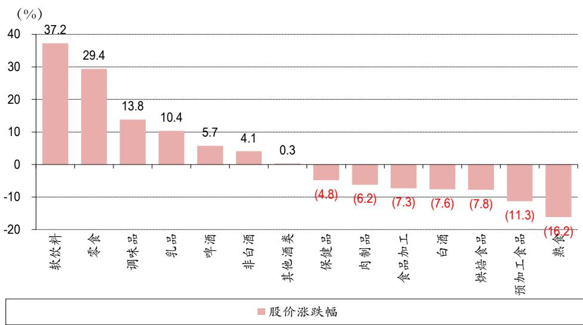  
资料来源：iFind.中银证券

## 啤酒：量价承压，企业之间表现分化，后续利润修复可期

2024年啤酒行业量价承压，主要企业表现分化。（1）整体来看，受餐饮、夜场等即饮需求减弱的影响， 年啤酒行业量、价均承压。 月啤酒累计产量 万千升，同比 。主要啤酒企业1-3Q24 整体吨价 4247 元，同比+1.2%。（2）分季度来看，随着即饮需求增速逐季放缓，3Q24啤酒行业出现旺季不旺的特征， 主要啤酒企业整体营收分别同比 ，量、价增长压力进一步加剧。（ ）分企业来看，百威亚太、重庆啤酒产品定位偏高，受即饮渠道需求减弱的影响更大，1-3Q24 营收分别同比-6.1%/+0.3%，销量分别同比-8.1%/+0.2%，吨价分别同比+2.2%/+0.1%。青岛啤酒 1-3Q24 营收/销量/吨价分别同比-6.5%/-7.0%/+0.5%，3Q24 表现较弱（单季营收同比 ），或系主动去化渠道库存所致。燕京啤酒、珠江啤酒两大区域啤酒企业受益于 U8、珠江纯生等升级大单品的放量，走出了独立表现，1-3Q24 营收分别同比+3.5%/+7.4%，销量分别同比+0.5%/+2.7%，吨价分别同比+3.0%/+4.5%。

图表 36. 啤酒累计产量、同比增速（截至 24年 10月）  
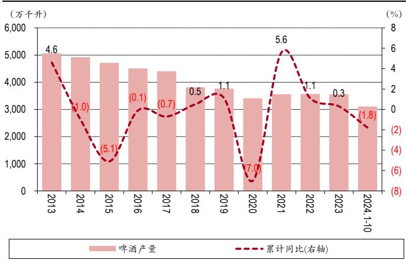  
资料来源：iFind，中银证券

图表 37. 主要啤酒企业 2024年量、价同比增速

<table><tr><td colspan="6">销量YoY</td></tr><tr><td></td><td>1Q24</td><td>2Q24</td><td>3Q24</td><td>1H24</td><td>1-3Q24</td></tr><tr><td>青岛啤酒</td><td>-7.6%</td><td>-8.0%</td><td>-5.1%</td><td>-7.8%</td><td>-7.0%</td></tr><tr><td>重庆啤酒</td><td>5.2%</td><td>1.5%</td><td>-5.6%</td><td>3.3%</td><td>0.2%</td></tr><tr><td>燕京啤酒</td><td>--</td><td>--</td><td>0.2%</td><td>0.6%</td><td>0.5%</td></tr><tr><td>珠江啤酒</td><td>0.8%</td><td>1.8%</td><td>4.7%</td><td>1.4%</td><td>2.7%</td></tr><tr><td>华润啤酒</td><td>--</td><td>--</td><td>--</td><td>-3.4%</td><td>--</td></tr><tr><td>百威亚太(内生)</td><td>-4.8%</td><td>--</td><td>--</td><td>-6.2%</td><td>-8.1%</td></tr><tr><td colspan="6">吨价YoY</td></tr><tr><td></td><td>1Q24</td><td>2Q24</td><td>3Q24</td><td>1H24</td><td>1-3Q24</td></tr><tr><td>青岛啤酒</td><td>2.6%</td><td>-0.9%</td><td>-0.2%</td><td>0.8%</td><td>0.5%</td></tr><tr><td>重庆啤酒</td><td>1.8%</td><td>0.0%</td><td>-1.6%</td><td>0.9%</td><td>0.1%</td></tr><tr><td>燕京啤酒</td><td>--</td><td>--</td><td>0.0%</td><td>4.9%</td><td>3.0%</td></tr><tr><td>珠江啤酒</td><td>6.2%</td><td>6.2%</td><td>2.0%</td><td>6.2%</td><td>4.5%</td></tr><tr><td>华润啤酒</td><td>--</td><td>--</td><td>--</td><td>2.0%</td><td>--</td></tr><tr><td>百威亚太(内生)</td><td>4.6%</td><td>--</td><td>--</td><td>2.0%</td><td>2.2%</td></tr></table>

资料来源：iFind，中银证券

图表 38. 主要啤酒企业 1-3Q24 营收表现  
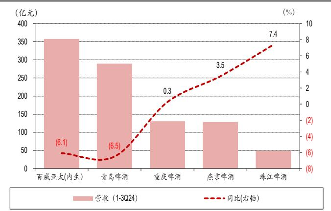  
资料来源：iFind.中银证券

图表 39. 主要啤酒企业 1-3Q24 归母净利润表现  
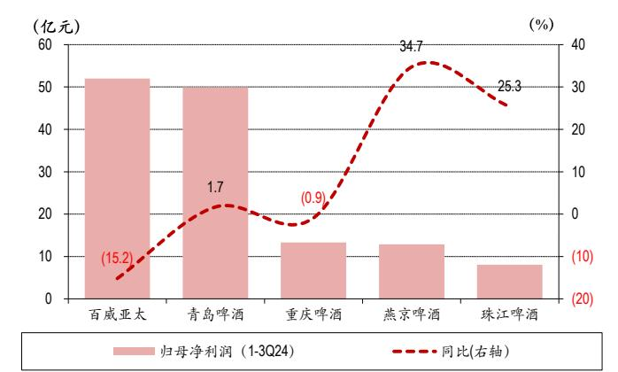  
资料来源：iFind.中银证券

原材料价格持续下行，成本红利有望延续至 2025 年。2024 年内，多数啤酒原材料价格延续下行趋势，铝锭/玻璃/瓦楞纸 11 月均价分别同比+11.1%/-28.1%/-5.9%，玻璃、瓦楞纸价格较年初显著下降。在取消双反税收后，大麦 10 月进口均价进一步下降至 250美元/吨，同比-14.6%。我们预计，随着新一轮锁价周期的到来，啤酒企业2025年使用的大麦成本有望进一步下降，叠加较弱的包材成本压力，啤酒行业的成本红利有望延续。

图表 40. 铝锭、玻璃价格变动（截至 2024年 11月 30日）  
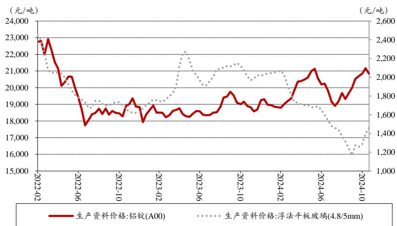  
资料来源：iFind.中银证券

图表 41. 瓦楞纸价格变动（截至 2024年 11月 30日）  
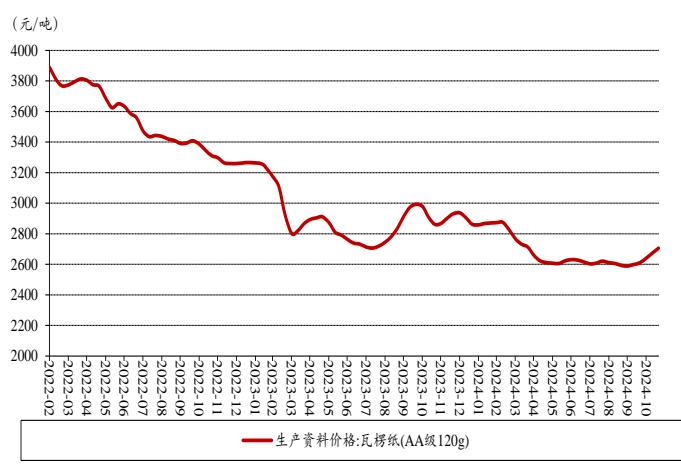  
资料来源：iFind，中银证券

图表 42. 进口大麦价格变动（截至 2024年 10月）  
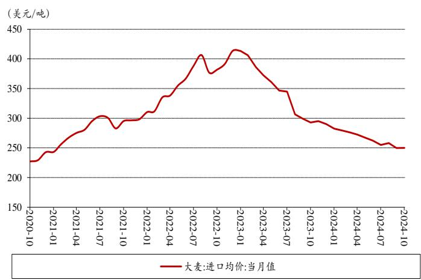  
资料来源：iFind，中银证券

结构升级进程仍具韧性，后续利润修复可期。我们认为，从竞争格局改善、产能两个角度来看，中期来看啤酒企业的结构升级进程仍具有韧性。如果 年消费、餐饮需求能够重新走强，啤酒企业销量有望重返增长轨道，吨价有望加速增长，叠加延续的成本红利，有望为啤酒企业带来较大的利润弹性。推荐运营节奏有望反转的青岛啤酒, 建议关注持续推进降本增效的燕京啤酒，低基数且中国区负责人发生更迭的百威亚太。

青岛啤酒：公司拥有优质的品牌资产、广阔的渠道网络，同时坚持高质量发展，近年来在持续巩固提升“一纵两横”战略带内市场地位的同时积极推进产品结构升级。我们判断，当前公司渠道库存去化较为充分，后续餐饮需求有望跟随宏观经济的修复持续好转，公司在餐饮渠道修复的带动下，量、价均有望重回增长轨道。

燕京啤酒：公司升级大单品 U8 持续放量，成本端人效显著低于同业。我们预计后续随着改革红利的延续、宏观环境的好转、内部成本管理的改善，公司量、价、盈利水平均有望延续增长趋势。后续营收端量价齐升+成本端降本增效两条利润提升主线如能悉数兑现，估值仍有一定的提升空间。

百威亚太：公司强调高端化战略，近年来主要产品多次提价、费用投放力度减小，1-3Q24 受餐饮、夜场等即饮消费场景减少的影响，中国区营收下降幅度较大。我们认为，公司近年来公司通过 BEES数字化平台持续赋能经销商，高端品牌的影响力仍然强大，且布局了越南、印度等新兴市场，长期来看仍具备较好的成长潜力。2024 年 11 月公司中国管理层发生人事变动，来年有望重整中国区运营思路，助力业绩重回增长轨道。

## 调味品：龙头强者恒强，率先走出调整，复调迎来销售旺季，基本面回暖

行业调整渐进尾声，3季度环比改善明显。根据国家统计局数据，1Q24、2Q24、3Q24 餐饮收入增速分别为 10.8%、5.0%、3.0%，受消费需求不振及接连的暴雨天气影响，餐饮端经营整体承压。10月份以来，国家政策加大消费扶持力度，叠加 2H24为调味品销售旺季，需求逐季回暖。参考马上赢监测的调味品线下商超及零售终端数据，酱油品类及复合调味品销售额同比降幅逐季收窄，3Q24 酱油吨价环比有所提升，行业调整渐进尾声，环比改善明显。

图表 43. 餐饮社零总额及同比增速  
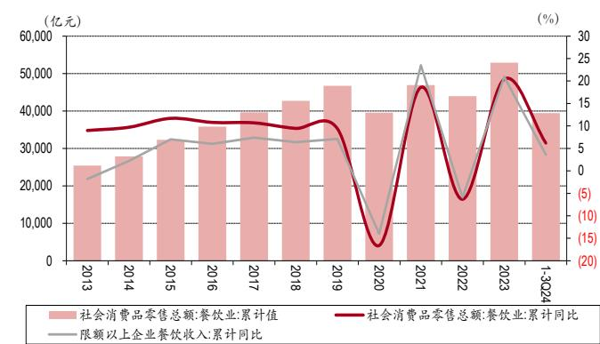  
资料来源：iFind，中银证券

图表 44. 不同调味品品类销售额及销售件数同比情况

<table><tr><td rowspan="2"></td><td colspan="3">销售额同比(%)</td><td colspan="3">销售件数同比(%)</td></tr><tr><td>1Q24</td><td>2Q24</td><td>3Q24</td><td>1Q24</td><td>2Q24</td><td>3Q24</td></tr><tr><td>味精</td><td>1.6</td><td>2.8</td><td>8.7</td><td>1.7</td><td>3.9</td><td>10.6</td></tr><tr><td>复合调味品</td><td>(9.7)</td><td>(6.8)</td><td>(0.4)</td><td>(12.6)</td><td>(11.0)</td><td>(2.2)</td></tr><tr><td>食糖</td><td>(15.2)</td><td>(13.6)</td><td>(0.6)</td><td>(16.7)</td><td>(16.4)</td><td>(3.6)</td></tr><tr><td>醋</td><td>(14.6)</td><td>(13.2)</td><td>(2.6)</td><td>(15.2)</td><td>(14.1)</td><td>(2.6)</td></tr><tr><td>蚝油</td><td>(17.8)</td><td>(13.9)</td><td>(2.8)</td><td>(20.7)</td><td>(17.3)</td><td>(6.4)</td></tr><tr><td>酱油</td><td>(15.3)</td><td>(11.8)</td><td>(3.8)</td><td>(15.6)</td><td>(10.9)</td><td>(3.0)</td></tr><tr><td>鸡精</td><td>(16.4)</td><td>(17.9)</td><td>(8.1)</td><td>(18.3)</td><td>(18.1)</td><td>(8.7)</td></tr><tr><td>盐</td><td>(23.9)</td><td>(18.7)</td><td>(51.1)</td><td>(28.1)</td><td>(23.0)</td><td>32.0</td></tr></table>

资料来源：马上赢，澎湃新闻，中银证券

龙头强者恒强，业绩表现优于其他基础调味品。受益成本红利，调味品整体毛利率稳步提升。（ ）营收端：1-3Q24 海天、中炬、千禾营收增速分别为+9.4%、-0.2%、-1.9%，其中 3Q24 营收增速分别为+9.8%、+2.2%、-12.6%。龙头海天受益渠道改革红利，业绩表现优于其他两家基础调味品企业。基础调味品竞争格局为一家独大，龙头营收规模远超其他基础调味品企业，因此当龙头理顺渠道及内部机制后，呈现出强者恒强的态势，市场份额不断向头部集中。（2）利润端：1-3Q24 海天、中炬、千禾归母净利增速分别为+11.2%、+19.3%、-9.2%，其中 3Q24 分别为+13.6%、+27.7%、-22.6%。受益原材料成本红利，3Q24海天、中炬、千禾毛利率分别同比提升 2.1pct、5.0pct、0.7pct。

海天味业：率先走出调整，重回增长轨道。2023年公司放弃表端业绩，对内部进行深度调整。当前公司在渠道结构、产品推新等方面的调整均卓有成效，改革红利显现。从经销商数量变化来看，C端的渠道优化基本结束，B端仍在精进改革，意在餐饮端持续做大做强。2024年前三季度餐饮行业表现平淡，我们判断公司今年 端营收贡献大于 端，主要体现在不断下沉的经销网络及产品在质量、规格、品类等方面的持续优化。疫情三年使得中小调味品企业加速出清，行业竞争格局出现变化，强者恒强，龙头调味品企业对其他品牌形成一定挤压，市场份额持续提升。内部治理方面，公司于24年 9月公告完成董事会、高管换届，新管理班子均深耕公司多年，调味品管理经验丰富。与此同时，公司推出《2024-2028年员工持股计划（草案）》，激发内部员工活力及积极性。2024 年海天规划营收、归母净利同比增速目标分别为 12.0%、10.7%，公司整体经营稳健。

中炬高新：内部改革持续，股权激励目标承压。中炬高新近两年大股东频繁更换，对公司经营产生一定影响，公司收入增速慢于行业内其他竞品。2023 年火炬集团重新掌舵，重返中炬高新第一大股东位置，同时引进具有华润背景的管理人员入驻，对公司过往发展存在的问题进行全面梳理改革。从公司前三季度业绩表现来看，完成全年同比 的营收增长目标压力较大。主要原因为：（ ）渠道仍处于磨合阶段。新管理层上任后对内部员工进行竞品上岗，同时引进快消品人员加入公司，因此在渠道磨合上仍需时间。（ ）年初以来，公司进行了两次价盘调整， 季度公司对大本营华南地区进行价盘改革，但因行业整体需求疲软，终端价未达到公司预期。2季度美味鲜营收增速为-12.1%，低于公司预期。9月份，公司在全国层面对部分厨邦酱油、鸡精进行提价，调价动作增厚营收，3Q24美味鲜营收同比 。我们认为，新管理层上任后对渠道及内部治理积极改革，随着新老人员的不断磨合，后期有望逐渐走出调整，收获改革成效。

千禾味业: 受 KA 商超流量下滑及 0 添加品类竞争激烈，公司业绩增速放缓。3 季度千禾业绩同比下滑。1-3Q24 千禾营收及归母净利增速分别为-1.9%、-9.2%，其中 3Q24 营收及归母净利增速分别为-12.6%、-22.6%，业绩在近两年高增后首次下滑。千禾受商超流量下滑影响，叠加自身账期问题，渠道周转放缓。此外， 添加产品已逐渐发展为较为成熟的品类，不同调味品企业纷纷推出 添加及减盐产品，市场竞争较为激烈，公司短期面临增长瓶颈，当前处于调整期。

图表 45. 调味品上市公司 1-3Q24业绩概览

<table><tr><td></td><td>1-3Q24 营业收入(亿元)</td><td>同比增速(%)</td><td>1-3Q24 归母净利(亿元)</td><td>同比增速(%)</td><td>3Q24 营收(亿元)</td><td>同比增速(%)</td><td>3Q24 归母净利(亿元)</td><td>同比增速(%)</td></tr><tr><td colspan="9">基础调味品</td></tr><tr><td>海天味业</td><td>204.0</td><td>9.4</td><td>48.1</td><td>11.2</td><td>62.4</td><td>9.8</td><td>10.5</td><td>13.6</td></tr><tr><td>中炬高新</td><td>39.5</td><td>(0.2)</td><td>5.5</td><td>19.3</td><td>13.3</td><td>2.2</td><td>2.1</td><td>27.7</td></tr><tr><td>千禾味业</td><td>22.9</td><td>(1.9)</td><td>3.5</td><td>(9.2)</td><td>7.0</td><td>(12.6)</td><td>1.0</td><td>(22.6)</td></tr><tr><td>恒顺醋业</td><td>15.3</td><td>(6.5)</td><td>1.2</td><td>(13.1)</td><td>5.3</td><td>5.6</td><td>0.3</td><td>80.0</td></tr><tr><td colspan="9">复合调味品</td></tr><tr><td>天味食品</td><td>23.6</td><td>5.8</td><td>4.3</td><td>35.0</td><td>9.0</td><td>10.9</td><td>1.9</td><td>64.8</td></tr><tr><td>日辰股份</td><td>3.0</td><td>11.8</td><td>0.5</td><td>30.9</td><td>1.1</td><td>6.5</td><td>0.3</td><td>44.5</td></tr><tr><td>宝立食品</td><td>19.3</td><td>9.7</td><td>1.7</td><td>(28.0)</td><td>6.6</td><td>4.1</td><td>0.6</td><td>(13.5)</td></tr><tr><td colspan="9">其他</td></tr><tr><td>安琪酵母</td><td>109.1</td><td>13.0</td><td>9.5</td><td>4.2</td><td>37.4</td><td>27.1</td><td>2.6</td><td>7.0</td></tr><tr><td>涪陵榨菜</td><td>19.6</td><td>0.6</td><td>6.7</td><td>1.7</td><td>6.6</td><td>6.8</td><td>2.2</td><td>17.9</td></tr></table>

资料来源：iFind.中银证券  
注：中炬高新为扣非归母净利润

图表 46. 海天味业单季度营收及同比增速  
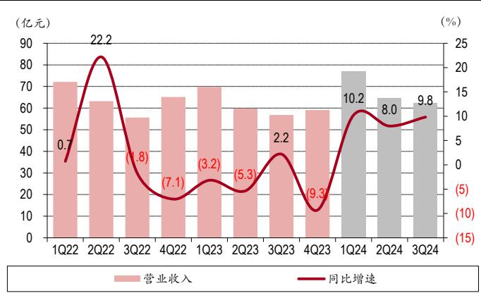  
iFind

图表 47. 海天味业单季度归母净利及同比增速  
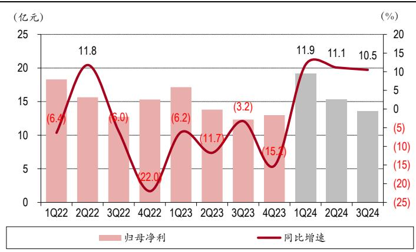  
资料来源：iFind，中银证券

图表 48. 主要调味品企业营收同比增速（单季度）  
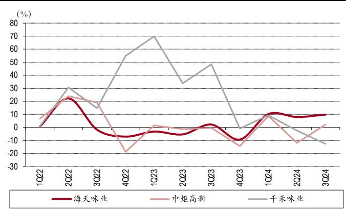  
iFind

图表 49. 主要调味品企业归母净利同比增速（单季度）  
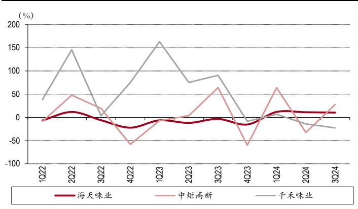  
iFind  
注：中炬高新为扣非归母净利同比增速

图表 50. 原材料成本价格同比增速（单位：%）

<table><tr><td></td><td>2Q21</td><td>3Q21</td><td>4Q21</td><td>1Q22</td><td>2Q22</td><td>3Q22</td><td>4Q22</td><td>1Q23</td><td>2Q23</td><td>3Q23</td><td>4Q23</td><td>1Q24</td><td>2Q24</td><td>3Q24</td></tr><tr><td>豆粕</td><td>11.9</td><td>16.5</td><td>10.8</td><td>10.0</td><td>23.9</td><td>19.8</td><td>39.8</td><td>14.1</td><td>(3.8)</td><td>3.1</td><td>(15.8)</td><td>(17.8)</td><td>(15.3)</td><td>(26.3)</td></tr><tr><td>食盐</td><td>(2.1)</td><td>(2.6)</td><td>(1.6)</td><td>1.7</td><td>3.8</td><td>4.4</td><td>3.5</td><td>1.0</td><td>0.0</td><td>1.2</td><td>2.1</td><td>2.0</td><td>1.1</td><td>1.3</td></tr><tr><td>小麦</td><td>6.5</td><td>7.6</td><td>13.1</td><td>18.1</td><td>26.3</td><td>21.5</td><td>17.0</td><td>4.7</td><td>(11.9)</td><td>(5.3)</td><td>(7.1)</td><td>0.0</td><td>(12.1)</td><td>(15.5)</td></tr><tr><td>玻璃</td><td>81.1</td><td>74.5</td><td>12.7</td><td>(0.1)</td><td>(27.9)</td><td>(47.5)</td><td>(31.9)</td><td>(26.1)</td><td>(2.6)</td><td>14.0</td><td>19.3</td><td>12.3</td><td>(14.3)</td><td>(26.9)</td></tr><tr><td>PET</td><td></td><td>31.1</td><td>50.0</td><td>25.1</td><td>28.7</td><td>23.8</td><td>(4.0)</td><td>(9.5)</td><td>(15.3)</td><td>(17.8)</td><td>(4.7)</td><td>(2.6)</td><td>(4.1)</td><td>(5.8)</td></tr><tr><td>瓦楞纸</td><td></td><td>11.4</td><td>12.7</td><td>6.0</td><td>3.8</td><td>(8.8)</td><td>(19.6)</td><td>(18.7)</td><td>(23.3)</td><td>0.1</td><td>(12.5)</td><td>(10.1)</td><td>(1.9)</td><td>(4.0)</td></tr><tr><td>大豆</td><td>29.4</td><td>19.8</td><td>22.9</td><td>9.4</td><td>11.9</td><td>12.4</td><td>3.6</td><td>0.5</td><td>(13.9)</td><td>(16.4)</td><td>(10.6)</td><td>(10.2)</td><td>(11.5)</td><td>(16.4)</td></tr></table>

资料来源：iFind，中银证券

复调行业整体仍然保持增长态势，龙头积极探寻多元化发展，消费赛道进一步细分。（ ）复合调味品的渠道销售主要来自餐饮、家庭和食品工业三个方面，受益于连锁化率的提升以及外卖市场的繁荣，近两年复合调味品市场取得了较快发展。在复合调味料赛道中，中式复合调味料崛起较为迅速，为空间广阔的细分赛道之一。根据红餐网数据及我们测算，预计复合调味料、中式复合调味料 2020-2024年 CAGR 分别 14.2%、18.2%，在整体餐饮行业消费不振的背景下依然保持增长态势。（2）从行业竞争态势来看，为提升消费者触达面，满足更多消费场景，龙头企业不断推陈出新，展现出较强的供应链优势及产品研发实力。例如火锅底料方面，继市场热度较高的牛油锅底后，颐海 2024年推出贵州红酸汤锅底，天味推出第三代厚火锅底料等。复调方面，天味投资入股团餐企业，以团餐为切入口试水预制菜领域。颐海旗下筷手小厨也推出牛杂火锅、羊蝎子火锅、虎皮凤爪等产品。

图表 51. 调味料及复合调味料行业规模及同比增速  
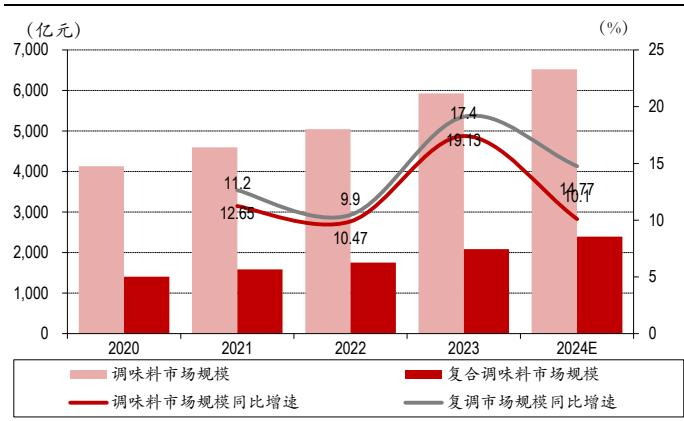  
资料来源：红餐网《中国餐饮发展报告2024》.中银证券

图表 52. 中式复合调味料行业市场规模及同比增速  
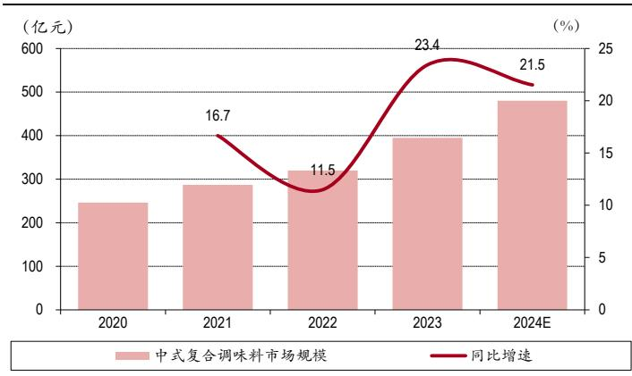  
资料来源：红餐网《中国餐饮发展报告2024》.中银证券

2H24为复调旺季复调龙头企业基木面有望逐季回暖。（1)天味食品：全年利润端将延续前三季度态势，表现亮眼，收入端有望逐季改善。1-3Q24 天味营收、归母净利增速分别为 5.8%、35.0%，其中 3Q24 营收、归母净利增速分别为 10.9%、64.8%，公司收入端回暖，业绩受益成本下降、高毛利产品结构提升及费用率优化，利润端表现亮眼。 年 月，公司公告员工持股计划，持股计划总金额不超过 万元，其中六位高管拟获份额占比为 。如果按照行权条件 年营收增速 计算， 天味营收增速需达到 。 季度随着销售旺季的到来，渠道动销环比改善，公司收入端有望环比提速。（2）颐海国际：第三方业务实现增长，不同渠道多点开花，全年延续高分红风格。1H24公司营收 29.3亿元，同比增 11.9%，其中关联方、第三方营收增速分别为+11.6%、+12.1%，第三方业务自 2023 年调整以来企稳恢复，且实现增长。1H24 受关联方调价影响，毛利率同比小幅下滑。净利率受销售费用拖累，同比下降 3.0pct 至 11.4%。考虑到关联方调价将影响整体收入表现，我们判断 2H24关联方业务增速慢于第三方。渠道方面，2024 年公司不同渠道多点开花，受益内部销售激励及组织结构调整， 及线上渠道实现较快增速，小 、大 渠道经过近两年培育，逐渐贡献营收。公司实施中期分红，1H24 公司计划分红 2.92亿元，分红率达到 95%，延续此前高分红风格，股东回报显著提升。

## 乳制品：3Q24 乳企表现环比改善，奶粉行业逐步回暖

3Q24乳企表现环比改善，终端价盘逐渐企稳。乳制品行业 A股上市公司 1-3Q23合计实现营收 1410亿元，同比-8.8%。（1）量上，乳制品消费较弱，1-10月累计产量 2450 万吨，同比-2.3%。（2）价上，受消费力不足和原奶价格回落下竞争加剧影响，乳制品零售单价持续下行，1-11 月牛奶/酸奶终端平均零售价格分别同比-2.3%/-1.7%。（3）从趋势上来看，春节后乳企 2Q24 表端营收承压，终端零售价持续回落。3Q24 随着龙头乳企渠道库存去化的结束，乳制品产量环比改善，8 月、9 月乳制品单月产量同比转正（分别+1.1%/+2.1%），终端价盘逐步企稳，牛奶零售价稳定在 12.1-12.3 元/升之间。乳制品行业 A 股主要上市公司 1Q24/2Q24/3Q24 营收分别同比-4.3%/-14.0%/-8.0%，扣非归母净利分别同比+12.9%/-6.8%/-0.9%，Q3 表端业绩环比亦有改善。

图表 53. 中国乳制品产量及同比增速  
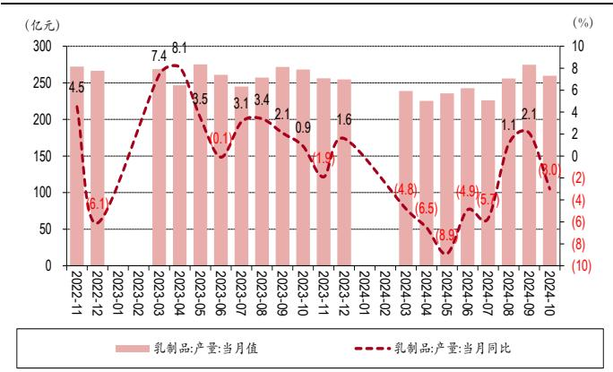  
资料来源：IFind，中银证券

图表 54. 牛奶、酸奶零售价变化  
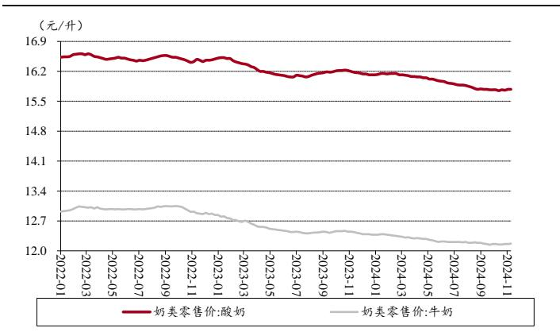  
资料来源：商务部、IFind，中银证券

2024 年原奶价格持续下行，乳企销售费用投放力度加大。（1）成本端：2024 年以来原奶价格持续向下，1-11月平均价格同比-13.4%，包材价格亦有所下降，瓦楞纸 1-11月平均价格同比-7.0%。受益于原材料价格的下降，乳制品板块 1-3Q24 毛利率同比+1.5pct至 30.8%。（2）费用端: 1-3Q24乳制品企业销售/管理/财务费用率分别同比+1.2/-0.0/-0.2pct，由于终端需求不足，乳企竞争加剧、销售费用投放力度加大，1-3Q24乳制品板块销售费用率同比增加至 17.4%。（3）盈利水平端：虽然乳制品终端需求不足、竞争加剧下企业销售费用投放有所增加，但受益于成本红利的释放、伊利 1Q24投资收益的增加，乳企 1-3Q24整体销售净利率有所提升，同比+1.0pct至 8.4%。

图表 55. 生鲜乳价格变动（截至 2024年 11月 29日）  
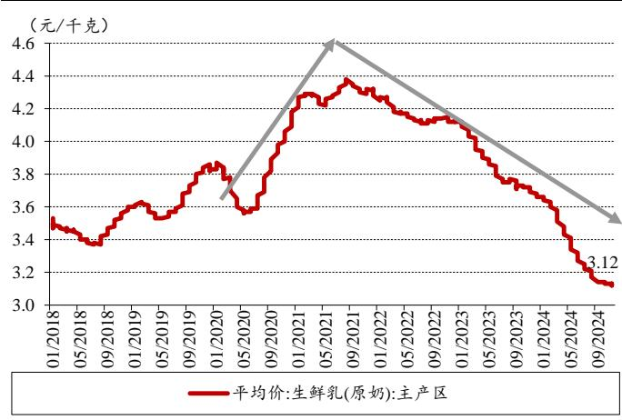  
资料来源：IFind，中银证券

图表 56. 1-3Q24乳制品板块费用率、利润率同比变化情况  
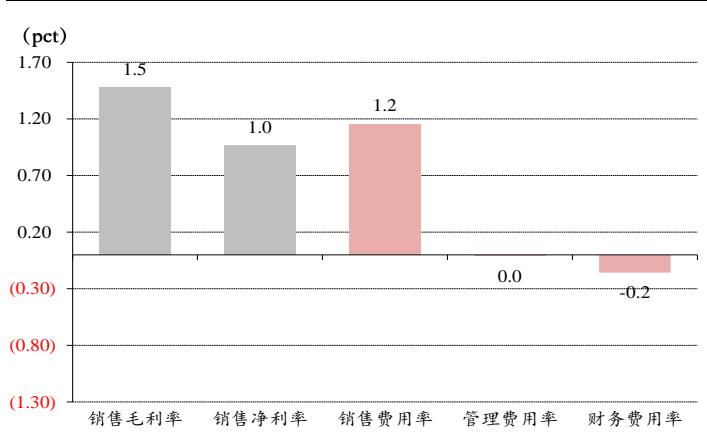  
资料来源：IFind.中银证券

奶粉行业逐步回暖，头部企业表端拐点有望确立。1H24 奶粉企业营收、归母净利增速显著回暖，飞鹤/澳优/贝因美营收分别同比+4.4%/+4.9%/+5.6%，归母净利润分别同比+10.6%/-21.2%/+16.6%。过去几年在需求承压的行业环境和更严格的新国标要求下，奶粉企业的应对策略有所分化。头部企业以价盘管控为先，渠道库存去化速度或快于中小企业，虽然牺牲了一定的短期增速，但长期来看有益于品牌高端化形象的建设。随着 2024年龙宝宝的出生，我们预计婴配粉消费人口基数或已开始回暖，奶粉龙头企业报表端的营收拐点、利润拐点均有望确立，建议关注中国飞鹤。

图表 57.奶粉行业主要企业 1H24营收、同比增速  
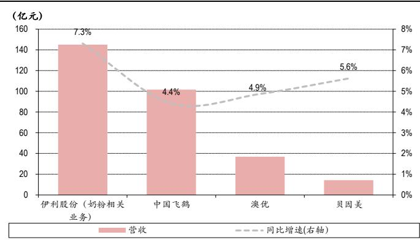  
资料来源：IFind，中银证券

图表 58. 奶粉行业主要企业 1H24归母净利润、同比增速  
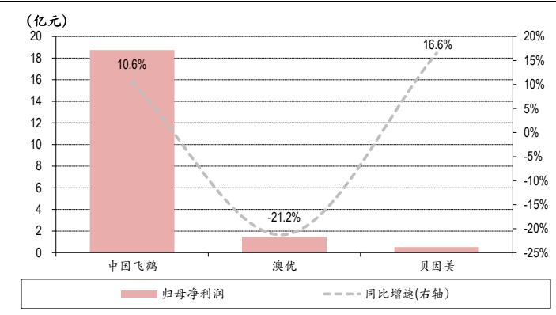  
资料来源：IFind，中银证券

原奶价格拐点或已临近，重点关注伊利股份和新乳业。当前生鲜乳价格（3.12 元/千克）已大幅低于上一轮周期底点。我们判断当前的原奶价格或已突破部分上游企业的可变成本线，预计后续上游过剩产能将陆续温和出清，原奶价格有望在 2025 年内迎来向上拐点，利好原奶自给率较高的乳企。伊利股份作为乳制品龙头企业，供应链、渠道优势显著，品牌认知度强，品类均衡发展，有望维持稳健增长，当前股息收益率超 4%。低温白奶成长空间较大，新乳业聚焦低温鲜奶、重视盈利水平的改善提升，有望维持超越行业均值的业绩增速。

## 休闲零食：零食渠道持续变革，龙头企业抢抓渠道红利末期

疫情后，受经济环境影响，国内休闲零食市场转为消费者主导的买方市场，具有性价比特征的新兴零食渠道崛起，行业业态发生变化。（ ）休闲零食行业市场广阔，为万亿规模。行业细分品类较多，呈现出 大行业 小公司 的特点， 年休闲零食板块营收 亿元，同比 ，其中百亿或近百亿体量的零食公司数量较少，行业整体竞争格局较为分散。（ ）从渠道类型来看，国内休闲零食市场自 2000 年以来先后经历了商超崛起（外资商超+本土商超）、电商崛起（京东+天猫）。2020年后，受国内经济环境影响，休闲零食行业供需关系发生转变，由供给侧主导的卖方市场逐渐转向以消费者为导向的买方市场。例如，线下以零食量贩店、山姆超市为主，线上以拼多多、抖音等具有高性价比特征的销售渠道兴起。虽然行业业态在发生变化，但是在产品、品牌、渠道、供应链等方面具备优势的头部零食企业近两年仍保持较快增长，市场份额持续提升。

图表 59. 2023年休闲零食线上销售规模分布  
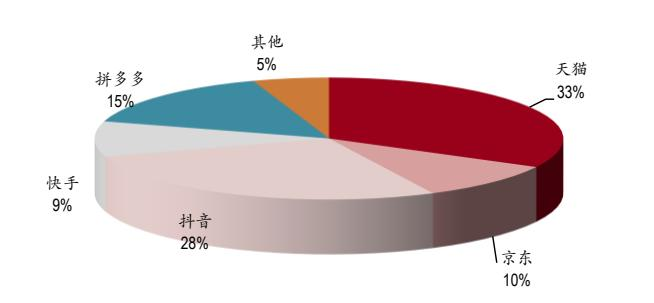  
资料来源：三只松鼠线下品销大会，中银证券

图表 60. 2023年休闲零食行业线下销售规模分布  
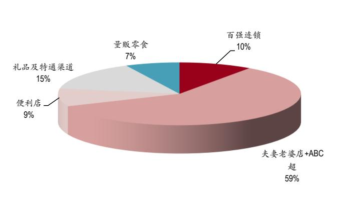  
资料来源：三只松鼠线下品销大会，中银证券

受渠道变革影响，不同类型企业表现不一，渠道型企业营收增速快于其他类型零食企业。按照不同商业模式划分，休闲零食企业分为渠道型企业（万辰集团）、自主生产型企业（洽洽、盐津、甘源、劲仔、有友）、品牌+渠道型企业（三只松鼠、良品铺子、来伊份）、全产业链企业（绝味、周黑鸭、煌上煌）等。近两年，新兴渠道的崛起对传统渠道带来一定冲击，例如直营、KA渠道、散装收入占比收缩，零食量贩渠道收入占比提升导致行业整体毛利率、毛销差同比下降。积极拥抱新兴渠道且渠道转型较快的企业营收增速相对较快。从不同类型零食企业表现来看：

万辰集团：万辰集团专注渠道运营，为零食量贩头部品牌。 年零食量贩渠道持续扩张，鸣鸣很忙集团门店数量突破万家，门店数量较去年 11 月零食很忙、零食有鸣双品牌合并时的 7000 家净新增超 3000 家。万辰集团受益于对零食量贩品牌的收购整合，旗下品牌量贩门店数量的扩张，1-3Q24/3Q24 营收分别同比+320%/+261%至 206.1/97.0 亿元，1H24 公司量贩门店数量净增 1912 家至6638家。从竞争的角度来看，我们认为目前零食量贩赛道头部企业已进入整合期，未来随着头部企业供应链能力的不断增强，或将形成较强的头部效应，呈现两超（鸣鸣很忙集团、万辰集团）+多强的竞争格局。我们认为，零食量贩连锁瞄准的是中国的下沉市场，随着规模效应的显现，公司通过调整门店产品组合占比及提升门店运营效率，来提升整体净利率水平。

三只松鼠： 2023 年，三只松鼠战略转型，供应链端做到“一品一控”，提升产品性价比；渠道端着重线上兴趣电商分销，进行渠道适配，1Q24、2Q24、3Q24 三只松鼠营收增速分别为 91.8%、43.9%、24.0%，归母净利增速分别为 60.8%、51.2%、221.9%，业绩相比 2023 年出现较大幅度改善。2Q24 公司启动新一轮线下分销业务，通过 105 款高性价比产品适配渠道，制定三年 200 亿的战略目标（含税）。从具体实施路径来看，（1）传统线下分销业务方面，坚果礼盒以传统“三节”（端午、中秋、春节）及团购渠道为主，日销产品在多渠道架设经销商，向下游网点分销。（2）公司抢抓零食量贩红利末期，收购零食量贩店（爱折扣、爱零食）将三只松鼠的品牌、供应链及管理能力对其进行赋能，以合伙人的形式共同拓展线下市场。根据公司 111分销大会，2024年以来线下分销数据表现亮眼。2Q24 增长 7%，3Q24增长 51%，24年 10 月增长 285%。我们判断 4季度年节将延续较快增长，季度营收表现亮眼。未来随着线下渠道收入占比的提升，松鼠归母净利率有望呈上升趋势。

洽洽食品： 公司实现营收 亿元，同比 。分季度看， 年 公司营收分别同比+36.4%/-20.3%/+3.7%，受节假日错期影响，公司发货节奏、收入确认节奏较去年发生较大变化，在 季度公司主动去库存， 季度业绩环比好转，但相比其他同类型企业稍显疲软。我们判断主要与消费环境仍在修复，以坚果为主的礼赠场景竞争激烈，拉低整体营收增速有关。受益于产品毛利率的提升，公司盈利水平持续回升，1-3Q24/3Q24 归母净利率分别同比+1.9/+2.3pct 至 13.2%/15.6%。公司于 9 月份公告 2024年股票期权激励方案（草案），此次股权激励公司制定较高行权目标，如果按照目标值计算，2H24公司营收及扣非归母净利增速分别为 14.7%、16.9%。2025 年春节提前， 公司提早进入春节备货期，加大性价比礼盒铺货，我们预计在年货节的带动下，公司整体收入增速将环比提升，努力达成激励目标。

图表 61. 1-3Q24休闲食品上市公司业绩概览

<table><tr><td></td><td>1-3Q24 营收(亿元)</td><td>同比(%)</td><td>1-3Q24 归母净利(亿元)</td><td>同比(%)</td><td>3Q24 营收(亿元)</td><td>同比(%)</td><td>3Q24 归母净利(亿元)</td><td>同比(%)</td></tr><tr><td>万辰集团</td><td>206.1</td><td>320.6</td><td>0.8</td><td>248.6</td><td>97.0</td><td>261.3</td><td>0.8</td><td>263.1</td></tr><tr><td>三只松鼠</td><td>71.7</td><td>56.5</td><td>3.4</td><td>101.2</td><td>20.9</td><td>24.0</td><td>0.5</td><td>221.9</td></tr><tr><td>良品铺子</td><td>54.8</td><td>(8.7)</td><td>0.2</td><td>(89.9)</td><td>15.9</td><td>(20.8)</td><td>(0.0)</td><td>(325.2)</td></tr><tr><td>洽洽食品</td><td>47.6</td><td>6.2</td><td>6.3</td><td>23.8</td><td>18.6</td><td>3.7</td><td>2.9</td><td>21.4</td></tr><tr><td>盐津铺子</td><td>38.6</td><td>28.5</td><td>4.9</td><td>24.5</td><td>14.0</td><td>26.2</td><td>1.7</td><td>15.6</td></tr><tr><td>来伊份</td><td>25.2</td><td>(16.0)</td><td>(0.4)</td><td>(1038.3)</td><td>7.3</td><td>(18.1)</td><td>(0.6)</td><td>(15.5)</td></tr><tr><td>劲仔食品</td><td>17.7</td><td>18.7</td><td>2.1</td><td>61.2</td><td>6.4</td><td>12.9</td><td>0.7</td><td>42.6</td></tr><tr><td>甘源食品</td><td>16.1</td><td>22.2</td><td>2.8</td><td>29.5</td><td>5.6</td><td>15.6</td><td>1.1</td><td>17.1</td></tr><tr><td>黑芝麻</td><td>15.9</td><td>(17.4)</td><td>0.4</td><td>(5.3)</td><td>6.2</td><td>(11.9)</td><td>0.3</td><td>15.4</td></tr><tr><td>好想你</td><td>11.8</td><td>7.9</td><td>(0.6)</td><td>(48.7)</td><td>3.6</td><td>(7.4)</td><td>(0.2)</td><td>(8.3)</td></tr><tr><td>有友食品</td><td>8.9</td><td>16.8</td><td>1.2</td><td>14.3</td><td>3.6</td><td>28.0</td><td>0.5</td><td>75.2</td></tr></table>

资料来源：iFind，中银证券

图表 62. 零食板块季度销售毛利率  
  
iFind

当前休闲零食行业已呈现出较为明显的 买方市场 特征，拥有供应链及品牌优势的龙头企业试错成本较低，能快速反应，拥抱渠道变革。休闲零食作为快消品行业，最能率先反应消费者的喜好。从商业模式来看，休闲食品行业为万亿规模，行业细分品类较多但是每一个细分品类规模不大，渠道结构以线下流通渠道为主，因此休闲食品行业与白酒行业展现出了不一样的商业模式，零售终端表现相对强势。疫情后，国内经济疲软，经历了较长的恢复期，零售业态受经济环境影响出现新一轮变革。从不同零食企业来看，在次轮渠道变革中，对单一品类、品牌追逐的产品型企业反应相对慢于渠道型企业。参考日本零售业态的发展，日本泡沫经济崩溃后，日本市场也出现了大量的折扣店，加量不加价是当时比较流行的促销方式。但是在老龄化的时代，对单身人士或两人的家庭结构来说，更长时间维度来看，消费者对高品质产品的期待胜过单一的低价属性。因此，我们认为不同类型的企业在战略坚持上并无孰对孰错，企业的战略方针自当随时代改变。当前休闲零食行业已呈现出较为明显的 买方市场 特征，拥有供应链、品牌优势的龙头企业试错成本较低，能快速反应拥抱新兴渠道，建议关注三只松鼠、盐津铺子、万辰集团、洽洽食品、盐津铺子。

## 投资思路：把握底部回升的结构性机会，精选景气赛道中的优质个股

## 1.白酒周期底部，首选经营韧性较强的龙头酒企

2025年酒企经营目标将更加务实，表端降速为渠道舒压。当前行业底部特征显现，龙头分红意愿提升，具备长期配置价值。（1）1-3Q24白酒板块营收及归母净利增速分别为 9.2%、10.7%，其中 3Q24营收及归母净利增速分别为 0.5%、2.1%，板块业绩降速明显。我们预计 4Q24 业绩仍有承压，2025年春节受益旺季提振环比将有望改善，但考虑到去年同期高基数，我们判断 同比增速或将表现平稳。（2）对比上轮白酒周期，行业底部特征显现，酒企在存量竞争背景下主动刹车减速，对来年目标制定更加务实。我们判断，2025年行业仍以去库存、促动销为主旋律，随着渠道压力的不断释放，叠加酒企自身迈向精细化管理，企业盈利有望逐步恢复，走出周期谷底。（3）白酒独特的商业模式使其拥有较强的业绩兑现能力，特别是龙头酒企对产品品质升级及价格调控的能力仍然较强。在强集中、强分化、强挤压的行业现状下，龙头白酒优势明显。（4）信心堪比黄金，龙头酒企百亿中期分红纷纷落地，同时承诺未来三年较高分红率。根据我们测算，茅台、五粮液股息率分别约为3.4%、4.0%，均高于十年期国债收益率。我们认为，白酒资产优质，龙头经营韧性较强，叠加高分红政策加持，白酒龙头具备长期配置价值。推荐经营稳健的贵州茅台、五粮液、山西汾酒，建议关注 2H24报表出清力度较大的洋河股份。

## 2.大众品景气回升，关注不同子行业结构性机会

大众品渠道库存逐渐出清步入景气回升阶段，不同子行业结构性机会较多，龙头整体表现优于板块其他企业。

（ ）调味品：上半年调味品行业受餐饮影响整体业绩承压， 季度需求环比改善。龙头海天率先走出调整，业绩表现优异，市场竞争呈现出强者恒强的状态。复合调味品整体增速快于基础调味品 4Q24为复调旺季，复调龙头企业基本面有望逐季回暖。推荐渠道改革稳步推进的中炬高新，第三方业务实现增长，且高分红标的颐海国际。

（2）休闲零食：零食渠道变革延续，已呈现出较为明显的“买方市场”特征，零食量贩及内容电商为近两年增速最快的零食渠道。受行业业态变化影响，板块不同类型企业分化加剧，拥有供应链优势及积极拥抱新兴渠道的企业受益渠道变革红利，业绩实现较快增长。部分生产型企业享受细分品类中的大单品放量红利，其他生产型企业仍在内部调整中。建议关注三只松鼠、盐津铺子、万辰集团、洽洽食品。

（3）乳制品：2024年乳业需求承压。相对于前两轮周期，本轮原奶周期受产能出清慢、需求走弱加剧供需错配影响，调整时间更长。乳制品行业供需传导速度较快，上下游价格存在较强联动性。1H24各省份已开始调节产能，我们判断 2025 年下半年原奶有望实现供需平衡。在此行业背景下，龙头伊利抗压能力强，3季度业绩环比明显改善。公司渠道库存调整基本完毕，经营周期向上趋势确立。建议关注伊利股份、新乳业。

（4）啤酒：2024 年啤酒行业量、价均承压，呈现出旺季不旺的特征。企业之间分化明显，燕京及珠江两大区域酒企受益大单品放量，营收、归母净利表现均优于其他企业。我们认为，从竞争格局改善、产能两个角度来看，啤酒企业结构升级进程仍具韧性，原材料成本红利有望延续至 2025年，利润修复可期。重视低基数下啤酒龙头底部反转机会，推荐青岛啤酒。

附录图表 63. 报告中提及上市公司估值表

<table><tr><td rowspan="2">公司代码</td><td rowspan="2">公司简称</td><td rowspan="2">评级</td><td rowspan="2">股价(元)</td><td rowspan="2">市值(亿元)</td><td colspan="4">PE估值</td><td rowspan="2">最新每股净资产(元/股)</td></tr><tr><td>2023A</td><td>2024E</td><td>2025E</td><td>2026E</td></tr><tr><td>600519.SH</td><td>贵州茅台</td><td>买入</td><td>1,527.2</td><td>19,184.7</td><td>25.7</td><td>22.2</td><td>20.1</td><td>18.5</td><td>189.23</td></tr><tr><td>000858.SZ</td><td>五粮液</td><td>买入</td><td>144.6</td><td>5,612.4</td><td>18.6</td><td>17.2</td><td>16.3</td><td>15.0</td><td>35.13</td></tr><tr><td>000568.SZ</td><td>泸州老窖</td><td>买入</td><td>132.6</td><td>1,951.8</td><td>14.7</td><td>13.6</td><td>13.1</td><td>12.2</td><td>30.86</td></tr><tr><td>002304.SZ</td><td>洋河股份</td><td>买入</td><td>83.7</td><td>1,260.4</td><td>12.6</td><td>15.6</td><td>15.3</td><td>14.2</td><td>35.51</td></tr><tr><td>600809.SH</td><td>山西汾酒</td><td>买入</td><td>194.9</td><td>2,377.6</td><td>22.8</td><td>19.0</td><td>16.7</td><td>14.9</td><td>27.76</td></tr><tr><td>000596.SZ</td><td>古井贡酒</td><td>---</td><td>187.4</td><td>894.0</td><td>21.6</td><td>17.5</td><td>14.9</td><td>12.9</td><td>45.2</td></tr><tr><td>603369.SH</td><td>今世缘</td><td>买入</td><td>48.0</td><td>601.9</td><td>19.2</td><td>16.5</td><td>14.5</td><td>12.9</td><td>12.06</td></tr><tr><td>603198.SH</td><td>迎驾贡酒</td><td>---</td><td>60.2</td><td>481.4</td><td>21.0</td><td>17.5</td><td>14.9</td><td>12.8</td><td>11.58</td></tr><tr><td>603589.SH</td><td>口子窖</td><td>买入</td><td>40.8</td><td>244.5</td><td>14.2</td><td>12.7</td><td>11.5</td><td>10.4</td><td>16.93</td></tr><tr><td>600702.SH</td><td>舍得酒业</td><td>---</td><td>73.5</td><td>244.9</td><td>13.8</td><td>26.0</td><td>23.9</td><td>20.1</td><td>21.28</td></tr><tr><td>600779.SH</td><td>水井坊</td><td>---</td><td>55.6</td><td>270.9</td><td>21.3</td><td>19.7</td><td>18.1</td><td>16.4</td><td>10.18</td></tr><tr><td>603345.SH</td><td>安井食品</td><td>买入</td><td>88.4</td><td>259.2</td><td>17.5</td><td>17.7</td><td>15.6</td><td>13.9</td><td>43.56</td></tr><tr><td>600600.SH</td><td>青岛啤酒</td><td>买入</td><td>78.0</td><td>882.6</td><td>24.9</td><td>23.8</td><td>21.8</td><td>20.3</td><td>21.84</td></tr><tr><td>000729.SZ</td><td>燕京啤酒</td><td>---</td><td>11.1</td><td>313.7</td><td>48.7</td><td>32.2</td><td>25.1</td><td>20.8</td><td>5.27</td></tr><tr><td>600887.SH</td><td>伊利股份</td><td>---</td><td>29.2</td><td>1,858.9</td><td>17.8</td><td>15.4</td><td>16.1</td><td>14.9</td><td>8.83</td></tr><tr><td>002946.SZ</td><td>新乳业</td><td>---</td><td>14.7</td><td>126.3</td><td>29.3</td><td>22.9</td><td>18.9</td><td>15.8</td><td>3.41</td></tr><tr><td>603288.SH</td><td>海天味业</td><td>---</td><td>46.7</td><td>2,598.5</td><td>46.2</td><td>41.6</td><td>37.6</td><td>34.0</td><td>5.28</td></tr><tr><td>600872.SH</td><td>中炬高新</td><td>增持</td><td>24.1</td><td>188.8</td><td>11.1</td><td>26.5</td><td>21.0</td><td>17.0</td><td>6.24</td></tr><tr><td>603317.SH</td><td>天味食品</td><td>---</td><td>14.6</td><td>155.9</td><td>34.1</td><td>26.9</td><td>23.5</td><td>20.8</td><td>4.1</td></tr><tr><td>1579.HK</td><td>颐海国际</td><td>增持</td><td>16.4</td><td>169.8</td><td>18.6</td><td>20.5</td><td>17.6</td><td>15.8</td><td>4.65</td></tr><tr><td>300783.SZ</td><td>三只松鼠</td><td>---</td><td>35.3</td><td>141.7</td><td>64.5</td><td>35.3</td><td>25.5</td><td>19.3</td><td>6.98</td></tr><tr><td>300972.SZ</td><td>万辰集团</td><td>---</td><td>79.2</td><td>142.6</td><td>亏损</td><td>69.8</td><td>26.4</td><td>18.4</td><td>5.09</td></tr><tr><td>002847.SZ</td><td>盐津铺子</td><td>---</td><td>56.2</td><td>153.2</td><td>30.3</td><td>23.5</td><td>18.5</td><td>14.9</td><td>5.66</td></tr><tr><td>003000.SZ</td><td>劲仔食品</td><td>---</td><td>13.6</td><td>61.3</td><td>29.3</td><td>20.5</td><td>16.4</td><td>13.4</td><td>2.98</td></tr></table>

资料来源：iFind.中银证券  
注：股价截止日2024年12月16日，未有评级公司盈利预测来自iFind一致预期，港股股价、每股净资产货币单位为港币。

## 风险提示

1）宏观经济波动：如整体消费需求低于预期，食品饮料企业销量、ASP 增速可能承压

2）渠道库存偏高：下游经销商库存无法精确测算，部分食品饮料子板块处于去库存周期内，渠道库存去化速度快慢可能对企业 2025年表端营收、利润造成影响。

3）原料价格波动：包材、农产品价格如果大幅上涨，若无法顺利通过提价等方式传导至下游，食品饮料企业的盈利空间可能会被挤压。

## 披露声明

本报告准确表述了证券分析师的个人观点。该证券分析师声明，本人未在公司内、外部机构兼任有损本人独立性与客观性的其他职务，没有担任本报告评论的上市公司的董事、监事或高级管理人员；也不拥有与该上市公司有关的任何财务权益；本报告评论的上市公司或其它第三方都没有或没有承诺向本人提供与本报告有关的任何补偿或其它利益。

中银国际证券股份有限公司同时声明，将通过公司网站披露本公司授权公众媒体及其他机构刊载或者转发证券研究报告有关情况。如有投资者于未经授权的公众媒体看到或从其他机构获得本研究报告的，请慎重使用所获得的研究报告，以防止被误导，中银国际证券股份有限公司不对其报告理解和使用承担任何责任。

## 评级体系说明

以报告发布日后公司股价/行业指数涨跌幅相对同期相关市场指数的涨跌幅的表现为基准：

## 公司投资评级：

入：预计该公司股价在未来 6-12 个月内超越基准指数 20%以上；

增 持：预计该公司股价在未来 6-12 个月内超越基准指数 10%-20%；

中 性：预计该公司股价在未来 6-12 个月内相对基准指数变动幅度在-10%-10%之间；

减 持：预计该公司股价在未来 6-12 个月内相对基准指数跌幅在 10%以上；

未有评级：因无法获取必要的资料或者其他原因，未能给出明确的投资评级。

## 行业投资评级：

强于大市：预计该行业指数在未来 6-12 个月内表现强于基准指数；

中 性：预计该行业指数在未来 6-12 个月内表现基本与基准指数持平；

弱于大市：预计该行业指数在未来 6-12 个月内表现弱于基准指数；

未有评级：因无法获取必要的资料或者其他原因，未能给出明确的投资评级。

沪深市场基准指数为沪深 300 指数；新三板市场基准指数为三板成指或三板做市指数；香港市场基准指数为恒生指数或恒生中国企业指数；美股市场基准指数为纳斯达克综合指数或标普 500指数。

# 风险提示及免责声明

本报告由中银国际证券股份有限公司证券分析师撰写并向特定客户发布。

本报告发布的特定客户包括：1) 基金、保险、QFII、QDII 等能够充分理解证券研究报告，具备专业信息处理能力的中银国际证券股份有限公司的机构客户；2) 中银国际证券股份有限公司的证券投资顾问服务团队，其可参考使用本报告。中银国际证券股份有限公司的证券投资顾问服务团队可能以本报告为基础，整合形成证券投资顾问服务建议或产品，提供给接受其证券投资顾问服务的客户。

中银国际证券股份有限公司不以任何方式或渠道向除上述特定客户外的公司个人客户提供本报告。中银国际证券股份有限公司的个人客户从任何外部渠道获得本报告的，亦不应直接依据所获得的研究报告作出投资决策；需充分咨询证券投资顾问意见，独立作出投资决策。中银国际证券股份有限公司不承担由此产生的任何责任及损失等。

本报告内含保密信息，仅供收件人使用。阁下作为收件人，不得出于任何目的直接或间接复制、派发或转发此报告全部或部分内容予任何其他人，或将此报告全部或部分内容发表。如发现本研究报告被私自刊载或转发的，中银国际证券股份有限公司将及时采取维权措施，追究有关媒体或者机构的责任。所有本报告内使用的商标、服务标记及标记均为中银国际证券股份有限公司或其附属及关联公司（统称“中银国际集团”）的商标、服务标记、注册商标或注册服务标记。

本报告及其所载的任何信息、材料或内容只提供给阁下作参考之用，并未考虑到任何特别的投资目的、财务状况或特殊需要，不能成为或被视为出售或购买或认购证券或其它金融票据的要约或邀请，亦不构成任何合约或承诺的基础。中银国际证券股份有限公司不能确保本报告中提及的投资产品适合任何特定投资者。本报告的内容不构成对任何人的投资建议，阁下不会因为收到本报告而成为中银国际集团的客户。阁下收到或阅读本报告须在承诺购买任何报告中所指之投资产品之前，就该投资产品的适合性，包括阁下的特殊投资目的、财务状况及其特别需要寻求阁下相关投资顾问的意见。

尽管本报告所载资料的来源及观点都是中银国际证券股份有限公司及其证券分析师从相信可靠的来源取得或达到，但撰写本报告的证券分析师或中银国际集团的任何成员及其董事、高管、员工或其他任何个人（包括其关联方）都不能保证它们的准确性或完整性。除非法律或规则规定必须承担的责任外，中银国际集团任何成员不对使用本报告的材料而引致的损失负任何责任。本报告对其中所包含的或讨论的信息或意见的准确性、完整性或公平性不作任何明示或暗示的声明或保证。阁下不应单纯依靠本报告而取代个人的独立判断。本报告仅反映证券分析师在撰写本报告时的设想、见解及分析方法。中银国际集团成员可发布其它与本报告所载资料不一致及有不同结论的报告，亦有可能采取与本报告观点不同的投资策略。为免生疑问，本报告所载的观点并不代表中银国际集团成员的立场。

本报告可能附载其它网站的地址或超级链接。对于本报告可能涉及到中银国际集团本身网站以外的资料，中银国际集团未有参阅有关网站，也不对它们的内容负责。提供这些地址或超级链接（包括连接到中银国际集团网站的地址及超级链接）的目的，纯粹为了阁下的方便及参考，连结网站的内容不构成本报告的任何部份。阁下须承担浏览这些网站的风险。

本报告所载的资料、意见及推测仅基于现状，不构成任何保证，可随时更改，毋须提前通知。本报告不构成投资、法律、会计或税务建议或保证任何投资或策略适用于阁下个别情况。本报告不能作为阁下私人投资的建议。

过往的表现不能被视作将来表现的指示或保证，也不能代表或对将来表现做出任何明示或暗示的保障本报告所载的资料意见及预测只是反映证券分析师在本报告所载日期的判断可随时更改。本报告中涉及证券或金融工具的价格、价值及收入可能出现上升或下跌。

部分投资可能不会轻易变现，可能在出售或变现投资时存在难度。同样，阁下获得有关投资的价值或风险的可靠信息也存在困难。本报告中包含或涉及的投资及服务可能未必适合阁下。如上所述，阁下须在做出任何投资决策之前，包括买卖本报告涉及的任何证券，寻求阁下相关投资顾问的意见

中银国际证券股份有限公司及其附属及关联公司版权所有。保留一切权利。

## 中银国际证券股份有限公司

中国上海浦东

银城中路 200 号

中银大厦 39楼

邮编 200121

电话: (8621) 6860 4866

传真: (8621) 5888 3554

## 相关关联机构：

## 中银国际研究有限公司

香港花园道一号

中银大厦二十楼

电话:(852) 3988 6333

致电香港免费电话:

中国网通 10 省市客户请拨打：10800 8521065

中国电信 21 省市客户请拨打：10800 1521065

新加坡客户请拨打：800 852 3392

传真:(852) 2147 9513

## 中银国际证券有限公司

香港花园道一号

中银大厦二十楼

电话:(852) 3988 6333

传真:(852) 2147 9513

## 中银国际控股有限公司北京代表处

中国北京市西城区

西单北大街 110号 8层

邮编:100032

电话: (8610) 8326 2000

传真: (8610) 8326 2291

## 中银国际(英国)有限公司

2/F, 1 Lothbury

London EC2R 7DB

United Kingdom

电话: (4420) 3651 8888

传真: (4420) 3651 8877

## 中银国际(美国)有限公司

美国纽约市美国大道 1045号

7 Bryant Park 15 楼

NY 10018

电话: (1) 212 259 0888

传真: (1) 212 259 0889

## 中银国际(新加坡)有限公司

注册编号 199303046Z

新加坡百得利路四号

中国银行大厦四楼(049908)

电话: (65) 6692 6829 / 6534 5587

传真: (65) 6534 3996 / 6532 3371