# 梅花香自苦寒中，柳暗花明又一年

# —白酒行业 2025 年投资策略

## 推荐(维持)

分析师：孙山山

S1050521110005

sunss@cfsc.com.cn

联系人：肖燕南

S1050123060024

xiaoyn@cfsc.com.cn

联系人：张倩

S1050124070037

zhangqian@cfsc.com.cn

## 行业相对表现

<table><tr><td>表现</td><td>1M</td><td>3M</td><td>12M</td></tr><tr><td>白酒II(申万)</td><td>-3.2</td><td>23.6</td><td>-8.7</td></tr><tr><td>沪深300</td><td>-1.5</td><td>22.7</td><td>17.9</td></tr></table>

## 市场表现

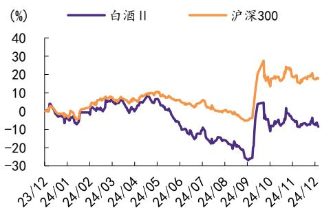  
资料来源：Wind，华鑫证券研究

## 相关研究

1、《白酒Ⅱ行业专题报告：业绩降速渠道减压，底部调整静待拐点》2024-11-09

2、《白酒Ⅱ行业专题报告：业绩表现分化，结构调整为主线》2024-09-08

3、《白酒Ⅱ行业专题报告：分化态势延续，趋势向好确定性强》2024-05-07

## 投资要点

## ▌ 板块回顾：需求承压，低位震荡

1）行情回顾：全年表现承压，利好带来回暖。2024 年年初至今食品饮料指数（申万）/白酒Ⅱ指数（申万）涨跌幅分别为-5%/-11%，食品饮料板块全年涨幅在所有行业排名第 26位。9 月底至今快速反弹上行后持续震荡，主要系利好政策频出提振市场信心，已进入政策落地验证阶段。2）基本面回顾：市场需求疲软，酒企主动降速。2024Q1-Q3 上市酒企收入/归母净利润分别为 3377/1317 亿元，分别同增 9%/11%。Q2 以来收入与利润增速环比放缓，系市场需求疲软与公司主动降速所致。3）估值回顾：震荡下行，底部调整。2016 年至今申万白酒指数 PE 均值为 31.38，当前值为 20.54，10 年内市盈率分位点为 17.81%，当前处于历史低位。

## ▌ 板块展望：拐点源自磨底中，主动降速求质量

政策端：利好政策频发，消费复苏可期。9 月 24 日以来国家出台多项利好政策，促进内需政策频发；12 月召开中共中央政治局会议，强调扩大内需，实施更积极有为的宏观政策。行业端：长期整体增长动力与韧性仍强，短期应以市场健康运行为主线，加速产业库存出清，主动调低业绩预期，化解供需矛盾。企业端：板块估值反弹为先，基本面逐步修复。基本面修复需经历消费场景复苏与消费力提升两个阶段。1）高端酒：预计茅五泸主动带头降速，求高质量发展，稳定压倒一切。2）次高端：预计随着消费场景和消费力提升，板块估值逐步修复，基本面望加快迎改善。3）地产酒：龙头酒企仍享受省内集中度提升红利，随着场景逐步复苏，产品结构有望继续优化。

## ▌ 行业评级及投资策略

我们维持白酒行业“推荐”投资评级，认为白酒板块整体仍将按照“先估值修复，后基本面改善”的路径演绎，内部分为三条主线：1）估值修复与基本面改善均受益的高端板块，推荐茅五泸；2）场景修复对基本面改善最明显的地产酒板块，推荐内部结构升级的今世缘、古井贡酒等；3）估值率先反弹的次高端板块，推荐业绩确定性较强的山西汾酒、舍得酒业等。

## ▌ 风险提示

重点关注公司及盈利预测

疫情波动风险；宏观经济波动风险；推荐公司业绩不及预期的风险；行业竞争或政策变动风险；消费税或生产风险等。

<table><tr><td rowspan="2">公司代码</td><td rowspan="2">名称</td><td rowspan="2">2024-12-20 股价</td><td colspan="3">EPS</td><td colspan="3">PE</td><td rowspan="2">投资评级</td></tr><tr><td>2023</td><td>2024E</td><td>2025E</td><td>2023</td><td>2024E</td><td>2025E</td></tr><tr><td>000568.SZ</td><td>泸州老窖</td><td>130.32</td><td>9.00</td><td>9.81</td><td>10.20</td><td>14.48</td><td>13.28</td><td>12.78</td><td>买入</td></tr><tr><td>000596.SZ</td><td>古井贡酒</td><td>176.30</td><td>8.68</td><td>10.41</td><td>11.98</td><td>20.31</td><td>16.94</td><td>14.72</td><td>买入</td></tr><tr><td>000799.SZ</td><td>酒鬼酒</td><td>56.77</td><td>1.69</td><td>0.33</td><td>0.46</td><td>33.59</td><td>172.03</td><td>123.41</td><td>买入</td></tr><tr><td>000858.SZ</td><td>五粮液</td><td>143.21</td><td>7.78</td><td>8.49</td><td>8.99</td><td>18.41</td><td>16.87</td><td>15.93</td><td>买入</td></tr><tr><td>002304.SZ</td><td>洋河股份</td><td>85.00</td><td>6.65</td><td>5.56</td><td>5.43</td><td>12.78</td><td>15.29</td><td>15.65</td><td>买入</td></tr><tr><td>600197.SH</td><td>伊力特</td><td>17.82</td><td>0.72</td><td>0.74</td><td>0.82</td><td>24.75</td><td>24.08</td><td>21.73</td><td>买入</td></tr><tr><td>600199.SH</td><td>金种子酒</td><td>14.10</td><td>-0.03</td><td>0.08</td><td>0.29</td><td>-470.00</td><td>176.25</td><td>48.62</td><td>买入</td></tr><tr><td>600519.SH</td><td>贵州茅台</td><td>1522.00</td><td>59.49</td><td>68.28</td><td>73.38</td><td>25.58</td><td>22.29</td><td>20.74</td><td>买入</td></tr><tr><td>600559.SH</td><td>老白干酒</td><td>21.37</td><td>0.73</td><td>0.89</td><td>1.06</td><td>29.27</td><td>24.01</td><td>20.16</td><td>买入</td></tr><tr><td>600702.SH</td><td>舍得酒业</td><td>70.73</td><td>5.32</td><td>2.83</td><td>3.83</td><td>13.30</td><td>24.99</td><td>18.47</td><td>买入</td></tr><tr><td>600779.SH</td><td>水井坊</td><td>54.69</td><td>2.60</td><td>2.81</td><td>3.01</td><td>21.03</td><td>19.46</td><td>18.17</td><td>买入</td></tr><tr><td>600809.SH</td><td>山西汾酒</td><td>192.50</td><td>8.56</td><td>10.05</td><td>11.18</td><td>22.49</td><td>19.15</td><td>17.22</td><td>买入</td></tr><tr><td>603198.SH</td><td>迎驾贡酒</td><td>55.75</td><td>2.86</td><td>3.35</td><td>3.91</td><td>19.49</td><td>16.64</td><td>14.26</td><td>买入</td></tr><tr><td>603369.SH</td><td>今世缘</td><td>45.18</td><td>2.50</td><td>2.86</td><td>3.17</td><td>18.07</td><td>15.80</td><td>14.25</td><td>买入</td></tr><tr><td>603589.SH</td><td>口子窖</td><td>39.38</td><td>2.87</td><td>3.32</td><td>3.78</td><td>13.72</td><td>11.86</td><td>10.42</td><td>买入</td></tr><tr><td>603919.SH</td><td>金徽酒</td><td>20.00</td><td>0.65</td><td>0.80</td><td>1.01</td><td>30.77</td><td>25.00</td><td>19.80</td><td>买入</td></tr></table>

资料来源：Wind，华鑫证券研究

## 正文目录

1、板块回顾：需求承压，低位震荡....6
1.1、行情回顾：全年表现承压，利好带来回暖....6
1.2、基本面回顾：市场需求疲软，酒企主动降速....8
1.3、估值回顾：震荡下行，底部调整....13
2、板块展望：拐点源自磨底中，主动降速求质量....14
2.1、利好政策频发，消费复苏可期....14
2.2、估值反弹为先，基本面逐步修复....16
2.3、次高端率先调整，为反弹机会蓄力....18
2.4、高端酒业绩稳健，关注批价表现....22
2.5、地产酒以场景修复为主，重视优质龙头....26
3、行业评级及投资策略....31
4、风险提示....32

## 图表目录

图表1：2024.1.1至今食品饮料（申万）指数、白酒指数、上证指数涨跌幅 6  
图表2：2024.1.1至今申万一级行业涨跌幅 7  
图表3：2024.1.1至今食品饮料二级申万行业涨跌幅 7  
图表4：9.24-至今消费行业细分板块涨跌幅 7  
图表5：9.24-至今食品饮料板块二级行业涨跌幅 7  
图表6：9.24-至今食品饮料板块三级行业涨跌幅 8  
图表7：9.24-至今白酒板块个股涨跌幅 8  
图表8：2012年至今白酒当月产量与同比增速 8  
图表9：2012年至今白酒月度累计产量与同比增速 8  
图表10：2012年至今规上白酒产量及其增速及吨价增速 9  
图表11：2012年至今规上白酒单家收入及增速 9  
图表12：2010年以来我国结婚登记人数及增速 9  
图表13：2010年以来出生人数、高考报名人数及增速 9  
图表14：2021年至今茅台批价（元） 10  
图表15：2021年至今五粮液、老窖批价（元） 10  
图表16：2012年至今白酒行业累计季度收入与同比增速 10  
图表17：2012年至今白酒行业累计季度归母净利与同比增速 10  
图表18：2014年至今高端酒、次高端酒、地产酒营收 YoY 11  
图表19：2014年至今高端酒、次高端酒、地产酒归母净利润 YOY 11  
图表20：2024Q1-3上市酒企销售费用率普遍提高 12

图表21：2024年1-6月经营指标同期变化情况.... 12  
图表22：2024年1-6月白酒市场经营变化情况评价.... 12  
图表23：2016年至今申万白酒指数点位与PE.... 13  
图表24：2016年至今食品饮料与白酒板块相对沪深300 PE.... 13  
图表25：2019年至今白酒各板块与沪深300 PE.... 13  
图表26：2000年至今上市酒企营收与房地产投资额、基建投资额、GDP增速等宏观经济指标拟合... 14  
图表27：今年9月底以来经济利好政策发布情况.... 15  
图表28：2018年至今社会消费品零售总额当月值及同比.... 16  
图表29：2019年至今CPI、PPI当月同比.... 16  
图表30：2019年至今制造业PMI、非制造业PMI.... 16  
图表31：2019年至今消费与储蓄意愿占比.... 16  
图表32：2024年1-6月节假日白酒消费量同比变化情况.... 17  
图表33：2024年1-6月白酒市场畅销产品的价格段占比.... 17  
图表34：2013-2023年人均可支配收入及增速.... 17  
图表35：1999-2022年成人人均财富及增速.... 17  
图表36：2006-2022年我国高净值人群数量及增速.... 18  
图表37：2015及2030年我国人均年可支配收入分配.... 18  
图表38：次高端酒2019-2024Q3营收增速.... 18  
图表39：次高端酒2019-2024Q3归母净利率表现.... 18  
图表40：2014-2024年前三季度次高端四家酒企毛利率.... 19  
图表41：2019-2024年前三季度水井坊分产品收入占比.... 19  
图表42：2014-2023年次高端市场规模及增速.... 19  
图表43：2014-2024年前三季度次高端酒企经销商数量.... 19  
图表44：2014-2024年前三季度山西汾酒总营收及增速.... 20  
图表45：2014-2024年前三季度山西汾酒归母净利润及增速.... 20  
图表46：2017-2023年清香型白酒销售收入、产能及其增速.... 20  
图表47：2018-2023年清香型酒占白酒比重.... 20  
图表48：2023年清香型白酒价格带占比情况.... 21  
图表49：清香型各价格带代表企业.... 21  
图表50：山西汾酒发布青26复兴版.... 22  
图表51：山西汾酒“汾享礼遇”五码合一体系.... 22  
图表52：高端酒2019Q1-2024Q3营收增速.... 22  
图表53：高端酒2019Q1-2024Q归母净利润增速.... 22  
图表54：2010年至今茅台价格变动.... 23  
图表55：2021年至今高端酒价格变动.... 23  
图表56：贵州茅台今年以来控货措施.... 24

图表57：今年以来五粮液及泸州老窖宴席、扫码红包等措施列举 25  
图表58：2014-2024年前三季度高端三家酒企毛利率. 25  
图表59：2014-2024年前三季度高端三家酒企销售费用率. 25  
图表60：2019Q1-2024Q3地产酒企营收增速. 26  
图表61：2019Q1-2024Q3地产酒企归母净利润增速. 26  
图表62：2014-2024年前三季度地产酒企毛利率. 27  
图表63：2014-2024年前三季度地产酒企销售费用率. 27  
图表64：2020-2024H1洋河各产品收入占比. 27  
图表65：2016-2024前三季度今世缘各产品收入占比. 27  
图表66：2014-2024前三季度迎驾贡酒各产品收入占比. 28  
图表67：2016-2024前三季度口子窖各产品收入占比. 28  
图表68：各家地产酒今年费用投放措施列举. 29  
图表69：2023年江苏省白酒市场竞争格局. 30  
图表70：2023年安徽省白酒市场竞争格局. 30  
图表71：2023年河北省白酒市场竞争格局. 31  
图表72：2023年新疆白酒市场竞争格局. 31  
图表73：重点关注公司及盈利预测. 32

## 1、 板块回顾：需求承压，低位震荡

## 1.1、 行情回顾：全年表现承压，利好带来回暖

整体板块承压明显，9 月政策利好后反弹。2024 年年初至今食品饮料指数（申万）/白酒Ⅱ指数（申万）涨跌幅分别为-5.46%/-11.03%，食品饮料板块全年涨幅在所有行业排名第 26 位。1）2024 年初至 5 月底食饮板块以震荡上行为主, 2024.01.01-2024.05.20 食品饮料指数（申万）/白酒Ⅱ指数（申万）涨跌幅分别+1.56%/-2.85%，主要系春节动销好于预期，叠加 4 月底中共中央政治局会议召开宣布稳地产；2）2024 年 5 月底至 9 月底食饮板块行情以下行为主，年初至 09.23 食品饮料指数（申万）/白酒Ⅱ指数（申万）涨跌幅分别-26.36%/-33.39%，主要系整体经济表现疲软，叠加白酒批价受“618”影响持续下跌、中秋动销不及预期等；3）2024 年 9 月底至今食饮板块快速反弹上行后持续震荡，主要系利好政策频出提振市场信心，目前进入等待政策落地验证阶段。

消费板块整体调整，白酒跌幅较大。分行业看，大部分消费板块年初至今涨跌幅均靠 后，轻工/纺服/食饮/农牧/医药年初至今涨跌幅分别为-0.63%/-1.23%/-5.46%/-7.48%/- 10.90%，体现整体消费力疲软。食饮板块中白酒板块预期下降明显，基本面调整叠加估值 下杀致降幅较大，饮料/调味品/非白酒/休闲食品/白酒Ⅱ/食品加工年初至今涨跌幅分别为 +14.44%/+6.92%/+5.32%/+2.62%/-10.23%/-10.25%。

图表 1：2024.1.1 至今食品饮料（申万）指数、白酒指数、上证指数涨跌幅  
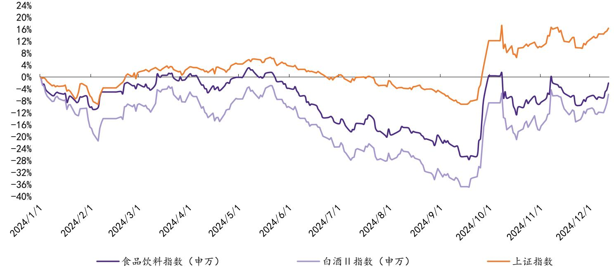  
资料来源：WIND，华鑫证券研究

图表 2：2024.1.1 至今申万一级行业涨跌幅  
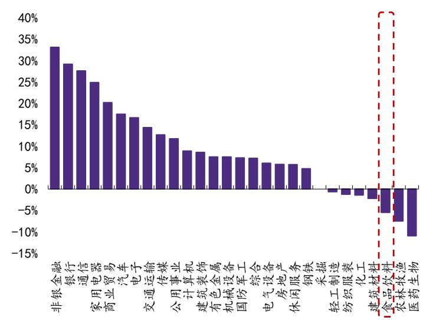  
资料来源：WIND，华鑫证券研究

图表 3：2024.1.1 至今食品饮料二级申万行业涨跌幅  
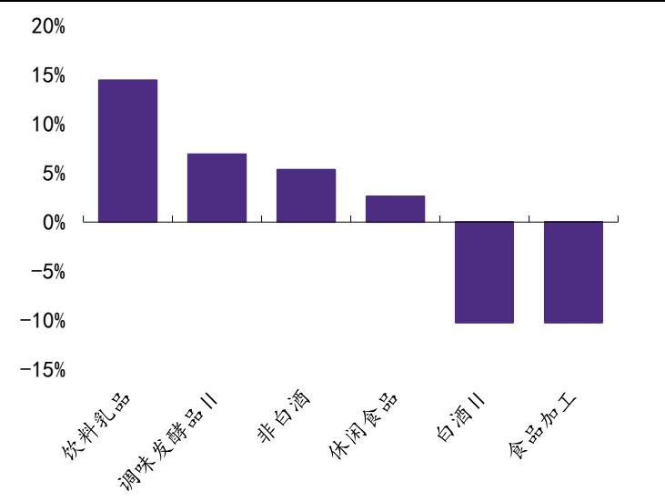  
资料来源：WIND，华鑫证券研究

消费板块受政策利好明显，次高端白酒涨幅突出。9 月底利好政策释出以来消费板块反弹明显，其中 9.24 至今食品饮料（申万）/白酒Ⅱ涨跌幅分别为 28.38%/25.67%；白酒板块中次高端酒前期估值下杀较多，本次反弹幅度较大，舍得酒业/水井坊/酒鬼酒涨跌幅分别为 72.94%/63.60%/52.26%。

图表 4：9.24-至今消费行业细分板块涨跌幅  
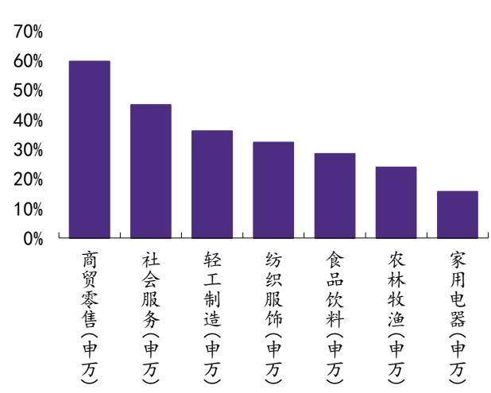  
资料来源：WIND，华鑫证券研究

图表 5：9.24-至今食品饮料板块二级行业涨跌幅  
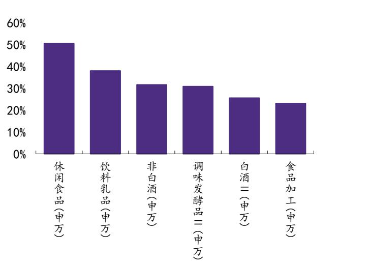  
资料来源：WIND，华鑫证券研究

图表 6：9.24-至今食品饮料板块三级行业涨跌幅  
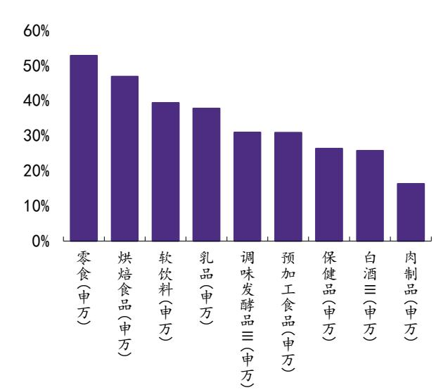  
资料来源：WIND，华鑫证券研究

图表 7：9.24-至今白酒板块个股涨跌幅  
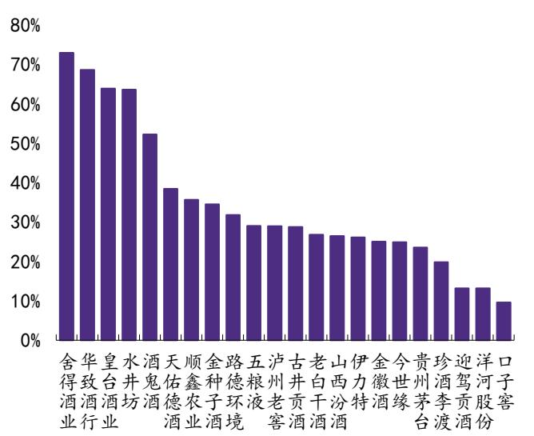  
资料来源：WIND，华鑫证券研究

## 1.2、 基本面回顾：市场需求疲软，酒企主动降速

产量持续下降，集中度不断提升。量上看，2023 年规上酒企产量 629.00 万吨，同比下降 6.29%。白酒产量仍处于持续下降状态，2017-2023 年 CAGR 为-10.18%，其中今年以来产量同比下降 7.98%。价上看，2023 年规上白酒吨价 12.02 万元/吨，同比增长 21.80%，吨价持续提升且增速环比提高。格局上看，2023 年规上酒企数量 896 家，同比下滑 6.96%；单家创收8.44 亿元/家，同比增长22.67%，行业格局进一步集中，中小规模酒企持续出清。

图表 8：2012 年至今白酒当月产量与同比增速  
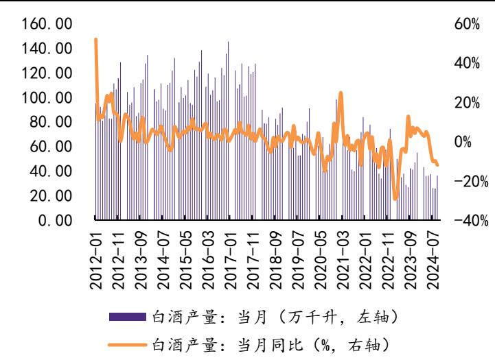  
资料来源：WIND，华鑫证券研究

图表 9：2012 年至今白酒月度累计产量与同比增速  
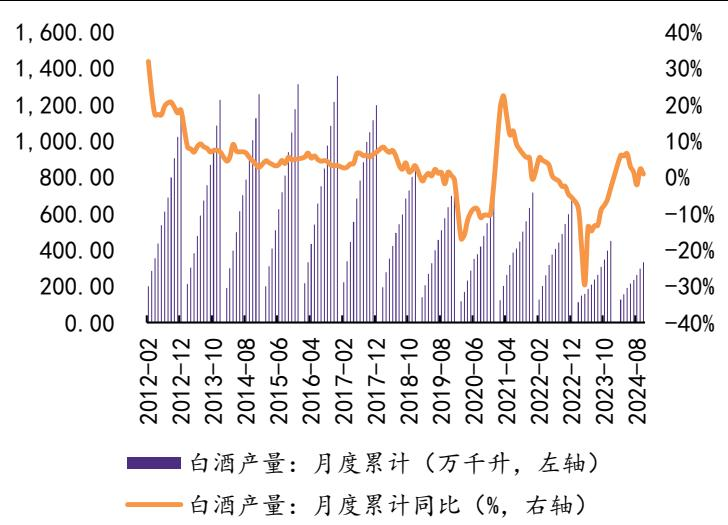  
资料来源：WIND，华鑫证券研究

图表 10：2012 年至今规上白酒产量及其增速及吨价增速  
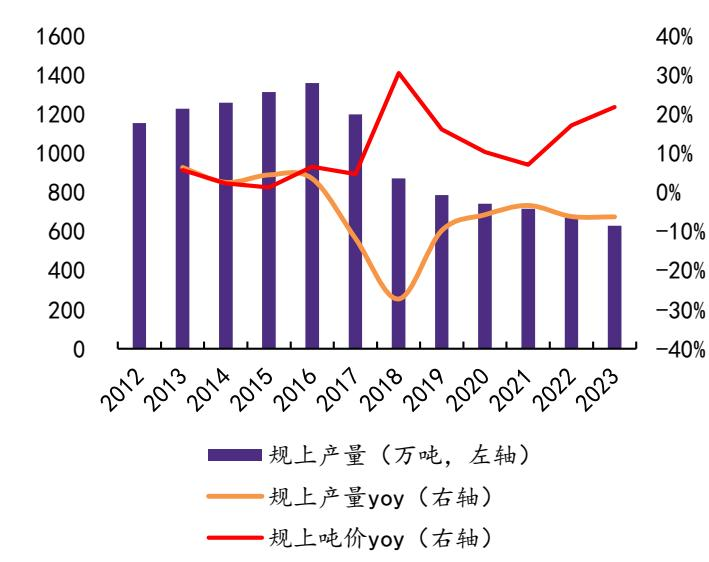  
资料来源：WIND，华鑫证券研究

图表 11：2012 年至今规上白酒单家收入及增速  
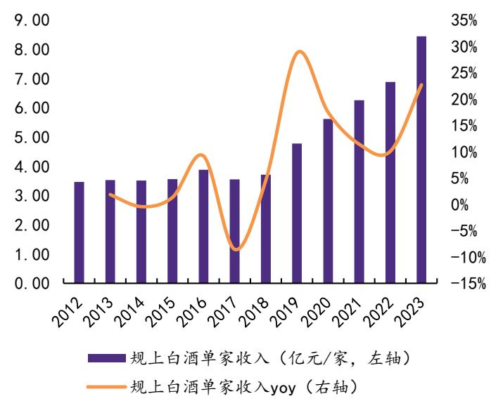  
资料来源：WIND，华鑫证券研究

结婚登记人数与出生人数下降明显，宴席场景表现疲软。2024 年前三季度我国结婚登记人数共 474.70 万对，同比下滑 16.57%，今年结婚登记累计人数降幅环比持续扩大；2023年我国出生人数共 902 万人，同比下降 5.65%，出生人数持续减少；2024 年我国高考报名人数共 1342 万名，同比增长 3.95%，增速环比下降明显，整体看宴席场景同比下降，影响白酒消费需求。

图表 12：2010 年以来我国结婚登记人数及增速  
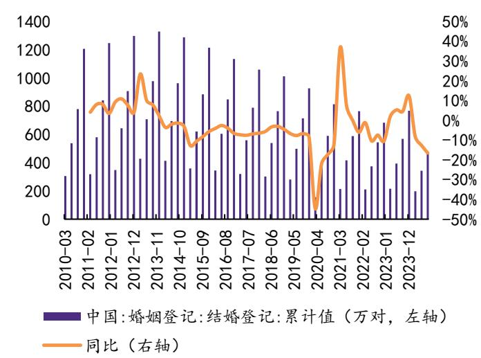  
资料来源：Wind，华鑫证券研究

图表 13：2010 年以来出生人数、高考报名人数及增速  
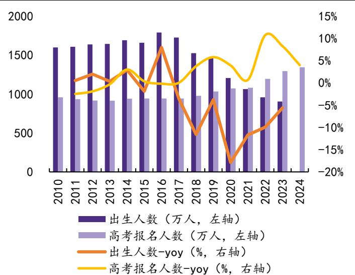  
资料来源：Wind，华鑫证券研究

茅台批价震荡下行，核心因素仍为需求较弱。今年“618 大促”期间电商平台补贴力度较大致电商渠道飞天茅台终端成交价格低于市场价，甚至低于黄牛进货价，叠加市场需求疲软，引发渠道整体信心受损严重，飞天茅台批价持续下跌至 2400 元/瓶。2024 年 7 月起茅台公司发布控货挺价等措施，批价有所回升；后因旺季动销同比下降，渠道信心疲弱，批价震荡下行。

图表 14：2021 年至今茅台批价（元）  
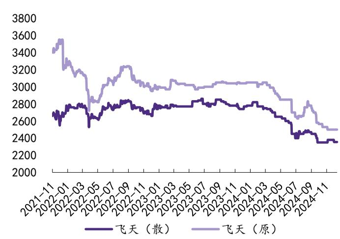  
资料来源：今日酒价，酒价参考，华鑫证券研究

图表 15：2021 年至今五粮液、老窖批价（元）  
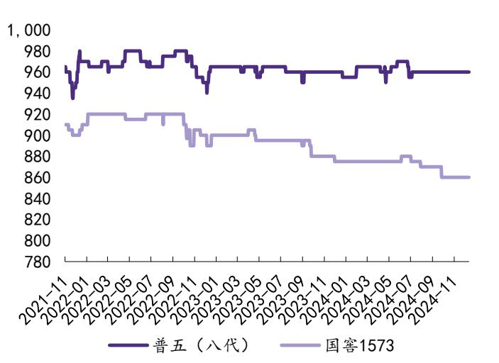  
资料来源：今日酒价，酒价参考，华鑫证券研究

上市酒企主动降速，调节渠道压力。2024 年前三季度白酒上市公司实现收入/归母净利润 分 别 为 3377.16/1316.97 亿 元 ， 分 别 同 比 +9.25%/+10.69% ； 单 三 季 度 分 别 为956.43/360.15 亿元，分别同比+0.58%/+2.10%，Q2 以来上市公司收入与利润增速环比放缓，主要系市场需求疲软与公司主动降速所致。消费环境整体疲软，渠道资金压力较大，经销商与终端收入增长预期与后续信心不明朗，多数酒企不再追求报表数据高增长，而是寻求渠道健康良性发展与自身增长目标间的动态平衡，故业绩降速实际缓解酒企报表的增长压力与渠道回款的资金压力，有效为渠道减负从而促进行业长期良性健康发展。

图表 16：2012 年至今白酒行业累计季度收入与同比增速  
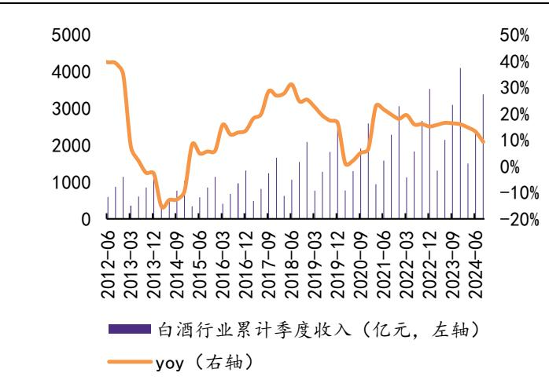  
资料来源：Wind，华鑫证券研究

图表 17：2012 年至今白酒行业累计季度归母净利与同比增速  
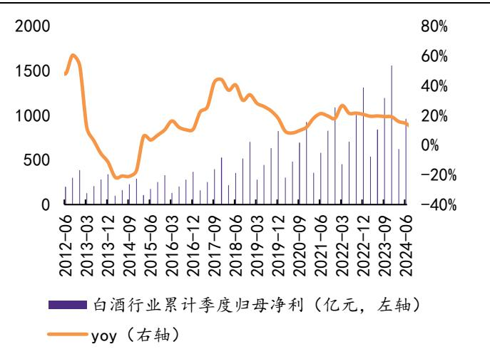  
资料来源：Wind，华鑫证券研究

板块内部分化加剧，考验酒企定力。2024Q1-3 收入增速：高端酒＞次高端酒＞地产酒，分别为 13.46%＞8.15%＞1.67%；2024Q3 收入增速：高端酒＞次高端酒＞地产酒，分别为9.59%＞-0.38%＞-17.97%。高端酒仍保持稳健增长，贵州茅台收入利润双位数增长，五粮液与老窖收入环比降速，保持渠道良性发展；次高端酒分化加剧，山西汾酒双位数增长，水井坊臻酿八号放量效果较好，舍得与酒鬼处于减速调整期；地产酒增速放缓，表现亦分化，洋河股份率先进入调整期，今世缘与古井贡酒自身结构仍优异。

图表 18：2014 年至今高端酒、次高端酒、地产酒营收 YoY  
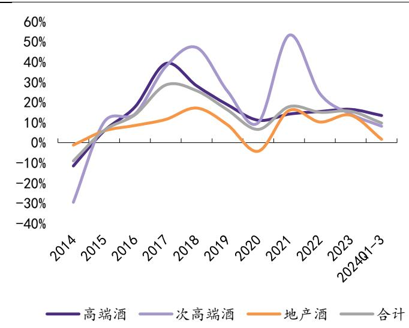  
资料来源：WIND，华鑫证券研究

图表 19：2014 年至今高端酒、次高端酒、地产酒归母净利润 YOY  
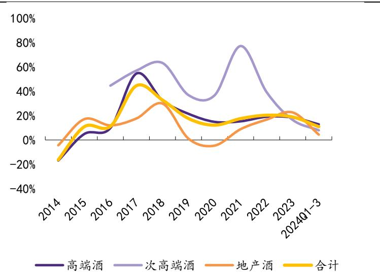  
资料来源：WIND，华鑫证券研究

下行周期竞争加剧，上市酒企销售费用率提高。旺季期间上市酒企多采取大力度的渠道策略，整体费用投放呈同比上涨态势，2024Q1-3 高端/次高端/地产酒销售费用率分别同比+0.58/-0.67/+0.66pcts；2024Q3 分别同比+0.60/-1.23/+2.62pcts，同时以终端培育为主，更注重费用精细化管理，头部企业竞争优势明显，中小酒企加速出清。

图表 20：2024Q1-3 上市酒企销售费用率普遍提高

<table><tr><td>分类</td><td>个股名称</td><td>2023Q1-3</td><td>2024Q1-3</td><td>YOY</td><td>2023Q3</td><td>2024Q3</td><td>YOY</td></tr><tr><td rowspan="4">高端酒</td><td>贵州茅台</td><td>2.91%</td><td>3.44%</td><td>0.53%</td><td>3.72%</td><td>4.08%</td><td>0.36%</td></tr><tr><td>五粮液</td><td>9.96%</td><td>11.47%</td><td>1.51%</td><td>11.20%</td><td>14.03%</td><td>2.83%</td></tr><tr><td>泸州老窖</td><td>10.97%</td><td>10.29%</td><td>-0.68%</td><td>12.83%</td><td>11.76%</td><td>-1.07%</td></tr><tr><td>合计</td><td>6.16%</td><td>6.74%</td><td>0.58%</td><td>7.03%</td><td>7.63%</td><td>0.60%</td></tr><tr><td rowspan="5">次高端酒</td><td>山西汾酒</td><td>9.46%</td><td>9.27%</td><td>-0.18%</td><td>10.61%</td><td>10.54%</td><td>-0.07%</td></tr><tr><td>酒鬼酒</td><td>29.85%</td><td>39.92%</td><td>10.08%</td><td>36.09%</td><td>66.30%</td><td>30.21%</td></tr><tr><td>舍得酒业</td><td>18.81%</td><td>21.38%</td><td>2.57%</td><td>21.46%</td><td>24.84%</td><td>3.38%</td></tr><tr><td>水井坊</td><td>22.45%</td><td>19.93%</td><td>-2.52%</td><td>12.43%</td><td>8.44%</td><td>-3.99%</td></tr><tr><td>合计</td><td>13.15%</td><td>12.48%</td><td>-0.67%</td><td>13.72%</td><td>12.50%</td><td>-1.23%</td></tr><tr><td rowspan="11">地产酒</td><td>洋河股份</td><td>11.76%</td><td>14.17%</td><td>2.41%</td><td>15.48%</td><td>27.75%</td><td>12.27%</td></tr><tr><td>今世缘</td><td>17.65%</td><td>15.35%</td><td>-2.30%</td><td>24.46%</td><td>20.56%</td><td>-3.90%</td></tr><tr><td>古井贡酒</td><td>27.35%</td><td>25.29%</td><td>-2.06%</td><td>28.33%</td><td>23.01%</td><td>-5.32%</td></tr><tr><td>口子窖</td><td>14.27%</td><td>14.31%</td><td>0.04%</td><td>15.41%</td><td>12.38%</td><td>-3.03%</td></tr><tr><td>迎驾贡酒</td><td>8.47%</td><td>8.30%</td><td>-0.18%</td><td>8.26%</td><td>8.98%</td><td>0.73%</td></tr><tr><td>老白干酒</td><td>28.56%</td><td>26.32%</td><td>-2.24%</td><td>25.44%</td><td>25.54%</td><td>0.11%</td></tr><tr><td>金种子酒</td><td>17.68%</td><td>25.72%</td><td>8.04%</td><td>28.54%</td><td>57.10%</td><td>28.56%</td></tr><tr><td>伊力特</td><td>9.18%</td><td>11.46%</td><td>2.28%</td><td>9.37%</td><td>13.90%</td><td>4.53%</td></tr><tr><td>金徽酒</td><td>21.31%</td><td>20.38%</td><td>-0.93%</td><td>27.27%</td><td>24.08%</td><td>-3.19%</td></tr><tr><td>顺鑫农业</td><td>10.12%</td><td>9.40%</td><td>-0.72%</td><td>11.71%</td><td>14.17%</td><td>2.46%</td></tr><tr><td>合计</td><td>16.25%</td><td>16.91%</td><td>0.66%</td><td>18.91%</td><td>21.53%</td><td>2.62%</td></tr></table>

资料来源：WIND，华鑫证券研究

渠道整体承压，市场调整明显。根据中国酒业协会，2024 年上半年分别有61.5%/33.3%/46.4%的经销商或终端感受到渠道库存压力/现金流压力/价格倒挂程度在增加，53.3%的经销商或终端感到营业利润空间在减少，80%的企业认为市场有所遇冷，渠道整体承压明显，库存与资金压力均较大。

图表 21：2024 年 1-6 月经营指标同期变化情况  
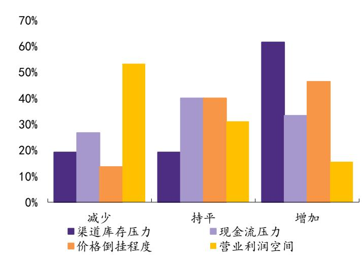  
资料来源：中国酒业协会，华鑫证券研究

图表 22：2024 年 1-6 月白酒市场经营变化情况评价  
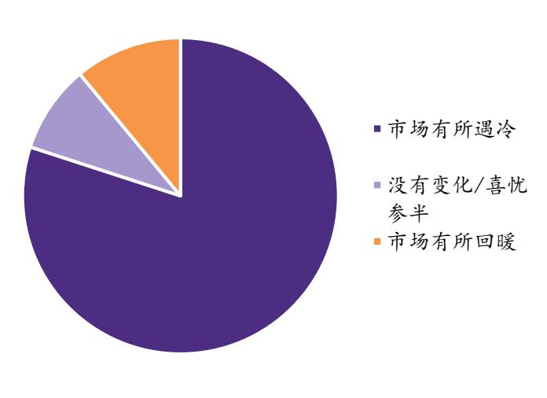  
资料来源：中国酒业协会，华鑫证券研究

## 1.3、 估值回顾：震荡下行，底部调整

整体绝对与相对估值均处于低位，后续抬升支撑力仍强。绝对估值上，2016 年至今申万白酒指数 PE 均值为 31.38，当前值为 20.54，目前仍在低位，10 年内市盈率分位点为17.81%。相对估值上，2016 年至今食品饮料板块与白酒板块相对沪深 300 平均市盈率分别为 2.58/2.46，当前值为 1.69/1.61，亦低于均值。分板块来看，2019 年至今高端酒/次高端酒/地产酒 PE 平均值分别为 34.01/44.51/31.39，当前值分别为 18.23/52.43/19.76，除次高端酒估值反弹外，高端与区域酒市盈率均低于平均值。

图表 23：2016 年至今申万白酒指数点位与 PE  
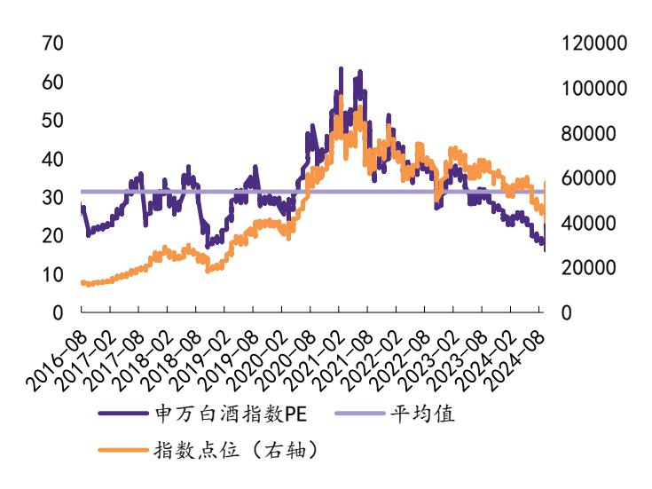  
资料来源：WIND，华鑫证券研究

图表 24：2016 年至今食品饮料与白酒板块相对沪深 300 PE  
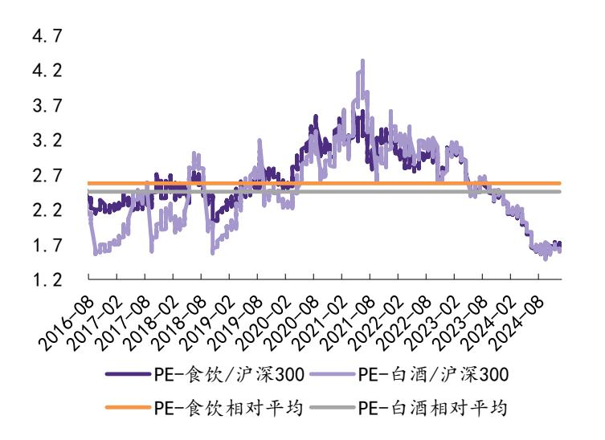  
资料来源：WIND，华鑫证券研究

图表 25：2019 年至今白酒各板块与沪深 300 PE  
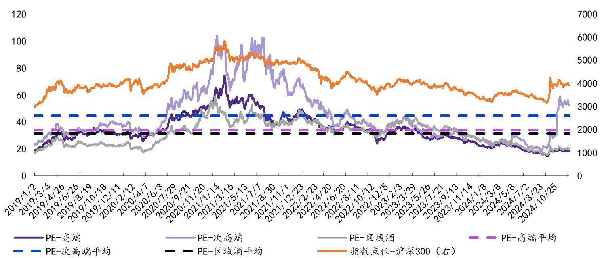  
资料来源：WIND，华鑫证券研究

## 2、 板块展望：拐点源自磨底中，主动降速求质量

## 2.1、 利好政策频发，消费复苏可期

白酒板块与宏观经济拟合度高，顺周期属性强。过去白酒板块受繁荣房地产投资与我国 GDP 快速增长带来的旺盛商务与宴席需求所驱动，经历高速成长的“黄金十年”与快速增长的“白银十年”，期间产业政策与行业黑天鹅事件对行业表现或有影响，但总体与宏观经济指标拟合度较高，顺周期属性强。2022 年以来整体经济态势疲软，房地产投资与消费增速放缓，白酒消费场景受损，居民信心与消费力受压制明显，对白酒基本面影响较大。

图表 26：2000 年至今上市酒企营收与房地产投资额、基建投资额、GDP 增速等宏观经济指标拟合  
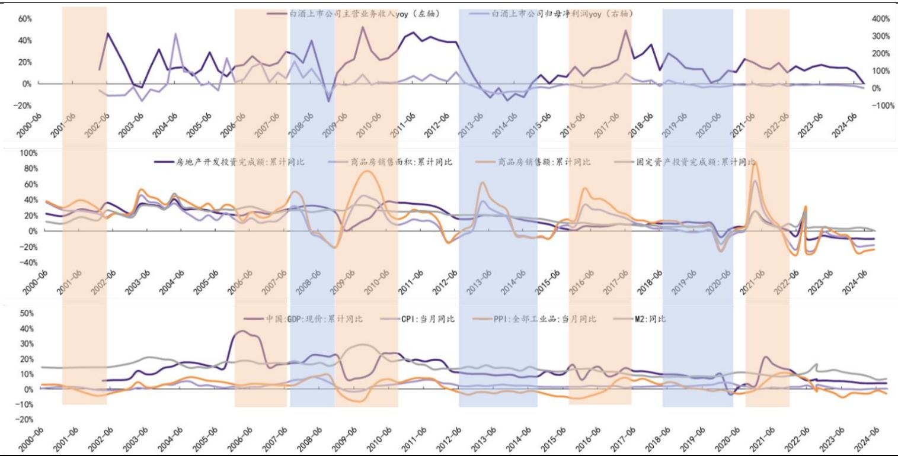  
资料来源：WIND，华鑫证券研究

促进内需政策频发，提振消费信心。9 月 24 日以来国家出台多项利好政策，方向包括：1）货币政策方面，降低存款准备金率、逆回购利率，创设证券、基金、保险公司互换便利和股票回购增持专项再贷款两项新货币政策工具等；2）财政政策方面，增加 6 万亿元地方政府债务限额置换存量隐性债务、发行特别国债等；3）房地产方面，出台多项政策促进房地产市场平稳健康发展，如降低存量房贷利率、优化首付款比例等；4）消费民生方面，提出促消费惠民生、扩大内需等，同时各地发放“以旧换新”补贴、消费券等，释放消费潜力。

图表 27：今年 9 月底以来经济利好政策发布情况

<table><tr><td>时间</td><td>部门</td><td>名称</td><td>主要内容</td></tr><tr><td rowspan="3">2024/09/24</td><td rowspan="3">中国人民银行、国家金融监督管理总局</td><td rowspan="3">国新办新闻发布会</td><td>1)中国人民银行宣布下调金融机构存款准备金率0.5个百分点,释放长期流动性约1万亿元。2)将公开市场7天期逆回购操作利率下调0.2个百分点至1.5%。此举旨在降低市场融资成本,优化流动性结构,支持实体经济发展。</td></tr><tr><td>降低存量房贷利率和统一房贷最低首付比例,预计平均降幅在50bps;统一首套房和二套房的房贷最低首付比例,将全国层面的二套房贷款最低首付比例由25%下调至15%。</td></tr><tr><td>创设证券、基金、保险公司互换便利和股票回购增持专项再贷款两项新货币政策工具;互换便利允许金融机构以债券和股票资产质押获取流动性,用于投资股市;股票回购增持再贷款。</td></tr><tr><td>2024/09/25</td><td>中共中央国务院</td><td>《关于实施就业优先战略促进高质量充分就业的意见》</td><td>首次从中央层面提出促进高质量充分就业的二十四项举措,包括强化就业优先政策、调整教育专业结构、提升技能人才待遇和权益保障等。</td></tr><tr><td>2024/09/26</td><td>中共中央政治局</td><td>《分析研究当前经济形势和经济工作》</td><td>强调稳增长和高质量发展:加大财政货币政策调节,发行特别国债、降低存款准备金率和存量房贷利率;促进房地产市场企稳;提振资本市场,引导中长期资金入市;出台民营经济促进法;促消费惠民生;保障重点人群就业,加强粮食安全和物资稳价。</td></tr><tr><td>2024/09/27</td><td>中国人民银行</td><td>央行降准</td><td>自2024年9月27日起,下调金融机构存款准备金率0.5个百分点(不含已执行5%存款准备金率的金融机构)。</td></tr><tr><td>2024/09/29</td><td>中国人民银行、金融监管总局</td><td>降低存量房贷利率</td><td>发布四项金融支持房地产政策,包括完善商业性个人住房贷款利率定价机制、优化个人住房贷款最低首付款比例、优化保障性住房再贷款、延长部分房地产金融政策期限。</td></tr><tr><td>2024/10/12</td><td>财政部</td><td>国新办新闻发布会</td><td>陆续推出一揽子有针对性的增量政策举措,包括支持地方化解隐性债务、支持国有大型商业银行补充核心一级资本、支持推动房地产市场止跌回稳、加大对重点群体的支持保障力度等多个方面。</td></tr><tr><td>2024/10/17</td><td>住房城乡建设部等</td><td>国务院新闻办就促进房地产市场平稳健康发展有关情况举行发布会</td><td>取消限购、取消限售、取消限价、取消普通住宅和非普通住宅标准;降低住房公积金贷款利率、降低住房贷款的首付比例、降低存量贷款利率、降低“卖旧买新”换购住房的税费负担;新增实施100万套城中村改造和危旧房改造、年底前将“白名单”项目的信贷规模增加到4万亿。</td></tr><tr><td>2024/11/08</td><td>财政部</td><td>国务院关于提请审议增加地方政府债务限额置换存量隐性债务的议案</td><td>增加6万亿元地方政府债务限额置换存量隐性债务:从2024年开始,连续五年每年从新增地方政府专项债券中安排8000亿元,补充政府性基金财力,专门用于化债,累计可置换隐性债务4万亿元。2029年及以后年度到期的棚户区改造隐性债务2万亿元,仍按原合同偿还。</td></tr><tr><td>2024/12/11</td><td>中共中央政治局</td><td>中央经济工作会议</td><td>中央经济工作会议强调,进一步全面深化改革、扩大高水平对外开放、实施更加积极有为的宏观政策、扩大国内需求、稳住楼市股市。</td></tr></table>

资料来源：中国人民银行官网，国务院官网，国家税务总局官网，财政部官网，证监会官网，中国新闻网，华鑫证券研究

宏观指标环比缓慢提高，政策逐步落地后消费复苏可期。社零数据来看，截至 2024 年11 月，我国社会消费品零售总额累计 36.14 万亿元，同比增长 3.00%，处于缓慢复苏态势；单月来看，2024 年 8/9/10 月社零同比增速分别为 2.10%/3.20%/4.80%，增速环比提升。生产数据来看，2024 年 11 月制造业 PMI 为 50.30，较前几月略有提升；非制造业 PMI 仍在低位震荡。消费意愿来看，上半年储蓄意愿占比仍高，消费意愿占比环比有所提升，投资意愿持续下降。

产业端，长期整体增长动力与韧性仍强，短期应以市场健康运行为主线，加速产业库存出清，主动调低业绩预期，化解供需矛盾。一方面主动放缓产能增长速度，放慢供给端累库存速度；另一方面缓解产业需求疲软状况，提供更多符合当下消费理念产品。

图表 28：2018 年至今社会消费品零售总额当月值及同比  
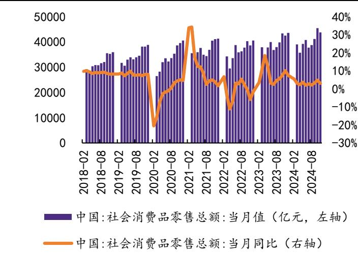  
资料来源：Wind，华鑫证券研究

图表 29：2019 年至今 CPI、PPI 当月同比  
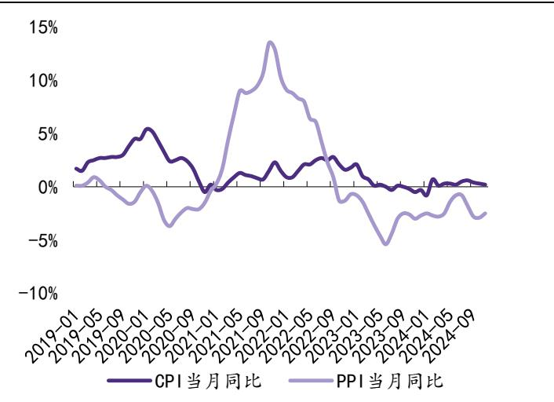  
资料来源：Wind，华鑫证券研究

图表 30：2019 年至今制造业 PMI、非制造业 PMI  
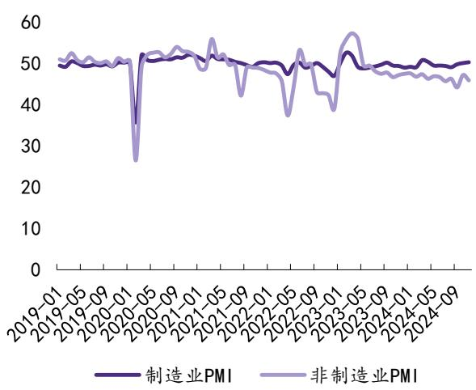  
资料来源：Wind，华鑫证券研究

图表 31：2019 年至今消费与储蓄意愿占比  
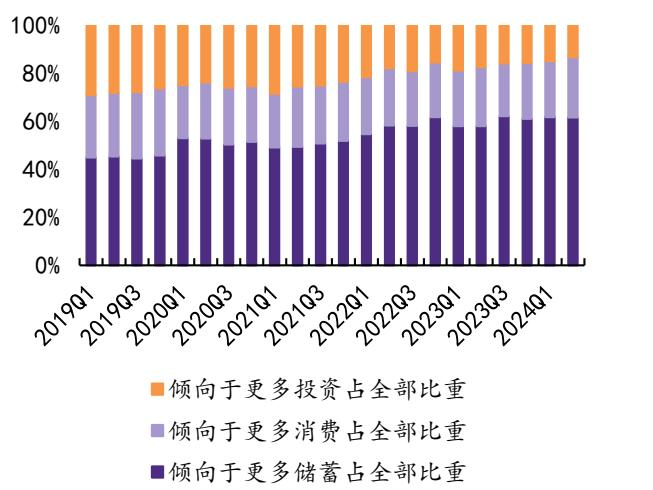  
资料来源：Wind，华鑫证券研究

## 2.2、 估值反弹为先，基本面逐步修复

估值底部形成，长短期回升驱动力不同。9 月底板块超跌反弹，我们认为主要系利好政策驱动下市场资金与情绪面回暖反弹，1）白酒板块作为商业模式优质资产，前期超跌后估值持续在底部震荡；2）央行出台多项利好货币政策，提振整体信心，带动资金注入全市场，市场及板块情绪亦快速升温。板块展望来看，Q3 板块业绩出清后基本面安全边际较高，后续估值拉升确定性强，但长短期估值提升内在驱动力与稳定性不同，短期依靠政策等宏观因素拉动市场情绪与资金回流，估值率先回升，长期取决于消费力复苏而带来基本面恢复。

第一阶段消费场景修复，白酒消费频次有望提升。我们认为基本面修复一般需经历消费场景复苏与消费力提升两个阶段，阶段一通过场景复苏、提高用酒频次带来销量修复，其中区域酒量增明显；阶段二通过财富效应积累、消费力提升带来商务场景恢复、整体价格上移，其中次高端弹性最大，高端受益明显。2024 年上半年消费场景“由热及冷”，春节前中期间白酒消费量同比持平或增加的占比为 56.67%，而春节及五一期间白酒消费量同比下降的占比分别为 80.00%/73.33%，宴席场景有待恢复，2025 年随着促消费政策逐步落地，消费信心逐步回升，预计场景加快修复，区域酒增量明显。

图表 32：2024 年 1-6 月节假日白酒消费量同比变化情况  
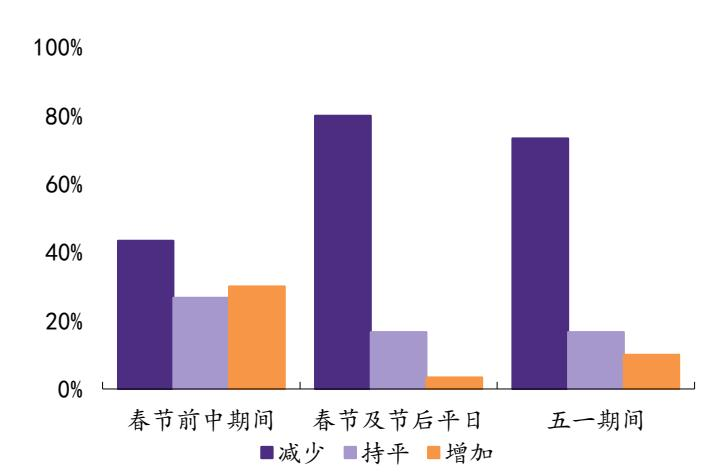  
资料来源：中国酒业协会，华鑫证券研究

图表 33：2024 年 1-6 月白酒市场畅销产品的价格段占比  
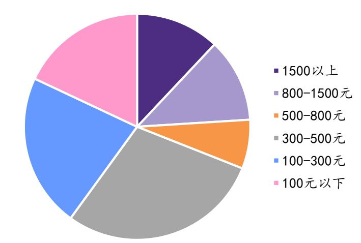  
资料来源：中国酒业协会，华鑫证券研究

第二阶段消费力提升，白酒商务消费弹性大。人均可支配收入、中产阶级人群数量及财富水平等财富效应指标变化对白酒基本面短期扰动，长期支撑力度足。目前大众消费人群人均可支配收入、人均财富仍在提高，财富积累情况与中产阶级资产情况长处于上升通道。2025 年宴席等大众消费场景恢复后，商务活动预计愈加频繁，商务宴请场景弹性大，对应更高价位的次高端酒需求恢复明显，高端酒预计在后期价格整体抬升后受益。

图表 34：2013-2023 年人均可支配收入及增速  
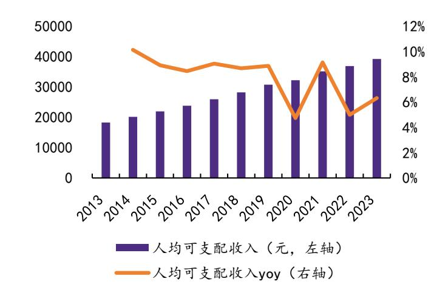  
资料来源：Wind，华鑫证券研究

图表 35：1999-2022 年成人人均财富及增速  
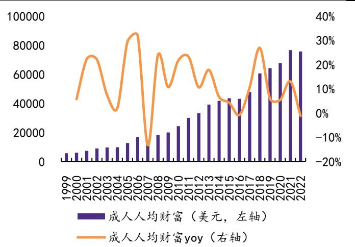  
资料来源：Wind，华鑫证券研究

图表 36：2006-2022 年我国高净值人群数量及增速  
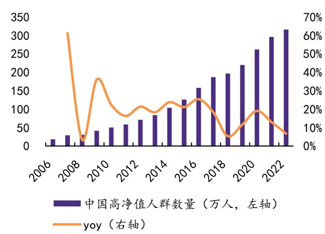  
资料来源：Wind，华鑫证券研究

图表 37：2015 及 2030 年我国人均年可支配收入分配  
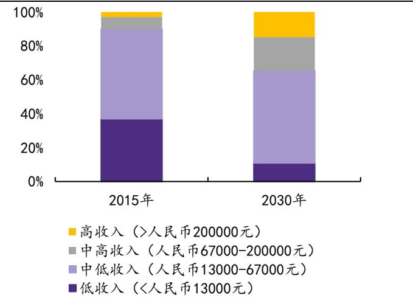  
资料来源：经济学人智库，华鑫证券研究

## 2.3、 次高端率先调整，为反弹机会蓄力

次高端酒企内部仍分化，业绩压力普遍加大。次高端酒企 2024Q1-3 营收 407.97 亿元（同增 8.15%），2024Q3 营收 120.67 亿元（同减 0.38%），Q3 增速环比回落较明显。其中，山西汾酒依靠稳健的省内基本盘与多价位带的产品布局，业绩仍保持双位数增长；水井坊臻酿八号放量效果较好，财年开门红同比持平；舍得与酒鬼对次高端主要大单品依赖程度高，前期渠道累积压力较大，处于减速调整期。

图表 38：次高端酒 2019-2024Q3 营收增速  
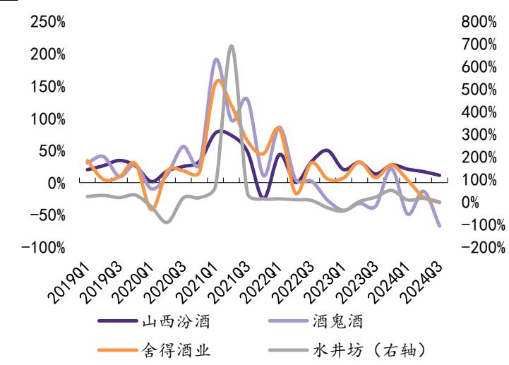  
资料来源：WIND，华鑫证券研究

图表 39：次高端酒 2019-2024Q3 归母净利率表现  
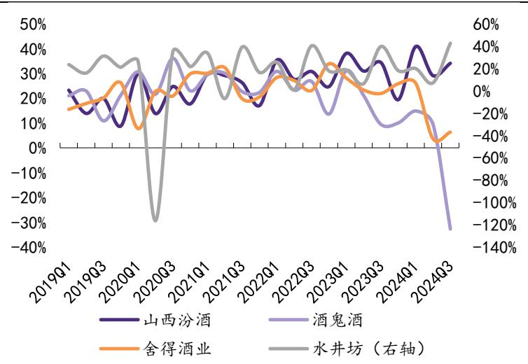  
资料来源：WIND，华鑫证券研究

产品结构普遍下行，利润端影响较大。2024Q1-3 山西汾酒/酒鬼酒/舍得酒业/水井坊毛利率分别同比-4.29/-7.04/-5.94/-2.95pcts，主要系消费力整体疲软下次高端价位带产品动销速度下降，次高端酒企中高价位带产品销量同比增长，如山西汾酒腰部产品巴拿马、老白汾系列，舍得中高端产品舍之道，水井坊产品臻酿八号等，价位带整体下移。

图表 40：2014-2024 年前三季度次高端四家酒企毛利率  
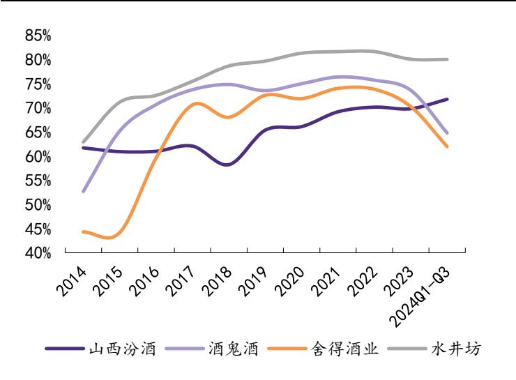  
资料来源：Wind，华鑫证券研究

图表 41：2019-2024 年前三季度水井坊分产品收入占比  
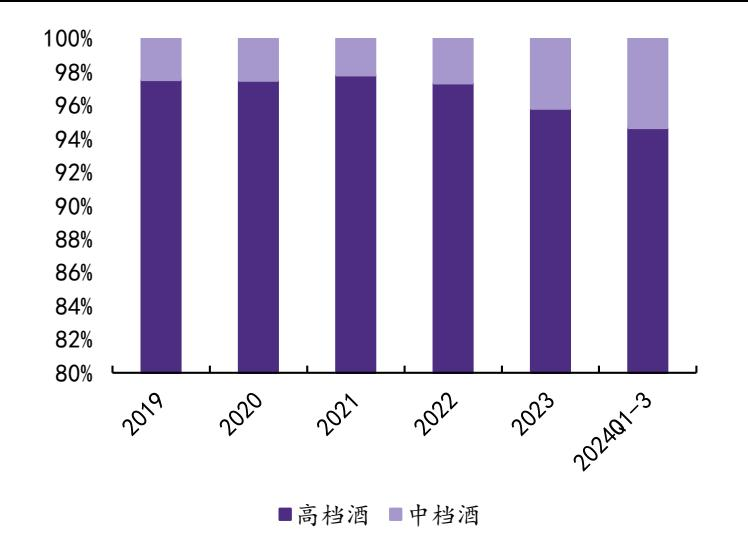  
资料来源：Wind，华鑫证券研究

次高端板块估值反弹速度快，基本面反弹力度大。2019 年在宏观环境与消费信心利好下，四家全国化次高端酒企加大招商力度，2019-2022 年山西汾酒/酒鬼酒经销商数量 CAGR分别为+13.48%/+44.29%，较强品牌效应下大单品全国化铺货顺畅，快速释放业绩弹性。根据弗若斯特沙利文，2018-2022 年次高端市场规模 CAGR 为 16.74%，处于快速发展阶段。我们认为，基本面上看，次高端板块在本次调整中业绩率先降速契合市场态势，加速渠道库存出清，为后续板块业绩反弹蓄力；估值上看，虽次高端整体业绩表现恢复需等待消费力提升后商务场景修复，但因前期超跌幅度较大，故受利好因素驱动后，板块估值快速反弹，股价表现预计仍快于基本面恢复。

图表 42：2014-2023 年次高端市场规模及增速  
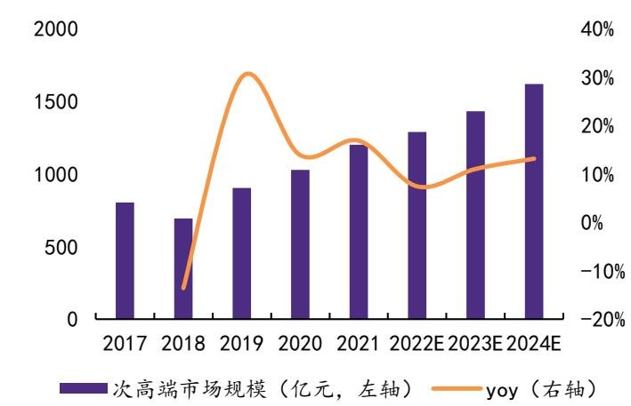  
资料来源：国家统计局，弗若斯特沙利文，珍酒李渡招股书，华鑫证券研究

图表 43：2014-2024 年前三季度次高端酒企经销商数量  
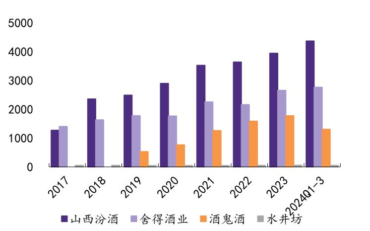  
资料来源：WIND，华鑫证券研究  
注：酒鬼酒 2024 年前三季度经销商数未披露，由 2024H1 数据代替

山西汾酒业绩稳健，多价位带产品轮动放量。2024Q1-3 山西汾酒实现总收入/归母净利润分别 313.58/113.50 亿元，分别同比+17.25%/+20.34%，收入利润仍保持双位数稳健增长。在行业动销整体承压情况下，山西汾酒作为次高端龙头酒企仍取得不错表现，主要得益于其他价位带产品承接一定业绩增长，其中，青花系列 1-9 月增速预计与公司整体增速持平，其中青 20 与青 25 作为次高端价位带核心单品，增速快于青花系列整体；巴拿马老白汾价位带顺应行业发展趋势，1-9 月增速预计达 20%，处于放量阶段；玻汾性价比与品牌认知度高，前三季度增速略快于整体。

图表 44：2014-2024 年前三季度山西汾酒总营收及增速  
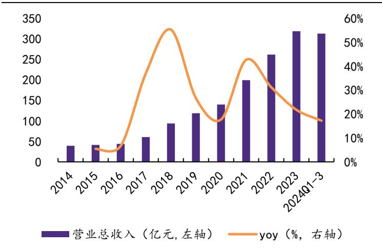  
资料来源：WIND，华鑫证券研究

图表 45：2014-2024 年前三季度山西汾酒归母净利润及增速  
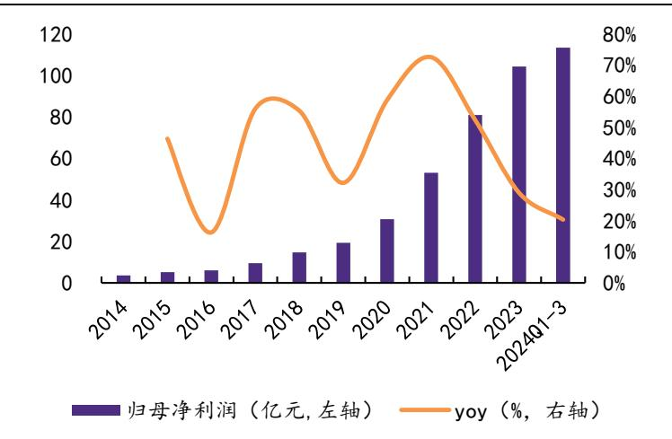  
资料来源：WIND，华鑫证券研究

清香复兴迎热潮，香型优势仍将持续。根据黑格咨询，2023 年清香型白酒实现收入/产能分别为 900 亿元/112 万千升，山西汾酒强势带动整体清香品类市占率提升。根据中国酒业协会，“十四五”期间清香型收入/产能分别将突破 1300 亿元/200 万千升，市占率将由2023年的 15%提高至20%，形成1 个大产区、2 个百亿级品牌、N个区域品牌。

图表 46：2017-2023 年清香型白酒销售收入、产能及其增速  
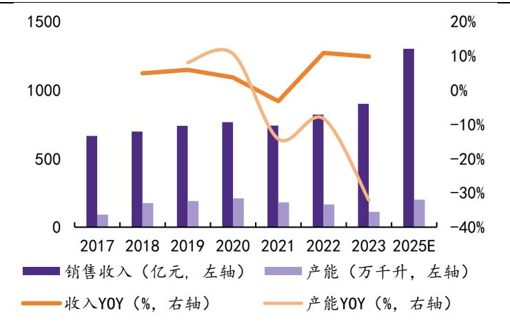  
资料来源：黑格咨询，中国酒业协会，华鑫证券研究

图表 47：2018-2023 年清香型酒占白酒比重  
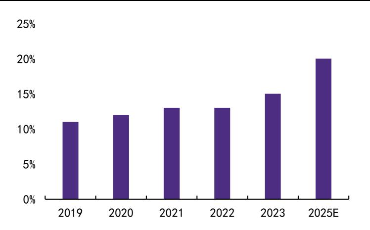  
资料来源：黑格咨询，中国酒业协会，华鑫证券研究

清香型整体价格带偏低，后续高端化空间足。根据长江酒道，100 元内的清香型白酒市场规模约 450 亿元，占整体市场 50%，其中玻汾持续带动光瓶酒高端化升级；100-200 元/300-800 元/1000 元以上市场占比分别为 13.30%/20.00%/13.30%，次高端市场主要由汾酒青20所占据。竞争格局方面，汾酒目前为绝对龙头，带领整体清香产业复兴与高端化。

图表 48：2022 年清香型白酒价格带占比情况  
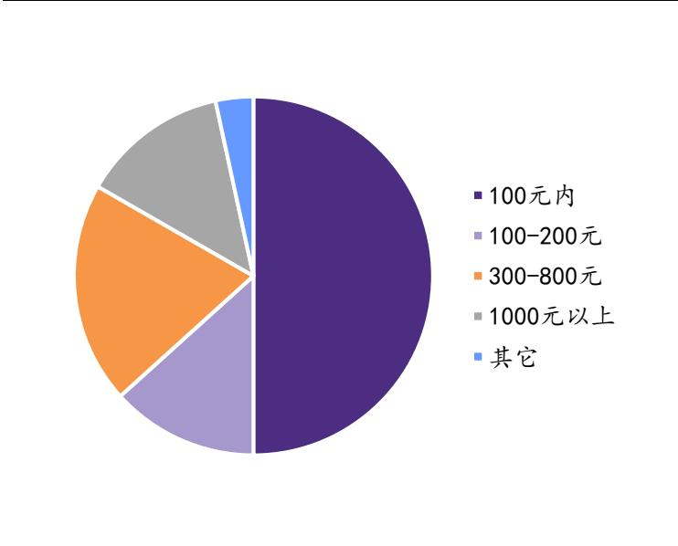  
资料来源：长江酒道，华鑫证券研究

图表 49：清香型各价格带代表企业

<table><tr><td>市场规模</td><td>200-300亿元</td><td>100-200亿元</td></tr><tr><td>代表企业</td><td>汾酒</td><td>牛栏山</td></tr><tr><td>市场规模</td><td>10-50亿元</td><td>5-10亿元</td></tr><tr><td>代表企业</td><td>老白干、红星、江小白、黄鹤楼、劲牌、宝丰、天佑德</td><td>青稞、永丰二锅头、北京二锅头、汾阳王、一担粮</td></tr><tr><td>市场规模</td><td>3-5亿元</td><td>3亿元内</td></tr><tr><td>代表企业</td><td>石花、汾杏、金门高粱、蒙古王</td><td>其它</td></tr></table>

资料来源：长江酒道，华鑫证券研究

进入复兴第二阶段，看好公司业绩稳健增长。2024 年 12 月 2 日山西汾酒召开 2024 年全球经销商大会，宣布“复兴纲领”第一阶段圆满完成，2025 年起将迈入第二阶段，玻汾系列、老白汾系列、青花 20 系列、青花 30 系列力争均突破百亿目标。2025 年公司以“稳健压倒一切”为整体方针， 以环山西市场为单位，与其他升级区域市场营收占比达到 4:6，进入全国化 2.0；同时做好年轻化与国际化布局。我们长期看好公司凭借香型差异化与龙头优势引领清香高势头增长，全价位带产品轮动放量保持业绩稳定增长，“汾享礼遇”渠道模式改革后渠道效率提升。

图表 50：山西汾酒发布青 26 复兴版  
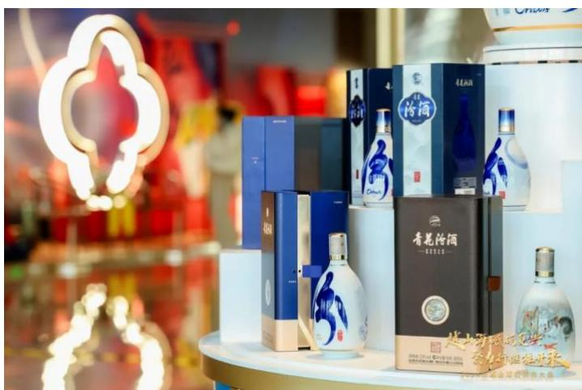  
资料来源：酒食汇，华鑫证券研究

图表 51：山西汾酒“汾享礼遇”五码合一体系

<table><tr><td>层级码</td><td>三级包装码:垛码</td><td colspan="2">二级包装码:箱码</td><td colspan="2">一级包装码:瓶码</td></tr><tr><td>同级码</td><td>箱码一垛码</td><td>箱外码</td><td>箱内码</td><td>盖外码</td><td>盖内码</td></tr><tr><td>码职能</td><td>仓储物流</td><td>物流+追溯</td><td>动销</td><td>物流+追溯</td><td>防伪+营销</td></tr><tr><td>赋码方式</td><td>产线关联采集</td><td colspan="2">包材商关联赋码</td><td colspan="2">瓶盖厂关联赋码</td></tr><tr><td>使用角色</td><td>工厂、仓库</td><td>经销商业务员</td><td>门店</td><td>导购员业务员</td><td>消费者</td></tr><tr><td>关键动作</td><td>关联采集生产入库</td><td>扫码出库扫码签收</td><td>开箱领奖登记返利</td><td>物流追溯登记返利</td><td>防伪营销触发返利</td></tr></table>

资料来源：微酒，华鑫证券研究

## 2.4、 高端酒业绩稳健，关注批价表现

高端酒表现稳健，业绩确定性强。高端酒企 2024Q1-3 营收 2153.42 亿元（同增13.46%），2024Q3 营收 643.38 亿元（同增 9.59%），整体保持稳健增长，Q3 增速环比略下降。其中，贵州茅台依靠强品牌韧性与需求支撑，收入利润仍保持双位数增长；五粮液与老窖收入利润环比降速，保持渠道良性发展。

图表 52：高端酒 2019Q1-2024Q3 营收增速  
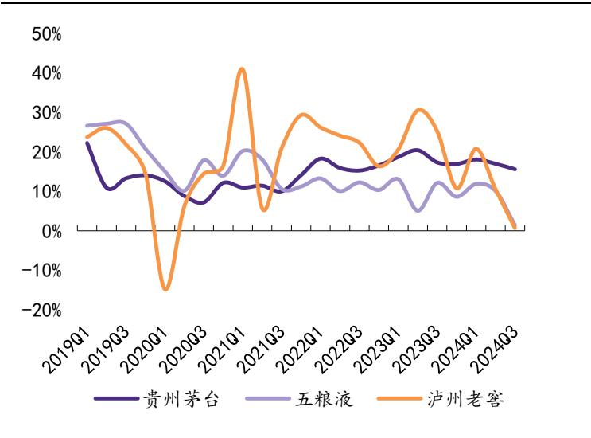  
资料来源：Wind，华鑫证券研究

图表 53：高端酒 2019Q1-2024Q 归母净利润增速  
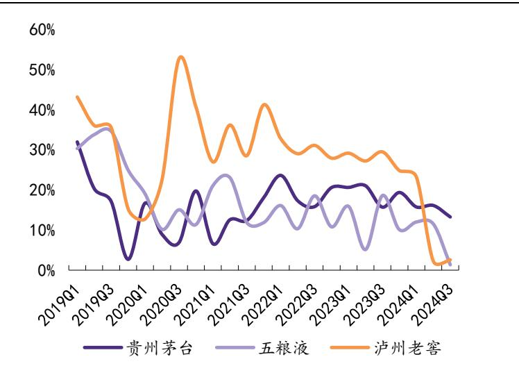  
资料来源：Wind，华鑫证券研究

高端批价表现疲软，长期预计回升。高端酒产品批价表现通常可侧面反映当下渠道信心情况与消费力强弱，本轮调整期以来消费力未完全回升，整体动销增速一般，经销商信心较弱，酒企库存持续承压；较长时间的经济活动停滞亦使得财富效应弱化，体现在以飞天茅台、普五为代表的高端产品批价走弱。我们认为短期受春节供货力度加大、消费弱复苏影响，飞天批价预计仍将调整下行至 2000 元附近，但中长期看政策力度持续加码，消费场景复苏与消费力提升可期，预计将逐步回升企稳，且应重点关注批价上行拐点。

图表 54：2010 年至今茅台价格变动  
  
资料来源：Wind，华鑫证券研究

图表 55：2021 年至今高端酒价格变动  
  
资料来源：Wind，华鑫证券研究

控货措施频繁，合理把控供求关系。今年“618 大促”对飞天茅台批价产生较大影响以来，公司采取较多控货措施，如暂停巽风世界 375ml 飞天茅台酒合成行权、取消投放大箱飞天茅台、暂停直营渠道平价购买等。在整体消费需求不足情况下，酒厂对供给量的控制与对渠道的掌控力更为重要，预计在公司控货措施下，后续飞天茅台价格恐慌性下降的可能性较小，而是更多反映市场供需关系的平衡。

图表 56：贵州茅台今年以来控货措施

<table><tr><td>时间</td><td>措施</td><td>内容</td></tr><tr><td>2024/06/05</td><td>暂停直营渠道平价购买</td><td>部分省份暂停直营渠道团购企业客户平价飞天茅台的申请受理。</td></tr><tr><td>2024/06/19</td><td>巽风暂停375ml飞天茅台酒的行权</td><td>巽风世界将在6月19日试运营结束后开始优化工作;也将暂停巽风375ml茅台酒的合成行权,已经合成且还为失效的收藏凭证还可继续行权激活,重新开放时间以后续公告为准。</td></tr><tr><td>2024/06/20</td><td>茅台1935酒体升级</td><td>升级后的茅台1935酒酒体在原有的基础上提升了香气优雅度、口感丰富度、香和味的平衡度。经中国食品发酵工业研究院酿酒部分析检测中心技术剖析,茅台1935酒升级款与茅台1935原款年份因子综合比值为2:1。</td></tr><tr><td>2024/06/23</td><td>停止投放大箱茅台、高端产品暂停发货</td><td>1)大箱飞天茅台(12瓶装)取消投放,相应减少散瓶茅台供应量;2)部分地区和商家“15年陈年茅台”、“精品茅台”暂停发货。</td></tr><tr><td>2024/07/02</td><td>茅台1935暂停发货</td><td>茅台酱香酒营销公司通知,茅台1935已超进度完成今年各项任务,为保证市场良性健康发展,即日起暂停投放茅台1935酒合同计划。</td></tr><tr><td>2024/11/01</td><td>经销商停止向电商渠道供货</td><td>部分省区茅台酒商主动销售方式,停止向电商渠道供货。</td></tr></table>

资料来源：界面新闻，国酒时空，茅台时空，新浪财经，财联社，名酒研究所，华鑫证券研究

千元价位带酒企向下发力，保持收入稳健表现。今年以来五粮液与泸州老窖宴席政策与扫码红包活动力度较大，且多以低度酒/次高端价位带产品为重点费投对象，2024Q1-3 五粮液销售费用率同比提升 1.51pcts。我们认为，在消费力提升或商务场景恢复前，高端酒对次高端价位带产品加大费投力度的态势难以改变，一方面将带来销量直接提升以缓解业绩压力，另一方面利于数字化系统持续精进；但同时利润方面将略受影响，行业竞争态势更加激烈，费用投放效率预计下降。

图表 57：今年以来五粮液及泸州老窖宴席、扫码红包等措施列举

<table><tr><td>时间</td><td>产品</td><td>措施</td></tr><tr><td>2024/3</td><td>国窖1573</td><td>1)购买5箱及以上(买断不退),且宴席5桌及以上,送52度国窖大时代1瓶。2)15箱及以上(买断不退),且宴席10桌及以上,送3斤国窖1瓶。3)购买30箱及以上(买断不退),且宴席20桌及以上,送国窖大时代1箱。</td></tr><tr><td>2024/4</td><td>五粮液1618</td><td>1)在任意正规渠道购买五粮液1618产品,开瓶扫盖内码综合中奖率高达99.99%,其中最大红包面额为2000元。2)针对宴席市场,凡购买五粮液1618,3件及以上,同时宴席桌数3桌及以上,经核实后即可获得五粮液1618宴席专属礼盒;满足单款活动产品10件及以上,同时宴席桌数10桌及以上,经核实后即可获得五粮液缘定晶生戒指款一瓶,满足单款活动产品20件及以上,同时宴席桌数20桌及以上,经核实后可获得五粮液缘定晶生戒指款两瓶。</td></tr><tr><td>2024/5</td><td>五粮液</td><td>借抖音挑战赛吸引年轻用户,推广和美文化节,通过互动活动和奖励提升品牌影响力。</td></tr><tr><td>2024/7</td><td>五粮液1618</td><td>开瓶扫码返红包活动金额升级,四等奖/三等奖/二等奖/一等奖/特等奖对应的红包分别为30/100/200/2000/2万元,对应中奖率为63.94%/30%/5%/1%/0.05%。</td></tr><tr><td>2024/7</td><td>五粮特曲</td><td>推出“金榜题名鹏程万里”宴席活动,宴席扫码6-11瓶可获得价值460元的书包,扫码12瓶以上,即可获得价值3280元的行李箱。</td></tr><tr><td>2024/9</td><td>五粮春</td><td>陆续开展“五粮春来”“我和春天有个约会”“品牌文化臻享会”等系列品牌IP活动。</td></tr><tr><td>2024/11</td><td>39度五粮液</td><td>1)推出39度五粮液开瓶扫码活动升级,参与者最高特等奖能中19780元现金红包。2)如果抽中特别奖39元,还能再次参加二次抽奖。</td></tr><tr><td>2024/6</td><td>38度国窖1573</td><td>经销售公司研究决定,即日起停止接收国窖38度经典装订单及货物发运。</td></tr><tr><td>2024/7</td><td>38度国窖1573</td><td>自即日起,38度国窖1573经典装(500ml*6)经销客户计划内配额结算价格上调30元/瓶。</td></tr><tr><td>2024/7</td><td>老窖特曲60版</td><td>1)开瓶扫码有6.6元-666元的红包不等。2)开瓶数达到68瓶、98瓶,厂商将分别赠送黄金纪念品5克、黄金纪念品10克;对应开瓶规模的赠礼还包括特曲60版礼盒套装、富安娜四件套、华为GT3运动智能手表、九号电动滑板车等。</td></tr><tr><td>2024/7</td><td>老窖特曲</td><td>10-17桌赠送酒具一套、18-20桌赠1.5L生肖酒一瓶、30桌及以上赠送2.5L藏品酒一坛。</td></tr><tr><td>2024/8</td><td>38度/52度国窖1573经典装</td><td>特等奖/一等奖/二等奖/三等奖/四等奖现金红包分别为15739/1573/100/50/20元,中奖率分别为0.01%/0.20%/3.00%/20.00%/76.79%,综合中奖率100%,除现金红包外,还可以获得单瓶999开瓶积分和开瓶999成长值。</td></tr><tr><td>2024/9</td><td>38度/52度国窖1573经典装</td><td>1)会员扫码,天天有“金”;2)会员首开,抽华为Mate60 pro;3)限时礼遇,赢雅致版国窖。</td></tr></table>

资料来源：酒商荟，香豫五粮，微酒，湾酒观察，云酒头条，数字化星球，券商中国，湖北省河北商会，华鑫证券研究

图表 58：2014-2024 年前三季度高端三家酒企毛利率  
  
资料来源：Wind，华鑫证券研究

图表 59：2014-2024 年前三季度高端三家酒企销售费用率  
  
资料来源：Wind，华鑫证券研究

## 2.5、 地产酒以场景修复为主，重视优质龙头

地产酒表现分化，整体业绩承压。2024Q1-3/2024Q3 地产酒企分别实现收入825.94/197.50 亿元，分别同比+1.67%/-17.97%，增速环比下降明显，主要系今年除商务场景未恢复外，宴席场景亦表现疲软，部分区域消费升级趋势放缓所致。同时地产酒企内部表现亦分化，洋河降速明显；今世缘与古井贡酒增速表现良好；老白干酒利润弹性释放。

图表 60：2019Q1-2024Q3 地产酒企营收增速  
  
资料来源：Wind，华鑫证券研究

图表 61：2019Q1-2024Q3 地产酒企归母净利润增速  
  
资料来源：Wind，华鑫证券研究

多数地产酒企毛利率同比提升，费投力度同比加大。2024Q1-3 古井贡酒/迎驾贡酒/金种子/伊力特毛利率为 79.71%/74.28%/38.67%/52.35%，同比+0.67/+2.65/+2.90/+3.84pcts，徽酒产品结构仍为升级趋势，苏酒毛利率同比下降明显。费投方面，2024Q1-3 古井贡酒/老白干酒/金种子酒/伊力特销售费用率分别为 25.29%/26.32%/25.72%/11.46%，分别同比-2.06/-2.24/+8.04/+2.28pcts，古井贡酒销售费率同比下降主要系规模效应释放，老白干酒处于费用改革期。

图表 62：2014-2024 年前三季度地产酒企毛利率  
  
资料来源：Wind，华鑫证券研究

图表 63：2014-2024 年前三季度地产酒企销售费用率  
  
资料来源：Wind，华鑫证券研究

地产酒企产品结构持续升级，享受利润率提升红利。苏酒中以今世缘为代表，2024 年前三季度特 A 类/A 类/B 类/CD 类收入占比分别为 94.43%/3.72%/1.24%/0.61%%，分别同比+0.75/-0.22/-0.32-/0.20pcts，内部价位带结构升级。徽酒整体升级扩容，其中迎驾贡酒2024 年前三季度中高档酒/普通酒收入占比分别为 80.85%/19.15%，分别同比+2.39/-2.39pcts。

图表 64：2020-2024H1 洋河各产品收入占比  
  
资料来源：Wind，华鑫证券研究

图表 65：2016-2024 前三季度今世缘各产品收入占比  
  
资料来源：Wind，华鑫证券研究

图表 66：2014-2024 前三季度迎驾贡酒各产品收入占比  
  
资料来源：Wind，华鑫证券研究

图表 67：2016-2024 前三季度口子窖各产品收入占比  
  
资料来源：Wind，华鑫证券研究

费投力度加大，投放效率降低。从今年各家地产酒企费投方向看，多以开展扫码得红包、扫码抽奖、宴席赠酒等活动为主，纷纷从渠道端费投转战终端与消费者，费投力度加大；同时过去以货品为主的费用形式转换为以现金红包为主，同质化竞争加剧下费投效率降低，更考验各家酒企对销售政策的把控力度与执行质量。我们认为龙头地产酒企更具优势，同时竞争态势相对缓和的区域竞争性价比更高，稳定性更强。

图表 68：各家地产酒今年费用投放措施列举

<table><tr><td>时间</td><td>酒企</td><td>产品</td><td>措施</td></tr><tr><td>2024.01</td><td>伊力特</td><td>伊力王酒</td><td>开展“伊力王酒扫码中大奖”活动</td></tr><tr><td>2024.01</td><td>金种子</td><td>金种子馥合香</td><td>购买金种子春节装产品开盖扫码赢大奖</td></tr><tr><td>2024.02</td><td>今世缘</td><td>国缘</td><td>持续性开展扫码有奖、陈列奖励、终端激励、品鉴会等促销政策,发力宴席 促销。</td></tr><tr><td>2024.02</td><td>古井贡酒</td><td>中国香古7</td><td>中国香古7推出“荣获名酒60载,感恩红包‘码’上来”扫码活动,第一重 扫码赢100%现金红包,最低5元到最高666元;第二重扫码抽换购,领取红 包后再次抽奖即有机会赢再来一瓶,凭奖码前往指定门店,加20元换购一瓶 中国香古7</td></tr><tr><td>2024.02</td><td>口子窖</td><td>口子窖兼20</td><td>口子窖兼20、现金红包等新春好礼“龙”重登场,现金扫码活动</td></tr><tr><td>2024.04</td><td>伊力特</td><td>伊力王酒</td><td>活动期间购买52度伊力王酒(活动款蓝王),揭开瓶盖顶部二维码覆膜打开 微信扫一扫即可参与活动“伊力王酒·扫码有惊喜”,综合中奖率99.99%</td></tr><tr><td>2024.05</td><td>口子窖</td><td>口子窖兼8</td><td>口子窖·兼8主攻宴席市场,大力度办宴席送酒;瓶盖回收奖励20元/个; 开瓶扫码有机会中再来1瓶</td></tr><tr><td>2024.06</td><td>洋河股份</td><td>梦之蓝</td><td>开展天之蓝乐跑、品推圈层活动,中秋“开瓶扫码”促销活动,洋河·梦之 蓝作为“中法礼物”出现在礼赠环节</td></tr><tr><td>2024.06</td><td>今世缘</td><td>今世缘、国缘</td><td>6月5日至9月30日期间使用今世缘、国缘产品作为升学宴用酒,均可参与 抽奖活动</td></tr><tr><td>2024.06</td><td>口子窖</td><td>口子窖兼系列</td><td>宴席达到规定的桌数,每桌赠一瓶本品</td></tr><tr><td rowspan="3">2024.06</td><td rowspan="3">迎驾贡酒</td><td>迎驾洞藏6</td><td>满5-19桌赠1瓶1000ml洞9;满20桌及以上赠52度2500ml原浆珍藏1坛</td></tr><tr><td>迎驾洞藏9</td><td>满5-19桌赠52度2500ml原浆珍藏1坛;满20桌以上赠52度2500ml私享 典藏1坛</td></tr><tr><td>迎驾洞藏16</td><td>满5-19桌赠42度1000ml生态洞藏16一瓶;满20桌及以上赠52度2500ml 洞藏16一坛</td></tr><tr><td>2024.07</td><td>口子窖</td><td>口子窖</td><td>开瓶扫码中现金大奖活动,宴请喝几瓶送几瓶活动</td></tr><tr><td>2024.08</td><td>伊力特</td><td>伊力特1978</td><td>喜宴用酒为伊力特1978系列产品,送婚礼用劳斯莱斯豪车或者豪车车队</td></tr><tr><td>2024.08</td><td>古井贡酒</td><td>古井贡酒</td><td>携手近百所高校,以志愿填报咨询强化消费者培育,紧抓痛点在助考、助学 上提供增值服务</td></tr><tr><td>2024.10</td><td>今世缘</td><td>今世缘</td><td>加入会员购酒立享95折开卡立享666积分和淡雅小酒一瓶,单笔消费满999 元即可参加抽奖,赢取蟹卡、今世缘D20小酒、无门槛优惠券等</td></tr><tr><td>2024.11</td><td>金徽酒</td><td>金徽酒</td><td>到指定饭店就餐、携带/购买柔和金徽酒的酒友,一桌一酒友可参与抽奖,奖 品现场领取</td></tr><tr><td>2024.11</td><td>老白干酒</td><td>老白干酒</td><td>设置“开盖有奖”的活动刺激市场需求</td></tr><tr><td>2024.12</td><td>口子窖</td><td>口子窖</td><td>宴席用口子窖酒,送口子窖演唱会门票</td></tr></table>

资料来源：微酒，金种子馥合香，数字化星球，爱上合肥，伊力特官微，酒食汇，酒道说酒，深浅 daily，酒周志，印象诗城，酒讯，今世缘官方商城，柔和金徽，美酒招商网，皖美含山，华鑫证券研究

江苏省竞争白热化，安徽省仍有市场扩容红利。根据长江酒道，2023 年在江苏省 600亿元的市场规模中，洋河股份/贵州茅台/五粮液与国窖 1573/今世缘市占率分别为

23.98%/20.00%/18.33%/15.62%，洋河股份与今世缘均为省内地产酒企绝对龙头。我们认为全国性酒企与苏酒龙头在省内格局基本稳定，而徽酒等其他外来酒企的加入加剧省内竞争，本土地产酒仍需加大费用投放以保持稳定市占率，另外目前价位带升级放缓，利润端短期预计略受影响。徽酒方面，2023 年古井贡酒/口子窖/迎驾贡酒在安徽市场市占率分别为30.00%/12.50%/11.25%，本土酒企市占率共 70.00%。我们认为，徽酒内部竞争态势较苏酒更激烈，同时外部酒企逐步进入安徽省后对省内市场份额形成抢占，但同时消费升级缓慢进行下省内规模仍持续扩容，预计向苏酒竞争格局演变，龙头徽酒集中度提升红利仍在。

图表 69：2023 年江苏省白酒市场竞争格局  
  
资料来源：微酒，长江酒道，华鑫证券研究

图表 70：2023 年安徽省白酒市场竞争格局  
  
资料来源：酒时讯，首席酒评，华鑫证券研究

河北市场与新疆市场仍有价位带升级红利，本土龙头酒企预计受益。全国性酒企对河北省市占率抢占较强势，而本土酒企在中高端及以下价位带地位较稳固，老白干（含板城）/丛台/山庄在省内市占率分别为 9.46%/7.71%/4.86%，市占率较低。我们认为，河北省白酒市场扩容趋势确定性强，以老白干酒为代表的本土酒企在自身价位带升级与品牌认知度提升上仍有较大机会，今年以来老白干酒产品结构升级亦较明显。新建市场看，疆内外品牌在新疆市场各占一半，其中伊力特作为疆内绝龙头，2023 年市占率为 23%，其他疆内酒企规模均较小；疆外品牌中除茅台市占率达 25%外，其他品牌规模均不超 5 亿元。我们认为，新疆消费群体分布较分散，利于疆内品牌发挥地方优势，同时目前 300 元及以下的中低端价位带占比达 50%，价位带升级空间仍大，伊力特增长潜力仍在。

图表 71：2023 年河北省白酒市场竞争格局  
  
资料来源：河北资本，华鑫证券研究

图表 72：2023 年新疆白酒市场竞争格局  
  
资料来源：文水县酒业协会，华鑫证券研究

## 3、 行业评级及投资策略

我们认为白酒行业目前处于估值超跌、基本面调整的关键期，四季度以来宏观政策利好持续释放带来部分估值修复，短期政策力度难超预期，关键在于政策落地情况与经济实际恢复情况。1）白酒板块整体仍将按照“先估值修复，后基本面改善”的路径演绎，前者催化点在于整体消费逐步回暖如社零数据逐月回升，后者驱动力为消费场景修复与消费力提升，期间伴随渠道信心恢复、库存逐季改善等利好因素，最终带来估值与基本面双重验证及回升。2）内部来看，次高端板块前期业绩调整最多，市场对其估值弹性期望较高，故最先受益于估值修复，同时在消费力提升的基本面改善后期，业绩弹性较高；高端酒板块业绩稳定性最强，但整体信心不足下前期估值下跌亦较多，估值修复阶段蕴含机会；地产酒中受益于内部产品结构升级标的估值拉升空间大，同时为场景修复最先受益标的。3）分为三条主线：①估值修复与基本面改善均受益的高端板块，推荐茅五泸；②场景修复对基本面改善最明显的地产酒板块，推荐内部结构升级的今世缘、古井贡酒；③估值率先反弹的次高端板块，推荐业绩确定性最强的山西汾酒、舍得酒业等。

维持白酒行业“推荐”投资评级。

图表 73：重点关注公司及盈利预测

<table><tr><td rowspan="2">公司代码</td><td rowspan="2">名称</td><td rowspan="2">2024-12-20 股价</td><td colspan="3">EPS</td><td colspan="3">PE</td><td rowspan="2">投资评级</td></tr><tr><td>2023</td><td>2024E</td><td>2025E</td><td>2023</td><td>2024E</td><td>2025E</td></tr><tr><td>000568.SZ</td><td>泸州老窖</td><td>130.32</td><td>9.00</td><td>9.81</td><td>10.20</td><td>14.48</td><td>13.28</td><td>12.78</td><td>买入</td></tr><tr><td>000596.SZ</td><td>古井贡酒</td><td>176.30</td><td>8.68</td><td>10.41</td><td>11.98</td><td>20.31</td><td>16.94</td><td>14.72</td><td>买入</td></tr><tr><td>000799.SZ</td><td>酒鬼酒</td><td>56.77</td><td>1.69</td><td>0.33</td><td>0.46</td><td>33.59</td><td>172.03</td><td>123.41</td><td>买入</td></tr><tr><td>000858.SZ</td><td>五粮液</td><td>143.21</td><td>7.78</td><td>8.49</td><td>8.99</td><td>18.41</td><td>16.87</td><td>15.93</td><td>买入</td></tr><tr><td>002304.SZ</td><td>洋河股份</td><td>85.00</td><td>6.65</td><td>5.56</td><td>5.43</td><td>12.78</td><td>15.29</td><td>15.65</td><td>买入</td></tr><tr><td>600197.SH</td><td>伊力特</td><td>17.82</td><td>0.72</td><td>0.74</td><td>0.82</td><td>24.75</td><td>24.08</td><td>21.73</td><td>买入</td></tr><tr><td>600199.SH</td><td>金种子酒</td><td>14.10</td><td>-0.03</td><td>0.08</td><td>0.29</td><td>-470.00</td><td>176.25</td><td>48.62</td><td>买入</td></tr><tr><td>600519.SH</td><td>贵州茅台</td><td>1522.00</td><td>59.49</td><td>68.28</td><td>73.38</td><td>25.58</td><td>22.29</td><td>20.74</td><td>买入</td></tr><tr><td>600559.SH</td><td>老白干酒</td><td>21.37</td><td>0.73</td><td>0.89</td><td>1.06</td><td>29.27</td><td>24.01</td><td>20.16</td><td>买入</td></tr><tr><td>600702.SH</td><td>舍得酒业</td><td>70.73</td><td>5.32</td><td>2.83</td><td>3.83</td><td>13.30</td><td>24.99</td><td>18.47</td><td>买入</td></tr><tr><td>600779.SH</td><td>水井坊</td><td>54.69</td><td>2.60</td><td>2.81</td><td>3.01</td><td>21.03</td><td>19.46</td><td>18.17</td><td>买入</td></tr><tr><td>600809.SH</td><td>山西汾酒</td><td>192.50</td><td>8.56</td><td>10.05</td><td>11.18</td><td>22.49</td><td>19.15</td><td>17.22</td><td>买入</td></tr><tr><td>603198.SH</td><td>迎驾贡酒</td><td>55.75</td><td>2.86</td><td>3.35</td><td>3.91</td><td>19.49</td><td>16.64</td><td>14.26</td><td>买入</td></tr><tr><td>603369.SH</td><td>今世缘</td><td>45.18</td><td>2.50</td><td>2.86</td><td>3.17</td><td>18.07</td><td>15.80</td><td>14.25</td><td>买入</td></tr><tr><td>603589.SH</td><td>口子窖</td><td>39.38</td><td>2.87</td><td>3.32</td><td>3.78</td><td>13.72</td><td>11.86</td><td>10.42</td><td>买入</td></tr><tr><td>603919.SH</td><td>金徽酒</td><td>20.00</td><td>0.65</td><td>0.80</td><td>1.01</td><td>30.77</td><td>25.00</td><td>19.80</td><td>买入</td></tr></table>

资料来源：Wind，华鑫证券预测

## 4、 风险提示

疫情波动风险；宏观经济波动风险；推荐公司业绩不及预期的风险；行业竞争或政策变动风险；消费税或生产风险等。

## ▌ 食品饮料组介绍

孙山山：经济学硕士，6 年食品饮料卖方研究经验，全面覆盖食品饮料行业，聚焦饮料子板块，深度研究白酒行业等。曾就职于国信证券、新时代证券、国海证券，于 2021 年 11 月加盟华鑫证券研究所担任食品饮料首席分析师，负责食品饮料行业研究工作。获得 2021 年东方财富百强分析师食品饮料行业第一名、2021 年第九届东方财富行业最佳分析师食品饮料组第一名和 2021 年金麒麟新锐分析师称号，2023 年东方财富行业最佳分析师第六名。注重研究行业和个股基本面，寻求中长期个股机会，擅长把握中短期潜力个股；勤于思考白酒板块，对苏酒有深入市场的思考和深刻见解。

肖燕南：湖南大学金融硕士，于 2023 年 6月加入华鑫证券研究所，研究方向是次高端等白酒和软饮料板块。

张倩：厦门大学金融学硕士，于 2024 年 7 月加入华鑫证券研究所，研究方向是调味品、速冻品以及除徽酒外的地产酒板块。

## ▌ 证券分析师承诺

本报告署名分析师具有中国证券业协会授予的证券投资咨询执业资格并注册为证券分析师，以勤勉的职业态度，独立、客观地出具本报告。本报告清晰准确地反映了本人的研究观点。本人不曾因，不因，也将不会因本报告中的具体推荐意见或观点而直接或间接收到任何形式的补偿。

## ▌ 证券投资评级说明

股票投资评级说明：

<table><tr><td></td><td>投资建议</td><td>预测个股相对同期证券市场代表性指数涨幅</td></tr><tr><td>1</td><td>买入</td><td>&gt;20%</td></tr><tr><td>2</td><td>增持</td><td>10%—20%</td></tr><tr><td>3</td><td>中性</td><td>-10%—10%</td></tr><tr><td>4</td><td>卖出</td><td>&lt;-10%</td></tr></table>

行业投资评级说明：

<table><tr><td></td><td>投资建议</td><td>行业指数相对同期证券市场代表性指数涨幅</td></tr><tr><td>1</td><td>推荐</td><td>&gt;10%</td></tr><tr><td>2</td><td>中性</td><td>-10% — 10%</td></tr><tr><td>3</td><td>回避</td><td>&lt;-10%</td></tr></table>

以报告日后的 12 个月内，预测个股或行业指数相对于相关证券市场主要指数的涨跌幅为标准。

相关证券市场代表性指数说明：A 股市场以沪深 300 指数为基准；新三板市场以三板成指（针对协议转让标的）或三板做市指数（针对做市转让标的）为基准；香港市场以恒生指数为基准；美国市场以道琼斯指数为基准。

## ▌ 免责条款

华鑫证券有限责任公司（以下简称“华鑫证券”）具有中国证监会核准的证券投资咨询业务资格。本报告由华鑫证券制作，仅供华鑫证券的客户使用。本公司不会因接收人收到本报告而视其为客户。

本报告中的信息均来源于公开资料，华鑫证券研究部门及相关研究人员力求准确可靠，但对这些信息的准确性及完整性不作任何保证。我们已力求报告内容客观、公正，但报告中的信息与所表达的观点不构成所述证券买卖的出价或询价的依据，该等信息、意见并未考虑到获取本报告人员的具体投资目的、财务状况以及特定需求，在任何时候均不构成对任何人的个人推荐。投资者应当对本报告中的信息和意见进行独立评估，并应同时结合各自的投资目的、财务状况和特定需求，必要时就财务、法律、商业、税收等方面咨询专业顾问的意见。对依据或者使用本报告所造成的一切后果，华鑫证券及/或其关联人员均不承担任何法律责任。本公司或关联机构可能会持有报告中所提到的公司所发行的证券头寸并进行交易，还可能为这些公司提供或争取提供投资银行、财务顾问或者金融产品等服务。本公司在知晓范围内依法合规地履行披露。

本报告中的资料、意见、预测均只反映报告初次发布时的判断，可能会随时调整。该等意见、评估及预测无需通知即可随时更改。在不同时期，华鑫证券可能会发出与本报告所载意见、评估及预测不一致的研究报告。华鑫证券没有将此意见及建议向报告所有接收者进行更新的义务。

本报告版权仅为华鑫证券所有，未经华鑫证券书面授权，任何机构和个人不得以任何形式刊载、翻版、复制、发布、转发或引用本报告的任何部分。若华鑫证券以外的机构向其客户发放本报告，则由该机构独自为此发送行为负责，华鑫证券对此等行为不承担任何责任。本报告同时不构成华鑫证券向发送本报告的机构之客户提供的投资建议。如未经华鑫证券授权，私自转载或者转发本报告，所引起的一切后果及法律责任由私自转载或转发者承担。华鑫证券将保留随时追究其法律责任的权利。请投资者慎重使用未经授权刊载或者转发的华鑫证券研究报告。