# 需求主导，价值重估 —2025年食品饮料行业策略报告

2024年12月31日

# 证券研究报告

# 行业研究

# 行业投资策略

食品饮料行业

投资评级 看好

上次评级 看好

程丽丽 食品饮料行业分析师

执业编号：S1500523110003

邮箱：chenglili@cindasc.com

赵丹晨 食品饮料行业分析师

执业编号：S1500523080005

邮箱：zhaodanchen@cindasc.com

赵雷 食品饮料行业分析师

执业编号：S1500524100003

邮箱：zhaolei@cindasc.com

# 需求主导，价值重估

2024年12月31日

## 本期内容提要:

## 白酒板块：

批价向下挤压反映供需矛盾，行业分化加剧。当前白酒行业仍面临宏观经济周期和自身发展周期的调整叠加，主流大单品的批价松动，反映出酒企增长与需求疲软的矛盾。2024年三季度开始，白酒行业销售增长呈现放缓趋势，以维护渠道发展良性。从动销端看，各价位、各区域的品牌分化仍较突出，高端酒的挤压式竞争明显，头部单品的市场份额有所提升；次高端价位升级动能不足，且受商务需求疲软影响，分化最显著；大众价位仍具有较强的消费韧性，且在升降级并存的环境下，呈现一定的扩容，区域龙头受益更多。

估值处于低位，股息回报可观。当前白酒板块的估值中枢落后于食品饮料大部分细分行业，在商业模式更优的基础上，具备一定的投资性价比。基于上市酒企分红规划的明晰，股东回报率持续提升，头部酒企的股息率达到4%左右，提供了较强估值支持，我们认为再次出现上一轮行业下行期的极低估值的可能性较低，底部择机布局的胜率较高。

投资建议：推荐品牌护城河突出、业绩稳定强的高端白酒，如贵州茅台、五粮液；具有较独立势能、具备全国化宽价位带优势的山西汾酒；在区域市场组织力、渠道力突出且仍具消费升级逻辑的地产酒龙头，如古井贡酒、迎驾贡酒、今世缘；消费好转下仍具成长弹性的高端及次高端品牌，如泸州老窖、水井坊、舍得酒业，以及改革调整驱动下的洋河股份、金种子酒、酒鬼酒。

## 大众食品板块：

啤酒：长期应当关注啤酒公司内部结构性变化，低端啤酒向上整合的趋势对公司吨酒收入的提升仍有一定贡献，且啤酒成本改善确定性较大，有望贡献较好的利润增速，推荐青岛啤酒、重庆啤酒、华润啤酒。

饮料：我们认为饮料行业主要有两大变化：1）品类结构重塑，健康化趋势明显；2）价格优势突出，大包装饮料受消费者青睐。推荐能量饮料高增、通过新品补水啦+乌龙上茶持续构建“能量+”的品类矩阵的东鹏饮料；推荐在健康化趋势下，包装饮用水和无糖茶有望持续增长的农夫山泉；推荐持续深耕主业、积极布局量贩零食新渠道、椰子水新品类的欢乐家。

乳制品：当前乳制品行业供给过剩，需求缓慢复苏，但供给已开始收缩，供需缺口收窄，静待需求回暖。推荐渠道库存出清，基本面预期充分、股息率高的伊利股份，关注估值偏低的蒙牛乳业。

食品添加剂：当前食品添加剂公司海外需求景气，国内增速高于多数

C 端食品饮料公司，明年需关注盈利预期和海外政策变化。推荐新产能顺利投产、海外业务强劲的百龙创园，海外业务亮眼、成本持续下降的安琪酵母，业绩表现出色、推进并购重组的嘉必优，关注估值偏低、业绩有望持续改善的晨光生物。

休闲食品：投资主线一：当前处于供需关系转换推动的零售变革阶段，面对需求主导的时代，关注实现供应链效率提升的厂商以及零售商，给终端提供性价比产品的业态。渠道端推荐渠道效率更高的量贩零食行业头部品牌万辰集团，以及提出高端性价比战略、布局社区折扣超市的三只松鼠，关注降价积极变革的良品铺子；厂商端推荐积极拥抱量贩零食高效率渠道的盐津铺子、甘源食品，关注积极拥抱零食量贩渠道的好想你。投资主线二：休闲食品行业部分细分品类集中度提升逻辑仍在演绎当中，下沉市场消费潜力大，有望加速头部品牌市占率提升，关注休闲食品行业经典品类头部品牌市占率提升及品类扩张带来的投资机会。推荐面制品推新加快提升市占率及魔芋品类红利正当时的辣味零食头部品牌卫龙美味，以及通过大包装持续提升渗透率具备品类整合红利的劲仔食品，关注积极推进渠道深耕及打造第二品类曲线的瓜子龙头洽洽食品。卤味连锁业态品类长周期，关注门店积极调整以期提振单店的绝味食品、周黑鸭、煌上煌。

➢ 风险因素：宏观经济不确定风险；食品安全风险；行业竞争加剧风险；成本上行风险。

## 目录

1.白酒：集中趋势不改，分化中首选龙头....6  
1.1市场行情回顾....6  
1.2批价向下挤压，反映供需矛盾....6  
1.3产业持续分化，头部稳健性突出....7  
1.4明确分红规划，提供估值支撑....8  
1.5重点公司....9  
2.啤酒：稳健增长，成本红利持续兑现....11  
2.1市场行情回顾....11  
2.2现饮渠道短期承压，成本持续改善....12  
2.3重点公司....14  
3.饮料：性价比需求增长....15  
3.1市场行情回顾....15  
3.2性价比需求旺盛，软饮料持续增长....16  
3.3重点公司....18  
4.乳制品：供需缺口收窄，静待需求回暖....19  
4.1供需缺口收窄，静待需求回暖....19  
4.2重点公司....20  
5.食品添加剂：需求表现亮眼，关注海外变化....21  
5.1需求表现亮眼，关注海外变化....21  
5.2重点公司....22  
6.休闲食品：需求主导时代开启，零食量贩拉开渠道变革序幕....23  
6.1新品类新渠道，跑出超额收益....23  
6.2需求主导时代，效率为王....24  
6.3下沉市场“消费升级”，品类红利强者愈强....27  
6.4重点公司....27  
7.投资策略....29  
7.1白酒板块....29  
7.2大众品板块....29  
8.风险因素....30

## 表目录

表1：白酒上市企业分红规划....8  
表2：白酒上市企业股息率估算（2024.12.24）....9  
表3：顺应渠道变革趋势的产业链以及具备品类红利的公司收入增长上表现更为突出....23

## 图目录

图1：截至2024年12月13日A股白酒板块走势....6  
图2：2024年茅台批价下行压力明显....6  
图3：五粮液批价在11月中旬出现松动....6  
图4：千元酱酒单品批价下探至700元附近....7  
图5：次高端上沿酱酒单品批价回落至400元左右....7  
图6：2024Q3白酒行业出现降速且分化加剧....8  
图7：白酒板块估值较食品饮料偏低....9  
图8：截止2024年12月13日A股啤酒板块年初至今涨跌幅....11  
图9：截止2024年12月13日华润啤酒年初至今涨跌幅....11  
图10：青岛啤酒Forward净利润和PE走势图....12  
图11：重庆啤酒Forward净利润和PE走势图....12  
图12：2024年3-11月全国规模以上啤酒企业产量同比 $-5.11\%$ ...12  
图13：2024Q1-Q3啤酒上市公司销量走势分化....12  
图14：2024Q3青岛啤酒主品牌销量增速高于副品牌....13  
图15：2024Q1-Q3重庆啤酒高端酒收入增速放缓....13  
图16：2024年青岛啤酒、重庆啤酒吨酒收入增速放缓....13  
图17：2024年青岛啤酒、重庆啤酒收入增速放缓....13  
图18：青岛啤酒股份公司啤酒制造成本拆解....13  
图19：2024年啤酒吨成本改善明显....13

图20: 大麦进口均价2024年持续下跌....14  
图21: 打包易拉罐价格2023年7月后继续上涨....14  
图22: 瓦楞纸价格持续下跌....14  
图23: 玻璃价格2024年4月后转跌....14  
图24: 2022Q1-2024Q3上市公司青岛啤酒和重庆啤酒归母净利润情况....14  
图25: 2022Q1-2024Q3青岛啤酒和重庆啤酒净利润率情况....14  
图26: 截止2024年12月13日A股饮料板块年初至今涨跌幅....15  
图27: 截止2024年12月13日农夫山泉年初至今涨跌幅....15  
图28: 东鹏饮料Forward净利润和PE走势图....16  
图29: 欢乐家Forward净利润和PE走势图....16  
图30: 2024年软饮料产量表现好于啤酒、乳制品....16  
图31: 大即饮的占比由2019年的 $6.4\%$ 提升到2023年的 $11.3\%$ ....16  
图32: 2024年4月农夫山泉推出纯净水产品....17  
图33: 农夫山泉纯净水产品终端促销价为9.9元12瓶....17  
图34: 无糖茶行业增长进入以价换量阶段....18  
图35: 无糖茶行业密集上新....18  
图36: 中国能量饮料市场规模2016-2023年CAGR为 $8.3\%$ ....18  
图37: 2024Q1东鹏饮料收入同比 $+30.1\%$ ....18  
图38: 今年以来奶价跌幅逐季环比收窄....19  
图39: 今年前十个月乳制品产量和进口量双双下降....19  
图40: 牛奶零售价今年跌幅逐步收窄....20  
图41: 乳业股价开始反转....20  
图42: 添加剂公司海外收入增速普遍高于国内增速....21  
图43: 原材料价格持续下降....21  
图44: 今年涨跌幅归因各异....22  
图45: 今年年初以来休闲食品指数跑输上证指数....24  
图46: 渠道效率更高的零食量贩头部品牌万辰集团显著跑赢指数....24  
图47: 拥抱新渠道推出新产品的厂商公司股价表现更好....24  
图48: 卫龙美味魔芋制品老品焕新机，下半年股价表现强于恒生综指....24  
图49: 消费进入需求主导的时代....25  
图50: 国内商超变革下，山姆在国内仍保持较快增长....26  
图51: 量贩零食行业门店数量近三年快速增长....26  
图52: 三只松鼠提出高端性价比战略推动营收....26  
图53: 盐津铺子21Q2优化供应链推动营收实现快速增长....26  
图54: 万辰集团旗下品牌来优品推出省钱超市....27  
图55: 零食有鸣24年积极探索社区批发超市....27

## 1. 白酒：集中趋势不改，分化中首选龙头

## 1.1 市场行情回顾

截至 2024 年 12 月 13 日，SW 白酒III年内下跌 10.4%，跑输 SW 食品饮料 5.6pct，跑输沪深 300 指数 25.0pct。今年以来，白酒板块与食品饮料整体的涨跌走势基本一致，11 月后走势偏弱，核心在于白酒消费与商务需求密切相关，在拉动内需、刺激消费的政策预期下，以大众品消费为主的居民需求有望率先得到改善；此外白酒的去库存周期相对较长，行业底部出清也需要一定时间。与沪深 300 相比，白酒板块在年中的下跌行情中表现出超跌，核心是淡季动销偏弱，市场信心不足；在 9 月底的中央政策催化下，白酒板块强势反弹，短期领跑大盘，体现出市场对经济回暖的强烈预期。整体上，白酒板块当前的 α 较弱，行业调整周期尚未结束，股价更多依靠 β 支撑，走势与宏观预期紧密相关。

图 1: 截至 2024 年 12 月 13 日 A 股白酒板块走势  
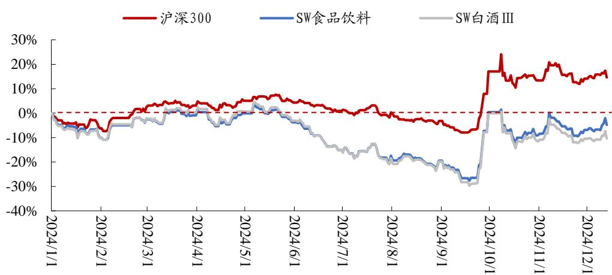  
资料来源：iFind，信达证券研发中心

## 1.2 批价向下挤压，反映供需矛盾

茅台虽控制发货节奏，但难掩批价下行压力。今年以来，茅台批价走势弱于过去几年表现，清明前后因 375ml 巽风酒上市，开始下行趋势，随后每逢旺季及电商补贴，批价均出现急速下跌。虽然公司通过调节发货节奏来缓解短期的供需不匹配问题，但全年看来，整箱飞天跌价约 600 元，散瓶飞天跌价约 400 元，两者价差也从年初的近 300 元缩减至 100 元左右。茅台批价走弱，我们认为，一方面源于价格下行过程中对投资需求的挤出，另一方面也反应其消费需求的疲软。

图 2: 2024 年茅台批价下行压力明显  
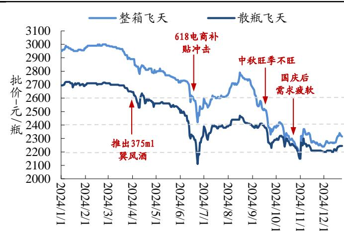  
资料来源：茅粉鲁智深，信达证券研发中心

图 3: 五粮液批价在 11 月中旬出现松动  
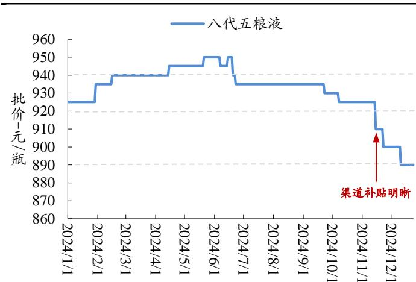  
资料来源：渠道调研、信达证券研发中心

渠道补贴易折入成本，经销商以价换量回笼资金。五粮液今年前10个月的控货稳价效果良好，八代五粮液批价在二季度稳中有升，在茅台批价出现较大波动时，也依然稳定在920-940元。而临近年终，渠道补贴政策明晰后，再因电商低价成为导火索，11月中旬起，八代五粮液批价快速跌破900元，价格倒挂幅度进一步加大。由于五粮液是全国流通性大单品，经销商出货大多随行就市，因开门红打款需求，个别经销商以价换量回笼资金，其实也侧面反映市场需求一般。

酱酒价格回归理性，工艺溢价难抵供需矛盾。在 19-21 年酱酒热期间，受产量限制及茅台批价引领，酱酒单品的溢价表现突出，较浓香酒更易卡位 600 元及千元价位。但随过热后进入调整期，渠道库存持续去化，主流酱酒单品的批价逐渐走低。以茅台 1935 和习酒两大单品为例，由于增长任务带来的库存积累问题，渠道不得已以价换量缓解资金压力，2024 年批价下行明显，茅台 1935 及君品习酒批价下探至 700 元附近，而习酒 1988 批价回落至 400 元左右，相较于浓香酒各价位的核心单品，批价降幅较大，产品溢价回归理性。

图 4: 千元酱酒单品批价下探至 700 元附近  
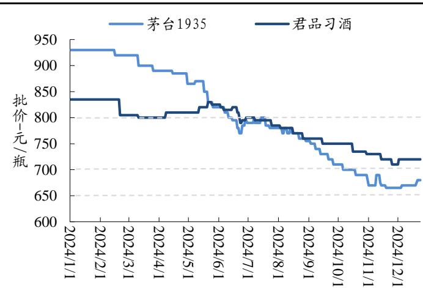  
资料来源：茅粉鲁智深，渠道调研，信达证券研发中心

图 5: 次高端上沿酱酒单品批价回落至 400 元左右  
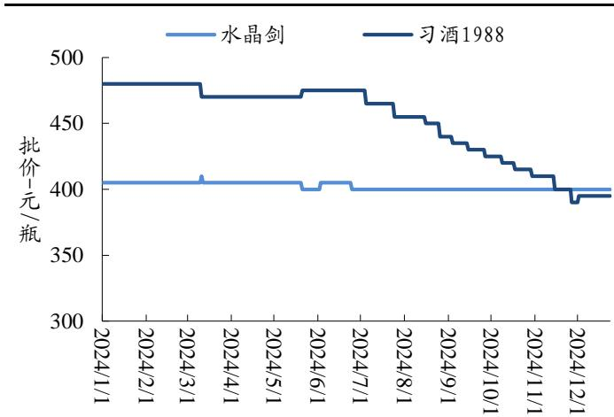  
资料来源：渠道调研、信达证券研发中心

## 1.3 产业持续分化，头部稳健性突出

渠道压力传导至报表降速，行业分化加剧。受制于消费端疲软与企业完成增长的矛盾，白酒渠道库存在过去几年持续累加，并且在此过程中终端的进货意愿降低，库存压力多挤压在经销商端。当渠道杠杆难以增加时，真实的动销弱表现便开始反映至报表端。我们能明显看到，2024Q3 的更多酒企出现收入负增长，一些上半年表现较优的企业也将收入增速放缓至小个位数，以主动缓解渠道压力。在行业下行过程中，分化明显，高端酒整体仍能维持双位数左右的增长表现；次高端酒相继进入调整期，且一旦调整，短期内较难恢复增长；苏酒、徽酒的区域竞争加剧，出现此消彼长的挤压态势；二线地产酒也相应放缓增长。

挤压性竞争中，份额进一步向头部酒企集中。由于行业整体处于下行周期，中高价位产品的需求出现一定的缩量，挤压式竞争明显。在此过程中，头部酒企的品牌力、渠道力优势凸显，各区域各价位的前两名产品挤压后部品牌，市场份额向头部集中，由此保障了头部品牌的发展稳健性。包括2025年的开门红回款，我们认为不少酒企都面临一定压力，从渠道选择看，也优先拥护流动性较强的品牌，避免变现难的风险，预计2025年的分化仍将持续，头部酒企有望继续抵住行业下行压力，保持行业份额的优势。

图 6: 2024Q3 白酒行业出现降速且分化加剧

<table><tr><td colspan="2">单位:百万元</td><td colspan="4">2024Q1-3</td><td colspan="4">2024Q3</td></tr><tr><td>分类</td><td>酒企</td><td>营业收入</td><td>YOY</td><td>归母净利润</td><td>YOY</td><td>营业收入</td><td>YOY</td><td>归母净利润</td><td>YOY</td></tr><tr><td rowspan="3">高端</td><td>贵州茅台</td><td>120,776</td><td>16.95%</td><td>60,828</td><td>15.04%</td><td>38,845</td><td>15.29%</td><td>19,132</td><td>13.23%</td></tr><tr><td>五粮液</td><td>67,916</td><td>8.60%</td><td>24,931</td><td>9.19%</td><td>17,268</td><td>1.39%</td><td>5,874</td><td>1.34%</td></tr><tr><td>泸州老窖</td><td>24,304</td><td>10.76%</td><td>11,593</td><td>9.72%</td><td>7,399</td><td>0.67%</td><td>3,566</td><td>2.58%</td></tr><tr><td rowspan="4">全国次高端</td><td>山西汾酒</td><td>31,358</td><td>17.25%</td><td>11,350</td><td>20.34%</td><td>8,611</td><td>11.35%</td><td>2,940</td><td>10.36%</td></tr><tr><td>舍得酒业</td><td>4,460</td><td>-14.97%</td><td>669</td><td>-48.35%</td><td>1,189</td><td>-30.72%</td><td>78</td><td>-79.22%</td></tr><tr><td>水井坊</td><td>3,788</td><td>5.56%</td><td>1,125</td><td>10.03%</td><td>2,070</td><td>0.38%</td><td>883</td><td>7.67%</td></tr><tr><td>酒鬼酒</td><td>1,191</td><td>-44.41%</td><td>56</td><td>-88.20%</td><td>197</td><td>-67.24%</td><td>-65</td><td>-213.67%</td></tr><tr><td rowspan="2">苏酒</td><td>洋河股份</td><td>27,516</td><td>-9.14%</td><td>8,579</td><td>-15.92%</td><td>4,641</td><td>-44.82%</td><td>631</td><td>-73.03%</td></tr><tr><td>今世缘</td><td>9,941</td><td>18.86%</td><td>3,086</td><td>17.08%</td><td>2,636</td><td>10.12%</td><td>624</td><td>6.61%</td></tr><tr><td rowspan="4">徽酒</td><td>古井贡酒</td><td>19,069</td><td>19.53%</td><td>4,746</td><td>24.49%</td><td>5,263</td><td>13.36%</td><td>1,174</td><td>13.60%</td></tr><tr><td>迎驾贡酒</td><td>5,513</td><td>14.77%</td><td>2,006</td><td>21.23%</td><td>1,728</td><td>4.05%</td><td>628</td><td>6.18%</td></tr><tr><td>口子窖</td><td>4,362</td><td>-1.89%</td><td>1,311</td><td>-2.81%</td><td>1,195</td><td>-22.04%</td><td>362</td><td>-27.72%</td></tr><tr><td>金种子酒</td><td>806</td><td>-24.90%</td><td>-100</td><td>-185.51%</td><td>139</td><td>-54.41%</td><td>-111</td><td>-3843.21%</td></tr><tr><td rowspan="5">二线地产酒</td><td>老白干酒</td><td>4,088</td><td>6.29%</td><td>556</td><td>33.00%</td><td>1,618</td><td>0.26%</td><td>252</td><td>25.17%</td></tr><tr><td>金徽酒</td><td>2,328</td><td>15.31%</td><td>333</td><td>22.17%</td><td>574</td><td>15.77%</td><td>38</td><td>108.84%</td></tr><tr><td>伊力特</td><td>1,654</td><td>0.64%</td><td>241</td><td>5.27%</td><td>324</td><td>-23.32%</td><td>43</td><td>-17.75%</td></tr><tr><td>天佑德酒</td><td>987</td><td>4.89%</td><td>57</td><td>-45.80%</td><td>228</td><td>-18.76%</td><td>-22</td><td>-334.41%</td></tr><tr><td>皇台酒业</td><td>113</td><td>0.57%</td><td>23</td><td>545.36%</td><td>48</td><td>25.12%</td><td>27</td><td>5590.48%</td></tr><tr><td>光瓶酒</td><td>顺鑫农业</td><td>7,317</td><td>-16.92%</td><td>382</td><td>230.72%</td><td>1,630</td><td>-37.20%</td><td>-41</td><td>80.83%</td></tr></table>

资料来源：iFind，信达证券研发中心

## 1.4 明确分红规划，提供估值支撑

分红规划清晰，增加中期分红。本轮白酒行业下行调整中，虽然增速不可避免会出现放缓，但酒企对市值管理、加强分红的举措明显增加，彰显公司盈利能力及对股东的回报意识，增强投资者信心。茅台、五粮液、洋河均已公告2024-2026年分红规划，此外茅台、五粮液、老窖、汾酒也相继公布2024年中期分红方案，积极兑现投资者回报。

表 1: 白酒上市企业分红规划

<table><tr><td>企业</td><td>分红规划</td><td>2024年中期分红方案</td></tr><tr><td>贵州茅台</td><td>2024-2026年度,公司每年度分配的现金红利总额不低于当年实现归属于上市公司股东的净利润的75%,每年度的现金分红分两次(年度和中期分红)实施。</td><td>每股派发现金红利23.882元(含税),共计派发现金红利约300亿元(含税)。</td></tr><tr><td>五粮液</td><td>2024-2026年度,公司每年度现金分红总额占当年归母净利润的比例不低于70%,且不低于200亿元(含税);公司每年度的现金分红可分一次或多次(即年度分红、中期分红、特殊分红)实施。</td><td>拟每10股派发现金红利25.76元(含税),合计拟派发现金红利约100亿元(含税)。</td></tr><tr><td>泸州老窖</td><td></td><td>拟每10股派发现金红利13.58元(含税),合计拟派发现金红利约20亿元(含税)。</td></tr><tr><td>山西汾酒</td><td></td><td>拟每股派发现金红利2.46元(含税),合计拟派发现金红利约30亿元(含税)。</td></tr><tr><td>洋河股份</td><td>2024-2026年度,公司每年度的现金分红总额不低于当年实现归属于上市公司股东净利润的70%且不低于人民币70亿元(含税)。</td><td></td></tr></table>

资料来源：各公司公告，信达证券研发中心

白酒估值中枢偏低，股息率可观。本轮政策预期引导下，白酒板块的估值修复表现出前快后缓的趋势，在11月以来的震荡过程中，股价表现也弱于食品饮料。当前白酒板块的估值也较为分化，茅台、全国化次高端及二线地产酒估值普遍在20PE左右，千元价位及苏酒徽酒估值在15PE左右，均落后于大部分食品饮料板块。在酒企积极分红的举措下，我们测算，2024年白酒上市企业的股息率普遍为 $2\% - 3\%$ ，头部酒企股息率在 $4\%$ 左右，投资回报率可观。我们认为，企业分红规划对估值底有较强的支撑效应，触及 13-14 年的极低估值的可能性较低，当前低位布局的胜率较高。

图 7: 白酒板块估值较食品饮料偏低（2024.12.13）  
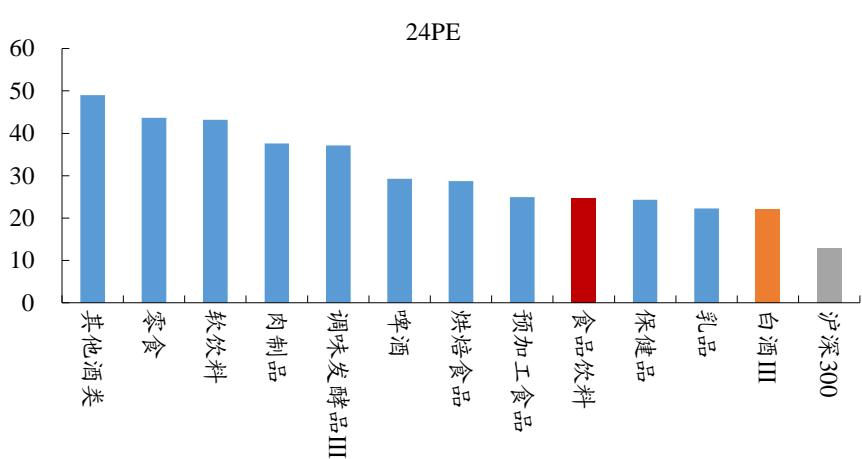  
资料来源：iFind，信达证券研发中心

表 2: 白酒上市企业股息率估算 (2024.12.24)

<table><tr><td>企业</td><td>市值</td><td>24E 归母净利润</td><td>24PE</td><td>23年分红率</td><td>24年股息率预测</td></tr><tr><td>贵州茅台</td><td>19331亿元</td><td>861亿元</td><td>22.4</td><td>84.01%</td><td>3.79%</td></tr><tr><td>五粮液</td><td>5569亿元</td><td>329亿元</td><td>16.9</td><td>60%</td><td>4.14%</td></tr><tr><td>泸州老窖</td><td>1915亿元</td><td>144亿元</td><td>13.3</td><td>60%</td><td>4.51%</td></tr><tr><td>山西汾酒</td><td>2312亿元</td><td>125亿元</td><td>18.5</td><td>51.07%</td><td>2.76%</td></tr><tr><td>舍得酒业</td><td>230亿元</td><td>9亿元</td><td>24.5</td><td>40.18%</td><td>1.64%</td></tr><tr><td>水井坊</td><td>263亿元</td><td>14亿元</td><td>19.1</td><td>35.03%</td><td>1.84%</td></tr><tr><td>酒鬼酒</td><td>183亿元</td><td>2亿元</td><td>89.7</td><td>59.31%</td><td>0.66%</td></tr><tr><td>洋河股份</td><td>1254亿元</td><td>87亿元</td><td>14.5</td><td>70.09%</td><td>5.58%</td></tr><tr><td>今世缘</td><td>570亿元</td><td>37亿元</td><td>15.5</td><td>39.76%</td><td>2.56%</td></tr><tr><td>古井贡酒</td><td>845亿元</td><td>57亿元</td><td>14.9</td><td>51.83%</td><td>3.48%</td></tr><tr><td>迎驾贡酒</td><td>434亿元</td><td>27亿元</td><td>15.8</td><td>45.46%</td><td>2.88%</td></tr><tr><td>口子窖</td><td>237亿元</td><td>17亿元</td><td>13.6</td><td>52.29%</td><td>3.84%</td></tr><tr><td>老白干酒</td><td>195亿元</td><td>9亿元</td><td>22.9</td><td>61.81%</td><td>2.70%</td></tr><tr><td>金徽酒</td><td>101亿元</td><td>4亿元</td><td>23.7</td><td>59.95%</td><td>2.53%</td></tr><tr><td>伊力特</td><td>83亿元</td><td>4亿元</td><td>22.7</td><td>54.16%</td><td>2.39%</td></tr></table>

资料来源：iFind，信达证券研发中心

## 1.5 重点公司

贵州茅台：优化供需适配，增强消费者触达。面对宏观经济周期、行业发展周期和茅台自身周期调整“三期叠加”的市场形势，2024年茅台酒批价出现较大幅波动，依靠公司较强的渠道管控力，市场秩序维持平稳。茅台销售分为自营体系和社会经销体系两大部分，自营包括i茅台，社会经销体系包括商超百货、餐饮、烟草、电商渠道等渠道，借助这些渠道，公司将进行客户转型、消费场景转型、服务转型，增加消费者触达面，并实现销售的转换，更好的满足消费者需求。对于经销商而言，茅台酒依旧是具有丰厚利润的产品，经销商配合意愿在行业中领先，我们认为这有利于厂家对渠道的掌控及转型工作的推进，在行业调整期，更容易形成合力，以完成公司发展目标。

五粮液：营销执行提升，巩固稳健发展。五粮液品牌底蕴厚，千元价位带首要选择和浓香高端白酒首要选择的地位更加凸显。在行业下行、缩量竞争情况下，对竞品的挤压明显。八代五粮液市场占有率高、复购率高、开瓶率高、社会库存相对较低，这是五粮液可持续发展的最大优势和底气。2024年以来，公司对八代五粮液实施控量稳价，维护住基本盘，并做好产品结构优化。低度五粮液、1618成为新增长点，与八代五粮液形成战术协同，重点打造高地市场、重点市场，加快布局弱势市场、空白市场；全力打造经典五粮液样板市场，尽快形成多轮驱动的新增长点，着力构建新的发展格局。2025年，公司将继续破除经销商盈利问题，将从费用管控、市场治理、渠道优化等方面综合施策，提升经销商的盈利水平，我们认为，此举有助于巩固厂商合作的稳定性，五粮液的回款保障和动销表现均有较竞品更强的优势，有望顶住行业调整期压力，实现稳健发展。

泸州老窖：深耕区域市场，等候行业修复。在行业下行调整中，公司依靠数字化工具，有效实现国窖价盘的稳定，维护好市场秩序，持续深耕渠道网点，发挥团队执行力优势。公司低度化产品在区域市场具有较强消费基础，在华北、华东市场仍有渗透空间；腰部产品特曲60版、老字号特曲加快市场推进，进行价位结构补充。虽然公司在短期竞争中承受一定的动销压力，但随消费回暖预期的兑现，长期仍有望受益于品牌集中化及渠道拓展力优势。

山西汾酒：势能依旧，宽价位带优势凸显。当前，汾酒仍然保持着名酒势能、清香势能和自身势能，在玻汾和青花20两个全国化大单品的牵引下，不断强化腰部产品和向上延伸品牌张力。从行业调整冲击看，汾酒受到的影响相对较小，其赛道优势突出，品牌效应也在持续发挥，依靠较宽的价位布局，战略自由度较高。随汾享礼遇的推广，公司也在不断加强渠道精细化管控，有助于做好风险控制。2025年是“复兴纲领”第二阶段的开局之年，公司将以稳健出发，加强团队专业化运作，依靠产品矩阵优势，做好市场工作。

舍得酒业：主动调整渠道，谋取长远机会。面对行业下行，公司主动释放渠道压力，控量维持市场良性，业绩下滑已在报表端反映。品味舍得在次高端竞争中仍是头部品牌，舍之道在大众价位的宴席需求快速提升，T68卡位高线光瓶酒，换代升级后依旧保持较快增长。我们预计，随政策驱动的消费回暖逐步显现，公司渠道库存有效去化后，仍然具备一定的增长弹性。

水井坊：回归稳增长，发展可持续。公司较早完成渠道调整，经营状态持续改善，八大核心市场稳定发展，以臻酿八号为代表的核心产品增长势头良好，在300元左右的错位竞争优势凸显。我们预计，公司有望更早受益于行业需求的回暖，表现出次高端价位的增长弹性。

酒鬼酒：管理团队调整，深化经营改革。2024年，公司领导班子有较大调整，董事长及总经理均有变动，目前高峰先生担任董事长，程军先生担任总经理。在行业下行期的调整是较漫长的，公司人事稳定后，我们预计内部组织力有望加强，在优先巩固省内市场的基础上，或加快走出调整期。

洋河股份：直面问题，改善渠道利润。公司多次提出构建“厂商共同体”，将设置合理的盈利目标，确保商家的基本利润，通过一体化的构建，重新创造价值，产生新的核心竞争力，通过价格管理、市场拓展等手段，提升洋河品牌的价值与市场的占有率，形成经销商客户资源保障，解决渠道推力问题。2025年，公司将推动海之蓝的升级、天之蓝深度全国化、推动梦6+的焕新，双沟品牌区域全国化，贵酒品牌全国区域化，未来也将以此为基，打造海之蓝、天之蓝、梦之蓝、手工班和双沟五大百亿单品。

今世缘：省内竞争占优，份额持续提升。目前今世缘在江苏省内的400元价位具有大单品虹吸效应，向上持续培育V系，向下带动对开、淡雅等产品在大众价位的增长。基于南京样板市场的经验，公司加快苏中市场的拓展，在与竞品的竞争过程中，暂具势能优势，省内市场份额持续提升。

古井贡酒：省内渠道扎实，结构升级延续。安徽省内整体在存在消费升级趋势，公司适时调整营销战略，发力古16，卡位300-400元价位，引领升级。在行业下行期，向外扩张的难度增加，但核心市场的基本盘较为牢固，我们认为，公司作为区域龙头，依靠安徽省消费升级的红利，古16、古20增速有望维持较高水平，扎实做市场的渠道深耕能力和优良的团队建设，实现稳健发展。

迎驾贡酒：大众价位势能突出，营销下沉深耕。在100-300元价位，公司洞6、洞9的增长势能明显，消费者认知及口碑持续提升，是大众价位扩容的主要受益产品。由于洞藏系列的渠道利润较竞品更高，下沉精耕市场的推力更强，我们认为，随公司对县乡市场的覆盖面提升，有望进一步维持增长韧性。

## 2. 啤酒：稳健增长，成本红利持续兑现

## 2.1 市场行情回顾

截止 2024 年 12 月 13 日，SW 啤酒上涨 12.91%，跑赢食品饮料板块 15.51pct。从个股走势来看，截止 2024 年 12 月 13 日，青岛啤酒年初至今上涨 9.8%，重庆啤酒年初至今上涨 6.17%，分别跑赢食品饮料行业 12.39pct、8.77pct；港股方面，华润啤酒年初至今下跌 15.95%，跑输恒生指数 34.91pct，我们认为主要原因在于外资对国内啤酒高端化预期较为悲观。

图 8: 截止 2024 年 12 月 13 日 A 股啤酒板块年初至今涨跌幅  
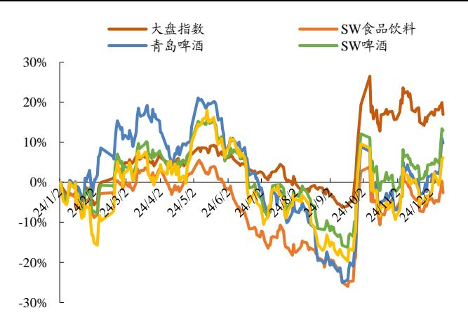  
资料来源：iFind，信达证券研发中心

图 9: 截止 2024 年 12 月 13 日华润啤酒年初至今涨跌幅  
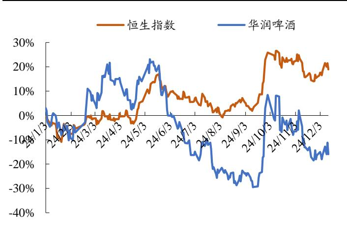  
资料来源：iFind，信达证券研发中心

图 10: 青岛啤酒 Forward 净利润和 PE 走势图  
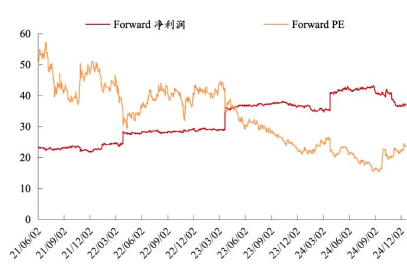  
资料来源：iFind，信达证券研发中心

图 11: 重庆啤酒 Forward 净利润和 PE 走势图  
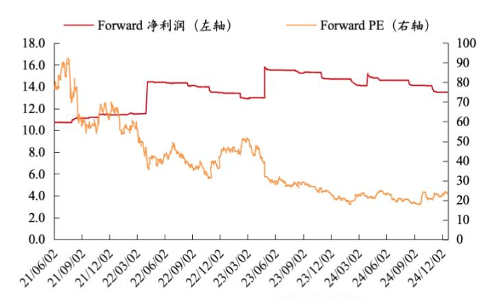  
资料来源：iFind，信达证券研发中心

## 2.2 现饮渠道短期承压，成本持续改善

受基数和餐饮渠道影响，我们预计行业全年销量有所承压。2024年3月-11月全国规模以上啤酒企业产量合计同比 $-5.11\%$ ，我们认为主要原因在于去年同期基数较高+餐饮渠道受损所致。啤酒上市公司销量走势有所分化，2024H1华润啤酒销量同比 $-3.39\%$ ，2024Q1-Q3青岛啤酒销量同比 $-6.98\%$ 、重庆啤酒销量同比 $+0.2\%$ ，我们认为主要系重庆啤酒渠道库存相对良性且部分基地市场受益于旅游人流恢复。

图 12: 2024 年 3-11 月全国规模以上啤酒企业产量同比 -5.11%  
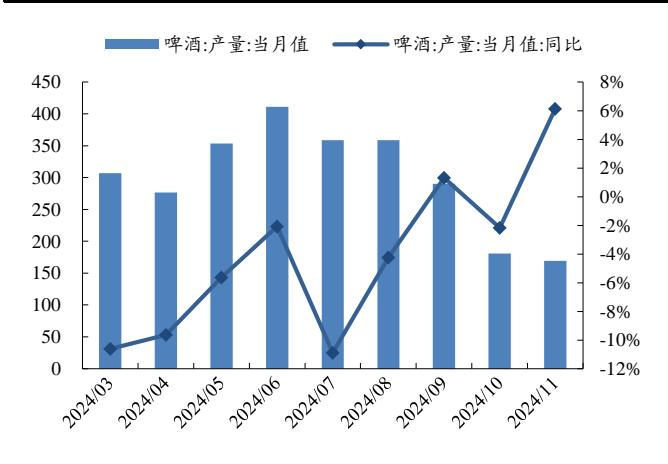  
资料来源：iFind，信达证券研发中心

图 13: 2024Q1-Q3 啤酒上市公司销量走势分化  
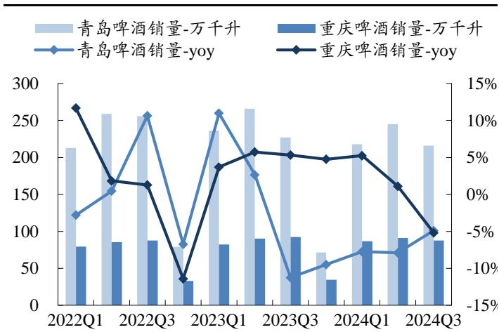  
资料来源：iFind，信达证券研发中心

超高端产品承压，吨酒收入放缓至低个位数增长区间。从啤酒高端化进程来看，超高端啤酒继续承压，但是8-10元价格带仍保持了较好的增长。在整体基数较高的情况下，2024Q1-Q3青岛啤酒主品牌销量同比 $-6.2\%$ ，降幅好于副品牌情况（销量同比 $-7.9\%$ ）；重庆啤酒高档酒收入同比 $-1.2\%$ ，我们认为主要原因在于餐饮和夜场渠道消费疲软所致。从吨价情况来看，主要上市公司的吨酒收入增有所放缓、回落至低个位数增长区间，2024Q1-Q3青岛啤酒吨酒收入同比 $+0.5\%$ 、重庆啤酒吨酒收入同比 $+0.1\%$ ，2024H1华润啤酒吨酒收入同比 $+2.03\%$ 。展望2025年，我们认为随着餐饮市场的恢复，啤酒高端化情况有望随之改善。

图 14: 2024Q3 青岛啤酒主品牌销量增速高于副品牌  
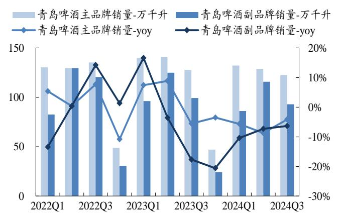  
资料来源：iFind，信达证券研发中心

图 15: 2024Q1-Q3 重庆啤酒高端酒收入增速放缓  
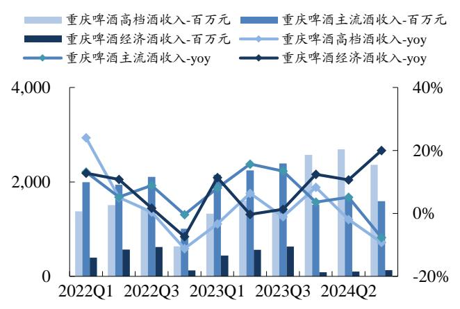  
资料来源：iFind，信达证券研发中心

图 16: 2024 年青岛啤酒、重庆啤酒吨酒收入增速放缓  
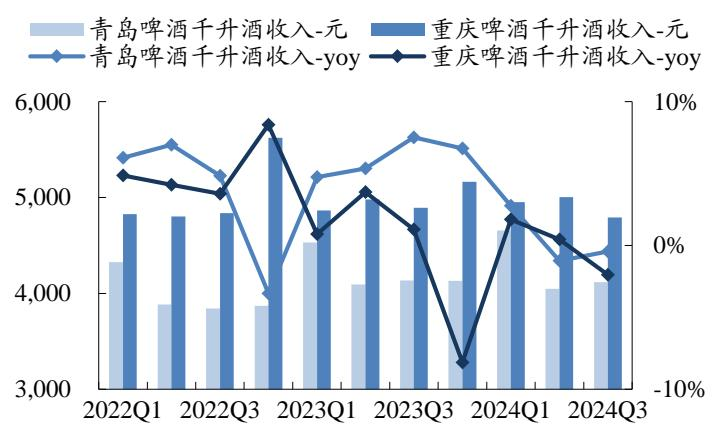  
资料来源：iFind，信达证券研发中心

图 17: 2024 年青岛啤酒、重庆啤酒收入增速放缓  
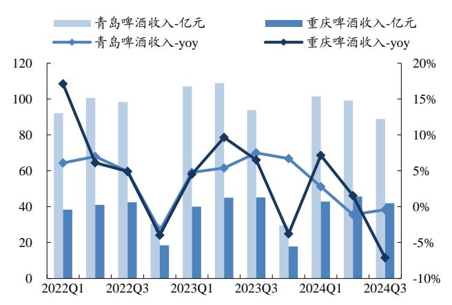  
资料来源：iFind，信达证券研发中心

啤酒成本有望持续改善，贡献利润增速。大麦和包材价格是啤酒成本研究的核心变量，以青岛啤酒2023年披露的成本构成来看，制造成本中占比最高的为包装物，包含了玻瓶、铝罐、瓦楞纸等，占比 $51.05\%$ ；麦芽占比 $15.17\%$ 。目前成本走势有所分化，其中进口大麦均价2024年双位数下降；瓦楞纸价格持续下跌，2024Q3跌幅在 $5 - 10\%$ 左右；玻璃价格在4月后跌幅扩大，Q3同比 $-30\%$ 左右。而打包易拉罐价格继续上涨、涨幅在 $10 - 20\%$ 左右。在大麦、大部分包材价格下跌的背景下，啤酒行业成本持续改善明显，对利润有一定的提振作用。2024H1华润啤酒营业成本同比减少3.12亿元，带动啤酒EBIT同比 $+2.6\%$ ；2024Q1-Q3青岛啤酒千升酒成本同比 $-2.9\%$ ，带动归母净利润同比 $+1.67\%$ ，利润稳健增长。

图 18: 青岛啤酒股份公司啤酒制造成本拆解  
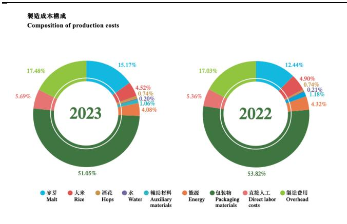

图 19: 2024 年啤酒吨成本改善明显  
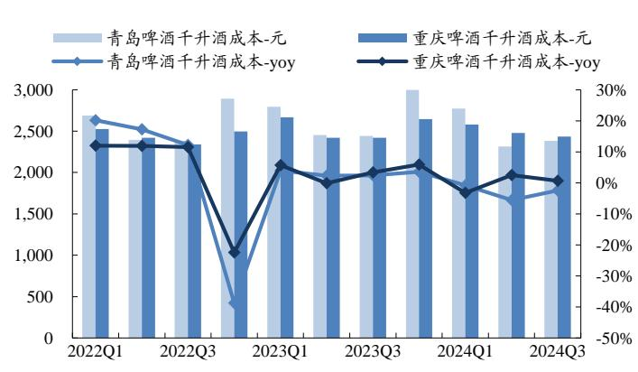

资料来源：青岛啤酒公司公告，信达证券研发中心

图 20: 大麦进口均价 2024 年持续下跌  
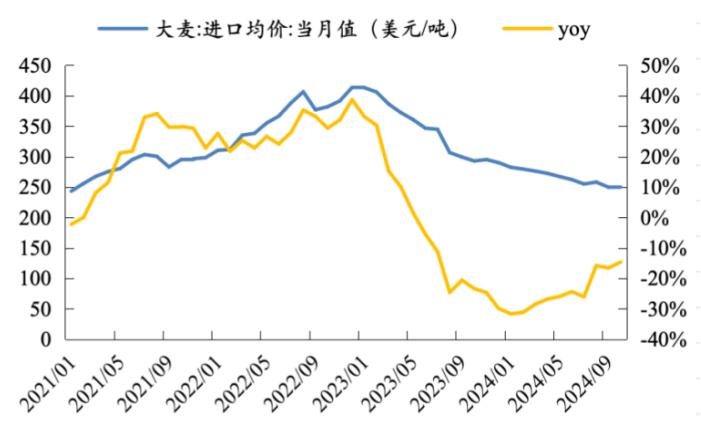  
资料来源：iFind，信达证券研发中心  
资料来源：iFind，信达证券研发中心

图 21: 打包易拉罐价格 2023 年 7 月后继续上涨  
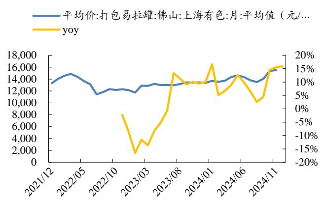  
资料来源：iFind，信达证券研发中心

图 22: 瓦楞纸价格持续下跌  
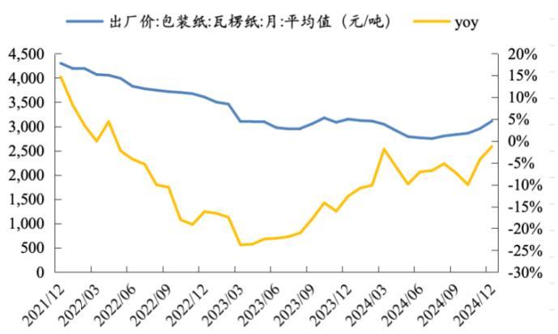  
资料来源：iFind，信达证券研发中心

图 23: 玻璃价格 2024 年 4 月后转跌  
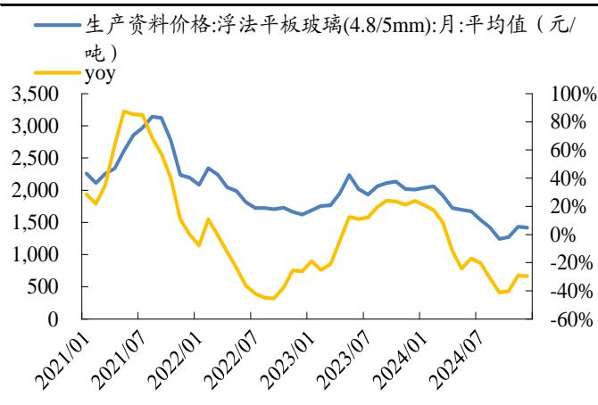  
资料来源：iFind，信达证券研发中心

图 24: 2022Q1-2024Q3 上市公司青岛啤酒和重庆啤酒归母净利润情况  
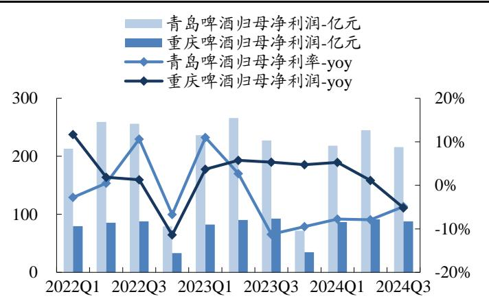  
资料来源：iFind，信达证券研发中心

图 25: 2022Q1-2024Q3 青岛啤酒和重庆啤酒净利润率情况  
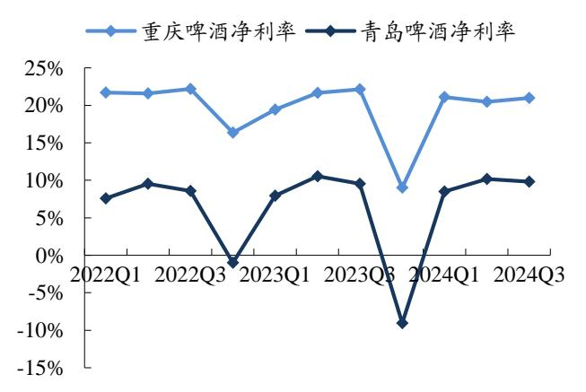  
资料来源：iFind，信达证券研发中心

## 2.3 重点公司

华润啤酒：啤酒决胜高端，白酒积极探索。啤酒方面，我们认为在最后一个三年发展战略“高端制胜，卓越发展”下，公司次高端及以上的啤酒销量有望保持增长，带动吨价的稳步增长，叠加成本改善，我们认为啤酒仍贡献较好的利润增速。白酒方面，公司积极推进贵州金沙的投后整合、赋能及提升，一方面推出新品“敬贽”摘要产品面向企业客户以及特色小光瓶“金沙小酱”，另一方面积极处理遗留问题，恢复渠道信心，展望未来，我们认为贵州金沙全面重塑后，白酒业务收入有望保持较好的增长。

青岛啤酒：成本改善明显，盈利能力持续提升。在2024年消费力走弱的环境下，市场担忧啤酒行业高端化增速放缓，但我们认为核心要关注啤酒公司内部结构性变化，低端啤酒向上整合的趋势对公司吨酒收入的提升仍有一定的贡献。青岛啤酒是国内啤酒酿造历史长达百年的企业，品牌底蕴深厚，产品品质优异，我们认为，经典+纯生+白啤三大主力升级产品有望继续在沿黄河流域的主力市场实现较好的增长，优势市场的结构升级+成本改善释放的利润弹性有望超出市场预期。

重庆啤酒：创新驱动，“嘉”速扬帆。公司的核心竞争力在于6+6品牌矩阵，对啤酒生意的理解更强调产品创新，因此我们看好重庆啤酒对旗下品牌调性的提炼，品牌资产的沉淀是不可复制的。目前，公司积极应对宏观挑战，不断优化经销商体系并且加大投入。展望2025年，我们认为疆外乌苏销售有望逐渐回暖，乐堡、重庆、大理等主流产品有望在优势市场继续保持较好的增长。此外从分红角度来看，公司从2021年至今的分红率基本维持在80%以上，具备较好的资本回报。

## 3.饮料：性价比需求增长

## 3.1 市场行情回顾

截止 2024 年 12 月 13 日，SW 软饮料上涨 38.39%，跑赢食品饮料板块 40.99pct。从个股走势来看，截止 2024 年 12 月 13 日，受并购重组行情催化、欢乐家上涨 27.18%；东鹏饮料上涨 37.79%，公司能量饮料全国化提速，补水啦进入快速铺货阶段，业绩表现较好，公司质地优秀受机构青睐；港股方面，受包装水业务拖累，农夫山泉年初至今下跌 18.64%，跑输恒生指数 37.6pct。

图 26: 截止 2024 年 12 月 13 日 A 股饮料板块年初至今涨跌幅  
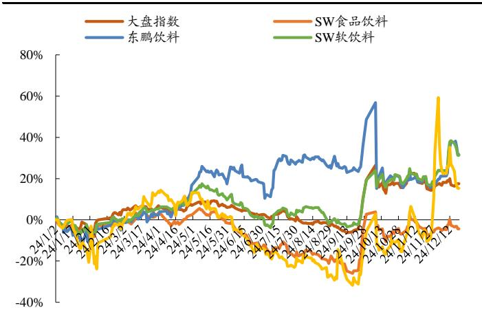  
资料来源：iFind，信达证券研发中心

图 27: 截止 2024 年 12 月 13 日农夫山泉年初至今涨跌幅  
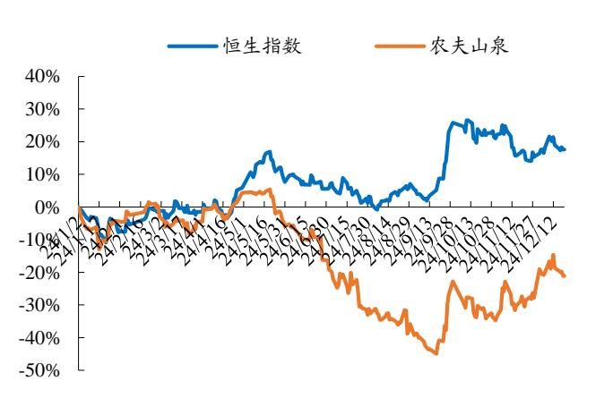  
资料来源：iFind，信达证券研发中心

图 28: 东鹏饮料 Forward 净利润和 PE 走势图  
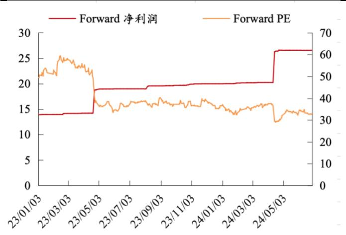  
资料来源：iFind，信达证券研发中心

图 29: 欢乐家 Forward 净利润和 PE 走势图  
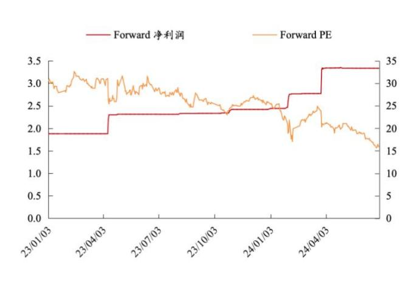  
资料来源：iFind，信达证券研发中心

## 3.2 性价比需求旺盛，软饮料持续增长

性价比需求增加，软饮料行业凸显增长 alpha。对比啤酒、乳制品来看，2024 年软饮料行业在消费者收入预期走弱的背景下仍然实现了较好的增长，我们认为主要原因在于消费者对于软饮料的性价比需求持续增长。具体来看：1）大包装饮料的消费人群从以前的体力劳动者扩大至年轻消费者，根据尼尔森 IQ，大即饮（600-1249ml）的占比由 2019 年的 6.4% 提升到 2023 年的 11.3%，而小瓶装（0-400ml）的占比则从 2019 年的 19% 下滑至 2023 年的 14.5%；2）能量饮料中主打性价比的东鹏特饮全国化加速，2024Q1-Q3 收入同比 31.4%；3）无糖茶火热依旧，尽管大部分产品定位 5 元价格带，但是行业增长的背后则是以价换量、消费者更加倾向于终端促销和大规格产品。

图 30: 2024 年软饮料产量表现好于啤酒、乳制品  
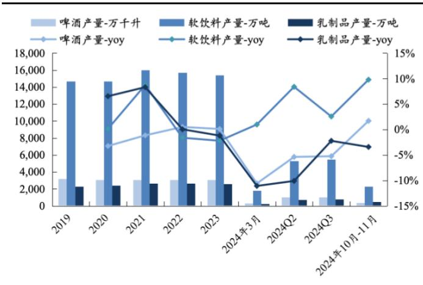  
资料来源：iFind，信达证券研发中心

图 31: 大即饮的占比由 2019 年的 6.4% 提升到 2023 年的 11.3%  
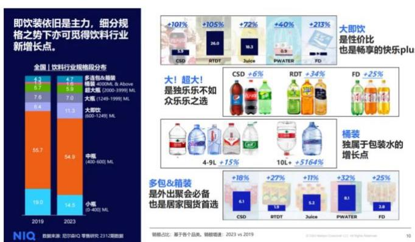  
资料来源：尼尔森IQ，信达证券研发中心

包装水行业：竞争白热化，农夫山泉有望胜出。2024年2月底以来，网上出现大量对农夫山泉及创始人的舆论攻击和恶意诋毁，对品牌及销售产生了严重的负面影响，2024H1农夫山泉包装饮用水同比-18.3%。2024年3月以来，农夫山泉通过各种方式向公众澄清真相，并且2024年5月20日在公司官方微信号发布题为《自2月25日来针对农夫山泉和创始人钟睒睒的谣言及真相|比流量更重要的是真相，是基于事实本身的善恶是非判断》，针对网上流传的相关谣言进行了汇总回应和澄清，并且采取行动追究恶意造谣者的法律责任。应对包装饮用水市场的变化，农夫山泉于2024年4月推出了纯净水产品，区别于市场上绝大多数同品类产品。纯净水产品规格为550ml，瓶型与天然水产品一致，但是标签采用绿色、和天然水产品的红色包装形成强烈的对比。在品牌宣传方面，农夫山泉以“所有农夫山泉都来自天然水源”的广告语向消费者传递公司所有包装饮用水都来自于天然水源的优势，并且以“绿瓶有点甜，红瓶更健康”的表达向消费者传递两款产品的差异化定位，持续进行消费者对于水品类的认知教育。在价格方面，虽然农夫山泉纯净水产品单瓶零售价格为2元，但是终端促销价为9.9元/12瓶，平均下来每瓶只有8毛2，主打性价比，水的价格竞争进一步加剧。市场关心2025年包装饮用水行业格局变化，我们认为，在消费者性价比需求旺盛的背景下，包装水行业预计进入竞争白热化阶段，而具备规模优势和战略定力的农夫山泉有望进一步攫取市场份额。

图 32: 2024 年 4 月农夫山泉推出纯净水产品  
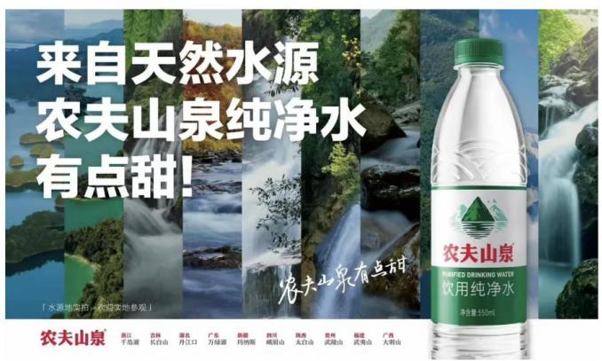  
资料来源：品饮汇观察微信公众号，信达证券研发中心

图 33: 农夫山泉纯净水产品终端促销价为 9.9 元 12 瓶  
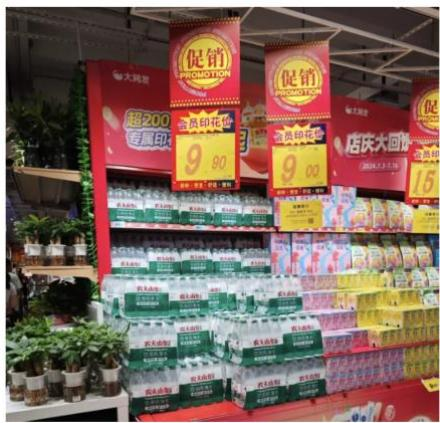  
资料来源：食品官微信公众号，信达证券研发中心

无糖茶：竞争加剧，东方树叶享受行业扩容红利。2020年开始，饮料减糖化趋势明显，以农夫山泉东方树叶和三得利为代表的无糖茶表现的尤其明显。根据马上赢数据，无糖茶在茶饮料中占比由2022Q3的 $17.62\%$ 提升至2024Q2的 $31.65\%$ ，增长接近翻倍；在无糖茶东方树叶带动下，2024H1农夫山泉茶饮料业务收入同比 $+59.48\%$ 。从竞争格局变化来看，品牌商加速上新，根据尼尔森IQ，2023年无糖茶全国新上市单品数量高达157个、2022年仅有93个。价格方面，根据马上赢数据，2024年2月开始无糖茶的百毫升均价下降趋势明显，2月到7月，百毫升均价以环比每月约 $2\%$ 的速度持续下降，说明市场上大规格产品份额正在抢占小规格产品的市场份额。市场关注在新品密集上市、行业进入以价换量的阶段中，格局如何变化，我们认为会更有利于头部品牌东方树叶。一方面，东方树叶具备规模优势，能够支撑较多的投入，而新品牌资源有限、难以生存；另一方面，农夫山泉凭借包装水业务在线下拥有243万个终端网点，在销售人员对终端的维护下，东方树叶能够实现快速的铺货，而小品牌则相对欠缺传统渠道的铺货能力。此外，市场担忧无糖茶增长的持续性，我们认为核心是要看无糖茶是否满足了消费者的需求，而这一需求是否处于增长的阶段。从消费者需求角度来看，相比于含糖饮料，无糖茶特点体现在更为解渴且可以一天内饮用多瓶，并不需要担心蔗糖或者代糖对身体造成的负担，因此能够满足消费者希望解渴、但比包装饮用水更有味道、比含糖饮料健康的产品。

图 34: 无糖茶行业增长进入以价换量阶段  
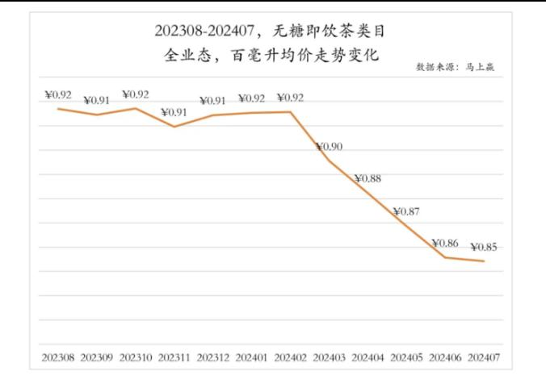  
资料来源：马上赢情报站公众号，信达证券研发中心

图 35: 无糖茶行业密集上新  
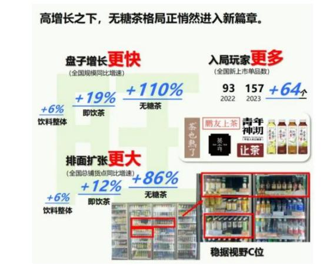  
资料来源：尼尔森IQ，信达证券研发中心

能量饮料：强需求绑定，性价比东鹏特饮表现优秀。能量饮料是指含有一定能量并添加适量营养成分或其他特定成分、能为机体补充能量释放和吸收的制品，具有“抗疲劳”、“提神”等功效。2016年之后，国内能量饮料行业进入了较为稳健增长的阶段，根据欧睿数据，市场规模从2016年的317亿元增长至2023年的553亿元，CAGR为 $8.3\%$ 。从格局来看，相较于行业老大红牛，东鹏饮料500ml通过性价比、强实用性开拓新人群。一方面，目前红牛仍然陷入商标纠纷，无暇顾及市场投入，另一方面性价比消费趋势明显，因此我们认为品牌+渠道+产品综合实力强的东鹏饮料有望继续保持较好的增长。

图 36: 中国能量饮料市场规模 2016-2023 年 CAGR 为 8.3%  
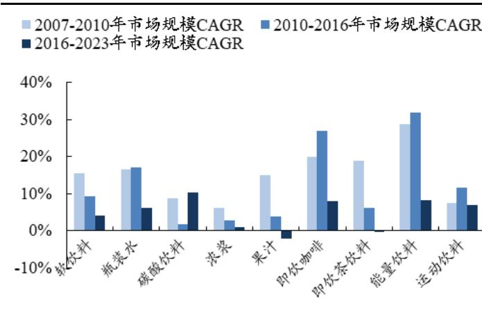  
资料来源：欧睿数据，信达证券研发中心

图 37: 2024Q1 东鹏饮料收入同比+30.1%  
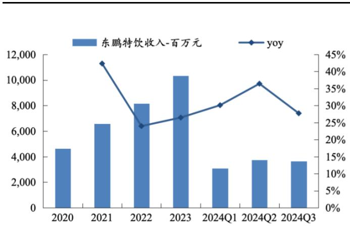  
资料来源：iFind，信达证券研发中心

## 3.3 重点公司

农夫山泉：长期主义践行者，穿越周期的力量。公司深耕包装天然水、但是并未受困于单一品类，在“天然、健康”的理念下，持续完善茶饮料、功能饮料、果汁饮料、咖啡饮料等细分品类的布局，成为不可多得、能够多品类经营的饮料公司。我们认为，这背后映射的不仅仅是公司在品类选择、产品打造、品牌建设的战略眼光以及团队执行能力，更是长久地坚持，久久为功。由于今年网络舆情事件，公司今年包装水业务有所承压，我们认为随着网络舆情的平息以及公司推出主打性价比的绿瓶水收复市占率，包装饮用水业务有望环比改善。而中长期看，小规格包装水将继续三四线城市渠道下沉；公司在小规格包装水积累下的品牌认知能够转换到主打家庭消费的中大包装水，中大包装水的渗透率有望进一步提升。此外，我们认为东方树叶不仅是代表一个品牌、更是引领了无糖茶细分赛道的发展，因此从竞争格局的演绎上，我们认为行业的扩容下，头部品牌东方树叶仍将实现较快的增长，而新锐品牌与东方树叶的差距或进一步扩大，因此我们长期看好东方树叶增长的持续性。在新品方面，公司积极布局即饮咖啡赛道、推出炭久系列，果汁饮料陆续上线NFC常温系列、冷藏系列、17.5度系列，这些产品目前销量尚低，但是基于所处细分赛道的成长性，我们认为新品进展值得持续关注。

东鹏饮料：全国提速发展，品类拓展未来可期。作为能量饮料的成长性品牌，公司在广东省内持续深耕，省外不断优化经销体系、完善业务团队，2024Q3广东省收入占比已经从2018年的 $61.1\%$ 下降到 $28.12\%$ ，华北、西南、华东、华中区域皆实现了中高双位数的增长，全国化进程提速。在公司主力品牌东鹏饮料持续高增的基础上，2023年2月新上市的电解质饮料“东鹏补水啦”仍然保持了较好的增长，2024Q3收入同比 $+299.6\%$ 至7.35亿元。截至2024Q1，公司拥有2912家经销商，实现 $100\%$ 地级市覆盖，因此“东鹏补水啦”有望通过已有的渠道覆盖面实现较好增长，持续构建公司“能量+”的品类矩阵。

欢乐家：持续深耕主业，积极布局量贩零食。公司成立于2001年广东省湛江市，发家于罐头行业，黄桃和橘子罐头是主力产品。2014年公司进入植物蛋白饮料市场，依靠总部位居岭南的地理优势，推出“欢乐家生榨”产品，是公司第二大支柱品类，2021年公司椰子汁产品的市场占有率位居第五。尽管利润短期有所波动，但是我们认为公司深耕罐头业务二十余年，椰子汁在宴席和送礼方面有较好的品牌基础，长期成长逻辑不变。新渠道方面，公司积极拥抱量贩零食渠道，我们认为罐头和椰子饮料有望在该渠道获得较好的增量。

## 4. 乳制品：供需缺口收窄，静待需求回暖

## 4.1 供需缺口收窄，静待需求回暖

奶价跌幅收窄，上游供给情况改善。根据农业农村部的全国生鲜乳平均价数据，今年以来，生鲜乳价格呈现跌幅环比逐季收窄的趋势，这背后是上游供给的改善。从供给端看，奶牛存栏量从2月份起连续6个月环比下降。国内乳制品产量今年以来同比增幅也逐步收窄，前十个月同比-4.1%。此外，前十个月我国乳制品进口量也大幅下降，同比-9.4%。

图 38: 今年以来奶价跌幅逐季环比收窄  
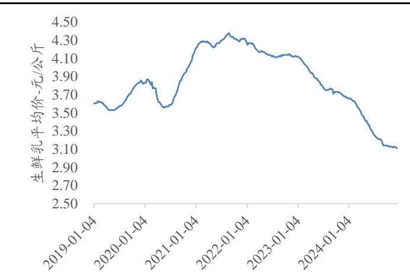  
资料来源：iFind，信达证券研发中心

图 39: 今年前十个月乳制品产量和进口量双双下降  
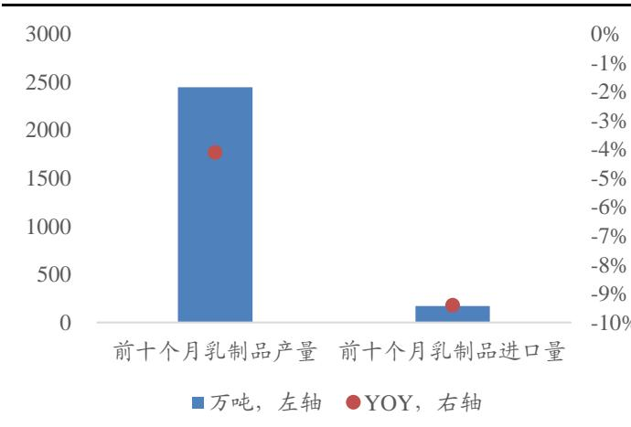  
资料来源：iFind，信达证券研发中心

需求缓慢修复，终端价格降幅收窄。需求端看，消费者对乳制品的需求今年呈现缓慢修复的状态。根据尼尔森终端零售额数据，乳业全渠道零售额前四个月、上半年、前三季度分别同比-3.2%、-2.5%和-1.8%，跌幅逐步收窄。价格方面，根据商务部数据，牛奶零售价今年仍在下降，但跌幅也在逐步收窄。

政策利好叠加三季度业绩出色，乳业股价开始反转。下半年以来，特别是9月24日以来，一方面政府大力出台多项政策，应对短期经济压力；另一方面，多家乳企在Q3因原奶成本下降叠加大包粉或淘汰牛减值的阶段性下降而业绩表现出色，股价开始反转。

图 40: 牛奶零售价今年跌幅逐步收窄  
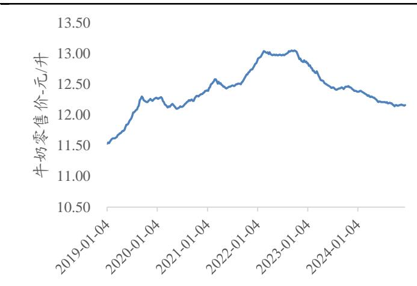  
资料来源：iFind，信达证券研发中心

图 41: 乳业股价开始反转  
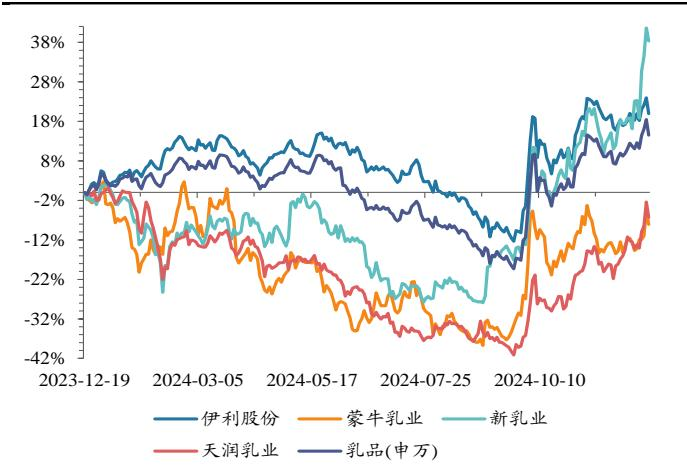  
资料来源：WIND，信达证券研发中心

需求修复叠加成本低位，乳业有望迎来新一轮周期。展望明年，政策面上政府已明确提出着力扩大国内需求，大力提振消费，稳住楼市股市，这均对乳制品明年需求端有积极的影响。同时，农业农村部预计生鲜乳市场供应过剩压力缓解仍需时间，生鲜乳收购价格有望企稳运行。在需求修复和成本低位的背景下，乳业有望迎来新一轮的向上周期。

## 4.2 重点公司

伊利股份：渠道调整结束，静待需求回暖。三季度起，公司结束渠道库存清理，收入迎来环比恢复，但同比仍有下降。同时，得益于奶价下降所带来的毛利率提升和资产/信用减值损失的阶段性下降，公司Q3利润端表现超出市场预期。展望Q4及明年，供给端如上文所述，生鲜乳供给量有望逐步收缩，价格有望企稳运行；需求端则有望在政府大力提振消费、着力扩大内需的指向下逐步回暖，伊利作为乳业龙头，有望享受到新一轮行业红利，股价形成戴维斯双击。此外，考虑到央行股票回购增持贷款的 $1.75\%$ 年利率和公司 $3.98\%$ 的股息率之间的显著利差（截至2024年12月30日），我们认为估值未来也存在显著的提升空间。

妙可蓝多：蒙牛奶酪并表，期待需求弹性。7月1日，蒙牛奶酪与妙可蓝多正式并表，标志着蒙牛内部奶酪平台的正式融合与确立。两者的合并，一方面可形成协同效应，C端经销商已实现互相代理双方产品，同时原材料采购上也形成战略协同，以量换价，争取成本最优；另一方面，蒙牛对妙可蓝多持续支持，包括供应链方面的协同（资源采购及原奶深加工）、投并购资源的协同、公司管理系统的支持和品牌上的协同。需求端看，奶酪具有营养健康的价值，中国人均奶酪消费量远低于欧美及东亚近邻，长期发展潜力大，同时奶酪相对较长的保质期对于中国上游原奶供给波动的平衡具有重要意义。短期看，C端奶酪产品具有一定可选消费属性，在消费需求恢复的条件下有望实现更大的弹性。

天润乳业：收入表现亮眼，利润弹性可期。相较于行业内多数公司今年收入的同比下滑趋势，天润前三季度收入同比 $+3.5\%$ ，表现较为亮眼，特别是疆外达同比 $+10.8\%$ 。公司去年收购新农乳业 $100\%$ 股权，奶源自给率大幅上升，在上游养殖业整体亏损的背景下经营压力放大。公司果断采取措施，及时淘汰低效牛只，在Q3实现利润大幅反弹。展望明年，在乳业有望进入奶价反转周期之下，公司的高自给率将使得其利润弹性大于竞争对手，业绩增速值得期待。此外，公司20万吨乳制品加工项目有望于明年完工并投产，相关转债已于近期上市。新的20万吨项目将为公司未来收入的进一步提升奠定坚实的产能基础。

此外，我们也积极关注估值低位、渠道库存降至合理水平并不断提升股东回报的蒙牛乳业，估值相对低位、利润增速亮眼的新乳业和今年收入表现稳健、利润持续回暖、现金流优秀的贝因美。

## 5. 食品添加剂：需求表现亮眼，关注海外变化

## 5.1 需求表现亮眼，关注海外变化

海外需求持续，国内关注健康。前三季度，我们所覆盖的食品添加剂公司海外收入增速普遍高于国内增速，包括百龙创园国内同比+15%，国外同比+34%；安琪酵母国内同比+7%，国外同比+22%；嘉必优 24H1 国内同比+11%，国外同比+76%。另一方面，尽管国内增速相对偏弱，但仍高于多个食品饮料下游公司，显示出消费者对于天然健康食品添加剂认知和需求的提升。

成本持续下降，毛利率相对稳定。无论通过化工工艺，还是发酵工艺，添加剂的主要原材料均来自于上游大宗农产品及其衍生物。今年以来，玉米、豆粕价格继续下降，为添加剂公司的成本端提供了有利条件。另一方面，部分企业产品价格有所下降、折旧摊销增加，对冲了成本的下降，整体毛利率保持相对稳定。

图 42: 添加剂公司海外收入增速普遍高于国内增速  
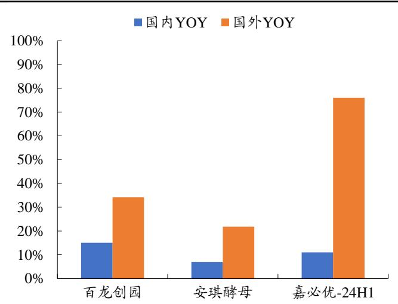  
资料来源：iFind，信达证券研发中心

图 43: 原材料价格持续下降  
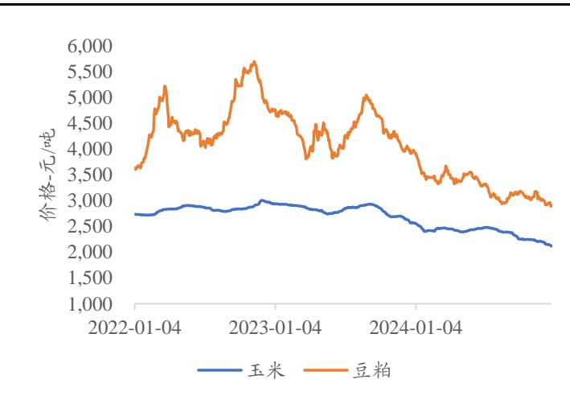  
资料来源：iFind，信达证券研发中心

政策催化股价，涨跌归因各异。9月24日以来的政策同样催化了添加剂板块公司的股价。另一方面，涨跌幅的差异也来自于各家公司的不同情况。嘉必优受益于今年业绩增长和近期收购欧易生物的预期，股价涨幅居前。安琪酵母则得益于海外业务高增和糖蜜成本下降，在业绩提升的情况下股价提升。百龙创园则在业绩方面持续增长，估值受到美国关税预期影响，下半年收缩较多。晨光生物则因今年棉籽业务亏损，业绩表现下滑，股价涨幅偏低。

图 44: 今年涨跌幅归因各异  
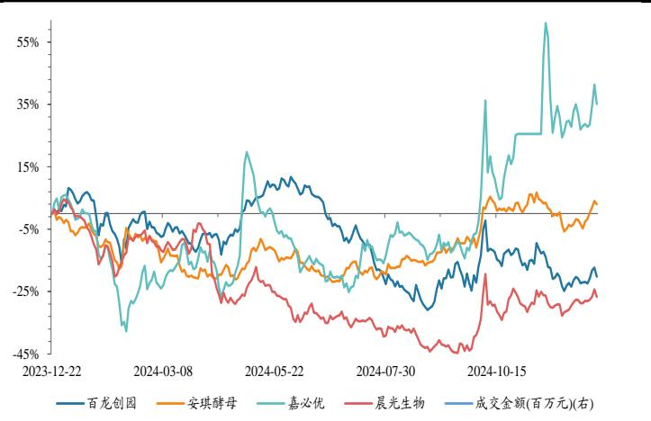  
资料来源：WIND，信达证券研发中心

关注盈利预期，关注海外变化。展望明年，一方面我们需要关注各公司业务上的变化所带来的盈利增速预期，例如安琪酵母和百龙创园的产能变化，以及嘉必优可能的新增业务；另一方面由于出口在添加剂公司中的显著比重，我们也需要关注各公司在海外的产能进展及对应出口国家的相关政策变化。

## 5.2 重点公司

百龙创园：新产能顺利投产，国际化更进一步。今年5月，公司年产30000吨膳食纤维和年产15000吨结晶糖项目正式全面投产，新产能的投产将改善公司先前产能不足的问题，同时提高公司产线生产效率。9月份，公司公布可转债预案，拟募集不超过7.8亿元，用于投资泰国大健康新食品原料智慧工厂项目、功能糖干燥扩产与综合提升项目和美国新食品原料应用国际研发中心项目，一方面有望利用东南亚具有性价比的原料，打开东南亚市场；另一方面有望降低潜在的关税风险，提升公司在全球市场竞争力。前三季度，公司保持高速增长，收入同比+25.5%，归母净利润同比+29.2%。我们预计公司全年利润有望实现2.5亿以上。展望明年，公司新产能逐步调试正常，国际市场对抗性糊精和阿洛酮糖的需求依然旺盛，国内市场对营养健康配料的需求进一步渗透，我们预计公司仍有望维持利润端30%以上的增长。此外，阿洛酮糖国内仍在审批，考虑到D-阿洛酮糖-3-差向异构酶已获批成为新食品添加剂，我们认为阿洛酮糖作为新食品原料有望获批，并有望为公司的业绩增长提供额外的助力。

安琪酵母：海外需求高增，新产能渐次落地。2024年，海外需求的高速增长带动公司收入走出亮眼趋势，前三季度收入同比+13.0%；而糖蜜价格的下降则为公司在成本端提供了空间，前三季度利润同比+4.2%。考虑到Q4通常为销售旺季，我们预计公司有望实现既定的全年收入目标。经营层面上，下半年公司新一轮股权激励方案落地，提升员工能动性；9月印尼合资公司设立，国际化再进一步。展望明年，公司多地新产能渐次落地，为公司提升收入提供有力保障；我们预计糖蜜价格有望继续下降，为公司成本端持续创造有利条件，在收入和利润端完成股权激励目标。

嘉必优：业绩表现出色，推进并购重组。今年前三季度，得益于海外业务的高速增长，公司收入同比+19.2%，利润同比+38.9%。同时，公司于10月底发布公告，拟收购欧易生物65%股权，并于近日发布收购预案。欧易生物是一家行业领先的多组学检测科研服务公司，产品涵盖基因组学、转录组学、蛋白质组学、代谢组学、生物信息学和临床基因检测。通过收购该公司，嘉必优有望在菌种选育、数据分析和客户服务上实现提升。当前收购工作仍在进行，展望明年，我们预计公司有望在ARA/DHA业务上通过新国标添加量的提升、海外客户订货量的提升、海外新客户的拓展和新应用场景的开拓上继续实现增长；HMO业务有望实现商业交付；整合多组学检测业务，公司研发和商业价值得到进一步提升。

此外，我们也积极关注当前估值偏低、业绩有望逐季修复的植提龙头晨光生物。

## 6. 休闲食品：需求主导时代开启，零食量贩拉开渠道变革序幕

## 6.1 新品类新渠道，跑出超额收益

供应链成熟及消费者理性推动渠道变革，模型跑通的新兴渠道以及积极拥抱的产业链获得快速发展。零食品类属于后发展阶段的品类，具有品类集中度提升及推新品的红利。复盘23-24年，业绩表现突出的零食公司具备“新产品”或者“新渠道”的特点：1.性价比连锁业态零食量贩：零食供给端丰富度大幅提升，需求端消费者变得更为理性，推动零食量贩业态的发展，零食量贩头部品牌万辰集团24Q3门店数量过万家。2.积极拥抱新兴渠道的厂商：盐津铺子渠道敏锐度高，21年下半年起全面拥抱零食量贩及抖音等新兴渠道，持续享受新渠道红利。甘源食品22年下半年积极拥抱零食量贩渠道，24年海外渠道表现亮眼，持续推动公司23年-24Q1-3收入快速增长。3.具备品类集中度提升&新品红利的品牌：劲仔食品21Q4推出大包装产品适配KA/BC等现代渠道，成功扩张渠道推动小鱼品类市占率的提升，22年成功推出鹌鹑蛋新品，渠道扩张红利+新品红利推动公司23年-24Q1-3收入快速增长。有友食品24Q3鸭掌新品成功进入山姆渠道，推动收入增长显著向上。消费趋势向健康化发展，卫龙美味核心大单品魔芋爽契合健康低脂消费趋势，老品焕新机，叠加公司顺应新渠道变化，24H1收入增长显著提速。零食属于后发展阶段的品类，头部品牌具备市占率进一步提升的红利，其次零食万亿市场品类分散，头部品牌推新具备渠道网络的优势，推新成功率更高。4.大众消费的连锁业态表现疲软：由于终端消费疲软，大众消费连锁业态单店均受到了不同程度的影响，卤味连锁业态24Q1-3收入均出现不同程度的下滑，预制菜连锁业态头部品牌味知香24Q1-3收入下滑 $18\%$ 。整体来看，休闲食品板块业绩表现有分化，顺应渠道变革趋势的产业链以及具备品类红利的公司收入增长上表现更为突出。

表 3: 顺应渠道变革趋势的产业链以及具备品类红利的公司收入增长上表现更为突出

<table><tr><td colspan="3">单位:百万元</td><td colspan="3">2024Q1-3</td><td colspan="4">2023年</td></tr><tr><td>分类</td><td>公司</td><td>营业收入</td><td>YOY</td><td>归母净利润</td><td>YOY</td><td>营业收入</td><td>YOY</td><td>归母净利润</td><td>YOY</td></tr><tr><td rowspan="7">自主生产型</td><td>卫龙美味</td><td>2,939</td><td>26%</td><td>621</td><td>39%</td><td>4,872</td><td>5%</td><td>880</td><td>482%</td></tr><tr><td>洽洽食品</td><td>4,758</td><td>6%</td><td>626</td><td>24%</td><td>6,806</td><td>-1%</td><td>803</td><td>-18%</td></tr><tr><td>盐津铺子</td><td>3,861</td><td>28%</td><td>493</td><td>25%</td><td>4,115</td><td>42%</td><td>506</td><td>68%</td></tr><tr><td>甘源食品</td><td>1,606</td><td>22%</td><td>277</td><td>29%</td><td>1,848</td><td>27%</td><td>329</td><td>108%</td></tr><tr><td>劲仔食品</td><td>1,772</td><td>19%</td><td>215</td><td>61%</td><td>2,065</td><td>41%</td><td>210</td><td>68%</td></tr><tr><td>有友食品</td><td>887</td><td>17%</td><td>121</td><td>14%</td><td>966</td><td>-6%</td><td>116</td><td>-24%</td></tr><tr><td>好想你</td><td>1,177</td><td>8%</td><td>-61</td><td>-49%</td><td>1,728</td><td>23%</td><td>73</td><td>-52%</td></tr><tr><td rowspan="4">零食连锁&amp;量贩零食</td><td>三只松鼠</td><td>7,169</td><td>56%</td><td>341</td><td>101%</td><td>7,115</td><td>-2%</td><td>220</td><td>70%</td></tr><tr><td>良品铺子</td><td>5,480</td><td>-9%</td><td>19</td><td>-90%</td><td>8,046</td><td>-15%</td><td>180</td><td>-46%</td></tr><tr><td>来伊份</td><td>2,523</td><td>-16%</td><td>-43</td><td>-</td><td>3,977</td><td>-9%</td><td>57</td><td>-44%</td></tr><tr><td>万辰集团</td><td>20,613</td><td>321%</td><td>84</td><td>249%</td><td>9,294</td><td>1592%</td><td>-83</td><td>-274%</td></tr><tr><td rowspan="3">卤味连锁</td><td>绝味食品</td><td>5,015</td><td>-11%</td><td>438</td><td>13%</td><td>7,261</td><td>10%</td><td>344</td><td>47%</td></tr><tr><td>煌上煌</td><td>1,452</td><td>-8%</td><td>79</td><td>-22%</td><td>1,921</td><td>-2%</td><td>71</td><td>129%</td></tr><tr><td>周黑鸭</td><td>1,260</td><td>-11%</td><td>33</td><td>-68%</td><td>2,744</td><td>17%</td><td>116</td><td>357%</td></tr><tr><td rowspan="2">其他连锁</td><td>紫燕食品</td><td>2,687</td><td>-5%</td><td>349</td><td>2%</td><td>3,550</td><td>-1%</td><td>332</td><td>49%</td></tr><tr><td>巴比食品</td><td>1,210</td><td>2%</td><td>194</td><td>26%</td><td>1,630</td><td>7%</td><td>214</td><td>-4%</td></tr></table>

资料来源：iFind，信达证券研发中心

厂商端具备品类红利&积极拥抱渠道变革的公司、零售端渠道效率更高的量贩零食业态跑出超额收益。1. 渠道效率更高的量贩零食业态：万辰集团23年年初布局量贩零食业态，并逐步成为头部品牌，股价24年以来表现突出。渠道大变革的背景下，模型跑通的新兴渠道及相应的产业链均获得快速发展。2. 顺应渠道变革趋势的零食厂商：盐津铺子、甘源食品等通过积极拥抱量贩零食、电商等新兴渠道加速产品渗透率提升。渠道变革红利背后倒逼厂商供应链效率的提升，比如三只松鼠23年年初提出高端性价比战略，供应链效率提升优化成本成效显著，24年初至今股价表现突出。3. 品类渗透率提升红利&成功推出新品：1）劲仔食品21Q4通过大包装产品加速KA/BC等现代渠道的渗透率，推动原有大单品小鱼干体量快速提升，22年成功推出新品鹌鹑蛋，推动24Q1-3收入延续较快增长。2）有友食品24Q3鸭掌新品成功进入山姆渠道并成为大单品对股价形成催化。3）卫龙美味魔芋爽健康低脂的特性顺应消费健康化的趋势，叠加公司23年起积极拥抱新兴渠道，推动公司24年股价企稳向上。

图 45: 今年年初以来休闲食品指数跑输上证指数  
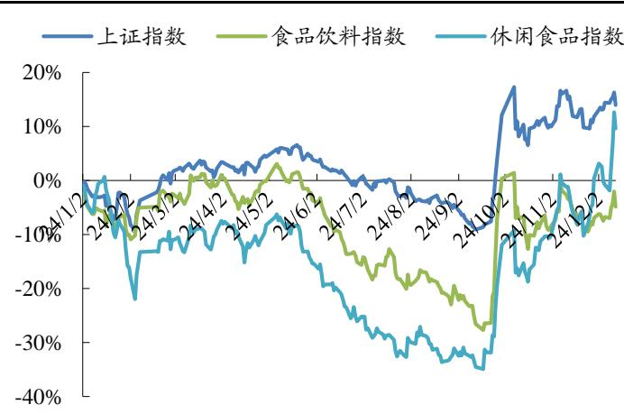  
资料来源：iFind，信达证券研发中心 时间：更新至2024.12.13

图 46: 渠道效率更高的零食量贩头部品牌万辰集团显著跑赢指数  
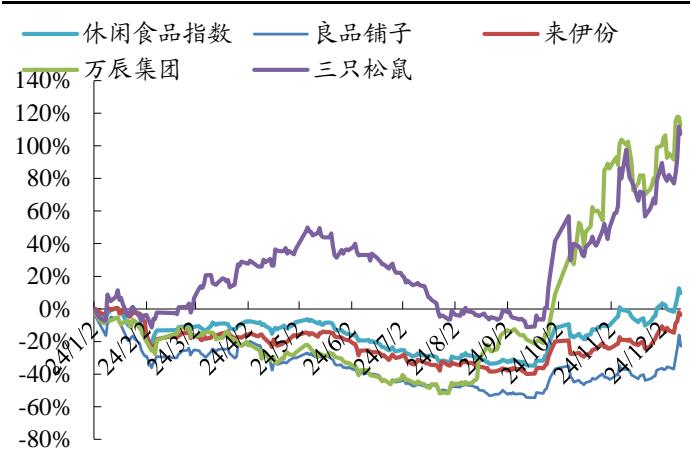  
资料来源：iFind，信达证券研发中心时间：更新至2024.12.13

图 47: 拥抱新渠道推出新产品的厂商公司股价表现更好  
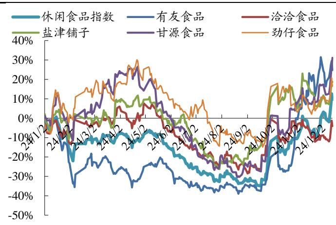  
资料来源：iFind，信达证券研发中心 时间：更新至2024.12.13

图 48: 卫龙美味魔芋制品老品焕新机，下半年股价表现强于恒生综指  
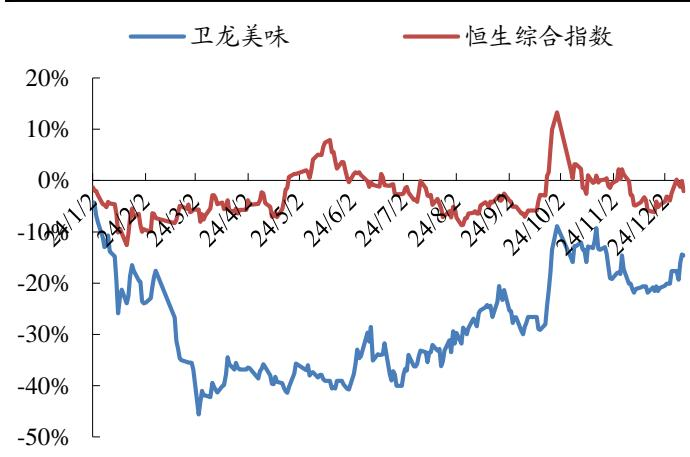  
资料来源：iFind，信达证券研发中心时间：更新至2024.12.13

## 6.2 需求主导时代，效率为王

供应链成熟及消费者理性推动消费品进入需求主导时代，倒闭产业链（渠道+厂商环节）效率提升。供应链成熟及消费者理性推动慢变量供需关系发生变化，供给端，工业的本能是提供更多的产量，然后逐步进入产能过剩的阶段，目前国内快消品的供应链条件相比十年前更为成熟。需求端，受国内宏观环境、人口结构、收入预期变化的影响，消费者面对不确定的外部消费更为理性，需求端进入了偏存量竞争的时代。消费者对于大众消费品更加注重质价比，对于大众品而言，消费者更加注重其实用价值，社交价值及情绪价值含量低，大众品品牌可以降低消费者的选择成本，但品牌当中社交价格及情绪价值占比低，品牌溢价一般不宜过高。在新的供需关系背景下，消费市场逐步从供给驱动进入到需求导向的时代，产业链的话语体系将逐步从品牌主导下的渠道渗透转移到消费者主导的供应链效率提升上，倒逼厂商/零售等环节构成的供应链体系效率全面提升，体现在终端为物美价廉产品的供给增加。

投资主线一：当前处于供需关系转换推动的产业链变革阶段，面对需求主导的时代，关注实现供应链效率提升的厂商以及零售商，给终端提供质价比产品的业态。1. 关注零售环节效率提升的投资机会，如零食量贩业态：消费者变得更为理性以及行业供需关系的变化倒逼零售商进行效率革命，零售商作为厂商和消费者产品传递的桥梁，面对目前新的供需关系背景下，零售商的价值创造需回归零售的本质，1）降低供应链成本，给消费者提供物美价廉的产品，2）作为消费者的代理人，洞察消费者的需求实现高效率的供给，降低消费者的选择成本（因为在供给逐步成熟的背景下，眼花缭乱的产品信息对于消费者来说是过载的）。比如近年快速兴起的量贩零食业态，作为渠道效率更高的业态，持续迭代传统零售渠道的份额，渠道渗透率持续提升。市场担心国内零售业态更新迭代快，质疑量贩零食业态的生命力，我们认为国内过去零售业态迭代较快，主要受到国内消费品供需关系经历两轮较大切换的影响：供需关系从80-90年代的供不应求逐步进入到目前供大于求的阶段，每一轮供需关系的大背景下都出现了相应的主流零售业态，比如90年代整体供不应求背景下商超业态的快速崛起，大众品的供需关系在自然商业发展路径下通常是不可逆的（不考虑工业化体系被破坏大众品重新回到供不应求的时代相对极端的情况），在新型供求关系背景下涌现的零售业态将回归零售价值本质，在商业模式和经营理念上预计会更具竞争力，对标国外来看，Costco、奥乐齐等折扣业态生命周期均非常长，因而以折扣业态经营理念运营的零食量贩业态我们认为具备较好的投资价值。

图 49: 消费进入需求主导的时代  
产业链供需变化，由品牌主导转为消费者主导  
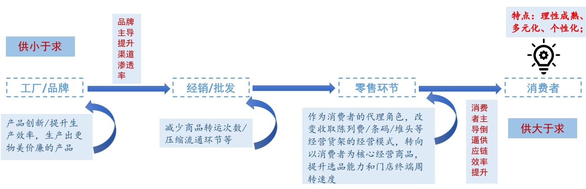  
资料来源：信达证券研发中心

图 50: 国内商超变革下，山姆在国内仍保持较快增长  
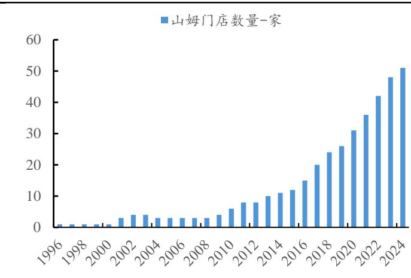  
资料来源：天使湾创投，信达证券研发中心

图 51: 量贩零食行业门店数量近三年快速增长  
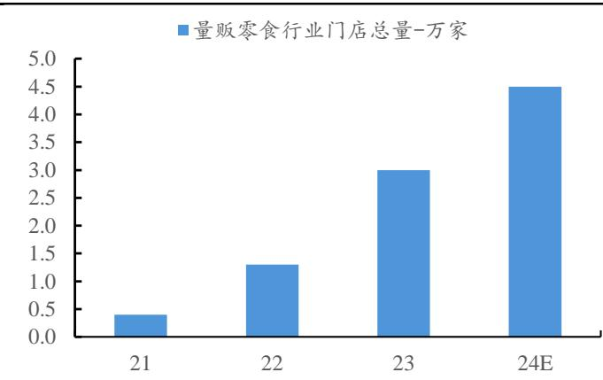  
资料来源：三联生活周刊、百度地图，高德地图、信达证券研发中心

2. 关注厂商供应链效率提升的投资机会：主要体现在采购、生产、仓配等供应链环节效率提升，厂商完成供应链效率升级后可以积极拥抱高效率的新兴渠道，并且能加速对于需求端的反应，加速公司渠道渗透率的提升进度，比如盐津铺子通过积极拥抱量贩零食渠道近三年实现了高速增长，三只松鼠自2023年年初提出高端性价比战略，线上渠道整体市占率显著提升，甘源食品优化供应链积极拥抱量贩零食渠道，跟随新兴渠道加速产品在消费者端的渗透率。对于厂商而言，提升供应链效率能够强化公司整体的竞争力，提升产品在消费者端的竞争力，市占率提升的速度曲线与原有的市占率水位相关，若是此前核心品类渠道渗透率极低或者是新品，通过优化后端供应链及积极拥抱新兴高效率渠道有望实现更为陡峭的市占率增长曲线或者弯道超车。由于进入到了一个偏存量竞争的时代，消费品在量价方面呈现的出来的特点是价格不具备大幅提升的时代条件，所以我们认为业绩增长的核心驱动力为“量”。

图 52: 三只松鼠提出高端性价比战略推动营收  
  
资料来源：iFind，信达证券研发中心

图 53: 盐津铺子 21Q2 优化供应链推动营收实现快速增长  
  
资料来源：iFind，信达证券研发中心

量贩零食业态拉开国内零售大变革的序幕。零食由于细分品类众多且属于可选消费，所以在消费升级阶段（强者愈强）时发展阶段是靠后的，但是在面对渠道变革时是联动最快的品类，我们可以看到，21年起零食量贩业态快速发展，24年永辉超市调改等，包括盒马NB也在24年加速跑模型，所以从时间节奏上来看，量贩零食拉开国内零售渠道大变革的序幕，后续社区折扣超市、全品类综合折扣超市有望持续跑出，建议关注此轮零售大变革下的投资机会。

图 54: 万辰集团旗下品牌来优品推出省钱超市  
  
资料来源：来优品品牌微信公众号，信达证券研发中心

图 55: 零食有鸣 24 年积极探索社区批发超市  
  
资料来源：零食有鸣微信公众号，信达证券研发中心

## 6.3 下沉市场“消费升级”，品类红利强者愈强

下沉市场消费潜力大，休闲食品头部品牌具备市占率提升及新品扩张红利。休闲食品具有万亿市场，细分品类众多，行业整体竞争格局较为分散，市场质疑休闲食品行业能否出现类似于农夫山泉等饮料集团或者国外亿滋等休闲食品集团类型的公司，我们认为休闲食品行业属于食品饮料行业后发展阶段的子板块，尤其是辣卤零食等中式零食渠道渗透率仍有较大的提升空间，叠加当前行业正处于渠道变革红利期，下沉市场消费潜力大，头部品牌有望加速下沉市场市占率的提升，其次目前零食赛道逐步跑出全渠道布局的公司，渠道网络优势可以提升公司推新品的成功率，长期行业有望跑出多大单品的零食公司。投资主线二：休闲食品行业部分细分品类集中度提升逻辑仍在演绎当中，下沉市场消费潜力大，有望加速头部品牌市占率提升，关注休闲食品行业经典品类头部品牌市占率提升及品类扩张带来的投资机会。

市场担心渠道多元化、折扣化会提升跑出消费品品牌的难度，我们认为渠道变革、多元化确实对于头部厂商提出渠道价值链分配、价盘管理等挑战，但背后是对于厂商的供应链效率提出更高的要求，并非折扣化浪潮下消费品公司市占率一定被分化，我们认为在零食经典品类上仍将持续有头部品牌跑出。不论是厂商品牌有心智还是渠道建立信任，本质都是消费者降低选择成本的结果，对于经典品类品牌而言，仍然在消费者端创造价值，尤其是在我国下沉市场目前仍存在“消费升级”（主要指“量”提升）机会，消费者仍然需要“通货”产品，零食作为食品饮料板块后发展的赛道，经典品类头部品牌在下沉市场具备品类红利，有望强者愈强。

## 6.4 重点公司

万辰集团：看好万辰集团从渠道效率提升向供应链效率提升的硬折扣发展方向，竞争优势有望越加凸显。零食量贩业态为零售业态里面较好的生意模式，产业链标准化&零食细分品类众多，渠道有望发挥更多选品的价值，我们预计量贩业态头部品牌的稳态利润率有望高于其他的传统零售业态，有望享有更高的估值体系。万辰集团作为量贩零食头部品牌，当前规模效应明显，有望逐步在供应链成本端形成核心竞争力。行业当前仍处于较快开店的阶段，行业马太效应明显，万辰集团作为头部品牌市占率有望进一步加速提升，支撑公司公司收入持续增长。盈利能力端，随着行业竞争格局进一步确立，规模效应下，公司盈利能力有望持续向上。

卫龙美味：辣条推新加快，市占率提升路径清晰，魔芋制品红利正当时。公司为非常典型的消费品公司，聚焦辣味零食赛道，产品口味粘性好、成瘾性强，容易出大单品，辣条和魔芋爽均为生命周期较长的品类。公司自23年下半年起推新加快，有望推动面制品进入市占率提升通道中。魔芋制品品类正当时，公司相继推出小魔女素毛肚、素板筋等产品，精准卡位1元和9.9元价位带，顺应消费趋势，持续推进加量不加价的活动，体量预计会快速提升。辣味零食龙头成长路径清晰，随着公司进入收入扩张周期中，有望推动后端供应链效率持续提升，前端渠道规模效应亦有望逐步呈现，推动公司盈利能力稳中有升。

三只松鼠：高端性价比战略成效显著，全渠道有望放量。公司线上起家，线上渠道运营能力强，高端性价比战略打开抖音流量入口，线上基本盘全面跑通，有望进一步提升市占率，微信小店以送礼场景切入利好头部品牌商，公司全渠道布局微信小店有望带来增量；礼盒产品性价比竞争优势突出，公司作为国民品牌知名度高，有望延续快速增长；线下分销空间大，性价比产品强竞争力，9.9元瓜子等分销新品表现突出，有望贡献收入弹性。利润端，公司连续多个季度验证供应链和内部组织效率提升驱动盈利能力提升，后续持续加强后端供应链建设优化成本，看好后续盈利能力持续向上。公司前瞻性布局折扣零售端，关注爱零食、爱折扣后续业务进展。

盐津铺子：构建总成本领先优势，独立品类品牌起势明显。公司注重激励，持续培养具备内部企业家精神的高管团队，实现强组织驱动力，内部运营效率（人效）高，渠道反应速度快，电商和零食量贩渠道持续放量可见一斑。精细化管理逐步在供应链端实现多品类成本领先的优势，休闲魔芋、鹌鹑蛋等新品培育速度显著加快。鹌鹑蛋、素毛肚等独立品类品牌起势，其中鹌鹑蛋产品进入山姆渠道验证强产品力，逐步体现出公司培育品类品牌大单品的能力。短期，零食量贩、电商渠道等红利渠道推动公司收入保持较好增长。长期来看，公司产品性价比战略切合此轮零售渠道折扣化变革趋势，品类品牌逐步起势，有望逐步提升市占率。

甘源食品：产品型公司，海外等增量市场表现突出。公司为典型的产品型公司，10月份翡翠豆产品进入会员店渠道表明公司持续的强产品创新能力。国内下沉市场渗透率仍有提升空间，通过积极拥抱量贩渠道有望加速下沉市场的开拓带来市占率的提升，品类红利延续。海外渠道今年持续表现较好，有望持续打开新市场空间。短期来看，24Q3毛销差环比提升，表明公司作为坚果炒货龙头的竞争优势。长期来看，国内外渠道渗透率均有提升空间，有望持续驱动公司收入向上。

劲仔食品：小鱼渠道渗透率有望进一步提升，鹌鹑蛋处新品放量期。短期来看，公司持续推进线下渠道开拓，KA/BC等现代渠道品牌辐射能力好，有望持续推动核心单品体量提升，线上渠道积极调整，关注线上渠道调整结果。公司于11月份正式上市溏心鹌鹑蛋，建议关注升级产品表现情况。长期来看，公司为典型的大单品型公司，先后成功开拓小鱼、鹌鹑蛋等大单品，长期可期。公司核心小鱼产品多年未提价，目前利润率相比零食行业其他大单品公司仍有较好的提升空间，盈利能力有望呈现向上趋势。

绝味食品：长周期品类，经营韧性强，静待花开。短期公司受到消费大环境的影响，单店和门店数量我们预计仍将延续承压趋势。长期来看，公司主动求变、优化门店，加大费用投放，强化品牌年轻化，保障加盟商信任及消费者对于品牌的认知度，有望逐步走出承压阶段。核心关注公司单店拐点，单店为连锁加盟业态的微观单元，若出现单店拐点，公司有望重新进入单店改善，门店企稳或者重新恢复正增长的上行周期。其次，关注美食生态圈及廖记等餐桌卤品牌带来的投资收益及协同性对于利润弹性的贡献。

周黑鸭：短期承压，积极调整。短期来看，当前行业单店端因消费疲软有所承压，公司积极调整，推出二合一门店，有望提振单店水平，引领公司进入新一轮经营向上周期。长期来看，公司提出回归经典口味，且持续加强和年轻人的品牌互动，加强私域会员运营，有望提升目标客户群体的复购水平，重点关注单店或者行业趋势向上的拐点。行业来看，卤味品类消费基础深厚，单店调整到位后有望重新开启新一轮的增长，长期可期。

洽洽食品：渠道深耕有增量，坚果第二曲线动能延续。公司作为瓜子品类头部品牌，品类仍有渠道下沉和深耕的空间，体量有望维持平稳的增长。我国人均坚果消费量和国外差距仍大，每日坚果切中健康的消费趋势，目前渠道渗透率提升空间仍大，经过多年的品类消费者教育，第二曲线有望持续保持快速增长。

此外，我们也关注降价积极顺应消费趋势的良品铺子，以及积极拥抱零食量贩渠道的好想你。

## 7. 投资策略

## 7.1 白酒板块

批价向下挤压反映供需矛盾，行业分化加剧。当前白酒行业仍面临宏观经济周期和自身发展周期的调整叠加，主流大单品的批价松动，反映出酒企增长与需求疲软的矛盾。2024年三季度开始，白酒行业销售增长呈现放缓趋势，以维护渠道发展良性。从动销端看，各价位、各区域的品牌分化仍较突出，高端酒的挤压式竞争明显，头部单品的市场份额有所提升；次高端价位升级动能不足，且受商务需求疲软影响，分化最显著；大众价位仍具有较强的消费韧性，且在升降级并存的环境下，呈现一定的扩容，区域龙头受益更多。

估值处于低位，股息回报可观。当前白酒板块的估值中枢落后于食品饮料大部分细分行业，在商业模式更优的基础上，具备一定的投资性价比。基于上市酒企分红规划的明晰，股东回报率持续提升，头部酒企的股息率达到4%左右，提供了较强估值支持，我们认为再次出现上一轮行业下行期的极低估值的可能性较低，底部择机布局的胜率较高。

投资建议：推荐品牌护城河突出、业绩稳定强的高端白酒，如贵州茅台、五粮液；具有较独立势能、具备全国化宽价位带优势的山西汾酒；在区域市场组织力、渠道力突出且仍具消费升级逻辑的地产酒龙头，如古井贡酒、迎驾贡酒、今世缘；消费好转下仍具成长弹性的高端及次高端品牌，如泸州老窖、水井坊、舍得酒业，以及改革调整驱动下的洋河股份、金种子酒、酒鬼酒。

## 7.2大众品板块

啤酒：长期应当关注啤酒公司内部结构性变化，低端啤酒向上整合的趋势对公司吨酒收入的提升仍有一定贡献，且啤酒成本改善确定性较大，有望贡献较好的利润增速，推荐青岛啤酒、重庆啤酒、华润啤酒。

饮料：我们认为饮料行业主要有两大变化：1）品类结构重塑，健康化趋势明显；2）价格优势突出，大包装饮料受消费者青睐。推荐能量饮料高增、通过新品补水啦+乌龙上茶持续构建“能量+”的品类矩阵的东鹏饮料；推荐在健康化趋势下，包装饮用水和无糖茶有望持续增长的农夫山泉；推荐持续深耕主业、积极布局量贩零食新渠道、椰子水新品类的欢乐家。

乳制品：当前乳制品行业供给过剩，需求缓慢复苏，但供给已开始收缩，供需缺口收窄，静待需求回暖。推荐渠道库存出清，基本面预期充分、股息率高的伊利股份，关注估值偏低的蒙牛乳业。

食品添加剂：当前食品添加剂公司海外需求景气，国内增速高于多数 C 端食品饮料公司，明年需关注盈利预期和海外政策变化。推荐新产能顺利投产、海外业务强劲的百龙创园，海外业务亮眼、成本持续下降的安琪酵母，业绩表现出色、推进并购重组的嘉必优，关注估值偏低、业绩有望持续改善的晨光生物。

休闲食品：投资主线一：当前处于供需关系转换推动的零售变革阶段，面对需求主导的时代，关注实现供应链效率提升的厂商以及零售商，给终端提供性价比产品的业态。渠道端推荐渠道效率更高的量贩零食行业头部品牌万辰集团，以及提出高端性价比战略、布局社区折扣超市的三只松鼠，关注降价积极变革的良品铺子，厂商端推荐积极拥抱量贩零食高效率渠道的盐津铺子、甘源食品，关注积极拥抱零食量贩渠道的好想你。投资主线二：休闲食品行业部分细分品类集中度提升逻辑仍在演绎当中，下沉市场消费潜力大有望加速头部品牌市占率提升，关注休闲食品行业经典品类头部品牌市占率提升及品类扩张带来的投资机会。推荐面制品推新加快提升市占率及魔芋品类红利正当时的辣味零食头部品牌卫龙美味，以及通过大包装持续提升渗透率具备品类整合红利的劲仔食品，关注积极推进渠道深耕及打造第二品类曲线的瓜子龙头洽洽食品。卤味连锁业态品类长周期，关注门店积极调整以期提振单店的绝味食品、周黑鸭、煌上煌。

## 8.风险因素

宏观经济不确定风险：宏观经济增长不达预期，会影响居民收入及消费意愿。

食品安全风险：食品安全事故可能对公司乃至行业产生不利影响。

行业竞争加剧风险：过度竞争或影响企业目标完成度及盈利水平。

成本上行风险：原材料成本上行影响企业盈利水平。

## 研究团队简介

程丽丽，金融学硕士，毕业于厦门大学王亚南经济研究院，3年食品饮料研究经验。覆盖休闲食品（深度研究卫龙美味、三只松鼠、洽洽食品、盐津铺子、甘源食品、劲仔食品等）和连锁业态（深度研究绝味食品、周黑鸭、煌上煌等），深度研究零食量贩业态（万辰集团等）。

赵丹晨，经济学硕士，毕业于厦门大学经济学院，3年食品饮料研究经验。主要覆盖白酒（深度研究贵州茅台、五粮液、泸州老窖、山西汾酒、舍得酒业、酒鬼酒、水井坊、洋河股份、今世缘、酱酒板块）。

赵雷，食品科学研究型硕士，毕业于美国威斯康星大学麦迪逊分校，随后2年留美在乳企巨头萨普托从事研发和运营，2年食品饮料研究经验。覆盖乳制品（深度研究伊利股份、蒙牛乳业、妙可蓝多、嘉必优）、饮料（深度研究东鹏饮料）。

张伟敬，武汉理工大学毕业，法学、经济学双学位，金融行业工作两年，随后进入白酒行业十三年，先后在泸州老窖、杜康、舍得酒业从事一线销售工作，在高端酒、次高端、中低端价位均有实际操盘经验，产业思维强，酒圈资源丰富，对白酒行业趋势有独到理解，尤其擅长分析次高端酒企竞争格局。

王雪骄，康奈尔大学管理学硕士，华盛顿大学经济学+国际关系双学士，覆盖啤酒（深度研究华润啤酒、青岛啤酒、重庆啤酒）、水、饮料行业。

## 分析师声明

负责本报告全部或部分内容的每一位分析师在此申明，本人具有证券投资咨询执业资格，并在中国证券业协会注册登记为证券分析师,以勤勉的职业态度,独立、客观地出具本报告；本报告所表述的所有观点准确反映了分析师本人的研究观点；本人薪酬的任何组成部分不曾与，不与，也将不会与本报告中的具体分析意见或观点直接或间接相关。

## 免责声明

信达证券股份有限公司(以下简称“信达证券”)具有中国证监会批复的证券投资咨询业务资格。本报告由信达证券制作并发布。

本报告是针对与信达证券签署服务协议的签约客户的专属研究产品，为该类客户进行投资决策时提供辅助和参考，双方对权利与义务均有严格约定。本报告仅提供给上述特定客户，并不面向公众发布。信达证券不会因接收人收到本报告而视其为本公司的当然客户。客户应当认识到有关本报告的电话、短信、邮件提示仅为研究观点的简要沟通，对本报告的参考使用须以本报告的完整版本为准。

本报告是基于信达证券认为可靠的已公开信息编制，但信达证券不保证所载信息的准确性和完整性。本报告所载的意见、评估及预测仅为本报告最初出具日的观点和判断，本报告所指的证券或投资标的的价格、价值及投资收入可能会出现不同程度的波动，涉及证券或投资标的的历史表现不应作为日后表现的保证。在不同时期，或因使用不同假设和标准，采用不同观点和分析方法，致使信达证券发出与本报告所载意见、评估及预测不一致的研究报告，对此信达证券可不发出特别通知。

在任何情况下，本报告中的信息或所表述的意见并不构成对任何人的投资建议，也没有考虑到客户特殊的投资目标、财务状况或需求。客户应考虑本报告中的任何意见或建议是否符合其特定状况，若有必要应寻求专家意见。本报告所载的资料、工具、意见及推测仅供参考，并非作为或被视为出售或购买证券或其他投资标的的邀请或向人做出邀请。

在法律允许的情况下，信达证券或其关联机构可能会持有报告中涉及的公司所发行的证券并进行交易，并可能会为这些公司正在提供或争取提供投资银行业务服务。

本报告版权仅为信达证券所有。未经信达证券书面同意，任何机构和个人不得以任何形式翻版、复制、发布、转发或引用本报告的任何部分。若信达证券以外的机构向其客户发放本报告，则由该机构独自为此发送行为负责，信达证券对此等行为不承担任何责任。本报告同时不构成信达证券向发送本报告的机构之客户提供的投资建议。

如未经信达证券授权，私自转载或者转发本报告，所引起的一切后果及法律责任由私自转载或转发者承担。信达证券将保留随时追究其法律责任的权利。

## 评级说明

<table><tr><td>投资建议的比较标准</td><td>股票投资评级</td><td>行业投资评级</td></tr><tr><td rowspan="4">本报告采用的基准指数:沪深300指数(以下简称基准);时间段:报告发布之日起6个月内。</td><td>买入:股价相对强于基准15%以上;</td><td>看好:行业指数超越基准;</td></tr><tr><td>增持:股价相对强于基准5%~15%;</td><td>中性:行业指数与基准基本持平;</td></tr><tr><td>持有:股价相对基准波动在±5%之间;</td><td>看淡:行业指数弱于基准。</td></tr><tr><td>卖出:股价相对弱于基准5%以下。</td><td></td></tr></table>

## 风险提示

证券市场是一个风险无时不在的市场。投资者在进行证券交易时存在赢利的可能，也存在亏损的风险。建议投资者应当充分深入地了解证券市场蕴含的各项风险并谨慎行事。

本报告中所述证券不一定能在所有的国家和地区向所有类型的投资者销售，投资者应当对本报告中的信息和意见进行独立评估，并应同时考量各自的投资目的、财务状况和特定需求，必要时就法律、商业、财务、税收等方面咨询专业顾问的意见。在任何情况下，信达证券不对任何人因使用本报告中的任何内容所引致的任何损失负任何责任，投资者需自行承担风险。