## 2025中国白酒市场中期研究报告

## 编委会

# 报告撰写：中国酒业协会市场专业委员会

撰写成员：

组 长：刘振国

副组长：闫一楠

成 员：陈赫名 程 浩

毕马威成员：孟 璐 刘世钦 梁颖红 黎燕平 徐江南

© 2025 毕马威华振会计师事务所(特殊普通合伙) — 中国合伙制会计师事务所，毕马威企业咨询 (中国) 有限公司 — 中国有限责任公司，毕马威会计师事务所 — 澳门特别行政区合伙制事务所，及毕马威会计师事务所 — 香港特别行政区合伙制事务所，均是与毕马威国际有限公司(英国私营担保有限公司)相关联的独立成员所全球组织中的成员。版权所有，不得转载。

## 目 录

引言 …… 1
第一部分 2024 年-2025 年 1 月-6 月白酒市场表现 …… 2
第二部分 2025 年 1 月-6 月白酒市场环境变化 …… 14
第三部分 促进酒类市场健康发展的观点 …… 23
结束语 …… 29
关于《2025 中国白酒市场中期研究报告》调查问卷 …… 30
感谢 …… 30
说明 …… 30
声明 …… 30

## 引 言

2024 年，国际环境日趋复杂严峻，尽管我国经济发展总体稳中向好，但仍面临着需求收缩、供给冲击、预期转弱等多重压力。

2025 年，酒类产业进入新一轮政策调整期、消费结构转型和分化期、存量竞争的深度调整期，形成“三期叠加”的局面。产能增长与需求放缓，消费动能不足与价格下行，消费场景弱化与产业增长压力，名酒企业对区域酒企降维打击，渠道商、终端商数量减少与渠道库存增加，传统渠道与电商平台价格冲突，名酒企业保价与市场价格倒挂等现象无疑给行业带来了广泛的关注和深刻的思考。

为此，中国酒业协会充分发挥行业资源整合优势和桥梁纽带作用，以 2025 年 1-6 月白酒市场动态为观测窗口，观察酒类消费市场表现情况，并分析其背后逻辑及成因，判断未来趋势和需要关注的重点，以便更加全面、深刻地反映酒类市场环境变化，促进新型厂商关系建设，纾解渠道压力，提振酒类消费、助力行业健康发展。

## 第一部分 2024 年-2025年1 月-6月白酒市场表现

## 一、2024 年白酒市场表现

2024 年，白酒行业延续深度调整的阶段。行业尽管整体规模缩减，但呈现“量降利升”的分化现象，表明行业正从粗放型发展转向集约型发展。根据国家统计局与中国酒业协会行业数据，我国规模以上白酒企业 989 家，2024 全年完成白酒总产量 414.5 万千升，同比下降 1.8%。行业完成销售收入 7,963.8 亿元，同比增加 5.3%；实现利润总额 2,508.7 亿元，同比增长 7.8%1。

A 股上市的 20 家白酒企业在 2024 全年的整体表现不俗，营业总收入共 4,422.3 亿元，同比增长 7.3%；利润总额 2,301.0 亿元，同比增长 7.8%2；归属母公司股东的净利润合计 1,666.3 亿元，同比增长 7.4%。具体来看，超过半数的企业实现了营业总收入与利润总额的同比增长，其中 CR6 企业（茅台、五粮液、山西汾酒、泸州老窖、洋河、古井贡酒）的利润总额占行业的比重达到 86%，占比从 2014 年的 55%提升至 2024 年的 86%，呈现逐年增长的趋势，行业集中度上升，头部企业通过优化产品结构、提升品牌价值及加强渠道管理，实现了稳健增长，进一步巩固了市场地位，马太效应进一步凸显。

CR6白酒企业利润总额行业占比  
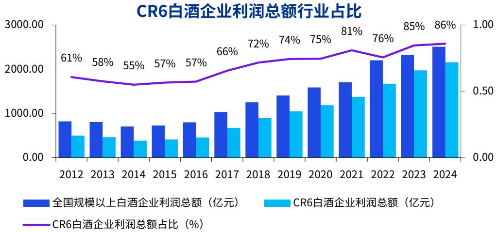

## 图1：CR6白酒企业利润总额行业占比 3

第2页

酒企业绩分化加剧，头部企业韧性凸显。贵州茅台、五粮液、山西汾酒等头部企业 2024 年营收同比增长率分别为 15.7%、7.1%、12.8%，净利润增速分别达 11.6%、5.4%、17.3%，且 ROE均超过 30%，展现出强劲的盈利能力。与此同时，区域龙头企业如古井贡酒、今世缘也保持了较高的增长态势，营收增速分别为 16.4%和 14.3%。然而，另一些区域企业却面临较大困境，其中有两家企业的营收分别下滑 35.5%和 37.0%，净利润跌幅更是超过 70%。这种分化现象的背后，主要源于头部企业在品牌护城河和渠道掌控力方面的优势，使其在行业周期调整中具备更强的控价能力和供需调整能力，而中小企业则因区域市场竞争激烈和品牌力不足，导致动销疲软。

CR6营业总收入与净利润同比增长率  
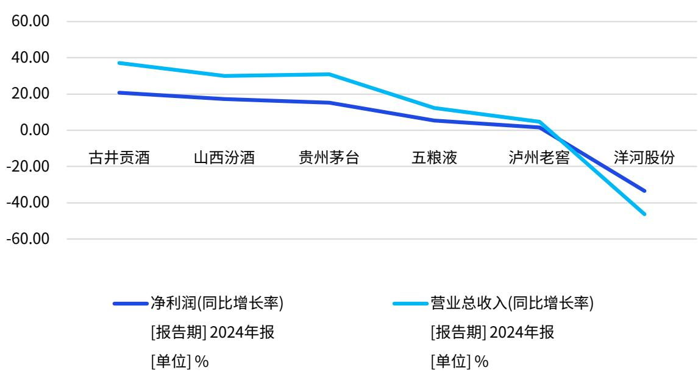  
图2: CR6营业总收入与净利润同比增长率 4

## 第3页

库存压力高企与价格倒挂普遍化，行业平均存货周转天数已达 900 天，较上年同期增加 10%，存货量同比增加25%。与此同时，价格倒挂现象已覆盖60%的企业，反映出市场供需失衡与渠道压力的加剧。

这一现象背后的主要原因是供需失衡与渠道堰塞湖效应。终端需求疲软，社会零售餐饮收入仅增长3.0%，导致经销商库存达到历史高位。

A股白酒上市企业2024年存货周转天数  
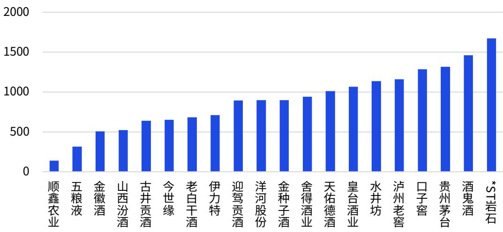  
图3：A股白酒上市企业2024年存货周转天数 5

## 第4页

## 二、2025 年 1-6 月白酒市场表现

## (一) 经营指标：量价齐跌，费用上升

2025 年一季度行业产量为 103.2 万千升，同比下降 7.2%。整体来看，白酒行业产量持续萎缩，2025 年行业有可能迎来连续第八个年度产量下降 6。白酒上市公司表现优于行业整体，经营业绩稳健，第一季度实现营业总收入 1,534.2 亿元，同比增长 1.7%；净利润 649.1 亿元，同比增长 2.3%7，展现出上市企业较强的抗压能力与市场韧性。

2024年一季度与2025年一季度白酒调研企业经营指标反馈的占比  
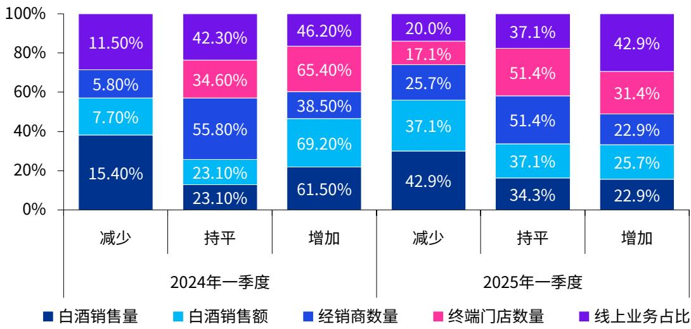

## 图4：2024年一季度与2025年一季度白酒调研企业经营指标反馈的占比 8

根据数据显示，白酒生产企业经营情况与2024年同期相比有所下滑，22.9%和25.7%的酒企表示白酒销售量和销售额有所增加，超过一半的酒企反映经销商数量和终端门店数量保持不变，42.9%的调研企业表示其线上业务占比有所增加。反映销售额有所减少的企业主要为全年营业额低于 10 亿的区域酒企、营业额低于 100 亿的泛全国化酒企，以及个别头部的全国性白酒生产企业。

## 第5页

2025年1-6月白酒行业经营指标变化情况  
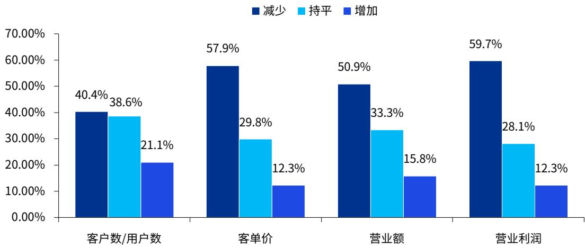  
图5：2025 年1-6月白酒行业经营指标变化情况 9

从调研结果来看，2025 年上半年，酒类生产企业和经销商的客户数、客单价、营业额和营业利润的减少比例均高于增加比例，其中营业利润负面情况最为显著，利润率有所减少的企业占比高达59.7%，政策调整、消费谨慎情绪和成本上升的影响明显，凸显行业整体承压。

需求侧来看，今年仅有 21.1%的调研企业表示其客户数量有所提升，白酒消费群体萎缩已成为共识。2025 年上半年，全球供应链扰动和国内消费信心恢复需时，抑制了白酒大众需求。伴随消费者可支配收入减少，消费者更加追求性价比更高的替代品。

另一方面，供给端的客单价同比有所减少的企业比例高达57.9%，反映价格竞争加剧，白酒企业和经销商为应对需求疲软，频繁开展促销活动，如折扣和捆绑销售，以维持市场份额。此外，高端白酒市场受政策影响，消费场景减少，迫使企业降价。客单价减少与客户数减少形成双重压力，共同导致营业额有所减少的企业比例达到50.9%。

根据调查问卷数据，2025年1-6月，营业利润减少的酒企和经销商高达60%，原因在于成本上升：固定成本和营销渠道费用的上升，原材料价格波动和人工成本增加，挤压利润率。同时，客单价减少导致收入下降，放大亏损风险，行业面临“量价齐跌、费用上升”的困境。

## 第6页

## (二) 供给端：多元化布局，差异化特色风味

根据调查问卷数据，从供给端布局看，一方面仍以浓香型、酱香型、清香型为主；除此之外，酒企发挥区域特色和工艺特色优势，进行差异化的特色香型、风味布局的趋势明显。

白酒香型格局本质是工艺价值、消费偏好与商业效率的三角博弈。今年行业整体进入“存量分化”阶段，出现了生产端布局差异化的特色香型在市场份额中占据相当一部分比例的现象。

白酒本身是一种风味食品，随着消费者对产品个性化需求的增强，白酒生产端产品布局多元化差异化，风味特色化发展趋势可能会愈发明显。但企业需在差异化与规模化间寻找平衡点和突破口，保障品质风格，找到与消费者的情感连接和共鸣，否则将面临难以突出重围的风险。

## (三) 线上销售：平台多元化，占比稳步提升

中国白酒在 2025 年 1-5 月线上总销量累计超过 6,000 万瓶，总销售额累计超过 300 亿元。值得关注的是，随着京东、天猫等电商平台满减、百亿补贴等促销活动的开展，名酒品牌产品均价持续走低，“低价引流”策略虽短期刺激消费，却导致长期利润压缩，区域酒企更面临市场份额萎缩压力。

A 股白酒上市企业中有 18 家在 2024 年年报中披露了线上销售收入，共计 332.2 亿元，同比减少 3.7%，但这 18 家企业 2024 年的线上销售收入占其营业收入的平均比重为 5.0%，较 2023年上升了 0.3 个百分点 10。2024 年以来，受整体经济下行压力加大、行业调整周期延续以及线上流量趋于饱和的影响，白酒电商的增长也逐步放缓，但线上销售额占总营收的比重仍在稳步上升。

数据显示，42.9%的白酒生产企业反映2025上半年线上业务占比同比有所增长，进一步证明了白酒企业正逐步加大对线上渠道的布局。

## 第7页

2025年1-6月白酒生产企业线上业务占比变化情况

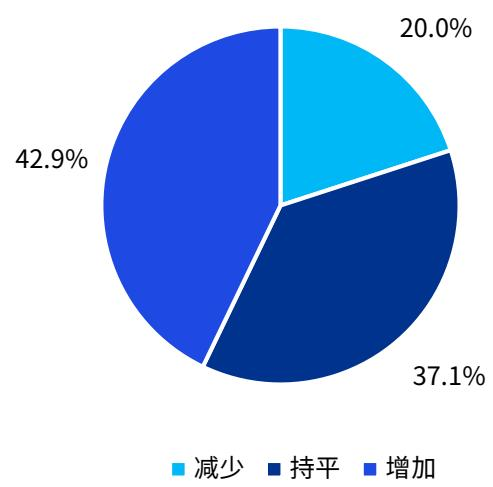  
图6：2025 年1-6月白酒生产企业线上业务占比变化情况 11

分品牌 12而言，全国化品牌（茅台、五粮液、泸州老窖等）线上销售额为 280.0 亿元，同比下降6.0%，线上销售占比 7.5%，较上年下降 1.1 个百分点；泛全国化品牌（酒鬼酒、舍得酒业、水井坊等）线上销售收入达 37.8 亿元，同比增长 8.9%，线上销售占比 6.1%，较上年提升 0.7 个百分点；区域性品牌（今世缘、迎驾、口子窖等）线上收入为 14.4 亿元，增幅达 16.6%，线上销售占比 3.1%，较上年上升 0.4 个百分点。尽管全国化品牌在线上渠道中仍占据主导地位，但其线上渠道的增长动力不足。而泛全国化和区域性品牌则通过差异化和积极拥抱线上的市场策略，在竞争激烈的线上市场中实现了逆势增长，这也反映出白酒行业正在向多元化、精细化方向发展。未来，随着线上渠道的进一步竞争和消费场景的拓展，各品牌需在渠道优化方面寻求突破，以应对市场环境的变化。

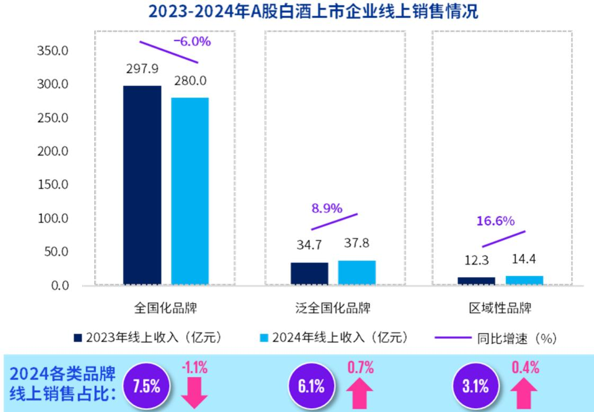  
图7：2023-2024 年 A股白酒上市企业线上销售情况 13

## (四) 市场动销：消费场景转变，节假日销售平淡

在节假日表现方面，2025 年 1-6 月白酒市场的旺季需求恢复有限，整体销售表现平淡。26.9%的经销商、零售商反映春节前、中期消费量有所增加，但春节后没有明显的销售旺季；而在五一节假日期间仅有 11.5%的经销商、零售商反映消费量有所增加。

## 第9页

2025年1-6月节假日白酒消费量同比变化情况

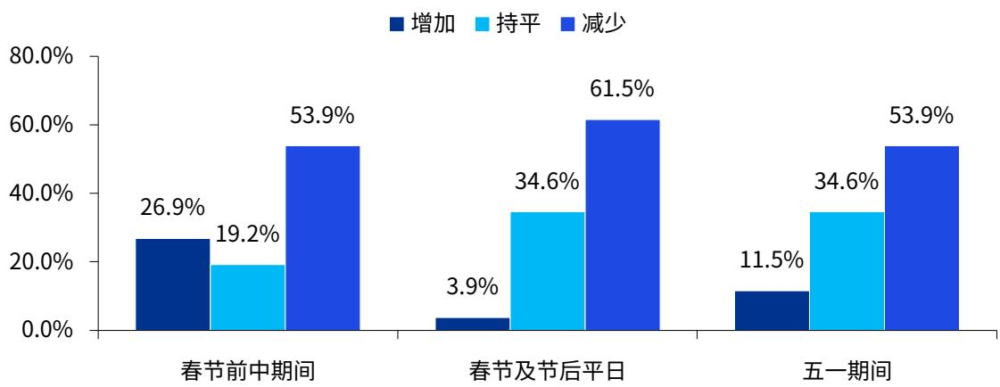  
图8：2025 年1-6月节假日白酒消费量同比变化情况 14

在价格带表现方面，2025 年 1-6 月白酒市场经销商、零售商反馈市场动销最好的前三价格带分别为 100-300 元、300-500 元、100 元及以下；倒挂程度前三价格带分别为 800-1500 元、500-800 元、300-500 元。中低端畅销价位带由 300-500 元进一步向 100-300 元下沉，500-800 元价位带产品生存则最为困难。

## 第10页

2024年H1及2025年H1白酒市场畅销产品的价格带占比  
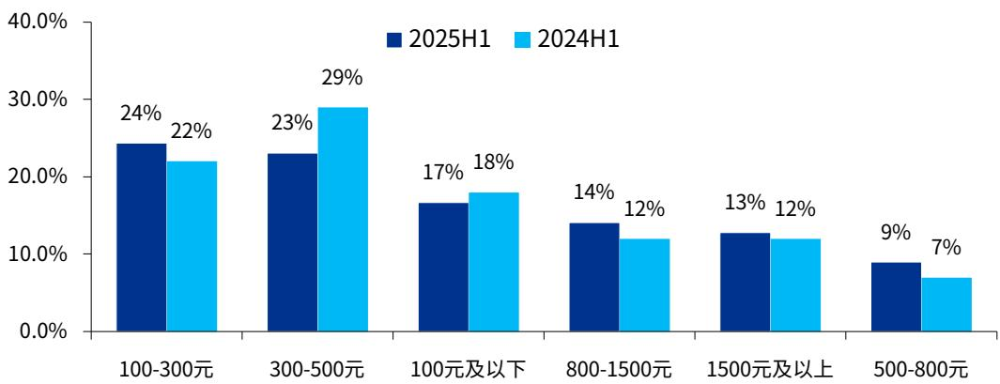  
图9：2024H1 及2025H1白酒市场畅销产品的价格带占比 15  
2024H1及2025H1白酒市场倒挂严重价格带占比

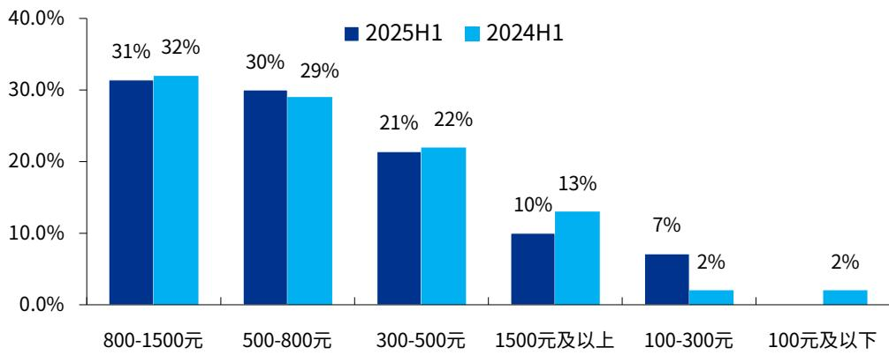  
图 10：2024H1 及 2025H1 白酒市场倒挂严重价格带占比 16

从 T9 白酒品牌过去五年的主要产品的价格变化情况看，茅台酒作为传统白酒价格风向标，2022年至今飞天茅台（专卖店）价格持续下跌，总跌幅高达 36.15%，而渠道价已经跌破 2,000 元。作为具有代表性的高端宴饮、公务宴饮用酒，茅台酒价格的大幅下跌也充分说明相关消费场景的巨大变化，该变化与消费行为、消费习惯和相关政策的出台息息相关。其他T9品牌产品价格也存在不同程度的跌幅，其中，君品习酒过去五年跌幅高达 39.82%，洋河梦之蓝 M9（23.16%）、郎酒青花郎（21.79%）、古井贡古20（18.03%）、汾酒青花汾（14.67%）过去五年价格累计跌幅均在 10%以上。剑南春水晶剑（1.23%）、五粮液普五（八代）（3.68%）和泸州老窖国窖1573（7.6%）则相对价格比较稳定，跌幅较小。

近5 年T9品牌主要产品价格变化情况

<table><tr><td>T9品牌</td><td>茅台</td><td>五粮液</td><td>洋河</td><td>汾酒</td><td>泸州老窖</td><td>古井贡</td><td>郎酒</td><td>习酒</td><td>剑南春</td></tr><tr><td>产品</td><td>飞天</td><td>普五</td><td>梦之蓝M9</td><td>青花30</td><td>国窖1573</td><td>古20</td><td>青花郎</td><td>君品习酒</td><td>水晶剑</td></tr><tr><td>2021年6月</td><td></td><td>985</td><td>1120</td><td>770</td><td>920</td><td>550</td><td>950</td><td>955</td><td>395</td></tr><tr><td>2022年1月</td><td>2900</td><td>970</td><td>1170</td><td>830</td><td>910</td><td>550</td><td>925</td><td>935</td><td>397</td></tr><tr><td>2022年6月</td><td>2750</td><td>980</td><td>1170</td><td>830</td><td>915</td><td>550</td><td>950</td><td>940</td><td>398</td></tr><tr><td>2023年1月</td><td>2650</td><td>965</td><td>1135</td><td>805</td><td>900</td><td>540</td><td>935</td><td>880</td><td>410</td></tr><tr><td>2023年6月</td><td>2700</td><td>965</td><td>1125</td><td>780</td><td>895</td><td>540</td><td>905</td><td>880</td><td>410</td></tr><tr><td>2024年1月</td><td>2850</td><td>960</td><td>1080</td><td>810</td><td>875</td><td>490</td><td>825</td><td>820</td><td>410</td></tr><tr><td>2024年6月</td><td>2850</td><td>970</td><td>988</td><td>860</td><td>875</td><td>490</td><td>825</td><td>790</td><td>410</td></tr><tr><td>2025年1月</td><td>2300</td><td>950</td><td>950</td><td>750</td><td>860</td><td>466</td><td>790</td><td>710</td><td>410</td></tr><tr><td>2025年6月</td><td>2130</td><td>950</td><td>950</td><td>755</td><td>855</td><td>520</td><td>780</td><td>683</td><td>405</td></tr><tr><td>降价幅度</td><td>-36.15%</td><td>-3.68%</td><td>-23.16%</td><td>-14.67%</td><td>-7.60%</td><td>-18.03%</td><td>-21.79%</td><td>-39.82%</td><td>-1.23%</td></tr></table>

表1：近 5 年T9品牌主要产品价格变化情况 17

## 第12页

## (五) 整体评价：由“企业主导”转向“消费者定义价值”

2025 年上半年，从生产企业业绩来看，白酒行业整体营收与利润规模延续扩张趋势，但增速较2024 年同期有所放缓。在行业进入深度调整期间，白酒企业分化进一步加剧。头部名优白酒及区域龙头酒企凭借品牌影响力、市场渠道和资金实力持续稳固市场地位，中小酒企则面临销售承压。而传统白酒需求旺季“旺季不旺”的消费模式变化正在深刻改变着白酒消费市场甚至重新定义白酒消费市场。

数据显示，从消费市场反馈情况来看， 77%的企业表示市场有所遇冷，与上一年同期的 80%认为市场有所遇冷相比，悲观情绪持续存在。21%的企业反映上半年市场没有变化或喜忧参半，较去年同期增加 12 个百分点，同时仅 2%的企业反映市场呈现回暖迹象，较去年同期减少 9%，意味着业内生产企业和经销商对市场回暖预期不足。当前，白酒行业处于存量竞争阶段，核心命题已从“企业主导”转向“消费者定义价值”。随着宏观政策加码和经济韧性增强，白酒行业将全面追求产品品质的硬实力和服务的软实力。

2025年1-6月白酒市场经营变化情况评价  
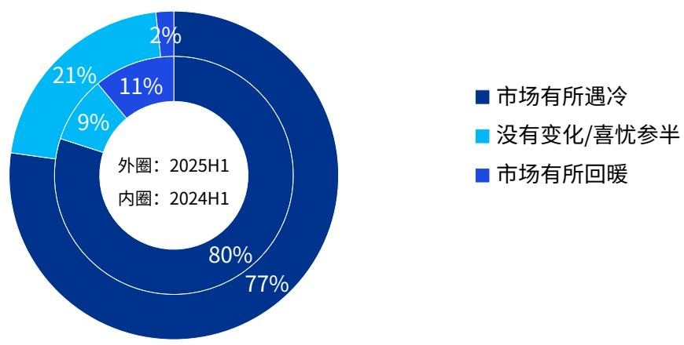  
图11：2025年 1-6月白酒市场经营变化情况评价 18

## 第二部分 2025年 1月-6月白酒市场环境变化

## 一、政策调控深化，冲击市场情绪

2025 年 5 月修订的《党政机关厉行节约反对浪费条例》将禁酒范围从高档酒水扩展至所有含酒精饮料，标志着政策调控进入新阶段。尽管政务消费占比已大幅下降，但政策对市场情绪的冲击仍不容忽视。政策发布次日，白酒板块整体回调 2%～3%，与 2012 年“八项规定”后的剧烈波动形成鲜明对比，而此次调整幅度相对温和，反映出行业对政策冲击的适应能力增强。受政策影响消费场景的结构性迁移正在加速。当前婚庆寿宴和家庭独酌已成为最主要的消费场景，而商务宴请占比受到经济环境影响加速下滑。这种转变倒逼企业调整产品策略，茅台 1935 等次高端产品批发价降至 700 元左右，销量逆势有所提升，显示价格带下移已成趋势。

## 二、市场周期导致上半年白酒批价整体表现较弱

根据对“2025 年 1-5 月中国白酒批发价格总指数”的观察，2025 年上半年，中国白酒市场整体呈现小幅震荡的态势。当前白酒行业正处于调整期，在白酒库存高企、价格倒挂等多重压力下，今年上半年批价整体表现较弱。这种市场表现与宏观经济环境密切相关，经济发展的不确定性导致消费者信心不足，消费行为更加谨慎，进而影响了白酒终端需求。

2025年1-5月中国白酒批发价格总指数  
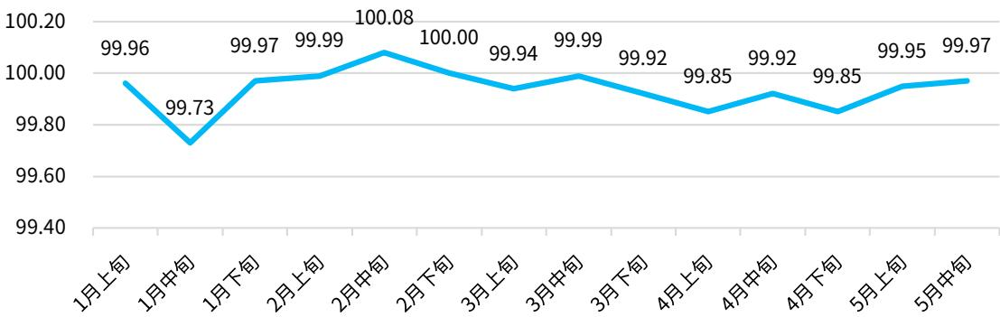  
图12：2025年 1-5月中国白酒批发价格总指数 19

## 第14页

中国:白酒批发价格总指数:名酒:旬环比 中国:白酒批发价格总指数:基酒:旬环比中国:白酒批发价格总指数:地方酒:旬环比

从具体分类来看，名酒、地方酒、基酒价格指数走势出现了一定的分歧。地方酒整体涨跌幅度小于名酒。相比名酒和地方酒，基酒价格稳健，印证了上游供应链调控的稳定性，名酒企业正面临库存积压与市场需求波动的双重压力，而地方酒品牌则由于品牌竞争力不足，在市场份额的争夺中陷入被动，不得不通过降价来维持生存。

2025年1-5月中国白酒批发价格总指数  
——名酒、地方酒、基酒  
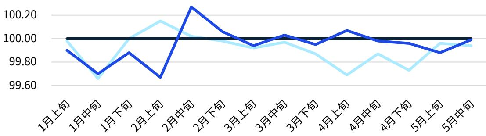

## 图13：2025年 1-5月中国白酒批发价格总指数⸺名酒、地方酒、基酒 20

## 三、企业价格策略缓解库存压力

2024 年以来，众多酒企纷纷采取调价手段以应对库存压力，其中包括五粮液、剑南春、郎酒、今世缘、牛栏山、汾酒、泸州老窖等众多头部品牌。然而，酒企调价行为暂未对库存压力产生明显改善，根据 2024 年 A 股 20 家白酒上市公司年报，20 家白酒上市公司存货达到 1,683.89 亿元，同比增加 192.9 亿元，其中 13 家存货集体增长，相较于 2022、2023 年，库存继续呈现上升趋势。

## 第15页

2015-2024年A股上市白酒企业存货金额（亿元）  
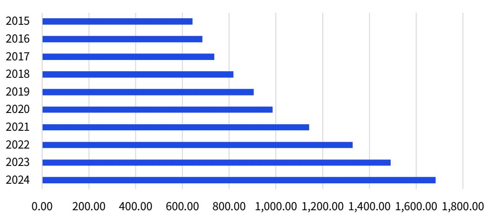  
图 14：2015-2024 年 A 股上市白酒企业存货金额 21

进入 2025 年，头部酒企控货稳价动作密集，具体来看，2025 年 1 月 5 日，贵州两家酒企联合发布通知，因产品迭代升级，自 1 月 10 日起停止接收第三代珍十五（含无奖）产品销售订单。随后，洋河、今世缘、山西汾酒等酒企纷纷下发通知，部分产品暂停接受销售订单及货物供应。在市场需求不振的情况下，特别是即将进入节后销售淡季，酒企控货通过减少市场供给来平衡渠道产销，达到维持产品渠道价格稳定、维护企业品牌形象等目的。

根据数据显示，2025 年 1-6 月与去年同期相比，经销商、终端零售商在经营方面，58.1%表示库存增加；超过一半经销商、零售商表示实际销售价格的倒挂程度有所增加，超过40%经销商、零售商表示面临着现金流压力；38.7%经销商和零售商表示经销回款减少。换而言之，经销商普遍面临库存压力，部分经销商库存周期延长，市场价格倒挂现象普遍。这使得经销商资金周转困难，对后续进货变得更加谨慎。

## 第16页

2025年1-6月经营指标同期变化情况  
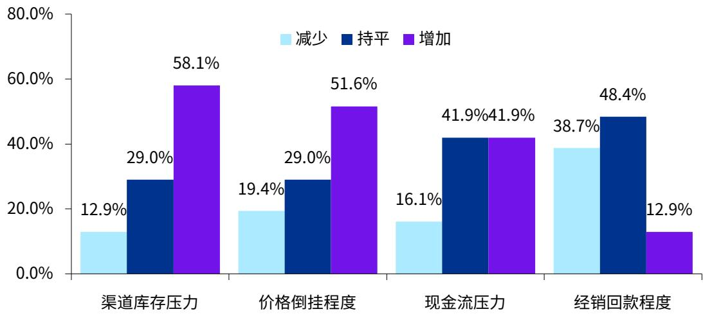  
图15：2025年 1-6月经营指标同期变化情况 22

## 四、竞争格局加速演变，品牌梯队分化加剧

调查数据显示，2025 年 1-6 月白酒市场销量前六的品牌为茅台、五粮液、汾酒、泸州老窖、洋河、剑南春（排名不分先后）23。 从 2025 年第一季度的营业收入来看，CR6 白酒品牌营业收入总计达1,344.7亿元，占A股20家白酒品牌营业收入的 87.6%，继续呈现“强者恒强”的分化趋势 24。CR6 品牌凭借其强大的品牌力、渠道优势和规模效应，占据了大部分市场份额，品牌集中度进一步提升。而其他品牌则面临增长乏力和市场竞争加剧的双重挑战。未来，其他名酒（即其他上市酒企）若想在竞争中脱颖而出，需在产品创新、渠道优化和品牌建设方面持续发力，以应对来自 CR6 品牌的竞争压力。

综合 20 家 A 股白酒上市公司年报来看，经销商依旧是白酒厂家营业收入的主力军。在经销为主、直销为辅的模式下，厂家主要依靠经销商开拓市场。同时各大酒企加码直营业务，辅助开发市场。数据显示，部分经营较好的区域酒企的直营特征非常显著，远超全国性品牌和泛全国化品牌，直营业务超 50%以上的区域酒企已经达到了 42.9%。区域酒企借助渠道下沉和深入营销，实现对

终端有效控制。

2025年1-6月白酒品牌生产企业直营业务占比情况  
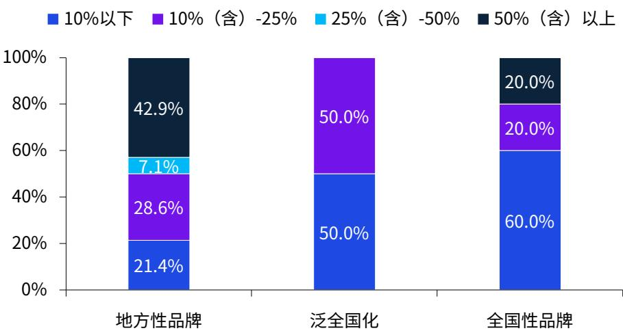  
图16：2025年 1-6月白酒品牌生产企业直营业务占比情况 25

从本地市场占有率来看，白酒的地域性特征十分显著。区域性经销商表现强势，在本地市场占有率领先。从酒企层面看，全国性品牌在向外进行市场开拓的同时在本地市场占有率亦表现突出，泛全国化酒企逐步转向省外，在本地市场占有率上会分散一定精力。这也给予了区域中小酒企和经销商相应的经营启示，即扎根本土，充分开发本地市场需求，做“小而美”的地方酒饮，在深耕本地市场的基础上，与全国化白酒品牌差异化竞争。

2025年1-6月酒企及经销商本地市场占有率情况  
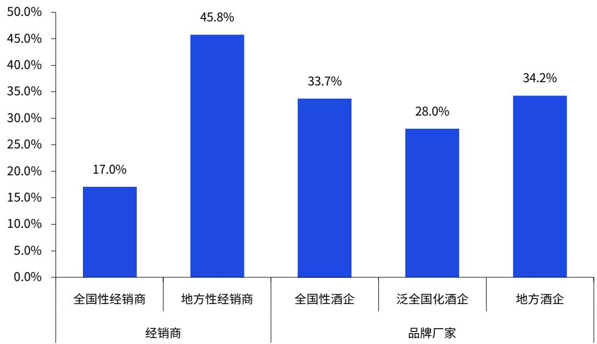  
图17：2025年 1-6月酒企及经销商本地市场占有率情况 26

## 五、消费结构裂变，年轻化需求崛起

中国经济高质量发展正深刻重塑白酒消费逻辑，行业底层逻辑从“规模扩张”转向“价值深耕”，消费需求从“量”的满足转向“质”的追求。

从不同消费群体的视角观察，随着年轻消费群体的崛起，白酒行业的消费结构正在悄然发生变化。数据显示，商务及管理人群依然成为白酒的消费主力，占比 85.1%。同时，“年轻化”成为酒业发展潮流。85 年至 94 年出生的普通白领和职场新人成为企业寻找细分市场的重要突破口。因此，企业积极拥抱年轻消费者、打破固有消费圈层、探索品牌年轻化之路成为当下白酒企业的必修课题。

## 第19页

2025年1-6月白酒消费市场的高潜消费人群  
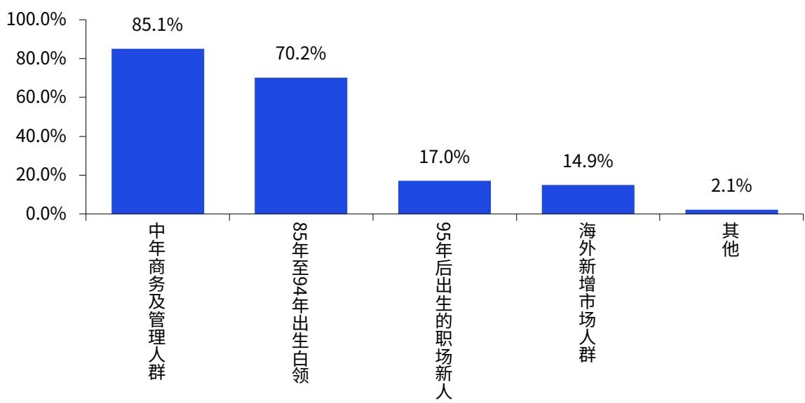  
图18：2025年 1-6月白酒消费市场的高潜消费人群 27

从白酒消费场景变化的角度来看，当前消费者在非刚性消费上显得更加理性。数据显示，80.8%的经销商表示宴请及送礼需求减少。在消费分化趋势下，酒类品牌、产品、价格与消费场景出现深度分化。一方面，尽管高端白酒消费场景受限，但“茅五”等高端白酒在宴请、礼品用酒上依然占据优势。同时，有接近一半的经销商认为，朋友聚会（53.9%）、日常饮用（46.2%）的消费场景均有所减少。与之相比，相对稳定的消费场景则是婚宴。此外，在调查问卷中，还有企业反映了一些新增消费场景，包括高端宴请、酒旅融合、餐酒融合和便利店调酒等小众场景值得酒企关注。

## 第20页

2025年1-6月白酒经销商的消费场景变化情况

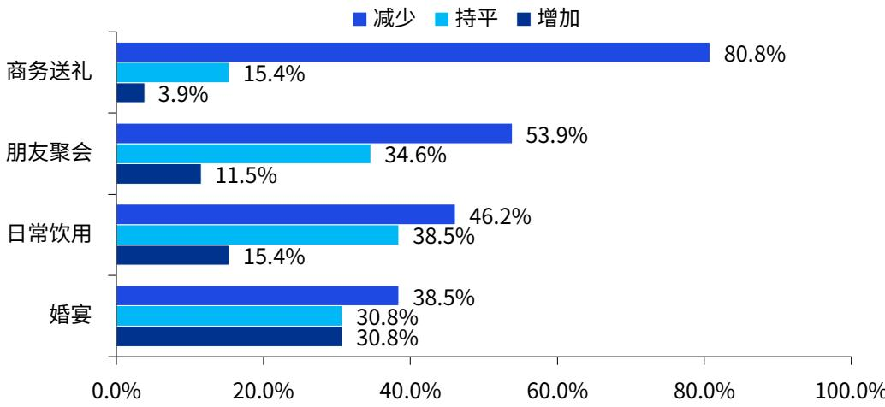  
图19：2025年 1-6月白酒经销商的消费场景变化情况 28

## 六、市场展望预期谨慎，流动性预期趋于稳定

根据调研显示，面对市场竞争的加剧和消费者购买习惯的变化，白酒市场的经营思路更加务实，酒企回归理性竞争、高质量发展的正轨。在产品层面，大多数企业的策略是核心产品和产品创新两手抓，集中资源投入核心产品（64.9%），开发新品（33.3%），加码投入年轻化酒类产品（21.1%）。在价格层面，布局大众价格带占比40.4%，期望凭借亲民价格吸引更多消费者。与此同时，节约成本、降本增效也成为企业持续发展的关键策略。

## 第21页

白酒企业2025年经营策略情况  
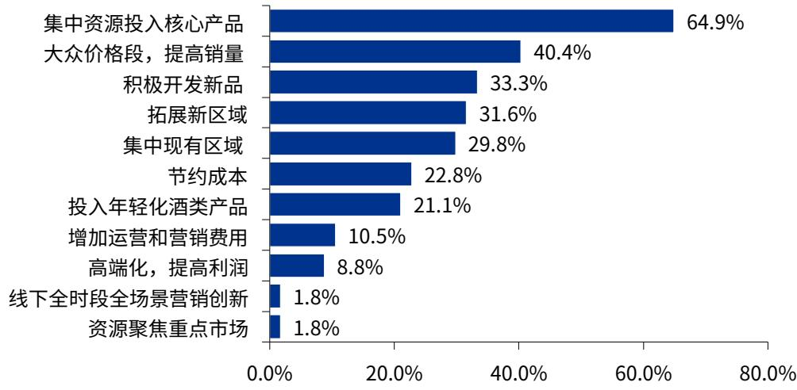  
图20：白酒企业2025年经营策略情况 29

在 2025 年下半年整体经营思路方面，80%以上的经销商和零售商认为下半年核心经营思路是“重点保住现金流”，仅 12.5%的经销商（主要集中于三、四线城市及县域下沉市场）选择“利润为王”的经营思路，他们认为这些区域仍然蕴藏着丰富的利润商机。白酒生产企业下半年的主要经营思路则为“优先扩大规模”，表明下半年仍然是市场份额的竞争而非利润的角逐。

2025年下半年白酒市场的整体经营思路

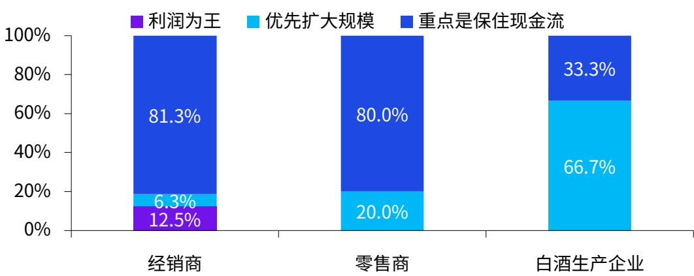  
图21：2025年下半年白酒市场的整体经营思路 30

## 第22页

## 第三部分 促进酒类市场健康发展的观点

## 一、稳健开局，共赴高质量发展

经济增长放缓、消费代际更替、理性化趋势深化、场景多元化演进、情感价值诉求升级、需求分层加速、渠道生态重构、存量博弈白热化等结构性变革，正在深度重塑白酒产业格局。高速增长期积累的供需矛盾持续显化，核心矛盾已从供给驱动转向需求驱动，这一转变成为产业转型的核心标志。

2025 年正加速成为酒业价值链系统性重塑的关键分水岭，行业发展的战略重心聚焦三大关键词“强基、重构、立新”，强基-产业与产区融合发展，需以“长期主义”筑牢发展根基，聚焦产区建设、科研创新、标准完善、人才培育等八大“强基”工程；重构-重建渠道与消费场景、产品、品牌、渠道价值体系；立新-创新产品与商业模式，依托文化、AI、国际化、潮饮、场景“五新驱动”开拓增量。虽然受到大环境影响酒类消费增长动能不足，酒产业在生产和市场消费方面依然表现较好。

## 二、 产能优化，从“以量谋大”向“以质图强”升级

过去十年间，中国白酒行业经历深度结构性调整。国家统计局数据显示，行业产量从2016年的1,358.4 万千升持续下降至 2024 年的 414.5 万千升，累计降幅达 69.5%。这一趋势在 2025 年仍在延续⸺2025 年 1-4 月累计产量仅 130.8 万千升，同比下滑 7.8%。

主要白酒产区和名酒品牌在“十四五”期间对优质产能进行了目标规划并分步实施，随着这些产能的渐进释放，产能过剩的问题将凸显。这样的问题矛盾，在不同的产区，都客观存在，只是侧重不同而已。存量竞争时代，增长的压力是不可回避的，应主动调低预期，主动选择可为、可不为，甚至主动盈亏，从而赢得未来更是明智之举。切忌盲目扩产，“瓶里”“瓶外”协同发展，产业与城市经济协同发展。产业链价值提升应该是主旋律。

## 第23页

## 三、重构厂商关系，直销模式提速

在行业集中度提升的背景下，传统线性供应链正被打破。头部企业通过并购、联盟等方式整合资源，形成“链主”地位，厂商关系从单边博弈转向共生共赢。一方面，厂商合作模式向“价值共同体”进化，通过股权绑定、数据共享实现精准产销对接，完成从生产导向到用户导向的转变；另一方面，渠道职能加速重构，“百亿酒商”阵营已初露峥嵘，从“搬运工”转型为“服务商”，重构业务模型，创新服务价值，承担终端运营、消费者培育等增值角色。

酒类行业渠道变革加速。头部酒企纷纷加码直销，通过自建电商平台、拓展直营门店、深化与新零售平台合作等方式，缩短供应链，提升利润空间。茅台直销所占的业务比例最高已达 45%，五粮液直销占比最高接近 40%，印证了渠道扁平化趋势。直销模式不仅增强酒企对终端的掌控力，更通过数据反哺精准营销，满足消费者对品质溯源、个性化服务的需求。未来，随着“直面消费者”战略深化，酒厂与经销商的职能边界将进一步重构，渠道利润分配或迎来新一轮洗牌。

<table><tr><td colspan="9">茅台及五粮液直销占比</td></tr><tr><td>项目</td><td colspan="4">茅台</td><td colspan="4">五粮液</td></tr><tr><td>年份</td><td>2021</td><td>2022</td><td>2023</td><td>2024</td><td>2021</td><td>2022</td><td>2023</td><td>2024</td></tr><tr><td>直销额(亿元)</td><td>240.29</td><td>493.78</td><td>672.32</td><td>748.43</td><td>115.95</td><td>270.7</td><td>304.62</td><td>343.89</td></tr><tr><td>营收额(亿元)</td><td>1060.59</td><td>1237.72</td><td>1472.18</td><td>1741.44</td><td>617.31</td><td>675.62</td><td>764.47</td><td>891.75</td></tr><tr><td>直销占比</td><td>22.66%</td><td>39.89%</td><td>45.67%</td><td>43.87%</td><td>18.78%</td><td>40.07%</td><td>39.84%</td><td>38.6%</td></tr></table>

表2：茅台及五粮液直销占比 31

## 第24页

## 四、构建线上线下全域数字化营销体系

线上渠道已从补充性角色转变为驱动行业增长的核心引擎，尤其在年轻消费群体中，电商平台与直播带货的转化率持续走高。线上渠道的扩张对传统经销商形成结构性冲击，但实践证明，单一渠道模式难以适应消费分层趋势。线上聚焦流量转化与数据沉淀，线下强化体验服务与场景深耕。新零售模式如“即时零售”和“直面消费者”模式，正推动渠道效率革命。数据显示，2025年，34.9%的白酒企业最看重即时零售这种创新销售渠道的拓展，占比第二的为直播带货。

2025年白酒企业拓展新渠道的方向

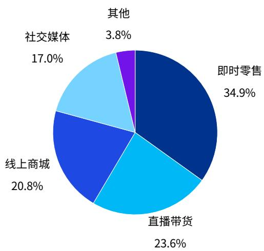  
图22：2025年白酒企业拓展新渠道的方向 32

## 五、技术重构产业链，重塑消费场景

2025年，中国酒业正站在技术革命与文化复兴的交汇点。区块链防伪溯源、AI技术及元宇宙体验等技术深度渗透产业链，重塑生产关系与消费理念。面对消费升级与数字化浪潮，酒商需突破传统框架：战略上构建生态共同体，产品端融合科创与文创，渠道层打造全域零售网络，品牌侧实现情感共鸣，消费端注重场景创新和消费培育。在科技赋能与文化自信的双重驱动下，“酒+新业态”“酒+新科技”等创新模式不断涌现，不仅将重塑消费场景，更推动行业从规模扩张转

向质量发展。

从“推杯换盏”到“随身饮品”，年轻群体的消费场景更多元。比起在酒宴中的“推杯换盏”，年轻群体更热衷于轻便、轻量型，携带方便的“随身饮品”，如奶茶等茶饮也是契合了这个需求而兴起的。年轻群体消费白酒，可能会用于露营、线下小型聚会、下班后小酌等轻量型社交场景，因此对于白酒的瓶装设计、瓶身质感、瓶身重量、瓶身容量等也会有不同的期待。酒类企业在推出迎合年轻群体需求的产品线时，也需要对相应的场景进行探索研究，从而在产品定位、包装设计、容量定价等方面契合年轻群体的特色需求。

## 六、“文化+营销”双核驱动，构建可持续发展新生态

当前，行业正从规模扩张转向价值竞争，消费升级使得营销模式迭代，消费者不仅关注产品功能，更追求文化体验与品质溯源。相较于过去对于技术人才队伍的高度重视和培育，如今，酒企更加注重系统化培育“懂酒又懂营销”的复合型人才，加强文化认同，提升综合能力和战略执行能力。构建全面且多元化的人才储备体系，实现可持续发展。

## 七、白酒国际化任重道远，势在必行

踏入 2025 年，白酒出口量维持着稳健增长，中国食品土畜进出口商会酒类进出口商分会发布的数据显示，2025 年第一季度白酒出口整体价格上涨，量额并进，出口额 2 亿美元，同比增长 30%，出口量 387 万升，同比增长 9%，远高于白酒全行业增长情况，可以看出白酒出海具有较大的发展空间。数据显示，2025 年有 63.9%的白酒企业均已布局或正在拓展海外市场，亦反映出白酒出口的还有众多待探索企业。

## 第26页

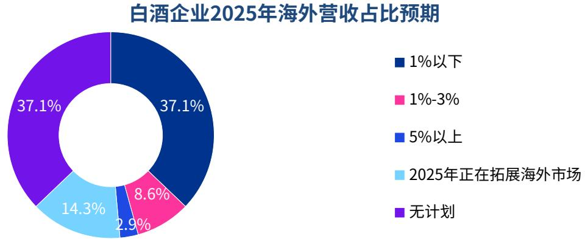  
图23：白酒企业2025年海外营收占比预期 33

根据调研数据反馈情况，目前被调查企业中白酒出海的目的地以亚太地区为主，其中中国香港和美国是白酒热门出口目的地，韩国、日本、澳大利亚、新加坡、马来西亚等国家（地区）也是比较热门的出海目的地。

白酒企业主要出海国家和地区分布  
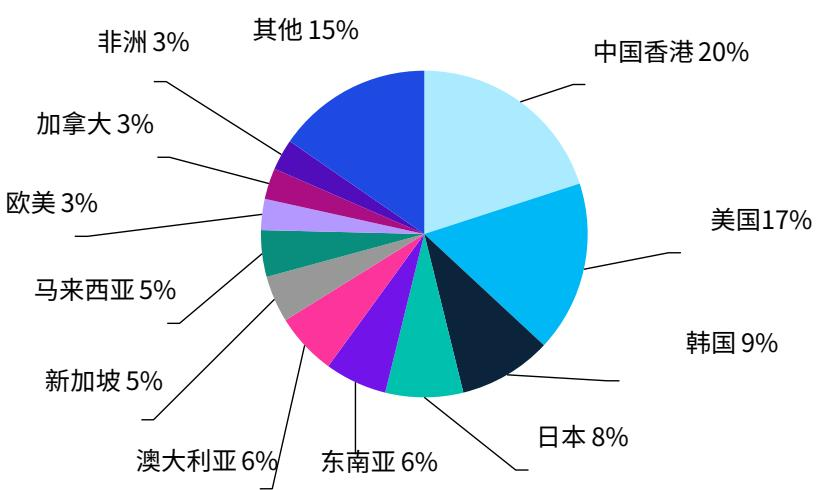  
图24：白酒企业主要出海国家和地区分布 34

## 第27页

根据调研数据，文化差异（82.9%）、品牌影响力（68.6%）和关税及贸易壁垒（60.0%）是白酒生产企业出口或出海的主要挑战。白酒作为中国传统饮品，其消费习惯、饮用场景和文化内涵与西方饮酒文化存在显著差异，同时，中国白酒品牌在国际市场上的知名度相对较低，与国际烈酒品牌相比存在较大差距。由于亚太地区中东盟内部贸易壁垒较低，但美国等地关税和贸易壁垒稳定性不强，给酒企出海也带来了一定的影响，需要考虑转口等方式规避相关贸易壁垒。此外，高效的渠道和分销网络、政策和战略支持也是白酒生产企业出口的挑战所在。未来白酒行业出海既要打造符合国外消费习惯和价值认同的产品，也需要适应本土化消费场景的创新，以及本土化生产、灌装和渠道的融合，以文化驱动展示中国白酒的魅力。

影响白酒出口或出海的主要挑战  
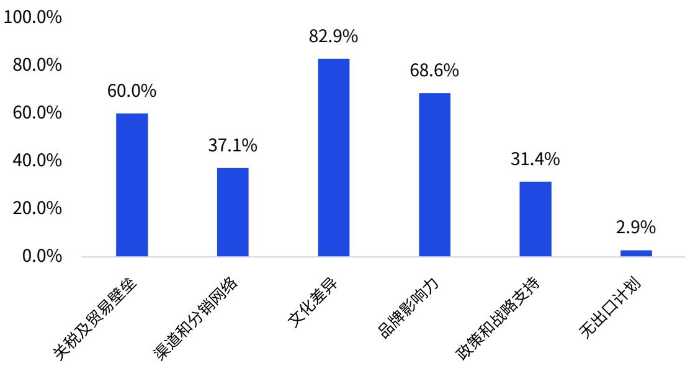  
图25：影响白酒出口或出海的主要挑战 35

## 第28页

## 结束语

2025 年将是中国酒业穿越周期、实现高质量发展的战略机遇期。面对政策调整、消费动能趋弱与行业调整深化带来的多重挑战，产业转型升级已迫在眉睫。这既是承压前行的攻坚期，更是破局重生的关键窗口。企业需以战略定力精准把握消费迭代与产业变革的时代脉搏。既要顺大势而为，在宏观政策导向与市场结构演变中校准航向；更要顺趋势而动，以主动转型构筑差异化竞争优势，在品类创新、渠道变革、价值重塑中开辟新赛道，要坚定信心，人民网评“禁止违规吃喝，不是吃喝都违规”，美好生活美酒相伴，共同擘画中国酒业转型升级的崭新篇章。

## 第29页

## 关于《2025 中国白酒市场中期研究报告》调查问卷

“《2025 中国白酒市场中期研究报告》调查问卷”为 2025 年 5 月下旬中国酒业协会市场专业委员会开展的线上线下市场调研走访，发出样本总计 795 份，样本覆盖白酒生产企业 200 家、经销商 260 家、零售商 100 家、电商平台含直播电商 10 家、商超 75 家、便利店 50 家、烟酒店 100 家。最终收到有效分析样本 583 份。

## 感 谢

感谢毕马威中国的技术支持。

感谢所有为该报告填写调查问卷的单位。

## 说 明

白酒行业从售价角度把品牌白酒划分为四类：超高端（1500 元以上）、高端白酒（800-1500元）、次高端白酒（300-800元）、中端白酒（100-300元）和低端白酒（100元以下）。

## 声 明

本报告内容中所引资料、数据、论述均来自第三方公开或可以通过第三方途径查询的信息。调研数据仅用于本报告的研究目的，我方不保证上述信息与实际情况完全一致和没有新的变化，如认为上述信息存在问题，可与我们联系。

本报告仅供内部交流、学习和参考使用，未经允许，不得对报告内容进行引用、修改、编辑，也不得进行具有任何商业目的使用。

## 第30页

kpmg.com/cn/socialmedia

如需获取毕马威中国各办公室信息，请扫描二维码或登陆我们的网站：https://home.kpmg/cn/zh/home/about/offices.html

所载资料仅供一般参考用，并非针对任何个人或团体的个别情况而提供。虽然本所已致力提供准确和及时的资料，但本所不能保证这些资料在阁下收取时或日后仍然准确。任何人士不应在没有详细考虑相关的情况及获取适当的专业意见下依据所载资料行事。

©2025毕马威华振会计师事务所(特殊普通合伙)—中国合伙制会计师事务所，毕马威企业咨询(中国)有限公司—中国有限责任公司，毕马威会计师事务所一澳门特别行政区合伙制事务所，及毕马威会计师事务所一香港特别行政区合伙制事务所，均是与毕马威国际有限公司(英国私营担保有限公司)相关联的独立成员所全球组织中的成员。版权所有，不得转载

毕马威的名称和标识均为毕马威全球组织中的独立成员所经许可后使用的商标。