食品饮料行业2025年中期投资策略

## 白酒从去库存到去产能，大众品关注新品新渠道

王言海、张玲玉、孙冉、张馨予、胡慧铭、范锡蒙

## 总有效需求不足，消费结构调整，增长动能源自“情绪溢价”与“新渠道变革”

➢ 从趋势上看，总需求仍受制于外部环境，一揽子“惠民生，促销费”政策稳定了消费基本盘，服务性消费支出逐年提升，居民就业、可支配收入、“财富效应”等因素对消费倾向的提升仍有制约。

➢ 从“物质占有”到“体验价值”，物质消费注重质价比，精神消费仍处于供给创造需求阶段，“碎片化”的新需求买单情绪溢价，人口、地域、圈层愈发精细，谷子经济、宠物经济、银发经济、露营经济等细分赛道快速发展。

➢ 新渠道变革持续重构品牌商、经销商/平台商及零售商价值链，效率是关键。

◆即时零售将成为酒饮品牌导流的重要入口，或将持续压减传统渠道商、终端门店生存空间，渠道商集中度提速。

（1）品牌产品、区域成熟度已然较高，持续的场景需求收缩环境下，以控盘分利、控价分利、固化利润等措施维持现有规模体量的渠道主体合理稳定利润分配将受到挑战；（2）逐步年轻化的消费者结构，在美团、叮咚、京东、朴朴超市等本地生活的及时配送的便利性培育下，即时配送的消费习惯已养成，达成酒类下单并无实质性障碍；（3）即时零售解决了传统电商的两个难点，一是即时性销售配送，过往企业O2O尝试多受制于单一品牌流量；二是企业电商部门与线下销售区域间的分利冲突，从对抗变为赋能导流。（京东、猫超等传统官旗店线上价格标杆多高于线下，独立的电商部门对销区多有业绩分流）。平台背书下，对于高货值产品下单的信任问题或许只需要一张大额优惠券。

◆以胖东来、山姆会员超市、奥乐齐、盒马NB、好想来、赵一鸣等为代表新兴零售商，迎合质价比消费趋势，对于品牌商来说，传统经销体系与新兴渠道并不对立，新兴的规模化零售商或许更懂消费者，以其数据赋能定制化新品或将是更好选择。

➢ 风险提示：消费场景复苏节奏及相关刺激政策效果不达预期；大宗原材料价格大幅上行，将加重大众品企业成本负担；白酒等产业政策调整风险；公司改革进度不及预期；零售商品牌产品的替代分流；下游需求恢复不及预期；食品安全风险。

结婚对数：万对

## 总有效需求不足，消费结构调整，增长动能源自“情绪溢价”与“新渠道变革”

图表：我国60岁以上人口占比提升  
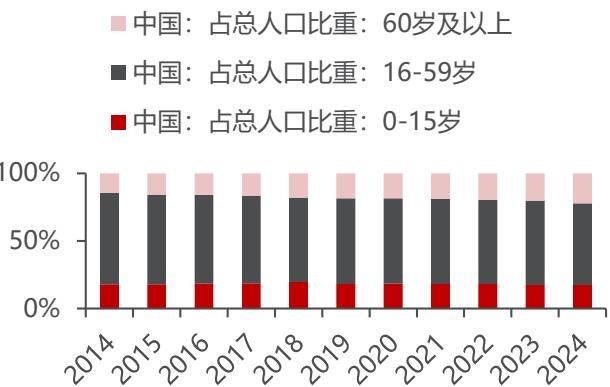  
图表：24年我国婚姻对数下降至610万对

图表：24年我国粗出生率为6.77‰粗出生率（CBR）：‰  
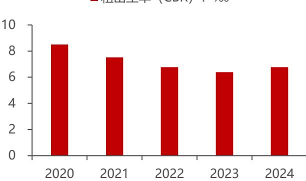

图表：我国宠物市场规模持续上升（亿元）  
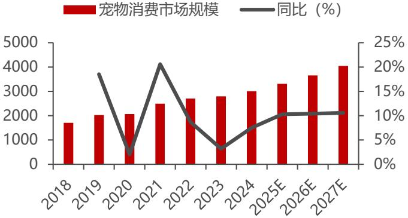  
图表：我国城镇宠物消费规模持续上升（亿元）

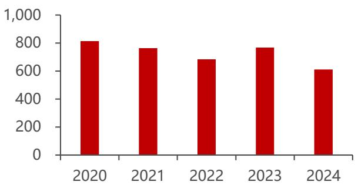

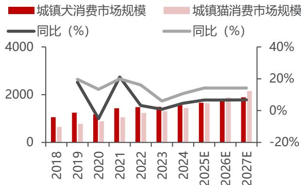  
图表：预计到2035年我国银发经济规模达30万亿元

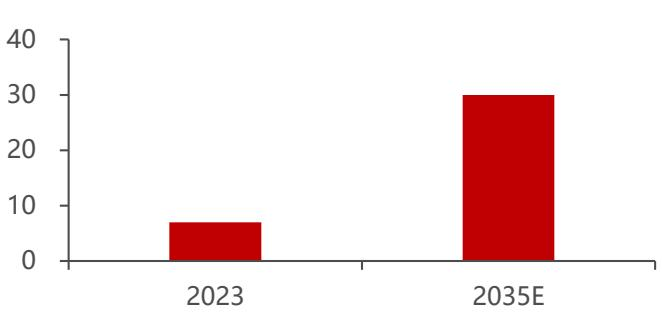

白酒：政策压制下加速探底，行业从去库存到去产能

低度酒：关注啤酒精酿新品与黄酒高端化改革

调味品&餐供：修复在途，关注新品新渠道

休闲食品：品类结构红利，情绪价值凸显

乳品饮料：乳品饮料：原奶产能持 续去化，关注饮料旺季新品

盈利预测

风险提示

## C O N T E N T S 目录

## 01. 白酒：政策压制下加速探 底，行业从去库存到去产能

## 1.0 白酒：产业端或从去库存到去产能，“禁酒令”等政策加速行业探底与新生态构建

➢ 受外部环境与政策影响，消费场景现阶段压制明显，在“降速释压”的共识下，行业渠道库存或将有效出清，复苏节奏亦将有调整，相关政策影响仍为现阶段第一要素，大众消费、商务宴请驱动的行业新生态亦在孕育。

◆供给端：降速释压已成共识，2025年增速目标有赖于三季度旺季动销。行业供给收缩，渠道库存舒压，规上白酒产量延续下滑趋势，各酒企2025年目标或因势动态调整。

◆需求端：“无场景不开瓶”，政策对餐饮链条总体有压制，传统政商务宴请及大众消费场景需求或进一步萎缩。1）政商务需求：根据微酒、酒业家等专业媒体测算，白酒公务消费占比已从高峰期由30%-40%降至5%左右，但引领性场景减少对商务消费、大众消费意愿的影响或将扩大。2）宴席场景：生日宴、婚宴等家宴、商务宴等较刚需场景同比或有恢复，但场均桌数、桌均开瓶数下降及退酒率提升等做了部分抵销，酒企宴席政策的加码亦拉高了费率。

➢ 白酒板块具备较高股息、低持仓、低估值特征，推荐左侧底仓配置：从投资角度看，板块估值已较为充分反应市场预期，持仓处于低位且较为集中，企业多措并举（包括不限于未来三年现金分红回报方案、大股东增持、回购注销等）以提升股东回报。

◆投资建议：基于行业生态与企业能力，我们建议以长远眼光看待行业发展，行业高集中、价格驱动的逻辑并未改变，企业治理与市场竞争能力出众的公司，1）品牌与渠道抗风险能力强，且明确三年期股东回报或有分红提升预期，推荐贵州茅台、五粮液、山西汾酒；2）基本盘稳定、动销确定高、且在区域内具备竞争优势的古井贡酒、今世缘、迎驾贡酒、金徽酒等；3）如外部环境及政策改善，β品种可加配，关注泸州老窖、舍得酒业、酒鬼酒、水井坊、珍酒李渡、华致酒行、老白干酒等。

➢ 风险提示：经济修复斜率放缓及消费刺激政策效果不达预期；竞争加剧；食品安全问题；政策风险等。

## 白酒：产业端或从去库存到去产能，“禁酒令”等政策加速1.1 行业探底与新生态构建

图表：24年规上酒企酿酒总产量415万千升，同比-8%规上白酒企业酿酒总产量（万千升）  
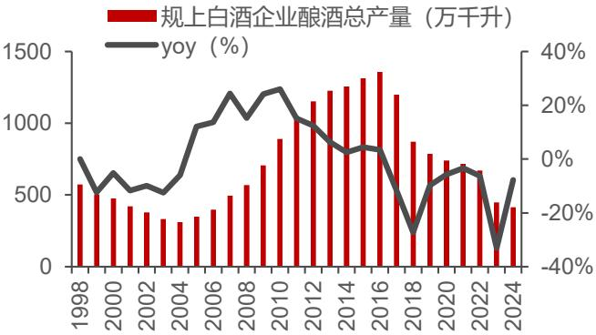

图表：24年规上酒企数量989家，较去年增加9家  
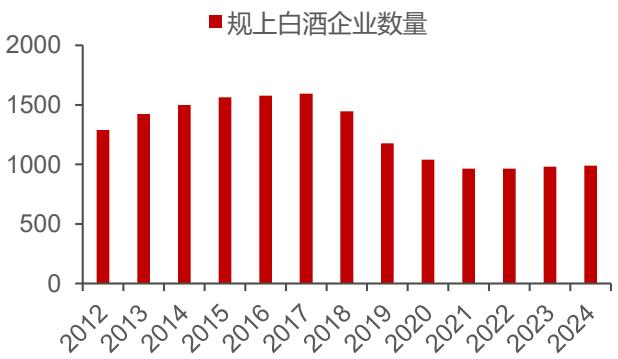

图表：24年规上酒企营收CR5占比持续提升  
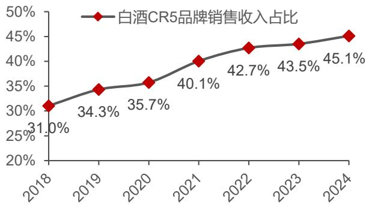

图表：24年规模以上白酒企业营收7964亿元，同比+5%规上白酒企业营收（亿元） yoy（%）  
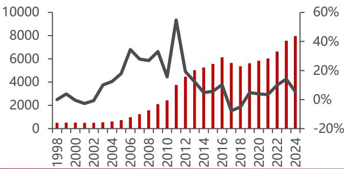

图表：24年规上白酒企业利润2509亿元，同比+8%  
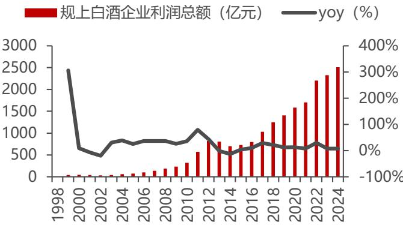

图表：24年规上酒企营收CR5占比保持稳定  
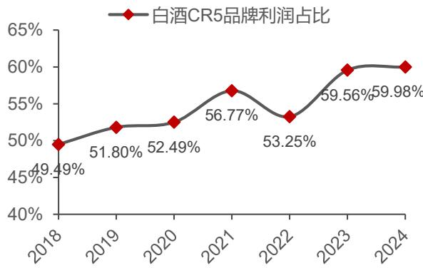

## 白酒：政务消费的直接占比低，但对商务、大众消费的引领性较强1.2

• 2012年禁止“三公消费”以来，白酒公务消费占比已由过去30-40%降至5%，本轮禁酒令间接影响大于直接影响。以茅台为例，2012年之前茅台公务直采占比15%，叠加经销商间接销售，茅台公务系统消费占比约30%。酒企在过去十年已逐渐将政务消费转向商务和大众消费，政务接待占比5%，本次禁酒令对白酒销售的直接影响有限，但由于政务消费对于商务和大众消费具有引领作用，次生影响（如企业招待用酒的团购量减少、以及公职人员个人消费、家宴、自饮意愿降低等）对行业仍有较大影响。

图表：白酒主要消费场景  
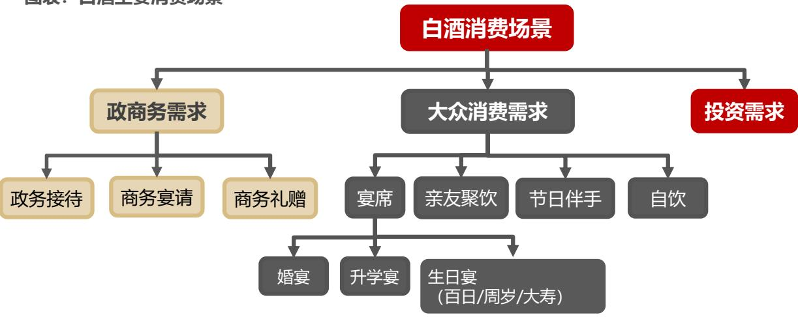

图表：各类消费场景占白酒饮用场景比例  
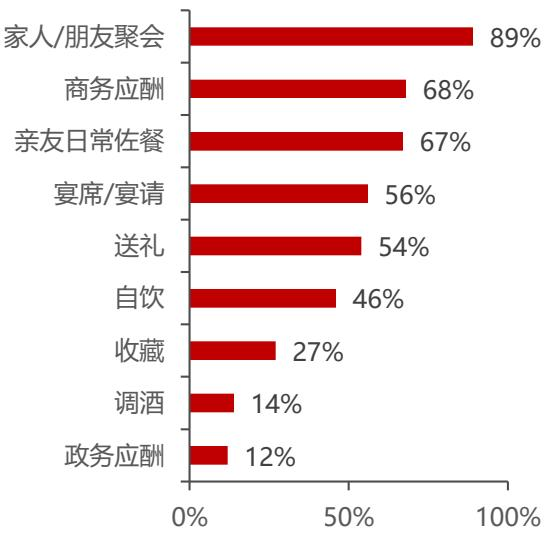

## 1.3 白酒：政策的长期影响仍需观察，当下中高档餐饮及白酒动销流速骤降，产业情绪受挫

图表：12年以来白酒相关禁令梳理

<table><tr><td>日期</td><td>政策/事件</td><td>核心内容</td><td>实施范围</td></tr><tr><td>2012/3/27</td><td>国务院第五次廉政工作会议 温家宝总理讲话</td><td>首次提出“禁止用公款购买香烟、高档酒和礼品”,为后续禁酒令奠定基调。</td><td>全国(中央层面)</td></tr><tr><td>2012/12/28</td><td>财政部发布《关于切实做好岁末年初有关财政工作的通知》</td><td>明确禁止用公款购买香烟、高档酒和礼品。</td><td>全国财政系统</td></tr><tr><td>2013/11/13</td><td>中央纪委印发《关于严禁元旦春节期间公款购买赠送烟花爆竹等年货节礼的通知》</td><td>明确提出严禁用公款购买赠送烟花爆竹、烟酒、花卉、食品等年货节礼。</td><td>全国(中央层面)</td></tr><tr><td>2013/12/8</td><td>中办、国办印发《党政机关国内公务接待管理规定》</td><td>明确”工作餐不得提供香烟和高档酒水”,并规定陪餐人数限制。</td><td>全国(中央层面)</td></tr><tr><td>2013/8/14</td><td>浙江省高院规定&quot;十个一律&quot;加强司法廉洁建设</td><td>浙江明确公务活动一律不准饮酒。</td><td>浙江省</td></tr><tr><td>2016/7/13</td><td>湖南省高院发布《关于禁酒的八条规定》</td><td>规定法院系统内部公务接待全面禁酒,工作日和工作时间禁止饮酒,禁止与案件相关人员饮酒等。</td><td>湖南省(法院系统)</td></tr><tr><td>2016/7/21</td><td>安徽出台升级版“禁酒令”</td><td>安徽明确省内公务活动禁止饮酒(外事和招商引资除外)。</td><td>安徽省</td></tr><tr><td>2017/1/5</td><td>财政部、组织部、国家公务员局印发《中央和国家机关培训费管理办法》</td><td>明确国家公务员培训住宿时不得提供烟酒。</td><td>全国(中央层面)</td></tr><tr><td>2017/8/22</td><td>贵州省发布《贵州省公务活动全面禁酒的规定》</td><td>贵州实行公务活动“四个一律”禁酒,外事用酒需分管领导审批并报纪委备案。</td><td>贵州省</td></tr><tr><td>2017/9/30</td><td>中央军委发布《关于严禁违规宴请喝酒问题的规定》</td><td>全军和武警部队严禁工作日、执行任务期间饮酒,并禁止”公款买酒”“外事用酒需审批”等。</td><td>军队系统</td></tr><tr><td>2017/12/29</td><td>最高检修订《禁酒令》</td><td>提出“六个严禁”,包括工作时间禁酒、禁止携带涉密文件饮酒等。</td><td>全国检察机关</td></tr><tr><td>2018/6/16</td><td>江苏省出台《关于公务接待和商务接待禁止饮酒相关事项的通知》</td><td>规定公务和商务接待一律禁止饮酒,禁止公款购买酒类饮品,被称为“史上最严禁酒令”。</td><td>江苏省</td></tr><tr><td>2021/12/1</td><td>公安部发布《关于严禁违规宴请饮酒的规定》</td><td>严禁工作日、值班备勤期间饮酒,并禁止任何时间酗酒。</td><td>全国公安系统</td></tr><tr><td>2025/3/17</td><td>中共中央办公厅印发《关于在全党开展深入贯彻中央八项规定精神学习教育的通知》</td><td>严禁用公款购买烟酒。</td><td>全国(中央层面)</td></tr><tr><td>2025/5/18</td><td>中共中央、国务院修订《党政机关厉行节约反对浪费条例》</td><td>全面升级禁酒要求:公务接待不得提供任何酒类及香烟,外事和重大招商引资活动需“一事一审批”;配套公函制度、费用总额控制等监督措施,并严禁公款购酒。</td><td>全国(中央层面)</td></tr></table>

## 白酒：降速释压已成共识，2025年增速目标有赖于三季度旺1.4季动销各酒企2025年目标或因势动态调整。

➢ 2025年各上市酒企目标制定理性，降速已成为行业共识。其中茅台(9%)、五粮液(GDP同速)、今世缘(5-12%)、迎驾(3.49%)、老白干(2%)制定了可量化的营收增长目标（或区间），老窖、汾酒、古井则明确稳中求进保增长。贵州茅台9%的营收目标，兼顾短期增长和长期发展的同时，仍有望在“十四五”收官年助力集团实现“十四五”目标，展现了行业龙头的韧性。

图表：上市酒企2025年目标规划理性克制

<table><tr><td>上市公司</td><td>上市酒企2025年经营目标规划</td></tr><tr><td>贵州茅台</td><td>2025年目标营业总收入同比增长9%左右,完成固定资产投资47.11亿元,目标营业成本同比增长11%左右,目标期间费用同比增长27%左右</td></tr><tr><td>五粮液</td><td>2025年目标营业总收入与宏观经济指标保持一致,巩固和增强稳健发展态势推动品牌价值和市场份额双提升</td></tr><tr><td>泸州老窖</td><td>2025年目标营业收入稳中求进,推动高质量发展</td></tr><tr><td>山西汾酒</td><td>2025年目标营业收入继续保持稳健增长态势</td></tr><tr><td>舍得酒业</td><td>2025年推动高质量发展,以老酒战略为基石,推动多品牌战略、年轻化战略和国际化战略齐头并进,强化核心竞争力</td></tr><tr><td>水井坊</td><td>2025年聚焦主业深化布局,产品上:推动第一坊上市,水井坊系列迭代产品按计划推出,渠道布局上:重点城市在原有基础上新增拓店同比双位数增长,标杆门店单店销售额同比双位数提升,部分城市团购业务在其总销售额中占比超双位数</td></tr><tr><td>酒鬼酒</td><td>2025年以完成年度任务为目标,实现销售质量的提升。</td></tr><tr><td>洋河股份</td><td>2025年将立足长远,聚焦主导产品和重点市场,夯实市场基础,推动健康可持续发展</td></tr><tr><td>今世缘</td><td>2025年目标营业总收入同比增长5~12%左右,净利润增幅略低于收入增幅,保持利润增长与经营质量的动态平衡</td></tr><tr><td>古井贡酒</td><td>2025年目标营业总收入同比稳健增长</td></tr><tr><td>迎驾贡酒</td><td>2025年目标营业收入76亿元(同比+3.49%),其中白酒业务72.56亿元(同比+3.61%),其他业务3.44亿元(同比+0.88%),目标净利润26.2亿元(同比+1%)</td></tr><tr><td>口子窖</td><td>2025年将聚焦“市场升级、结构升级、品牌升级”的阶段目标,推动更高质量发展</td></tr><tr><td>老白干酒</td><td>2025年计划实现营业收入54.7亿元(同比+2%),营业成本控制在18.26亿元以内,费用不超过16.58亿元,税金及附加力争实现8.75亿元,营业总成本控制在43.59亿元以内</td></tr></table>

## 白酒：降速释压已成共识，2025年增速目标有赖于三季度旺1.5季动销各酒企2025年目标或因势动态调整。

图表：上市酒企估值水平及盈利预测

<table><tr><td rowspan="2">股票名称</td><td rowspan="2">总市值 (亿元) 2025/6/12</td><td rowspan="2">PE 2025</td><td colspan="4">营收(亿元)</td><td colspan="4">营收YOY (%)</td><td colspan="4">归母净利润(亿元)</td><td colspan="4">归母净利润YOY (%)</td></tr><tr><td>2024A</td><td>2025E</td><td>2026E</td><td>2027E</td><td>2024A</td><td>2025E</td><td>2026E</td><td>2027E</td><td>2024A</td><td>2025E</td><td>2026E</td><td>2027E</td><td>2024A</td><td>2025E</td><td>2026E</td><td>2027E</td></tr><tr><td>贵州茅台</td><td>18,328</td><td>20</td><td>1709</td><td>1909</td><td>2070</td><td>2239</td><td>15.7%</td><td>9.6%</td><td>8.5%</td><td>8.1%</td><td>862</td><td>948</td><td>1030</td><td>1116</td><td>15.4%</td><td>9.9%</td><td>8.7%</td><td>8.4%</td></tr><tr><td>五粮液</td><td>4,755</td><td>15</td><td>892</td><td>936</td><td>995</td><td>1070</td><td>7.1%</td><td>5.0%</td><td>6.3%</td><td>7.5%</td><td>319</td><td>333</td><td>356</td><td>384</td><td>5.4%</td><td>4.7%</td><td>6.6%</td><td>8.2%</td></tr><tr><td>泸州老窖</td><td>1,666</td><td>12</td><td>312</td><td>319</td><td>336</td><td>358</td><td>3.2%</td><td>2.2%</td><td>5.3%</td><td>6.5%</td><td>135</td><td>138</td><td>145</td><td>156</td><td>1.7%</td><td>2.1%</td><td>5.7%</td><td>7.5%</td></tr><tr><td>山西汾酒</td><td>2,121</td><td>16</td><td>360</td><td>397</td><td>436</td><td>478</td><td>12.8%</td><td>10.2%</td><td>9.8%</td><td>9.8%</td><td>122</td><td>135</td><td>149</td><td>165</td><td>17.3%</td><td>10.0%</td><td>10.5%</td><td>10.8%</td></tr><tr><td>舍得酒业</td><td>172</td><td>26</td><td>54</td><td>55</td><td>59</td><td>65</td><td>-24.4%</td><td>2.1%</td><td>7.8%</td><td>10.1%</td><td>3</td><td>6.7</td><td>8.1</td><td>9.5</td><td>-80.5%</td><td>94.5%</td><td>20.7%</td><td>17.3%</td></tr><tr><td>水井坊</td><td>209</td><td>15</td><td>52</td><td>55</td><td>58</td><td>62</td><td>5.3%</td><td>4.6%</td><td>6.5%</td><td>7.1%</td><td>13</td><td>14</td><td>15</td><td>17</td><td>5.7%</td><td>5.4%</td><td>7.7%</td><td>8.9%</td></tr><tr><td>酒鬼酒</td><td>135</td><td>115</td><td>14</td><td>14</td><td>15</td><td>15</td><td>-49.7%</td><td>-2.4%</td><td>7.1%</td><td>2.8%</td><td>0</td><td>1.2</td><td>1.5</td><td>2.0</td><td>-97.7%</td><td>849.8%</td><td>29.9%</td><td>27.7%</td></tr><tr><td>洋河股份</td><td>991</td><td>17</td><td>289</td><td>253</td><td>267</td><td>288</td><td>-12.8%</td><td>-12.4%</td><td>5.5%</td><td>8.1%</td><td>67</td><td>59</td><td>62</td><td>68</td><td>-33.4%</td><td>-12.1%</td><td>6.5%</td><td>8.4%</td></tr><tr><td>今世缘</td><td>511</td><td>14</td><td>115</td><td>128</td><td>141</td><td>155</td><td>14.3%</td><td>10.8%</td><td>10.3%</td><td>9.8%</td><td>34</td><td>37</td><td>41</td><td>44</td><td>8.8%</td><td>9.3%</td><td>8.7%</td><td>9.5%</td></tr><tr><td>古井贡酒</td><td>692</td><td>13</td><td>236</td><td>260</td><td>287</td><td>318</td><td>16.4%</td><td>10.3%</td><td>10.5%</td><td>10.8%</td><td>55</td><td>62</td><td>69</td><td>78</td><td>20.2%</td><td>11.7%</td><td>11.8%</td><td>12.6%</td></tr><tr><td>迎驾贡酒</td><td>316</td><td>12</td><td>73</td><td>74</td><td>77</td><td>83</td><td>9.3%</td><td>0.3%</td><td>4.6%</td><td>7.5%</td><td>26</td><td>26</td><td>28</td><td>30</td><td>13.2%</td><td>1.7%</td><td>5.9%</td><td>8.8%</td></tr><tr><td>口子窖</td><td>212</td><td>13</td><td>60</td><td>61</td><td>63</td><td>66</td><td>0.9%</td><td>1.3%</td><td>3.1%</td><td>4.7%</td><td>17</td><td>17</td><td>17</td><td>18</td><td>-3.8%</td><td>1.7%</td><td>3.6%</td><td>5.3%</td></tr><tr><td>金徽酒</td><td>95</td><td>24</td><td>30</td><td>33</td><td>36</td><td>40</td><td>18.6%</td><td>8.8%</td><td>9.5%</td><td>10.5%</td><td>4</td><td>4.1</td><td>4.4</td><td>4.8</td><td>18.0%</td><td>5.3%</td><td>8.1%</td><td>9.0%</td></tr><tr><td>老白干酒</td><td>154</td><td>18</td><td>54</td><td>56</td><td>59</td><td>62</td><td>1.9%</td><td>4.6%</td><td>4.9%</td><td>5.1%</td><td>8</td><td>9</td><td>10</td><td>11</td><td>18.2%</td><td>12.5%</td><td>9.6%</td><td>9.1%</td></tr><tr><td>伊力特</td><td>70</td><td>23</td><td>22</td><td>23</td><td>25</td><td>27</td><td>-1.3%</td><td>4.8%</td><td>7.4%</td><td>7.8%</td><td>3</td><td>3.0</td><td>3.3</td><td>3.5</td><td>-15.9%</td><td>6.1%</td><td>7.2%</td><td>8.3%</td></tr></table>

## 白酒：以大众消费、商务消费为主驱动的白酒新生态正在孕育1.6

• 白酒的社交属性没有变，挑战是年轻一代的社交承载的变化。随着“60/70”退休潮来临，白酒“强社交”标签逐渐减弱，取而代之的可能是90后年轻一代社交图谱中的微醺社交（清吧/居家小聚）、情绪消费（独酌解压）、文化体验（酒旅融合）等。

图表：白酒消费者各年龄段占比  
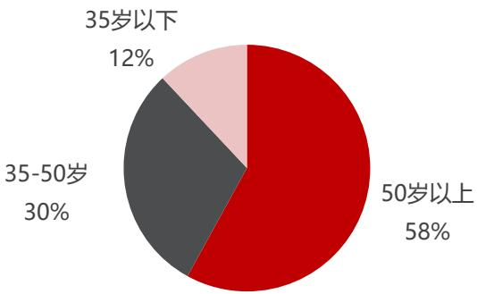

图表：白酒场景拓新尝试

<table><tr><td>酒企名称</td><td>时间</td><td>联名/合作品牌</td><td>跨界产品</td></tr><tr><td rowspan="5">贵州茅台</td><td>2022.05</td><td>蒙牛</td><td>冰淇淋</td></tr><tr><td>2023.09</td><td>德芙</td><td>巧克力</td></tr><tr><td>2023.09</td><td>瑞幸咖啡</td><td>酱香拿铁</td></tr><tr><td>2023.09</td><td>广州酒家</td><td>飞天茅台系列积木月饼</td></tr><tr><td>2023.11</td><td>莫其托</td><td>鸡尾酒</td></tr><tr><td rowspan="3">五粮液</td><td>2017.06</td><td>施华洛世奇</td><td>“缘定晶生”酒</td></tr><tr><td>2022.01</td><td>极氪汽车</td><td>定制酒</td></tr><tr><td>2023.05</td><td>永璞咖啡</td><td>酒咖</td></tr><tr><td rowspan="7">泸州老窖</td><td>2016.09</td><td>气味图书馆</td><td>“顽味”香水</td></tr><tr><td>2019.09</td><td>钟薛高</td><td>断片雪糕</td></tr><tr><td>2019.12</td><td>听月小筑</td><td>汉服文创果酒</td></tr><tr><td>2020.07</td><td>茶百道</td><td>“醉步上道”奶茶</td></tr><tr><td>2020.12</td><td>老中医化妆品</td><td>“酒糟醒肤修护面膜”</td></tr><tr><td>2023.08</td><td>奈雪的茶</td><td>开醺礼盒</td></tr><tr><td>2023.09</td><td>光明冷饮</td><td>酒香月饼冰淇淋</td></tr><tr><td>洋河股份</td><td>2022.08</td><td>文创产品</td><td>盲盒雪糕</td></tr><tr><td>山西汾酒</td><td>2020.11</td><td>爱顿博格</td><td>白酒酒心巧克力</td></tr><tr><td>水井坊</td><td>2023.09</td><td>哈根达斯</td><td>浓香冰淇淋</td></tr><tr><td>古井贡酒</td><td>2023.09</td><td>八喜</td><td>冰淇淋</td></tr></table>

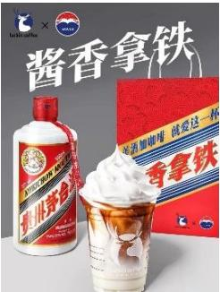  
贵州茅台&瑞幸咖啡酱香拿铁

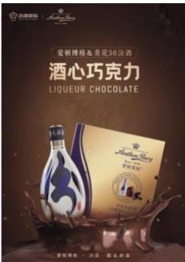  
泸州老窖&钟薛高 断片雪糕  
汾酒&爱顿博格酒心巧克力

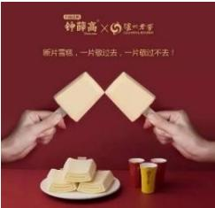

古井贡酒×八喜冰淇淋

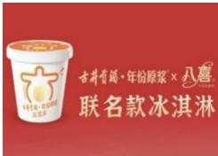

## 白酒：即时零售渠道将加速酒饮渠道现代化，是机遇也是挑战1.7

➢ 白酒品牌陆续布局即时零售，从“直播下单+门店配送”到“半小时达”网络，与电商平台联手，通过即时零售突破传统渠道瓶颈，抢占部分年轻消费市场。《2023酒类即时零售白皮书》显示，酒类渠道线上渗透率达35%，白酒市场即时零售的市场规模从2020年到2022年同比增长554%，预计2025年市场规模将突破1000亿元。美团闪购数据显示，今年618首日白酒成交额同比暴增70倍，1499元飞天茅台半日预约超23万人，带动茅台、五粮液等名酒线上成交额破千万元。

图表：我国即时零售规模持续扩大  
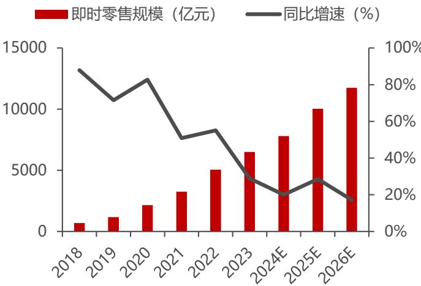

图表：白酒品牌布局即时零售渠道

<table><tr><td>上市公司</td><td>酒企与电商平台联手</td></tr><tr><td>贵州茅台</td><td>计划通过自营店和合作终端构建“30分钟极速达”网络。4月中茅台酱香酒公司官宣面向社会招募5000—7000家主题终端店运营商,计划在美团、饿了么、抖音三大平台构建即时零售网络。</td></tr><tr><td>泸州老窖</td><td>“小时达”新店正式上线运营,该新店基于形象店渠道,依托抖音平台采用“直播+即时零售”模式,旨在打通线上线下营销闭环,实现“观看即下单、下单即配送”的即时零售模式。</td></tr><tr><td>习酒</td><td>今年3月,基于供给优化、用户体验、市场营销等多个层面的需求,与歪马送酒达成了战略合作,共同助力习酒成为歪马送酒平台内首个破亿白酒品牌。</td></tr><tr><td>洋河</td><td>与美团闪购达成战略合作。建立起战略合作之后,双方将从数字化、营销、用户体验等多个方面深入合作,共同提升白酒品类在平台内的销售增长,打造行业标杆。去年洋河在美团闪购交易额年同比增长超100%。</td></tr></table>

## 1.8 从投资角度，年初至今板块股价走势较弱，禁酒令后加速下探

• 2025年适逢本轮白酒行业深度调整期的第四年，宏观周期调整、供需失衡、场景缺失等因素在白酒板块股价走势上兑现较充分，截至25/6/12，中证白酒指数今年下挫-12.1%，跑输同期沪深300（-1.1%），板块内个股均有不同程度下跌，其中茅台YTD-4.3%展现了“压舱石”的韧性。

• 相较“924”政策刺激前的底部，白酒指数仍有6.7%安全边际，但已有5支个股击穿924前低，其中迎驾或受一季报拖累，股价较去年924下跌25.6%。

• 5月18日央办、国办颁布新一轮禁酒令以来，白酒板块累计下跌9.2%，汾酒因大单品在政商务场景高占比领跌，519以来累计下跌15.2%。

图表5：2025年以来白酒指数跑输沪深300  
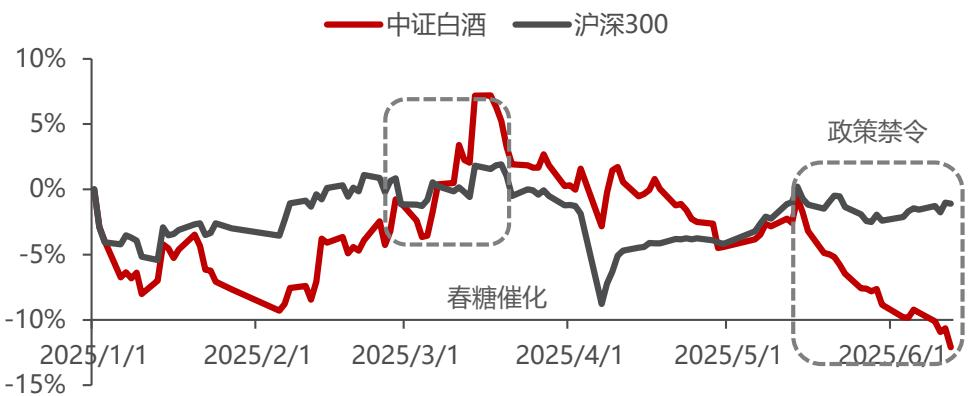

图表5：白酒上市公司区间涨跌幅

<table><tr><td></td><td>年初至今涨跌幅</td><td>924政策刺激以来</td><td>519禁酒令以来</td></tr><tr><td>000300.SH 沪深300</td><td>-1.1%</td><td>21.1%</td><td>0.1%</td></tr><tr><td>603919.SH 金徽酒</td><td>-2.1%</td><td>16.6%</td><td>0.3%</td></tr><tr><td>600519.SH 贵州茅台</td><td>-4.3%</td><td>17.5%</td><td>-9.6%</td></tr><tr><td>600809.SH 山西汾酒</td><td>-4.3%</td><td>14.1%</td><td>-15.2%</td></tr><tr><td>603369.SH 今世缘</td><td>-6.9%</td><td>10.0%</td><td>-10.7%</td></tr><tr><td>000568.SZ 泸州老窖</td><td>-8.5%</td><td>11.9%</td><td>-10.4%</td></tr><tr><td>603589.SH 口子窖</td><td>-10.0%</td><td>-4.0%</td><td>-2.0%</td></tr><tr><td>000858.SZ 五粮液</td><td>-10.8%</td><td>11.3%</td><td>-6.5%</td></tr><tr><td>399997.SZ 中证白酒</td><td>-12.1%</td><td>6.7%</td><td>-9.2%</td></tr><tr><td>002646.SZ 天佑德酒</td><td>-12.2%</td><td>10.9%</td><td>3.9%</td></tr><tr><td>600197.SH 伊力特</td><td>-14.5%</td><td>3.5%</td><td>0.0%</td></tr><tr><td>000596.SZ 古井贡酒</td><td>-18.2%</td><td>-2.6%</td><td>-12.4%</td></tr><tr><td>002304.SZ 洋河股份</td><td>-18.9%</td><td>-8.5%</td><td>-3.7%</td></tr><tr><td>000860.SZ 顺鑫农业</td><td>-19.3%</td><td>7.5%</td><td>-0.9%</td></tr><tr><td>600779.SH 水井坊</td><td>-19.8%</td><td>25.6%</td><td>-6.3%</td></tr><tr><td>600559.SH 老白干酒</td><td>-19.8%</td><td>-2.4%</td><td>-3.8%</td></tr><tr><td>600702.SH 舍得酒业</td><td>-21.2%</td><td>21.9%</td><td>-6.7%</td></tr><tr><td>000799.SZ 酒鬼酒</td><td>-25.0%</td><td>10.2%</td><td>-4.4%</td></tr><tr><td>600199.SH 金种子酒</td><td>-25.0%</td><td>-6.7%</td><td>-0.7%</td></tr><tr><td>603198.SH 迎驾贡酒</td><td>-26.8%</td><td>-25.6%</td><td>-11.0%</td></tr></table>

## 白酒：25Q1机构持仓下降，乳品饮料及休闲食品持仓提升1.9

• 截至25Q1，食品饮料板块在主动权益基金中的重仓占比环比延续下滑趋势，在申万一级行业中位居四位。2025Q1食品饮料板块（申万一级）在主动权益基金重仓股中的占比为7.39%，环比下滑了-0.12pcts。在所有申万一级行业中位居第五，次于电子（17.94%）、医药生物（9.97%）、电力设备（8.91%）、汽车（7.72%）。

图表：申万一级各板块在25Q1/24Q4基金4重仓股中的占比  
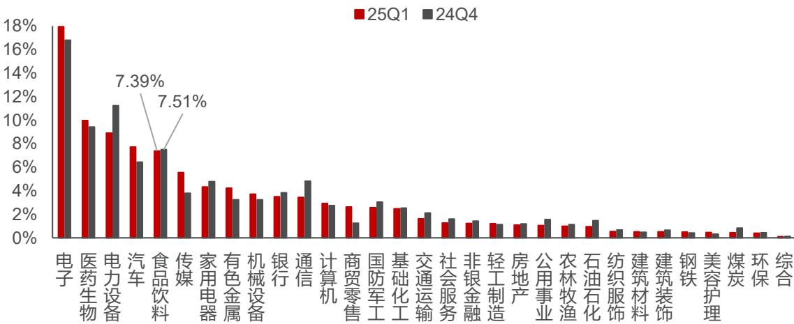

图表：25Q1&24Q4食饮申万二级各子板块基金持仓  
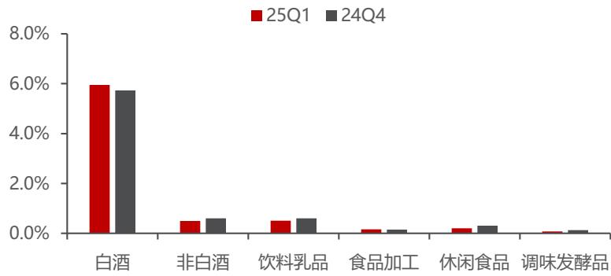

图表：25Q1&24Q4食饮申万三级板块（除白酒）基金持仓  
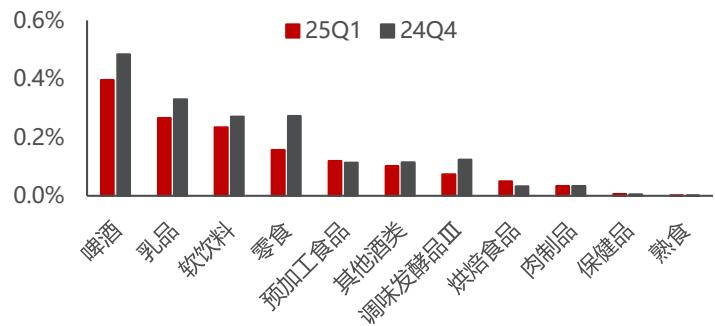

## 1.10 白酒：25Q1机构持仓下降，乳品饮料及休闲食品持仓提升

2025Q1食品饮料板块（申万一级）在基金重仓股的持股市值占比为7.39%，环比-0.12pcts，较前期高点（19Q2）17.82%已减半有余。25Q1白酒（申万Ⅱ）占比5.95%，环比+0.22pcts。

图表：25Q1白酒的食饮重仓占比80.54%，环比+0.22pcts  
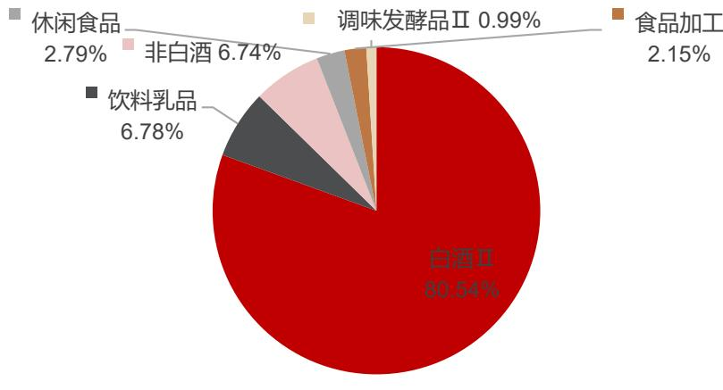

图表：2015年以来食品饮料板块在逐季基金重仓股中的持股占比  
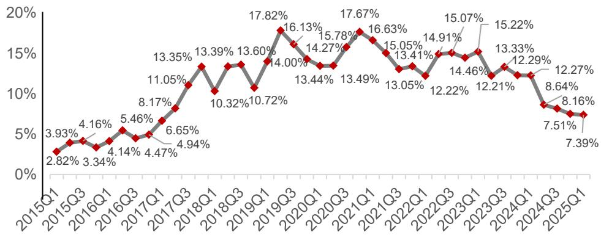

图表：2015年以来白酒板块（申万Ⅱ）在逐季基金重仓股中的持股占比  
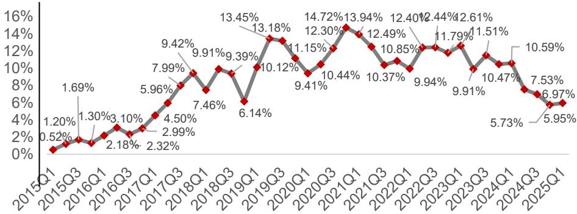

## 1.11 白酒：25Q1机构持仓下降，乳品饮料及休闲食品持仓提升

➢ 食品饮料板块内个股持股市值在主动权益基金重仓股占比靠前的十大个股中，白酒占7席，较24Q4增加一席。前十大中白酒由高到低依次为：贵州茅台、五粮液、山西汾酒、泸州老窖、古井贡酒、今世缘和洋河股份，而迎驾贡酒跌落前十大。前十大中其他三席为：东鹏饮料、乳品板块伊利股份和啤酒板块港股青岛啤酒股份，其中今世缘为新晋前十大。

➢ 25Q1食品饮料板块前十大重仓个股合计在基金重仓股总市值中合计占比6.43%，食品饮料板块整体占比7.39%，CR10=87.58%，前十大集中度较24Q4增加了1.95pcts。

图表：25Q1食品饮料板块内个股持股市值在主动权益基金重仓股占比靠前的十大个股

<table><tr><td rowspan="2">代码</td><td rowspan="2">简称</td><td colspan="2">持有基金数</td><td colspan="2">持股数量(万股)</td><td colspan="2">持股占流通股比(%)</td><td colspan="2">持股市值在基金重仓股总市值中占比(%)</td><td rowspan="2">25Q1区间涨跌幅(%)</td></tr><tr><td>25Q1</td><td>环比变化(pcts)</td><td>25Q1</td><td>环比变化(pcts)</td><td>25Q1</td><td>环比变化(pcts)</td><td>25Q1</td><td>环比变化(pcts)</td></tr><tr><td>600519.SH</td><td>贵州茅台</td><td>628</td><td>-4</td><td>2405</td><td>7</td><td>1.9</td><td>0.01</td><td>2.25</td><td>0.031</td><td>2%</td></tr><tr><td>000858.SZ</td><td>五粮液</td><td>308</td><td>-44</td><td>15273</td><td>-689</td><td>3.9</td><td>-0.18</td><td>1.20</td><td>-0.155</td><td>-4%</td></tr><tr><td>600809.SH</td><td>山西汾酒</td><td>168</td><td>47</td><td>7430</td><td>1326</td><td>6.1</td><td>1.09</td><td>0.96</td><td>0.272</td><td>18%</td></tr><tr><td>000568.SZ</td><td>泸州老窖</td><td>173</td><td>62</td><td>10532</td><td>1532</td><td>7.2</td><td>1.03</td><td>0.82</td><td>0.135</td><td>5%</td></tr><tr><td>000596.SZ</td><td>古井贡酒</td><td>72</td><td>2</td><td>3922</td><td>-329</td><td>9.6</td><td>-0.81</td><td>0.40</td><td>-0.047</td><td>-1%</td></tr><tr><td>605499.SH</td><td>东鹏饮料</td><td>107</td><td>12</td><td>1368</td><td>-67</td><td>2.6</td><td>-0.13</td><td>0.20</td><td>-0.012</td><td>0%</td></tr><tr><td>600600.SH</td><td>青岛啤酒</td><td>60</td><td>-25</td><td>3984</td><td>-525</td><td>5.6</td><td>-0.74</td><td>0.18</td><td>-0.039</td><td>-6%</td></tr><tr><td>600887.SH</td><td>伊利股份</td><td>116</td><td>-67</td><td>10312</td><td>-3189</td><td>1.6</td><td>-0.50</td><td>0.17</td><td>-0.074</td><td>-7%</td></tr><tr><td>603369.SH</td><td>今世缘</td><td>75</td><td>32</td><td>4559</td><td>2911</td><td>3.7</td><td>2.34</td><td>0.14</td><td>0.099</td><td>17%</td></tr><tr><td>002304.SZ</td><td>洋河股份</td><td>13</td><td>-3</td><td>2915</td><td>-1197</td><td>1.9</td><td>-0.80</td><td>0.13</td><td>-0.075</td><td>-6%</td></tr></table>

## 白酒：渠道压力向表端传导，25年开门红剔除茅台营收利润双下滑1.12

• 增速降档，渠道压力向报表传导。24年上市酒企营收/归母净利润分别4417.7亿元/1668.2亿元，同比+7.6%/+7.6%。25Q1实现营收/归母净利润1533.6/634.1亿元，同比+1.7%/+2.3%。考虑25年春节早于往年，将24Q4与25Q1合并看开门红情况，行业营收/归母净利润分别同比+1.6%/+0.3%。需求收缩后酒企业绩分化，其中茅台、五粮液、汾酒、古井、金徽酒在开门红中取得收入利润的双增张。

• 剔除茅台后25年开门红行业营收、利润双下滑。24年酒企全年营收/归母净利润分别2676.3亿元/805.92亿元，同比+3.0%/0.3%。25Q1实现营收/归母净利润1019.2/365.6亿元，同比-2.2%/-3.6%。24Q4+25Q1合并，营收/归母净利润分别同比-4.2%/-11.6%。

图表：2024&2025Q1白酒上市公司营收&归母净利率增速

<table><tr><td rowspan="2">上市公司</td><td colspan="4">24A</td><td colspan="4">25Q1</td><td colspan="4">24Q4+25Q1</td></tr><tr><td>营收(亿元)</td><td>营收yoy(%)</td><td>归母净利润(亿元)</td><td>归母净利润yoy(%)</td><td>营收(亿元)</td><td>营收yoy(%)</td><td>归母净利润(亿元)</td><td>归母净利润yoy(%)</td><td>营收(亿元)</td><td>营收yoy(%)</td><td>归母净利润(亿元)</td><td>归母净利润yoy(%)</td></tr><tr><td>贵州茅台</td><td>1,741.4</td><td>15.7%</td><td>862.3</td><td>15.4%</td><td>514.4</td><td>10.7%</td><td>268.5</td><td>11.6%</td><td>1,024.6</td><td>11.7%</td><td>522.5</td><td>13.8%</td></tr><tr><td>五粮液</td><td>891.8</td><td>7.1%</td><td>318.5</td><td>5.4%</td><td>369.4</td><td>6.1%</td><td>148.6</td><td>5.8%</td><td>582.0</td><td>4.7%</td><td>217.8</td><td>1.7%</td></tr><tr><td>泸州老窖</td><td>312.0</td><td>3.2%</td><td>134.7</td><td>1.7%</td><td>93.5</td><td>1.8%</td><td>45.9</td><td>0.4%</td><td>162.4</td><td>-7.1%</td><td>64.7</td><td>-10.8%</td></tr><tr><td>山西汾酒</td><td>360.1</td><td>12.8%</td><td>122.4</td><td>17.3%</td><td>165.2</td><td>7.7%</td><td>66.5</td><td>6.2%</td><td>211.8</td><td>3.2%</td><td>75.4</td><td>3.7%</td></tr><tr><td>舍得酒业</td><td>53.6</td><td>-24.4%</td><td>3.5</td><td>-80.5%</td><td>15.8</td><td>-25.1%</td><td>3.5</td><td>-37.1%</td><td>24.7</td><td>-37.2%</td><td>0.2</td><td>-97.8%</td></tr><tr><td>水井坊</td><td>52.2</td><td>5.3%</td><td>13.4</td><td>5.7%</td><td>9.6</td><td>2.7%</td><td>1.9</td><td>2.1%</td><td>23.9</td><td>3.9%</td><td>4.1</td><td>-6.1%</td></tr><tr><td>酒鬼酒</td><td>14.2</td><td>-49.7%</td><td>0.1</td><td>-97.7%</td><td>3.4</td><td>-30.3%</td><td>0.3</td><td>-56.8%</td><td>5.8</td><td>-51.2%</td><td>-0.1</td><td>-108.6%</td></tr><tr><td>洋河股份</td><td>288.8</td><td>-12.8%</td><td>66.7</td><td>-33.4%</td><td>110.7</td><td>-31.9%</td><td>36.4</td><td>-39.9%</td><td>124.3</td><td>-34.9%</td><td>17.3</td><td>-70.5%</td></tr><tr><td>今世缘</td><td>115.5</td><td>14.3%</td><td>34.1</td><td>8.8%</td><td>51.0</td><td>9.2%</td><td>16.4</td><td>7.3%</td><td>67.0</td><td>4.6%</td><td>19.7</td><td>-3.1%</td></tr><tr><td>古井贡酒</td><td>235.8</td><td>16.4%</td><td>55.2</td><td>20.2%</td><td>91.5</td><td>10.4%</td><td>23.3</td><td>12.8%</td><td>136.6</td><td>8.5%</td><td>31.0</td><td>9.1%</td></tr><tr><td>迎驾贡酒</td><td>73.4</td><td>8.5%</td><td>25.9</td><td>13.4%</td><td>20.5</td><td>-12.3%</td><td>8.3</td><td>-9.5%</td><td>38.8</td><td>-8.6%</td><td>14.1</td><td>-8.7%</td></tr><tr><td>口子窖</td><td>60.1</td><td>0.9%</td><td>16.6</td><td>-3.8%</td><td>18.1</td><td>2.4%</td><td>6.1</td><td>3.6%</td><td>34.6</td><td>5.5%</td><td>9.6</td><td>-0.7%</td></tr><tr><td>老白干酒</td><td>53.6</td><td>1.9%</td><td>7.9</td><td>18.2%</td><td>11.7</td><td>3.4%</td><td>1.5</td><td>11.9%</td><td>24.4</td><td>-4.1%</td><td>3.8</td><td>-0.2%</td></tr><tr><td>伊力特</td><td>22.0</td><td>-1.3%</td><td>2.9</td><td>-15.9%</td><td>8.0</td><td>-4.3%</td><td>1.4</td><td>-9.3%</td><td>13.4</td><td>-5.3%</td><td>1.9</td><td>-30.0%</td></tr><tr><td>金徽酒</td><td>30.2</td><td>18.6%</td><td>3.9</td><td>18.0%</td><td>11.1</td><td>3.0%</td><td>2.3</td><td>5.8%</td><td>18.0</td><td>12.3%</td><td>2.9</td><td>4.2%</td></tr><tr><td>顺鑫农业</td><td>91.3</td><td>-13.8%</td><td>2.3</td><td>178.2%</td><td>32.6</td><td>-19.7%</td><td>2.8</td><td>-37.3%</td><td>50.7</td><td>-13.3%</td><td>1.3</td><td>-70.6%</td></tr><tr><td>天佑德酒</td><td>12.5</td><td>3.7%</td><td>0.4</td><td>-53.0%</td><td>4.3</td><td>-18.0%</td><td>0.7</td><td>-37.7%</td><td>7.0</td><td>-12.0%</td><td>0.5</td><td>-43.2%</td></tr><tr><td>金种子酒</td><td>9.3</td><td>-37.0%</td><td>-2.6</td><td>-1067.2%</td><td>3.0</td><td>-29.4%</td><td>-0.4</td><td>-320.6%</td><td>4.2</td><td>-49.1%</td><td>-2.0</td><td>-747.3%</td></tr><tr><td>白酒板块</td><td>4,417.7</td><td>7.6%</td><td>1,668.2</td><td>7.6%</td><td>1,533.6</td><td>1.7%</td><td>634.1</td><td>2.3%</td><td>2,554.2</td><td>1.6%</td><td>984.8</td><td>0.3%</td></tr><tr><td>剔除茅台</td><td>2,676.3</td><td>3.0%</td><td>805.92</td><td>0.3%</td><td>1,019.2</td><td>-2.2%</td><td>365.6</td><td>-3.6%</td><td>1,529.5</td><td>-4.2%</td><td>462.3</td><td>-11.6%</td></tr></table>

## 1.13 白酒：渠道压力向表端传导，25年开门红剔除茅台营收利润双下滑

• 营收端：白酒板块报表端自24Q3起降速释压，从双位数增长切换至小个位数，但仍维持正增长。其中高端酒平滑周期能力较强，降幅最小，降速后仍保持高个位数增长；次高端、地产龙头营收均于24Q3起下滑，其他区域酒企在本轮调整期内受淡旺季分化加剧影响，季度营收波动剧烈。

• 利润端：行业整体利润增速随收入同步放缓，24Q4行业净利润自2020以来首次负增长，或系下行期酒企以政策保份额，费投力度加大并于年末集中确认所致。高端酒凭借品牌、渠道优势利润仍维持增长，其他价位带净利润均大幅下滑。

图表：21Q1-25Q1白酒整体单季度营收&利润增速趋势放缓  
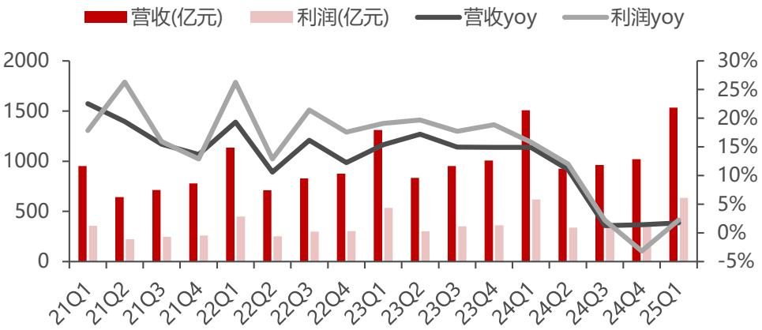

图表：23Q1-25Q1白酒各价格带单季度营收&利润增速逐季放缓单季度营收增速  
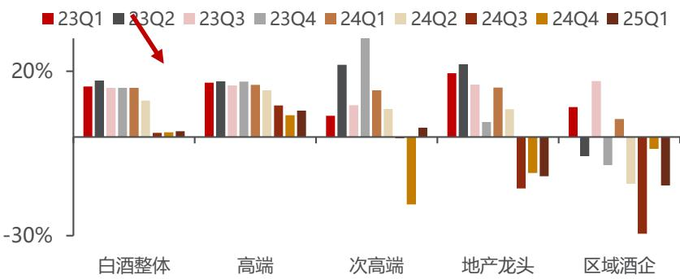

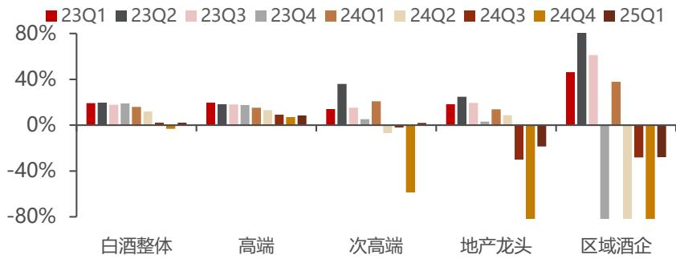

## 白酒：结构升级趋势放缓，费投加大盈利中枢下移1.14

• 毛利率：行业下行期但行业毛利水平仍有增长。2024/25Q1白酒板块毛利率分别为81.8%/81.5%，同比+0.7/+0.3pct；剔除茅台后板块毛利率在24A/25Q1仍分别有+0.5/0.1pcts增长，主要系低毛利区域酒企营收下滑较大，行业向头部酒企集中，变相支撑行业结构上移。25Q1 高 端 / 次 高 端 / 地 产 龙 头 / 区 域 酒 企 毛 利 率 分 别 为86.0%/78.0%/76.3%/46.1%,同比-0.7/+1.0/+0.0/ +0.3pcts。

• 净利率：剔除茅台后板块盈利中枢下移，地产酒因竞争加剧费投加大 拖累净利率。2024/25Q1白酒板块净利率分别为37.8%/41.3%，同 比持平/+0.2pct；剔除茅台后，板块净利率分别-0.8/-0.5pcts。 25Q1高端/次高端/地产龙头/区域酒企归母净利率分别为 47.4%/37.2%/30.3%/11.7%,同比+0.2/-0.3/-2.5/-2.1pcts。

## • 盈利中枢下移归因：

①产品结构升级放缓或有所下移：商务场景收缩，消费降档，拖累毛利率；

②市场费用投入加码，货折增加，拉低吨价：为促进渠道备货和消费开瓶，宴席买赠、数字化BC联动扫码红包等费用加大，货折费用增加，吨价下降；

③税收的征缴节奏也造成了一定波动。

图表：24全年及25Q1酒企毛利率&归母净利率

<table><tr><td rowspan="2">上市公司</td><td colspan="4">2024A</td><td colspan="4">2025Q1</td></tr><tr><td>毛利率</td><td>同比(pcts)</td><td>归母净利率</td><td>同比(pcts)</td><td>毛利率</td><td>同比(pcts)</td><td>归母净利率</td><td>同比(pcts)</td></tr><tr><td>贵州茅台</td><td>91.9%</td><td>0.0</td><td>49.5%</td><td>-0.1</td><td>92.0%</td><td>-0.6</td><td>52.2%</td><td>0.4</td></tr><tr><td>五粮液</td><td>77.1%</td><td>1.3</td><td>35.7%</td><td>-0.6</td><td>77.7%</td><td>-0.7</td><td>40.2%</td><td>-0.1</td></tr><tr><td>泸州老窖</td><td>87.5%</td><td>-0.8</td><td>43.2%</td><td>-0.6</td><td>86.5%</td><td>-1.9</td><td>49.1%</td><td>-0.7</td></tr><tr><td>山西汾酒</td><td>76.2%</td><td>0.9</td><td>34.0%</td><td>1.3</td><td>78.8%</td><td>1.3</td><td>40.2%</td><td>-0.6</td></tr><tr><td>舍得酒业</td><td>65.5%</td><td>-9.0</td><td>6.5%</td><td>-18.6</td><td>69.4%</td><td>-4.8</td><td>22.0%</td><td>-4.2</td></tr><tr><td>水井坊</td><td>82.8%</td><td>-0.4</td><td>25.7%</td><td>0.1</td><td>82.0%</td><td>1.5</td><td>19.8%</td><td>-0.1</td></tr><tr><td>酒鬼酒</td><td>71.4%</td><td>-7.0</td><td>0.9%</td><td>-18.5</td><td>70.7%</td><td>-0.4</td><td>9.2%</td><td>-5.6</td></tr><tr><td>洋河股份</td><td>73.2%</td><td>-2.1</td><td>23.1%</td><td>-7.1</td><td>75.6%</td><td>-0.4</td><td>32.9%</td><td>-4.4</td></tr><tr><td>今世缘</td><td>74.7%</td><td>-3.6</td><td>29.6%</td><td>-1.5</td><td>73.6%</td><td>-0.6</td><td>32.2%</td><td>-0.6</td></tr><tr><td>古井贡酒</td><td>79.9%</td><td>0.8</td><td>23.4%</td><td>0.7</td><td>79.7%</td><td>-0.7</td><td>25.5%</td><td>0.5</td></tr><tr><td>迎驾贡酒</td><td>73.9%</td><td>2.6</td><td>35.3%</td><td>1.2</td><td>76.5%</td><td>1.4</td><td>40.5%</td><td>1.2</td></tr><tr><td>口子窖</td><td>74.6%</td><td>-0.6</td><td>27.5%</td><td>-1.4</td><td>76.2%</td><td>-0.3</td><td>33.7%</td><td>0.4</td></tr><tr><td>老白干酒</td><td>65.9%</td><td>-1.2</td><td>14.7%</td><td>2.0</td><td>68.6%</td><td>5.9</td><td>13.1%</td><td>1.0</td></tr><tr><td>伊力特</td><td>52.3%</td><td>4.1</td><td>13.0%</td><td>-2.3</td><td>48.8%</td><td>-3.1</td><td>18.1%</td><td>-1.0</td></tr><tr><td>金徽酒</td><td>60.9%</td><td>-1.5</td><td>12.8%</td><td>-0.1</td><td>66.8%</td><td>1.4</td><td>21.1%</td><td>0.5</td></tr><tr><td>顺鑫农业</td><td>36.0%</td><td>4.2</td><td>2.5%</td><td>5.3</td><td>36.8%</td><td>-0.3</td><td>8.7%</td><td>-2.4</td></tr><tr><td>天佑德酒</td><td>59.8%</td><td>-3.2</td><td>3.4%</td><td>-4.0</td><td>60.5%</td><td>-2.5</td><td>15.6%</td><td>-5.0</td></tr><tr><td>金种子酒</td><td>34.9%</td><td>-5.4</td><td>-27.8%</td><td>-26.3</td><td>41.7%</td><td>-2.8</td><td>-13.1%</td><td>-17.4</td></tr><tr><td>白酒板块</td><td>81.8%</td><td>0.7</td><td>37.8%</td><td>0.0</td><td>81.5%</td><td>0.3</td><td>41.3%</td><td>0.2</td></tr><tr><td>剔除茅台</td><td>75.4%</td><td>0.5</td><td>30.1%</td><td>-0.8</td><td>76.4%</td><td>0.1</td><td>35.9%</td><td>-0.5</td></tr></table>

## 白酒：促销费投加大，管理费效提升，税收征缴节奏扰动营业税金率1.15

• 行业竞争加剧，酒企加大费投以求提高流速、增加开瓶，为渠道纾压减负。2024/25Q1白酒板块销售费用率分别为10.4%/8.3%， 同比+0.3/+0.3pct；25Q1高端/次高端/地产龙头/区域酒企销售费用率分别-0.18/+0.77/+2.79/+2.72pcts。

• 组织效率提升，管理费效优化。2024/25Q1白酒板块管理费用率分别为5.2%/3.4%，同比-0.3/-0.3pct；25Q1高端/次高端/地产龙头/区域酒企管理费用率分别-0.48/-0.41/+0.48/-0.05pcts。

• 消费税征收标准逐渐规范化，24年部分上市酒企税金及附加/营收占比同比波动，其中老窖+1.6pcts，水井坊+5.1pcts，酒鬼酒+2.6pcts，水井坊25Q1同比+3.5pcts，拖累当期净利率水平。

图表：24A&25Q1上市酒企费率和营业税金率同比变化

<table><tr><td rowspan="2">上市公司</td><td colspan="6">2024A</td><td colspan="6">2025Q1</td></tr><tr><td>销售费用率</td><td>同比(pcts)</td><td>管理费用率</td><td>同比(pcts)</td><td>税金及附加/营收</td><td>同比(pcts)</td><td>销售费用率</td><td>同比(pcts)</td><td>管理费用率</td><td>同比(pcts)</td><td>税金及附加/营收</td><td>同比(pcts)</td></tr><tr><td>贵州茅台</td><td>3.2%</td><td>0.2</td><td>5.3%</td><td>-1.1</td><td>15.5%</td><td>0.7</td><td>2.9%</td><td>0.5</td><td>3.7%</td><td>-0.7</td><td>13.9%</td><td>-1.6</td></tr><tr><td>五粮液</td><td>12.0%</td><td>2.6</td><td>4.0%</td><td>0.0</td><td>14.6%</td><td>-0.4</td><td>6.5%</td><td>-1.0</td><td>2.8%</td><td>-0.2</td><td>14.6%</td><td>0.7</td></tr><tr><td>泸州老窖</td><td>11.3%</td><td>-1.8</td><td>3.5%</td><td>-0.2</td><td>15.2%</td><td>1.6</td><td>8.2%</td><td>0.4</td><td>2.1%</td><td>-0.4</td><td>11.7%</td><td>-0.8</td></tr><tr><td>山西汾酒</td><td>10.3%</td><td>0.3</td><td>4.0%</td><td>0.3</td><td>16.5%</td><td>-1.8</td><td>9.2%</td><td>1.8</td><td>1.8%</td><td>-0.2</td><td>13.7%</td><td>0.3</td></tr><tr><td>舍得酒业</td><td>23.8%</td><td>5.6</td><td>10.2%</td><td>1.1</td><td>19.4%</td><td>5.1</td><td>19.4%</td><td>3.0</td><td>7.9%</td><td>0.0</td><td>11.6%</td><td>-2.6</td></tr><tr><td>水井坊</td><td>25.1%</td><td>-1.3</td><td>8.2%</td><td>0.9</td><td>15.3%</td><td>-0.4</td><td>27.5%</td><td>-7.6</td><td>9.0%</td><td>-0.5</td><td>17.0%</td><td>3.5</td></tr><tr><td>酒鬼酒</td><td>42.9%</td><td>10.7</td><td>11.7%</td><td>5.8</td><td>20.5%</td><td>2.6</td><td>27.7%</td><td>-6.2</td><td>10.6%</td><td>2.6</td><td>20.3%</td><td>1.1</td></tr><tr><td>洋河股份</td><td>19.1%</td><td>2.8</td><td>6.7%</td><td>1.3</td><td>16.7%</td><td>0.8</td><td>12.4%</td><td>3.9</td><td>4.0%</td><td>1.1</td><td>15.7%</td><td>-0.3</td></tr><tr><td>今世缘</td><td>18.5%</td><td>-2.2</td><td>4.0%</td><td>-0.2</td><td>14.6%</td><td>-0.2</td><td>13.3%</td><td>-0.9</td><td>2.1%</td><td>-0.1</td><td>16.4%</td><td>0.9</td></tr><tr><td>古井贡酒</td><td>26.2%</td><td>-0.6</td><td>6.1%</td><td>-0.6</td><td>15.9%</td><td>0.8</td><td>26.6%</td><td>-0.6</td><td>4.4%</td><td>-0.4</td><td>16.0%</td><td>0.9</td></tr><tr><td>迎驾贡酒</td><td>9.1%</td><td>0.4</td><td>3.2%</td><td>0.0</td><td>15.1%</td><td>-0.3</td><td>7.7%</td><td>1.0</td><td>3.1%</td><td>0.7</td><td>14.4%</td><td>0.2</td></tr><tr><td>口子窖</td><td>15.3%</td><td>1.4</td><td>6.8%</td><td>-0.1</td><td>15.2%</td><td>0.1</td><td>12.5%</td><td>0.4</td><td>5.6%</td><td>0.3</td><td>14.8%</td><td>0.7</td></tr><tr><td>老白干酒</td><td>23.7%</td><td>-3.5</td><td>7.3%</td><td>-0.6</td><td>16.6%</td><td>-0.1</td><td>27.5%</td><td>4.6</td><td>8.4%</td><td>0.0</td><td>16.5%</td><td>-0.3</td></tr><tr><td>伊力特</td><td>11.9%</td><td>2.5</td><td>4.1%</td><td>0.5</td><td>16.5%</td><td>2.3</td><td>5.2%</td><td>-1.4</td><td>2.9%</td><td>0.2</td><td>12.2%</td><td>-2.7</td></tr><tr><td>金徽酒</td><td>19.7%</td><td>-1.3</td><td>10.1%</td><td>-0.7</td><td>14.8%</td><td>0.1</td><td>16.8%</td><td>-1.2</td><td>7.0%</td><td>-0.9</td><td>15.3%</td><td>1.1</td></tr><tr><td>顺鑫农业</td><td>9.6%</td><td>-1.8</td><td>8.3%</td><td>0.2</td><td>11.0%</td><td>0.2</td><td>9.0%</td><td>3.6</td><td>5.8%</td><td>0.3</td><td>9.8%</td><td>0.0</td></tr><tr><td>天佑德酒</td><td>25.8%</td><td>2.0</td><td>13.5%</td><td>1.1</td><td>15.1%</td><td>-0.1</td><td>17.7%</td><td>3.3</td><td>7.0%</td><td>-0.4</td><td>15.3%</td><td>0.2</td></tr><tr><td>金种子酒</td><td>31.8%</td><td>15.9</td><td>9.9%</td><td>0.9</td><td>19.3%</td><td>4.7</td><td>29.2%</td><td>12.1</td><td>5.5%</td><td>-1.6</td><td>18.7%</td><td>2.6</td></tr><tr><td>白酒板块</td><td>10.4%</td><td>0.3</td><td>5.2%</td><td>-0.3</td><td>15.4%</td><td>0.3</td><td>8.3%</td><td>0.3</td><td>3.4%</td><td>-0.3</td><td>14.2%</td><td>-0.3</td></tr></table>

## 白酒：渠道压力向表端传导，25年开门红剔除茅台营收利润双下滑1.16

单季度毛利率  
图表：23Q1-25Q1白酒各价格带单季度销售、管理费用率  
单季度销售费用率  
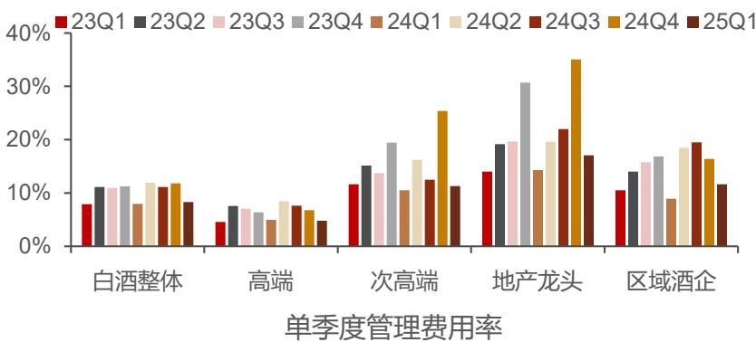

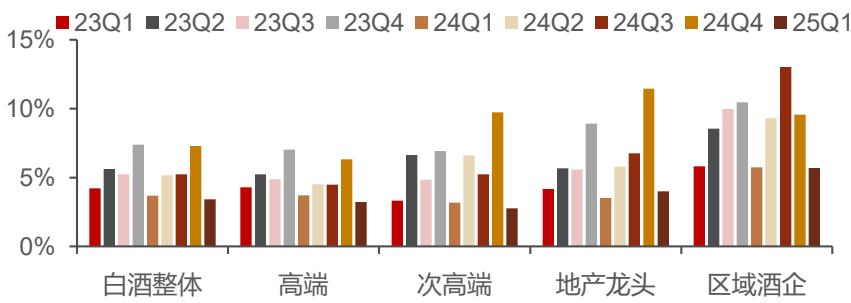

图表：23Q1-25Q1白酒各价格带单季度毛利率、净利率水平  
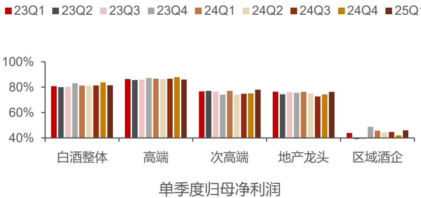

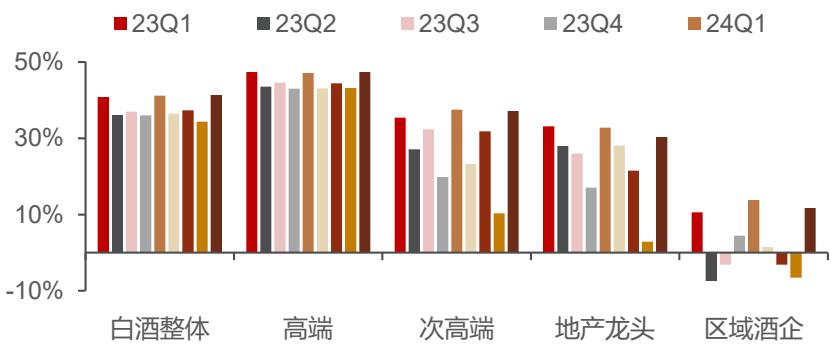

## 白酒：龙头经营稳健，分红回报托底，具备较好配置价值1.17

• 以25年6月12日收盘价测算，高端酒股息底线仍然稳定，茅台/五粮液/老窖股息率分别对应 3.4%/4.5%/5.1%，对长线资金有充足吸引力。洋河24 年虽利润延续下滑趋势，但现金分红 70 亿保底，对应股息率 7.1%，在股价筑底阶段是较好的生息资产。

图表：白酒行业公司分红率与股息率

<table><tr><td rowspan="2" colspan="2"></td><td colspan="5">分红率</td><td rowspan="2">分红率表现</td><td rowspan="2">股息率(25/6/12)</td></tr><tr><td>2020</td><td>2021</td><td>2022</td><td>2023</td><td>2024</td></tr><tr><td>600519.SH</td><td>贵州茅台</td><td>51.9%</td><td>51.9%</td><td>95.8%</td><td>84.0%</td><td>75.0%</td><td></td><td>3.5%</td></tr><tr><td>000858.SZ</td><td>五粮液</td><td>50.2%</td><td>50.2%</td><td>55.0%</td><td>60.0%</td><td>70.0%</td><td></td><td>4.7%</td></tr><tr><td>000568.SZ</td><td>泸州老窖</td><td>50.0%</td><td>60.0%</td><td>60.0%</td><td>60.0%</td><td>65.0%</td><td></td><td>5.3%</td></tr><tr><td>600809.SH</td><td>山西汾酒</td><td>5.7%</td><td>41.3%</td><td>50.0%</td><td>51.1%</td><td>60.4%</td><td></td><td>3.5%</td></tr><tr><td>600779.SH</td><td>水井坊</td><td>80.1%</td><td>30.5%</td><td>30.1%</td><td>35.0%</td><td>35.1%</td><td></td><td>2.2%</td></tr><tr><td>600702.SH</td><td>舍得酒业</td><td>25.8%</td><td>21.3%</td><td>29.7%</td><td>40.2%</td><td>40.9%</td><td></td><td>0.8%</td></tr><tr><td>000799.SZ</td><td>酒鬼酒</td><td>46.3%</td><td>47.3%</td><td>40.3%</td><td>59.3%</td><td>1560.5%</td><td></td><td>1.4%</td></tr><tr><td>002304.SZ</td><td>洋河股份</td><td>60.0%</td><td>60.2%</td><td>60.1%</td><td>70.1%</td><td>104.9%</td><td></td><td>7.1%</td></tr><tr><td>603369.SH</td><td>今世缘</td><td>36.0%</td><td>36.3%</td><td>36.4%</td><td>39.8%</td><td>43.9%</td><td></td><td>2.9%</td></tr><tr><td>000596.SZ</td><td>古井贡酒</td><td>40.7%</td><td>50.6%</td><td>50.5%</td><td>51.8%</td><td>57.5%</td><td></td><td>4.3%</td></tr><tr><td>603198.SH</td><td>迎驾贡酒</td><td>58.7%</td><td>52.1%</td><td>51.6%</td><td>45.5%</td><td>46.3%</td><td></td><td>3.8%</td></tr><tr><td>603589.SH</td><td>口子窖</td><td>56.1%</td><td>51.8%</td><td>58.1%</td><td>52.2%</td><td>47.0%</td><td></td><td>3.7%</td></tr><tr><td>603919.SH</td><td>金徽酒</td><td>36.7%</td><td>34.4%</td><td>54.3%</td><td>60.0%</td><td>64.0%</td><td></td><td>2.6%</td></tr><tr><td>002646.SZ</td><td>天佑德酒</td><td></td><td>37.4%</td><td>37.7%</td><td>69.9%</td><td>50.3%</td><td></td><td>0.5%</td></tr><tr><td>600559.SH</td><td>老白干酒</td><td>43.1%</td><td>35.3%</td><td>38.8%</td><td>61.8%</td><td>63.9%</td><td></td><td>3.3%</td></tr><tr><td>000860.SZ</td><td>顺鑫农业</td><td>17.7%</td><td>18.1%</td><td></td><td></td><td>48.1%</td><td></td><td>1.0%</td></tr><tr><td>600197.SH</td><td>伊力特</td><td>55.9%</td><td>61.9%</td><td>117.0%</td><td>54.2%</td><td>74.5%</td><td></td><td>3.1%</td></tr></table>

注：①标红单元格指当年有两次现金分红 ；②分红率=现金分红总额/当年归母净利率

图表：白酒行业公司股息率  
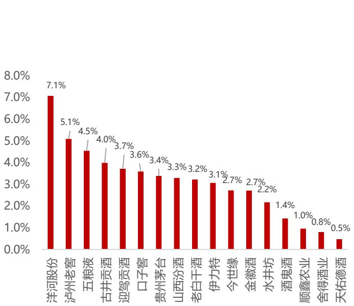

## 1.18 现金流方面：白酒板块具备较高ROE水平、较为稳定的经营现金流

图表：2014-2024年食品饮料细分板块经营性现金流净额

<table><tr><td>经营性现金流净额(亿元)</td><td>2014</td><td>2015</td><td>2016</td><td>2017</td><td>2018</td><td>2019</td><td>2020</td><td>2021</td><td>2022</td><td>2023</td><td>2024</td></tr><tr><td>白酒</td><td>189.6</td><td>347.5</td><td>666.6</td><td>513.3</td><td>774.9</td><td>911.2</td><td>885.8</td><td>1,382.4</td><td>965.1</td><td>1,466.5</td><td>1,739.8</td></tr><tr><td>啤酒</td><td>49.5</td><td>58.2</td><td>62.1</td><td>50.0</td><td>64.0</td><td>71.4</td><td>109.1</td><td>117.1</td><td>112.1</td><td>82.3</td><td>114.6</td></tr><tr><td>软饮料</td><td>4.6</td><td>7.7</td><td>9.6</td><td>4.4</td><td>33.4</td><td>31.3</td><td>28.9</td><td>60.6</td><td>57.6</td><td>83.5</td><td>90.1</td></tr><tr><td>乳品</td><td>31.0</td><td>129.9</td><td>158.3</td><td>97.6</td><td>130.8</td><td>128.5</td><td>146.3</td><td>217.5</td><td>162.9</td><td>247.9</td><td>285.9</td></tr><tr><td>调味发酵品</td><td>39.8</td><td>66.9</td><td>86.8</td><td>58.6</td><td>76.6</td><td>89.5</td><td>90.6</td><td>147.6</td><td>87.9</td><td>117.8</td><td>134.7</td></tr><tr><td>肉制品</td><td>49.4</td><td>63.8</td><td>61.9</td><td>61.6</td><td>54.0</td><td>43.3</td><td>126.9</td><td>70.4</td><td>110.1</td><td>37.0</td><td>106.0</td></tr><tr><td>保健品</td><td>-0.3</td><td>0.2</td><td>0.4</td><td>-0.1</td><td>0.1</td><td>1.0</td><td>0.7</td><td>30.5</td><td>27.9</td><td>35.2</td><td>24.1</td></tr><tr><td>零食</td><td>-</td><td>-</td><td>-</td><td>-</td><td>-</td><td>-</td><td>-</td><td>40.4</td><td>35.1</td><td>41.7</td><td>54.5</td></tr><tr><td>烘焙食品</td><td>-</td><td>-</td><td>-</td><td>-</td><td>-</td><td>-</td><td>-</td><td>36.4</td><td>32.7</td><td>34.1</td><td>32.8</td></tr><tr><td>其他酒类</td><td>9.5</td><td>19.2</td><td>14.0</td><td>10.9</td><td>10.0</td><td>12.4</td><td>14.7</td><td>21.6</td><td>23.1</td><td>25.3</td><td>17.8</td></tr><tr><td>预加工食品</td><td>-</td><td>-</td><td>-</td><td>-</td><td>-</td><td>-</td><td>-</td><td>20.5</td><td>39.1</td><td>43.8</td><td>46.0</td></tr></table>

## 白酒：企业多措并举（包括不限于未来三年现金分红回报方1.19案、大股东增持、回购注销等）以提升股东回报。

2024年以来酒企响应上市公司提质增效重回报的号召，行业头部酒企通过多项提升股东回报，重塑市场信心的操作，包括但不限于未来三年期现金分红回报方案（茅台、五粮液、老窖、洋河）、大股东增持计划（五粮液、老窖、汾酒）、注销式回购方案（茅台、水井坊）、回购用以员工持股计划或股权激励（舍得）等，在基本面疲软、估值持续下探的调整期给股东信心注入强心针，吸引长线资金坚守行业价值，共同穿越周期。

<table><tr><td>上市公司</td><td>2024年以来上市酒企提质增效重回报方案</td></tr><tr><td rowspan="2">贵州茅台</td><td>现金分红回报计划:24-26年度,每年现金分红率≥75%,现金分红分年度和中期两次实施。</td></tr><tr><td>回购并注销:24/9/15公司计划在未来12个月内以30-60亿的自有资金回购股份并注销,后续用以注销减少公司注册资本,价格≤1795.78元/股(含)以最高回购价格测算,预计本次回购数量约在167-334万股,占总股本0.13%-0.27%,系茅台上市以来实施的首次注销式回购。预计本轮结束后将推动新一轮回购。</td></tr><tr><td rowspan="2">五粮液</td><td>现金分红回报计划:24-26年度,每年现金分红率≥70%,且每年现金分红(一次或多次,年度/中期/特殊分红)金额≥200亿元(含税)。</td></tr><tr><td>两轮大股东增持计划:第一轮:公司于23/12/13公告五粮液集团公司计划未来6个月内以自有资金增持4-8亿元,本轮增持已于24/6/12日实施完毕,期间共增持5亿元,340.67万股,占总股本0.09%;第二轮:公司于25/4/8公告集团公司计划在未来6个月内以自有资金增持5-10亿元,本轮增持尚在进行中。</td></tr><tr><td rowspan="2">泸州老窖</td><td>现金分红回报计划:24-26年度,每年现金分红率分别≥65%/70%/75%,且每年现金分红均≥85亿元(含税)。原则上公司每年度可以进行两次现金分红。</td></tr><tr><td>大股东增持计划:公司于25/3/12公告老窖集团及计划在未来6个月内以银行增持专项贷款和集团自有资金,合计1.5-3亿元增持股份,本轮增持尚在进行中。</td></tr><tr><td>山西汾酒</td><td>大股东增持计划:公司于24/3/11公告控股股东汾酒集团计划未来6个月内以自有资金增持1-2亿元,本轮增持已于24/9/10日实施完毕,期间共增持1.91亿元,96.79万股,占总股本0.08%。</td></tr><tr><td>洋河股份</td><td>现金分红回报计划:24-26年分红率≥70%,且每年≥人民币70亿元(含税)</td></tr><tr><td>舍得酒业</td><td>两轮回购并用于未来员工持股计划或股权激励:第一轮:24/2/6公告未来6个月内拟通过自有资金1-2亿元回购股份,每股≤131元,预计回购76.34-152.67股,占总股本0.23-0.46%。回购已于24/8/22实施完毕,共回购1.34亿元,185.43万股,占总股本0.56%;第二轮:24/10/28公告未来6个月拟通过自由资金/自筹资金回购股份,每股≤91元,预计回购109.89-219.78万股,占总股本0.33-0.66%。回购已于25/4/25实施完毕,共回购1亿,167.20万股,占总股本0.5%;</td></tr><tr><td>水井坊</td><td>回购并注销(原计划用于员工持股计划或股权激励):24/2/21公告拟在未来12个月内以自有资金0.75-1.5亿元回购股份,每股≤75元,预计回购100-200万股,占总股本0.20-0.41%。目前回购计划已届满,共使用资金1.25亿元,回购286.24万股,占总股本0.59%。</td></tr></table>

## 白酒价格跟踪：Q2库存稳定与动销流速下降，叠加618电商1.20补贴，批价走势稳中有降

图表：飞天茅台（散瓶）批价及渠道价差（元）  
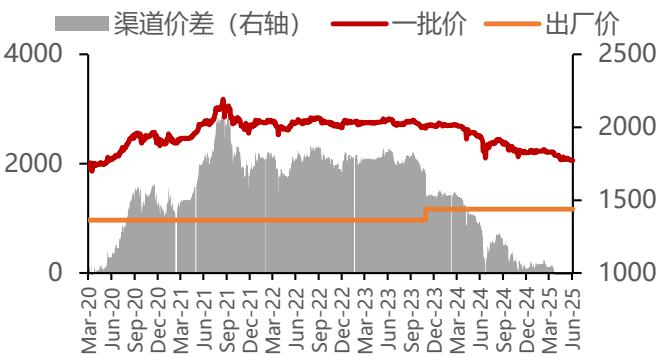

图表：八代普五批价及渠道价差（元）  
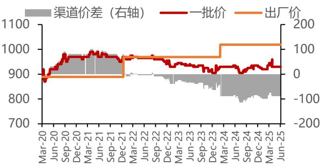

图表：国窖高度批价及渠道价差（元）  
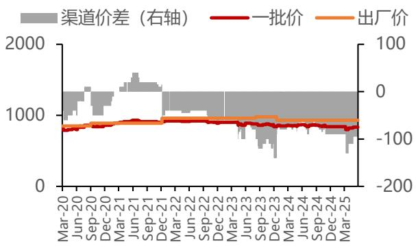

图表：精品茅台批价及渠道价差（元）  
图表：青花20批价及渠道价差（元）  
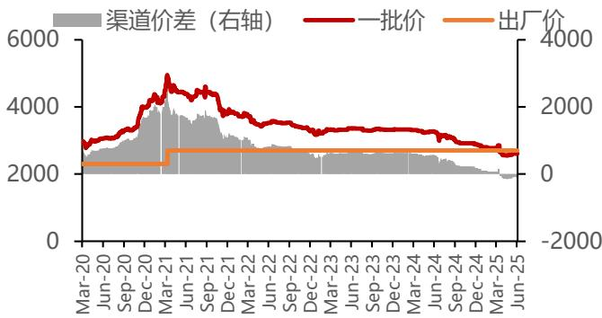

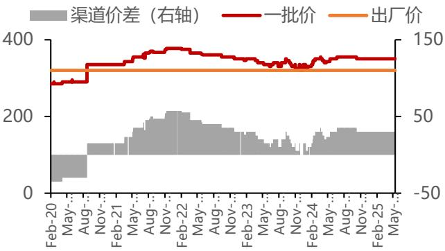

图表：梦6+批价及渠道价差（元）  
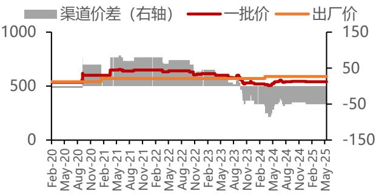

## 02. 低度酒：关注啤酒精酿新品与黄酒高端化改革

## 啤酒：2024年板块量跌价平，收入分化下全国性龙头相对承压2.1

➢ 量：现饮场景进一步疲软+天气原因行业总量下滑；区域性龙头跑赢行业，全国性龙头承压。2024年，在多雨天气、现饮需求恢复持续偏弱等背景下，行业总量有所下滑。根据统计局数据，2024年全国规上企业产量3521万千升，同比-0.6%；销量端上市公司龙头合计我们预估同比-4%左右。分公司来看，全国性龙头销量均不同程度下滑，其中华润同比-2.5%、青岛同比-5.9%、百威同比-11.8%；区域性龙头相对韧性更好，除重啤微降0.8%外，燕京、珠江销量均呈现正增长，分别同比+1.6%/+2.6%。

➢ 价：行业均价滞涨；区域性龙头整体趋势维持，全国性龙头增速中枢回落。行业升级速率较2023年进一步放缓，叠加成本下行周期提价贡献减少2024年行业均价滞涨，我们测算上市公司合计吨价基本持平。分公司来看，全国性龙头吨价增长中枢普遍有所回落，其中百威中国由于产品结构领先于行业且受夜场渠道疲软影响较大吨价同比-1.4%，青啤同比微增0.4%，华润同比+1.5%；区域性龙头吨价增速趋势环比23年相对平稳，其中燕京吨价同比微降0.6%（我们预计与24Q4货折兑付节奏有关），珠江同比+4.3%，重啤由于产品结构领先于行业同比-1.1%。

➢ 因此营收横向对比看：区域性龙头中珠江、燕京收入端呈现α，营收实现正增长，分别同比+7.0%/+1.0%；全国性龙头营收普遍下滑，综合表现华润>青啤> 百威中国，分别-1.0%/-5.5%/-13.0%；重啤介于中间，销量表现跑赢上市公司平均，但吨价由于产品结构领先行业，表现有所承压。

图表：2024年啤酒行业量价表现

<table><tr><td>2024</td><td>销量(万千升)</td><td>YOY</td><td>吨价(元)</td><td>YOY</td><td>啤酒营收(亿元/亿美元)</td><td>YOY</td></tr><tr><td>青岛啤酒</td><td>754</td><td>-5.9%</td><td>4189</td><td>0.4%</td><td>316</td><td>-5.5%</td></tr><tr><td>重庆啤酒</td><td>297</td><td>-0.8%</td><td>4763</td><td>-1.1%</td><td>142</td><td>-1.9%</td></tr><tr><td>燕京啤酒</td><td>400</td><td>1.6%</td><td>3304</td><td>-0.6%</td><td>132</td><td>1.0%</td></tr><tr><td>珠江啤酒</td><td>144</td><td>2.6%</td><td>3828</td><td>4.3%</td><td>55</td><td>7.0%</td></tr><tr><td>华润啤酒</td><td>1087</td><td>-2.5%</td><td>3355</td><td>1.5%</td><td>365</td><td>-1.0%</td></tr><tr><td>百威亚太</td><td>848</td><td>-8.8%</td><td>754</td><td>2.1%</td><td>62</td><td>-6.9%</td></tr><tr><td>百威中国</td><td>/</td><td>-11.8%</td><td>/</td><td>-1.4%</td><td>/</td><td>-13.0%</td></tr></table>

## 渠道结构差异是龙头收入分化的重要原因，单品生命周期错位亦有影响2.2

➢ 归因： 2024年全国性啤酒龙头收入端相对承压，我们认为主要有以下两点影响因素：

➢ 1）渠道结构差异：Beta角度，2024年下游现饮渠道（餐饮、夜场）恢复较弱，但由于各公司自身渠道占比有所不同，因此量、价受到的影响各异，考虑到啤酒企业往往通过封锁现饮渠道（买店）维持市占率，因此全国性龙头通常现饮占比更高；

➢ 2）单品生命周期：酒企中高端大单品渠道利润周期错位引发份额变化，导致酒企自身渠道占比变化趋势与行业Beta变动不一致，从而影响各公司量价表现。

⚫ 销量：下游现饮恢复较慢，则现饮占比高的公司在量上受损程度更大；在现饮整体需求偏弱的背景下，部分大单品通过更有竞争力的渠道/终端利润抢夺市场份额，代表单品有喜力、U8、97纯生。

⚫ 吨价：由于现饮是封闭式渠道而非现饮是开放渠道，所以通常现饮渠道产品结构好于非现饮、且过往现饮渠道较非现饮升级速率更快，因此现饮恢复较慢对于企业吨价是负向影响，如百威夜场占比高于竞品，其吨价受夜场需求疲软影响最大；企业间份额变化影响同上。

图表：社零餐饮业当月同比增速，2024年餐饮整体复苏缓慢  
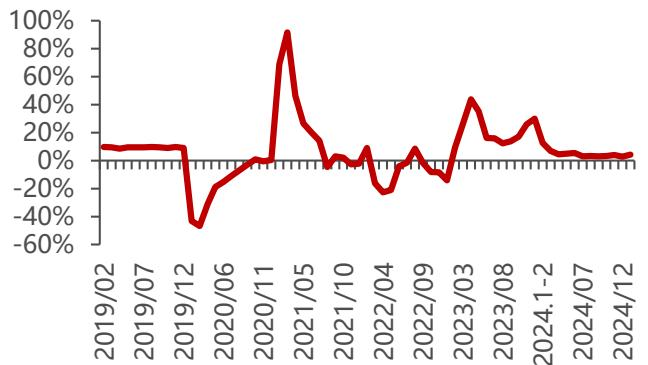

图表：青岛啤酒分渠道销量占比  
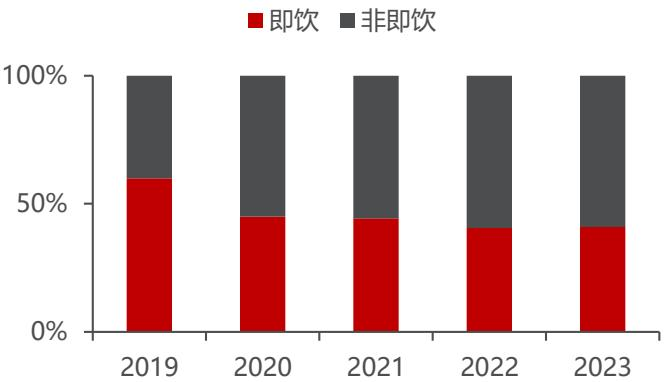

## 啤酒：25Q1销量实现转正，低基数下期待25年旺季趋势2.3

➢ 开年轻装上阵，25Q1销量实现转正，吨价表现略显平淡。24Q1板块基数于近几年中相对较高，25Q1上市公司龙头销量增速转正，我们认为一方面板块需求正温和复苏，另外24Q4各酒企积极去库，25年开年轻装上阵。25Q1我们判断除百威外啤酒龙头销量普遍实现正增长，青啤/重啤/珠江销量分别同比+3.5%/+1.9%/+11.7%，24Q1燕京未披露销量绝对值，我们估计25Q1销量同比增中低单位数，华润未披露季报，我们估计销量亦实现中低单位数增长，百威中国由于自身渠道结构原因叠加自身库存管理措施影响，销量同比-9.2%。吨价端，上市公司表现普遍略显平淡，我们判断主因需求复苏节奏仍较缓，因为酒企货折力度有所增加，青啤/重啤/珠江/百威中国吨价分别同比-0.6%/-0.3%/-0.9%/-3.9%，燕京我们估计吨价增中低单位数，华润吨价增低单位数。

➢ 24Q2-Q3板块旺季不旺，叠加龙头24H2普遍开启降库周期，期待25年旺季复苏。展望25年后续节奏，一方面今年以来需求侧逐渐企稳筑底，销量下探压力较小，同时2024年行业旺季不旺，叠加进入24H2龙头普遍开启降库周期，因此24Q2-Q3销量基数较低。伴随后续基数走低+消费政策端持续刺激，下游场景逐步恢复有望带动需求企稳修复、旺季数据趋势环比改善。

图表：25Q1啤酒企业量价表现

<table><tr><td>25Q1</td><td>销量(万千升)</td><td>YOY</td><td>吨价(元)</td><td>YOY</td><td>营收(亿元/亿美元)</td><td>YOY</td></tr><tr><td>青岛啤酒</td><td>226</td><td>3.5%</td><td>4620</td><td>-0.6%</td><td>104</td><td>2.9%</td></tr><tr><td>重庆啤酒</td><td>88</td><td>1.9%</td><td>4804</td><td>-0.3%</td><td>42</td><td>1.6%</td></tr><tr><td>燕京啤酒</td><td>100</td><td>增中低单</td><td>3846</td><td>增中低单</td><td>38</td><td>6.7%</td></tr><tr><td>珠江啤酒</td><td>29</td><td>11.7%</td><td>4164</td><td>-0.9%</td><td>12</td><td>10.7%</td></tr><tr><td>华润啤酒</td><td>/</td><td>增中低单</td><td>/</td><td>增低单</td><td>/</td><td>增接近中单</td></tr><tr><td>百威亚太</td><td>197</td><td>-6.1%</td><td>740</td><td>-1.5%</td><td>15</td><td>-7.5%</td></tr><tr><td>百威中国</td><td>/</td><td>-9.2%</td><td>/</td><td>-3.9%</td><td>/</td><td>-12.7%</td></tr></table>

## 啤酒：成本红利持续，竞争格局尚优，毛销差仍在扩张阶段2.4

➢ 毛销差：从2024年以及25Q1酒企数据来看，尽管下游需求较弱，行业龙头毛销差基本仍处在扩张阶段。究其原因，除成本贡献以外，核心系行业产品结构仍有升级空间，因此竞争格局仍处于较好阶段，企业费用投放较为克制。

➢ 成本端：伴随澳麦“双反”政策取消，同时主要包材价格步入下行通道，24年行业成本端普遍显著改善。2024年，青啤/重啤/燕京/珠江/华润/百威亚太啤酒吨成本分别-2.2%/-1.1%/-6.6%/-2.4%/-0.2%/+0.7%。 25Q1，青啤/重啤/珠江/百威亚太吨成本分别-2.6%/-1.4%/-5.8%/-1.6%，延续下降趋势，其中燕京我们预计吨成本中单位数下降。展望2025年，进口大麦价格仍在下行通道，且各家澳麦采购比例仍有上升空间，预计25年酒企麦芽采购成本仍有一定下降空间，包材端市场价格整体较为平稳，预计25年酒企成本采购端上行压力较小，重点关注销量恢复情况对产能利用率的影响。

➢ 费用端：在需求持续偏弱、升级进一步放缓背景下行业竞争边际小幅加剧，龙头投入有所增加但整体较为克制，且各价格带尤其低端价格带未出现明显的加促/打价格战迹象，预计中高端价格带货折比例或有一定程度增加（主要抵减收入，已反映在吨价端）。2024年龙头销售费用率基本平稳，青啤/重啤微增0.4/0.1pct，燕京/珠江均同比-0.3pct，华润整体销售费用率同比+1pct，我们预计主要系白酒业务导致，啤酒业务费用率增幅可控。25Q1，除燕京啤酒销售费用率同比有所增长外，其余龙头企业均同比略有下降。整体来看，行业竞争格局仍处于较好阶段，因此酒企整体费用投入较为理性，销售费率增幅可控。

➢ 竞争： 25年可看到龙头均不同程度强化对份额的诉求，弱需求下行业竞争有一定程度加剧为正常阶段，尤其对于啤酒这种重基地市场、强规模效应属性的行业来说份额是中长期稳健发展的基石，在当前市场发展环境下龙头诉求适当向稳份额倾斜为理性选择。尽管如此龙头并非放弃结构，行业更不是恶性竞争，整体竞争态势是适度、 良性的，且当前不同于24年的是需求已逐渐筑底，对利润影响程度需看行业量价扩容情况，若需求恢复较好则可平滑消化，现饮景气度为核心跟踪变量。

图表：2024啤酒企业利润表现

<table><tr><td>2024</td><td>啤酒吨成本 YOY</td><td>啤酒毛利率 YOY</td><td>销售费用率 YOY</td><td>毛销差 YOY</td><td>利润 (亿元/亿美元)</td><td>YOY</td><td>利润率</td><td>YOY</td></tr><tr><td>青岛啤酒</td><td>-2.2%</td><td>1.7%</td><td>0.4%</td><td>1.1%</td><td>39.5</td><td>6.2%</td><td>12.3%</td><td>1.3%</td></tr><tr><td>重庆啤酒</td><td>-1.1%</td><td>-1.3%</td><td>0.1%</td><td>-0.6%</td><td>12.2</td><td>-7.0%</td><td>8.3%</td><td>-0.5%</td></tr><tr><td>燕京啤酒</td><td>-6.6%</td><td>0.4%</td><td>-0.3%</td><td>3.4%</td><td>10.4</td><td>108.0%</td><td>7.1%</td><td>3.6%</td></tr><tr><td>珠江啤酒</td><td>-2.4%</td><td>0.0%</td><td>-0.3%</td><td>3.8%</td><td>7.6</td><td>36.8%</td><td>13.3%</td><td>2.9%</td></tr><tr><td>华润啤酒</td><td>-0.2%</td><td>1.7%</td><td>1.0%</td><td>0.3%</td><td>78.81</td><td>2.4%</td><td>20.4%</td><td>0.6%</td></tr><tr><td>百威亚太</td><td>0.7%</td><td>0.6%</td><td>/</td><td>/</td><td>18.07</td><td>-6.2%</td><td>29.7%</td><td>0.2%</td></tr><tr><td>百威中国</td><td>/</td><td>/</td><td>/</td><td>/</td><td>/</td><td>-13.2%</td><td>/</td><td>/</td></tr></table>

图表：25Q1啤酒企业利润表现

<table><tr><td>25Q1</td><td>吨成本YOY</td><td>毛利率YOY</td><td>销售费用率YOY</td><td>毛销差YOY</td><td>利润(亿元/亿美元)</td><td>YOY</td><td>利润率</td><td>YOY</td></tr><tr><td>青岛啤酒</td><td>-2.6%</td><td>1.2%</td><td>-0.3%</td><td>1.5%</td><td>16.0</td><td>5.9%</td><td>15.3%</td><td>0.4%</td></tr><tr><td>重庆啤酒</td><td>-1.4%</td><td>0.5%</td><td>-0.4%</td><td>0.9%</td><td>4.7</td><td>4.7%</td><td>10.7%</td><td>0.3%</td></tr><tr><td>燕京啤酒</td><td>中单下降</td><td>5.6%</td><td>3.7%</td><td>1.9%</td><td>1.5</td><td>49.1%</td><td>4.0%</td><td>1.1%</td></tr><tr><td>珠江啤酒</td><td>-5.8%</td><td>2.9%</td><td>-0.8%</td><td>3.7%</td><td>1.5</td><td>39.4%</td><td>11.9%</td><td>2.4%</td></tr><tr><td>百威亚太</td><td>-1.6%</td><td>0.0%</td><td>/</td><td>/</td><td>4.9</td><td>-11.2%</td><td>33.4%</td><td>-1.4%</td></tr><tr><td>百威中国</td><td>/</td><td>/</td><td>/</td><td>/</td><td>/</td><td>-17.1%</td><td>/</td><td>/</td></tr></table>

## 2.5 啤酒：行业逻辑及长期趋势未变，关注新产品和新渠道

➢ 行业竞争格局及态势仍处于较好阶段，行业升级由供需两端共同引导：寡头垄断+区域割据（多数省份啤酒龙头间呈现或接近“721”格局，底层逻辑为啤酒销售存在运输半径限制，且价位越低产品受该限制越明显）。目前行业竞争格局及态势较好，核心系行业失去量增红利后龙头追求份额效益边际减弱，与此同时行业价增空间仍较大，因此龙头目标统一高端化。基于酒企基地市场中低端价位产品份额稳固，龙头普遍优先选择依托渠道封锁优势积极推动强势市场产品结构升级，同时寻求中高端产品区域拓展机会。目前行业整体竞争态势较为温和，相较于过往的恶性竞争，龙头整体更呈“竞合式”发展，共同推动中高价位产品持续扩容，各家发力价位、区域一定程度有所区隔。

➢ 外部环境仅影响升级速率，中长期趋势不变。对标海外成熟市场，我国啤酒行业产品结构及出厂吨价仍有较大增长空间。在当前外部环境下，虽10元以上产品升级速率阶段性放缓（高端消费追求性价比+高端产品更依赖现饮渠道），但目前该部分产品占比较小，8元价格带承接过去6元主流价格带向上升级红利明显，同时主流以下低端品仍可内部迭代。

➢ 吨价=渠道结构\*单一渠道内部升级速率，龙头积极探索非现饮高端化，加快产品创新&拥抱即时零售渠道。在当前现饮需求恢复较缓的外部环境下，探索非现饮高端化从而提升非现饮渠道升级速率是企业抵御当前外部市场环境下升级速率放缓、抵消渠道结构负面影响的重要方式。一方面，酒企纷纷加大产品创新，布局低醇/风味化/精酿啤酒等满足消费者多样化、个性化的消费需求，同时积极拥抱即时零售渠道等新兴渠道。据美团数据，2023年酒类即时零售行业规模180+亿元（渗透率1.3%），预计2027年酒类即时零售行业规模超1000+亿元（渗透率6.2%）。

图表：啤酒龙头份额变动边际变化不大  
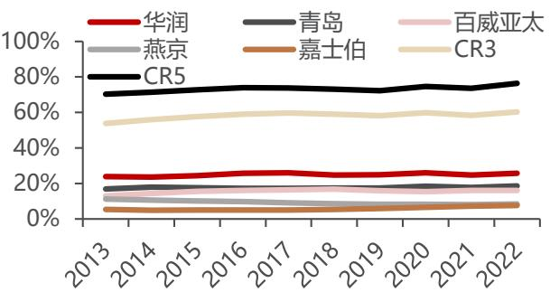

图表：不同国家和地区啤酒零售均价对比（元/吨）  
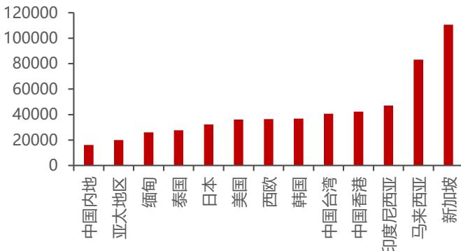

图表：啤酒市场规模及即时零售市场规模（亿元）  
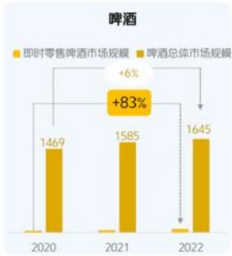

## 黄酒：历史上，市场参与主体、容量持续萎缩，份额向龙头集中2.6

➢ 我国黄酒行业企业参与主体、容量持续萎缩，市场份额向龙头集中。根据酒业协会数据，我国黄酒行业销售收入于2016年触顶，规上企业营收达198.2亿元。2023年，我国黄酒规上企业销售收入85.5亿元，较2016年已腰斩下滑57%，CAGR-11%。2023年，我国规上黄酒企业利润总额达15.6亿元，较2016年18.9亿元下滑16%，CAGR-2%。行业利润增速下滑幅度小于收入，行业利润率有所提升主要系行业存量竞争下，长尾酒企亏损加剧并逐步出清，市场份额向龙头集中，2016-2023年，全国规上黄酒企业数量由112 家减少至81家，2023年三家上市黄酒企业酒类营收占比较2016年提升25pcts至43%（其中CR2提升23pcts至36%），利润份额较2016年则提升35pcts至58%。从吨价表现来看，三家上市公司龙头古越龙山、会稽山、金枫酒业2016-2023年吨价CAGR分别为1.6%、3.4%、0.6%，考虑到上市龙头表现较优，我们预计行业容量萎缩以量跌为主，均价增长不明显甚至略有下滑。

图表： 我国黄酒行业规上企业收入及利润（亿元）  
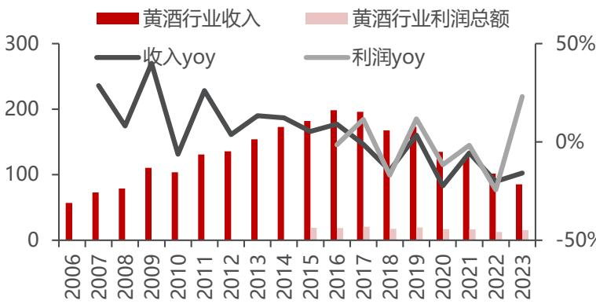

图表： 我国黄酒行业规上企业数量（家）  
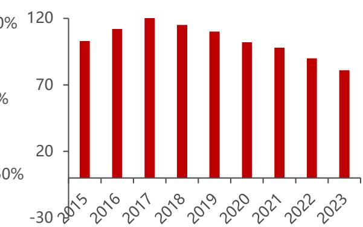

图表： 我国黄酒行业集中度  
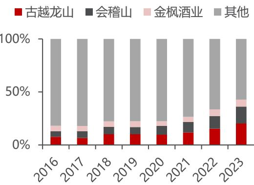

## 黄酒：价位、区域、人群、场景难以破圈，底层痛点是缺乏高价2.7

➢ 我国黄酒行业面临产品结构低端、消费区域集中且局限、消费人群老龄化、消费场景单一受限的困局

1）目前市面上主流销售的黄酒多为3-5年陈的产品，终端零售价普遍在10-30元/500ml，23年上市酒企平均吨价仅1.15万元。

2）销售区域上黄酒高度集中，23年三家上市黄酒企业江浙沪销售占比达77%。

3）黄酒的消费主力主要集中在45岁以上的男性，消费群体老化明显。

4）黄酒社交属性偏弱，其饮用场景中家庭生活消费总体占比合计79%，而社交场景消费合计仅21%（其中招待朋友16%，可能仍有部分属于家庭场景的消费），不同于白酒绑定宴席、商务宴请，啤酒绑定烧烤排挡，黄酒难以在国内主流酒精饮用场景下形成消费者强心智占领。

➢ 黄酒为我国传统饮用酒种，有较好的历史文化和消费基础，但在近十余年的酒精品类竞争中持续处于劣势，逐步被边缘化，目前占酒类市场总量已不到2%，归其原因我们认为：1则行业内产品长期缺乏产品创新、进而提价困难，主销产品售价低、渠道利润空间薄，也就无法支撑酒企推动全国化和年轻化的消费者人群培育，同时也让品类丧失进入宴席、商务宴请等诸多消费场景的可能性；2则酒企运营管理相对白酒、啤酒等行业较为粗放，缺乏系统化的营销体系。后者更多为战术层面归因，行业的底层痛点仍是产品没有高价，从而缺乏可持续的投入支撑，从而陷入低端内卷竞争。因此高端化也是行业恢复增长、重新扩容的重要主线。

图表： 黄酒上市企业分地区收入情况（百万元） 图表： 黄酒上市企业吨价情况（元） 图表： 黄酒消费场景  
上海 浙江 江苏 其它区域 国外  
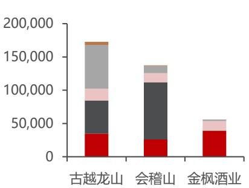

图表： 行业产品同质化严重，长期缺乏产品创新，提价

<table><tr><td>品牌</td><td>产品</td><td>价格:元/500ml</td><td>品牌</td><td>产品</td><td>价格:元/500ml</td></tr><tr><td rowspan="3">会稽山</td><td>纯正3年</td><td>15</td><td rowspan="2">沙洲优黄</td><td>红标5年</td><td>13.6</td></tr><tr><td>纯正5年</td><td>23</td><td>低聚糖6年</td><td>24.5</td></tr><tr><td>品酒大师8年</td><td>19.7</td><td rowspan="4">古越龙山</td><td>清醇3年</td><td>11</td></tr><tr><td rowspan="5">金枫-和酒</td><td>3年陈</td><td>7.4</td><td>清醇5年</td><td>19.8</td></tr><tr><td>5年陈</td><td>11.1</td><td>金3年</td><td>11</td></tr><tr><td>大开福3年陈</td><td>8.2</td><td>金5年</td><td>22</td></tr><tr><td>大开福5年陈</td><td>11.8</td><td>鉴湖</td><td>5年陈</td><td>15</td></tr><tr><td>金色年华5年陈</td><td>19.1</td><td>状元红</td><td>5年陈</td><td>10.7</td></tr><tr><td rowspan="3">金枫-石库门</td><td>红色峥嵘2001</td><td>18.6</td><td rowspan="3">塔牌</td><td>花雕3年</td><td>9.8</td></tr><tr><td>蓝牌1号</td><td>28.5</td><td>纯正5年</td><td>18.8</td></tr><tr><td>红牌1号</td><td>23.8</td><td>丽春8年</td><td>33.5</td></tr></table>

## 黄酒：内外部因素共振蓄势待发，供给侧积极变革把握机遇2.8

➢ 宏观层面：近年来饮酒趋势朝低度化、健康化方向发展，黄酒的品类属性与之完美契合。随着我国居民消费水平提高、人口结构发生变化（90、00后成为消费主力军、60、70后年龄提升），酒类行业低度化、健康化趋势显著。一方面社会时代背景变化使得酒类消费的目的由“悦人”向“悦己”倾斜，黄酒凭借其低度、温和的特性与这种追求自我享受的理念天然契合，同时具备健康化属性。

➢ 行业层面：政策、资金、经销商等外部资源正不断向行业集中。

1）政策方面，近几年地方政府更加重视黄酒行业发展，一系列支持政策密集出台，政府调拨专向资金扶持行业发展，鼓励企业研发创新、扩大销售、引进人才。

2）产业资本方面，青岛啤酒为推动自身多元化发展，拟收购北派黄酒代表企业山东即墨黄酒厂100%股权，后续有望在即墨黄酒品宣推广、渠道销售等方面形成赋能与协同。

3）随着白酒行业进入调整期，行业呈挤压式增长，白酒市场存量竞争激烈，内部企业分化加剧，白酒经销商投资回报收窄、资金压力较大，急需结构性转型，部分渠道寻求自身转型或寻找其他高毛利产品进行利润补充。

图表：针对支持黄酒行业发展的政策密集出台

<table><tr><td>时间</td><td>文件名</td><td>发布单位</td><td>主要内容</td></tr><tr><td>2021年</td><td>《浙江省食品工业“十四五”发展规划》</td><td>浙江省政府</td><td>明确提出要大力发展黄酒产业,推动黄酒产品的多样化、高端化和品牌化,培育一批具有国际竞争力的黄酒品牌</td></tr><tr><td>2021年10月</td><td>《绍兴黄酒保护和发展条例》</td><td>绍兴市</td><td>从黄酒文化传承、生产规范、技术研发、产品创新、产区保护、标准共建、经营秩序、市场环境等多个维度对黄酒产业的保护和发展进行了全方位指导和立体式规范。条例的实施为绍兴黄酒产业的高质量发展提供了坚实的法律支撑。</td></tr><tr><td>2023年9月</td><td>《关于促进黄酒产业发展振兴的实施意见》</td><td>绍兴市人民政府办公室</td><td>2027年基本实现“1522”阶段性目标,即全市黄酒产业年销售收入达到100亿元,在全国市场占有率超过50%,形成2-3家黄酒行业链主企业,绍兴成为黄酒产业最具活力主产区和黄酒文化传承发展引领区。梳理出台保护和振兴发展黄酒产业专项政策。各级财政支持绍兴黄酒区域品牌,市财政每年安排不少于500万资金专项用于支持打响绍兴黄酒区域品牌。积极向上争取相关支持和要素保障;适时统筹各级政府产业基金支持黄酒产业发展壮大。</td></tr><tr><td>2024年9月</td><td>《绍兴黄酒产业发展振兴若干政策》</td><td>绍兴市人民政府办公室</td><td>鼓励标准化体系建设。积极推荐黄酒领域研究项目申报市级及以上科技计划,列入市级产业关键技术攻关计划的,按项目研发投入25%以内的比例给予补助,最高300万元。支持人才培育。对符合条件的黄酒高层次人才,支持推荐申报各级人才计划。对黄酒企业守正创新打造大单品和扩大销售给予奖励。</td></tr></table>

## 黄酒：内外部因素共振蓄势待发，供给侧积极变革把握机遇2.9

➢ 企业层面：供给侧积极变革，龙头合力推行高端化、年轻化战略。

1）高端化：打破黄酒的价值天花板，重塑价格认知

1）科技革新升级工艺解决饮后舒适度问题，同时建立行业分级评分标准体系让好黄酒的价值表达有据可依。

2）产品线梳理，从低端SKU汇量到大单品聚焦，推动结构化升级。

3）生意模式（渠道分润体系）激活，营销模式升级。

2）年轻化：打破黄酒的传统老化，突破品类边界。客观上高端化的培育周期较长、前置投入较高，年轻化本质是探索通过品类创新驱动行业扩容的可能性，且这种方式往往推广性更强、效率更快。

图表： 消费者不愿意喝黄酒的原因  

图表： 会稽山古越龙山研发费用率  

图表 ：龙头布局高端价位

<table><tr><td>品牌</td><td>产品</td><td>零售价</td><td>酒龄</td></tr><tr><td rowspan="2">会稽山</td><td>国潮兰亭</td><td>699元/L</td><td>20年</td></tr><tr><td>大师兰亭</td><td>2099元/L</td><td>30年</td></tr><tr><td rowspan="3">古越龙山</td><td>国酿1959青玉</td><td>599元/500ml</td><td>20年</td></tr><tr><td>国酿1959红玉</td><td>1199元/500ml</td><td>30年</td></tr><tr><td>国酿1959白玉</td><td>1959元/500ml</td><td>40年</td></tr><tr><td>塔牌</td><td>本酒</td><td>550元/500ml</td><td>13年</td></tr></table>

## 2.10 预调酒：供需两端共同驱动，行业发展方兴未艾，百润占据竞争高点

➢ 供需两端共同驱动，行业发展方兴未艾。RTD在我国作为新兴消费品类，进入国内市场仅10余年，真正推广开来仅5-6年时间，当前行业仍处于发展的前期。根据欧睿数据，2023年我国预调酒市场零售口径规模127.26亿元，出厂口径规模80.27亿元，销量36.27万千升，若与我国传统低度酒第一大品类啤酒进行对比，目前RTD销量占比仅为啤酒的0.85%。

 从人均消费量角度看：目前我国仅0.26L/年，核心消费群体人均消费量也仅约3.43L（根据华东华南沿海地区20-34岁人群估算，约7000w人+），对标海外成熟市场仍有很大差距，如日本14.10L、美国7.86L。未来，无论是核心受众人群的不断下沉、扩容，还是人均消费量的提升，均有较大提升空间。

 从大单品数量看：目前我国RTD行业零售口径规模10亿人民币以上的大单品仅有锐澳（3款）和动力火车。反观海外成熟市场，日本零售口径规模在10亿人民币以上的大单品有冰结、-196C Strong Zero、柠檬酸，宝酒造High Ball、Kaku Highball,、Chu-hi共6款产品；美国则有17款，其中20亿人民币以上的单品有13款，主要包括High Noon、White Claw Hard Seltzer、Twisted Tea,、Mike‘s Hard Lemonade、TrulySpiked & Sparkling等（美国RTD行业过去几年市场规模增长主要来自于硬苏打水品类的爆火，目前排前列的大单品多为硬苏打水品类）。

➢ 我国预调酒行业未来的进一步发展依赖需求端、供给端共同发力，包括消费能力、消费习惯&认知、供给水平。需求端，1）随着可支配收入的增加，消费者将更加关注自我精神满足，悦己消费需求有望不断提升；2）随着经济发展水平提升，消费者对酒类产品的多元化需求将不断被激发，对应的饮用场景将更加细分。供给端方面，厂商通过消费者需求洞察，针对不同场景提供精准的酒精解决方案，甚至可通过各类营销方式培育和创造新的消费需求。未来随着供需两端共同发力，行业大单品数量有望逐步增加，驱动行业规模逐步扩容。

图表：中国预调酒销量  

图表：中国预调酒规模（零售口径）  

图表：中国预调酒单品规模（亿元，零售口径）  

## 2.11 预调酒：供需两端共同驱动，行业发展方兴未艾，百润占据竞争高点

➢ 预调酒行业主要标的为【百润股份】，2024公司营收30.5亿元，同比-6.6%，其中预调酒业务实现收入26.8亿元，同比-7.2%，主要系整体消费环境仍较为疲软，且大单品强爽基数较高，因此收入仍有承压；香精业务稳健增长。2024公司毛利率/销售费用率分别同比+3.0/+2.9pct，毛利率表现较好主要系成本优化叠加渠道结构变化，同时高毛利率业务威士忌新品亦有部分贡献，毛销差基本平稳，扣非净利率同比-1.8pct。25Q1公司营收7.4亿元，同比-8.1%，主要系公司主动去化预调酒库存，调整回款节奏，毛利率销售费用率分别同比+1.3/-8.1pct，扣非净利率同比+4.0pct。

➢ 产品和营销是行业的核心竞争要素，公司占据竞争高点。预调酒由于缺乏传统酒类的历史根基和消费基础，属于创新驱动型品类，且作为满足的是细分场景和需求的新兴小品类，因此对产品力提出更高要求，产品端需具备明显的长板，同时需要配合优秀的营销手段，吸引消费者进行初次尝试并进行消费习惯的宣传和引导。好的产品力首先需要厂商具备敏锐的消费者洞察，需紧跟消费趋势，挖掘消费场景，并针对不同的细分场景判断消费者需求痛点，持续研发、迭代出不同的产品。百润公司立足于做年轻人的生意，对年轻消费群体的消费行为、习惯、观念都有着非常深刻的理解，善于洞察消费者需求，如微醺、强爽都是公司通过精准的定位消费人群及场景后成功推出的大单品，且公司以香精业务起家，在口味调配、配方设计方面具备非常明显的优势。营销方面，公司几轮大单品的成功均通过线上话题率先引爆，实现快速破圈。

图表：百润股份累季收入及利润表现（单位：亿元）  

图表：百润股份单季收入及利润表现（单位：亿元）  

## 威士忌：市场增长潜力巨大，百润先发优势显著2.12

➢ 国内威士忌行业处发展前期，进口产品为主且定位较为高端，国产化进程逐步推进。2023 年中国威士忌酒市场规模约 55亿元，同比增长 10%，其中进口额达41亿元，进口量3.26 万千升，国产威士忌市场份额较低。此外，目前我国威士忌行业产品结构主要呈现“倒金字塔型”，主要消费人群集中在经济发达区域，高端化特征明显。目前我国国产威士忌行业处于布局阶段，随着威士忌本土化进程的开启，未来国产威士忌性价比优势将逐步显现。目前我国烈酒市场产品品类较为单一，白酒占据较大比例，且主要针对社交、商务消费场景。随着，中国消费者个性化、悦己化、日常化的饮酒需求不断提升，我国的威士忌消费市场具备增长潜力。

➢ 行业存在先发优势，产品周期较长，新品陆续上市，期待威士忌后续放量。威士忌行业属于重资产行业（生产设备、木桶等），前期投入金额较大，且因威士忌出酒存在陈年时间要求，均为行业后进入者设置了较高门槛。百润公司于2021年推进建设成都崃周蒸馏厂，是我国较早布局威士忌产业的企业之一，目前已顺利灌桶包括黄酒桶、雪莉桶、葡萄酒桶、波本桶、朗姆桶等各种风味的麦芽威士忌及谷物威士忌。公司崃州蒸馏厂于2021年开始第一批威士忌灌桶，截止2023年12月14日，崃州蒸馏厂灌桶30万桶。在满足国际标准三年的桶陈陈酿要求下，公司已于24Q4推出成品酒产品，25Q1推出“百利得”单一调和威士忌22和66系列，预计将推出“崃州”单一麦芽威士忌新品。该业务板块有望开辟第二增长曲线。

## 投资建议：关注啤酒旺季修复与悦己型消费标的2.13

➢ 低度酒饮：悦己型消费当下已成为一种重要消费趋势和诉求，追求品质多元化的饮用体验。

➢ 啤酒成本下降与消费旺季催化，估值底部价值凸显；产业资源导入，黄酒等低度酒饮将迎供给侧改革。对于低度酒饮市场，酒种多元化是一个重要趋势：我们认为理性消费时代，悦己消费与个性化需求增加，低度酒饮适口性较好、购买品鉴门槛相对较低，以黄酒、啤酒、果酒、预调酒及其他配制酒为代表的低度酒精饮料市场有望扩容，以黄酒产业为例，伴随资金、人才、技术等资源的导入，黄酒行业供给侧改革或将加速，其消费端培育也将起锚。

◼ 啤酒行业升级的长期趋势不变，关注消费旺季催化：外部环境影响下行业升级速率客观上阶段性有所放缓，但从啤酒产品属性、行业升级阶段、竞争格局等多角度去看，长期趋势不变。25年麦芽价格持续下行，成本红利有望逐步释放；基数效应下25年旺季销量有望迎来拐点，结构升级驱动吨价稳健提升。中长期维度来看，啤酒企业经营性现金流稳定、未来基本无大额资本开支，分红比例有望提升。

◼ 黄酒产业资源导入，黄酒等低度酒饮将迎供给侧改革。黄酒行业面临产品结构低端、消费区域集中且局限、消费人群老龄化的困局，行业企业参与主体、容量持续萎缩。近两年行业供给侧积极求变，头部酒企纷纷通过产品结构性升级、渠道网络深化、组织管理提升等举措积极推动自身创新和发展变革。

➢投资建议：考虑到现饮渠道复苏斜率暂无显著改善，啤酒板块推荐基本面景气相对较优、业绩具备α的的燕京啤酒、珠江啤酒，主因非现占比高+单品渠道利润周期因素共振下公司收入端α具备一定持续性，其中燕京啤酒得益于改革稳步推进，经营效率持续提升，利润端α更为突出；24Q2-Q3板块旺季不旺，叠加龙头24H2普遍开启降库周期，建议持续跟踪25年旺季低基数的数据趋势以及现饮渠道需求恢复情况，关注青岛啤酒/青岛啤酒股份、重庆啤酒、华润啤酒。黄酒板块关注会稽山、古越龙山。预调酒板块建议关注百润股份。

➢风险提示：消费场景复苏节奏及相关刺激政策效果不达预期；公司改革进度不及预期；下游需求恢复不及预期。

## 调味品&餐供：修复在03.途，关注新品新渠道

## 下游餐饮：需求修复在途，拓店放缓，客单价下移3.1

➢ 连锁餐饮品牌拓店放缓。截至25Q1我国餐饮门店数量接近800万家，门店数量同比略有提升。各品类连锁餐饮品牌更重单店质量，放缓拓店速度，25Q1连锁茶饮、连锁咖啡、小吃快餐开闭店比分别为1.5/6.6/1.4。

➢ 门店客单价下滑。 2024年餐饮大盘整体人均消费同比-6.6%，分场景看下滑top3为饮品/中式正餐/火锅，同比-13.9%/-9.6%/-8.1%。

图表：25Q1餐饮门店数量略有回升  
图表：25Q1餐饮存量企业数量同比+8%  

图表：25Q1各连锁业态拓店闭店情况  

图表：2024年餐饮门店客单价下滑（元）2022 2023 2024 24年同比变动  

## 3.2 下游餐饮：需求修复在途，拓店放缓，客单价下移

➢ 餐饮需求修复在途，后续若下游好转，B端占比较高的餐供有望率先受益。24年以来餐饮供应链企业由于需求疲软、竞争加剧等因素导致业绩及估值持续承压，相关餐供企业无库存周期影响，后续若下游餐饮经营转暖，则有望同步传导至上游，B端占比较高的企业收入端有望迎来较快恢复。

图表： 社零餐饮收入同比增速及较19年同期CAGR  

图表： 25Q1以来餐饮门店相关指数表现承压，修复在途  

图表：主要餐供企业渠道结构梳理

<table><tr><td>调味品</td><td>颐海国际</td><td>天味食品</td><td>宝立食品</td><td>日辰股份</td></tr><tr><td>24年收入规模(亿元)</td><td>65</td><td>35</td><td>27</td><td>4</td></tr><tr><td>渠道结构</td><td>大B定制约33%,小B约3%,C端约64%</td><td>大B定制约10%,小B占比10%+,C端占比75%+</td><td>大B定制约60%,C端约40%</td><td>大B餐饮连锁约46%,工业及品牌定制约51%,小B约3%</td></tr></table>

<table><tr><td>速冻食品</td><td>安井食品</td><td>千味央厨</td><td>立高食品</td><td>三全食品</td></tr><tr><td>24年收入规模(亿元)</td><td>151</td><td>19</td><td>38</td><td>66</td></tr><tr><td>渠道结构</td><td>大B约7%,小B餐饮50%+,C端约40%</td><td>大B定制约40%,小B约60%</td><td>直营B端占比约43%,经销B端占比约56%</td><td>小B约20%,C端约80%</td></tr></table>

图表：餐饮现状指数与预期指数呈现分化中国餐饮业表现指数整体趋势

## 3.3 调味品：龙头优势强化，Q1集中去库，关注下半年新品新渠表现

图表：调味品板块单季度收入及增速  
  
图表：调味品板块单季度归母净利润及增速

  
图表：板块单季度管理/销售费用率  
图表：板块单季度毛利率/扣非净利率

图表：调味品企业分季度营收/归母净利润情况（亿元）

<table><tr><td rowspan="2"></td><td colspan="3">2024年报表现</td><td colspan="6">单季度收入增速</td></tr><tr><td>2024收入</td><td>2024增速</td><td>2023Q4</td><td>2024Q1</td><td>2024Q2</td><td>2024Q3</td><td>2024Q4</td><td>2025Q1</td><td>24Q4+25Q1</td></tr><tr><td>海天味业</td><td>269.01</td><td>9.53%</td><td>-9.30%</td><td>10.21%</td><td>7.98%</td><td>9.83%</td><td>10.03%</td><td>8.08%</td><td>8.93%</td></tr><tr><td>安琪酵母</td><td>151.97</td><td>11.90%</td><td>1.76%</td><td>2.53%</td><td>11.31%</td><td>27.17%</td><td>9.07%</td><td>8.95%</td><td>9.01%</td></tr><tr><td>中炬高新</td><td>55.19</td><td>7.39%</td><td>-14.37%</td><td>8.64%</td><td>-11.96%</td><td>2.23%</td><td>32.59%</td><td>-25.81%</td><td>0.13%</td></tr><tr><td>千禾味业</td><td>30.73</td><td>-4.16%</td><td>-0.82%</td><td>9.28%</td><td>-2.53%</td><td>-12.63%</td><td>-10.30%</td><td>-7.15%</td><td>-8.71%</td></tr><tr><td>涪陵榨菜</td><td>23.87</td><td>-2.56%</td><td>-0.84%</td><td>-1.53%</td><td>-3.37%</td><td>6.81%</td><td>-14.77%</td><td>-4.75%</td><td>-8.76%</td></tr><tr><td>恒顺醋业</td><td>21.96</td><td>4.25%</td><td>2.44%</td><td>-24.89%</td><td>3.36%</td><td>5.64%</td><td>41.87%</td><td>35.97%</td><td>38.94%</td></tr><tr><td>天味食品</td><td>34.76</td><td>10.41%</td><td>16.95%</td><td>11.34%</td><td>-6.80%</td><td>10.93%</td><td>21.57%</td><td>-24.80%</td><td>-0.81%</td></tr><tr><td>宝立食品</td><td>26.51</td><td>11.91%</td><td>8.61%</td><td>15.72%</td><td>10.29%</td><td>4.06%</td><td>18.24%</td><td>7.18%</td><td>12.65%</td></tr><tr><td>日辰股份</td><td>4.05</td><td>12.59%</td><td>24.11%</td><td>14.73%</td><td>15.58%</td><td>6.45%</td><td>14.90%</td><td>10.50%</td><td>12.72%</td></tr></table>

<table><tr><td rowspan="2"></td><td colspan="3">2024年报表现</td><td colspan="6">单季度归母净利润增速</td></tr><tr><td>2024归母</td><td>2024增速</td><td>2023Q4</td><td>2024Q1</td><td>2024Q2</td><td>2024Q3</td><td>2024Q4</td><td>2025Q1</td><td>24Q4+25Q1</td></tr><tr><td>海天味业</td><td>63.44</td><td>12.75%</td><td>-15.20%</td><td>11.85%</td><td>11.12%</td><td>10.50%</td><td>17.82%</td><td>14.77%</td><td>16.00%</td></tr><tr><td>安琪酵母</td><td>13.25</td><td>4.28%</td><td>-15.48%</td><td>-9.48%</td><td>17.65%</td><td>7.84%</td><td>3.60%</td><td>16.02%</td><td>9.45%</td></tr><tr><td>中炬高新</td><td>8.93</td><td>-47.37%</td><td>393.72%</td><td>59.70%</td><td>106.95%</td><td>32.90%</td><td>-89.33%</td><td>-24.24%</td><td>-84.48%</td></tr><tr><td>千禾味业</td><td>5.14</td><td>-3.07%</td><td>-8.47%</td><td>6.66%</td><td>-14.16%</td><td>-22.58%</td><td>13.45%</td><td>3.67%</td><td>8.37%</td></tr><tr><td>涪陵榨菜</td><td>7.99</td><td>-3.29%</td><td>-17.32%</td><td>3.93%</td><td>-15.58%</td><td>17.88%</td><td>-23.12%</td><td>0.24%</td><td>-8.66%</td></tr><tr><td>恒顺醋业</td><td>1.27</td><td>46.54%</td><td>-212.02%</td><td>-24.23%</td><td>-24.06%</td><td>79.99%</td><td>114.03%</td><td>2.36%</td><td>1537.28%</td></tr><tr><td>天味食品</td><td>6.25</td><td>36.77%</td><td>39.90%</td><td>37.20%</td><td>-10.90%</td><td>64.79%</td><td>41.03%</td><td>-57.53%</td><td>-14.52%</td></tr><tr><td>宝立食品</td><td>2.33</td><td>-22.52%</td><td>-2.98%</td><td>-20.36%</td><td>-46.75%</td><td>-13.45%</td><td>-0.49%</td><td>-4.19%</td><td>-2.35%</td></tr><tr><td>日辰股份</td><td>0.64</td><td>13.16%</td><td>54.90%</td><td>21.06%</td><td>20.37%</td><td>44.52%</td><td>-36.49%</td><td>36.86%</td><td>-2.37%</td></tr></table>

## 3.4 基础调味品：行业加速集中，龙头优势强化

➢ 回顾来看，22-23年酱油行业社会库存水平持续偏高，主因：1）囤货推高库存基数；2）餐饮渠道需求不振削弱库存消化能力，导致整体去化进程迟缓。以龙头海天为例，23年核心任务为优化库存，24年中以来业绩边际持续改善，收入增长企稳，市场期待后续餐饮需求恢复，部分资金提前布局。

➢ 25年以来餐饮端复苏仍然缓慢， 家庭端需求相对稳定，B端性价比、C端质价比。B端整体承量能力下降，当前竞争偏向存量，下游追求性价比、定制化，短期预计量增缓慢、价增承压。C端家庭需求相对稳定，基础调味品呈现健康化趋势，消费者需求向质价比方向发展。酱油行业增速放缓，集中度有望进一步提升。

图表：酱油行业增速回落至中低个位数  

图表：调味品家庭端消费占比提升  

图表： 餐饮端需求波动，家庭端预计表现稳健  

## 3.5 基础调味品：行业加速集中，龙头优势强化

➢ 行业加速集中，龙头优势强化。24Q4+25Q1合并来看，海天味业、安琪酵母表现优于同行，其中海天先于行业着手渠道改革，24年以来库存水平控制合理，渠道理顺效果持续显现，传统品类增长稳健、小品类快速起量。就酱油行业来看，行业竞争由过去抢占中小品牌份额，到目前头部品牌间竞争趋紧，行业加速集中。以2023年的收入计，中国/日本/美国酱油CR5分别为25%/43%/40%，我国集中度仍有提升空间。

➢ 海天渠道优势突出，龙头地位稳固。渠道精细，经销商数量多，网络下沉密度高、对终端掌控力强（经销商直控，价格体系执行、推新速度快），使得海天在拓品上有较强的渠道推力，非酱油类产品表现优于同行。中炬25Q1消化库存、主动控货调整，千禾以提升经营质量为主线对产品进行战略升级，同时优化经销商队伍聚焦单点提升，关注后续调整效果。

图表：海天味业渠道动作梳理

<table><tr><td>时间</td><td>渠道表现</td></tr><tr><td>21年</td><td>行业需求疲软,成本上涨,公司10月提价;21Q4提价后经销商备货积极、春节备货提前,Q4库存偏高没有影响提价落地,行业内率先完成终端提价</td></tr><tr><td>22年</td><td>疫情以来行业餐饮端需求受压制,二批和终端不再囤货使得经销商在产业链条中承担较大压力</td></tr><tr><td>23年</td><td>全年重点动作在于完善基础工作,增加费用及人员投入疏导终端动销,缓解经销商压力,同时抓住复苏趋势,扩张新渠道、新客户;3月进入降库存周期,重点优化客户结构、渠道体系恢复</td></tr><tr><td>23年渠道调整</td><td>成立八大销售公司,采用独立自主经营的模式激发团队活力,部分费用权限下放至销售公司,可灵活用于员工激励或市场投入,同时也可以根据区域内市场情况规划和推广特色产品针对定制化需求,公司成立敏捷部门快速响应,避免过去丢失订单的情况出现,后端柔性供应链支持,目前处于起步阶段,起量后毛利率有望逐步提升对外部经销商,公司以库存调整为先</td></tr><tr><td>24年</td><td>餐饮渠道推进扁平化,成立餐饮部门对接大客户,积极满足个性化、碎片化的客户需求</td></tr><tr><td>25年</td><td>传统渠道:下沉市场覆盖与终端数字化渗透;新兴渠道:线上新品投放、商超合作及B端定制化业务;核心通过大单品规模效应与供应链效率提升</td></tr></table>

图表：海天/中炬/千禾酱油类产品收入增速  

图表：海天/中炬/千禾非酱油类产品收入增速  

## 复合调味品：渗透率稳步提升，关注新品及新渠进展3.6

➢ 参考美日韩成熟市场，国内复调渗透率仍有较大提升空间，但中式菜品多样性下集中度缓慢提升。截至2020年中国复调渗透率为26%，而美国/日本/韩国市场复调渗透率已达73%/66%/59%，国内复调渗透率仍有提升空间。集中度来看，现阶段国内中式复调＜火锅底料<西式复调，龙头企业有望通过拓展新区域/新渠/新品获得增量。

➢ 复调C端成长有赖于大单品放量，B端成长受益餐饮连锁化和“外卖+“，未来行业有望保持双位数增长。分渠道来看，复合调味品在C端的成长有赖于大单品放量，如酸菜鱼、小龙虾、麻辣香锅、红烧肉等中式复调。而复调在B端的成长受益于餐饮连锁化率提升和“外卖+”模式发展下，餐饮标准化/便捷化/个性化等需求日益提高。

图表：复合调味品行业规模及增速（亿元）  
  
图表：天味食品5月会员商超上新  
数据来源：弗若斯特沙利文，山姆APP，盒马APP，民生证券研究院

<table><tr><td>产品</td><td>图示</td><td>上市时间</td><td>规格</td><td>售价</td><td>情况说明</td></tr><tr><td>好人家麻辣香锅煲复合调味料</td><td></td><td>2025年5月</td><td>140g*5</td><td>39.9</td><td>【山姆新品】</td></tr><tr><td>好人家秘制麻辣香锅调料</td><td></td><td>2025年5月</td><td>180g</td><td>9.9</td><td>【盒马新品】</td></tr><tr><td>好人家秘制水煮肉片调料</td><td></td><td>2025年5月</td><td>100g</td><td>7.9</td><td>【盒马新品】</td></tr><tr><td>好人家秘制粉蒸肉调料</td><td></td><td>2025年5月</td><td>220g</td><td>7.9</td><td>【盒马新品】</td></tr></table>

图表：2021年美国/日本/中国餐饮连锁化率对比  

图表：2020年中国/美国/韩国/日本复调渗透率  

## 3.7 餐供：24年受损严重，竞争加剧，各企业以价换量稳住份额，收入降速 利

图表：板块单季度收入及增速  

图表：板块单季度归母净利润及增速  
  
图表：预加工食品企业分季度营收/归母净利润情况（亿元）  
图表：板块单季度毛利率/归母净利率  
图表：板块单季度管理/销售费用率销售费用率（%）

<table><tr><td rowspan="2"></td><td colspan="3">2024年报表现</td><td colspan="6">单季度收入增速</td></tr><tr><td>2024收入</td><td>2024增速</td><td>2023Q4</td><td>2024Q1</td><td>2024Q2</td><td>2024Q3</td><td>2024Q4</td><td>2025Q1</td><td>24Q4+25Q1</td></tr><tr><td>安井食品</td><td>151.27</td><td>7.70%</td><td>-6.27%</td><td>17.67%</td><td>2.31%</td><td>4.63%</td><td>7.31%</td><td>-4.13%</td><td>1.61%</td></tr><tr><td>三全食品</td><td>66.32</td><td>-6.00%</td><td>-21.83%</td><td>-5.01%</td><td>-4.74%</td><td>-6.46%</td><td>-8.14%</td><td>-1.58%</td><td>-4.34%</td></tr><tr><td>立高食品</td><td>38.35</td><td>9.61%</td><td>6.67%</td><td>15.31%</td><td>2.80%</td><td>-1.11%</td><td>21.99%</td><td>14.13%</td><td>18.06%</td></tr><tr><td>巴比食品</td><td>16.71</td><td>2.53%</td><td>4.58%</td><td>10.74%</td><td>-1.93%</td><td>-0.46%</td><td>3.84%</td><td>4.45%</td><td>4.11%</td></tr><tr><td>千味央厨</td><td>18.68</td><td>-1.71%</td><td>25.02%</td><td>8.04%</td><td>1.65%</td><td>-1.17%</td><td>-11.93%</td><td>1.50%</td><td>-5.92%</td></tr><tr><td>味知香</td><td>6.72</td><td>-15.90%</td><td>-5.67%</td><td>-17.92%</td><td>-24.94%</td><td>-9.19%</td><td>-10.40%</td><td>4.24%</td><td>-3.38%</td></tr></table>

<table><tr><td rowspan="2"></td><td colspan="3">2024年报表现</td><td colspan="6">单季度归母净利润增速</td></tr><tr><td>2024归母</td><td>2024增速</td><td>2023Q4</td><td>2024Q1</td><td>2024Q2</td><td>2024Q3</td><td>2024Q4</td><td>2025Q1</td><td>24Q4+25Q1</td></tr><tr><td>安井食品</td><td>14.85</td><td>0.46%</td><td>-13.41%</td><td>21.24%</td><td>-2.51%</td><td>-36.76%</td><td>22.84%</td><td>-10.01%</td><td>4.72%</td></tr><tr><td>三全食品</td><td>5.42</td><td>-27.64%</td><td>-28.37%</td><td>-17.76%</td><td>-34.36%</td><td>-47.02%</td><td>-24.91%</td><td>-9.22%</td><td>-16.47%</td></tr><tr><td>立高食品</td><td>2.68</td><td>266.94%</td><td>-297.22%</td><td>53.96%</td><td>0.30%</td><td>35.07%</td><td>175.96%</td><td>15.11%</td><td>1878.67%</td></tr><tr><td>巴比食品</td><td>2.77</td><td>29.42%</td><td>-33.21%</td><td>-3.43%</td><td>75.60%</td><td>14.00%</td><td>39.23%</td><td>-6.13%</td><td>21.01%</td></tr><tr><td>千味央厨</td><td>0.84</td><td>-37.67%</td><td>24.12%</td><td>14.16%</td><td>-3.36%</td><td>-42.08%</td><td>-94.65%</td><td>-37.98%</td><td>-68.38%</td></tr><tr><td>味知香</td><td>0.88</td><td>-35.36%</td><td>-13.91%</td><td>-46.94%</td><td>-40.12%</td><td>-21.81%</td><td>-29.78%</td><td>3.16%</td><td>-16.56%</td></tr></table>

## 3.8 投资建议：修复在途，关注新品新渠道

➢ 修复在途，关注新品新渠道。短期看，当前下游餐饮需求仍在弱复苏阶段，阶段性外部扰动下竞争激烈、强调性价比，餐饮供应链由于无库存周期传导影响，与下游餐饮需求恢复高度敏感，后续仍需紧密关注下游餐饮恢复进程。中长期看，后续若餐饮需求回暖，有望带动相关供应链需求，行业规模扩张下餐供龙头凭借自身规模、渠道及研发优势，有望获取更多市场份额，释放增长潜力。后续建议关注：1）主动布局新渠、渠道扩展显效、单品持续放量的标的；2）新品开拓进程；3）具备阿尔法、市场份额持续提升的标的。

➢ 投资建议：推荐立高食品（稀奶油快速增长，大B端持续开拓），天味食品（新品新渠扩张），安井食品（下半年密集推新）、海天味业（龙头地位稳固，市占率稳步提升），关注锅圈（布局乡镇市场，持续开店）。

➢ 风险提示：下游餐饮恢复进程不及预期、新品新渠拓展不及预期、原料价格大幅上涨、行业竞争加剧等。

## 04. 休闲食品：品类结构红利，情绪价值凸显

## 春节错期形成基数扰动，新渠新品贡献增量，成本维稳费效提升4.1

➢ 复盘A股核心休闲食品上市公司25H1表现，春节错期带来基数扰动，收入增速放缓，这种基数影响预计在25Q4亦会体现。

➢ 成本端总体维稳，净利率趋势向下。成本端棕榈油增长放缓，大豆、葵花籽、鹌鹑蛋等原材料价格持续回落企稳；渠道连锁化产业趋势下，品牌需要凭借差异化新品和全渠道运营能力才能维持盈利优势。

图表：部分零食企业分季度营收同比增长情况  

图表：部分零食企业分季度净利率表现  

图表：零食板块成本端同比趋势

<table><tr><td></td><td>24度精炼棕榈油:现货价</td><td>葵花籽:现货价</td><td>花生米:现货价</td><td>大豆:生产资料价格</td><td>鹌鹑蛋</td><td>纸箱</td><td>包膜</td></tr><tr><td colspan="8">同比增速</td></tr><tr><td>2023-01</td><td>-25.17%</td><td>-2.74%</td><td>30.87%</td><td>-1.61%</td><td>-37.66%</td><td>-16.54%</td><td>-6.66%</td></tr><tr><td>2023-02</td><td>-31.65%</td><td>-3.93%</td><td>38.17%</td><td>-2.79%</td><td>2.24%</td><td>-17.46%</td><td>-7.96%</td></tr><tr><td>2023-03</td><td>-40.64%</td><td>-6.82%</td><td>44.72%</td><td>-4.56%</td><td>-0.95%</td><td>-28.76%</td><td>-10.07%</td></tr><tr><td>2023-04</td><td>-41.88%</td><td>-17.80%</td><td>35.20%</td><td>-9.83%</td><td>2.58%</td><td>-28.61%</td><td>-8.79%</td></tr><tr><td>2023-05</td><td>-51.96%</td><td>-24.85%</td><td>33.73%</td><td>-15.96%</td><td>-7.14%</td><td>-22.43%</td><td>-9.90%</td></tr><tr><td>2023-06</td><td>-49.09%</td><td>-29.06%</td><td>30.72%</td><td>-17.96%</td><td>-26.14%</td><td>-22.26%</td><td>-10.48%</td></tr><tr><td>2023-07</td><td>-20.87%</td><td>-23.24%</td><td>28.72%</td><td>-11.25%</td><td>-30.14%</td><td>-21.90%</td><td>-1.47%</td></tr><tr><td>2023-08</td><td>-22.15%</td><td>-15.90%</td><td>29.35%</td><td>-11.02%</td><td>-27.93%</td><td>-21.03%</td><td>4.43%</td></tr><tr><td>2023-09</td><td>-9.20%</td><td>-15.83%</td><td>8.21%</td><td>-11.14%</td><td>-23.19%</td><td>-17.81%</td><td>2.89%</td></tr><tr><td>2023-10</td><td>-9.56%</td><td>-15.35%</td><td>-2.91%</td><td>-15.41%</td><td>-21.60%</td><td>-14.14%</td><td>-2.88%</td></tr><tr><td>2023-11</td><td>-12.27%</td><td>-13.23%</td><td>-11.60%</td><td>-14.66%</td><td>-23.63%</td><td>-16.05%</td><td>-1.31%</td></tr><tr><td>2023-12</td><td>-10.56%</td><td>-11.03%</td><td>-10.94%</td><td>-13.89%</td><td>-15.27%</td><td>-12.62%</td><td>-2.57%</td></tr><tr><td>2024-01</td><td>-6.13%</td><td>-11.86%</td><td>-8.33%</td><td>-15.33%</td><td>51.69%</td><td>-10.79%</td><td>-0.39%</td></tr><tr><td>2024-02</td><td>-8.16%</td><td>-14.79%</td><td>-10.64%</td><td>-17.16%</td><td>-46.85%</td><td>-10.12%</td><td>-0.95%</td></tr><tr><td>2024-03</td><td>3.67%</td><td>-20.12%</td><td>-14.72%</td><td>-14.31%</td><td>-28.31%</td><td>-1.87%</td><td>-0.21%</td></tr><tr><td>2024-04</td><td>6.50%</td><td>-16.94%</td><td>-11.75%</td><td>-10.79%</td><td>-21.19%</td><td>-5.95%</td><td>1.62%</td></tr><tr><td>2024-05</td><td>6.21%</td><td>-14.65%</td><td>-17.82%</td><td>-6.99%</td><td>-14.48%</td><td>-9.85%</td><td>7.08%</td></tr><tr><td>2024-06</td><td>6.66%</td><td>-12.14%</td><td>-23.97%</td><td>-9.21%</td><td>-3.73%</td><td>-7.06%</td><td>9.04%</td></tr><tr><td>2024-07</td><td>3.46%</td><td>-11.29%</td><td>-25.53%</td><td>-13.16%</td><td>-4.73%</td><td>-6.78%</td><td>4.44%</td></tr><tr><td>2024-08</td><td>2.93%</td><td>-11.55%</td><td>-24.57%</td><td>-15.00%</td><td>-1.59%</td><td>-5.19%</td><td>0.40%</td></tr><tr><td>2024-09</td><td>9.19%</td><td>-12.51%</td><td>-21.79%</td><td>-15.68%</td><td>-6.17%</td><td>-7.28%</td><td>-2.49%</td></tr><tr><td>2024-10</td><td>23.80%</td><td>-6.26%</td><td>-22.07%</td><td>-15.05%</td><td>-9.88%</td><td>-9.97%</td><td>3.38%</td></tr><tr><td>2024-11</td><td>35.33%</td><td>-0.92%</td><td>-11.30%</td><td>-19.32%</td><td>-7.44%</td><td>-4.25%</td><td>4.73%</td></tr><tr><td>2024-12</td><td>41.64%</td><td>-0.53%</td><td>-13.02%</td><td>-19.14%</td><td>-7.90%</td><td>-0.48%</td><td>9.15%</td></tr><tr><td>2025-1</td><td>33.25%</td><td>-1.65%</td><td>-15.80%</td><td>-14.44%</td><td>-19.84%</td><td>0.48%</td><td>5.40%</td></tr><tr><td>2025-2</td><td>34.76%</td><td>-10.79%</td><td>-16.26%</td><td>-10.14%</td><td>18.25%</td><td>-1.37%</td><td>1.02%</td></tr><tr><td>2025-3</td><td>18.97%</td><td>-9.43%</td><td>-15.53%</td><td>-8.78%</td><td>-4.08%</td><td>-4.24%</td><td>-0.94%</td></tr><tr><td>2025-4</td><td>12.40%</td><td>1.25%</td><td>-17.29%</td><td>-7.16%</td><td>-6.96%</td><td>-4.58%</td><td>-7.99%</td></tr><tr><td>2025-5</td><td>8.44%</td><td>2.95%</td><td>-14.51%</td><td>-7.13%</td><td>-11.70%</td><td>0.00%</td><td>-13.01%</td></tr></table>

## 4.2 量贩零食渠道格局基本稳定，休闲食品下沉市场需求趋势显著

• 量贩渠道品牌合纵连横，中国休闲食品饮料零售市场下沉趋势显著。据鸣鸣很忙招股书，在食品消费水平提升、消费场景多样化兴起及消费偏好转变的驱动下，中国休闲食品饮料零售行业实现稳定增长。2019年至2024年间，中国休闲食品饮料零售行业的市场规模从人民币2.9万亿元增长至人民币3.7万亿元，复合年增长率为5.5%其中下沉市场2019-2024年休闲食品饮料零售行业复合增长6.5%达到2.3万亿元，增速持续高于高线市场，预计2024-2029年下沉市场将以6.8%的增速继续领跑。

图表：中国休闲食品饮料零售市场分区域增长表现  

图表：量贩零食渠道合纵连横形成一超多强的格局，品牌快速展店（单位：家）  

## 渠道品牌联合营销提高曝光度，魔芋品类高速增长4.3

• 渠道商品牌化发展，加强品牌营销曝光。鸣鸣很忙高度重视品牌建设，通过双品牌（零食很忙、赵一鸣零食）协同发力，结合线上线下全域营销策略；依托区域品牌势能，通过自然流量、口碑推荐及定向投放高效获客；以多样化营销活动强化消费者情感连接，持续提升品牌黏性与知名度。

• 代言人+品牌联名+渠道营销，盐津铺子成功打造品类品牌。大魔王作为盐津铺子新中式零食核心战略的首个子品牌，联名百年老字号六必居，创新“六必居麻酱味”魔芋素毛肚，3月，官宣 “外网三巨头”之一的林一成为代言人，品牌势能进一步提升，当月销售破亿。

• 自主打造的卡通形象“小忙”及 “小鸣”大受消费者欢迎

•通过直播，短视频及社交媒体推送通知，以及公共广告牌、社区媒体以及店内广告等线上及线下品牌推广活动来官宣品牌代言人。线上曝光量超25亿次。

• 通过抖音、小红书、快手等平台开展互动直播和话题营销，显著提升品牌曝光。其中，抖音挑战赛代言人官宣相关话题曝光量超25亿次

图表：鸣鸣很忙品牌建设及营销  

• 围绕节日(如年货节)策划主题促销，通过全店/定向优惠和门店氛围营造，吸引顾客到店体验，强化品牌曝光。例如，2025年货节以“年货大单品销售”为核心，线上曝光超16亿次

• 跨界IP联名(如奶龙、旺旺等知名IP及品牌）打造限定产品和主题营销，借助文化热点增强品牌话题度

图表：盐津铺子麻酱素毛肚单品月销表现  

图表：零食很忙&盐津铺子联合营销  

## 抖音电商品牌表现分化，休闲食品品类仍保持高增4.4

• 抖音电商休闲食品品类增长强劲，各品牌表现较为分化。剔除1月春节错期因素影响，抖音休闲食品品类大盘2、3月仍实现了30%+高速增长。不同品牌发展抖音电商策略有所分化，出于ROI和费效比的考虑，部分品牌战略收缩电商费用。从1-4月累计销售看，洽洽/旺旺/有友食品/良品铺子/西麦/沃隆/比比赞/三只松鼠1-4月同比增长分别为90%/81%/30%/24%/23%/22%/18%/17%；好想你/甘源/卫龙/盐津铺子/百草味/劲仔食品等1-4月同比有所下滑。

图表：2025年1-4月部分休闲食品企业抖音销售额

<table><tr><td>各休闲食品品牌销售额</td><td>4月(万)</td><td>月度同比</td><td>月度环比</td><td>1-4月(万)</td><td>1-4月同比</td></tr><tr><td>三只松鼠</td><td>15,645</td><td>65%</td><td>10%</td><td>140,786</td><td>17%</td></tr><tr><td>盐津铺子</td><td>3,665</td><td>-37%</td><td>-17%</td><td>26,497</td><td>-13%</td></tr><tr><td>良品铺子</td><td>2,189</td><td>-29%</td><td>14%</td><td>30,087</td><td>24%</td></tr><tr><td>比比赞</td><td>1,837</td><td>8%</td><td>-14%</td><td>11,063</td><td>18%</td></tr><tr><td>卫龙</td><td>1,639</td><td>29%</td><td>9%</td><td>5,430</td><td>-23%</td></tr><tr><td>旺旺</td><td>3,671</td><td>253%</td><td>34%</td><td>24,972</td><td>81%</td></tr><tr><td>百草味</td><td>2,044</td><td>63%</td><td>-25%</td><td>50,633</td><td>-2%</td></tr><tr><td>西麦</td><td>4,048</td><td>33%</td><td>-33%</td><td>21,656</td><td>23%</td></tr><tr><td>好想你</td><td>512</td><td>-66%</td><td>-35%</td><td>4,857</td><td>-42%</td></tr><tr><td>劲仔食品</td><td>530</td><td>-22%</td><td>-39%</td><td>3,626</td><td>-1%</td></tr><tr><td>洽洽食品</td><td>291</td><td>-52%</td><td>-45%</td><td>9,178</td><td>90%</td></tr><tr><td>甘源食品</td><td>1,074</td><td>273%</td><td>62%</td><td>5,497</td><td>-36%</td></tr><tr><td>沃隆</td><td>576</td><td>23%</td><td>67%</td><td>6,404</td><td>22%</td></tr><tr><td>有友食品</td><td>495</td><td>146%</td><td>-13%</td><td>1,900</td><td>30%</td></tr><tr><td>合计</td><td>38,217</td><td>26%</td><td>-3%</td><td>342,587</td><td>12%</td></tr></table>

图表：抖音平台休闲食品品类销售额（亿元）  

## 会员商超逆势增长，严格选品机制打造高流量单品4.5

• 山姆会员超市在华快速扩张，开店和单店双增长。据“Foodaily每日食品”报道，截至2025年1月1日，山姆已经开业的门店数量有53家。此外，据不完全统计，还有23家门店进入筹建阶段。此前据中国连锁经营协会数据，2023年山姆中国销售额已超800亿元，同比2022年营收上涨20%。如果按照同比20%的涨幅来看，山姆2024年全年销售额有望超过千亿元。

• 宽SPU窄SKU，供应链霸权+数据驱动选品。山姆通过战略层（年度品类规划）、战术层（季节性调整）、执行层（周度销售监控）形成系统性选品逻辑，确保商品兼具战略前瞻性和市场适应性。在休闲食品领域，已经打造多款如有友脱骨鸭掌、盐津铺子蛋皇鹌鹑蛋、甘源食品芥末味夏威夷果等月销破千万的流量单品。

图表：山姆会员超市在华扩张情况  

图表：山姆会员超市选品机制  

覆盖从食品到日用百货的多个品类，且全部采用全球优选原材料和顶级供应商，确保了产品质量和独特性

## 投资建议：渠道红利有亮点，魔芋风潮渐起4.6

➢ 一季度受春节基数扰动，看好结构性品类红利和新渠道机会。休闲食品旺季一季报高基数效应伴随一季报披露完毕已被市场消化，当下受益市场博弈内需消费提振反转；休闲食品不存在渠道杠杆及去库压力，今年一季度普遍渠道库存良性，去年二季度基数低，山姆会员超市、调改商超、微信小店等渠道红利仍在释放。

➢ 渠道红利尚有挖掘空间，品类延申新中式零食崛起，组织管理决定品牌执行效率。伴随量贩零食在下沉市场的大规模扩张，有效带动下沉市场休闲食品消费；同时，山姆等会员商超精准面向中产多人家庭的目标群体，满足其对极致质价比的需求，通过大幅精简SKU，聚焦于提供兼具品质与价格优势的差异化商品等方式打造“流量密码”，实现在中国成功本土化零售范式“超越期待的优质商品+全渠道便利体验+会员长久信任”。同时，盐津铺子品类品牌大魔王成功定位“好吃正宗真过瘾”的属性，以麻酱素毛肚为代表的魔芋类零食迎来高速增长，撬动百亿级市场空间。中式魔芋零食有望进一步“破圈”出海，传递中国风味。

➢ 投资建议：我们推荐饮料乳品的招商铺货拉动分销业务高增，零食品类、分销业务、日销品占比提升带来毛利、费率的改善，构建性价比之上的差异化的三只松鼠；魔芋品类红利延续，海外业务发展势头向上，消费趋势感知敏锐&组织执行效率高，会员制商超、量贩渠道等高势能渠道表现亮眼，子品牌营销（口味联名&代言人&渠道联合）效果显著的盐津铺子，关注魔芋品类龙头企业卫龙美味；关注山姆等会员制渠道趋势延续，脱骨鸭掌、素食等单品放量，同时深化零食量贩渠道渗透、电商起势，渠道突破&新品发布效果显著的有友食品；山姆渠道&量贩渠道高速增长，燕麦成本红利持续兑现，业绩弹性逐步释放的西麦食品; 同时，我们也建议关注量贩渠道合作加深，海外新国家导入增长的甘源食品以及山姆、胖东来等商超共创，叠加鸣鸣很忙投资收益贡献的好想你。

➢ 风险提示：行业竞争加剧、食品安全风险、新品推广不及预期、消费需求不及预期等。

## 05. 乳品饮料：原奶产能持续去 化，关注饮料旺季新品

## 5.0 上游供给出清趋势明确，奶价持续低迷

➢ 本轮原奶周期调整时间较长、调整幅度较大，预计2025年下半年原奶有望供需平衡。2008年7月以来我国原奶主要经历了三轮显著的调整期：

• 1）第一轮（2008.1-2014.3）：下跌区间为2008年1月到2009年7月，主因三聚氰胺事件引发乳业危机，国内乳制品需求减少，2008.01-2009.07国内生鲜乳价格下降超25%。三聚氰胺事件后，牧场大量减少，以及政策引导导致大量散养户退出，生鲜乳供应趋紧，叠加饲料价格上升，2009.08-2011.03原奶价格进入上涨通道，2011.07-2014.3 《生乳》新国标出台后奶源质量管控加强，供给有所出清。国内CPI指数攀升，乳制品进口量大幅增长，国内奶价涨势趋缓，市场进入温和上涨阶段。2013年，口蹄疫暴发使奶牛存栏量下降，夏季高温影响产奶量，叠加饲料成本上涨影响，国内原奶减产；同时，新西兰大旱以及肉毒杆菌事件，致使国际大包粉价格攀升，奶价连续上行。

• 2）第二轮（2014.4-2021.8）：下跌区间为2014 年3 月至2015 年6 月，累计跌幅20%，国际大包粉底价倾销国内，冲击国内原奶价格；奶荒期中小牧场扩产下游企业恐慌性囤积大包粉，原奶需求落至低位。伴随着上游去库存、下游去产能。上游规模化牧场的兴起加速了中小牧场出清，奶牛存栏量下降，下游乳企囤积的大包粉库存去化，原奶短期供需实现平衡，2015.7-2018.7期间，奶价呈季节性波动，直至2018Q3，上游饲料成本上涨、环保清退落后产能带来供给小幅下滑，但下游需求仍保持增长、供需偏紧下奶价开启新一轮上涨，2020年5月到2021 年8月，公共卫生事件后消费者健康意识强化，乳制品消费增加，叠加饲料价格走高，推高上游养殖成本，进入高奶价周期。

## 5.1 原奶价格筑底，供需缺口逐渐收窄

• 3）第三轮（2021.9至今）：下跌区间为2021年9月至今，累计跌幅超25%，主因规模化牧场扩产叠加需求走弱。2019 年起下游乳企开始加码上游，由于奶牛养殖周期为2 年，2021年9月起原奶产能逐步释放，生鲜乳供应量提升，叠加乳制品需求随公共卫生事件影响消退而走弱，原奶价格进入下跌通道，本轮周期中规模化牧场扩产较多，上游抗压能力较强，产能出清较慢；同时需求走弱超预期，加剧供需错配，原奶跌幅更深。

图表：2008.07-2025.05 原奶平均价格走势图（元/kg）  

## 5.2 国内乳制品产量持续下降，高品质乳制品需求持续攀升

• 国内：上游产能持续去化，国内乳制品产量同比下降。在牛肉价格上涨以及饲料储备的资金压力驱动下，根据中国奶业协会数据，2024 年11 月-2025 年4 月存栏量环比持续下降，社会牧场加速出清，且上游牧业已经由淘汰后备牛过渡至淘汰成母牛的产能去化深水区。

• 进口：天然乳制品实施关税下调、检验检疫流程简化、健康消费需求推动高端乳品进口增长。2025年1-4月我国共计进口各类乳制品95.51万吨，同比增加9.2%，进口额42.97亿美元，同比增长22%，进口乳制品折合生鲜乳为616万吨，同比增加13.6%（干制品按1:8，液态乳品按1:1折算）。其中，进口干乳制品74.31万吨，同比增加14.4%，进口液态奶21.19万吨，同比增加6%。进口量增长的品类在扩大，奶油类、乳清类、酸奶、婴配粉、奶酪类、大包粉等七类产品同比均增长，即使是国内奶源大量过剩情况下，大包粉的进口量也同比增长2.5%，仅炼乳、包装牛奶和蛋白三类产品有不同幅度下降。

图表：2025年1-4月国内乳制品产量同比-3.1%  

图表：2016-2025年全国奶牛存栏量变化  

图表：2019-2025年进口大包粉量价变化  

## 5.3 政策刺激下，下游需求在新渠道&新产品带动下有望温和修复

➢ 25-26 年在内需复苏和政府消费券拉动牛奶消费以及生育补贴等政策东风下，乳品需求有望企稳回升。

图表：各地出台生育补贴政策

<table><tr><td>时间</td><td>地区</td><td>政策</td></tr><tr><td>2025年3月13日</td><td>内蒙古呼和浩特</td><td>呼和浩特市卫健委在官网发布了落实《关于促进人口集聚推动人口高质量发展的实施意见》育儿补贴项目实施细则及服务流程。发放标准为生育一孩一次性发放育儿补贴10000元;生育二孩发放育儿补贴50000元,按照每年10000元发放,直至孩子5周岁;生育三孩及以上发放育儿补贴100000元,按照每年10000元发放,直至孩子10周岁。</td></tr><tr><td>2025年3月13日</td><td>云南昆明</td><td>《昆明市2025年推动经济稳进提质政策措施》中,提出降低生育养育教育成本的多项措施。具体政策包括:1.加强婴幼儿的托育服务,通过建设“托幼一体化”幼儿园,增加托育服务供给。2.对于二孩、三孩的家庭,在购买首套自住住房时,住房公积金贷款额度最多可上浮30%。3.设立财政资金支持普惠性托位建设,确保更多家庭享受到经济实惠的托管服务。</td></tr><tr><td>2025年3月17日</td><td>浙江省</td><td>3月17日,浙江省人民政府办公厅关于印发《大力提振和扩大消费专项行动实施方案的通知》中提到实施居民减负行动:(一)结婚生育。根据国家部署,建立实施生育补贴制度,为符合条件的生育家庭发放生育补贴。鼓励有条件的地方发放结婚消费券、托育券,开展普惠托育基本公共服务。(二)优学优教。深入推进山区海岛“县中崛起”。探索逐步扩大免费教育范围。2025年,新增公办普通高中新生学位2万个,为持有居住证的农民工随迁子女100%提供义务教育公办学位。</td></tr><tr><td>2025年3月28日</td><td>浙江义乌</td><td>3月28日,浙江省义乌市发布了关于支持刚性和改善性需求购房的通知,于3月28日起施行。实施多孩家庭购房补贴。符合国家全面两孩、三孩政策实施后生育的多孩家庭,购买一手新建商品住房时给予补贴。其中:两孩家庭每套补贴10万元,三孩家庭每套补贴20万元,每个家庭仅可享受一次。</td></tr><tr><td>2025年4月10日</td><td>中国</td><td>4月10日,国家医保局在其公众号上发布公告,宣布为增强生育保险的社会保障作用,深化“三医”联动改革,并进一步完善我国生育保障制度,决定成立中国医疗保险研究会生育保险专业委员会,旨在提升生育保险的管理和服务能力,支持健康中国建设,推动生育保障政策的创新与实施。</td></tr><tr><td>2025年4月10日</td><td>湖南常德</td><td>湖南省常德市住房公积金管委会发布了《“二孩”及“三孩”家庭住房公积金贷款优惠政策实施细则(试行)》,上调二孩三孩家庭公积金贷款上限。上调后,二孩三孩家庭公积金贷款上限分别达到96万元、120万元。</td></tr><tr><td>2025年5月1日</td><td>杭州</td><td>自2025年5月1日起,杭州企业女性职工生育津贴将直接发放至个人账户,参保人员生育津贴将直接拨付至个人银行账户。生育津贴直发个人不改变原有待遇,若生育津贴比工资高,单位不用发产假工资;若生育津贴比本人工资低,单位应按规定补差。灵活就业参保人员的生育津贴也直接发给个人。</td></tr><tr><td>2025年5月20日</td><td>神木市</td><td>神木市政府网站公布《神木市生育补贴、育儿补贴实施方案(试行)》,生育二孩的家庭,给予一次性生育补贴5000元;生育三孩的家庭,给予一次性生育补贴10000元。生育二孩的家庭,每年给予3000元育儿补贴,发放至孩子2周岁;生育三孩的家庭,每年给予10000元育儿补贴,发放至孩子3周岁。</td></tr><tr><td>2025年5月20日</td><td>长春市</td><td>《长春市提振消费专项行动实施方案(征求意见稿)》公开征求意见。该方案提到,加大生育保障力度。落实国家育儿补贴和全省二孩、三孩生育奖励。支持普惠托育服务发展,对差额补助公办托育服务机构,长春市城区按2400元/年/孩补助,其他地区按1800元/年/孩补助;对自收自支类公办、普惠民办托育服务机构,长春市城区按3600元/年/孩补助,其他地区按2400元/年/孩补助。</td></tr><tr><td>2025年5月24日</td><td>山东省泰安市</td><td>山东省泰安市泰山区上高街道北上高村举行人口高质量发展奖励政策兑现会,为首批符合条件的1户二孩家庭和2户三孩家庭颁发生育奖励金。北上高村推出的生育奖励政策试点期为3年,即在2025年1月1日至2027年12月31日期间,该村集体经济组织成员,且子女首次户籍落户在北上高村,生育二孩的家庭可享受2万元奖励补贴,生育三孩的家庭可拿到3万元奖励补贴。</td></tr><tr><td>2025年6月1日</td><td>海南</td><td>海南省医疗保障局、省财政厅和省医疗保险服务中心联合印发《关于调整生育津贴申领发放方式的通知》,进一步优化全省参保职工生育津贴发放流程,确定自2025年6月1日起,符合生育津贴申领条件的参保职工生育或实施计划生育手术的,其生育津贴申领可直接发放至个人,实现个人“即申即享”。</td></tr></table>

## 5.4 乳企报表端减值压力释放，业绩边际改善趋势

• 受益于成本红利释放，24 年以来伊利股份、新乳业、蒙牛乳业等主要乳企毛销差同比改善，板块供大于求下 24 年主要乳企减值损失增加。伊利股份 24 年计提资产减值损失 46.8 亿元，同比+206%，其中喷粉减值等存货减值损失 12.3 亿元，因澳优经营不及预期计提商誉减值 30.8 亿元；如蒙牛乳业 2024 年计提存货减值损失 9.1 亿元，因贝拉米经营不及预期计提相关减值合计 39.8 亿元，因上游经营压力较大录得现代牧业联营亏损 8.3 亿元。减值扰动下 24 年伊利、蒙牛、天润等主要乳企扣非销售净利率均同比下降，新乳业盈利能力逆势提升。

图表：2020-2024伊利资产减值损失  

图表：2020-2024蒙牛资产减值损失  

图表：2020-25Q1新乳业盈利水平表现  

## 投资建议：供需关系有望改善，静待原奶周期拐点5.5

➢ 上游产能去化加速，奶价筑底有望迎拐点，牛奶券、生育补贴等政策支持+健康消费趋势带动下需求有望稳步复苏，供需缺口缩小背景下，下游乳企盈利改善趋势确立。中国奶业周期正处于奶价低迷筑底阶段，叠加上游养殖业持续去产能、下游乳品企业渠道库存去化到位静待终端需求复苏的基本面左侧，预计在原奶产量下降及乳制品终端需求温和改善的供需关系重塑下，行业有望在2025下半年重回供需平衡，届时原奶价格上涨将对上游牧业的利润和股价形成直接催化。同时，供需均衡后，低价供给锐减，奠定行业有序竞争，同时牧业相关减值损失也将收敛，行业内主要公司均已提出盈利改善的目标，板块盈利改善趋势确立。

➢ 投资建议：乳制品有望迎来供需关系改善大周期，行业龙头抗风险能力较强，减值压力已释放，盈利拐点确立，推荐业绩稳健、有股息率提升预期的细分龙头伊利股份，公司增利路径清晰，低温鲜酸、DTC渠道拉动结构提升，中长期战略目标达成可期的区域乳企弹性标的新乳业，建议关注蒙牛乳业、中国飞鹤、天润乳业。

➢ 风险提示：原材料供应风险，产品质量风险，产能去化不及预期，宏观需求低于预期。

## 5.6 软饮料：板块收入分化，东鹏景气突出

➢ 横向对比重点软饮料公司，收入呈现分化，东鹏景气突出。东鹏饮料凭借布局高景气赛道享受行业扩容beta+强渠道能力贡献α，2024年延续高增势能，全年公司营收同比增41%，一方面能量饮料业务全国化持续推进，同比+28%至133亿元，同时电解质水作为第二增长曲线快速放量，同比+280%至15亿元；25Q1公司势能维持，营收同比+39%。2024年包装水行业价格竞争加剧，龙头公司均加大促销及终端费用投放力度，2024年农夫山泉/华润饮料水业务营收分别同比-21%/-3%至160/121亿元，其中农夫受24年2月底舆论事件影响较大，叠加绿瓶水促销影响销售均价，下滑幅度较大。但农夫山泉作为无糖茶绝对龙头，持续受益于细分赛道高景气，即饮茶营收同比增32%至167亿元，功能饮料/果汁/其他饮料营收分别同比+1%/+16%/-10%至49/41/12 亿元，公司合计营收同比+17%。华润饮料第二曲线饮料业务保持高增，同比+31%至14亿元，占营收比重首次超过10%，其中核心大单品“至本轻润”表现亮眼，24年銷量同比+122%，通过规格及口味延申满足消费者多样化、性价比、多场景等需求。2024年康师傅饮品业务营收同比增1%至516亿元，其中茶类/包装水/果汁类/碳酸饮料及其他产品分别同比+8%/-7%/-9%/持平至217/50/65/184亿元，统一企业中国饮料业务营收同比增8%，其中茶饮料/果汁/奶茶/其他产品分别同比+13%/+2%/+6%/+35%至86/64/36/7亿元.

图表：软饮料板块24年及25Q1业绩表现（亿元）

<table><tr><td rowspan="2">公司</td><td colspan="6">2024</td></tr><tr><td>营业收入</td><td>YOY</td><td>净利润</td><td>YOY</td><td>净利率</td><td>YOY</td></tr><tr><td>东鹏饮料</td><td>158.4</td><td>40.6%</td><td>32.6</td><td>74.5%</td><td>20.6%</td><td>4.0%</td></tr><tr><td>养元饮品</td><td>60.6</td><td>-1.7%</td><td>14.6</td><td>7.2%</td><td>24.1%</td><td>2.0%</td></tr><tr><td>承德露露</td><td>32.9</td><td>11.3%</td><td>6.6</td><td>3.6%</td><td>20.0%</td><td>-1.5%</td></tr><tr><td>香飘飘</td><td>32.9</td><td>-9.3%</td><td>2.2</td><td>-5.8%</td><td>6.6%</td><td>0.2%</td></tr><tr><td>李子园</td><td>14.2</td><td>0.2%</td><td>2.1</td><td>-5.2%</td><td>14.7%</td><td>-0.8%</td></tr><tr><td>欢乐家</td><td>18.5</td><td>-3.5%</td><td>1.4</td><td>-46.7%</td><td>7.8%</td><td>-6.3%</td></tr><tr><td>农夫山泉</td><td>429.0</td><td>0.5%</td><td>121.2</td><td>0.4%</td><td>28.3%</td><td>0.0%</td></tr><tr><td>华润饮料</td><td>135.2</td><td>0.0%</td><td>16.4</td><td>23.1%</td><td>12.1%</td><td>2.3%</td></tr><tr><td>康师傅控股</td><td>516.2</td><td>1.3%</td><td>25.1</td><td>51.0%</td><td>4.9%</td><td>1.6%</td></tr><tr><td>统一企业中国</td><td>192.4</td><td>8.2%</td><td>23.5</td><td>21.6%</td><td>12.2%</td><td>1.3%</td></tr></table>

<table><tr><td rowspan="2">公司</td><td colspan="6">25Q1</td></tr><tr><td>营业收入</td><td>YOY</td><td>净利润</td><td>YOY</td><td>净利率</td><td>YOY</td></tr><tr><td>东鹏饮料</td><td>48.5</td><td>39.2%</td><td>9.6</td><td>53.5%</td><td>19.8%</td><td>1.8%</td></tr><tr><td>养元饮品</td><td>18.6</td><td>-19.7%</td><td>5.6</td><td>-21.3%</td><td>29.9%</td><td>-0.6%</td></tr><tr><td>承德露露</td><td>10.0</td><td>-18.4%</td><td>2.2</td><td>-12.6%</td><td>21.5%</td><td>1.4%</td></tr><tr><td>香飘飘</td><td>5.8</td><td>-20.0%</td><td>-0.3</td><td>-228.1%</td><td>-4.4%</td><td>-7.1%</td></tr><tr><td>李子园</td><td>3.2</td><td>-4.3%</td><td>0.6</td><td>5.1%</td><td>19.3%</td><td>1.7%</td></tr><tr><td>欢乐家</td><td>4.5</td><td>-18.5%</td><td>0.3</td><td>-59.5%</td><td>7.2%</td><td>-7.3%</td></tr></table>

## 5.7 软饮料：成本红利兑现，利润有亮点

➢ 成本端看，2024年白砂糖、PET价格处于低位，带动成本红利兑现至报表端，酒企毛利率普遍有不同程度上行，其中农夫山泉毛利率同比-1.5pct主要系绿瓶纯净水上市促销、包装饮用水销量下降导致规模效应减弱、果汁产品原料价格上升影响；东鹏饮料/华润饮料/康师傅/统一企业中国毛利率则分别提升1.7/2.7/3.2/2.5pct，华润饮料在包装水行业竞争加剧背景下毛利率仍逆势提升，除PET价格下行原因外，主要系公司自有产能占比同比提升叠加代工费率下调。承德露露毛利率微降0.5pct主要受杏仁采购价格波动；欢乐家毛利率同比-4.7pct主要系产品结构变化。

➢ 费用端，由于行业竞争有所加剧部分企业销售费用率有所上行，其中东鹏饮料同比-0.4pct，主要得益于收入高增提振规模效应；香飘飘同比-0.6pct，主要系公司缩减品牌费用投放；农夫山泉同比-0.4pct主要系公司内部费用管控优化。

图表：软饮料板块24年及25Q1费率表现  
图：PET现货价格（元/吨）  

<table><tr><td rowspan="2">公司</td><td colspan="4">2024</td><td colspan="4">同比变动(pcts)</td></tr><tr><td>毛利率</td><td>销售费用率</td><td>毛销差</td><td>净利率</td><td>毛利率</td><td>销售费用率</td><td>毛销差</td><td>净利率</td></tr><tr><td>东鹏饮料</td><td>44.8%</td><td>16.9%</td><td>27.9%</td><td>20.6%</td><td>1.7</td><td>-0.4</td><td>2.2</td><td>4.0</td></tr><tr><td>养元饮品</td><td>46.5%</td><td>11.8%</td><td>34.8%</td><td>24.1%</td><td>0.8</td><td>-0.2</td><td>1.0</td><td>2.0</td></tr><tr><td>承德露露</td><td>40.9%</td><td>12.7%</td><td>28.2%</td><td>20.0%</td><td>-0.5</td><td>1.1</td><td>-1.6</td><td>-1.5</td></tr><tr><td>香飘飘</td><td>38.3%</td><td>23.2%</td><td>15.2%</td><td>6.6%</td><td>0.8</td><td>-0.6</td><td>1.4</td><td>0.2</td></tr><tr><td>李子园</td><td>39.1%</td><td>14.2%</td><td>24.9%</td><td>14.7%</td><td>3.2</td><td>2.3</td><td>0.9</td><td>-0.8</td></tr><tr><td>欢乐家</td><td>34.0%</td><td>15.8%</td><td>18.2%</td><td>7.8%</td><td>-4.7</td><td>3.4</td><td>-8.2</td><td>-6.3</td></tr><tr><td>农夫山泉</td><td>58.1%</td><td>21.4%</td><td>36.7%</td><td>28.3%</td><td>-1.5</td><td>-0.4</td><td>-1.1</td><td>0.0</td></tr><tr><td>华润饮料</td><td>47.3%</td><td>30.0%</td><td>17.3%</td><td>12.1%</td><td>2.7</td><td>-0.2</td><td>2.9</td><td>2.3</td></tr><tr><td>康师傅控股</td><td>35.3%</td><td>/</td><td>/</td><td>4.9%</td><td>3.2</td><td>/</td><td>/</td><td>1.6</td></tr><tr><td>统一企业中国</td><td>36.6%</td><td>/</td><td>/</td><td>12.2%</td><td>2.5</td><td>/</td><td>/</td><td>1.3</td></tr></table>

图：白糖现货价格（元/吨）  

## 06. 盈利预测

## 6.1 行业重点公司盈利预测

图表：部分食饮行业重点公司盈利预测

<table><tr><td rowspan="2">代码</td><td rowspan="2">简称</td><td rowspan="2">收盘价(元)</td><td colspan="3">EPS(元)</td><td colspan="5">PE(倍)</td><td rowspan="2">评级</td></tr><tr><td>2024A</td><td>2025E</td><td>2026E</td><td>2027E</td><td>2024A</td><td>2025E</td><td>2026E</td><td>2027E</td></tr><tr><td>600519.SH</td><td>贵州茅台</td><td>1,459.00</td><td>68.64</td><td>75.43</td><td>82.00</td><td>88.87</td><td>21</td><td>19</td><td>18</td><td>16</td><td>推荐</td></tr><tr><td>000858.SZ</td><td>五粮液</td><td>122.50</td><td>8.21</td><td>8.59</td><td>9.16</td><td>9.91</td><td>15</td><td>14</td><td>13</td><td>12</td><td>推荐</td></tr><tr><td>000568.SZ</td><td>泸州老窖</td><td>113.17</td><td>9.18</td><td>9.34</td><td>9.87</td><td>10.61</td><td>12</td><td>12</td><td>11</td><td>11</td><td>推荐</td></tr><tr><td>002304.SZ</td><td>洋河股份</td><td>65.80</td><td>4.43</td><td>3.89</td><td>4.15</td><td>4.49</td><td>15</td><td>17</td><td>16</td><td>15</td><td>推荐</td></tr><tr><td>000596.SZ</td><td>古井贡酒</td><td>140.94</td><td>10.44</td><td>11.66</td><td>13.04</td><td>14.67</td><td>14</td><td>12</td><td>11</td><td>10</td><td>推荐</td></tr><tr><td>603369.SH</td><td>今世缘</td><td>40.95</td><td>2.74</td><td>2.99</td><td>3.25</td><td>3.56</td><td>15</td><td>14</td><td>13</td><td>12</td><td>推荐</td></tr><tr><td>603198.SH</td><td>迎驾贡酒</td><td>39.47</td><td>3.24</td><td>3.29</td><td>3.49</td><td>3.79</td><td>12</td><td>12</td><td>11</td><td>10</td><td>推荐</td></tr><tr><td>603589.SH</td><td>口子窖</td><td>35.31</td><td>2.76</td><td>2.81</td><td>2.91</td><td>3.06</td><td>13</td><td>13</td><td>12</td><td>12</td><td>推荐</td></tr><tr><td>603919.SH</td><td>金徽酒</td><td>18.71</td><td>0.77</td><td>0.81</td><td>0.87</td><td>0.95</td><td>24</td><td>23</td><td>22</td><td>20</td><td>推荐</td></tr><tr><td>600197.SH</td><td>伊力特</td><td>14.75</td><td>0.61</td><td>0.64</td><td>0.69</td><td>0.74</td><td>24</td><td>23</td><td>21</td><td>20</td><td>推荐</td></tr><tr><td>600559.SH</td><td>老白干酒</td><td>16.83</td><td>0.86</td><td>0.97</td><td>1.06</td><td>1.16</td><td>20</td><td>17</td><td>16</td><td>15</td><td>推荐</td></tr><tr><td>600600.SH</td><td>青岛啤酒</td><td>71.30</td><td>3.19</td><td>3.54</td><td>3.85</td><td>4.13</td><td>22</td><td>20</td><td>19</td><td>17</td><td>推荐</td></tr><tr><td>600132.SH</td><td>重庆啤酒</td><td>56.74</td><td>2.30</td><td>2.66</td><td>2.77</td><td>2.87</td><td>25</td><td>21</td><td>20</td><td>20</td><td>推荐</td></tr><tr><td>000729.SZ</td><td>燕京啤酒</td><td>13.08</td><td>0.38</td><td>0.52</td><td>0.64</td><td>0.74</td><td>35</td><td>25</td><td>20</td><td>18</td><td>推荐</td></tr><tr><td>002461.SZ</td><td>珠江啤酒</td><td>11.17</td><td>0.37</td><td>0.44</td><td>0.50</td><td>0.55</td><td>30</td><td>25</td><td>22</td><td>20</td><td>推荐</td></tr></table>

## 6.2 行业重点公司盈利预测

图表：部分食饮行业重点公司盈利预测

<table><tr><td rowspan="2">代码</td><td rowspan="2">简称</td><td rowspan="2">收盘价(元)</td><td colspan="3">EPS(元)</td><td colspan="5">PE(倍)</td><td rowspan="2">评级</td></tr><tr><td>2024A</td><td>2025E</td><td>2026E</td><td>2027E</td><td>2024A</td><td>2025E</td><td>2026E</td><td>2027E</td></tr><tr><td>603288.SH</td><td>海天味业</td><td>41.29</td><td>1.14</td><td>1.26</td><td>1.38</td><td>1.52</td><td>36</td><td>33</td><td>30</td><td>27</td><td>推荐</td></tr><tr><td>600872.SH</td><td>中炬高新</td><td>19.72</td><td>1.14</td><td>1.16</td><td>1.31</td><td>1.43</td><td>17</td><td>17</td><td>15</td><td>14</td><td>推荐</td></tr><tr><td>603027.SH</td><td>千禾味业</td><td>11.70</td><td>0.50</td><td>0.54</td><td>0.58</td><td>0.62</td><td>23</td><td>22</td><td>20</td><td>19</td><td>推荐</td></tr><tr><td>603317.SH</td><td>天味食品</td><td>11.48</td><td>0.59</td><td>0.68</td><td>0.76</td><td>0.84</td><td>19</td><td>17</td><td>15</td><td>14</td><td>推荐</td></tr><tr><td>600298.SH</td><td>安琪酵母</td><td>36.43</td><td>1.55</td><td>1.77</td><td>2.08</td><td>2.38</td><td>24</td><td>21</td><td>18</td><td>15</td><td>推荐</td></tr><tr><td>600419.SH</td><td>天润乳业</td><td>10.41</td><td>0.14</td><td>0.47</td><td>0.67</td><td>0.75</td><td>75</td><td>22</td><td>16</td><td>14</td><td>推荐</td></tr><tr><td>605499.SH</td><td>东鹏饮料</td><td>336.50</td><td>6.40</td><td>8.68</td><td>10.95</td><td>13.39</td><td>53</td><td>39</td><td>31</td><td>25</td><td>推荐</td></tr><tr><td>002847.SZ</td><td>盐津铺子</td><td>89.44</td><td>2.36</td><td>3.16</td><td>3.82</td><td>4.65</td><td>38</td><td>28</td><td>23</td><td>19</td><td>推荐</td></tr><tr><td>002991.SZ</td><td>甘源食品</td><td>63.49</td><td>4.14</td><td>4.33</td><td>5.18</td><td>6.12</td><td>15</td><td>15</td><td>12</td><td>10</td><td>推荐</td></tr><tr><td>300783.SZ</td><td>三只松鼠</td><td>28.00</td><td>1.02</td><td>1.26</td><td>1.73</td><td>2.19</td><td>27</td><td>22</td><td>16</td><td>13</td><td>推荐</td></tr><tr><td>603517.SH</td><td>绝味食品</td><td>16.05</td><td>0.36</td><td>0.78</td><td>0.83</td><td>0.89</td><td>45</td><td>21</td><td>19</td><td>18</td><td>推荐</td></tr><tr><td>603345.SH</td><td>安井食品</td><td>82.51</td><td>5.08</td><td>5.50</td><td>6.03</td><td>6.62</td><td>16</td><td>15</td><td>14</td><td>12</td><td>推荐</td></tr><tr><td>002216.SZ</td><td>三全食品</td><td>11.46</td><td>0.62</td><td>0.63</td><td>0.66</td><td>0.69</td><td>18</td><td>18</td><td>17</td><td>17</td><td>推荐</td></tr><tr><td>300973.SZ</td><td>立高食品</td><td>52.82</td><td>1.59</td><td>2.04</td><td>2.32</td><td>2.69</td><td>33</td><td>26</td><td>23</td><td>20</td><td>推荐</td></tr></table>

## 07. 风险提示

## 7.1 风险提示

## ➢ 1. 消费场景复苏节奏及相关刺激政策效果不达预期：

消费场景复苏节奏及相关刺激政策效果不达预期将影响行业企业业绩，居民收入现金流、投资收益预期等下降也将导致居民消费意愿降低；白酒、啤酒行业场景修复节奏，如商务聚饮、餐饮消费修复不及预期或将影响终端动销，导致渠道库存周转压力加大，影响白酒、啤酒价格体系，渠道利益价值链条受损，价格走低；如茅台、五粮液等核心单品价格连续下跌或将影响白酒板块投资信心与估值定价；

## ➢ 2.大宗原材料价格大幅上行，将加重大众品企业成本负担：

• 食品行业原材料多为农副产品、肉类等，易受自然条件、市场供求等因素影响，其价格存在一定的波动性，行业采购成本存在随农副产品市场价格波动而变动的风险，若未来原材料价格大幅波动上行且无法及时消除原材料价格波动造成的不利影响，将对企业盈利能力和财务状况产生不利影响。

## ➢ 3. 白酒等产业政策调整风险：

• 如税收、禁酒令等相关产业政策变动，将会对企业营收、利润产生不利影响。

## ➢ 4. 公司改革进度不及预期：

• 公司结合自身情况对产品及渠道进行改革，进展不及预期或将影响公司业绩，如低度酒饮市场培育对公司人力财力资源长期持续投入依赖度较高，如市场开拓进度不达预期，将影响黄酒等企业业绩增速。

## 7.2 风险提示

## ➢ 5. 零售商品牌产品的替代分流：

零食量贩渠道快速发展，渠道商话语权增强，销售自有品牌商品将对上游生产商形成分流，行业竞争或有加剧。

## ➢ 6. 下游需求恢复不及预期：

• 连锁企业通过门店触达消费者，速冻及烘焙食品企业作为B端餐饮等客户的上游供应商，同时也通过商超等渠道向消费者销售C端产品，在消费场景放开、门店等场景客流恢复下，下游需求若持续遇冷将对食品企业业绩产生负面影响。

## ➢ 7. 食品安全风险：

• 采购、生产及流通环节可能存在一定食品安全风险，企业层面无法完全管控；此外，行业层面若发生重大食品安全事故等会使消费者产生舆论危机、信任危机，对行业内企业的业绩产生负面影响。

## THANKS 致谢

## 民生食品饮料研究团队：

分析师 王言海执业证号：S0100521090002邮箱：wangyanhai@mszq.com

民生证券研究院：

分析师 张玲玉执业证号：S0100522090002邮箱：zhanglingyu@mszq.com

分析师 孙冉执业证号：S0100522110004邮箱：sunran@mszq.com分析师 张馨予执业证号：S0100523060004邮箱：zhangxinyu@mszq.com

上海：上海市虹口区杨树浦路188号星立方大厦7层； 200082北京：北京市东城区建国门内大街28号民生金融中心A座18层； 100005深圳：深圳市福田区中心四路1号嘉里建设广场1座10层 01室； 518048分析师 胡慧铭执业证号：S0100524060006邮箱：huhuiming@mszq.com研究助理 范锡蒙执业证号：S0100123090030邮箱：fanximeng@mszq.com

## 分析师声明：

本报告署名分析师具有中国证券业协会授予的证券投资咨询执业资格并登记为注册分析师，基于认真审慎的工作态度、专业严谨的研究方法与分析逻辑得出研究结论，独立、客观地出具本报告，并对本报告的内容和观点负责。本报告清晰准确地反映了研究人员的研究观点，结论不受任何第三方的授意、影响，研究人员不曾因、不因、也将不会因本报告中的具体推荐意见或观点而直接或间接收到任何形式的补偿。

## 评级说明：

<table><tr><td colspan="2">投资建议评级标准</td><td>评级</td><td>说明</td></tr><tr><td rowspan="7">以报告发布日后的12个月内公司股价(或行业指数)相对同期基准指数的涨跌幅为基准。其中:A股以沪深300指数为基准;新三板以三板成指或三板做市指数为基准;港股以恒生指数为基准;美股以纳斯达克综合指数或标普500指数为基准。</td><td rowspan="4">公司评级</td><td>推荐</td><td>相对基准指数涨幅15%以上</td></tr><tr><td>谨慎推荐</td><td>相对基准指数涨幅5%~15%之间</td></tr><tr><td>中性</td><td>相对基准指数涨幅-5%~5%之间</td></tr><tr><td>回避</td><td>相对基准指数跌幅5%以上</td></tr><tr><td rowspan="3">行业评级</td><td>推荐</td><td>相对基准指数涨幅5%以上</td></tr><tr><td>中性</td><td>相对基准指数涨幅-5%~5%之间</td></tr><tr><td>回避</td><td>相对基准指数跌幅5%以上</td></tr></table>

## 免责声明：

民生证券股份有限公司（以下简称“本公司”）具有中国证监会许可的证券投资咨询业务资格。

本报告仅供本公司境内客户使用。本公司不会因接收人收到本报告而视其为客户。本报告仅为参考之用，并不构成对客户的投资建议，不应被视为买卖任何证券、金融工具的要约或要约邀请。本报告所包含的观点及建议并未考虑个别客户的特殊状况、目标或需要，客户应当充分考虑自身特定状况，不应单

本报告是基于已公开信息撰写，但本公司不保证该等信息的准确性或完整性。本报告所载的资料、意见及预测仅反映本公司于发布本报告当日的判断，且预测方法及结果存在一定程度局限性。在不同时期，本公司可发出与本报告所刊载的意见、预测不一致的报告，但本公司没有义务和责任及时更新本报告所涉及的内容并通知客户。

唯一参考依据。

本报告的版权仅归本公司所有，未经书面许可，任何机构或个人不得以任何形式、任何目的进行翻版、转载、发表、篡改或引用。所有在本报告中使用的商标、服务标识及标记，除非另有说明，均为本公司的商标、服务标识及标记。本公司版权所有并保留一切权利。