# 食品饮料行业2025年中期投资策略

# 白酒依然承压，大众品优选个股

西南证券研究院
食品饮料研究团队
2025年7月

## 核心观点

☐ 白酒：中长期配置价值凸显：目前看，高端和次高端白酒受经济和政策影响，呈现不同程度的压力，普飞批价从25年春节2200元左右下降至当前1850元左右，6月以来批价走弱明显；地产酒，宴席场景有所承压，批价略有下降；次高端，商务影响较大，导致销量不及预期，静待需求复苏；重点推荐高端和部分地产酒。从中长期看配置价值凸显：白酒自身行业属性并未发生大的变化，名酒市占率提升逻辑依然成立；消费升级短期受到影响，中长期升级趋势未发生变化；中长期看白酒主力饮酒人群相对稳健；深度调整后，白酒龙头25年估值13-19倍，已处于历史低位。

☐ 啤酒：1）从销量基数上看，24年存在明显旺季不旺导致25年夏天存在低基数效应，尤其是全国性龙头有望充分受益于此；进入旺季后行业整体需求有所回暖，25年4-5月国内啤酒产量同比增长 $2.9\%$ 。今年炎热少雨的天气因素或对旺季销量有积极促进。2）高端化升级趋势仍确定，以8元档为代表的次高大单品仍对酒企吨价及利润有充足弹性贡献。3）随着歪马、酒小二等酒类即时零售配送模式逐渐兴起，预计24年市场规模突破150亿元，非现饮啤酒有望充分受益于新兴消费模式实现高增。4）从大环境方面来看，国家目前已在多个省份通过发放餐饮消费券等方式鼓励消费，随着25年经济刺激政策持续加码，整体餐饮消费有望持续回暖，啤酒作为现饮渠道占比近 $50\%$ 的餐饮强相关行业，有望实现良好恢复。推荐青岛啤酒（600600）、燕京啤酒（000729）、珠江啤酒（002461）。

☐ 乳制品：短期看，目前国内奶业仍处于上游牧业库存与下游乳企渠道库存持续去化的调整期，整体奶价尚处于低位。预计未来随着乳制品终端需求持续改善以及原奶产量止跌企稳后所带来的供需关系再平衡，奶价重回上行周期后对乳制品上下游企业的盈利能力均有改善作用。中长期看，乳制品消费升级仍有空间，随着消费逐渐复苏，高端白奶、鲜奶及奶酪等产品更受消费者欢迎，产品结构将持续改善。重点推荐伊利股份（600887）、新乳业（002946）。

☐ 调味品：行业竞争格局持续改善，25年社零餐饮1-5月累计增速为 $5\%$ ，B端餐饮市场稳健增长为调味品需求提供坚实保障。高线市场高端化健康化升级+低线市场渠道下沉，C端调味品作为必选消费品需求端长期保持稳健，抗周期能力较强，产品结构升级和集中度提升逻辑不变；优选基本面扎实、业绩确定性强的细分子行业龙头企业，推荐海天味业（603288）、中炬高新（600872）、千禾味业（603027）、恒顺醋业（600305）。

☐ 速冻食品：龙头优势明显，长期增长可期。速冻火锅料行业长期维持10%+增长，尽管速冻行业在需求端有所承压，且疫情期间产能无序扩张带来近年来价格战烈度提升，但龙头企业仍可凭借其渠道、产品及规模优势，不断攫取中小企业市场份额，充分享受行业集中度提升红利。中长期看，目前国内餐饮连锁化率24年已提升至23%，而万亿餐饮供应链市场下餐企对于降本提效的需求永不停息，速冻企业大B端有望充分受益。推荐安井食品（603345）、千味央厨（001215）。

☐ 风险提示：高端酒价格或大幅下滑；原材料价格波动风险；食品安全风险；消费恢复不及预期；产品升级不及预期。

## 目录

白酒：中长期配置价值凸显

啤酒：低基数与低预期下，行业需求复苏可期

乳制品：成本、费用下降共振，高质量增长为主线

调味品：必需消费需求稳健，餐饮影响短期承压

速冻食品：借力餐饮连锁化，行业高景气持续

食品添加剂：成长空间广阔，天然健康为发展趋势

食品综合：优选优质子板块龙头

重点推荐标的

## 2025H1行业回顾：食品饮料涨幅靠后，休闲食品/饮料乳品表现较优

2025H1食品饮料整体涨幅靠后  
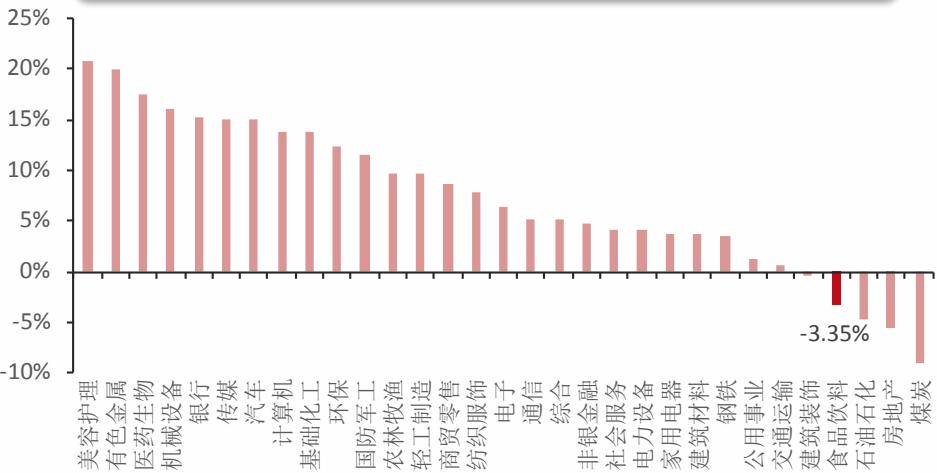

2025H1休闲食品/饮料乳品子版块表现较优  
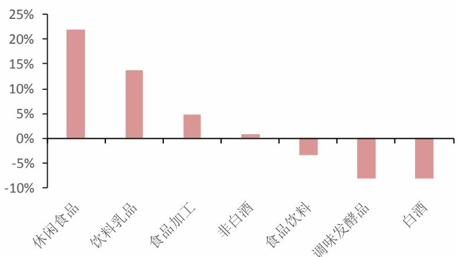

整体估值21倍，较年初估值回落明显  
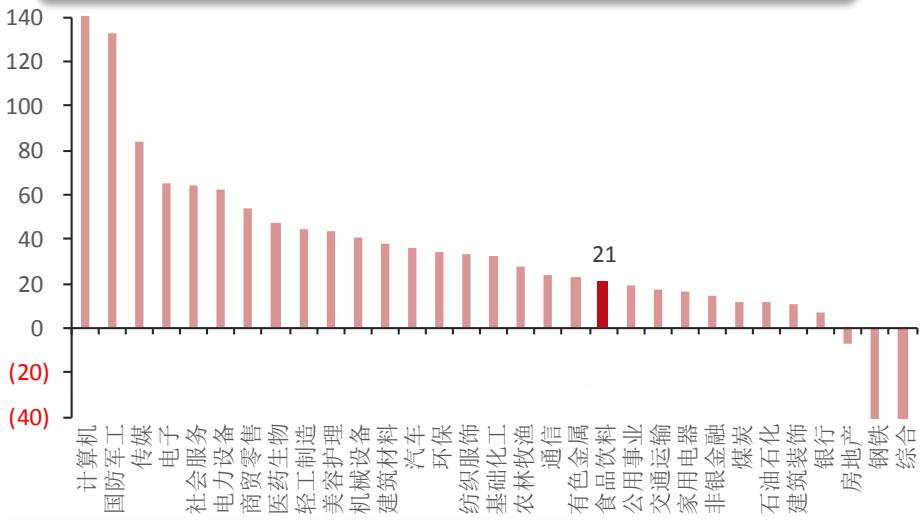

食品饮料/A股估值较年初保持平稳  
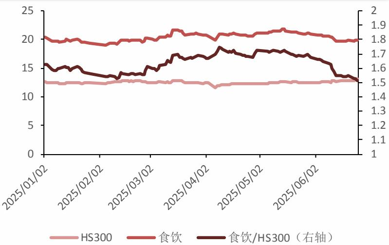

## 2025H1年行业回顾：板块内部分化明显，顺周期消费表现承压

☐ 从涨幅榜上看，受益于零售渠道变迁、企业主动推新，叠加市场风格倾向于新消费标的，相关标的股价表现突出，其中万辰集团、会稽山等新消费概念股领涨。伴随消费者健康意识和对功能性需求的提升，功能饮料、无糖茶等高景气赛道成长性延续。

☐ 在宏观经济尚待恢复和消费场景受限的背景下，白酒板块需求显著承压，次高端白酒业绩压力尤为显著；部分零食标的，春节前备货预期太高，造成当前回调幅度相对较大。

食品饮料板块涨幅前十名  
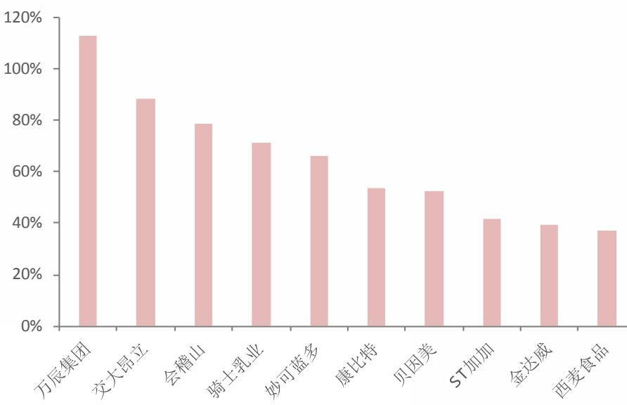

食品饮料板块跌幅前十名  
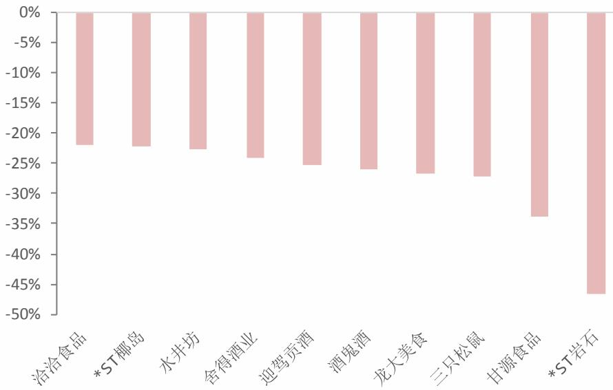

## 白酒：产量延续下降趋势，酒企竞争有所加剧

白酒产量延续下降  
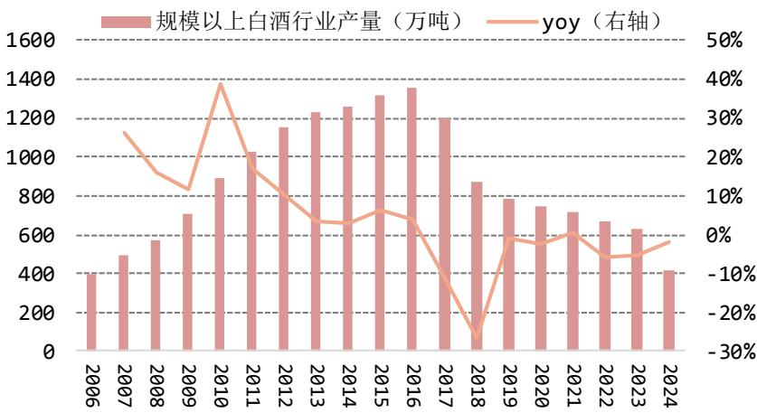

规模以上白酒企业数量  
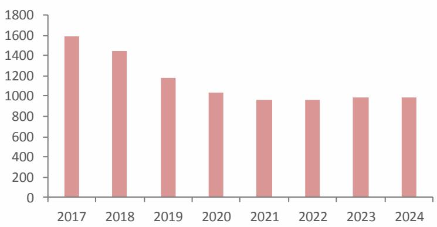

24年上市公司收入市占率提升至54.8%  

24年上市公司利润市占率提升至91.9%  
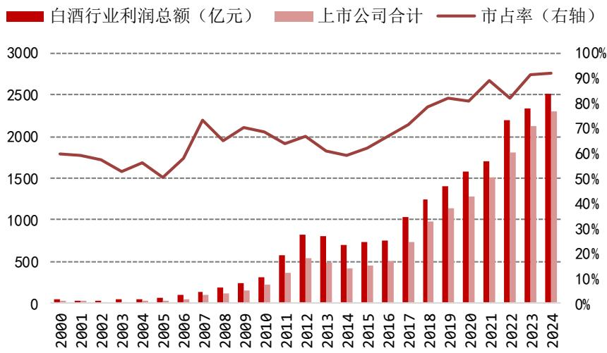

## 白酒：淡季需求显著承压，普飞批价边际走弱

☐ 高端：25Q2以来白酒需求有所承压，普飞批价从年初2200元左右下行至当前1850元左右震荡，普五和国窖批价也小幅下行

◆ 茅台：25年春节旺季期间，茅台酒和系列酒动销平稳；步入Q2淡季以来，伴随着政策趋严，餐饮环比走弱，商务消费低迷的背景下，供需矛盾有所放大，普飞批价出现下跌，批价从春节2200元左右下降至当前1850元左右；

◆ 五粮液：在商务消费低迷和飞天批价下行的影响下，渠道备货意愿低迷，普五批价从春节930元下行至当前880元左右；公司坚持量价平衡原则，积极开拓消费场景，1618和低度拉动消费；

◆ 国窖：在商务消费低迷，茅五需求疲软的压制下，国窖动销呈现出一定程度的压力，目前高度国窖批价850元左右，公司坚持长期主义，以价为先，积极开拓薄弱市场。

高端酒销量持续稳定增长  
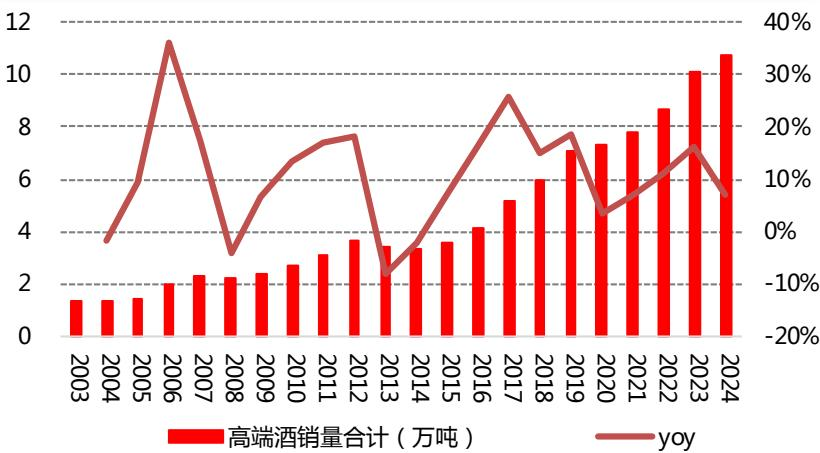

2024年高端酒销量市场份额  
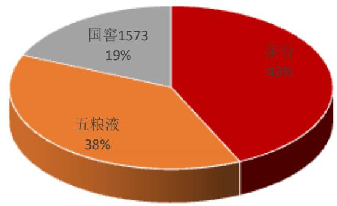

## 白酒：高端酒批价——行业景气度风向标

☐ 高端酒批价对于白酒行业尤其重要，直接反映行业景气度和供需状况。当前白酒行业正处于“政策调整、消费结构转型、存量竞争”三期叠加的深度调整期，高端酒需求边际走弱，渠道备货意愿变差，供需矛盾有所放大。加之茅台酒具有较强的金融属性，消费环境低迷的情况下，电商渠道和部分黄牛出现低价甩货叠加自媒体的传播放大，导致市场恐慌情绪加剧，造成短期价格恐慌式、非理性下跌；散瓶飞天批价从年初2200元左右下降至1850左右，生肖、散花飞天的批价也有所下滑。受终端需求疲软和茅台酒价格下行挤压，普五批价有所下行，当前批价880元左右；国窖采取批价跟随策略，兼顾价盘和动销，确保批价和竞品保持在合理范围内，当前高度国窖批价850元左右。

高端酒一批价变化趋势（元）

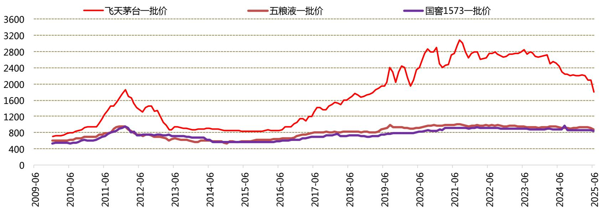

## 白酒：名优白酒占位品牌优势，次高端阶段性承压

☐ 次高端：需求端有所承压，品牌分化有所加剧。Q2淡季以来商务消费表现疲软，餐饮和宴席亦环比走弱，行业挤压式竞争有所加剧，次高端动销均显著承压，品牌分化进一步加剧。

☐ 汾酒：青花和玻汾双轮驱动，产品矩阵多点开花。得益于汾酒势能释放和产品矩阵完备，25Q1青花、玻汾、巴拿马等核心单品实现稳健增长；青花汾酒品牌积淀深厚，消费者基础优异，动销和批价表现优于次高端竞品。

◆ 舍得、酒鬼酒、水井坊：25年经济复苏缓慢，叠加政策冲击，商务消费比较疲软，烟酒店终端拿货意愿低迷，舍得、酒鬼酒、水井坊动销端均显著承压；水井坊较早进行库存去化，渠道库存相对可控。

◆ 区域地产酒次高端：25Q2以来商务消费表现疲软，宴席场次同比回落明显，500-800元价格带需求显著承压，主流单品增速均显著放缓；大众宴席市场比较坚挺，100-300元大众价格带需求有韧性，洞9、对开、古8/16等动销稳健。

次高端步入深度竞争阶段  
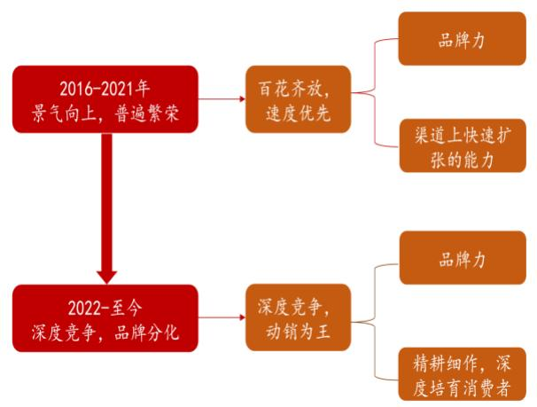  
2024年次高端市场份额

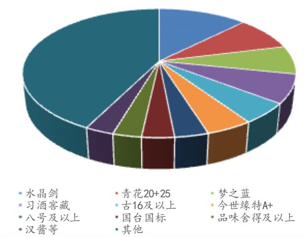

## 白酒：渠道——名酒引流效应显著，渠道优化加速集中度提升

☐ 渠道角度：名酒引流效应显著，渠道优化加速集中度提升。

名酒引流效应越发显著，经销商是否具有名酒代理权成为核心竞争力，拥有茅台、五粮液代理权占据制高点；同时，在行业并不乐观的大环境下，渠道对于品牌择优选择，加速行业集中度提升。

名酒厂家投入力度大，渠道费用支持；同时，渠道更加侧重于与厂家配合，积极开拓市场，注重终端动销；在信息化为主的管理系统下，厂家议价权增强，对于渠道的管控更加趋严。

<table><tr><td>层级</td><td>特征</td><td>渠道模式</td></tr><tr><td>高端</td><td>品牌为主,渠道为辅</td><td>直营+经销商,团购占比较大,经销商也以专卖店为主,厂家和经销商可同时供货大型KA,厂家有直接合作电商。厂家侧重于文化和品鉴,茅台直营占比持续提升。</td></tr><tr><td>次高端</td><td>品牌和渠道双轮驱动</td><td>经销商为主,烟酒店流通渠道走货为主。次高端既要有好的品牌,又需要强渠道运营能力,品牌数量众多,竞争比高端更加激烈,渠道的通路和消费者重复购买率至关重要。</td></tr><tr><td>中低端</td><td>渠道驱动为主,份额向强势品牌集中的趋势明显</td><td>经销商为主,主要以烟酒店和KA零售为主。消费者品牌忠诚度不高,品牌之间转换成本低;但近年来,中低端酒市场份额向该价位段强势品牌集中的趋势明显。</td></tr></table>

## 白酒：库存—大商库存压力仍存，终端主动去化库存

☐ 2016年白酒复苏以来，库存虽有所增加（尤其是近两年），经销商压力变大，但基本处于相对良性状态（部分品牌压力较大），随着厂家调控和信息化系统渗透，名优白酒库存周期有望平滑。25Q2受外部环境冲击，短期动销承压明显，出现了一定的渠道堰塞湖现象，库存压力变得更加明显。

名酒厂家关注可持续增长，不会主动压很多库存，一旦发现库存高企，主动控量保价。2018年6、7月份五粮液和国窖控量；2020年疫情之下，3月份开始各大酒厂控货；2022年四季度、2024年二季度厂家控货。

◆ 名优厂家均采用更加精细化，对于库存的把控能力较强。

基本采用扁平化运作+深度分销模式，厂家销售人员大幅增加，对于市场管控更加到位。

➢ 信息化系统的导入和使用，增强厂家对于渠道和终端的管理能力。

名优白酒价格，除茅台外，渠道利润并不丰厚，并未触发渠道大规模囤货行为。类比于2012年之前白酒的黄金十年期，此轮白酒复苏周期较短，除茅台外，鲜有渠道暴利的情况，经销商基本没有主动大规模囤货行为。

## 目录

白酒：中长期配置价值凸显
啤酒：低基数与低预期下，行业需求复苏可期
乳制品：成本、费用下降共振，高质量增长为主线
调味品：必需消费需求稳健，餐饮影响短期承压
速冻食品：借力餐饮连锁化，行业高景气持续
食品添加剂：成长空间广阔，天然健康为发展趋势
食品综合：优选优质子板块龙头
重点推荐标的

## 啤酒：24年行业表现分化，25年低基数效应可期

☐ 回顾25年上半年啤酒市场：受25年开年以后整体餐饮渠道需求持续呈现弱复苏态势以及去年Q1存在部分高基数的影响下，上半年啤酒行业整体普遍保持平稳增长态势，25Q1青啤/重啤/珠啤/燕啤销量增速分别为+3.5%/+1.9%/+2.5%/+11.7%；同期啤酒行业产量增速约为-2.2%。此外受整体消费力下滑影响，部分高端啤酒销量有所承压，25Q1青啤/重啤/珠啤/燕啤吨价增速分别为-0.6%/-0.3%/+4.1%/-0.9%。25年5月18日国家颁布《党政机关厉行节约反对浪费条例》引发部分市场对餐饮酒水消费的担忧，但随后6月17日人民网网评提出“禁止违规吃喝≠禁止正常吃喝”以强调并非限制正常餐饮消费。啤酒作为绝对单价较低且多以大众消费为主的单品，预计受冲击影响较小，中长期看政策影响趋近于无。

☐ 展望25年下半年啤酒表现：1）从销量基数上看，24年存在明显旺季不旺导致25年夏天存在一定低基数效应，尤其是全国性龙头有望充分受益于此。2）从天气因素来看，25年南方高温天气较多且雨涝偏少，北方虽入夏较晚但自6月后已进入持续高温状态，今年总体更为炎热少雨的天气因素或对旺季销量有积极促进。3）随着歪马、酒小二等酒类即时零售配送商逐渐兴起，非现饮啤酒有望充分受益于新兴消费模式实现高增。4）从大环境方面来看，国家目前已在多个省份通过发放餐饮消费券等方式鼓励消费，随着25年经济刺激政策持续加码，整体餐饮消费有望持续回暖，啤酒作为餐饮强相关行业有望实现良好恢复。

☐ 成本端保持平稳态势：从啤酒主要原材料来看，大麦价格目前仍处于低位，且酒企多在年末即锁定次年全年大麦价格，大麦有望在25年持续贡献成本红利；而从铝材、玻瓶等包材类原料价格走势看，虽价格相较年中有所上行但整体上涨程度温和可控。综合来看，25年啤酒成本端基本维持平稳态势，行业利润端弹性充足。

## 啤酒：寡头垄断格局确立，高端化成行业共识

☐ 行业进入寡头垄断阶段，CR5突破90%。历经多年跑马圈地与扩张并购，目前绝大部分省份竞争格局已确立，牢固的基地市场保证了龙头公司业绩下限。此外2010-2015年间啤酒行业价格战激烈，一方面拉低行业整体利润率，另一方面加速中小产能出清；行业CR5由70%迅速提升至90%以上，寡头垄断格局十分稳固。纵观食品饮料众多子板块，啤酒享有极佳的竞争格局，行业竞争趋于理性。

☐ 高端化成为行业共识，啤酒步入发展快车道。在行业利润率持续低下、低端啤酒消费下滑、进口啤酒连年高增等因素共振下，行业由规模为先向利润导向转变，产品结构升级成为行业主线逻辑。各大龙头近年来产品结构升级态势明显，例如华润次高及以上占比由19年11%快速提升至23年24%水平。

啤酒行业CR5突破90%  
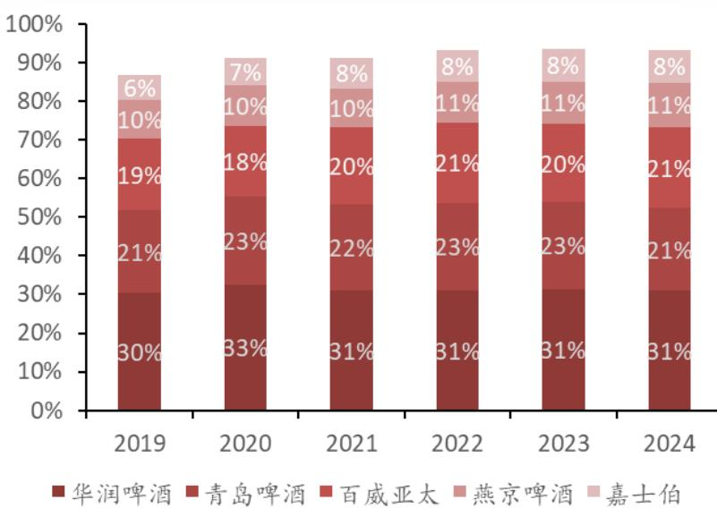

各品牌高档啤酒占比持续提升  
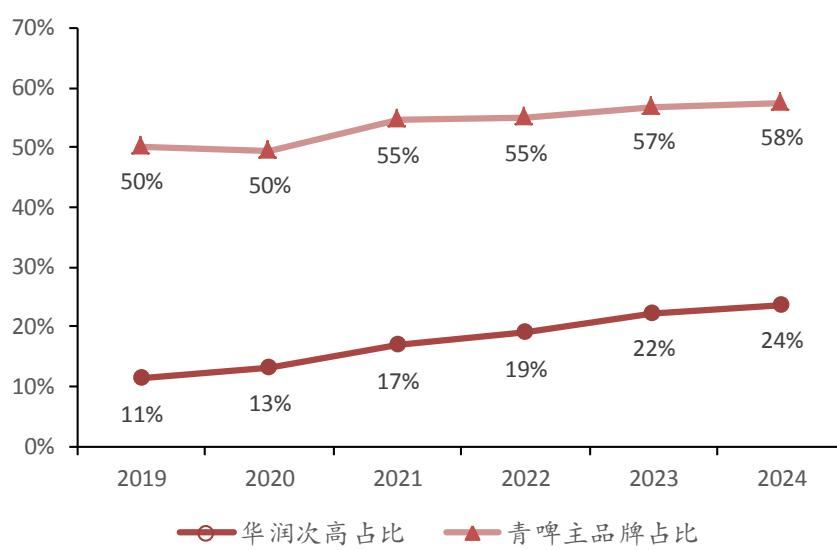

## 啤酒：行业布入成熟期，量稳价增为常态

◆ 量：受老龄化趋势加重、消费者健康意识觉醒、其他低度酒精饮料兴起等多种因素影响，中国啤酒产量自2013年达到历史顶峰4983万吨后开始逐年下滑，行业步入成熟期。对标海外，美国啤酒行业自1980年进入成熟期后，行业增速长期维持在低个位数水平；国内啤酒量长期保持平稳成为常态。

◆ 价：从需求端看以Z世代为主的年轻人作为啤酒的主力消费群体，其对于差异化和高端化啤酒的需求日渐旺盛；而供给端各啤酒企业纷纷通过主动提价+产品结构升级推动吨价上行，2019-2024年行业平均吨价年复合增速约3.4%；且目前行业内低档啤酒仍占比过半，未来价增空间广阔。

国内啤酒产量基本企稳  
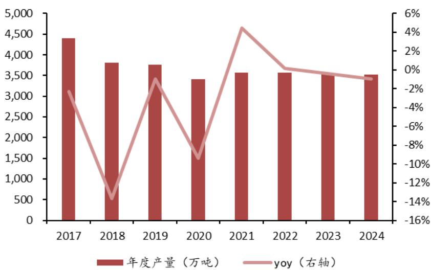  
数据来源：国家统计局，西南证券整理

啤酒企业近年吨价表现（元/吨）  
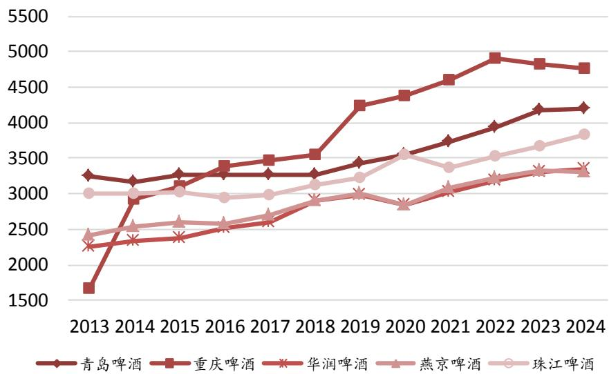  
数据来源：公司公告，西南证券整理

## 啤酒：2025年啤酒行业成本端呈现温和态势

☐ 啤酒受原材料价格波动影响较大。从啤酒的原材料构成来看，占比最大的两个部分分别是占比接近50%的包装材料和占比约25%的酿酒原料，具体来看：包装物中铝材、玻瓶以及纸箱分别占比约40%+、30%和20%；而酿酒材料中大麦占比超过50%。

☐ 展望2025年啤酒成本端：从啤酒主要原材料来看，大麦价格目前仍处于低位，且酒企多在年末即锁定次年全年大麦价格，大麦有望在25年持续贡献成本红利；而从铝材、玻瓶等包材类原料价格走势看，虽价格相较去年有所波动但整体上涨程度温和可控。综合来看，25年啤酒成本端基本维持平稳态势，行业利润端弹性充足。

大麦价格变动走势（美元/吨）  
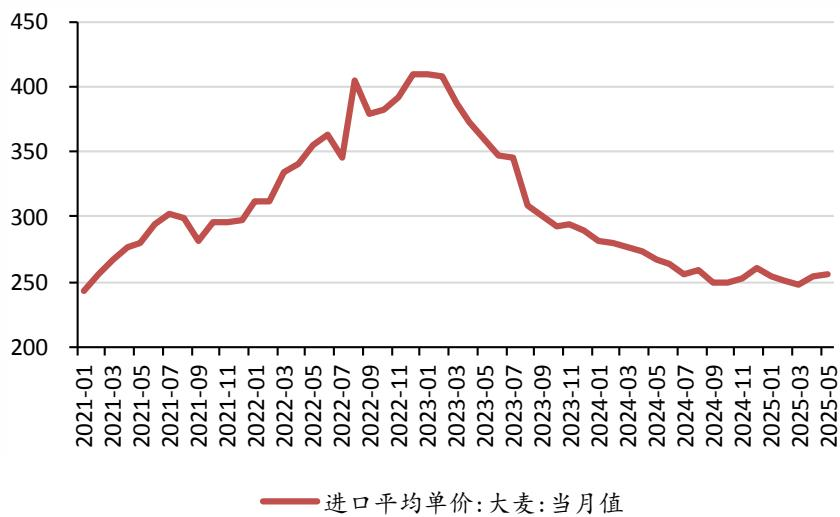

啤酒原材料成本构成  
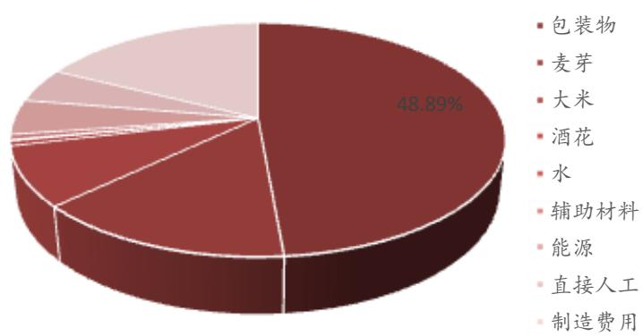  
数据来源：公司公告，西南证券整理

数据来源：国家统计局，西南证券整理

## 啤酒：高端化关键抓手，大单品之争愈演愈烈

☐ 高端化时代品牌数量激增，各酒企倾力打造高端大单品。随着行业高端化进程的推进，各大酒企均通过增加品牌数量来更好的匹配消费者越发差异化的需求，因此具备体量优势、盈利支撑和高消费者认知的高端大单品，在目前啤酒品牌林立的当下显得弥足珍贵。具体来看24年各龙头表现：

◆ 华润啤酒：24年次高及以上约260万吨，其中大单品喜力销量已突破70万吨；

◆ 重庆啤酒：24年高档销量146万吨，其中大单品乌苏体量约75万吨，重庆及乐堡均超60万吨；

◆ 珠江啤酒：24年高档啤酒销量约90万吨+，其中大单品97纯生销量已接近40万吨；

燕京啤酒：24年大单品U8销量已接近70万吨。

2024年主流啤酒企业产品销量结构

<table><tr><td></td><td>华润啤酒</td><td>青岛啤酒</td><td>燕京啤酒</td><td>重庆啤酒</td><td>珠江啤酒</td></tr><tr><td>次高端及以上</td><td>22%(8元以上)</td><td>15%(8元以上)</td><td>23%(8元以上)</td><td>48%(8元以上)</td><td>65%(6元以上)</td></tr><tr><td>中端</td><td>29%(6-8元)</td><td>35%(6-8元)</td><td>17%(6-8元)</td><td>49%(6-8元)</td><td>28%(4-6元)</td></tr><tr><td>主流</td><td>49%(6元以下)</td><td>50%(6元以下)</td><td>60%(6元以下)</td><td>3%(6元以下)</td><td>6%</td></tr></table>

www.swsc.com.cn  
数据来源：公司公告，西南证券整理（部分数据为估算值）

## 目录

白酒：中长期配置价值凸显
啤酒：低基数与低预期下，行业需求复苏可期
乳制品：成本、费用下降共振，高质量增长为主线
调味品：必需消费需求稳健，餐饮影响短期承压
速冻食品：借力餐饮连锁化，行业高景气持续
食品添加剂：成长空间广阔，天然健康为发展趋势
食品综合：优选优质子板块龙头
重点推荐标的

## 乳制品：成本、费用下降共振，高质量增长为主线

◆ 奶价仍处下行周期，头部乳企盈利能力提升。2021年以来，国内奶价进入下行周期，同时头部乳企进入追求盈利能力的高质量增长阶段，价格战等竞争明显减少，费用投放力度减弱，形成成本、费用共振，毛销差水平明显改善。此外，需求逐步回暖、产品结构改善同样将释放利润弹性。当前，原奶供需差已逐渐收窄，奶价下跌趋势已有所放缓，预计2025年下半年后原奶供需将逐步实现平衡、奶价有望企稳回升。

国内生鲜乳价格（元/kg）  
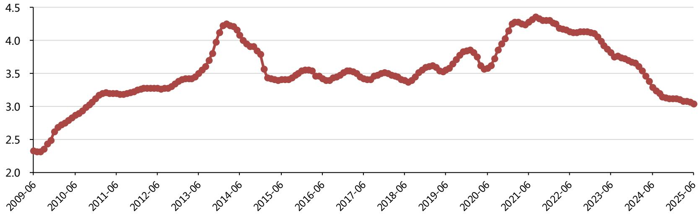

中国:主产区:平均价:生鲜乳:月:平均值

## 乳制品：成本、费用下降共振，高质量增长为主线

## □ 乳制品需求偏刚性，仍有较大增长空间

◆ 人口基数保障乳制品需求空间。我国人口基数庞大，伴随三胎政策出台、人口老龄化等因素，人口数量较为稳定，对乳制品的需求空间广阔。此外，2024年人均可支配收入达到4.1万元，近五年人均可支配收入复合增速为6.1%，居民收入水平稳步提高，消费升级趋势明显，为乳制品消费增长提供动力。

◆ 乳制品需求韧性强，长期仍将持续增长。2024年，我国居民人均奶类消费量12.6kg，同时城乡差距较大，农村居民人均消费量仅为城镇居民的大约一半，增长空间巨大。此外，《中国居民膳食指南2022》将每人每天乳制品摄入量提高至300-500g，长期看仍有增长空间。疫情结束以来乳制品行业需求复苏偏弱，白奶消费韧性相对较强。

全国居民人均可支配收入  

全国居民人均奶类消费量  
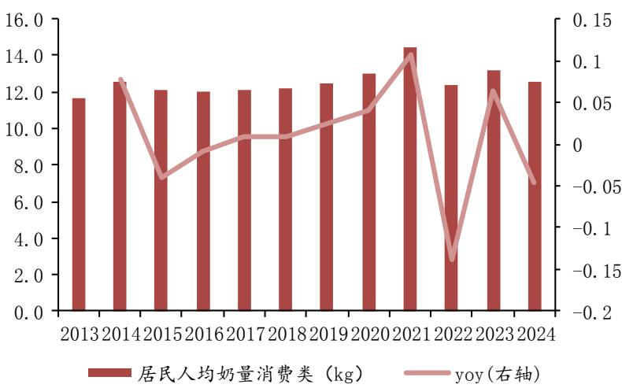

## 乳制品：成本、费用下降共振，高质量增长为主线

## □ 原奶供给稳健增长

奶牛数量下降后稳中有升。国内奶牛数量自2015年起下降，由于国内环保政策收紧，散户和中小牧场逐渐退出，规模化牧场占比提升。2019年下降至最低点610万头，2024年奶牛数量约为660万头，基本保持稳中有升态势。

奶牛单产提升。随着中小牧场退出和奶牛养殖规模化程度的快速提升，奶牛单产保持上升趋势，已从2010年的4387kg/年提升至2024年的6296kg/年。

◆ 从国内总量上看，2024年全国牛奶产量达4155万吨，同比下降2.9%，近五年复合增长率为4.7%，整体供给量充足。

全国奶牛数量  

全国奶牛年单产（kg/年）  

## 乳制品：成本、费用下降共振，高质量增长为主线

## □ 饲料价格高涨后逐步回落

◆ 玉米、豆粕价格有所回落。奶牛饲料分为精饲料、粗饲料、补充饲料，其中玉米和豆粕等精饲料占奶牛每日饲料消耗量的40%-50%。2020年下半年以来，玉米、豆粕等奶牛主要饲料价格保持高位后有所回落。截至2025年6月末，玉米、豆粕现货价分别为2.4元/kg、2.9元/kg，饲料价格对原奶价格形成一定支撑。

◆ 高品质苜蓿进口为主。苜蓿对提高奶牛产奶量和乳蛋白水平有重要作用。随着奶牛养殖规模扩大、大型牧场占比提高，高品质苜蓿需求快速增长。我国优质苜蓿生产得到有效发展，苜蓿种植面积增加，但目前仍无法满足需求，需要大量进口。2022年苜蓿价格高涨，2023-2024年间开始缓慢回落，2025年逐步企稳。2024年我国进口苜蓿干草约112万吨，同比增长13%；平均到岸价369美元/吨，同比下降28.5%。

玉米现货平均价（元/吨）  
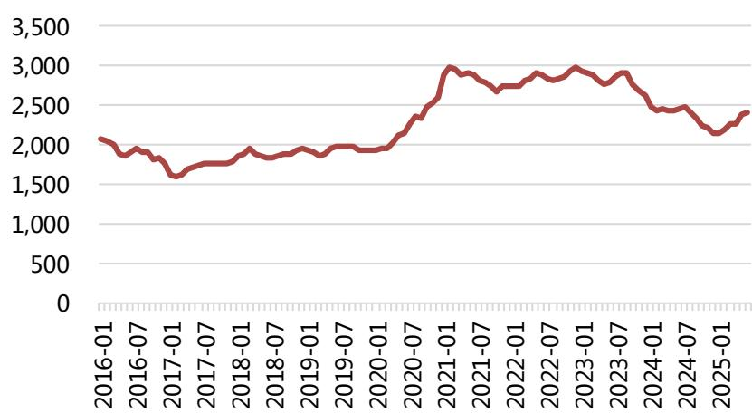

豆粕现货平均价（元/吨）  
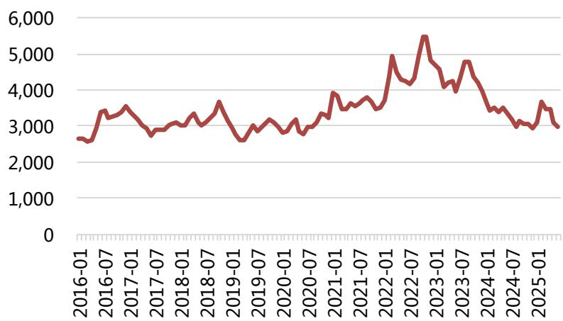

## 乳制品：成本、费用下降共振，高质量增长为主线

## □ 全球原奶产量平稳，大包粉进口价格回落

我国减少进口，国际奶价低位。除国产原奶外，进口大包粉也是国内乳制品重要的来源。2024年我国大包粉进口量169.4万吨，同比下降 $17.9\%$ ；进口奶粉年平均价格为2.6万元/吨，同比下降 $0.5\%$ 。2024年我国对新西兰、欧盟、澳大利亚、美国大包粉进口量分别下降 $15.9\%$ 、 $37.9\%$ 、 $58.8\%$ 、 $17.5\%$ 。GDT拍卖价格大幅下降，2024年12月全脂奶粉拍卖价格4332美元/吨，同比下降 $1.6\%$ ，在我国进口需求没有较大提升的情况下，预计国际奶价仍将保持低位。

大包粉进口数量情况  
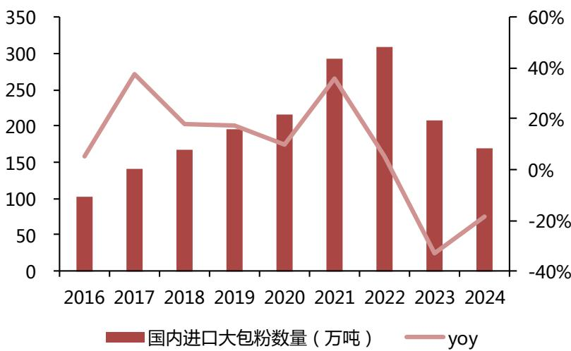

大包粉进口金额情况  
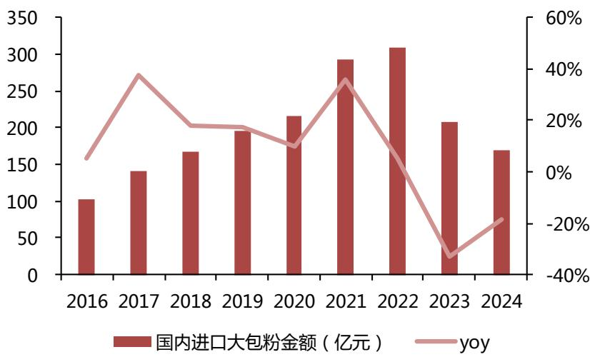

## 乳制品：成本、费用下降共振，高质量增长为主线

## ☐ 乳制品短期逻辑已兑现，长期盈利稳步向上。

1、短期看，乳制品公司利润弹性已释放：1）上游牧业产能释放叠加乳制品消费需求平稳，原奶价格下行，全年奶价仍将保持低位。2）乳制品企业费用投放效率普遍提高，进一步提高盈利水平。

2、中长期看，乳制品板块整体盈利有望持续向上：1）牧业规模化程度加大，供给端非理性行为引起原奶价格波动的因素逐渐消退，原奶价格有望企稳。2）乳制品消费升级仍有空间，随着消费逐渐复苏，高端白奶、高端鲜奶等产品更受消费者欢迎，产品结构将持续改善。3）乳制品企业普遍对费用管控力度加大，多数企业提出利润率提升的目标，长期盈利能力将稳步提高。重点推荐伊利股份（600887）、新乳业（002946）。

## 目录

白酒：中长期配置价值凸显
啤酒：低基数与低预期下，行业需求复苏可期
乳制品：成本、费用下降共振，高质量增长为主线
调味品：必需消费需求稳健，餐饮影响短期承压
速冻食品：借力餐饮连锁化，行业高景气持续
食品添加剂：成长空间广阔，天然健康为发展趋势
食品综合：优选优质子板块龙头
重点推荐标的

## 调味品：24年受益于成本下行，期待25年餐饮场景修复

☐ 回顾25年上半年调味品行业：调味品作为与居民日常消费息息相关的必需消费品，同时也是餐饮供应链中的重要一环。B端方面，25年开年以来餐饮需求复苏仍较为缓慢，25年1-5月社零餐饮实现收入2.2万亿元，同比+5%，且从24年来基本单月维持中低位数增长，整体复苏态势相对疲软。C端方面，25年调味品C端消费延续了去年以来的销量平稳+单价微降的突出性价比消费趋势，整体调味品行业上半年仍在量价层面处于相对承压态势。

☐ 展望25年下半年调味品行业：从B端来看，25年餐饮消费有望在政策刺激下实现逐步修复，而餐饮渠道作为调味品消费的主力战场有望充分受益于餐饮复苏，动销提速下B端销量或有明显改善；而C端方面，在居民消费力的持续复苏与调味品整体健康化大趋势的双重拉动下，调味品行业产品结构有望持续改善，此外以海天复合调味汁为代表的新品持续涌现，带动吨价稳步上行。

☐ 调味品行业成本端25年展望：目前国产大豆价格相较22年高点下降幅度超30%，且同环比来看均呈下行趋势；其他原材料如包材等亦处于相对低位。综合考虑酱油酿造周期及原料锁价等因素影响，25年调味品行业成本端仍具备部分红利，有助于25年行业整体业绩保持平稳增长态势。

## 调味品：行业空间广阔，未来持续稳定增长

☐ 纵观食品饮料诸多子板块，调味品赛道景气度始终不减。得益于其发酵后的独特风味形成的口味壁垒，以及其必选消费品属性带来的强消费者粘性，过去5年行业维持稳定增长，复合增速约为8.4%，2024年调味品市场规模已突破6500亿元。

☐ 随着经济发展和城镇化率提升，一方面带来消费能力的提升，家庭调味品往量价齐升方向发展；另一方面人口大量聚集带来生活习惯改变，外出就餐及外卖频次显著增加，拉动餐饮市场规模迅速提升，近五年整体餐饮市场CAGR约为5.5%，其中外卖和团餐渠道分别为37%/14%。

调味品行业持续稳定增长  

外卖渠道规模持续增长  
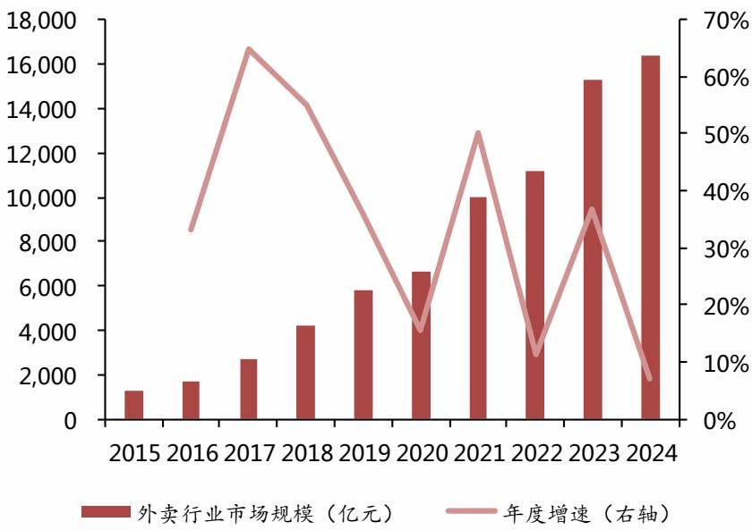

## 调味品：B端餐饮持续复苏，行业集中度加速提升

☐ 下游餐饮持续复苏，改善行业整体供需结构。从调味品行业下游渠道占比来看，餐饮渠道占比仍维持在半数以上，C端渠道占比约37%。线下B端需求遭受持续冲击，进而带动行业整体表现低迷；随着下游餐饮端需求的持续复苏以及连锁化率的持续提升，调味品企业B端增速有望实现边际改善。

☐ 相较海外成熟市场，集中度提升空间广阔：中国调味品行业集中度仍处于较低水平，以酱油行业为例：根据海天港股招股书，以收入计2024年国内酱油CR5仅为 $25.1\%$ ，与美国（ $41\%$ ）、日本（ $44\%$ ）等海外成熟市场相比，前五大企业市占率仍有巨大提升空间。随着行业走向成熟市场竞争逐步加剧，区域性中小产能将会加速出清，未来调味品将进入挤压式增长阶段，利好头部企业持续享受集中度提升红利。

调味品下游渠道占比  
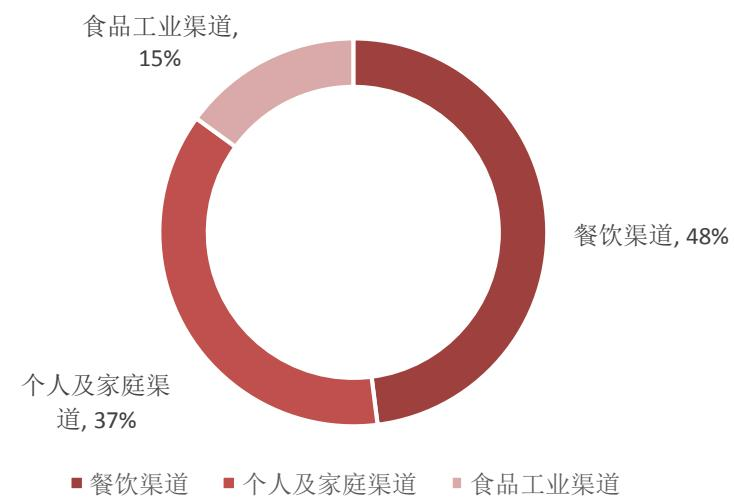  
2024年各国酱油行业CR5集中度对比

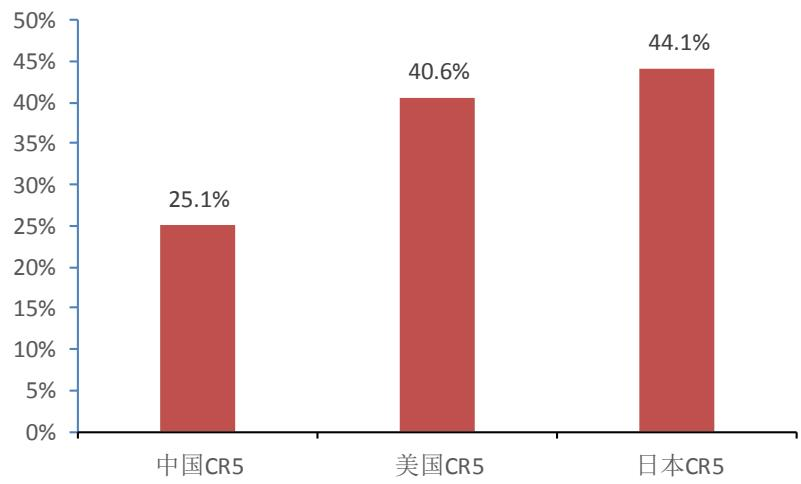

## 调味品：复合化及健康化为行业未来两大发展趋势

☐ 复合化：降本增效需求催生复合调味品渗透率不断提升。分B/C两端来看：1）餐饮企业随着连锁化率的持续提升，对菜品标准化及去厨师化的追求日益增加，而复合调味品可以帮助餐企解决这两大痛点；2）随着家庭结构变化与居民生活节奏加快，消费者愿意为烹饪锁花费的时间愈发减少，催生了对复调的需求。2024年复调行业规模已接突破2300亿元，近五年CAGR约为13.9%。

☐ 健康化：随着居民对生活品质的要求不断提高以及老龄化程度的持续提升，叠加22Q3以来零添加酱油风波事件的影响下，在消费升级大趋势逐步放缓的背景下，基础调味品向健康化方向发展，已逐渐成为行业未来结构升级的关键动能。

复合调味品行业市场规模  
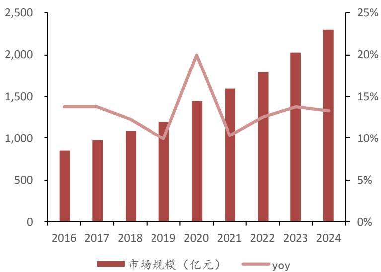

零添加调味品市场规模  
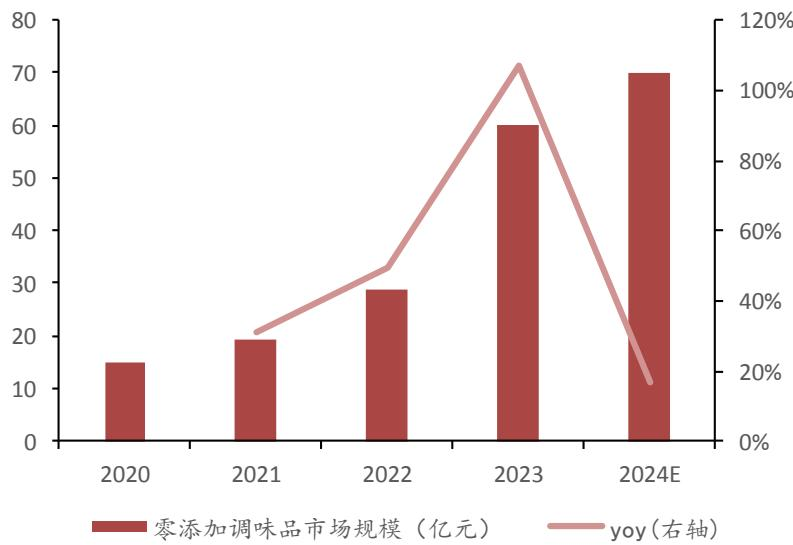

## 目录

白酒：中长期配置价值凸显
啤酒：低基数与低预期下，行业需求复苏可期
乳制品：成本、费用下降共振，高质量增长为主线
调味品：必需消费需求稳健，餐饮影响短期承压
速冻食品：借力餐饮连锁化，行业高景气持续
食品添加剂：成长空间广阔，天然健康为发展趋势
食品综合：优选优质子板块龙头
重点推荐标的

## 速冻食品：借力餐饮连锁化，行业高景气延续

☐ 无序扩张带来价格战：疫情期间受居家需求激增影响，速冻行业产能出现无序扩张从而带来供给过剩的问题；此外汤圆水饺等传统速冻产品自身同样存在同质化程度高等，因而致使行业在C端和小B端存在较为激烈的价格战。尽管速冻行业在需求端有所承压，但龙头企业仍旧凭借其渠道、产品及规模优势，不断攫取中小企业市场份额，充分享受行业集中度提升红利。

☐ 展望25年速冻食品行业：随着25年国家促消费政策不断出台，餐饮消费场景有望持续恢复，则大B自身有望受益于此，提升拓店速度与单店业绩，小B渠道在整体社会餐饮复苏的大环境下亦将实现较快恢复。中长期看，万亿餐饮供应链市场下，餐企对于降本提效的需求永不停息，速冻企业有望充分受益。社会餐饮的持续复苏，将拉动小B客户对速冻面点及火锅料需求回升，速冻行业整体有望实现高增。

## 速冻食品：餐饮行业高景气，连锁化率持续提升

☐ 据国家统计局数据，2024年全国餐饮收入5.6亿元，同比增长5.3%，受消费力下滑和大环境影响，24年整体餐饮行业呈现弱复苏态势。但随着下游餐饮连锁化率从18年12%持续提升至24年23%水平，作为行业中上游的餐饮供应链将维持高景气。

◆ 需求端：城镇化程度逐渐升高带动居民收入水平提升，外出就餐机会和频次增长，餐饮行业维持较快增长，2019-2024年CAGR为3.6%；

◆ 供给端：行业竞争加剧叠加人力与店租成本上升，倒逼商家降本增效，通过提升流程标准化程度，不断优化整体供应链成本。

中国餐饮市场规模持续增长  
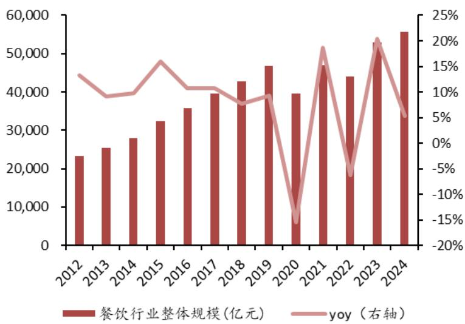

国内餐饮连锁化率持续增长  
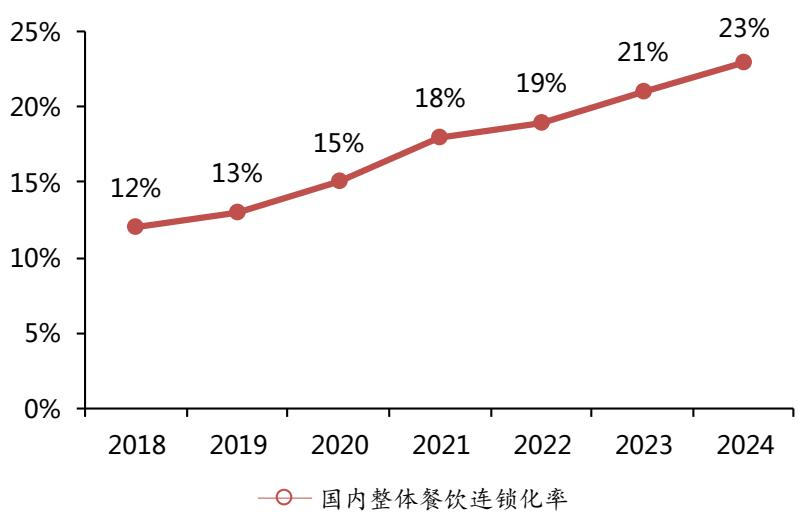

## 速冻食品：对标海外，B端占比尚有大幅提升空间

☐ 速冻食品作为餐饮供应链中重要的组成部分，尤其是针对B端餐饮客户的速冻火锅料、速冻面米制品、速冻菜肴等标准化半成品将极大提升后厨效率，迎来巨大的需求爆发。

◆ 餐饮连锁化趋势拉动食材标准化需求：根据美团统计，2024年我国餐饮连锁化率约为23%，相较日本49%水平仍有大幅提升空间。

◆ 餐饮渠道占比低，加速渗透可确立：相比较日本超60%以上的速冻食品消化在餐饮渠道内，而中国速冻食品餐饮渠道占比低（不到30%），冻品B端需求仍未得到充分释放。

## 速冻企业在整体餐饮供应链中处于行业中游

## 速冻食品：B端需求爆发，拉动火锅料高速增长

## □ 速冻火锅料

◆ 行业规模：2024年速冻火锅料的市场规模约740亿元，近五年行业整体复合增速约为8.1%。受益于B端连锁火锅类及烧烤类餐饮的快速发展，预计未来五年B端火锅料将保持约双位数增长。

$\spadesuit$ 竞争格局：1）速冻火锅料行业格局较为分散，2024年CR5约 $25\%$ ；其中安井作为绝对龙头，市占率已超 $10\%$ ；2）随着行业竞争烈度逐步提升，成本能力控制弱、品牌力弱且缺乏提价能力的小企业呈现加速退出态势，行业集中度持续提升。

速冻火锅料行业保持高速增长

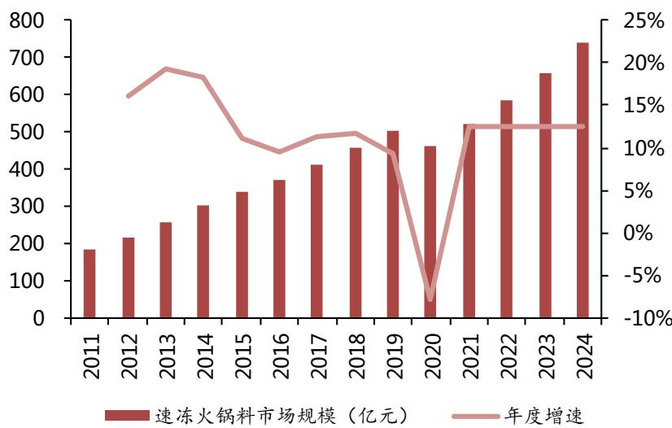  
数据来源：华经产业研究院，西南证券整理  
中国消费者速冻食品购买品类占比

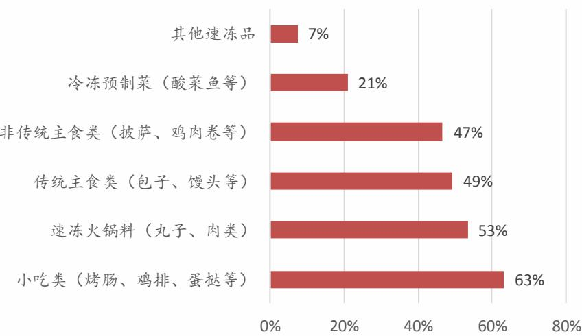  
数据来源：艾媒咨询，西南证券整理

## 速冻食品：传统米面增速放缓，新式面点蓄势待发

## □ 速冻面米制品

◆ 行业规模：2024年速冻米面行业规模约为970亿元，其中零售C端占比超70%。分品类看，传统米面进入成熟期，行业维持中单位数增长；新式面点正处于快速发展阶段，预计维持双位数以上增速。

◆ 竞争格局：1）C端零售市场集中度较高，传统的汤圆水饺领域主要主要集中在三全、湾仔码头、思念三家手中，市占率接近70%；2）B端餐饮快速发展，手抓饼、油条、蒸饺等一系列符合餐饮渠道消费的小吃类新品推出，其中千味央厨、三全、正大、安井等企业为头部玩家。

速冻米面整体增速平稳  
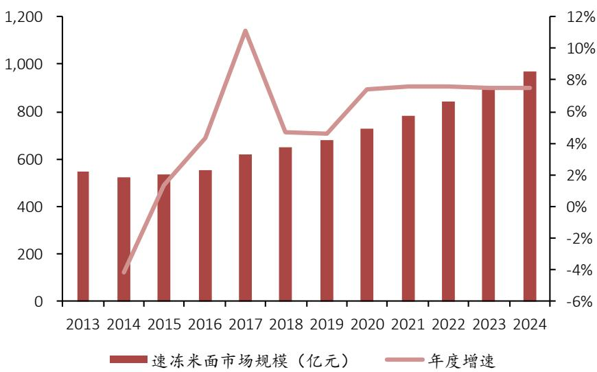  
数据来源：华经产业研究院，西南证券整理

速冻小吃市场维持高速增长  
  
数据来源：中商产业研究院，西南证券整理

## 目录

白酒：中长期配置价值凸显

啤酒：低基数与低预期下，行业需求复苏可期

乳制品：成本、费用下降共振，高质量增长为主线

调味品：必需消费需求稳健，餐饮影响短期承压

速冻食品：借力餐饮连锁化，行业高景气持续

食品添加剂：成长空间广阔，天然健康为发展趋势

食品综合：优选优质子板块龙头

重点推荐标的

## 食品添加剂：成长空间广阔，天然健康为发展趋势

## ☐ 甜味剂：借无糖之风乘势而上，品类向天然健康升级迭代

代糖市场加速扩容，渗透率持续提升。从全球来看，2024年甜味剂渗透率已达8.5%，代糖的市场规模已达到80亿美元的量级。随着消费者健康意识的觉醒以及越来越多无糖产品的问世，代糖的渗透率提升呈现加速趋势，我国甜味剂产量由2017年的15.9万吨提升至2024年的31.5万吨，近5年CAGR达10.9%，长期增长趋势明确。

◆ 多应用场景广泛使用，减糖风潮席卷市场。代糖应用场景广泛，除饮料外还广泛应用于餐桌调味品、个人护理产品、烘焙食品、药品、保健类食品、糖果巧克力、医药类用品、化工类制品等多个领域。饮料领域是代糖主要应用领域，占比约50%。

我国甜味剂产量  
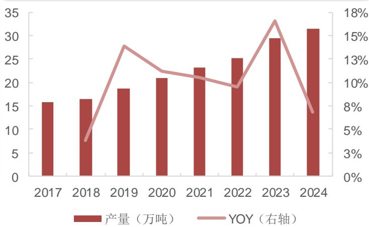  
甜味剂应用领域构成

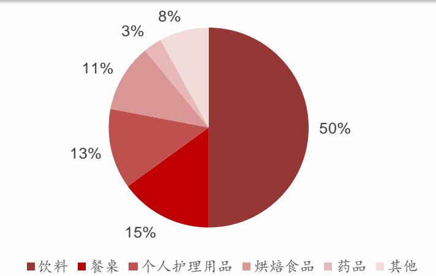

## 食品添加剂：成长空间广阔，天然健康为发展趋势

## ☐ 甜味剂：借无糖之风乘势而上，品类向天然健康升级迭代

成本优势推动人工甜味剂增长，健康优势打造天然甜味剂广阔空间。人工甜味剂经历了从糖精 $\rightarrow$ 甜蜜素 $\rightarrow$ 阿斯巴甜 $\rightarrow$ 安赛蜜 $\rightarrow$ 三氯蔗糖的迭代发展，在口味（更像蔗糖）与安全（对健康影响更小）方面持续优化，从具体品类看，糖精、甜蜜素、阿斯巴甜作为前三代合成甜味剂，价甜比低、性价比高，应用仍较广泛，但由于安全性不足，产销量增长动能较弱。安赛蜜与三氯蔗糖作为第四、五代合成甜味剂，相对安全且价甜比高，产量增速较快。天然甜味剂作为健康进阶产品，高安全性打开未来成长空间，甜菊糖苷/赤藓糖醇优势更加突出。通过植物萃取和生物发酵取得的天然甜味剂更为健康，广泛应用于饮料、调味品和糖果中。

代糖类产品特性对比

<table><tr><td>分类</td><td>产品</td><td>甜度系数</td><td>价甜比</td><td>热量(卡路里)</td><td>口感</td><td>安全性</td></tr><tr><td>天然糖</td><td>蔗糖</td><td>1</td><td>1.00</td><td>4</td><td>纯正</td><td>好</td></tr><tr><td rowspan="6">人工甜味剂</td><td>糖精</td><td>300</td><td>0.01</td><td>0</td><td>苦味、涩味、金属味</td><td>较差,有一定致癌性</td></tr><tr><td>甜蜜素</td><td>50</td><td>0.05</td><td>0</td><td>涩味</td><td>较差</td></tr><tr><td>阿斯巴甜</td><td>200</td><td>0.08</td><td>4</td><td>纯正</td><td>较好,有一定争议</td></tr><tr><td>安赛蜜</td><td>200</td><td>0.06</td><td>0</td><td>涩味、金属味</td><td>较好</td></tr><tr><td>三氯蔗糖</td><td>600</td><td>0.06</td><td>0</td><td>略有涩后味</td><td>好</td></tr><tr><td>纽甜</td><td>7000-13000</td><td>0.01</td><td>1</td><td>纯正</td><td>好</td></tr><tr><td rowspan="4">天然甜味剂</td><td>木糖醇</td><td>1</td><td>0.70</td><td>2.4</td><td>微清凉感</td><td>有腹泻风险</td></tr><tr><td>赤藓糖醇</td><td>0.6-0.8</td><td>3.95</td><td>0.21</td><td>微清凉感</td><td>有腹泻风险</td></tr><tr><td>甜菊糖苷</td><td>200-300</td><td>0.12</td><td>0</td><td>微苦涩</td><td>好</td></tr><tr><td>罗汉果糖苷</td><td>300</td><td>0.60</td><td>0</td><td>甘苦味</td><td>好</td></tr></table>

## 食品添加剂：成长空间广阔，天然健康为发展趋势

☐ 甜味剂：借无糖之风乘势而上，品类向天然健康升级迭代

◆ 人工甜味剂（化学合成）占主导地位，天然甜味剂（植物提取、生物发酵）份额不断提升。从目前的甜味剂配料市场来看，人工甜味剂（化学合成）依旧占据了较大的市场份额，2013-2024年间天然甜味剂在代糖产品的应用占比由8.1%迅速增长至32.7%。随着消费者对于甜味剂的来源及安全问题关注度的不断加强，天然甜味剂需求还将保持高速增长，预计通过植物提取（甜菊糖苷）和生物发酵（赤藓糖醇）得到的天然代糖份额将逐年增高。

全球甜味剂品类份额（按产量）  
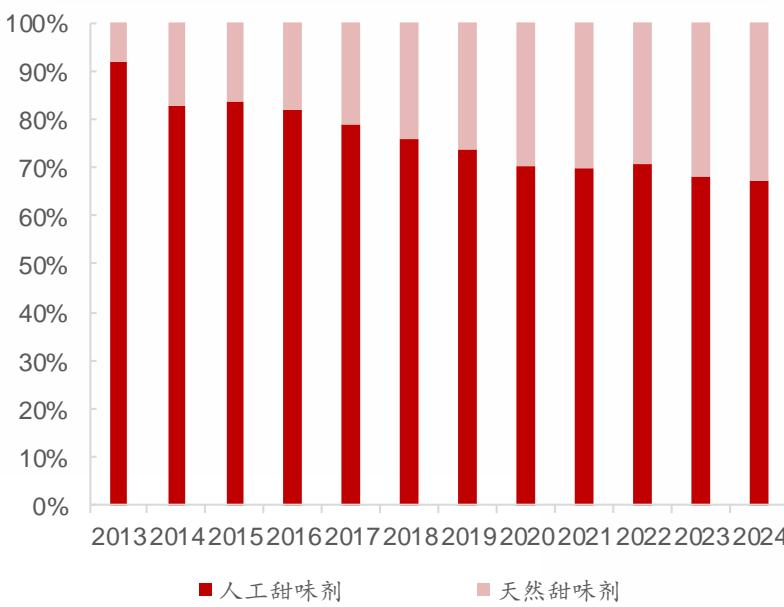  
全球甜味剂市场结构（按产量）

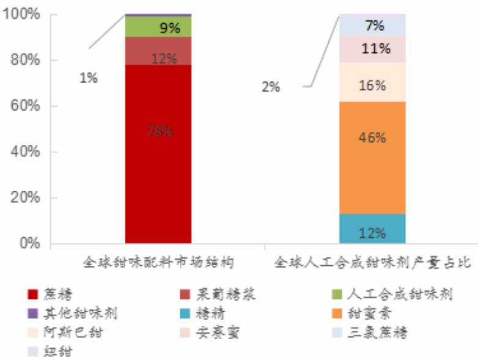

## 食品添加剂：成长空间广阔，天然健康为发展趋势

## □ 植物提取物：需求蓬勃发展，行业格局分散

全球植提市场持续扩张，中国植提市场规模稳中有升。植物提取物可作为原料，参与制成食品、中药、保健食品、日化产品、化妆品、养殖投入品。2024年全球植提市场达到422.5亿美元，同比增长9.3%。随着应用场景多样化，植物提取行业市场规模实现逐年递增，预计到2030年将以8.3%的复合年增长率增长至701.9亿美元。中国植提行业起步于20世纪70年代部分中药厂在生产环节对植物成分的提取，近年来随着消费者对天然健康概念的重视迎来快速发展，由2017年的275亿元增至2024年的546亿元，CAGR达10.4%。预计2025年中国植提市场规模有望突破600亿元。

全球植提市场规模及同比增速  
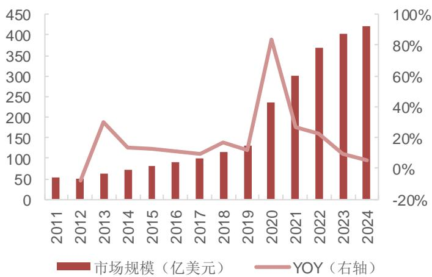

中国植提市场规模及同比增速  
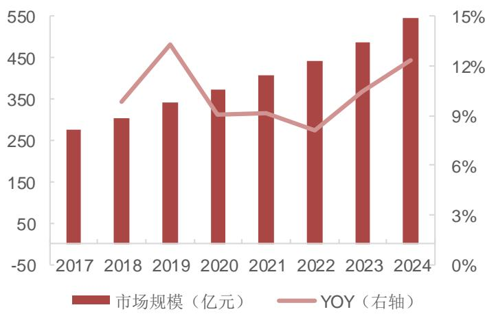

## 食品添加剂：成长空间广阔，天然健康为发展趋势

□ 植物提取物：需求蓬勃发展，行业格局分散

◆ 格局相对分散，龙头占据细分领域。植物提取细分产品种类多、应用领域涉及范围广阔，具有小而美的特性，因此行业格局相对分散。各个细分领域均有不同龙头占据，大部分企业仅提供几个或者十几个品类的初级产品。譬如辣椒红、辣椒精及叶黄素的全球市场份额由晨光生物主导，番茄红素的全球份额则主要由以色列的Lycored（利库德）占据，国内天然甜味剂则是莱茵生物处于领先地位。行业细分龙头凭借自身研发技术、生产工艺、机械设备、原料掌控和销售渠道等方面的优势，逐渐建立了自身的优势壁垒，头部企业走向平台化。

中国植物提取物行业市场竞争格局

<table><tr><td>排名</td><td>市场规模 (亿元)</td><td>代表公司</td><td>植提业务占比</td><td>市场分布</td><td>主要产品</td></tr><tr><td rowspan="3">第一梯队</td><td>48.7</td><td>晨光生物</td><td>51%</td><td>国内81%、国外19%</td><td>天然色素、香辛料提取物和精油、营养及药用提取物等</td></tr><tr><td>10.5</td><td>莱茵生物</td><td>94%</td><td>国内38%、国外58%</td><td>天然甜味剂、茶叶提取物、工业大麻提取物等</td></tr><tr><td>3.0</td><td>欧康医药</td><td>100%</td><td>国内75%、国外25%</td><td>槐米提取物、枳实提取物、黄连提取物等</td></tr><tr><td rowspan="5">第二梯队</td><td>1.6</td><td>天然谷</td><td>99%</td><td>国内54%、国外46%</td><td>淫羊藿提取物、刺蒺藜提取物、红景天提取物等</td></tr><tr><td>0.9</td><td>康隆生物</td><td>100%</td><td>绝大部分为海外市场</td><td>植物提取物</td></tr><tr><td>0.8</td><td>华康生物</td><td>100%</td><td>国内15%、国外85%</td><td>人参造甙提取物、蓝莓提取物、卡瓦提取物等</td></tr><tr><td>0.3</td><td>岳达生物</td><td>77%</td><td>西北、华北地区</td><td>人参提取物、万寿菊提取物、葛根提取物等</td></tr><tr><td>0.2</td><td>红星药业</td><td>100%</td><td>——</td><td>茶多酚、咖啡因等</td></tr></table>

## 食品添加剂：成长空间广阔，天然健康为发展趋势

## □ 植物提取物：需求蓬勃发展，行业格局分散

市场集中度逐渐提高，头部企业走向平台化。虽然部分细分领域出现龙头企业，但大多基于自身业务进行纵向布局，其植物提取业务的整体市占率并不高，尚未达到寡头垄断的程度。市场上存在多个具有一定规模和影响力的企业，竞争较为激烈。近几年中国植物提取物市场集中度呈上升态势，由2016年的 $2.3\%$ 上涨至2024年的 $18.3\%$ 。植物提取物行业内的头部企业优势日益明显，晨光生物的市场占有率位列国内植物提取物相关企业的首位，2024年占据约 $9.7\%$ 的市场份额；其次为莱茵生物和欧康医药，市场占有率分别为 $4.2\%$ 和 $2.5\%$ 。

中国植物提取行业市场集中度  
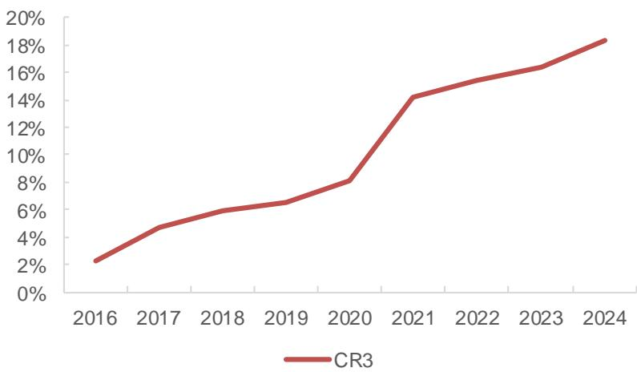

2024年中国植物提取行业竞争格局  
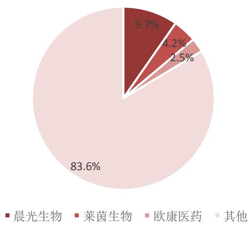

白酒：中长期配置价值凸显
啤酒：低基数与低预期下，行业需求复苏可期
乳制品：成本、费用下降共振，高质量增长为主线
调味品：必需消费需求稳健，餐饮影响短期承压
速冻食品：借力餐饮连锁化，行业高景气持续
食品添加剂：成长空间广阔，天然健康为发展趋势
食品综合：优选优质子板块龙头
重点推荐标的

## 目录

## 食品综合：优选优质子板块龙头

## □ 休闲食品：成长空间广阔，中式品类望孕本土巨头

☐ 万亿市场多强角力，竞争格局分散。中国休闲食品历经多年发展，进入稳态扩容阶段。行业品类繁多，集中度较低，消费者喜好差异程度大导致零食品类供需两端分散，单品难以上量，仅有细分品类龙头，尚无综合性大规模龙头出现。

☐ 传统西式零食增长趋缓，中式零食崛起正当时。早期零食作为舶来品以西式品类为主，品类内部格局以西方头部企业为主导。近年来中式零食概念加速崛起，目前辣味零食、卤味零食等传统中式品类已占据国内零食市场近4成份额，且仍处于总量扩张状态。中国辣味零食市场规模近5年的年复合增速为8.7%，高于非辣味零食的5.1%，未来预计将提速至10%以上，规模超2700亿人民币。随着中式品类热潮兴起，本土企业面临机遇。

中国休闲食品行业市场规模  
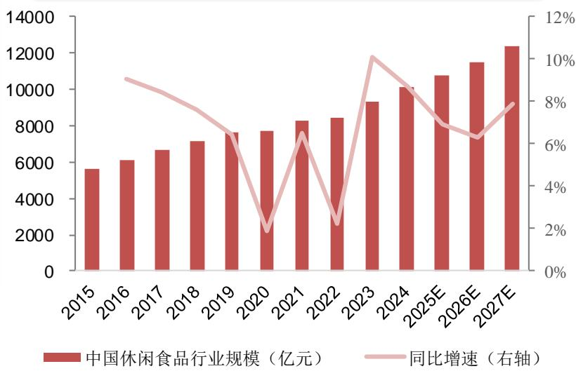

按口味划分中国休闲食品行业零售额（亿元）  
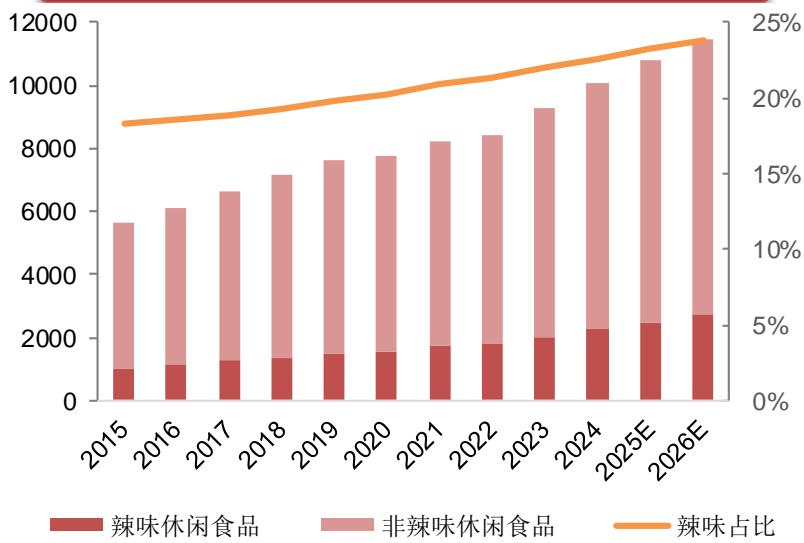

## 食品综合：优选优质子板块龙头

□ 休闲食品：辣味零食大赛道，有望孕育大规模龙头。

☐ 海外龙头占据中国零食市场主导地位，随着中式零食品类发展，本土企业逐渐起势。美国糖巧、薯片、饼干等西式零食品类占比高，相关品类孕育了百事、亿滋、玛氏等全球零食龙头。日本烘焙占比高，并拥有本土特色零食米饼，同时受西化影响，糖巧、薯片等规模较大。中式零食品类由于饮食习惯基础，天然具备产品研发优势，本轮品类热潮由本土零食企业主导，该赛道未来成长潜力较大。

中式零食细分赛道规模、增速、相关企业及市占率

<table><tr><td>品类</td><td>2021年规模(亿元)</td><td>2026年规模(亿元)</td><td>2021-2026ECAGR</td><td>相关企业及市占率(2021年)</td></tr><tr><td>调味面制品</td><td>455</td><td>697</td><td>8.9%</td><td>卫龙(14.3%)</td></tr><tr><td>休闲蔬菜制品</td><td>286</td><td>626</td><td>17.0%</td><td></td></tr><tr><td>魔芋爽</td><td>70</td><td>160</td><td>18%</td><td>卫龙(50%)、劲仔(1%)</td></tr><tr><td>海带</td><td>30</td><td>65</td><td>17%</td><td>卫龙(20%)</td></tr><tr><td>休闲豆干制品</td><td>182</td><td>257</td><td>7.1%</td><td>卫龙(3%)、劲仔(2%)、盐津(2%)、有友(&lt;1%)</td></tr><tr><td>海味零食</td><td>155</td><td>256</td><td>10.6%</td><td></td></tr><tr><td>深海小鱼</td><td>60</td><td>80</td><td>6%</td><td>劲仔(15-20%)、卫龙</td></tr><tr><td>肉类零食</td><td>669</td><td>1037</td><td>9.2%</td><td></td></tr><tr><td>鸡肉零食</td><td>183</td><td>284</td><td>9%</td><td>有友(7%)</td></tr><tr><td>鸭肉零食</td><td>178</td><td>276</td><td>9%</td><td>周黑鸭(18%)</td></tr><tr><td>牛肉类</td><td>158</td><td>245</td><td>9%</td><td></td></tr><tr><td>猪肉类</td><td>132</td><td>205</td><td>9%</td><td>良品(4%)</td></tr><tr><td>其他肉类</td><td>18</td><td>28</td><td>9%</td><td></td></tr><tr><td>其他休闲零食</td><td>390</td><td>500</td><td>5.1%</td><td></td></tr><tr><td>卤蛋</td><td>120</td><td>150</td><td>5%</td><td>卫龙(1%)</td></tr><tr><td>其他</td><td>270</td><td>350</td><td>5%</td><td></td></tr></table>

www.swsc.com.cn  
数据来源：Euromonitor，公司公告，智研咨询，西南证券整理

## 食品综合：优选优质子板块龙头

## □ 休闲食品：全渠道战略转型，渠道变迁推动行业成长

☐ 休闲食品具有全渠道销售的特点，行业渠道结构持续变革。2000-2012年传统流通和连锁商超渠道占据主导位置，2013年开始货架电商逐步兴起并成为主要增量渠道，2018年电商渠道去中心化、拼多多开始起量，2020年疫情加速直播电商成长，2020年之后会员超市渠道、量贩零食店渠道逆势增长，成为品牌商争夺的增量渠道。当下，传统商超调改如火如荼、腾讯开始发力微信小店、即时零售稳步成长。

☐ 零食并不是一个强品牌属性的品类，渠道变迁对行业影响较大。面对外部渠道变迁，零食企业若能根据新渠道特征，及时调整供应链、产品、组织团队等，可以获得持续不断的增长、保持份额提升。每一轮零食系统性行情基本都对应一轮渠道变迁。

2007\~2024年中国零食行业渠道结构情况  

## 食品综合：优选优质子板块龙头

## □ 休闲食品：新兴渠道红利释放，拥抱性价比和下沉市场

☐ 零食量贩“高性价比+高周转”冲击市场。零食量贩作为新兴渠道，整体效率较高，通过优化供应链，可实现多品种高品质低价格的产品供应。量贩零食店SKU接近2000，SKU深度及宽度均较高，可通过提供散装、称重零食，解决消费者选择困难问题，及时更新爆品。零食折扣店区域化特征明显、全国化难度较大，预计少数龙头可以实现全国化布局，绝大多数则是区域连锁门店。部分具备供应链优势的企业随零食量贩渠道拓展有望迎来加速成长，实现份额提升和推进渠道下沉。

☐ 传统渠道加价环节为量贩留下折扣空间。量贩业态开始于2010年，首家品牌老婆大人在浙江创立；2017年资本入局，推动零食很忙等新品牌崛起；2022年业态随性价比消费兴起，大量资本涌入。从加价情况来看，零食在传统渠道流通毛利较高，例如连锁KA加价率约60%，为量贩渠道留下较大折扣空间。

全国连锁零食集合店部分地区分布  
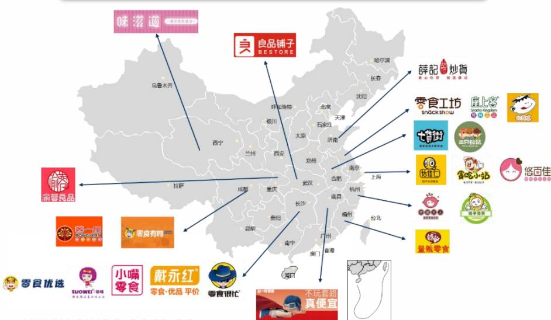  
零食在不同渠道各流通环节加价情况

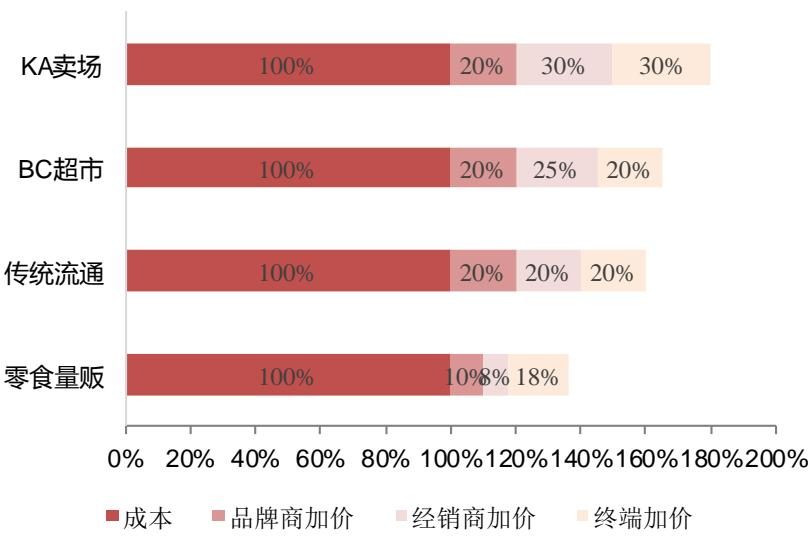

## 食品综合：优选优质子板块龙头

## □坚果炒货：坚果炒货两千亿大市场，集中度提升趋势明显

□ 消费者基础坚实，扩张势头强劲。坚果消费者以85后年轻人、一二线城市人群为主，消费人群不断扩大为行业扩容提供有力支撑。现制坚果炒货行业中，以散装为大头，而连锁化现制坚果炒货品牌采用散装的销售方式，创新产品、升级品牌、全国扩展，是具有万店潜力的赛道。

☐ 籽坚果格局分散，树坚果发展潜力大。2021年坚果行业1512亿元、未来5年CAGR为8%；籽坚果、树坚果行业规模分别为529、983亿元，预计21-26年CAGR分别为4.0%、9.9%。

☐ 集中度提升趋势明显。由于进入门槛较低，坚果炒货行业经营主体数量众多，行业集中度较低，存在巨大整合空间。近年来行业集中度不断提升。随着国家的行业标准不断出台和执行，休闲食品企业在生产加工、质量检测等方面更加规范化、标准化，叠加消费者健康意识提升，市场份额将进一步向头部企业集中。

2016-2026E坚果炒货行业规模（亿元）

<table><tr><td></td><td>2016</td><td>2021</td><td>2026E</td><td>16-21CAGR</td><td>21-26CAGR</td></tr><tr><td>坚果炒货行业规模</td><td>1042</td><td>1512</td><td>2220</td><td>7.7%</td><td>8.0%</td></tr><tr><td>籽坚果规模</td><td>427</td><td>529</td><td>644</td><td>4.4%</td><td>4.0%</td></tr><tr><td>其中:包装瓜子</td><td>90</td><td>120</td><td>150</td><td>5.9%</td><td>4.6%</td></tr><tr><td>其中:包装花生</td><td>100</td><td>120</td><td>140</td><td>3.7%</td><td>3.1%</td></tr><tr><td>其中:包装豆类</td><td>30</td><td>40</td><td>50</td><td>5.9%</td><td>4.6%</td></tr><tr><td>其中:其他(含散装)</td><td>207</td><td>249</td><td>304</td><td>3.7%</td><td>4.1%</td></tr><tr><td>树坚果规模</td><td>615</td><td>983</td><td>1576</td><td>9.8%</td><td>9.9%</td></tr><tr><td>其中:混合坚果</td><td>10</td><td>115</td><td>263</td><td>63.0%</td><td>18.0%</td></tr><tr><td>其中:单品类坚果</td><td>605</td><td>868</td><td>1313</td><td>7.5%</td><td>8.6%</td></tr><tr><td>口味性坚果</td><td>10</td><td>20</td><td>120</td><td>14.9%</td><td>43.1%</td></tr></table>

www.swsc.com.cn

2024年中国树坚果及籽坚果竞争格局  
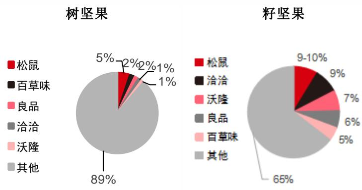

白酒：中长期配置价值凸显
啤酒：低基数与低预期下，行业需求复苏可期
乳制品：成本、费用下降共振，高质量增长为主线
调味品：必需消费需求稳健，餐饮影响短期承压
速冻食品：借力餐饮连锁化，行业高景气持续
食品添加剂：成长空间广阔，天然健康为发展趋势
食品综合：优选优质子板块龙头
重点推荐标的

## 目录

## 贵州茅台（600519）：积极布局三个转型，管控供给稳定批价

## □ 投资逻辑

1、政策趋严扰动需求，普飞批价环比走弱。25年春节期间，白酒需求韧性彰显，普飞动销与批价均较为稳定；进入5月以来，受外部环境变化影响，白酒商务消费表现低迷，餐饮消费环比走弱，叠加电商“618”促销政策影响，供需矛盾有所放大，散瓶普飞批价从春节2200元左右下降至当前1800元左右。

2、积极推进“三个转型”，管控供给稳定批价。在“三期叠加”的压力下，公司积极推进“三个转型”，在寻找新人群、培养新场景、创新新模式方面积极作为，不断扩大消费者覆盖面；与此同时，公司主动控制发货节奏，加大市场巡查力度，严查低价甩货现象。

3、行稳致远，穿越周期。公司拥有行业最强品牌力，产品矩阵完备，经销商实力强大；在优秀管理层引领下，拥有穿越周期的韧性和定力。

## □ 业绩预测与投资建议

预计2025/2026/2027年EPS分别为75.48元、82.68元、90.24元，“买入”评级。

## 口 风险提示

经济复苏不及预期风险，行业竞争加剧风险。

业绩预测与估值指标

<table><tr><td>指标</td><td>2024A</td><td>2025E</td><td>2026E</td><td>2027E</td></tr><tr><td>营业收入(亿元)</td><td>1741.4</td><td>1903.2</td><td>2075.6</td><td>2252.4</td></tr><tr><td>营业收入增长率</td><td>15.7%</td><td>9.3%</td><td>9.1%</td><td>8.5%</td></tr><tr><td>归母净利润(亿元)</td><td>862.3</td><td>948.1</td><td>1038.6</td><td>1133.6</td></tr><tr><td>归母净利润增长率</td><td>15.4%</td><td>10.0%</td><td>9.5%</td><td>9.2%</td></tr><tr><td>EPS(元)</td><td>68.64</td><td>75.48</td><td>82.68</td><td>90.24</td></tr><tr><td>P/E</td><td>26</td><td>22</td><td>20</td><td>18</td></tr></table>

www.swsc.com.cn  
数据来源：Wind，西南证券

股价表现  
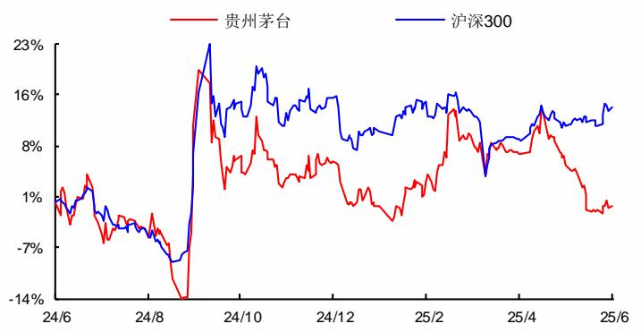  
数据来源：Wind，西南证券整理

## 五粮液（000858）：千元价位绝对龙头，长线布局正当时

## □ 投资逻辑

1、25Q2动销环比走弱，普五批价有所回落。在外部环境承压的背景下，白酒商务消费表现低迷，餐饮消费环比走弱，叠加电商“618”促销政策影响，供需矛盾有所放大，目前八代批价从春节期间930左右回落至当前880元左右；1618和低度在扫码红包刺激下，延续平稳增长。

2、提高分红比例，提振投资者信心。公司积极注重投资者回报，发布《2024-2026年度股东回报规划》，规划24-26年现金分红比例不低于 $70\%$ 且不低于200亿元（含税），分红比例进一步提升，有效提振投资者信心。

3、千元价位绝对龙头，稳健增长确定性高。公司千元价位绝对龙头地位稳固，当前股价对应25年估值仅14倍左右，对应股息率 $4.9\%$ 左右，配置价值凸显，长线布局正当时。

## □ 业绩预测与投资建议

预计2025/2026/2027年EPS分别为8.76元、9.41元、10.12元，“买入”评级。

## 口 风险提示

经济复苏不及预期风险，行业竞争加剧风险。

业绩预测与估值指标

<table><tr><td>指标</td><td>2024A</td><td>2025E</td><td>2026E</td><td>2027E</td></tr><tr><td>营业收入(亿元)</td><td>891.8</td><td>939.0</td><td>995.8</td><td>1054.4</td></tr><tr><td>营业收入增长率</td><td>7.1%</td><td>5.3%</td><td>6.1%</td><td>5.9%</td></tr><tr><td>归母净利润(亿元)</td><td>318.5</td><td>339.9</td><td>365.2</td><td>393.0</td></tr><tr><td>归母净利润增长率</td><td>5.4%</td><td>6.7%</td><td>7.4%</td><td>7.6%</td></tr><tr><td>EPS(元)</td><td>8.21</td><td>8.76</td><td>9.41</td><td>10.12</td></tr><tr><td>P/E</td><td>20</td><td>19</td><td>17</td><td>16</td></tr></table>

www.swsc.com.cn  
数据来源：Wind，西南证券

股价表现  
  
数据来源：Wind，西南证券整理

## 泸州老窖（000568）：坚守长期主义，静待需求复苏

## □ 投资逻辑

1、行业需求显著承压，动销端环比走弱。25Q2外部需求显著承压，商务消费表现低迷，餐饮端环比走弱，叠加茅台酒批价走弱，经销商和终端信心走弱，渠道加速去化库存；多因素共同作用下，预计国窖和特曲短期表现较为承压。

2、管控供给稳定批价，积极培育消费者。在行业需求下滑的背景下，公司管理层彰显定力与担当，主动控制发货节奏，确保国窖批价保持在合理范围，并通过“百城计划”和“挖井工程”，积极发掘薄弱市场增长空间。

3、坚持长期主义，静待需求改善。行业需求承压的背景下，公司坚持长期主义，将国窖批价保持在合理范围；展望未来，伴随宏观经济逐步改善，公司作为千元价位唯二的品牌，长期受益趋势不改。

## □ 业绩预测与投资建议

预计2025/2026/2027年EPS分别为9.39元、10.31元、11.31元，“买入”评级。

## □ 风险提示

经济复苏不及预期风险，行业竞争加剧风险。

业绩预测与估值指标

<table><tr><td>指标</td><td>2024A</td><td>2025E</td><td>2026E</td><td>2027E</td></tr><tr><td>营业收入(亿元)</td><td>312.0</td><td>321.2</td><td>345.7</td><td>375.4</td></tr><tr><td>营业收入增长率</td><td>3.2%</td><td>3.0%</td><td>7.7%</td><td>8.6%</td></tr><tr><td>归母净利润(亿元)</td><td>134.7</td><td>138.3</td><td>151.8</td><td>166.5</td></tr><tr><td>归母净利润增长率</td><td>1.7%</td><td>2.6%</td><td>9.8%</td><td>9.7%</td></tr><tr><td>EPS(元)</td><td>9.15</td><td>9.39</td><td>10.31</td><td>11.31</td></tr><tr><td>P/E</td><td>12</td><td>12</td><td>11</td><td>10</td></tr></table>

www.swsc.com.cn  
数据来源：Wind，西南证券

股价表现  
  
数据来源：Wind，西南证券整理

## 山西汾酒（600809）：产品矩阵多点开花，稳字当头穿越周期

## □ 投资逻辑

1、青花和玻汾双轮驱动，增长韧性充分体现。在外部消费环境承压的背景下，行业竞争越来越激烈；公司依托强大的品牌势能和香型优势，整体基本盘表现稳健。其中青花系列保持稳健态势，玻汾受益于强产品力和高性价比，动销延续亮眼。

2、持续推进“汾享礼遇”，渠道力持续提升。公司积极探索营销创新，不断完善“汾享礼遇”扫码体系，实现厂-商-消费者闭环，终端盈利能力得到显著改善，渠道精细化程度实质提升。

3、产品矩阵多点开花，稳字当头穿越周期。2025年公司定调稳定压倒一切，将推动集团三大品牌“协同发展”，四大单品“四轮驱动”的战略优势，做好消费者培育，推动公司品牌和产品线的持续繁荣与发展。汾酒产品矩阵完备，清香热延续，能够较好的穿越周期。

## □ 业绩预测与投资建议

预计2025/2026/2027年EPS分别为11.14元、12.36元、13.68元，“买入”评级。

## □ 风险提示

经济复苏不及预期风险，行业竞争加剧风险。

业绩预测与估值指标

<table><tr><td>指标</td><td>2024A</td><td>2025E</td><td>2026E</td><td>2027E</td></tr><tr><td>营业收入(亿元)</td><td>360.1</td><td>400.3</td><td>438.3</td><td>476.0</td></tr><tr><td>营业收入增长率</td><td>12.8%</td><td>11.2%</td><td>9.5%</td><td>8.6%</td></tr><tr><td>归母净利润(亿元)</td><td>122.4</td><td>135.9</td><td>150.8</td><td>166.9</td></tr><tr><td>归母净利润增长率</td><td>17.3%</td><td>11.0%</td><td>11.0%</td><td>10.7%</td></tr><tr><td>EPS(元)</td><td>10.04</td><td>11.14</td><td>12.36</td><td>13.68</td></tr><tr><td>P/E</td><td>18</td><td>16</td><td>14</td><td>13</td></tr></table>

www.swsc.com.cn  
数据来源：Wind，西南证券

股价表现  
  
数据来源：Wind，西南证券整理

## 水井坊（600779）：短期需求承压，静待需求改善

## □ 投资逻辑

1、短期需求环比走弱，次高端白酒承压明显。25Q2白酒商务消费表现低迷，宴席场次有所减少，叠加茅台酒批价波动较大，经销商备货积极性低迷；在需求承压和高端酒批价下行的作用下，市场竞争显著加剧，次高端白酒受到较大挤压。

2、扎实推进品牌高端化，不断强化营销能力。在当前白酒行业缩量市场、内卷加剧的背景下，公司坚持长期主义，2025年将继续强化井台及典藏品牌建设投入，不断提升品牌影响力，持续提高渠道和消费者覆盖面。

3、次高端核心品牌，长期向好趋势不变。公司坚持长期主义，23年开始先于竞品积极去化库存，稳定渠道价值链，较好的实现轻装上阵，在本轮调整中或将占据较好的先发优势，实现市占率稳步提升。

## □ 业绩预测与投资建议

预计2025/2026/2027年EPS分别为2.81元、3.03元、3.31元，维持“买入”评级。

## □ 风险提示

经济复苏不及预期风险，行业竞争加剧风险。

业绩预测与估值指标

<table><tr><td>指标</td><td>2024A</td><td>2025E</td><td>2026E</td><td>2027E</td></tr><tr><td>营业收入(亿元)</td><td>52.2</td><td>53.5</td><td>56.8</td><td>60.9</td></tr><tr><td>营业收入增长率</td><td>5.3%</td><td>2.6%</td><td>6.2%</td><td>7.2%</td></tr><tr><td>归母净利润(亿元)</td><td>13.4</td><td>13.7</td><td>14.8</td><td>16.1</td></tr><tr><td>归母净利润增长率</td><td>5.7%</td><td>2.2%</td><td>7.9%</td><td>9.0%</td></tr><tr><td>EPS(元)</td><td>2.75</td><td>2.81</td><td>3.03</td><td>3.31</td></tr><tr><td>P/E</td><td>15</td><td>15</td><td>14</td><td>13</td></tr></table>

www.swsc.com.cn  
数据来源：Wind，西南证券

股价表现  
  
数据来源：Wind，西南证券整理

## 酒鬼酒（000799）：渠道深度变革，积极调整蓄力长远

## □ 投资逻辑

1、产品动销承压，市场聚焦精耕。商务消费场景复苏较弱，次高端及以上产品消费需求仍待恢复，渠道现金周转变慢，主动去库情绪渐强。公司深化推进渠道费用改革，将费用投放向终端消费者倾斜，改变过去依靠渠道驱动快速增长的模式，积极向动销拉动转变。坚持“价”在“量”前，聚焦核心单品的价盘稳定，通过价盘稳定保证经销商的渠道利润，并通过促动销、降库存恢复渠道信心。

2、优化市场布局，蓄力布局长远。1）不断优化区域布局，由快速实现全国化覆盖向精耕细作转变。省内聚焦湖南大本营市场，以扫码活动、宴席活动为抓手，促进C端动销；省外实施“百强县工程”，推进精准营销和渠道下沉，24年已在全国建立15个样板市场。2）进一步聚焦酒鬼、内参两大产品系列，酒鬼系列聚焦红坛大单品，梳理产品体系，收缩非核心产品。内参系列以甲辰版为核心抓手，优化内参价值链，改善控盘分利运营模式，提振渠道活力。3、短期积极调整，中长期极具弹性。短期来看，公司仍处于营销模式转型阶段，库存压力逐渐缓解，拐点向上可期；长期来看，省内基本盘持续夯实，省外品牌影响力持续扩大，看好公司长期成长弹性。

## □ 业绩预测

预计2025/2026/2027年EPS分别为0.21元、0.33元、0.47元。

## 口 风险提示

经济复苏不及预期风险，商务消费复苏不及预期风险。

<table><tr><td colspan="5">业绩预测与估值指标</td></tr><tr><td>指标</td><td>2024A</td><td>2025E</td><td>2026E</td><td>2027E</td></tr><tr><td>营业收入(亿元)</td><td>14.2</td><td>13.7</td><td>14.1</td><td>14.8</td></tr><tr><td>营业收入增长率</td><td>-49.7%</td><td>-3.6%</td><td>2.4%</td><td>5.2%</td></tr><tr><td>归母净利润(亿元)</td><td>0.1</td><td>0.7</td><td>1.1</td><td>1.5</td></tr><tr><td>归母净利润增长率</td><td>-97.7%</td><td>451.9%</td><td>55.5%</td><td>42.7%</td></tr><tr><td>EPS(元)</td><td>0.04</td><td>0.21</td><td>0.33</td><td>0.47</td></tr><tr><td>P/E</td><td>1117</td><td>202</td><td>130</td><td>91</td></tr></table>

www.swsc.com.cn  
数据来源：Wind，西南证券

股价表现  
  
数据来源：Wind，西南证券整理

## 洋河股份（002304）：主动调整蓄势，静待需求复苏

## □ 投资逻辑

1、坚定调整蓄势，静待需求复苏。当前白酒行业处在深度调整期，普遍面临着渠道库存增加，价格体系透明，市场竞争加剧的问题，25Q2以来需求端更显承压；面对如此环境，公司主动控制发货节奏，平衡量价关系，梳理渠道体系，牺牲短期增长换取长期良性发展机遇。

2、持续聚焦核心大单品，深化营销体系改革。1）公司聚焦产品结构升级，持续推进海、天、梦等产品系列的结构优化。2）公司针对组织架构、激励制度、渠道模式和品牌序列的梳理基本完成，持续推动厂商一体化建设，完善经销商分类分级管理和经销商服务措施，稳定和提升经销商信心。

3、短期主动调整，未来改善可期。江苏白酒市场容量大，公司具有深厚的名酒基因和品牌护城河，主动调整后有望迎来恢复性增长；2024年度公司分红总额达70亿元，静态股息率行业最高，中长期配置价值凸显。

## □ 业绩预测与投资建议

预计2025/2026/2027年EPS分别为3.74元、3.90元、4.15元，“买入”评级。

## 口 风险提示

经济大幅下滑风险，消费复苏不及预期风险。

业绩预测与估值指标

<table><tr><td>指标</td><td>2024A</td><td>2025E</td><td>2026E</td><td>2027E</td></tr><tr><td>营业收入(亿元)</td><td>288.8</td><td>249.4</td><td>255.7</td><td>267.8</td></tr><tr><td>营业收入增长率</td><td>-12.8%</td><td>-13.6%</td><td>2.5%</td><td>4.7%</td></tr><tr><td>归母净利润(亿元)</td><td>66.7</td><td>56.3</td><td>58.8</td><td>62.5</td></tr><tr><td>归母净利润增长率</td><td>-33.4%</td><td>-15.6%</td><td>4.4%</td><td>6.3%</td></tr><tr><td>EPS(元)</td><td>4.43</td><td>3.74</td><td>3.90</td><td>4.15</td></tr><tr><td>P/E</td><td>14</td><td>17</td><td>16</td><td>15</td></tr></table>

www.swsc.com.cn  
数据来源：Wind，西南证券

股价表现  
  
数据来源：Wind，西南证券整理

## 古井贡酒（000596）：徽酒龙头韧性十足，市占率有望持续提升

## □ 投资逻辑

1、外部需求承压，库存有所上升。春节旺季期间，受益于聚饮和礼赠消费旺盛，年份原浆系列动销良好；25Q2以来，礼赠和宴席市场较为承压，渠道库存有所上升，需求端阶段性承压。

2、综合竞争优势突出，市占率稳步提升。在需求承压的背景下，古井依托多年耕耘投入带来的强品牌力，主流价位的全面覆盖，基地市场的精耕细作，在行业深度调整期，市占率有望逆势提升。

3、龙头地位优势稳固，长期向好趋势不变。安徽产业升级顺畅，婚宴等主流消费价位升级是长期趋势，省内大本营市场增长基础牢固；未来伴随着经济复苏和消费信心恢复，次高端和全国化逻辑依然清晰，公司长期向好趋势不变。

## □ 业绩预测与投资建议

预计2025/2026/2027年EPS分别为11.53元、12.68元、13.99元，“买入”评级。

## □ 风险提示

经济复苏不及预期风险，行业竞争加剧风险。

业绩预测与估值指标

<table><tr><td>指标</td><td>2024A</td><td>2025E</td><td>2026E</td><td>2027E</td></tr><tr><td>营业收入(亿元)</td><td>235.8</td><td>255.7</td><td>276.9</td><td>299.3</td></tr><tr><td>营业收入增长率</td><td>16.4%</td><td>8.4%</td><td>8.3%</td><td>8.1%</td></tr><tr><td>归母净利润(亿元)</td><td>55.2</td><td>61.0</td><td>67.0</td><td>74.0</td></tr><tr><td>归母净利润增长率</td><td>20.2%</td><td>21.6%</td><td>21.0%</td><td>20.6%</td></tr><tr><td>EPS(元)</td><td>10.44</td><td>11.53</td><td>12.68</td><td>13.99</td></tr><tr><td>P/E</td><td>13</td><td>11</td><td>10</td><td>9</td></tr></table>

www.swsc.com.cn  
数据来源：Wind，西南证券

股价表现  
  
数据来源：Wind，西南证券整理

## 今世缘（603369）：省内稳扎稳打，省外谋求突破

## □ 投资逻辑

1、江苏经济发展稳健，消费潜力极具韧性。江苏消费升级引领全国，省内主流消费已升级至300元以上，国缘四开、对开占据次高端300-500元核心价格带，淡雅、单开等单品在100-300元扩容价格带中逐步积累动力，仍处向上增长周期，外部消费环境改善后弹性可期。

2、省内稳扎稳打，省外谋求突破。公司省内市占率快速提升，品牌势能、消费者认可度提升显著，高自点率下消费氛围持续增强；省外市场开拓，聚焦江苏周边重点市场，资源投放更加高效；产品上稳步推进国缘V3的放量，产品结构升级路径清晰。

3、管理层激励到位，看好未来成长。公司的股权激励覆盖面广，考核目标较高，管理层和股东利益高度一致。展望未来，伴随着经济逐步复苏，有望迎来内外共振，成长性延续可期。

## □ 业绩预测与投资建议

预计2025/2026/2027年EPS分别为2.96元、3.25元、3.56元，“买入”评级。

## 口 风险提示

经济复苏不及预期风险，高端化、全国化不及预期风险。

<table><tr><td colspan="5">业绩预测与估值指标</td></tr><tr><td>指标</td><td>2024A</td><td>2025E</td><td>2026E</td><td>2027E</td></tr><tr><td>营业收入(亿元)</td><td>115.5</td><td>126.6</td><td>139.1</td><td>152.9</td></tr><tr><td>营业收入增长率</td><td>14.3%</td><td>9.6%</td><td>9.9%</td><td>9.9%</td></tr><tr><td>归母净利润(亿元)</td><td>34.1</td><td>36.9</td><td>40.5</td><td>44.4</td></tr><tr><td>归母净利润增长率</td><td>8.8%</td><td>8.2%</td><td>9.6%</td><td>9.6%</td></tr><tr><td>EPS(元)</td><td>2.72</td><td>2.96</td><td>3.25</td><td>3.56</td></tr><tr><td>P/E</td><td>14</td><td>13</td><td>12</td><td>11</td></tr></table>

www.swsc.com.cn  
数据来源：Wind，西南证券

股价表现  
  
数据来源：Wind，西南证券整理

## 迎驾贡酒（603198）：洞藏势能延续，静待需求复苏

## □ 投资逻辑

1、洞藏势能延续，静待需求复苏。在外部消费环境疲软和婚宴场次减少的背景下，白酒需求端持续承压；洞藏系列品牌势能延续，核心终端覆盖率持续提升，洞6和洞9表现优于省内同价位竞品，彰显出较强的韧性。金银星和普酒由于产品体系老化和渠道推力不足的原因，短期下滑幅度较大。

2、积极推进双核战略，全省化扩张趋势已成。在外部环境相对承压的背景下，公司有序推进市场梳理和消费者培育工作，在省内举办多场洞藏演唱会和高端品鉴会，皖北和皖南的重点市场开拓稳步推进，整体竞争力不断加强。

3、大众消费韧性凸显，静待消费信心恢复。洞6和洞9市场认可度持续提升，有望实现稳健持续增长。洞16/20整积极布局宴席、礼赠和商务等场景，待经济复苏后有望迎来接棒发力。

## □ 业绩预测与投资建议

预计2025/2026/2027年EPS分别为3.27元、3.50元、3.80元，“买入”评级。

## 口 风险提示

经济复苏不及预期风险，行业竞争加剧风险。

业绩预测与估值指标

<table><tr><td>指标</td><td>2024A</td><td>2025E</td><td>2026E</td><td>2027E</td></tr><tr><td>营业收入(亿元)</td><td>73.4</td><td>74.4</td><td>79.2</td><td>85.9</td></tr><tr><td>营业收入增长率</td><td>9.3%</td><td>1.4%</td><td>6.4%</td><td>8.4%</td></tr><tr><td>归母净利润(亿元)</td><td>25.9</td><td>26.2</td><td>28.0</td><td>30.4</td></tr><tr><td>归母净利润增长率</td><td>13.2%</td><td>1.1%</td><td>6.9%</td><td>8.7%</td></tr><tr><td>EPS(元)</td><td>3.24</td><td>3.27</td><td>3.50</td><td>3.80</td></tr><tr><td>P/E</td><td>12</td><td>12</td><td>11</td><td>10</td></tr></table>

www.swsc.com.cn  
数据来源：Wind，西南证券

股价表现  
  
数据来源：Wind，西南证券整理

## 口子窖（603589）：兼8培育扎实推进，营销改革扎实推进

## □ 投资逻辑

1、外部需求疲软，增长有所承压。25Q2外部消费环境趋于收紧，商务和宴席消费同比均有所下滑，经销商和终端备货积极性较差，预计收入端将阶段性承压。

2、加大兼系列培育力度，兼8放量值得期待。公司持续加大兼系列培育力度，其中兼8定价对标古8和洞9，终端利润高于竞品，渠道推力较强；兼8春节期间表现亮眼，消费人群稳步扩大，持续放量值得期待。

3、营销改革扎实推进，静待复苏迎来共振。公司近年来扎实推进品牌、产品、渠道三位一体的改革，新品兼系列逐步起量，经销商体系更加扁平化，营销改革取得实质进展。展望未来，伴随着外部需求和渠道信心逐步恢复，改革势能充分释放，公司有望在内外共振下实现高质量增长。

## □ 业绩预测与投资建议

预计2025/2026/2027年EPS分别为2.82元、2.99元、3.22元，“买入”评级。

## □ 风险提示

经济复苏不及预期风险，行业竞争加剧风险。

业绩预测与估值指标

<table><tr><td>指标</td><td>2024A</td><td>2025E</td><td>2026E</td><td>2027E</td></tr><tr><td>营业收入(亿元)</td><td>60.1</td><td>61.1</td><td>64.2</td><td>68.1</td></tr><tr><td>营业收入增长率</td><td>0.9%</td><td>1.6%</td><td>5.1%</td><td>6.0%</td></tr><tr><td>归母净利润(亿元)</td><td>16.6</td><td>16.9</td><td>17.9</td><td>19.3</td></tr><tr><td>归母净利润增长率</td><td>-3.8%</td><td>2.3%</td><td>6.0%</td><td>7.6%</td></tr><tr><td>EPS(元)</td><td>2.76</td><td>2.82</td><td>2.99</td><td>3.22</td></tr><tr><td>P/E</td><td>12</td><td>12</td><td>12</td><td>11</td></tr></table>

www.swsc.com.cn  
数据来源：Wind，西南证券

股价表现  
  
数据来源：Wind，西南证券整理

## 老白干酒（600559）：降本增效成效显著，利润弹性逐步释放

## □ 投资逻辑

1、多品牌联动赋能，经营势能拐点向上。1）老白干酒本部品牌逐步削减中低端产品收入占比，聚焦次高端及以上核心大单品培育，渠道严控价盘强化推力，迎来量稳价升。2）武陵酒资源聚焦于常德、长沙和省外市场，积极开拓空白市场，产能扩张伴随全省推广进程持续推进；板城围绕环承德市场，聚焦龙印系列；孔府家酒定位中高端及以上的阶梯型产品矩阵，实现低基高增；文王贡酒稳步拓展安徽市场，积极打造三大产品线，盈利能力改善显著。

2、降本增效效果显现，期待业绩弹性释放。1）公司围绕产品动销、消费者培育等重点工作对市场进行精耕细作，强化终端市场建设。随着降本增效持续开展，费用投放精准高效，费销比下降趋势明显。2）管理层激励充分动力十足，深化改革进程正稳步推进，治理体系优化效能正待释放，多品牌发力下，期待公司利润弹性释放。

3、短期受益本部势能改善，中长期利润弹性十足。短期来看，公司聚焦河北省内渠道结构调整，渠道力恢复持续夯实省内基本盘；长期来看，武陵酒放量优化产品结构，降本增效提升净利率水平，看好公司利润弹性。

## □ 业绩预测与投资建议

预计2025/2026/2027年EPS分别为0.96元、1.11元、1.25元，“买入”评级。

## □ 风险提示

消费复苏不及预期风险，产品结构升级不及预期风险。

<table><tr><td colspan="5">业绩预测与估值指标</td></tr><tr><td>指标</td><td>2024A</td><td>2025E</td><td>2026E</td><td>2027E</td></tr><tr><td>营业收入(亿元)</td><td>53.6</td><td>55.6</td><td>58.9</td><td>62.4</td></tr><tr><td>营业收入增长率</td><td>1.9%</td><td>3.7%</td><td>6.0%</td><td>5.9%</td></tr><tr><td>归母净利润(亿元)</td><td>7.9</td><td>8.7</td><td>10.1</td><td>11.5</td></tr><tr><td>归母净利润增长率</td><td>18.2%</td><td>11.0%</td><td>15.9%</td><td>13.2%</td></tr><tr><td>EPS(元)</td><td>0.86</td><td>0.96</td><td>1.11</td><td>1.25</td></tr><tr><td>P/E</td><td>21</td><td>19</td><td>16</td><td>14</td></tr></table>

www.swsc.com.cn  
数据来源：Wind，西南证券

股价表现  
  
数据来源：Wind，西南证券整理

## 金徽酒（603919）：高档势能强劲，全国化布局稳步推进

## □ 投资逻辑

1、省内夯实省外开拓，长期成长空间广阔。公司重点向大客户运营、用户建设、消费方面倾斜，夯实甘肃省内基地市场；滚动发展环甘肃西北市场，陕西、内蒙、宁夏、青海等省份稳步提升；逐步培育华东及北方市场第二增长曲线。2、持续推进结构升级，区域布局不断完善。1）金徽28年高端引领作用，金徽18/柔和金徽/能量金徽等300元以上产品销量稳健增长，产品体系结构升级凸显。2）在西北和北方市场，白酒主流消费价格带正向100-300元快节奏升级，公司聚焦核心价格带、核心产品，深化薄弱市场拓展。3）在华东市场，消费结构优异，公司聚焦团购渠道积极导入，消费氛围渐起，未来随着流通渠道的拓展，华东市场有望成为公司营收重要增长源。4）公司高举高打进行品牌建设，持续加大消费者培育，持续推进C端实体用户工程，稳扎稳打寻求良性增长。

3、积极蓄势主动作为，激励充分势能强劲。短期来看，三百元以上高档产品增势强劲，核心管理层通过持股平台持股，激励到位，业绩稳健性较强。中长期来看，头部酒企通过产品线延伸、全国化突破增长动力仍足，公司持续受益全国化布局和产品结构升级，成长空间进一步打开。

## □ 业绩预测与投资建议

预计2025/2026/2027年EPS分别为0.81元、0.90元、1.05元，“买入”评级。

## 口 风险提示

经济复苏不及预期风险，产品结构升级不及预期风险。

业绩预测与估值指标

<table><tr><td>指标</td><td>2024A</td><td>2025E</td><td>2026E</td><td>2027E</td></tr><tr><td>营业收入(亿元)</td><td>30.2</td><td>32.8</td><td>36.0</td><td>40.0</td></tr><tr><td>营业收入增长率</td><td>18.6%</td><td>8.4%</td><td>10.0%</td><td>11.2%</td></tr><tr><td>归母净利润(亿元)</td><td>3.9</td><td>4.1</td><td>4.6</td><td>5.4</td></tr><tr><td>归母净利润增长率</td><td>18.0%</td><td>5.9%</td><td>11.3%</td><td>16.9%</td></tr><tr><td>EPS(元)</td><td>0.77</td><td>0.81</td><td>0.90</td><td>1.05</td></tr><tr><td>P/E</td><td>26</td><td>24</td><td>22</td><td>19</td></tr></table>

www.swsc.com.cn  
数据来源：Wind，西南证券

股价表现  
  
数据来源：Wind，西南证券整理

## 天佑德酒（002646）：全国化步伐坚定，静待转型成效

## □ 投资逻辑

1、产品矩阵优化，全国大单品突破可期。受益于消费升级、品牌意识增强、消费者偏好多元化，高端、次高端市场持续扩容，白酒细分品类持续丰富，公司是青稞酒细分品类龙头，充分受益于消费结构升级和口感多元化。公司聚焦天之德、国之德、人之德、出口型及星级系列产品，聚焦人之德核心大单品抢占150-200元价位，发布新产品家之德积极布局300元价位，青海全面导入国之德真年份产品，带动结构升级明显。

2、深度调整节奏显著，成长势能持续增强。1）省内强化终端货架抢占行动、单品弱势区域提升计划、市场秩序恢复、营销基础工作提升、客情关系巩固等各项核心工作。2）省外深度调整销售渠道和产品结构，保留其原有团购渠道和产品，增加百元左右及以下价位带导入，白青稞光瓶酒和52度人之德招商工作稳步推进，动销情况良好。

3、营销转型持续深化，蓄力实干向上可期。公司聚焦出口型系列产品，推动第三代金标、国之德等高端产品形成良性生态，作为青稞酒龙头，具备坚实消费者基础，受益于产品结构升级和省外市场开拓，深度调整成效有望显现。

## □ 业绩预测

预计2025/2026/2027年EPS分别为0.17元、0.20元、0.23元。

## 口 风险提示

经济复苏不及预期风险，产品结构升级不及预期风险。

业绩预测与估值指标

<table><tr><td>指标</td><td>2024A</td><td>2025E</td><td>2026E</td><td>2027E</td></tr><tr><td>营业收入(亿元)</td><td>12.6</td><td>15.1</td><td>17.4</td><td>19.4</td></tr><tr><td>营业收入增长率</td><td>3.7%</td><td>20.6%</td><td>15.2%</td><td>11.3%</td></tr><tr><td>归母净利润(亿元)</td><td>0.4</td><td>0.8</td><td>1.0</td><td>1.1</td></tr><tr><td>归母净利润增长率</td><td>-53.0%</td><td>91.8%</td><td>20.3%</td><td>15.9%</td></tr><tr><td>EPS(元)</td><td>0.09</td><td>0.17</td><td>0.20</td><td>0.23</td></tr><tr><td>P/E</td><td>102</td><td>53</td><td>44</td><td>38</td></tr></table>

www.swsc.com.cn  
数据来源：Wind，西南证券

股价表现  
  
数据来源：Wind，西南证券整理

## 伊力特（600197）：深度改革战略明晰，疆外高增势能延续

## □ 投资逻辑

1、经济环境极具潜力，将尽享升级红利。新疆百元以下消费占比在40%左右，主流消费价位在80-150元，相比内地省份消费结构相对偏低，新疆处于一带一路经济带核心位置，是亚欧黄金通道和我国向西开放的桥头堡，经济发展红利将有利支撑疆内消费升级，未来产品结构升级空间广阔。

2、疆内品牌龙头，综合势能强劲。1）公司巩固强化小老窖、大老窖、小酒海等核心单品的市场优势，聚焦次高端核心大单品打造，完成产品体系梳理+小老窖控货挺价后，战略单品伊力王、壹号窖、大新疆和伊力特曲T10（升级版）推进设计、封样。2）新品省外招商持续，公司重心向伊力王/大小老窖等集中，较高渠道推力有望驱动疆外增量体现。3）公司营销体系逐步优化，将销售员工薪酬考核和营销费用核销市场化管理，激发一线团队活力。

3、深化改革积极求变，中长期极具成长弹性。公司处于深度改革期，持续聚焦产品结构升级，积极推进销售模式转型，经营势能显著增强；新疆经济受益—一带一路战略布局，疆内消费升级空间广阔，看好公司长期成长弹性。

## □ 业绩预测与投资建议

预计2025/2026/2027年EPS分别为0.68元、0.77元、0.90元，“买入”评级。

## 口 风险提示

经济复苏不及预期风险，产品结构升级不及预期风险，渠道拓展不及预期风险。

业绩预测与估值指标

<table><tr><td>指标</td><td>2024A</td><td>2025E</td><td>2026E</td><td>2027E</td></tr><tr><td>营业收入(亿元)</td><td>22.0</td><td>23.0</td><td>24.6</td><td>26.8</td></tr><tr><td>营业收入增长率</td><td>-1.3%</td><td>4.5%</td><td>6.9%</td><td>9.0%</td></tr><tr><td>归母净利润(亿元)</td><td>2.9</td><td>3.2</td><td>3.7</td><td>4.3</td></tr><tr><td>归母净利润增长率</td><td>-15.9%</td><td>12.8%</td><td>13.6%</td><td>16.5%</td></tr><tr><td>EPS(元)</td><td>0.60</td><td>0.68</td><td>0.77</td><td>0.90</td></tr><tr><td>P/E</td><td>24</td><td>21</td><td>19</td><td>16</td></tr></table>

www.swsc.com.cn  
数据来源：Wind，西南证券

股价表现  
  
数据来源：Wind，西南证券整理

## 华润啤酒（0291.HK）：喜力走向全国化，推动大高档扩容

## □ 投资逻辑

1、公司作为国内啤酒龙头，具备行业领先的渠道和体量优势：公司借助超勇卡位8-10元次高价格带，依靠纯生维持10-12元普高价格带前三的市场地位，并凭借喜力大单品不断攫取12元以上超高价格带的市场份额，从而实现全国高端份额第一的战略目标。

2、产品方面，公司将持续推进喜力全国化，老雪、红爵等强势单品预计将维持高增，超勇焕新后25年预计将恢复良好增长水平；此外公司加强与山姆、歪马等新兴渠道合作力度，个性化定制产品亦值得期待。

3、费用方面，公司25年将维持稳健的费投态势，投入方面更加注重费效比，预计全年整体费率将保持稳定；此外得益于公司产能优化以及全供应链效率提升，叠加成本下行趋势，预计25年利润率有较大提升空间。

## □ 业绩预测与投资建议

预计2025/2026/2027年EPS分别为1.60元、1.73元、1.85元，“买入”评级。

## 口 风险提示

原材料价格或大幅波动，餐饮需求恢复不及预期的风险。

业绩预测与估值指标

<table><tr><td>指标</td><td>2024A</td><td>2025E</td><td>2026E</td><td>2027E</td></tr><tr><td>营业收入(亿元)</td><td>386.4</td><td>396.9</td><td>406.5</td><td>416.0</td></tr><tr><td>营业收入增长率</td><td>-0.8%</td><td>2.7%</td><td>2.4%</td><td>2.3%</td></tr><tr><td>归母净利润(亿元)</td><td>47.4</td><td>52.0</td><td>56.1</td><td>60.1</td></tr><tr><td>归母净利润增长率</td><td>-8.0%</td><td>9.7%</td><td>7.9%</td><td>7.1%</td></tr><tr><td>EPS(元)</td><td>1.46</td><td>1.60</td><td>1.73</td><td>1.85</td></tr><tr><td>P/E</td><td>17</td><td>16</td><td>14</td><td>14</td></tr></table>

www.swsc.com.cn  
数据来源：Wind，西南证券

股价表现  
  
数据来源：Wind，西南证券整理

## 青岛啤酒（600600）：大经典战略拉动，结构升级稳扎稳打

## □ 投资逻辑

1、产品端方面，公司坚持“1+1+1+2+N”战略，持续推进产品结构优化升级，打造主力大单品、高端生鲜及超高端明星产品，实现全系列、多渠道产品覆盖。此外从低端崂山向中端经典的结构升级路径，仍将是整体吨价提升的重要引擎。

2、渠道端方面，公司将加速推进“一纵两横”战略带市场建设与布局，持续强化市场推广力度和深化市场销售网络建设，巩固和提高在基地市场的优势地位和新兴市场的占有率。

3、展望未来，随着24年末具备丰富内部管理经验的新董事长上任，且下半年公司主动调整渠道库存水平，在餐饮端需求持续复苏与低基数效应的带动下，25年公司销量端有望实现良好增长。

## □ 业绩预测与投资建议

预计2025/2026/2027年EPS分别为3.41元、3.62元、3.84元，“买入”评级。

## □ 风险提示

原材料价格波动风险，啤酒销量下滑风险，高端化进度不及预期风险。

业绩预测与估值指标

<table><tr><td>指标</td><td>2024A</td><td>2025E</td><td>2026E</td><td>2027E</td></tr><tr><td>营业收入(亿元)</td><td>321.38</td><td>334.69</td><td>345.55</td><td>355.42</td></tr><tr><td>营业收入增长率</td><td>-5.30%</td><td>4.14%</td><td>3.24%</td><td>2.86%</td></tr><tr><td>归母净利润(亿元)</td><td>43.45</td><td>46.52</td><td>49.41</td><td>52.32</td></tr><tr><td>归母净利润增长率</td><td>1.81%</td><td>7.06%</td><td>6.21%</td><td>5.90%</td></tr><tr><td>EPS(元)</td><td>3.19</td><td>3.41</td><td>3.62</td><td>3.84</td></tr><tr><td>P/E</td><td>20</td><td>22</td><td>19</td><td>18</td></tr></table>

www.swsc.com.cn  
数据来源：Wind，西南证券

股价表现  
  
数据来源：Wind，西南证券整理

## 重庆啤酒（600132）：腰部产品发力，大城市走向精耕

## □ 投资逻辑

1、乐堡+重庆两大腰部品牌发力贡献收入增量。乐堡受益于乌苏在华东及华南区域的持续扩张，在过去数年已成功将版图扩张至东南部区域，此外以贵州为代表的传统优势区域仍维持亮眼表现；24年起重庆品牌将借助重庆火锅类餐饮渠道开启向省外的扩张，此外省内产品结构升级，金重庆、纯生及白啤带动仍可期待。

2、大城市计划由粗放扩张型转为下沉精耕型。过去公司大城市计划以扩张为主，费用投放向新城市倾斜，但一方面当下整体经济环境复苏态势尚未明朗，另一方面在过去几年的发展中公司在一线城市已累积起较大的渠道体量，由此公司果断调整大城市计划投入方向，重点放在对已进入区域内做渠道深耕，筛选核心城市聚焦投入。

3、展望后续，在低基数效应下，伴随25年线下餐饮消费与啤酒需求端的逐步复苏，未来公司盈利能力有望持续修复。

## □ 业绩预测与投资建议

预计2025/2026/2027年EPS分别为2.53元、2.72元、2.90元，“买入”评级。

## 口 风险提示

原材料价格或大幅波动，现饮场景回暖不及预期风险，市场竞争加剧风险。

<table><tr><td colspan="5">业绩预测与估值指标</td></tr><tr><td>指标</td><td>2024A</td><td>2025E</td><td>2026E</td><td>2027E</td></tr><tr><td>营业收入(亿元)</td><td>146.45</td><td>148.31</td><td>152.44</td><td>155.88</td></tr><tr><td>营业收入增长率</td><td>-1.15%</td><td>1.27%</td><td>2.78%</td><td>2.26%</td></tr><tr><td>归母净利润(亿元)</td><td>11.15</td><td>12.23</td><td>13.17</td><td>14.03</td></tr><tr><td>归母净利润增长率</td><td>-16.61%</td><td>9.74%</td><td>7.69%</td><td>6.55%</td></tr><tr><td>EPS(元)</td><td>2.30</td><td>2.53</td><td>2.72</td><td>2.90</td></tr><tr><td>P/E</td><td>24</td><td>22</td><td>20</td><td>19</td></tr></table>

www.swsc.com.cn  
数据来源：Wind，西南证券

股价表现  
  
数据来源：Wind，西南证券整理

## 燕京啤酒（000729）：管理改革持续深化，长期业绩值得期待

## □ 投资逻辑

1、产品端：公司将在全国范围内坚定贯彻U8大单品战略，借助U8产品之利打入弱势市场攫取份额，且基地市场依托U8提升产品结构；除此之外，公司亦积极展开新鲜啤与新清爽两大主流单品焕新升级，整体高端化升级势能强劲。

2、品牌端：公司在营销方面不断创新，通过线上线下相结合的整合营销战略举措，成功实现品牌年轻化、潮流化转型，品牌影响力持续提升。

3、改革方面，公司将持续深化包括生产、市场和供应链在内的九大变革，总部职能不断强化以提升管理效能。展望未来，随着管理改革与成本下行的红利持续，在U8全国化扩张强劲势能带动下，公司未来业绩值得期待。

## □ 业绩预测与投资建议

预计2025/2026/2027年EPS分别为0.51元、0.62元、0.71元，“买入”评级。

## 口 风险提示

原材料价格或大幅波动，现饮场景回暖不及预期的风险。

<table><tr><td colspan="5">业绩预测与估值指标</td></tr><tr><td>指标</td><td>2024A</td><td>2025E</td><td>2026E</td><td>2027E</td></tr><tr><td>营业收入(亿元)</td><td>146.67</td><td>156.64</td><td>165.84</td><td>173.76</td></tr><tr><td>营业收入增长率</td><td>3.20%</td><td>6.80%</td><td>5.87%</td><td>4.78%</td></tr><tr><td>归母净利润(亿元)</td><td>10.56</td><td>14.50</td><td>17.43</td><td>20.10</td></tr><tr><td>归母净利润增长率</td><td>63.74%</td><td>37.37%</td><td>20.18%</td><td>15.34%</td></tr><tr><td>EPS(元)</td><td>0.37</td><td>0.51</td><td>0.62</td><td>0.71</td></tr><tr><td>P/E</td><td>36</td><td>26</td><td>22</td><td>19</td></tr></table>

www.swsc.com.cn  
数据来源：Wind，西南证券

股价表现  
  
数据来源：Wind，西南证券整理

## 珠江啤酒（002461）：97纯生势能强劲，省内份额持续扩张

## □ 投资逻辑

1、公司在华南拥有良好消费者基础，广东啤酒市场高端化程度位居全国前列，未来产品结构升级空间广阔。产品方面，公司高端化“3+N”品牌战略清晰，持续推进97纯生向普通纯生以及纯生对零度的替代升级。在巩固省内8元以上价格带市场地位的同时，持续攫取竞品丢失的次高价格带份额。

2、公司以文化产业提质升级促进协同发展，加快文化产业项目建设进度，深化“双主业”品牌融合。

3、展望未来，随着公司纯生系列产品占比提升带动量价齐升持续，公司整体高端化升级态势良好，叠加广东省内啤酒消费需求旺盛且高端化空间充足，业绩长期稳定增长值得期待。

## □ 业绩预测与投资建议

预计2025/2026/2027年EPS分别为0.46元、0.55元、0.64元，“买入”评级。

## □ 风险提示

原材料价格或大幅波动，现饮场景回暖不及预期的风险。

<table><tr><td colspan="5">业绩预测与估值指标</td></tr><tr><td>指标</td><td>2024A</td><td>2025E</td><td>2026E</td><td>2027E</td></tr><tr><td>营业收入(亿元)</td><td>57.31</td><td>62.40</td><td>68.23</td><td>74.43</td></tr><tr><td>营业收入增长率</td><td>6.56%</td><td>8.88%</td><td>9.34%</td><td>9.09%</td></tr><tr><td>归母净利润(亿元)</td><td>8.10</td><td>10.16</td><td>12.21</td><td>14.22</td></tr><tr><td>归母净利润增长率</td><td>29.95%</td><td>25.42%</td><td>20.15%</td><td>16.48%</td></tr><tr><td>EPS(元)</td><td>0.37</td><td>0.46</td><td>0.55</td><td>0.64</td></tr><tr><td>P/E</td><td>31</td><td>25</td><td>20</td><td>18</td></tr></table>

www.swsc.com.cn  
数据来源：Wind，西南证券

股价表现  
  
数据来源：Wind，西南证券整理

## 伊利股份（600887）：25年经营目标积极，业绩增长值得期待

## □ 投资逻辑

1、液奶收入降幅收窄，奶粉延续强劲表现：25Q1液体乳、奶粉及奶制品、冷饮产品分别实现营业收入196亿元（-3.1%）、88亿元（+18.6%）、41亿元（-5.3%）；液奶25Q1虽承压但降幅环比已收窄，预计低温奶表现优异，随着后续渠道库存恢复预计将持续改善；奶粉业务Q1高增主要系婴配粉业务表现出色；冷饮Q1下滑主要系去年高基数及渠道库存调整。

2、战略层面，公司1）将继续以消费者需求为导向，聚焦健康食品领域，成为健康食品行业发展的引领者；2）稳步推进国际化战略，提升全球品牌卓越运营能力；3）积极拓展新兴渠道，借助数智化和生成式人工智能技术打造全新业务模式。

3、展望未来，25年公司计划实现营业收入1190亿元（+2.8%），利润总额126亿元（+24%）。随着去年渠道库存去化充分，25年液奶收入有望持续回暖；利润方面随着原奶供给端产能去化持续，25H2奶价企稳回升可期，后续公司盈利能力改善空间充足。

## □ 业绩预测与投资建议。

预计2025/2026/2027年EPS分别为1.69元、1.82元、1.97元，“买入”评级。

## 口 风险提示

原奶价格持续上涨风险；行业竞争加剧风险；商誉计提大额减值损失风险；乳制品下游需求持续疲软风险。

业绩预测与估值指标

<table><tr><td>指标</td><td>2024A</td><td>2025E</td><td>2026E</td><td>2027E</td></tr><tr><td>营业收入(亿元)</td><td>1157.80</td><td>1193.50</td><td>1237.83</td><td>1283.95</td></tr><tr><td>营业收入增长率</td><td>-8.24%</td><td>3.08%</td><td>3.72%</td><td>3.73%</td></tr><tr><td>归母净利润(亿元)</td><td>84.53</td><td>107.34</td><td>115.87</td><td>125.30</td></tr><tr><td>归母净利润增长率</td><td>-18.94%</td><td>26.99%</td><td>7.95%</td><td>8.13%</td></tr><tr><td>EPS(元)</td><td>1.33</td><td>1.69</td><td>1.82</td><td>1.97</td></tr><tr><td>P/E</td><td>21</td><td>17</td><td>15</td><td>14</td></tr></table>

www.swsc.com.cn  
数据来源：Wind，西南证券

股价表现  
  
数据来源：Wind，西南证券整理

## 新乳业（002946）：低温引领收入增长，净利率提升趋势明确

## □ 投资逻辑

1、根据公司23年发布的五年战略规划，确立了做强低温、科技创新、内生为主、并购为辅、分布经营、区域深耕的战略实现路径。

2、产品端：以鲜立方战略为核心，低温鲜奶、低温酸奶为重点品类，推动高端鲜奶五年收入复合增速不低于 $20\%$ ，通过产品创新带动低温特色酸奶增长，力争五年新品收入复合增速超过 $10\%$ 。

3、渠道端：以DTC业务作为渠道增长第一引擎，通过区域深耕提升市场渗透率，此外低温特色产品+DTC模式有望建立起公司核心护城河，长期来看公司业绩增长潜力十足。

4、展望未来，强管理赋能+新希望集团冷链配送加持下公司低温品类净利率同样高于常温品类，后续通过各子公司相互代工提高产能利用率、提高直销渠道收入占比，成本及费用端的优化持续提高低温品类盈利能力。

## □ 业绩预测与投资建议

预计公司2025/2026/2027年EPS分别为0.78元、0.94元、1.09元，“买入”评级。

## 口 风险提示

原奶价格大幅波动风险；高端化升级不及预期风险；食品安全风险。

<table><tr><td colspan="5">业绩预测与估值指标</td></tr><tr><td>指标</td><td>2024A</td><td>2025E</td><td>2026E</td><td>2027E</td></tr><tr><td>营业收入(亿元)</td><td>106.65</td><td>110.28</td><td>115.86</td><td>121.25</td></tr><tr><td>营业收入增长率</td><td>-2.93%</td><td>3.40%</td><td>5.07%</td><td>4.65%</td></tr><tr><td>归母净利润(亿元)</td><td>5.38</td><td>6.73</td><td>8.08</td><td>9.37</td></tr><tr><td>归母净利润增长率</td><td>24.80%</td><td>25.13%</td><td>20.12%</td><td>15.94%</td></tr><tr><td>EPS(元)</td><td>0.62</td><td>0.78</td><td>0.94</td><td>1.09</td></tr><tr><td>P/E</td><td>28</td><td>23</td><td>19</td><td>16</td></tr></table>

www.swsc.com.cn  
数据来源：Wind，西南证券

股价表现  
  
数据来源：Wind，西南证券整理

## 海天味业（603288）：行业龙头壁垒深厚，渠道库存持续去化

## □ 投资逻辑

1、产品、品牌、渠道与供应链壁垒深厚。公司在产品力、品牌知名度、渠道广度和深度与供应链效率方面均领先其他业内竞争对手，构筑起强有力的壁垒，龙头优势明显竞争者难以撼动。

2、产品方面，公司在维持酱油、蚝油及酱类三大核心业务基础上，持续发力食醋、料酒等新品类，借助调味品平台及渠道优势提升市占率。渠道方面，公司B端借助餐饮渠道复苏趋势，业绩有望持续恢复；同时C端加快零添加产品布局，不断优化产品结构。产能方面，公司将坚持用精益化和数字化结合的思路推进生产制造向工业4.0转型升级，不断提高柔性响应能力、提升生产效率，打造市场具有质价比的产品。

3、随着公司理顺渠道体系，近一步优化经销商结构，叠加渠道库存已完成去化，整体库存回归正常水平；公司持续推进整体结构升级，在餐饮及家庭端消费需求持续回暖背景下，长期稳健增长可期。

## □ 业绩预测与投资建议

预计2025/2026/2027年EPS分别为1.26元、1.39元、1.52元，“买入”评级。

## □ 风险提示

原材料价格或大幅波动，食品安全风险，餐饮需求恢复不及预期风险。

<table><tr><td colspan="5">业绩预测与估值指标</td></tr><tr><td>指标</td><td>2024A</td><td>2025E</td><td>2026E</td><td>2027E</td></tr><tr><td>营业收入(亿元)</td><td>269.01</td><td>296.17</td><td>323.41</td><td>350.63</td></tr><tr><td>营业收入增长率</td><td>9.53%</td><td>10.10%</td><td>9.20%</td><td>8.41%</td></tr><tr><td>归母净利润(亿元)</td><td>63.44</td><td>70.18</td><td>77.41</td><td>84.67</td></tr><tr><td>归母净利润增长率</td><td>12.75%</td><td>10.63%</td><td>10.30%</td><td>9.38%</td></tr><tr><td>EPS(元)</td><td>1.14</td><td>1.26</td><td>1.39</td><td>1.52</td></tr><tr><td>P/E</td><td>34</td><td>31</td><td>28</td><td>26</td></tr></table>

www.swsc.com.cn  
数据来源：Wind，西南证券

股价表现  
  
数据来源：Wind，西南证券整理

## 中炬高新（600872）：内部改革持续推进，期待后续主业恢复

## □ 投资逻辑

1、公司内部持续推动大刀阔斧的组织变革，营销端建立事业部体制，在打破原有销售大区结构的同时，充分放权给一线事业部，增添销售队伍活力。

2、产品层面公司加强趋势品减盐系列和有机系列的推广；通过场景化产品布局、品类结构优化、新品开发等持续推进品牌产品升级。

3、25Q1因高基数及渠道库存待消化等因素，在经营层面仍存部分压力；展望未来，随着公司内部改革持续理顺，产品创新及渠道扩张势能推动下，后续主业有望持续改善。

## □ 业绩预测与投资建议

预计2025/2026/2027年EPS分别为1.17、1.35元、1.53元，“买入”评级。

## 口 风险提示

餐饮端回暖不及预期风险，市场竞争加剧风险。

<table><tr><td colspan="5">业绩预测与估值指标</td></tr><tr><td>指标</td><td>2024A</td><td>2025E</td><td>2026E</td><td>2027E</td></tr><tr><td>营业收入(百万元)</td><td>5518.8</td><td>5798.7</td><td>6490.8</td><td>7154.0</td></tr><tr><td>营业收入增长率</td><td>7.39%</td><td>5.07%</td><td>11.93%</td><td>10.22%</td></tr><tr><td>归母净利润(百万元)</td><td>893.1</td><td>916.7</td><td>1053.7</td><td>1202.2</td></tr><tr><td>归母净利润增长率</td><td>-47.37%</td><td>2.65%</td><td>14.95%</td><td>14.09%</td></tr><tr><td>EPS(元)</td><td>1.14</td><td>1.17</td><td>1.35</td><td>1.53</td></tr><tr><td>P/E</td><td>17</td><td>16</td><td>14</td><td>12</td></tr></table>

www.swsc.com.cn  
数据来源：Wind，西南证券

股价表现  
  
数据来源：Wind，西南证券整理

## 千禾味业（603027）：挟零添加产品大势，全国化扩张提速

## □ 投资逻辑

1、渠道方面，公司不断推进经销商队伍扩容，借零添加产品之利，持续加强空白网点铺货及渠道下沉，全国化扩张进程不断提速。随着25年线下商超及流通渠道持续改善，线上电商渠道延续高速发展，公司零添加类产品的渗透率有望近一步提升。

2、产品方面，公司将持续丰富零添加产品线，高毛利产品占比持续提升；此外积极拓展海鲜酱油、蒸鱼豉油以及料酒等品类，产品矩阵不断丰富。

3、展望未来，消费健康化趋势下，零添加渗透率有望持续提升，行业受益于此维持高景气度。公司作为零添加酱油龙头，在品类多元扩张及渠道加速渗透驱动下，业绩高增值得期待。

## □ 业绩预测与投资建议

预计公司2025/2026/2027年EPS分别为0.55元、0.61元、0.67元，“持有”评级。

## 口 风险提示

原材料价格波动风险，全国化扩张不及预期风险。

业绩预测与估值指标

<table><tr><td>指标</td><td>2024A</td><td>2025E</td><td>2026E</td><td>2027E</td></tr><tr><td>营业收入(百万元)</td><td>3073.4</td><td>3244.9</td><td>3421.1</td><td>3590.1</td></tr><tr><td>营业收入增长率</td><td>-4.16%</td><td>5.58%</td><td>5.43%</td><td>4.94%</td></tr><tr><td>归母净利润(百万元)</td><td>514.2</td><td>568.8</td><td>625.5</td><td>686.8</td></tr><tr><td>归母净利润增长率</td><td>-3.07%</td><td>10.63%</td><td>9.97%</td><td>9.80%</td></tr><tr><td>EPS(元)</td><td>0.50</td><td>0.55</td><td>0.61</td><td>0.67</td></tr><tr><td>P/E</td><td>23</td><td>21</td><td>19</td><td>17</td></tr></table>

www.swsc.com.cn  
数据来源：Wind，西南证券

股价表现  
  
数据来源：Wind，西南证券整理

## 恒顺醋业（600305）：改革持续深化，期待基本面改善

## □ 投资逻辑

1、产品方面，公司将继续贯彻“做深醋、做高酒、做宽酱”的三驾马车战略；其中醋品类将借助零添加及“轻”系列单品带动产品结构持续提升，同时坚持大单品战略，逐步精简SKU数量；复调系列将维持推新频率，还将继续推出轻火锅、小龙虾及冷泡汁等新品。

2、渠道方面，公司在发力传统零售渠道基础上，重点布局低线乡村市场网络，并在优势市场逐步打开B端增量；同时公司将加大电商及新零售渠道开拓，构筑全场景营销模式。

3、公司将落实国企深化改革提升行动，持续优化组织结构，打造市场化薪酬绩效体系并建立全员营销推广激励政策，随着后续公司内部改革不断深化，产品结构及渠道开拓持续理顺，中长期公司稳健增长值得期待。

## □ 业绩预测与投资建议

预计2025/2026/2027年EPS分别为0.17元、0.19元、0.21元，“持有”评级。

## □ 风险提示

原材料价格波动风险，C端消费回暖不及预期风险。

业绩预测与估值指标

<table><tr><td>指标</td><td>2024A</td><td>2025E</td><td>2026E</td><td>2027E</td></tr><tr><td>营业收入(百万元)</td><td>2195.87</td><td>2346.22</td><td>2532.26</td><td>2707.18</td></tr><tr><td>营业收入增长率</td><td>4.25%</td><td>6.85%</td><td>7.93%</td><td>6.91%</td></tr><tr><td>归母净利润(百万元)</td><td>127.34</td><td>184.29</td><td>209.66</td><td>233.26</td></tr><tr><td>归母净利润增长率</td><td>46.54%</td><td>44.72%</td><td>13.77%</td><td>11.26%</td></tr><tr><td>EPS(元)</td><td>0.11</td><td>0.17</td><td>0.19</td><td>0.21</td></tr><tr><td>P/E</td><td>67</td><td>46</td><td>40</td><td>36</td></tr></table>

www.swsc.com.cn  
数据来源：Wind，西南证券

股价表现  
  
数据来源：Wind，西南证券整理

## 天味食品（603317）：复调行业龙头，BC双端齐发力

## □ 投资逻辑

1、产品端：公司坚持贯彻大单品战略，手工火锅、不辣汤、酸菜鱼三大战略品类采用项目经理统筹制，大幅提升管理效率；同时品牌投资聚焦厚火锅和鲜汤料两大新品，带动整体品牌认知提升。

2、渠道端：传统渠道方面，公司将深化优商扶商政策，提升渠道精细化运营能力；并加速渠道下沉步伐，通过“聚焦大客户，打造大终端，执行大推广”战略，不断提升低线市场份额。此外公司将加大新零售及定制餐调渠道建设，同时借助食萃食品打通小B端销售通路，贡献未来收入弹性。

3、展望未来，复调行业在场景拓展与消费升级的双重助力下，未来仍维持双位数以上增速，公司作为行业龙头有望充分享受行业扩容红利，长期业绩高增可期。

## □ 业绩预测与投资建议

预计2025/2026/2027年EPS分别为0.68元、0.76元、0.83元，“买入”评级。

## 口 风险提示

C端消费回暖不及预期风险，市场竞争加剧风险。

<table><tr><td colspan="5">业绩预测与估值指标</td></tr><tr><td>指标</td><td>2024A</td><td>2025E</td><td>2026E</td><td>2027E</td></tr><tr><td>营业收入(百万元)</td><td>3476.25</td><td>3998.12</td><td>4384.69</td><td>4741.74</td></tr><tr><td>营业收入增长率</td><td>10.41%</td><td>15.01%</td><td>9.67%</td><td>8.14%</td></tr><tr><td>归母净利润(百万元)</td><td>624.64</td><td>724.52</td><td>806.55</td><td>886.97</td></tr><tr><td>归母净利润增长率</td><td>36.77%</td><td>15.99%</td><td>11.32%</td><td>9.97%</td></tr><tr><td>EPS(元)</td><td>0.59</td><td>0.68</td><td>0.76</td><td>0.83</td></tr><tr><td>P/E</td><td>19</td><td>17</td><td>15</td><td>14</td></tr></table>

www.swsc.com.cn  
数据来源：Wind，西南证券

股价表现  
  
数据来源：Wind，西南证券整理

## 涪陵榨菜（002507）：并购打开增长曲线，协同效应值得期待

## □ 投资逻辑

1、公司拟通过发行股份及支付现金购买四川味滋美食品科技有限公司51%股权，本次并购交易有利于1）充分发挥战略协同效应，标的公司有望借助榨菜成熟的C端销售网络实现渠道扩张；2）实现渠道网络整合融通，助推上市公司整体销售增长；3）通过并购重组提升技术水平与管理效能。

2、展望后续，收入端若新品和新渠道放量顺利，则全年收入端有望实现恢复性增长；利润端成本红利仍将延续，考虑到公司产品结构变动以及渠道费投增加的因素，预计全年利润端或将小幅改善。此外，外延并购打开公司增长曲线，后续协同效应值得期待。

## □ 业绩预测与投资建议

预计公司2025/2026/2027年EPS分别为0.74元、0.79元、0.84元，“买入”评级。

## □ 风险提示

C端消费回暖不及预期风险，市场竞争加剧风险。

业绩预测与估值指标

<table><tr><td>指标</td><td>2024A</td><td>2025E</td><td>2026E</td><td>2027E</td></tr><tr><td>营业收入(亿元)</td><td>2387.13</td><td>2515.33</td><td>2637.32</td><td>2750.94</td></tr><tr><td>营业收入增长率</td><td>-2.56%</td><td>5.37%</td><td>4.85%</td><td>4.31%</td></tr><tr><td>归母净利润(亿元)</td><td>799.35</td><td>854.61</td><td>906.04</td><td>968.31</td></tr><tr><td>归母净利润增长率</td><td>-3.29%</td><td>6.91%</td><td>6.02%</td><td>6.87%</td></tr><tr><td>EPS(元)</td><td>0.69</td><td>0.74</td><td>0.79</td><td>0.84</td></tr><tr><td>P/E</td><td>19</td><td>17</td><td>16</td><td>15</td></tr></table>

www.swsc.com.cn  
数据来源：Wind，西南证券

股价表现  
  
数据来源：Wind，西南证券整理

## 安井食品（603345）：深耕优质赛道，龙头优势稳固

## □ 投资逻辑

1、速冻食品优质赛道。速冻食品行业景气度高，行业增长来源于C端便捷性生活消费需求+B端餐饮提升效率需求，行业未来5-10年提供较快的增长环境。速冻火锅制品行业集中度低，CR5仅25%左右，大行业\小公司，且安井一家独大，优势明显。

2、短期经营承压，期待后续业绩修复。1）产品方面，公司按照“主食发力、主菜上市”思路，B端产品坚持“高质中价”、C端产品采取“高质中高价”的定价策略，在不断提高产品性价比的同时，加快产品结构优化升级。2）渠道方面，公司坚持“BC兼顾、全渠发力”的渠道策略，在夯实传统流通、商超渠道的基础上，不断加深特通、新零售和兴趣电商等全渠道开发，通过合理渠道组合实现效益最大化。

3、展望未来，公司作为速冻行业龙头，有望凭借新品类及新渠道的充沛动能实现业绩持续增长。

## □ 业绩预测与投资建议

预计2025/2026/2027年EPS分别为5.46元、6.02、6.67元，“买入”评级。

## 口 风险提示

原材料价格波动风险，食品安全舆论风险。

<table><tr><td colspan="5">业绩预测与估值指标</td></tr><tr><td>指标</td><td>2024A</td><td>2025E</td><td>2026E</td><td>2027E</td></tr><tr><td>营业收入(亿元)</td><td>151.27</td><td>162.34</td><td>175.80</td><td>190.73</td></tr><tr><td>营业收入增长率</td><td>7.70%</td><td>7.32%</td><td>8.29%</td><td>8.49%</td></tr><tr><td>归母净利润(亿元)</td><td>14.85</td><td>16.02</td><td>17.65</td><td>19.57</td></tr><tr><td>归母净利润增长率</td><td>0.46%</td><td>7.88%</td><td>10.18%</td><td>10.89%</td></tr><tr><td>EPS(元)</td><td>5.06</td><td>5.46</td><td>6.02</td><td>6.67</td></tr><tr><td>P/E</td><td>15</td><td>14</td><td>13</td><td>12</td></tr></table>

www.swsc.com.cn

股价表现  
  
数据来源：Wind，西南证券  
数据来源：Wind，西南证券整理

## 三全食品（002216）：米面维持稳健增长，餐饮渠道持续开拓

## □ 投资逻辑

1、渠道方面，公司积极推进直营减亏，稳步建设经销体系；同时加大餐饮大客户开发力度与细分社会餐饮渠道建设，持续提升餐饮端渗透率；此外公司积极推进线上布局，通过抖快直播等方式帮助新品迅速打开知名度。

2、产品方面，产品端公司将在维持传统米面平稳增长基础上，通过降费增效提升其利润贡献率；同时不断加大健康化与个性化新式米面推新力度，新品及次新品有望贡献收入增量。

3、展望未来，公司速冻米面行业龙头地位稳固，改革成效逐步显现，产品推新加渠道优化共同推动下，公司长期业绩有望稳健增长。

## □ 业绩预测与投资建议

预计2025/2026/2027年EPS分别为0.64元、0.67元、0.70元，“持有”评级。

## □ 风险提示

原材料价格波动风险，餐饮市场回暖不及预期风险。

业绩预测与估值指标

<table><tr><td>指标</td><td>2024A</td><td>2025E</td><td>2026E</td><td>2027E</td></tr><tr><td>营业收入(亿元)</td><td>66.32</td><td>68.63</td><td>70.85</td><td>72.99</td></tr><tr><td>营业收入增长率</td><td>-6.00%</td><td>3.48%</td><td>3.24%</td><td>3.02%</td></tr><tr><td>归母净利润(亿元)</td><td>5.42</td><td>5.63</td><td>5.87</td><td>6.15</td></tr><tr><td>归母净利润增长率</td><td>-27.64%</td><td>3.83%</td><td>4.25%</td><td>4.77%</td></tr><tr><td>EPS(元)</td><td>0.62</td><td>0.64</td><td>0.67</td><td>0.70</td></tr><tr><td>P/E</td><td>18</td><td>17</td><td>17</td><td>16</td></tr></table>

www.swsc.com.cn  
数据来源：Wind，西南证券

股价表现  
  
数据来源：Wind，西南证券整理

## 千味央厨（001215）：大B造就深厚壁垒，小B驱动后续增长

## □ 投资逻辑

1、大B方面，公司持续加强对核心大客户的新品研发及服务力度，大客户门店数量持续增长叠加连锁餐饮渠道持续回暖，存量客户有望维持高增；此外公司亦积极拓展新大B客户，借助品类扩张持续带来收入增量。小B方面，公司将继续支持重点经销商做大做强，一方面对经销商赋能帮助其提升管理能力，另一方面与经销商携手开发团餐早餐等新渠道，伴随社会餐饮需求逐步复苏，重点单品铺市率持续提升，小B端增速预计将有所改善。

2、产品方面，25年公司在稳固自身在油条、蒸煎饺等产品上的领先地位的同时，持续加大烘焙类及冷冻调理菜肴类产品的开发和推广力度，新品有望持续贡献增量。公司作为餐饮供应链龙头企业，在生产能力及规模效应方面已形成坚实壁垒，伴随公司持续探索餐供行业需求并发掘新兴机会，长期业绩有望维持高增。

## □ 业绩预测与投资建议

预计公司2025/2026/2027年EPS分别为1.02元、1.14元、1.26元，“持有”评级。

## □ 风险提示

原材料价格波动风险，小B餐饮市场回暖不及预期风险。

业绩预测与估值指标

<table><tr><td>指标</td><td>2024A</td><td>2025E</td><td>2026E</td><td>2027E</td></tr><tr><td>营业收入(亿元)</td><td>1868.34</td><td>1983.50</td><td>2105.00</td><td>2234.15</td></tr><tr><td>营业收入增长率</td><td>-1.71%</td><td>6.16%</td><td>6.13%</td><td>6.14%</td></tr><tr><td>归母净利润(亿元)</td><td>83.69</td><td>98.94</td><td>110.93</td><td>122.12</td></tr><tr><td>归母净利润增长率</td><td>-37.67%</td><td>18.22%</td><td>12.12%</td><td>10.08%</td></tr><tr><td>EPS(元)</td><td>0.86</td><td>1.02</td><td>1.14</td><td>1.26</td></tr><tr><td>P/E</td><td>33</td><td>28</td><td>25</td><td>23</td></tr></table>

www.swsc.com.cn  
数据来源：Wind，西南证券

股价表现  
  
数据来源：Wind，西南证券整理

## 安琪酵母（600298）：Q1业绩表现出色，海外市场高增持续

## □ 投资逻辑

1、25Q1海外市场高增延续，国内市场维持平稳态势。分品类看，25Q1酵母及深加工产品、制糖产品、包装类产品、食品原料+其他产品分别实现营业收入27.7亿元（+13.2%）、1.6亿元（-60.7%）、0.95（-4.4%）亿元、7.6亿元（+44.1%），酵母主业维持较快增长；制糖业务下滑主因公司主动剥离低毛利业务所致。分区域看，25Q1国内、国外分别实现营业收入21亿元（-0.3%）、16.8亿元（+22.9%）。

2、产能方面，公司为全球最大的YE供应商和第二大酵母供应商，酵母总产能超45万吨，在全球13个城市拥有生产基地，有助于规模效应充分释放。

3、成本方面，新榨季糖蜜成本持续下行，叠加海运费用从高位逐步回落，盈利能力有望持续修复。

4、展望未来，随着国内烘焙行业及YE产品等需求持续复苏，国内市场全年将延续稳健增长态势；随着海外渠道持续加强本土化布局，完成巴西、阿尔及利亚公司设立，公司海外市场高增态势有望延续。

## □ 业绩预测与投资建议

预计2025/2026/2027年EPS分别为1.78元、2.05元、2.31元，“买入”评级。

## 口 风险提示

原材料价格或大幅波动；汇率或大幅波动；产能建设进度不及预期的风险。

<table><tr><td colspan="5">业绩预测与估值指标</td></tr><tr><td>指标</td><td>2024A</td><td>2025E</td><td>2026E</td><td>2027E</td></tr><tr><td>营业收入(亿元)</td><td>151.97</td><td>169.11</td><td>187.44</td><td>206.39</td></tr><tr><td>营业收入增长率</td><td>11.90%</td><td>11.28%</td><td>10.84%</td><td>10.11%</td></tr><tr><td>归母净利润(亿元)</td><td>13.25</td><td>15.49</td><td>17.83</td><td>20.06</td></tr><tr><td>归母净利润增长率</td><td>4.28%</td><td>16.93%</td><td>15.12%</td><td>12.50%</td></tr><tr><td>EPS(元)</td><td>1.52</td><td>1.78</td><td>2.05</td><td>2.31</td></tr><tr><td>P/E</td><td>23</td><td>20</td><td>17</td><td>15</td></tr></table>

www.swsc.com.cn  
数据来源：Wind，西南证券

股价表现  
  
数据来源：Wind，西南证券整理

## 洽洽食品（002557）：盈利阶段性承压，关注边际改善

## □ 投资逻辑

1、产品战略清晰，核心品类稳健增长。公司瓜子类整体维持平稳，打手与葵珍持续贡献增量；坚果类坚持两主（每日坚果+坚果礼盒）、两辅（壳果+风味坚果）战略，打造高档和性价比相结合的产品矩阵，礼盒销量持续提升；积极发展坚果乳、花生新品类，构建第三增长曲线。

2、渠道精耕全面开展，加码原料布局释放成本红利。1）公司不断挖掘县乡弱势市场空间，组建专门精耕团队配套以特定补贴，加大专门经销商扩展。量贩渠道增加SKU数量，沃尔玛、山姆等会员店持续推动新品进入。2）公司加码上游原料布局强化原料掌控，国葵种植面积进一步提升，新采购季葵花籽原材料价格后续有望回落带来成本改善，坚果业务规模效应逐步凸显以及原材料替代带来毛利提升，看好盈利能力持续优化。

3、经营节奏稳健，静待龙头穿越周期。公司拓展下沉市场专业经销商、探索核心城市联合业代模式，瓜子业务与餐饮、零食专营等新兴渠道深度合作，坚果业务加大年节坚果团购及礼盒渠道终端开拓迎合行业礼赠场景修复。以蓝袋加量不加价、加大量贩扩展、毛嗑等产品让利等方式积极应对短期压力，有望平稳穿越经营周期。

## □ 业绩预测与投资建议

预计2025/2026/2027年EPS分别为1.42元、1.65元、1.81元，“买入”评级。

## □ 风险提示

渠道拓展或不及预期，原材料价格或大幅波动，食品安全风险。

<table><tr><td colspan="5">业绩预测与估值指标</td></tr><tr><td>指标</td><td>2024A</td><td>2025E</td><td>2026E</td><td>2027E</td></tr><tr><td>营业收入(亿元)</td><td>71.3</td><td>73.4</td><td>77.8</td><td>81.0</td></tr><tr><td>营业收入增长率</td><td>4.8%</td><td>2.9%</td><td>6.1%</td><td>4.1%</td></tr><tr><td>归母净利润(亿元)</td><td>8.5</td><td>7.2</td><td>8.4</td><td>9.2</td></tr><tr><td>归母净利润增长率</td><td>5.9%</td><td>-15.5%</td><td>16.3%</td><td>10.0%</td></tr><tr><td>EPS(元)</td><td>1.68</td><td>1.42</td><td>1.65</td><td>1.81</td></tr><tr><td>P/E</td><td>14</td><td>17</td><td>15</td><td>13</td></tr></table>

www.swsc.com.cn  
数据来源：Wind，西南证券

股价表现  
  
数据来源：Wind，西南证券整理

## 盐津铺子（002847）：供应链提效，迭代革新掇取渠道红利

## □ 投资逻辑

1、打造品类品牌，铸造长期竞争力。中式零食红利风起。鹌鹑蛋、魔芋制品品类红利释放，盐津大魔王、蛋皇扶摇直上。公司以素毛肚和鹌鹑蛋作为抓手，通过跟随创新、引领上游原材料标准化等不断打磨提升产品力。大魔王麻酱素毛肚成为爆品，进入盒马等高势能渠道；定位高品质的蛋皇鹌鹑蛋子品牌顺利入驻山姆会员超市。

2、供应链为基，多措并举打造极致性价比。公司战略转型为低成本之上的高品质+高性价比，积极推进各渠道产品结构优化，流通渠道全面下沉抢占端架陈列提升市占率，电商渠道新推差异化溢价型产品，盈利较高的会员店新势能渠道持续上量，加码布局日韩和欧美等海外市场公司相继投建越南子公司及泰国基地，前瞻布局上游魔芋产业链，通过前期低价锁价，在魔芋成本上涨下保证原材料供应及成本稳定，强化竞争优势。

3、品类与渠道共振，成长势能强劲。在产品研发创新和高效品牌营销驱动下，公司大单品打造能力逐步得到验证，其他品类后续有望复制爆款单品快速成长路径，随着品牌费用投放效果显现，业绩成长性具备充分支撑。

## □ 业绩预测与投资建议

预计2025/2026/2027年EPS分别为3.04元、3.74元、4.39元，“买入”评级。

## □ 风险提示

原材料价格或大幅波动，渠道拓展或不及预期，新品开拓或不及预期，食品安全风险。

<table><tr><td colspan="5">业绩预测与估值指标</td></tr><tr><td>指标</td><td>2024A</td><td>2025E</td><td>2026E</td><td>2027E</td></tr><tr><td>营业收入(亿元)</td><td>53.0</td><td>66.8</td><td>80.5</td><td>93.2</td></tr><tr><td>营业收入增长率</td><td>28.9%</td><td>26.0%</td><td>20.5%</td><td>15.8%</td></tr><tr><td>归母净利润(亿元)</td><td>6.4</td><td>8.3</td><td>10.2</td><td>12.0</td></tr><tr><td>归母净利润增长率</td><td>26.5%</td><td>29.8%</td><td>22.8%</td><td>17.5%</td></tr><tr><td>EPS(元)</td><td>2.35</td><td>3.04</td><td>3.74</td><td>4.39</td></tr><tr><td>P/E</td><td>37</td><td>29</td><td>23</td><td>20</td></tr></table>

www.swsc.com.cn  
数据来源：Wind，西南证券

股价表现  
  
数据来源：Wind，西南证券整理

## 卫龙美味（9985.HK）：多品类全渠道战略落地，高质量发展延续

## □ 投资逻辑

1、核心品类稳健增长，第二曲线高速发展。公司在辣味零食赛道头部地位稳固，精装款产品产能不断提升，规模效应逐渐凸显。目前行业市场格局较为分散，公司有望把握行业整合机遇逐渐取代小型经营者提升调味面制品市占率，同时通过蔬菜制品第二曲线高速成长和豆制品等新品推广带来收入与市占率的进一步爆发。

2、经营质量显著提升，品牌振兴路径清晰。1）公司聚焦中式辣味零食，深耕两大核心品类提升市占率，同品类产品口味不断延展，大单品和新品共同驱动规模提升。2）公司深化改革持续加强网点控制，自下而上进入高势能现代渠道，零食量贩在新消费趋势下亦贡献增益。3）公司逐步进入收入扩张周期，升级优化产线提高产能利用率，叠加原料成本持续改善，规模效应下利润弹性十足。

3、渠道扩张提质，期待后续动能释放。公司深化改革持续加强网点控制，自下而上进入高势能现代渠道，零食量贩在新消费趋势下亦贡献增益。公司积极把握新兴渠道带来的发展机遇，多维度加强全渠道建设，根据不同渠道的定位积极提供不同包装规格的差异化产品，转化更多目标客群。

## □ 业绩预测与投资建议

预计2025/2026/2027年EPS分别为0.57元、0.71元、0.84元，“买入”评级。

## □ 风险提示

行业竞争加剧风险；原材料价格波动风险；食品安全问题。

业绩预测与估值指标

<table><tr><td>指标</td><td>2024A</td><td>2025E</td><td>2026E</td><td>2027E</td></tr><tr><td>营业收入(亿元)</td><td>62.7</td><td>77.2</td><td>93.1</td><td>107.4</td></tr><tr><td>营业收入增长率</td><td>28.6%</td><td>23.2%</td><td>20.6%</td><td>15.4%</td></tr><tr><td>归母净利润(亿元)</td><td>10.7</td><td>13.5</td><td>16.6</td><td>19.8</td></tr><tr><td>归母净利润增长率</td><td>21.4%</td><td>25.9%</td><td>23.4%</td><td>19.2%</td></tr><tr><td>EPS(元)</td><td>0.45</td><td>0.57</td><td>0.71</td><td>0.84</td></tr><tr><td>P/E</td><td>29</td><td>23</td><td>19</td><td>16</td></tr></table>

www.swsc.com.cn  
数据来源：Wind，西南证券

股价表现  
  
数据来源：Wind，西南证券整理

## 劲仔食品（003000）：大单品稳扎稳打，渠道调整加速成长

## □ 投资逻辑

1、大单品思维，矩阵式布局。公司产品矩阵为“1+X”型，核心单品深海小鱼基本盘稳固，稳居细分领域第一；第二曲线鹌鹑蛋品类红利释放，市占率有望持续提升；其他优质品类补充货架，助力单点产出增加。

2、流通起家，现渠发力，积极拓展新渠道。公司其十亿级品类小鱼干的构建依赖大量夫妻老婆店的自然动销，21年以来借助大包装和鹌鹑蛋加速现代渠道及新渠道渗透。历经两年结构调整，目前渠道势能及经销商质量均有较大提升，终端网点和单点卖力有望迎来量价齐升。公司加速布局新渠道，积极接洽会员制商超。转变线上渠道战略思路，在不扰乱价盘的情况下将电商定位为引流渠道。25年核心品类规模起量和费用结构优化有望对冲成本压力。

3、品类与渠道共振，利润弹性逐步释放。小鱼品规改革红利持续，在广宣投放配合下进一步上提产品形象，现代渠道保持增长，同时反哺小包装产品。鹌鹑蛋产能布局完成，新品中溏心鹌鹑蛋和豆干有望成为新突破点。因渠道及产品价格约束，过去公司毛利率和净利率均属于同行中较低水平。考虑目前主要原材料价格相对温和，叠加产品结构升级和新品放量，有望步入利润率提升窗口期。

## □ 业绩预测与投资建议

预计2025/2026/2027年EPS分别为0.74元、0.87元、0.97元，“买入”评级。

## □ 风险提示

新品拓展或不及预期，原材料价格波动风险，食品安全风险。

<table><tr><td colspan="5">业绩预测与估值指标</td></tr><tr><td>指标</td><td>2024A</td><td>2025E</td><td>2026E</td><td>2027E</td></tr><tr><td>营业收入(亿元)</td><td>24.1</td><td>28.3</td><td>32.0</td><td>35.2</td></tr><tr><td>营业收入增长率</td><td>16.8%</td><td>17.3%</td><td>13.3%</td><td>9.9%</td></tr><tr><td>归母净利润(亿元)</td><td>2.9</td><td>3.3</td><td>3.9</td><td>4.4</td></tr><tr><td>归母净利润增长率</td><td>39.0%</td><td>14.4%</td><td>17.5%</td><td>12.2%</td></tr><tr><td>EPS(元)</td><td>0.65</td><td>0.74</td><td>0.87</td><td>0.97</td></tr><tr><td>P/E</td><td>19</td><td>16</td><td>14</td><td>12</td></tr></table>

www.swsc.com.cn  
数据来源：Wind，西南证券

股价表现  
  
数据来源：Wind，西南证券整理

## 甘源食品（002991）：出海空间广阔，关注规模效应释放

## □ 投资逻辑

1、老三样延续稳增，综合豆果保持高增势能。公司聚焦豆类与口味坚果，豆类具备较强龙头地位，口味坚果研发能力已有验证。老三样为公司产品品类基本盘，综合果仁及豆果受益于新品放量以及海外市场扩张实现增速领跑。公司以高品质多迭代的老三样为基，以强研发能力持续推出口味坚果与米饼等新品，以强产品力推进全渠道增长。

2、渠道调整亮点纷呈，改革成果逐步体现。公司将零食量贩与会员制商超作为主要抓手，通过聚焦风味坚果与风味小吃上新保持竞争力，系列产品铺开有望驱动月销持续爬坡，预计仍延续快速增长趋势。公司扩充海外销售团队，做本土化招商运营，东南亚专属产品预期于5月推出，越南月销稳步提升，印尼突破蓄势待发，增量贡献可期。传统商超匹配直营销售人员，聚焦核心系统，电商渠道与多平台展开深度合作，后续有望逐季迎来改善。

3、渠道调整和成本优化并举，利润修复可期。公司不断推新补全产品矩阵，渠道梳理顺畅后向上、向下均有望加速扩张，叠加当前零食渠道变革红利有望延续，有望以产品力巩固品牌力、凭借新品叠加全渠道扩张实现较快增速。后续通过棕榈油锁价、增加主要原材料直采比例、原材料产地多元化等方式优化成本，利润率有望环比改善。

## □ 业绩预测与投资建议

预计2025/2026/2027年EPS分别为4.51元、5.39元、6.42元，“买入”评级。

## □ 风险提示

行业竞争加剧风险，新品推广不及预期风险，食品安全风险。

<table><tr><td colspan="5">业绩预测与估值指标</td></tr><tr><td>指标</td><td>2024A</td><td>2025E</td><td>2026E</td><td>2027E</td></tr><tr><td>营业收入(亿元)</td><td>22.6</td><td>26.5</td><td>30.5</td><td>34.1</td></tr><tr><td>营业收入增长率</td><td>27.4%</td><td>22.5%</td><td>19.9%</td><td>19.3%</td></tr><tr><td>归母净利润(亿元)</td><td>3.8</td><td>4.0</td><td>4.6</td><td>5.2</td></tr><tr><td>归母净利润增长率</td><td>14.3%</td><td>5.7%</td><td>15.9%</td><td>13.3%</td></tr><tr><td>EPS(元)</td><td>3.53</td><td>4.51</td><td>5.39</td><td>6.42</td></tr><tr><td>P/E</td><td>18</td><td>17</td><td>15</td><td>13</td></tr></table>

www.swsc.com.cn  
数据来源：Wind，西南证券

股价表现  
  
数据来源：Wind，西南证券整理

## 西麦食品（002956）：品类边界持续拓展，全渠道布局势能向上

## □ 投资逻辑

1、燕麦主业保持高增，产品结构持续优化。公司各品类均保持良好增速，复合燕麦片和冷食系列营收占比提升，带动整体实现量价齐升，围绕健康化持续开发新品。燕麦产品外积极开发即食啵啵粥、藕粉、芝麻糊、益生菌蛋白质粉等新赛道产品，战略合作纯澳布局燕麦奶，收购德赛康谷拓展酸奶谷物盖业务，不断拓宽品类边界。

2、多渠道表现亮眼，品牌塑造成功。公司近年来积极拥抱零食量贩、抖音电商、会员店等新渠道，实现快速增长。线下渠道逆势增长，线上高增占比快速提升，出海业务积极推进。公司持续打造专业健康和年轻的品牌形象，重视品牌投入，中国第一燕麦谷物品牌形象深入人心。目前西麦作为行业第一市占率持续提升，与第二名差距不断拉大，在全产业链布局和产品渠道品牌多重赋能下有望持续保持领先优势。

3、成本下降有望释放利润弹性。公司成本结构中谷麦粒占比较高，主要进口自澳大利亚，24年澳大利亚燕麦供给大幅增加后预计燕麦原材料价格将有一定程度下滑，将对盈利能力产生一定正向贡献。

## □ 业绩预测与投资建议

预计2025/2026/2027年EPS分别为0.81元、1.01元、1.24元，“买入”评级。

## 口 风险提示

原材料价格波动风险，渠道拓展不及预期风险，食品安全风险。

<table><tr><td colspan="5">业绩预测与估值指标</td></tr><tr><td>指标</td><td>2024A</td><td>2025E</td><td>2026E</td><td>2027E</td></tr><tr><td>营业收入(亿元)</td><td>19.0</td><td>22.9</td><td>27.3</td><td>31.9</td></tr><tr><td>营业收入增长率</td><td>20.2%</td><td>20.9%</td><td>19.2%</td><td>16.7%</td></tr><tr><td>归母净利润(亿元)</td><td>1.3</td><td>1.8</td><td>2.3</td><td>2.8</td></tr><tr><td>归母净利润增长率</td><td>15.4%</td><td>35.3%</td><td>25.3%</td><td>22.5%</td></tr><tr><td>EPS(元)</td><td>0.60</td><td>0.81</td><td>1.01</td><td>1.24</td></tr><tr><td>P/E</td><td>32</td><td>24</td><td>19</td><td>16</td></tr></table>

www.swsc.com.cn  
数据来源：Wind，西南证券

股价表现  
  
数据来源：Wind，西南证券整理

## 良品铺子（603719）：全渠道协同布局，质价比转型效果待显现

## □ 投资逻辑

1、产品矩阵完整，供应链管理能力强。公司产品品类丰富，拥有18个品类、1600余个SKU，肉类零食、糖果糕点、坚果炒货为前三大品类，满足消费者一站式购物的体验。高效的供应链支撑全品类发展，覆盖原材料选用、新品研发、供应商管理等方面，以好原料造就好味道，降低价格的同时保持质量。

2、全渠道布局，销售网络不断优化。线下直营门店加速扩张，升级至第六代店型，增加咖啡、烘焙、短保等高频系列产品，提升消费者逛店体验，增加客单数、客单价，贡献主要线下增量。线上利用内容电商优势推出数款千万级爆款产品，通过美团、抖音等平台培养到店消费习惯，实现线上线下渠道联动。

3、开启质价比转型，盈利有望逐步修复。大规模降价使品牌回归邻家形象，走向价格亲民路线，更贴近消费者需求。价格调整空间主要来自供应链优化、管理费用调整，长期利于整体效率提升。随着经济修复以及客流客单的逐步恢复，有望带来公司费用端持续优化，逐步淡化品类价格调整的影响，盈利能力有望逐步改善。

## □ 业绩预测

预计2025/2026/2027年EPS分别为0.06元、0.13元、0.18元。

## 口 风险提示

行业竞争加剧风险，食品安全风险，消费需求恢复不及预期风险。

<table><tr><td colspan="5">业绩预测与估值指标</td></tr><tr><td>指标</td><td>2024A</td><td>2025E</td><td>2026E</td><td>2027E</td></tr><tr><td>营业收入(亿元)</td><td>71.6</td><td>67.9</td><td>74.5</td><td>79.8</td></tr><tr><td>营业收入增长率</td><td>-11.0%</td><td>-5.2%</td><td>9.7%</td><td>7.1%</td></tr><tr><td>归母净利润(亿元)</td><td>-0.5</td><td>0.2</td><td>0.5</td><td>0.7</td></tr><tr><td>归母净利润增长率</td><td>-125.6%</td><td>152.5%</td><td>116.1%</td><td>35.9%</td></tr><tr><td>EPS(元)</td><td>-0.11</td><td>0.06</td><td>0.13</td><td>0.18</td></tr><tr><td>P/E</td><td>-103</td><td>196</td><td>91</td><td>67</td></tr></table>

www.swsc.com.cn  
数据来源：Wind，西南证券

股价表现  
  
数据来源：Wind，西南证券整理

## 农夫山泉（9633.HK）：双引擎格局发力，期待旺季修复

## □ 投资逻辑

1、包装水推新完善产品线，茶饮加速放量。25年公司包装水份额有望迎来回补，销量回升有助于规模效应带动毛利率修复。无糖茶赛道延续高景气趋势，东方树叶在下沉市场渗透率仍有提升空间。功能饮料推进尖叫老品焕新，培育新品“等渗尖叫”切入运动领域。农夫果园完成经典产品 $100\%$ 纯果汁的升级回归，进行配方、原料、工艺的全方面更新迭代，NFC系列推出混合汁大瓶装丰富产品矩阵。

2、盈利能力显著提升，费用率改善卓有成效。产品结构优化升级叠加规模效应费率下降的持续改善下，公司的净利润率长期高于同业。公司多维度探索与改进上游原料和工艺，规模化采购锁价精准，全国水源地布局缩短运输距离，成本进入下行通道。

3、产品品类多点开花，中长期高质增长具备支撑。公司在包装水市场中具备较强地位，且当前茶饮料业务高增态势不变，公司在敏锐的消费者洞察与强渠道力支撑下持续拓新，各赛道布局具有前瞻性，在多领域打造出完整优秀的SKU矩阵，大单品长盛不衰。公司产品矩阵以天然健康为主基调，有望享受健康化趋势红利。

## □ 业绩预测与投资建议

预计2025/2026/2027年EPS分别为1.26元、1.43元、1.59元，“买入”评级。

## □ 风险提示

终端需求低迷；新品拓展不及预期；原材料价格大幅波动等。

<table><tr><td colspan="5">业绩预测与估值指标</td></tr><tr><td>指标</td><td>2024A</td><td>2025E</td><td>2026E</td><td>2027E</td></tr><tr><td>营业收入(亿元)</td><td>429.0</td><td>493.2</td><td>553.4</td><td>604.0</td></tr><tr><td>营业收入增长率</td><td>0.5%</td><td>15.0%</td><td>12.2%</td><td>9.2%</td></tr><tr><td>归母净利润(亿元)</td><td>121.2</td><td>141.3</td><td>161.3</td><td>179.2</td></tr><tr><td>归母净利润增长率</td><td>0.4%</td><td>16.5%</td><td>14.2%</td><td>11.1%</td></tr><tr><td>EPS(元)</td><td>1.08</td><td>1.26</td><td>1.43</td><td>1.59</td></tr><tr><td>P/E</td><td>32</td><td>27</td><td>24</td><td>21</td></tr></table>

www.swsc.com.cn  
数据来源：Wind，西南证券

股价表现  
  
数据来源：Wind，西南证券整理

## 东鹏饮料（605499）：赛道坡长雪厚，出海启航可期

## □ 投资逻辑

1、构建多元矩阵，成长空间打开。公司产品矩阵以能量饮料为核心，RTD咖啡、电解质饮料、无糖茶、预调鸡尾酒、植物蛋白饮料为战略协同，逐步从单一品类向多品类的综合性饮料集团发展。积极培育补水啦、大咖、鸡尾酒等新品，泛功能化布局，打造新增长极。

2、竞争格局优化，覆盖率仍有提升空间。红牛和东鹏进入寡头竞争阶段，由于近年来中国红牛与泰国红牛纷争不断，发展进入瓶颈，且尾部品牌渠道基础和消费者认知一般，份额竞争能力不强。未来成长空间看，广东、广西预计更多靠冰冻化陈列和新品拉动稳健增长，渠道基础较好、消费习惯接近的华中、华东、西南单点卖力提升，有望维持景气增长；而华北、线上和直营渠道基数较低，覆盖率有较大提升空间。

3、出海战略落地，迈步走向全球。亚太区域具备坚实的消费者基础，劳动密集型产业聚集，人口基数度大，在红牛此前教育下品类认知度高。东鹏计划在印尼设立生产基地，通过入驻Shopee、711等本土电商及线下渠道推动本地化生产销售。公司国内多层级渠道精耕+百万级网点数字化管理经验可复制至海外市场，进一步提升品牌影响力。

## □ 业绩预测与投资建议

预计2025/2026/2027年EPS分别为8.67元、10.95元、13.58元，“买入”评级。

## □ 风险提示

全国化推广不及预期、原材料价格大幅波动、食品安全等风险。

<table><tr><td colspan="5">业绩预测与估值指标</td></tr><tr><td>指标</td><td>2024A</td><td>2025E</td><td>2026E</td><td>2027E</td></tr><tr><td>营业收入(亿元)</td><td>158.4</td><td>207.7</td><td>256.6</td><td>310.3</td></tr><tr><td>营业收入增长率</td><td>40.6%</td><td>31.1%</td><td>23.5%</td><td>20.9%</td></tr><tr><td>归母净利润(亿元)</td><td>33.3</td><td>45.1</td><td>57.0</td><td>70.6</td></tr><tr><td>归母净利润增长率</td><td>63.1%</td><td>35.6%</td><td>26.3%</td><td>24.0%</td></tr><tr><td>EPS(元)</td><td>6.40</td><td>8.67</td><td>10.95</td><td>13.58</td></tr><tr><td>P/E</td><td>42</td><td>31</td><td>24</td><td>20</td></tr></table>

www.swsc.com.cn  
数据来源：Wind，西南证券

股价表现  
  
数据来源：Wind，西南证券整理

## 承德露露（000848）：股权激励到位，新品贡献增量

## □ 投资逻辑

1、品类基本盘稳固，新品梯次面世。公司已牢固掌握杏仁露的从原料采购到生产工艺再到市场品牌的全链条，稳据杏仁露品类龙头位置，市占率超 $90\%$ 。近年来加大研发投入，推新面市杏仁奶、杏仁大咖、巴旦木奶、有杏寻茶植物奶茶、汽心动力果汁碳酸饮料和草本养生水，研发储备燕窝杏仁奶和特色品类/地域性饮料。

2、市场精耕和开拓并举。除在优势区域继续精细化和下沉，公司选定西南（川渝）和华东重点省市（上海，杭州，南京、合肥等）优先布局突破，22年完成初步人员布局和流通渠道经销商开户。随着草本养生水市场兴起，公司起步及时，已在北方市场加快铺市，同时借力承德露露“南拓”战略的资源优势，依托杭州生产基地辐射江浙沪皖等核心区域，覆盖更多消费场景，随着市场投入同步加大，销售有望起量。

3、公司治理进入新篇章，机制改革逐步推进。公司于19年换届以后推进组织架构调整，重建销售队伍，20-22年连续推出2次回购，期间渠道拓展和产品推新有序推进。公司管理层稳定性得到验证，并成功实施股权激励，激励效果显现，既重视短期兑现，亦潜心布局长远。

## □ 业绩预测与投资建议

预计2025/2026/2027年EPS分别为0.67元、0.75元、0.80元，“买入”评级。

## □ 风险提示

市场竞争加剧、原材料供应及价格波动、新品推广不达预期等风险。

<table><tr><td colspan="5">业绩预测与估值指标</td></tr><tr><td>指标</td><td>2024A</td><td>2025E</td><td>2026E</td><td>2027E</td></tr><tr><td>营业收入(亿元)</td><td>32.9</td><td>33.6</td><td>36.5</td><td>38.7</td></tr><tr><td>营业收入增长率</td><td>11.3%</td><td>2.1%</td><td>8.9%</td><td>5.9%</td></tr><tr><td>归母净利润(亿元)</td><td>6.7</td><td>7.0</td><td>7.9</td><td>8.4</td></tr><tr><td>归母净利润增长率</td><td>4.4%</td><td>5.3%</td><td>11.9%</td><td>7.4%</td></tr><tr><td>EPS(元)</td><td>0.63</td><td>0.67</td><td>0.75</td><td>0.80</td></tr><tr><td>P/E</td><td>15</td><td>14</td><td>13</td><td>12</td></tr></table>

www.swsc.com.cn  
数据来源：Wind，西南证券

股价表现  
  
数据来源：Wind，西南证券整理

## 香飘飘（603711）：稳冲泡拓即饮，双轮驱动协同可期

## □ 投资逻辑

1、冲泡业务稳居龙头。公司是杯装奶茶品类开创者，顺应健康化趋势推出如鲜系列，力争打造冲泡业务中的第二增长曲线。公司从保障经销商权益、维护销售渠道健康及可持续发展的长远视角考虑，积极消化冲泡奶茶渠道库存，维护产品价盘，稳定经销商及渠道的积极性，渠道库存目前已回归良性健康状态，最大程度保障整体渠道利益。

2、即饮品类创新持续进行。作为双轮驱动第二成长曲线，公司结合前期探索瓶装形态的验证结果及杯装形态产品的市场销售表现和消费者反馈，坚定打造差异化杯装形态的策略路线。Meco果茶矩阵扩容，针对性开发渠道定制产品，基于产品特性及目标市场定位，实施整合营销，实现品牌认知度与市场渗透率的双重提升。目前渠道库存良性健康，随着新产品的研发推出、顺应健康化年轻化市场趋势，业绩有望迎来底部反转。

3、渠道调整稳步推进。公司通过精细化运营（如冰柜投放、货架生动化陈列、高频次终端拜访等）加强校园、CVS等原点渠道精耕，同时亦筹划借助渠道多元化拓展（如餐饮、特渠等渠道打磨），效果有望显现。

## □ 业绩预测与投资建议

预计2025/2026/2027年EPS分别为0.62元、0.72元、0.77元，“买入”评级。

## 口 风险提示

食品安全问题，原材料价格波动风险，渠道开拓不及预期。

<table><tr><td colspan="5">业绩预测与估值指标</td></tr><tr><td>指标</td><td>2024A</td><td>2025E</td><td>2026E</td><td>2027E</td></tr><tr><td>营业收入(亿元)</td><td>32.9</td><td>33.1</td><td>34.7</td><td>35.9</td></tr><tr><td>营业收入增长率</td><td>-9.3%</td><td>0.7%</td><td>4.8%</td><td>3.4%</td></tr><tr><td>归母净利润(亿元)</td><td>2.5</td><td>2.6</td><td>3.0</td><td>3.2</td></tr><tr><td>归母净利润增长率</td><td>-9.7%</td><td>1.0%</td><td>15.7%</td><td>7.5%</td></tr><tr><td>EPS(元)</td><td>0.61</td><td>0.62</td><td>0.72</td><td>0.77</td></tr><tr><td>P/E</td><td>23</td><td>23</td><td>20</td><td>18</td></tr></table>

www.swsc.com.cn  
数据来源：Wind，西南证券

股价表现  
  
数据来源：Wind，西南证券整理

## 李子园（605337）：新品卡位高势能赛道，多元拓展渠道放量

## □ 投资逻辑

1、前瞻性布局新品。公司持续优化主业产品结构布局，精准定位年轻消费群体，在产品形象、品牌定位、营销模式等方面着力突破。25年新进研发植物蛋白系列饮品与高含量的维生素水系列，推出“VitaYoung活力维他命”维生素水，满足消费者对健康饮品的高标准需求。

2、渠道多元拓展进行时。公司一方面推动传统渠道精耕下沉，针对不同渠道差异化推出产品，产品规格细分与品类裂变并进；另一方面积极拓展零食量贩、早餐、餐饮等渠道。不断优化渠道管理体系，进行分区域分渠道管理，根据渠道特点和诉求适配不同产品，对新渠道销售人员给予差异化薪酬待遇并进行单独考核，以推动新渠道放量。

3、营销投放策略转变，品牌年轻化焕新。新接班管理层年轻化视野和电商经验较为丰富，对新渠道感知较为敏锐、健康化转型决心坚定。25年以来公司加强营销费用投放管理，减少传统媒体费用投入，加强线上新媒体平台渗透，有助于加大品牌曝光，占领年轻消费群体心智，期待调整成效逐步显现。

## □ 业绩预测与投资建议

预计2025/2026/2027年EPS分别为0.64元、0.71元、0.78元，“买入”评级。

## □ 风险提示

原材料成本大幅波动风险，全国化拓展或不及预期，产能投放或不及预期。

<table><tr><td colspan="5">业绩预测与估值指标</td></tr><tr><td>指标</td><td>2024A</td><td>2025E</td><td>2026E</td><td>2027E</td></tr><tr><td>营业收入(亿元)</td><td>14.15</td><td>15.33</td><td>16.48</td><td>17.52</td></tr><tr><td>营业收入增长率</td><td>0.22%</td><td>8.31%</td><td>7.50%</td><td>6.36%</td></tr><tr><td>归母净利润(亿元)</td><td>2.24</td><td>2.52</td><td>2.78</td><td>3.06</td></tr><tr><td>归母净利润增长率</td><td>-5.55%</td><td>12.68%</td><td>10.37%</td><td>9.85%</td></tr><tr><td>EPS(元)</td><td>0.57</td><td>0.64</td><td>0.71</td><td>0.78</td></tr><tr><td>P/E</td><td>22</td><td>20</td><td>18</td><td>16</td></tr></table>

www.swsc.com.cn  
数据来源：Wind，西南证券

股价表现  
  
数据来源：Wind，西南证券整理

## 欢乐家（300997）：新品迭代渠道赋能，调整改革主动求变

## □ 投资逻辑

1、椰汁罐头双轮驱动，长期耕耘壁垒深厚。公司深耕椰子汁和水果罐头业务，在全国重点区域市场已形成较强的品牌力。25年针对水果罐头加快健康化、性价比、轻量化/休闲化产品研发，椰子+系列精耕传统渠道，聚焦100%椰子水的同时开发周边衍生产品。

2、区域渠道精耕推进，供应链稳步进阶。1）采取扁平化和下沉式渠道管理模式，加强对网点质量建设的重视，积极与头部专营门店建立合作。2）构建“国内四大水果主产区+东南亚谋划建厂”的垂直整合网络，依托订单农业与就近建厂模式，对冲原料价格波动；叠加自动化产线升级与冷链物流体系，实现从原料采购到终端配送的闭环。

3、经营思路调整，产品渠道多元并进。公司行业层面受益于水果罐头集中度提升与椰饮扩容红利，业务延展过程中竞争优势依旧，新总裁上任后经营思路良性调整。产品端锚定渠道需求定制研发（如减糖罐头），渠道端强化区域网点质量，费用端收缩低效促销转向品牌心智建设，期待后续调整成效逐步显现。

## □ 业绩预测与投资建议

预计2025/2026/2027年EPS分别为0.37元、0.41元、0.45元，“买入”评级。

## □ 风险提示

市场竞争激烈风险；原材料价格波动风险；To B业务进展较慢风险。

<table><tr><td colspan="5">业绩预测与估值指标</td></tr><tr><td>指标</td><td>2024A</td><td>2025E</td><td>2026E</td><td>2027E</td></tr><tr><td>营业收入(亿元)</td><td>18.6</td><td>20.5</td><td>22.3</td><td>23.8</td></tr><tr><td>营业收入增长率</td><td>-3.5%</td><td>10.5%</td><td>8.9%</td><td>6.4%</td></tr><tr><td>归母净利润(亿元)</td><td>1.5</td><td>1.7</td><td>1.8</td><td>2.0</td></tr><tr><td>归母净利润增长率</td><td>-47.1%</td><td>12.6%</td><td>10.2%</td><td>8.9%</td></tr><tr><td>EPS(元)</td><td>0.33</td><td>0.37</td><td>0.41</td><td>0.45</td></tr><tr><td>P/E</td><td>44</td><td>39</td><td>35</td><td>32</td></tr></table>

www.swsc.com.cn  
数据来源：Wind，西南证券

股价表现  
  
数据来源：Wind，西南证券整理

## 晨光生物（300138）：棉籽业务扭亏为盈，经营重回上升通道

## □ 投资逻辑

1、棉籽触底反弹，利润如期改善。随着原材料行情企稳，棉籽加工产品恢复至顺价状态，公司严格执行对锁策略平滑价格波动风险，25年以来棉籽行情回暖，25Q2棉籽业务持续扭亏，全年盈利改善趋势确定。

2、各品类以量补价，植提景气向上。多产品已处于价格周期底部，价格环比企稳，目前公司已完成库存储备，向后展望随着价格改善将释放额外业绩弹性。公司作为行业领先的龙头企业，技术壁垒造就显著成本优势，多个品种的市场份额稳步提升。25年4月，美国FDA宣布计划将于26年底前实现部分天然色素对合成色素的完全替代，25Q2以来雀巢、卡夫亨氏、好时等全球食品巨头已宣布相关替换计划。此举有望推动全球人工色素的加速淘汰，天然色素发展空间伴随食品健康安全需求进一步打开，利好公司的辣椒红、叶黄素、番茄红素等天然色素需求增长。

3、关注重启顺周期弹性释放。24年多产品价格下跌使公司经营阶段性承压，而销量上总体呈现向上势头。展望25年，上游原材料价格仍处低位，公司定价亦有所下降以谋求份额提升，销量增长有望拉动经营利润增长。公司重视长期优势积累，领先布局海外种植基地，并在中药、保健品等新业务上持续取得突破，源源不断丰富潜在增长点。

## □ 业绩预测与投资建议

预计2025/2026/2027年EPS分别为0.75元、1.00元、1.31元，“买入”评级。

## □ 风险提示

市场需求低迷风险，原材料价格波动风险，资产减值损失风险，投资收益波动风险。

业绩预测与估值指标

<table><tr><td>指标</td><td>2024A</td><td>2025E</td><td>2026E</td><td>2027E</td></tr><tr><td>营业收入(百万元)</td><td>69.9</td><td>73.7</td><td>79.2</td><td>84.1</td></tr><tr><td>营业收入增长率</td><td>1.8%</td><td>5.4%</td><td>7.4%</td><td>6.2%</td></tr><tr><td>归母净利润(百万元)</td><td>0.9</td><td>3.6</td><td>4.8</td><td>6.3</td></tr><tr><td>归母净利润增长率</td><td>-80.4%</td><td>286.5%</td><td>33.2%</td><td>30.8%</td></tr><tr><td>EPS(元)</td><td>0.19</td><td>0.75</td><td>1.00</td><td>1.31</td></tr><tr><td>P/E</td><td>70</td><td>18</td><td>14</td><td>10</td></tr></table>

www.swsc.com.cn  
数据来源：Wind，西南证券

股价表现  
  
数据来源：Wind，西南证券整理

重点公司估值表

<table><tr><td rowspan="2">代码</td><td rowspan="2">公司</td><td rowspan="2">股价(元/港元)</td><td colspan="4">EPS(元)</td><td colspan="4">PE(倍)</td><td rowspan="2">投资评级</td></tr><tr><td>2024A</td><td>2025E</td><td>2026E</td><td>2027E</td><td>2024A</td><td>2025E</td><td>2026E</td><td>2027E</td></tr><tr><td>600519</td><td>贵州茅台</td><td>1411.03</td><td>68.64</td><td>75.48</td><td>82.68</td><td>90.24</td><td>26</td><td>22</td><td>20</td><td>18</td><td>买入</td></tr><tr><td>000858</td><td>五粮液</td><td>125.28</td><td>8.21</td><td>8.76</td><td>9.41</td><td>10.12</td><td>20</td><td>19</td><td>17</td><td>16</td><td>买入</td></tr><tr><td>000568</td><td>泸州老窖</td><td>120.69</td><td>9.15</td><td>9.39</td><td>10.31</td><td>11.31</td><td>12</td><td>12</td><td>11</td><td>10</td><td>买入</td></tr><tr><td>600809</td><td>山西汾酒</td><td>175.61</td><td>10.04</td><td>11.14</td><td>12.36</td><td>13.68</td><td>18</td><td>16</td><td>14</td><td>13</td><td>买入</td></tr><tr><td>600779</td><td>水井坊</td><td>42.09</td><td>2.75</td><td>2.81</td><td>3.03</td><td>3.31</td><td>15</td><td>15</td><td>14</td><td>13</td><td>买入</td></tr><tr><td>000799</td><td>酒鬼酒</td><td>48.87</td><td>0.04</td><td>0.21</td><td>0.33</td><td>0.47</td><td>1117</td><td>202</td><td>130</td><td>91</td><td>-</td></tr><tr><td>002304</td><td>洋河股份</td><td>66.81</td><td>4.43</td><td>3.74</td><td>3.90</td><td>4.15</td><td>14</td><td>17</td><td>16</td><td>15</td><td>买入</td></tr><tr><td>000596</td><td>古井贡酒</td><td>136.99</td><td>10.44</td><td>11.53</td><td>12.68</td><td>13.99</td><td>13</td><td>11</td><td>10</td><td>9</td><td>买入</td></tr><tr><td>603369</td><td>今世缘</td><td>39.17</td><td>2.72</td><td>2.96</td><td>3.25</td><td>3.56</td><td>14</td><td>13</td><td>12</td><td>11</td><td>买入</td></tr><tr><td>603198</td><td>迎驾贡酒</td><td>39.47</td><td>3.24</td><td>3.27</td><td>3.50</td><td>3.80</td><td>12</td><td>12</td><td>11</td><td>10</td><td>买入</td></tr><tr><td>603589</td><td>口子窖</td><td>33.58</td><td>2.76</td><td>2.82</td><td>2.99</td><td>3.22</td><td>12</td><td>12</td><td>12</td><td>11</td><td>买入</td></tr><tr><td>600559</td><td>老白干酒</td><td>16.74</td><td>0.86</td><td>0.96</td><td>1.11</td><td>1.25</td><td>21</td><td>19</td><td>16</td><td>14</td><td>买入</td></tr><tr><td>603919</td><td>金徽酒</td><td>18.39</td><td>0.77</td><td>0.81</td><td>0.90</td><td>1.05</td><td>26</td><td>24</td><td>22</td><td>19</td><td>买入</td></tr><tr><td>002646</td><td>天佑德酒</td><td>9.57</td><td>0.09</td><td>0.17</td><td>0.20</td><td>0.23</td><td>102</td><td>53</td><td>44</td><td>38</td><td>-</td></tr><tr><td>600197</td><td>伊力特</td><td>14.60</td><td>0.60</td><td>0.68</td><td>0.77</td><td>0.90</td><td>24</td><td>21</td><td>19</td><td>16</td><td>买入</td></tr><tr><td>0291.HK</td><td>华润啤酒</td><td>27.00</td><td>1.46</td><td>1.60</td><td>1.73</td><td>1.85</td><td>17</td><td>16</td><td>14</td><td>14</td><td>买入</td></tr><tr><td>600600</td><td>青岛啤酒</td><td>68.24</td><td>3.19</td><td>3.41</td><td>3.62</td><td>3.84</td><td>20</td><td>22</td><td>19</td><td>18</td><td>买入</td></tr><tr><td>600132</td><td>重庆啤酒</td><td>55.22</td><td>2.30</td><td>2.53</td><td>2.72</td><td>2.90</td><td>24</td><td>22</td><td>20</td><td>19</td><td>买入</td></tr><tr><td>000729</td><td>燕京啤酒</td><td>12.84</td><td>0.37</td><td>0.51</td><td>0.62</td><td>0.71</td><td>36</td><td>26</td><td>22</td><td>19</td><td>买入</td></tr><tr><td>002461</td><td>珠江啤酒</td><td>11.20</td><td>0.37</td><td>0.46</td><td>0.55</td><td>0.64</td><td>31</td><td>25</td><td>20</td><td>18</td><td>买入</td></tr><tr><td>600887</td><td>伊利股份</td><td>27.52</td><td>1.33</td><td>1.69</td><td>1.82</td><td>1.97</td><td>21</td><td>17</td><td>15</td><td>14</td><td>买入</td></tr></table>

www.swsc.com.cn  
数据来源：Wind，西南证券（截止2025/7/16）

重点公司估值表

<table><tr><td rowspan="2">代码</td><td rowspan="2">公司</td><td rowspan="2">股价(元/港元)</td><td colspan="4">EPS(元)</td><td colspan="4">PE(倍)</td><td rowspan="2">投资评级</td></tr><tr><td>2024A</td><td>2025E</td><td>2026E</td><td>2027E</td><td>2024A</td><td>2025E</td><td>2026E</td><td>2027E</td></tr><tr><td>002946</td><td>新乳业</td><td>16.88</td><td>0.62</td><td>0.78</td><td>0.94</td><td>1.09</td><td>28</td><td>23</td><td>19</td><td>16</td><td>买入</td></tr><tr><td>603288</td><td>海天味业</td><td>38.38</td><td>1.14</td><td>1.26</td><td>1.39</td><td>1.52</td><td>34</td><td>31</td><td>28</td><td>26</td><td>买入</td></tr><tr><td>600872</td><td>中炬高新</td><td>18.94</td><td>1.14</td><td>1.17</td><td>1.35</td><td>1.53</td><td>17</td><td>16</td><td>14</td><td>12</td><td>买入</td></tr><tr><td>603027</td><td>千禾味业</td><td>11.75</td><td>0.50</td><td>0.55</td><td>0.61</td><td>0.67</td><td>23</td><td>21</td><td>19</td><td>17</td><td>持有</td></tr><tr><td>600305</td><td>恒顺醋业</td><td>7.67</td><td>0.11</td><td>0.17</td><td>0.19</td><td>0.21</td><td>67</td><td>46</td><td>40</td><td>36</td><td>持有</td></tr><tr><td>603317</td><td>天味食品</td><td>11.38</td><td>0.59</td><td>0.68</td><td>0.76</td><td>0.83</td><td>19</td><td>17</td><td>15</td><td>14</td><td>买入</td></tr><tr><td>002507</td><td>涪陵榨菜</td><td>12.88</td><td>0.69</td><td>0.74</td><td>0.79</td><td>0.84</td><td>19</td><td>17</td><td>16</td><td>15</td><td>买入</td></tr><tr><td>603345</td><td>安井食品</td><td>74.57</td><td>5.06</td><td>5.46</td><td>6.02</td><td>6.67</td><td>15</td><td>14</td><td>13</td><td>12</td><td>买入</td></tr><tr><td>001215</td><td>千味央厨</td><td>28.21</td><td>0.86</td><td>1.02</td><td>1.14</td><td>1.26</td><td>33</td><td>28</td><td>25</td><td>23</td><td>持有</td></tr><tr><td>002216</td><td>三全食品</td><td>11.06</td><td>0.62</td><td>0.64</td><td>0.67</td><td>0.70</td><td>18</td><td>17</td><td>17</td><td>16</td><td>持有</td></tr><tr><td>600298</td><td>安琪酵母</td><td>34.50</td><td>1.52</td><td>1.78</td><td>2.05</td><td>2.31</td><td>23</td><td>20</td><td>17</td><td>15</td><td>买入</td></tr><tr><td>002557</td><td>洽洽食品</td><td>21.55</td><td>1.68</td><td>1.42</td><td>1.65</td><td>1.81</td><td>14</td><td>17</td><td>15</td><td>13</td><td>买入</td></tr><tr><td>002847</td><td>盐津铺子</td><td>74.57</td><td>2.35</td><td>3.04</td><td>3.74</td><td>4.39</td><td>37</td><td>29</td><td>23</td><td>20</td><td>买入</td></tr><tr><td>9985.HK</td><td>卫龙美味</td><td>12.78</td><td>0.45</td><td>0.57</td><td>0.71</td><td>0.84</td><td>29</td><td>23</td><td>19</td><td>16</td><td>买入</td></tr><tr><td>002991</td><td>甘源食品</td><td>57.40</td><td>3.53</td><td>4.51</td><td>5.39</td><td>6.42</td><td>18</td><td>17</td><td>15</td><td>13</td><td>买入</td></tr><tr><td>003000</td><td>劲仔食品</td><td>12.63</td><td>0.65</td><td>0.74</td><td>0.87</td><td>0.97</td><td>19</td><td>16</td><td>14</td><td>12</td><td>买入</td></tr><tr><td>002956</td><td>西麦食品</td><td>22.25</td><td>0.60</td><td>0.81</td><td>1.01</td><td>1.24</td><td>32</td><td>24</td><td>19</td><td>16</td><td>买入</td></tr><tr><td>603719</td><td>良品铺子</td><td>14.82</td><td>-0.11</td><td>0.06</td><td>0.13</td><td>0.18</td><td>-103</td><td>196</td><td>91</td><td>67</td><td>-</td></tr><tr><td>605499</td><td>东鹏饮料</td><td>291.70</td><td>6.40</td><td>8.67</td><td>10.95</td><td>13.58</td><td>42</td><td>31</td><td>24</td><td>20</td><td>买入</td></tr></table>

www.swsc.com.cn  
数据来源：Wind，西南证券（截止2025/7/16）

重点公司估值表

<table><tr><td rowspan="2">代码</td><td rowspan="2">公司</td><td rowspan="2">股价(元/港元)</td><td colspan="4">EPS(元)</td><td colspan="4">PE(倍)</td><td rowspan="2">投资评级</td></tr><tr><td>2024A</td><td>2025E</td><td>2026E</td><td>2027E</td><td>2024A</td><td>2025E</td><td>2026E</td><td>2027E</td></tr><tr><td>9633.HK</td><td>农夫山泉</td><td>40.45</td><td>1.08</td><td>1.26</td><td>1.43</td><td>1.59</td><td>32</td><td>27</td><td>24</td><td>21</td><td>买入</td></tr><tr><td>000848</td><td>承德露露</td><td>8.79</td><td>0.63</td><td>0.67</td><td>0.75</td><td>0.80</td><td>15</td><td>14</td><td>13</td><td>12</td><td>买入</td></tr><tr><td>603711</td><td>香飘飘</td><td>13.60</td><td>0.61</td><td>0.62</td><td>0.72</td><td>0.77</td><td>23</td><td>23</td><td>20</td><td>18</td><td>买入</td></tr><tr><td>605337</td><td>李子园</td><td>12.59</td><td>0.57</td><td>0.64</td><td>0.71</td><td>0.78</td><td>22</td><td>20</td><td>18</td><td>16</td><td>买入</td></tr><tr><td>300997</td><td>欢乐家</td><td>16.19</td><td>0.33</td><td>0.37</td><td>0.41</td><td>0.45</td><td>44</td><td>39</td><td>35</td><td>32</td><td>买入</td></tr><tr><td>300138</td><td>晨光生物</td><td>13.50</td><td>0.19</td><td>0.75</td><td>1.00</td><td>1.31</td><td>70</td><td>18</td><td>14</td><td>10</td><td>买入</td></tr></table>

分析师：朱会振

执业证号：S1250513110001

电话：023-63786049

邮箱：zhz@swsc.com.cn

分析师：王书龙

分析师：舒尚立

分析师：杜雨聪

执业证号：S1250523070003

执业证号：S1250523070009

执业证号：S1250524070007

电话：023-63786049

电话：023-63786049

邮箱：wsl@swsc.com.cn

电话：023-63786049

邮箱：ssl@swsc.com.cn

邮箱：dyuc@swsc.com.cn

## 西南证券投资评级说明

<table><tr><td rowspan="8">报告中投资建议所涉及的评级分为公司评级和行业评级(另有说明的除外)。评级标准为报告发布日后6个月内的相对市场表现,即:以报告发布日后6个月内公司股价(或行业指数)相对同期相关证券市场代表性指数的涨跌幅作为基准。其中:A股市场以沪深300指数为基准,新三板市场以三板成指(针对协议转让标的)或三板做市指数(针对做市转让标的)为基准;香港市场以恒生指数为基准;美国市场以纳斯达克综合指数或标普500指数为基准。</td><td rowspan="5">公司评级</td><td>买入:未来6个月内,个股相对同期相关证券市场代表性指数涨幅在20%以上</td></tr><tr><td>持有:未来6个月内,个股相对同期相关证券市场代表性指数涨幅介于10%与20%之间</td></tr><tr><td>中性:未来6个月内,个股相对同期相关证券市场代表性指数涨幅介于-10%与10%之间</td></tr><tr><td>回避:未来6个月内,个股相对同期相关证券市场代表性指数涨幅介于-20%与-10%之间</td></tr><tr><td>卖出:未来6个月内,个股相对同期相关证券市场代表性指数涨幅在-20%以下</td></tr><tr><td rowspan="3">行业评级</td><td>强于大市:未来6个月内,行业整体回报高于同期相关证券市场代表性指数5%以上</td></tr><tr><td>跟随大市:未来6个月内,行业整体回报介于同期相关证券市场代表性指数-5%与5%之间</td></tr><tr><td>弱于大市:未来6个月内,行业整体回报低于同期相关证券市场代表性指数-5%以下</td></tr></table>

## 分析师承诺

报告署名分析师具有中国证券业协会授予的证券投资咨询执业资格并注册为证券分析师，报告所采用的数据均来自合法合规渠道，分析逻辑基于分析师的职业理解，通过合理判断得出结论，独立、客观地出具本报告。分析师承诺不曾因，不因，也将不会因本报告中的具体推荐意见或观点而直接或间接获取任何形式的补偿。

## 重要声明

西南证券股份有限公司（以下简称“本公司”）具有中国证券监督管理委员会核准的证券投资咨询业务资格。

本公司与作者在自身所知情范围内，与本报告中所评价或推荐的证券不存在法律法规要求披露或采取限制、静默措施的利益冲突。

《证券期货投资者适当性管理办法》于2017年7月1日起正式实施，本报告仅供本公司签约客户使用，若您并非本公司签约客户，为控制投资风险，请取消接收、订阅或使用本报告中的任何信息。本公司也不会因接收人收到、阅读或关注自媒体推送本报告中的内容而视其为客户。本公司或关联机构可能会持有报告中提到的公司所发行的证券并进行交易，还可能为这些公司提供或争取提供投资银行或财务顾问服务。

本报告中的信息均来源于公开资料，本公司对这些信息的准确性、完整性或可靠性不作任何保证。本报告所载的资料、意见及推测仅反映本公司于发布本报告当日的判断，本报告所指的证券或投资标的的价格、价值及投资收入可升可跌，过往表现不应作为日后的表现依据。在不同时期，本公司可发出与本报告所载资料、意见及推测不一致的报告，本公司不保证本报告所含信息保持在最新状态。同时，本公司对本报告所含信息可在不发出通知的情形下做出修改，投资者应当自行关注相应的更新或修改。

本报告仅供参考之用，不构成出售或购买证券或其他投资标的要约或邀请。在任何情况下，本报告中的信息和意见均不构成对任何个人的投资建议。投资者应结合自己的投资目标和财务状况自行判断是否采用本报告所载内容和信息并自行承担风险，本公司及雇员对投资者使用本报告及其内容而造成的一切后果不承担任何法律责任。

本报告及附录版权为西南证券所有，任何机构和个人不得以任何形式翻版、复制和发布。如引用须注明出处为“西南证券”，且不得对本报告及附录进行有悖原意的引用、删节和修改。未经授权刊载或者转发本报告及附录的，本公司将保留向其追究法律责任的权利。

## 西南证券研究院

## 上海

地址：上海市浦东新区陆家嘴21世纪大厦10楼

邮编：200120

## 北京

地址：北京市西城区金融大街35号国际企业大厦A座8楼

邮编：100033

## 西南证券机构销售团队

## 深圳

地址：深圳市福田区益田路6001号太平金融大厦22楼

邮编：518038

## 重庆

地址：重庆市江北区金沙门路32号西南证券总部大楼21楼

邮编：400025

<table><tr><td>区域</td><td>姓名</td><td>职务</td><td>手机</td><td>邮箱</td><td>姓名</td><td>职务</td><td>手机</td><td>邮箱</td></tr><tr><td rowspan="5">上海</td><td>蒋诗烽</td><td>院长助理、研究销售部经理、上海销售主管</td><td>18621310081</td><td>jsf@swsc.com.cn</td><td>欧若诗</td><td>销售岗</td><td>18223769969</td><td>ors@swsc.com.cn</td></tr><tr><td>崔露文</td><td>销售岗</td><td>15642960315</td><td>clw@swsc.com.cn</td><td>蒋宇洁</td><td>销售岗</td><td>15905851569</td><td>jyj@swsc.com.c</td></tr><tr><td>李煜</td><td>销售岗</td><td>18801732511</td><td>yfliyu@swsc.com.cn</td><td>贾文婷</td><td>销售岗</td><td>13621609568</td><td>jiawent@swsc.com.cn</td></tr><tr><td>汪艺</td><td>销售岗</td><td>13127920536</td><td>wyyf@swsc.com.cn</td><td>张嘉诚</td><td>销售岗</td><td>18656199319</td><td>zhangjc@swsc.com.cn</td></tr><tr><td>李嘉隆</td><td>销售岗</td><td>15800507223</td><td>ljlong@swsc.com.cn</td><td>毛玮琳</td><td>销售岗</td><td>18721786793</td><td>mwl@swsc.com.cn</td></tr><tr><td rowspan="4">北京</td><td>李杨</td><td>北京销售主管</td><td>18601139362</td><td>yfly@swsc.com.cn</td><td>张鑫</td><td>销售岗</td><td>15981953220</td><td>zhxin@swsc.com.cn</td></tr><tr><td>张岚</td><td>销售岗</td><td>18601241803</td><td>zhanglan@swsc.com.cn</td><td>王一菲</td><td>销售岗</td><td>18040060359</td><td>wyf@swsc.com.cn</td></tr><tr><td>杨薇</td><td>销售岗</td><td>15652285702</td><td>yangwei@swsc.com.cn</td><td>王宇飞</td><td>销售岗</td><td>18500981866</td><td>wangyuf@swsc.com</td></tr><tr><td>姚航</td><td>销售岗</td><td>15652026677</td><td>yhang@swsc.com.cn</td><td>马冰竹</td><td>销售岗</td><td>13126590325</td><td>mbz@swsc.com.cn</td></tr><tr><td rowspan="2">广深</td><td>龚之涵</td><td>销售岗</td><td>15808001926</td><td>gongzh@swsc.com.cn</td><td>林哲睿</td><td>销售岗</td><td>15602268757</td><td>lzr@swsc.com.cn</td></tr><tr><td>杨举</td><td>销售岗</td><td>13668255142</td><td>yangju@swsc.com.cn</td><td></td><td></td><td></td><td></td></tr></table>