## 开源证券

## 底部修复，柳暗花明

食品饮料行业2026年度投资策略

姓名 张宇光（分析师）

证书编号：S0790520030003

邮箱：zhangyuguang@kysec.cn

姓名 张思敏（联系人）

证书编号：S0790123070080

邮箱：zhangsimin@kysec.cn

2025年10月31日

## 核心观点

## 1.市场表现：食品饮料年初至今跑输大盘，板块市值下滑主因估值收缩

2025年1-10月食品饮料板块下跌 $1.6\%$ ，跑输沪深300约37.2pct，一级子行业中排名倒数第一。分子行业看，零食板块涨幅较好（+32.5%），软饮料（+17.7%）、保健品（+15.7%）表现相对靠前。啤酒（-9.7%）、调味品（-6.5%）、白酒（-4.8%）走势较弱。食品饮料2025年1-10月PE较2024年底回落 $10.4\%$ ，预计2025年净利增长 $5.4\%$ ，两者共同作用，年初至今板块市值下降 $5.6\%$ 。

## 2. 基金持仓：三季度食品饮料配置比例降至新低

从全市场基金重仓持股情况来看，2025Q3食品饮料配置比例由2025Q2的 $8.0\%$ 回落至 $6.4\%$ 水平，环比回落1.6pct，处于2020年以来新低位置。从主动权益基金重仓持股情况来看，2025Q3食品饮料配置比例为 $4.1\%$ ，和2025Q2的 $5.6\%$ 相比，下降1.5pct，说明三季度主动权益基金继续大幅减少食品饮料配置。主动权益与被动基金均在减配白酒。从基金配置的情况分析，白酒内部产生分化，报表业绩已处于出清节奏的泸州老窖、舍得酒业、酒鬼酒等公司在三季度更易获得市场青睐。

## 3.总量判断：宏观弱复苏，微观产业仍有压力

宏观层面：2025Q3我国GDP增速为 $4.8\%$ ，环比2025Q2有所回落，也在市场预期之内。2025年Q3月消费品零售额同比 $+3.5\%$ ，增速相较2025Q2减少1.9pct，复苏进度相对偏缓，预计主要系禁酒令政策导致部分餐饮消费场景受限。展望2026年，我们预判消费复苏仍在缓慢进行中，预计下半年消费可能会有改善。微观产业层面：产量承压，收入与利润增速也逐渐回落。

## 4. 投资机会展望：底部修复，柳暗花明

悲观预期发生改变。近期四中全会召开，同时发表十五五规划建议，在发展目标中提到“居民消费率明显提高，内需拉动经济增长主动力作用持续增强，经济增长潜力得到充分释放”。往2026年全年展望，食品饮料行业主线是底部回暖复苏，更多期望大众消费保持韧性，经济活跃度提升带来商务消费提振。白酒板块已接近左侧布局区间，当前可逐步开展配置，优先选择业绩出清或底部确认标的，建议关注贵州茅台、泸州老窖、山西汾酒、舍得酒业、洋河股份等。大众品方面建议关注具备成长属性的休闲零食板块，从成长性角度按照新渠道、新品类、新市场等思路布局，重点关注卫龙美味、西麦食品、盐津铺子、百润股份等。

5.风险提示：宏观经济波动风险、消费复苏低于预期风险、原料价格波动风险。

目录
CONTENTS
1 市场表现：食品饮料跑输市场，零食板块表现较好
2 基金持仓：三季度食品饮料配置比例降至新低
3 产业判断：宏观弱复苏，微观产业仍有压力
4 投资机会：白酒底部布局，兼顾成长型标的
5 风险提示

## 1.1 2025年1-10月食品饮料板块跑输市场

食品饮料跑输大盘，零食板块表现较好。2025年1-10月食品饮料板块下跌 $1.6\%$ ，跑输沪深300约37.2pct，一级子行业中排名倒数第一。分子行业看，零食板块涨幅较好（ $+32.5\%$ ），软饮料（ $+17.7\%$ ）、保健品（ $+15.7\%$ ）表现相对靠前。啤酒（ $-9.7\%$ ）、调味品（ $-6.5\%$ ）、白酒（ $-4.8\%$ ）走势较弱。零食板块表现较好，主要是万辰集团（ $+119.3\%$ ）、好想你（ $+28.6\%$ ）、有友食品（ $+22.8\%$ ）涨幅较多。整体来看在市场更多关注科技主题的背景下，食品饮料传统板块表现不佳。

图1：2025年1-10月食品饮料涨跌幅市场排名31/31  
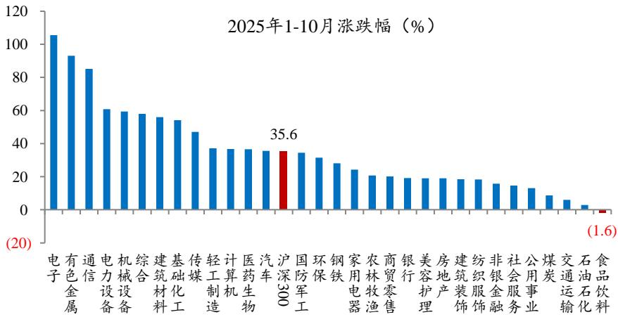  
数据来源：Wind、开源证券研究所

图2：2025年1-10月零食在食品饮料子行业中领涨  
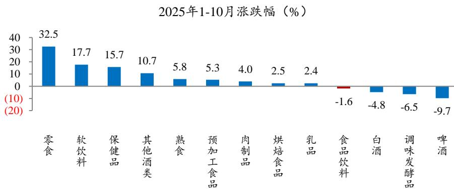  
数据来源：Wind、开源证券研究所

备注：板块涨跌幅为总市值加权平均，股价涨跌幅截至2025年10月29日

备注：板块涨跌幅为总市值加权平均，股价涨跌幅截至2025年10月29日

## 1.1 2025年1-10月食品饮料板块跑输市场

2025年1-10月食品饮料板块市值下降，主要来自于估值下降。我们从市值分解角度观察，食品饮料2025年1-10月PE较2024年底回落 $10.4\%$ ，预计2025年净利增长 $5.4\%$ ，两者共同作用，年初至今板块市值下降 $5.6\%$ 。其中：白酒估值同比下降 $9.8\%$ ，预计2025年净利增长 $1.9\%$ ，白酒板块市值下降 $8.1\%$ ；非白酒估值下降 $14.6\%$ ，预计2025年净利增长 $16.7\%$ ，板块市值回落 $0.3\%$ 。整体来看2025年初以来食品饮料板块市值下降，估值下降是主要原因。

图3：2025年1-10月食品饮料板块市值略有下降，主要来自于估值下降  
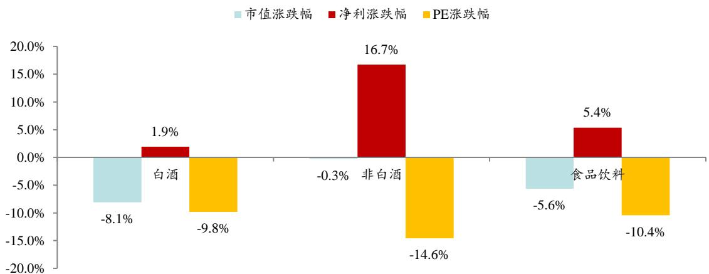  
数据来源：Wind、开源证券研究所

备注：股价涨跌幅截至2025年10月29日，盈利预测来源自Wind一致预测

## 1.1 2025年1-10月食品饮料板块跑输市场

食品饮料板块估值在31个行业处于中等偏下水平，环比回落。当前食品饮料估值（TTM）约20.5倍，与其他子行业相比处于中等偏下位置，近期估值环比略有回落，当前估值水平仍低于2019年初水平。

图4：2025年4月末食品饮料估值处于行业中等水平  
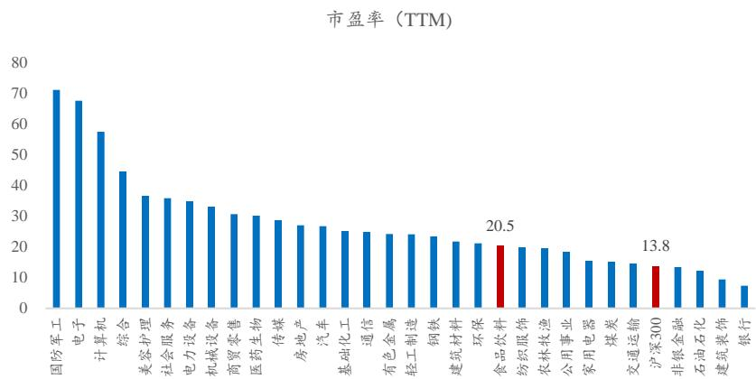  
数据来源：Wind、开源证券研究所  
备注：股价涨跌幅截至2025年10月29日

图5：2025年4月末食品饮料估值环比有所回升  
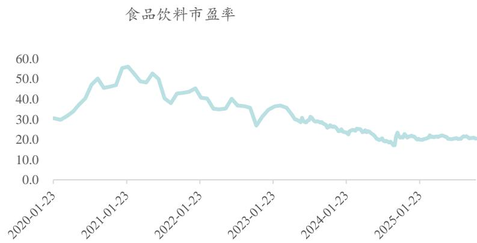  
数据来源：Wind、开源证券研究所  
备注：股价涨跌幅截至2025年10月29日

## 1.1 2025年10月食品饮料板块跑输市场

2025年10月食品饮料股价涨幅跑输市场。2025年10月食品饮料板块下跌 $1.1\%$ ，跑输沪深300约6.0pct，在一级子行业中排名倒数第五。分子行业看，预加工食品（ $+3.5\%$ ）、保健品（ $+2.7\%$ ）、烘焙食品（ $+1.6\%$ ）增速较快。

图6：2025年10月食品饮料涨跌幅市场排名27/31  
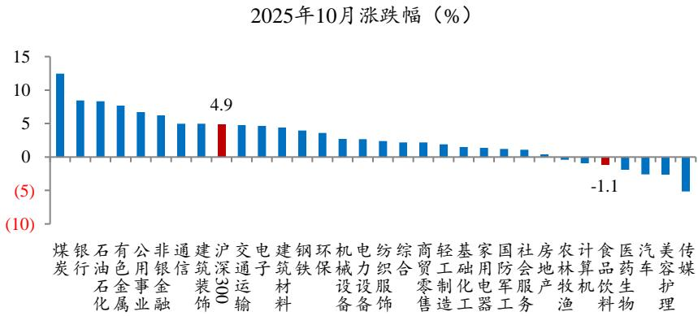  
数据来源：Wind、开源证券研究所  
备注：股价涨跌幅截至2025年10月29日

图7：2025年10月预加工食品在食品饮料子行业中涨幅最好  
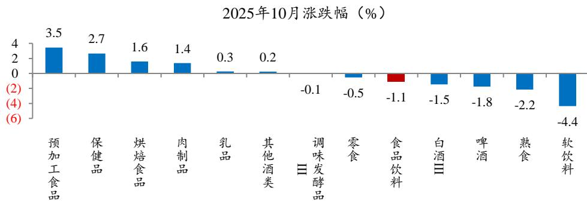  
数据来源：Wind、开源证券研究所  
备注：股价涨跌幅截至2025年10月29日

## 1.2 个股涨跌幅：具备成长性以及边际向好变化的股票表现较好

具备成长性以及边际向好变化的公司股价表现居前。2025年食品饮料板块需求仍然偏弱，叠加科技板块行情较好，吸引部分资金流入，市场普遍对食品饮料预期较为悲观。但受益于部分渠道、品类、市场红利，具备成长性的企业更加受到市场青睐。2025年1-10月板块涨幅前10股票中：万辰集团（+119.3%）、会稽山（+98.0%）行业景气度较高、边际具备向好的变化，涨幅位居前列；排名后十股票基本都是业绩预期较低，或处于经营低谷阶段的公司。

图8：2025年1-10月具备成长性以及边际向好变化的股票表现居前  
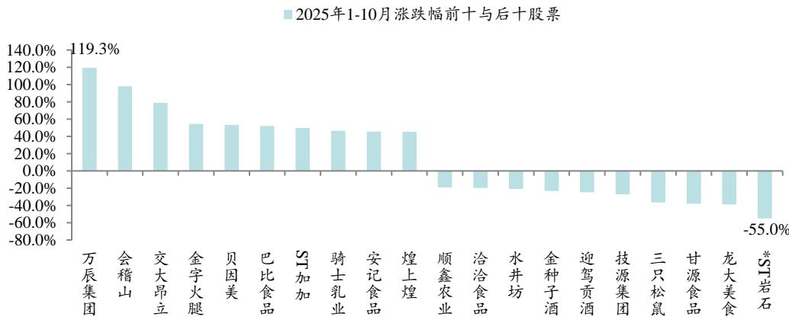  
数据来源：Wind、开源证券研究所  
备注：股价涨跌幅截至2025年10月29日

目录
CONTENTS
1 市场表现：食品饮料跑输市场，零食板块表现较好
2 基金持仓：三季度食品饮料配置比例降至新低
3 产业判断：宏观弱复苏，微观产业仍有压力
4 投资机会：白酒底部布局，兼顾成长型标的
5 风险提示

## 1.3 2025Q3食品饮料配置比例降至新低

2025Q3全市场基金食品饮料配置比例持续回落。从基金重仓持股情况来看（Wind中全部市场基金，一级子行业），2025Q3食品饮料配置比例由2025Q2的8.0%回落至6.4%水平，环比回落1.6pct，处于2020年以来新低位置。

2025Q3主动权益基金减配食品饮料。我们选取主动权益基金（普通股票、偏股混合、灵活配置三类基金），从基金重仓持股情况来看，2025Q3食品饮料配置比例为 $4.1\%$ ，和2025Q2的 $5.6\%$ 相比，下降1.5pct，说明三季度主动权益基金继续大幅减少食品饮料配置。三季度禁酒令影响仍在持续，科技板块具备明显投资机会，以白酒为代表的传统消费板块基本面情绪仍偏悲观，资金持续流出。预计四季度行业板块轮动，板块基本面见底叠加年底部分资金避险需求，我们估算会有部分资金回流。但整体来看，食品饮料板块配置比例仍是处于低位。

图9：2025Q3全市场基金重仓食品饮料比例环比回落至 $6.4\%$ 水平  
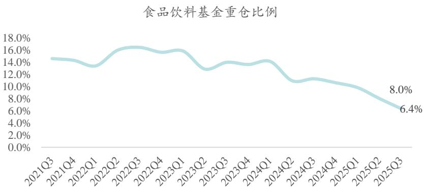  
数据来源：Wind、开源证券研究所

图10：2025Q3主动权益基金重仓食品饮料比例环比回落至 $4.1\%$ 水平  
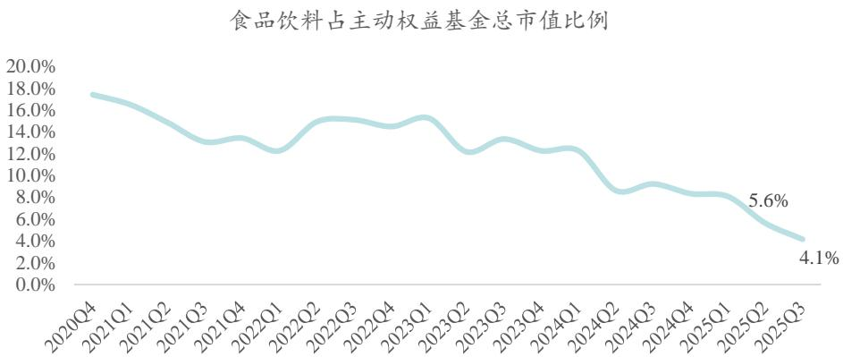  
数据来源：Wind、开源证券研究所

## 1.3 主动权益基金重仓白酒比例回落，报表出清酒企更易获得市场青睐

我们从主动权益基金持仓口径分析，从子行业分解来看，基金重仓白酒比例由2025Q2的 $4.0\%$ 回落至2025Q3的 $3.2\%$ 水平，环比回落0.8pct。如果观察全市场基金口径，基金重仓白酒比例由2025Q2的 $6.8\%$ 回落到2025Q3的 $5.5\%$ 。这反映出主动权益与被动基金均在减配白酒。从基金配置的情况分析，白酒内部产生分化，报表业绩已处于出清节奏的泸州老窖、舍得酒业、酒鬼酒等公司在三季度更易获得市场青睐。

图11：2025Q3全市场基金白酒与非白酒重仓比例回落  
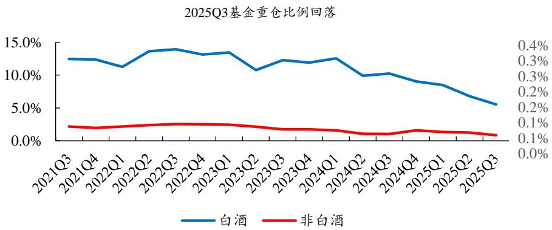  
数据来源：Wind、开源证券研究所

图12：2025Q1非白酒子行业重仓比例回落  
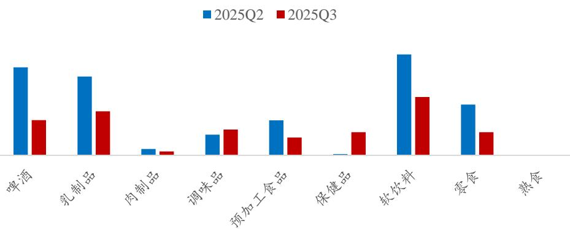  
数据来源：Wind、开源证券研究所

目录
CONTENTS
1 市场表现：食品饮料跑输市场，零食板块表现较好
2 基金持仓：三季度食品饮料配置比例降至新低
3 产业判断：宏观弱复苏，微观产业仍有压力
4 投资机会：白酒底部布局，兼顾成长型标的
5 风险提示

## 3.1 总量判断：三季度宏观经济与社零增速环比回落

从宏观层面来看，2025Q3我国GDP增速为 $4.8\%$ ，环比2025Q2有所回落，也在市场预期之内。观测季度数据变化情况，2025年Q3月消费品零售额同比 $+3.5\%$ ，增速相较2025Q2减少1.9pct，居民消费需求仍有承压，复苏进度相对偏缓，预计主要系禁酒令政策导致部分餐饮消费场景受限。宏观经济增速与社零数据基本匹配，也反映三季度消费环境有承压趋势。展望2026年，我们预判消费复苏仍在缓慢进行中，预计下半年消费可能会有改善。

图13：2025Q3 GDP同比增4.8%  
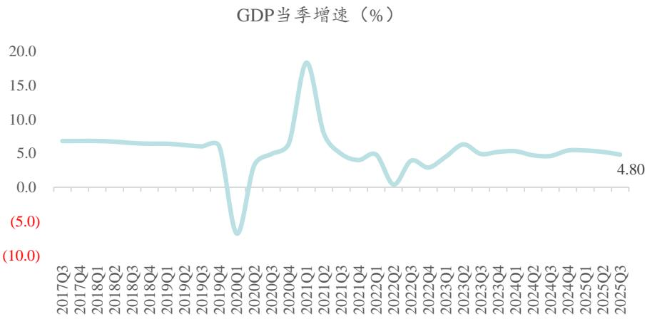  
数据来源：Wind、开源证券研究所

图14：2025Q3社零同比增速+3.5%，环比回落  
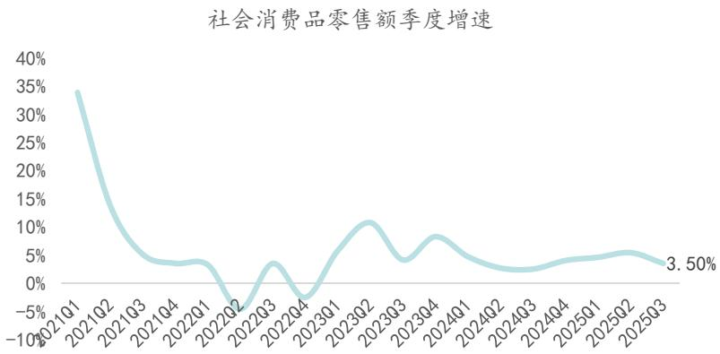  
数据来源：Wind、开源证券研究所

## 3.1 总量判断：三季度微观产业短期承压

从微观层面来看产业表现，产量承压，收入与利润增速也逐渐回落：食品制造企业2025年1-9月营收增速 $1.5\%$ ，累计增速较2024年有下行趋势；利润总额同比增 $2.1\%$ ，增速也呈回落趋势。食品制造业数据与社零数据基本匹配，表明行业需求压力已传导至企业供给端。观察行业产量数据，与2024年相比，2025年1-9月除乳制品产量降幅收窄，啤酒与冷藏肉产量增速回升，其余子行业产量增速均有下行。整体来看行业产量仍承受压力。

图15：2025年食品制造企业营收与利润增速呈回落趋势  
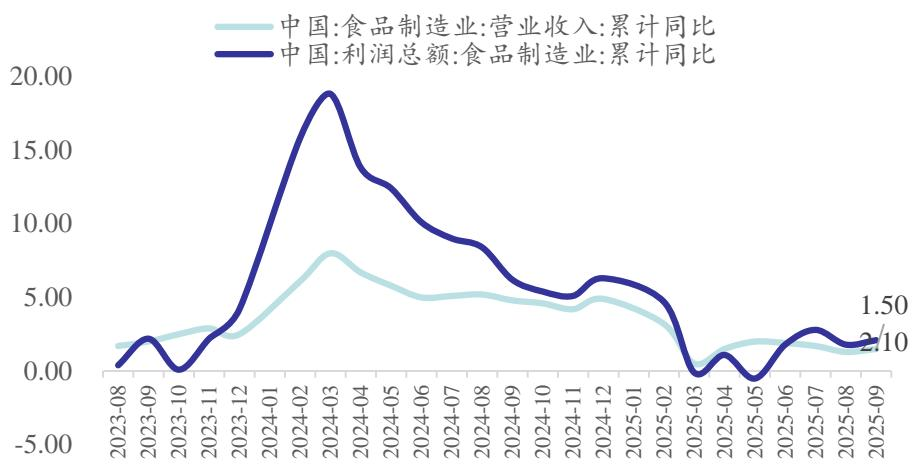  
数据来源：Wind、开源证券研究所

图16：2025年1-9月多数子行业产量增速较2024年仍有回落  
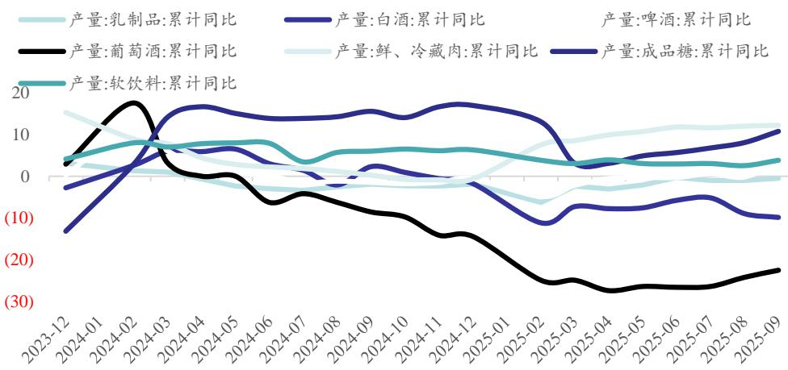  
数据来源：Wind、开源证券研究所

## 3.2 白酒：底部区间，低位布局

2025年5月底开始的严格控制体制内聚餐饮酒对行业需求和渠道信心有明显影响。从消费端看，受宏观经济压力影响，白酒整体需求有明显下降，商务需求持续承压，但居民消费相对刚性。从酒企端来看，渠道信心受影响较大，拒绝压货，并且渠道信心脆弱，年中批价下行明显。2025年，保证价格稳定、进行库存去化成为酒企和渠道的共识，行业去库存加速进行。

短期来看，白酒需求基本接近底部位置。商务需求持续承压；政务消费在二季度达到谷底，9月开始禁酒令影响边际放松，终端消费需求略有好转；大众消费持续保持韧性，婚宴、生日、日常聚会下降幅度相对较小。当前行业负面信息基本已被市场消化，短期基本面触底，但中长期行业趋势仍需观察宏观经济走势，目前看后续复苏斜率可能更加平缓。总结行业需求现状：同比仍承压，环比有改善。从行业秩序上看，当下趋势符合周期规律，越来越多的酒企降低回款要求，经销商和终端也优化和退出也比较有序，预计不会超预期的恶化。后续外部影响因素在于三公政策执行力度与经济环境压力，产业内部重要观察项目在于茅台批价的变化。

三季度白酒终端需求下降幅度环比二季度有所收窄，考虑到部分酒企进一步主动降低回款要求，三季度酒企报表下降幅度环比二季度扩大。我们判断白酒板块2025Q4有望迎来业绩和估值双底。当下考虑板块估值相对低位，筹码结构稳定，建议适当布局白酒板块。两维度思路选投：一是经营相对较为稳定的贵州茅台、山西汾酒，二是前期报表出清较多，积极进行市场改革的舍得酒业、洋河股份等，受益标的包括珍酒李渡。

## 3.3 啤酒：旺季需求承压，巩固基础再提高

2025年旺季啤酒未体现快速增长，主因行业受制于餐饮需求疲软以及禁酒令等因素影响。当前行业旺季即将过去，行业需求在波动中维持，渠道方面呈现餐饮渠道承压、新零售与即时零售渠道增长多方面变化，各大酒企积极探索新增长点。

继续巩固销量、结构，应对渠道多元化发展。近年来啤酒行业受消费力下行、餐饮需求疲软影响，量价表现有所回落，中高档啤酒竞争逐渐激烈、增速放缓，行业高端化进程阶段性放缓。年中受制于禁酒令及餐饮需求疲软等因素影响，旺季表现不佳。同时行业渠道呈现多元化发展趋势，家庭渠道占比提升，新零售、即时零售渠道在费用补贴下增长较快企业积极抓住渠道新增量，在大环境相对疲软的环境中力争实现正增长，巩固基础，等待需求修簍短期修复仍有一定的不确定性，但行业整体思路清晰，即销量修复为先、其次结构升级，各大企业瞄准中腰部价格带、壮大实力，为未来结构升级打下基础。

## 3.4 乳制品：需求偏弱，利润改善

受宏观经济影响，乳制品行业弱复苏，不同子行业处于不同阶段，传统常温液态奶行业双寡头格局稳定，龙头注重净利率提升，竞争较为理性且偏于长期品牌投入；低温奶行业各个区域乳制品企业区域割据，仍处于跑马圈地时期。

奶价延续下行趋势，预计2026年奶价可能迎来拐点。2025年原奶供需环境仍宽裕，虽奶牛存档量有所回落，但优先淘汰落后低产牛，我们观察生鲜乳产量仍较稳定，价格同比仍有回落，原奶价格延续下行趋势。往2026年展望，随着原奶深加工产能逐步落地，叠加上游牧场逐步出清，预计带动供需同步改善。长期看，我国奶牛存栏量仍处低位，在环保政策严格、土地资源紧缺的背景下，奶源供给增长仍较为缓慢；乳制品需求旺盛游合作深化下，预计未来原奶长期会处于供需紧平衡状态，原奶价格相对平稳。

投资建议：原奶价格可能在2026年迎来拐点，最受益是牧场产业，其次是乳制品制造企业。建议关注伊利股份，受益标的包括优然牧业等。

## 3.5 调味品：需求仍有压力，龙头优势明显

调味品行业仍处于弱复苏阶段。从收入端来看：（1）调味品需求与餐饮渠道相关性较大，受到禁酒令影响，消费场景缺失，餐饮业影响较大，调味品需求也承受压力。9月份以来，随着禁酒令管制边际松动，餐饮行业略有复苏，调味品板块需求也有望逐步改善；（2）部分调味品公司内部改革仍在推进，改革效果尚未充分释放，随着改革的进一步深化，我们预期改革效果有望逐步推动经营改善。盈利端来看：目前原材料成本下行趋势较为明显，成本红利已经逐步释放。

从2026年全年维度，我们建议调味品两条布局思路：一是关注高景气度复合调味料赛道；二是关注基础调味品板块行业龙头的个股改善性机会。优先关注天味食品、海天味业等。此外还可关注中炬高新底部改善性机会。

## 3.5 休闲食品：渠道、品类红利仍在，成长性板块值得布局

复盘历史每次零售渠道改革时总会带来成长红利，当前部分线下零售渠道面临流量流失、利润率下滑等问题，传统线下零售渠道在运营模式、服务方式等方面的不足日益显见，导致其竞争力下降，市场份额被不断挤压，部分线下渠道开始积极求变，其思路的变化给上游品牌供应方带来机会。一是部分商超企业效仿山姆会员店模式，对于进店品类严格要求，更注重产品品质，力求为消费者提供高品质体验，具有较强产品力与品牌力的上游供应企业将会受益；二是部分定位于中端消费的商超企业为了获得持续的客流量，开始进行差异化选品，同时综合考虑产品性价比，这就要求上游供应商同时具备品牌力、产品创新能力以及成本管控能力；三是以低价模式为主的连锁折扣业态，也在重新思考价格之外的核心竞争力类的丰富度及低成本的微创新或是突破之道。而无论哪种变革，均是零售业态自身以渠道力去主动匹配品牌供应商，这就要求供应商具备较强的品牌力、产品力以及创新能力。不单单是口味的创新，产品差异化、品类丰富度可能成为更重要的考量条件。

新品红利也是全年投资逻辑的重要部分，如盐津铺子抓住魔芋品类的红利期，叠加全渠道拓展；有友食品的脱骨鸭掌贡献一季度主要收入增量，山姆会员店的素食品类也已推出；百润股份国产威士忌已投放市场等。

我们建议关注头部零食品牌以及具备单品突破的公司，推荐卫龙美味、西麦食品、有友食品、盐津铺子等。

目录
CONTENTS
1 市场表现：食品饮料跑输市场，零食板块表现较好
2 基金持仓：三季度食品饮料配置比例降至新低
3 产业判断：宏观弱复苏，微观产业仍有压力
4 投资机会：白酒底部布局，兼顾成长型标的
5 风险提示

## 4.1 投资机会展望：底部修复，柳暗花明

预期发生改变。近期四中全会召开，同时发表十五五规划建议，在发展目标中提到“居民消费率明显提高，内需拉动经济增长主动力作用持续增强，经济增长潜力得到充分释放”。在建设国内市场中也提到“大力提振消费。深入实施提振消费专项行动。统筹促就业、增收入、稳预期，合理提高公共服务支出占财政支出比重，增强居民消费能力。扩大优质消费品和服务供给”。我们对于消费政策释放的预期更加坚定，对消费板块后续呈乐观态度。食品饮料行业格局以及商业模式未变，近几年估值持续回调，更多是出于对宏观经济的担忧，对行业需求产生悲观情绪。随着当前政策改善预期扭转，市场悲观情绪应可到缓解。食品饮料作为经济顺周期的重要行业之一，在经济向好预期强化时，更容易获得市场青睐。

2025年初至今，食品饮料显著跑输大盘，原因与消费环境、市场风格变化有关。（1）禁酒令使得很多消费场景消失，导致与酒类、餐饮相关的消费需求受到负面影响；（2）居民预期收入有压力，限制消费持续升级表现；（3）科技板块行情明显，导致部分资金流出。当前板块底层逻辑是基本面已接近底部区间，后续复苏预期逐渐升温。基本面底部依据：（1）行业利空已基本释放，禁酒令影响边际放缓；（2）部分企业主动收缩供给，力求实现供需平衡，减少渠道压力，释放渠道风险。（3）政策预期加强，提振相关消费领域需求。基本面底部叠加板块估值已经回落至低点，基金持仓食品饮料比例一直维持较低位置，筹码结构相对较好，此时板块已无悲观必要。

## 4.2 投资机会展望：白酒底部布局，兼顾成长型标的

往2026年全年展望，食品饮料行业主线是底部回暖复苏，而复苏的节奏及力度，与宏观经济相关性较大。按照复苏路径推演，2026年我们更多期望大众消费保持韧性，经济活跃度提升带来商务消费提振。

产业层面白酒企业已进入深度调整期，行业需求下行的结果已由终端经渠道传导至厂家，体现为酒企公司报表业绩增速放缓。多数企业尊重市场客观规律，调节供应量以适应当前行业状态，白酒行业典型特征是多数酒企尊重市场客观情况，以业绩为代价来换取渠道秩序的良性发展。2025Q3白酒动销普遍下滑，中秋国庆节日白酒市场呈现两个分化：一是场景分化：宴席场景凭借双节叠加的聚餐需求成为核心支撑，其中高性价比产品与地产酒动销表现突出；大众消费场景次之，高端礼赠因茅台酒需求刚性保持坚挺，但商务场景受环境影响拖累最明显。二是价格带分化，“两头强、中间弱”特征明确，以茅台为首的高端酒与高性价比地产酒表现最优，次高端酒整体承压，仅汾酒保持平稳。从渠道端来看，白酒库存虽仍在首位由于酒企减少压货力度，库存环比略有改善。批价节前稳定，节后价格小幅回落，但还在可控范围持续展望，酒厂仍克制压货以推进渠道库存去化，为长期健康发展奠定基础，但短期报表仍处于出清阶段。我们认为当前白酒板块已接近左侧布局区间，当前可逐步开展配置，优先选择业绩出清或底部确认标的，建议关注贵州茅台、泸州老窖、山西汾酒、舍得酒业、洋河股份等。

大众品方面，我们建议关注具备成长属性的休闲零食板块。零食增长逻辑是与消费行为变化深度绑定。散装、小包装零食因适配即时消费场景，成为近期食品饮料增长主力。渠道端，社区店、电商等因更贴近消费者日常采购与即时下单需求，增速显著优于其他渠道，头部企业则通过聚焦核心单品，进一步巩固了市场份额，支撑板块整体增长。品类端，具备健康属性的新品更易获得青睐。我们建议从成长性角度按照新渠道、新品类、新市场等思路布局，重点关注卫龙美味、西麦食品、盐津铺子、百润股份等。

## 4.3 重点公司盈利预测及估值

表2：重点公司盈利预测及估值

<table><tr><td rowspan="2">公司名称</td><td rowspan="2">评级</td><td rowspan="2">收盘价(元)</td><td colspan="3">EPS(元)</td><td colspan="3">PE</td></tr><tr><td>2025E</td><td>2026E</td><td>2027E</td><td>2025E</td><td>2026E</td><td>2027E</td></tr><tr><td>贵州茅台</td><td>买入</td><td>1431.9</td><td>76.10</td><td>84.27</td><td>91.07</td><td>18.8</td><td>17.0</td><td>15.7</td></tr><tr><td>五粮液</td><td>买入</td><td>118.8</td><td>8.46</td><td>8.99</td><td>9.62</td><td>14.0</td><td>13.2</td><td>12.4</td></tr><tr><td>泸州老窖</td><td>买入</td><td>129.9</td><td>9.47</td><td>9.84</td><td>10.35</td><td>13.7</td><td>13.2</td><td>12.5</td></tr><tr><td>山西汾酒</td><td>买入</td><td>186.6</td><td>11.03</td><td>12.03</td><td>13.04</td><td>16.9</td><td>15.5</td><td>14.3</td></tr><tr><td>口子窖</td><td>增持</td><td>32.3</td><td>1.64</td><td>1.84</td><td>2.02</td><td>19.7</td><td>17.5</td><td>16.0</td></tr><tr><td>古井贡酒</td><td>增持</td><td>150.5</td><td>11.14</td><td>12.49</td><td>13.97</td><td>13.5</td><td>12.0</td><td>10.8</td></tr><tr><td>金徽酒</td><td>增持</td><td>19.6</td><td>0.80</td><td>0.91</td><td>1.06</td><td>24.5</td><td>21.5</td><td>18.5</td></tr><tr><td>伊利股份</td><td>买入</td><td>27.2</td><td>1.70</td><td>1.83</td><td>1.95</td><td>16.0</td><td>14.9</td><td>13.9</td></tr><tr><td>新乳业</td><td>增持</td><td>16.6</td><td>0.78</td><td>0.92</td><td>1.04</td><td>21.3</td><td>18.0</td><td>16.0</td></tr><tr><td>双汇发展</td><td>增持</td><td>25.4</td><td>1.51</td><td>1.59</td><td>1.68</td><td>16.8</td><td>16.0</td><td>15.1</td></tr><tr><td>中炬高新</td><td>增持</td><td>18.1</td><td>1.18</td><td>1.26</td><td>1.43</td><td>15.3</td><td>14.3</td><td>12.6</td></tr><tr><td>涪陵榨菜</td><td>增持</td><td>13.1</td><td>0.72</td><td>0.78</td><td>0.84</td><td>18.1</td><td>16.7</td><td>15.5</td></tr><tr><td>海天味业</td><td>买入</td><td>38.4</td><td>1.24</td><td>1.41</td><td>1.55</td><td>31.0</td><td>27.3</td><td>24.8</td></tr><tr><td>西麦食品</td><td>增持</td><td>21.8</td><td>0.77</td><td>0.99</td><td>1.18</td><td>28.3</td><td>22.0</td><td>18.5</td></tr><tr><td>嘉必优</td><td>买入</td><td>24.1</td><td>1.14</td><td>1.37</td><td>1.64</td><td>21.1</td><td>17.6</td><td>14.7</td></tr><tr><td>绝味食品</td><td>增持</td><td>13.5</td><td>1.04</td><td>1.11</td><td>1.19</td><td>13.0</td><td>12.2</td><td>11.4</td></tr><tr><td>煌上煌</td><td>增持</td><td>12.3</td><td>0.14</td><td>0.19</td><td>0.22</td><td>87.6</td><td>64.5</td><td>55.7</td></tr><tr><td>广州酒家</td><td>增持</td><td>16.0</td><td>1.00</td><td>1.12</td><td>1.22</td><td>16.0</td><td>14.3</td><td>13.1</td></tr><tr><td>甘源食品</td><td>买入</td><td>55.8</td><td>2.65</td><td>3.23</td><td>4.38</td><td>21.1</td><td>17.3</td><td>12.7</td></tr><tr><td>劲仔食品</td><td>增持</td><td>11.8</td><td>0.72</td><td>0.89</td><td>1.13</td><td>16.4</td><td>13.3</td><td>10.5</td></tr><tr><td>天味食品</td><td>增持</td><td>11.4</td><td>0.65</td><td>0.73</td><td>0.82</td><td>17.5</td><td>15.6</td><td>13.9</td></tr></table>

数据来源：Wind、开源证券研究所（收盘价日期为2025年10月29日，表中公司盈利预测均来自开源证券研究所）

## 目录 CONTENTS

1 市场表现：食品饮料跑输市场，零食板块表现较好
2 基金持仓：三季度食品饮料配置降幅新低
3 产业判断：宏观弱复苏，微观产业仍有压力
4 投资机会：白酒底部布局，兼顾成长型标的
5 风险提示

## 4 风险提示

（1）宏观经济波动：宏观经济环境直接影响居民收入水平和消费意愿，如果宏观经济下行，将影响白酒、大众品消费需求。

(2) 消费复苏进度低于预期风险: 消费复苏进度影响终端需求, 若复苏进度低于预期、市场需求偏弱, 公司终端动销将会承压, 进而影响业绩。

(3) 原材料价格波动风险: 部分子行业中原材料占成本的比例较高, 若原材料价格波动较大, 将影响企业生产成本, 从而影响公司盈利能力。

## 分析师声明

负责准备本报告以及撰写本报告的所有研究分析师或工作人员在此保证，本研究报告中关于任何发行商或证券所发表的观点均如实反映分析人员的个人观点。负责准备本报告的分析师获取报酬的评判因素包括研究的质量和准确性、客户的反馈、竞争性因素以及开源证券股份有限公司的整体收益。所有研究分析师或工作人员保证他们报酬的任何一部分不曾与，不与，也将不会与本报告中具体的推荐意见或观点有直接或间接的联系。

## 特别声明

《证券期货投资者适当性管理办法》、《证券经营机构投资者适当性管理实施指引（试行）》已于2017年7月1日起正式实施。根据上述规定，开源证券评定此研报的风险等级为R4（中高风险），因此通过公共平台推送的研报其适用的投资者类别仅限定为专业投资者及风险承受能力为C4、C5的普通投资者。若您并非风险承受能力为C4、C5的普通投资者，请取消阅读，请勿收藏、接收或使用本研报中的任何信息。因此受限于访问权限的设置，若给您造成不便，烦请见谅！感谢您给予的理解与配合。

## 股票投资评级说明

<table><tr><td></td><td>评级</td><td>说明</td></tr><tr><td rowspan="4">证券评级</td><td>买入(buy)</td><td>预计相对强于市场表现20%以上;</td></tr><tr><td>增持(outperform)</td><td>预计相对强于市场表现5%~20%;</td></tr><tr><td>中性(Neutral)</td><td>预计相对市场表现在-5%~+5%之间波动;</td></tr><tr><td>减持(underperform)</td><td>预计相对弱于市场表现5%以下。</td></tr><tr><td rowspan="3">行业评级</td><td>看好(overweight)</td><td>预计行业超越整体市场表现;</td></tr><tr><td>中性(Neutral)</td><td>预计行业与整体市场表现基本持平;</td></tr><tr><td>看淡(underperform)</td><td>预计行业弱于整体市场表现。</td></tr></table>

## 分析、估值方法的局限性说明

本报告所包含的分析基于各种假设，不同假设可能导致分析结果出现重大不同。本报告采用的各种估值方法及模型均有其局限性，估值结果不保证所涉及证券能够在该价格交易。

## 法律声明

开源证券股份有限公司是经中国证监会批准设立的证券经营机构，具备证券投资咨询业务资格。

本报告仅供开源证券股份有限公司（以下简称“本公司”）的机构或个人客户（以下简称“客户”）使用。本公司不会因接收人收到本报告而视其为客户。本报告是发送给开源证券客户的，属于商业秘密材料，只有开源证券客户才能参考或使用，如接收人并非开源证券客户，请及时退回并删除。

本报告是基于本公司认为可靠的已公开信息，但本公司不保证该等信息的准确性或完整性。本报告所载的资料、工具、意见及推测只提供给客户作参考之用，并非作为或被视为出售或购买证券或其他金融工具的邀请或向人做出邀请。本报告所载的资料、意见及推测仅反映本公司于发布本报告当日的判断，本报告所指的证券或投资标的的价格、价值及投资收入可能会波动。在不同时期，本公司可发出与本报告所载资料、意见及推测不一致的报告。客户应当考虑到本公司可能存在可能影响本报告客观性的利益冲突，不应视本报告为做出投资决策的唯一因素。本报告中所指的投资及服务可能不适合个别客户，不构成客户私人咨询建议。本公司未确保本报告充分考虑到个别客户特殊的投资目标、财务状况或需要。本公司建议客户应考虑本报告的任何意见或建议是否符合其特定状况，以及（若有必要）咨询独立投资顾问。在任何情况下，本报告中的信息或所表述的意见并不构成对任何人的投资建议。在任何情况下，本公司不对任何人因使用本报告中的任何内容所引致的任何损失负任何责任。若本报告的接收人非本公司的客户，应在基于本报告做出任何投资决定或就本报告要求任何解释前咨询独立投资顾问。

本报告可能附带其它网站的地址或超级链接，对于可能涉及的开源证券网站以外的地址或超级链接，开源证券不对其内容负责。本报告提供这些地址或超级链接的目的纯粹是为了客户使用方便，链接网站的内容不构成本报告的任何部分，客户需自行承担浏览这些网站的费用或风险。开源证券在法律允许的情况下可参与、投资或持有本报告涉及

的证券或进行证券交易，或向本报告涉及的公司提供或争取提供包括投资银行业务在内的服务或业务支持。开源证券可能与本报告涉及的公司之间存在业务关系，并无需事先或在获得业务关系后通知客户。

本报告的版权归本公司所有。本公司对本报告保留一切权利。除非另有书面显示，否则本报告中的所有材料的版权均属本公司。未经本公司事先书面授权，本报告的任何部分均不得以任何方式制作任何形式的拷贝、复印件或复制品，或再次分发给任何其他人，或以任何侵犯本公司版权的其他方式使用。所有本报告中使用的商标、服务标记及标记均为本公司的商标、服务标记及标记。

## 开源证券研究所

上海：上海市浦东新区世纪大道1788号陆家嘴金控广场1号楼3层

邮箱：research@kysec.cn

北京：北京市西城区西直门外大街18号金贸大厦C2座9层

邮箱：research@kysec.cn

深圳：深圳市福田区金田路2030号卓越世纪中心1号楼45层

邮箱：research@kysec.cn

西安：西安市高新区锦业路1号都市之门B座5层

邮箱：research@kysec.cn

## 开源证券