# 食品饮料行业 2026 年度投资策略报告（二）

# 白酒：底部信号夯实，重视优质酒企配置机会

优于大市

## 核心观点

回顾2025年：供需矛盾凸显，酒企降低增长要求，逐步释放渠道压力。2025年初以来白酒指数（申万）下跌 $12\%$ （跑输沪深300指数 $33\%$ ），其中Wind一致预测板块归母净利润下降 $17\%$ ，预测PE(FY25)上涨 $6\%$ ，业绩是股价下跌主因。2023年以来市场担忧白酒行业增长久期，估值、持仓不断下降，目前均至历史低位，反映市场悲观预期。市场动销端，受第二季度饮酒政策影响，6-8月份动销进入冰点。目前看白酒消费环比略有修复，但实际需求仍然偏弱，且供给刚性强，以价换量现象普遍，主流产品批价处于筑底下跌阶段；这也倒逼酒企减少供给，改善供需关系，比如以五粮液、古井贡酒为代表的公司降低增长要求，三季报业绩大幅下滑，逐步释放渠道压力。

## 展望 2026 年：供给端优化，渠道出清，重视优质公司配置机会。

1）行业整体看，供需缺口仍然存在，但政策加码（消费压制边际减弱，持续提振内需），场景、需求预计逐步修复，白酒行业春节动销有望展现韧性，2026Q2后低基数下或更加稳健。酒企对于2026年目标制定预计更加理性，但仍会追求份额提升；龙头贵州茅台产品结构、渠道模式优化，理性发展目标下，行业供需关注有望逐步改善。

2）渠道状态看，库存在25Q3触达周期高点后环比减少，渠道利润自第二季度快速收缩，酒企加强经销商动态利润的维护，龙头茅台五粮液逐步放松渠道政策，区域龙头主品批价双节后出现企稳趋势。复盘2013-15年周期，渠道状态在13Q3进入动态磨底阶段，估值&股价在14Q1触底回升，本轮周期伴随茅台批价同比筑底，估值探底回升信号也将加强。

3）竞争视角看，本轮周期伴随需求的结构性变化，已从价位带景气度的分化到酒企能力（品牌、组织、渠道、营销）竞争的加剧，成为后续份额竞争的主要因素，我们认为在某个价位或某个区域掌握定价权的酒企，或是基本面左侧率先培育新人群/渠道/场景的酒企有望率先走出调整周期。

投资建议：我们认为白酒板块进入可配置区间，龙头贵州茅台量价关系改善，红利资产属性体现，2026年股息率4%、支撑估值；市场对板块业绩下降预期充分，任何供需两端的改善都有望构成催化。个股投资主线：1）品牌厚植，短期穿越周期、长期经营久期的贵州茅台、山西汾酒，伴随市场流动性改善，估值中枢有望提升；2）已逐步掌握价位带、区域的份额优势，调整阶段积极加强渠道和消费者触达，时间换空间的泸州老窖，关注古井贡酒、金徽酒；3）调整较为充分，短期动作正确的底部反转标的迎驾贡酒、舍得酒业，关注洋河股份；4）高综合股东回报，高现金流安全边际的五粮液。

风险提示：宏观经济的发展超预期或低于预期，需求恢复速度进一步放缓；行业内卷式竞争，增投费用影响利润率；市场资金波动加剧。

重点公司盈利预测及投资评级

<table><tr><td rowspan="2">公司代码</td><td rowspan="2">公司名称</td><td rowspan="2">投资评级</td><td rowspan="2">昨收盘(元)</td><td rowspan="2">总市值(亿元)</td><td colspan="2">净利润(亿元)</td><td colspan="2">PE</td></tr><tr><td>2025E</td><td>2026E</td><td>2025E</td><td>2026E</td></tr><tr><td>600519.SH</td><td>贵州茅台</td><td>优于大市</td><td>1,410.0</td><td>17,657</td><td>905.9</td><td>952.1</td><td>19.5</td><td>18.5</td></tr><tr><td>000858.SZ</td><td>五粮液</td><td>优于大市</td><td>110.5</td><td>4,290</td><td>256.7</td><td>258.7</td><td>16.7</td><td>16.6</td></tr><tr><td>000568.SZ</td><td>泸州老窖</td><td>优于大市</td><td>122.1</td><td>1,797</td><td>113.4</td><td>118.3</td><td>15.8</td><td>15.2</td></tr><tr><td>600809.SH</td><td>山西汾酒</td><td>优于大市</td><td>178.6</td><td>2,179</td><td>118.7</td><td>124.7</td><td>18.4</td><td>17.5</td></tr><tr><td>600702.SH</td><td>舍得酒业</td><td>优于大市</td><td>58.0</td><td>193</td><td>5.8</td><td>6.7</td><td>33.3</td><td>28.8</td></tr><tr><td>002304.SZ</td><td>洋河股份</td><td>中性</td><td>62.8</td><td>945</td><td>39.8</td><td>40.5</td><td>23.7</td><td>23.3</td></tr><tr><td>000596.SZ</td><td>古井贡酒</td><td>优于大市</td><td>144.6</td><td>764</td><td>45.1</td><td>45.6</td><td>16.9</td><td>16.8</td></tr><tr><td>603198.SH</td><td>迎驾贡酒</td><td>优于大市</td><td>40.1</td><td>321</td><td>19.9</td><td>21.6</td><td>16.2</td><td>14.9</td></tr><tr><td>603369.SH</td><td>今世缘</td><td>优于大市</td><td>35.8</td><td>446</td><td>27.4</td><td>28.0</td><td>16.3</td><td>15.9</td></tr><tr><td>603919.SH</td><td>金徽酒</td><td>优于大市</td><td>20.1</td><td>102</td><td>3.8</td><td>4.0</td><td>27.1</td><td>25.8</td></tr></table>

资料来源：Wind、国信证券经济研究所预测

## 行业研究·行业专题

食品饮料·白酒Ⅱ

优于大市·维持

证券分析师：张向伟

证券分析师：张未艾

021-61761031

zhangxiangwei@guosen.com.cn zhangweiai@guosen.com.cn S0980523090001 S0980525070005

## 市场走势

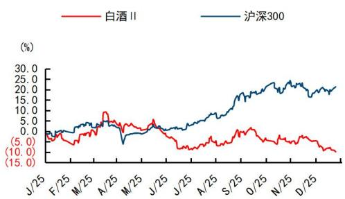  
资料来源：Wind、国信证券经济研究所整理

## 相关研究报告.

《食品饮料行业专题报告：数说食饮（一）-宏观经济指标如何指引白酒行业投资？》——2025-11-14

《白酒行业周期专题2-以史为镜，当前时点为什么我们认为白酒进入布局阶段？》——2025-10-28

《食品饮料行业 2025 年度策略报告（二）-白酒：积极因素增加，曙光渐现》——2024-12-14

《白酒板块事件点评报告-积极性政策持续加码，板块底部信号增多》——2024-09-29

《食品饮料周报（24年第20周）-白酒淡季聚焦市场秩序管控，啤酒短期催化因素增多》——2024-05-27

## 内容目录

1 回顾 2025 年：供需矛盾加剧，酒企业绩降速，释放渠道压力 …… 4
1.1 板块股价跑输大盘，报表开始释放需求压力 …… 4
1.2 市场动销环比第二季度略有修复，批价仍在下跌筑底 …… 6
2 展望 2026 年：供给优化、渠道磨底，重视优质公司配置机会 …… 8
2.1 行业整体：需求仍待磨底，酒企预计理性定调、份额优先 …… 8
2.2 渠道状态：酒企聚焦去库、维护渠道信心，已有筑底迹象 …… 10
2.3 竞争视角：优质公司夯实价位/区域优势，营销积极求变 …… 12
3 投资建议 …… 15
风险提示 …… 16

## 图表目录

图1：2025年白酒指数股价复盘 4  
图2：2025年白酒个股预测净利润、PE及股价涨跌幅情况 4  
图3：2025年白酒个股分季度业绩表现 5  
图4：当前白酒指数PE(TTM)对应2012年来 $26.4\%$ 分位数 5  
图5：当前白酒指数PE(TTM)对应2020年来 $7.4\%$ 分位数 5  
图6：3Q25白酒板块基金重仓持股比例 $3.69\%$ 6  
图7：3Q25白酒(剔除茅台)基金重仓持股比例 $2.21\%$ 6  
图8：2020-25年飞天（箱装）批价 7  
图9：2020-25年八代五粮液批价 7  
图10：飞天批价同比与居民中长期贷款情况 8  
图11：飞天批价同比与PPI同比 8  
图12：社零收入增速25M10餐饮有所恢复，烟酒类继续承压 8  
图13：2025年商品房销售面积同比降幅扩大 8  
图14：春节白酒消费场景构成 9  
图15：历史白酒企业营运资金变化情况 9  
图16：2013-2015年周期复盘，渠道利润磨底-股价触底-报表业绩降幅显著收窄 10  
图17：历史渠道库存情况，2013年双节达到历史高峰，当前库存环比25Q2-3有所去化 11  
图18：2025年飞天、普五经销商环节毛利率下降较多 11  
图19：茅五泸高端单品终端毛利率降至低个位数 11  
图20：徽酒大单品批价情况 12  
图21：苏酒大单品批价情况 12  
图22：白酒分价位带规模和增速情况，2025年在行业承压下个价位带大单品集中度持续提升 12  
图23：飞天茅台零售价接近城镇居民收入1/3水平 13  
图24：2025年分价位及对应产品规模情况预测 13  
图25：2025年部分区域及对应酒企规模情况预测 13  
图26：2025年全A销售费用降幅收窄 14  
图27：部分次高端酒企2025年创新渠道模式 14  

表1：2025年白酒行业市场动销在第二季度大幅下降后略有修复 6  
表2：上轮及本轮周期酒企收入目标达成情况，2026年目标预计制定理性，但会进一步扩大自己的优势9  
表3：主要白酒上市公司盈利预测及估值表 1

## 1 回顾 2025 年：供需矛盾加剧，酒企业绩降速，释放渠道压力

## 1.1 板块股价跑输大盘，报表开始释放需求压力

2025 年板块股价波动由 EPS 下修主导。年初至今（2025/12/9）申万白酒指数下跌 12.1%，跑输沪深 300 指数 32.5%；其中 Wind 一致预测板块归母净利润下降 16.8%，预测 PE(FY25) 上涨 6.4%。2025Q2 以来供需矛盾加剧，酒企被动或主动释放渠道压力，预期业绩表现较大幅度下修；中报后伴随表观与实际动销的差距逐步收窄，股价走势较上半年更加平稳，也表明估值端对下滑的预期反映已较为充分。2025 年个股股价表现看，基本面左侧阶段市场寻找中长期 α 标的，老窖、汾酒、金徽酒产品及区域增长空间清晰，茅台业绩表现相对稳健，酒鬼酒、珍酒受益于新产品或新渠道模式催化，古井在三季报充分释压后也跑出阶段性超额。

图1：2025年白酒指数股价复盘

<table><tr><td>2025年</td><td>1月</td><td>2月</td><td>3月</td><td>4月</td><td>5月</td><td>6月</td><td>7月</td><td>8月</td><td>9月</td><td>10月</td><td>11月</td><td>12月</td></tr><tr><td>涨跌</td><td>-6.7%</td><td>+4.2%</td><td>-1.7%</td><td>-4.6%</td><td>-2.4%</td><td>-0.7%</td><td>+2.0%</td><td>+11.5%</td><td>-6.4%</td><td>-0.4%</td><td>-1.8%</td><td></td></tr><tr><td>25%</td><td rowspan="4">●2024年12月居民消费信心和消费意愿仍然较弱●市场预期春节白酒动销平淡,销量同比下滑,价格延续压力</td><td rowspan="4">●春节白酒动销整体符合节前预期,大众价位&gt;高端&gt;次高端●消费政策预期升温●酒企重视价盘维护,多家酒企针对大单品停货</td><td rowspan="4">●两会召开,2025年《政府工作报告》将全方位扩大国内需求置于首位,市场信心有所修●节后酒企渠道表化稳定,库存在可控范围内,价盘保持平稳</td><td rowspan="4">●白酒行业受关税成本冲击较弱,同时振内需预期提升板块展现韧性3月CPI同比下降0.1%,降幅明显收窄●白酒行业步入需求淡季,茅台批价有所波动</td><td rowspan="4">●中美关税谈判突破性进展利好短期波动●《党政机关厉行节约反对浪费条例》,市场担忧政商务场景进一步受损,股价波动●五一动销符合市场前期悲观预期,高端白酒价格压力开始显现</td><td rowspan="4">●即时零售强势入局618,白酒618线上销售数据延续较快增长,端午动销仍面临需求压制●政策趋紧影响政商务场景需求,飞天茅台批价跌至2000元</td><td rowspan="4">●7月政治局会议决定召开二十届四中全会宏观政策要持续发力、适时加力,货币政策继续强调要保持流动性充裕●茅五批价下跌,白酒淡季需求较弱</td><td rowspan="4">●淡季需求仍有较大压力,7、8月终端动销和消费者开瓶环比有所改善,自饮、宴席场景开始恢复●茅台、五粮液、珍酒类股推出新品</td><td rowspan="4">●双节前渠道反馈氛围平淡备货谨慎●禁酒令对场景内压制延续坏比略有改善但同比仍有较大下滑●飞天茅台批价跌至1800元以下,同比降幅从8月-30%收窄至-25~30%</td><td rowspan="4">●双节略好于节前预期,动销量整体下滑15-20%,聚饮、家宴等大众场景好于预期,流量单品表现更好●高端茅五批价下跌后开瓶表现较好●多数酒企四款节奏慢于去年同期,库存仍有增加</td><td rowspan="4">●10月CPIPPI数据好于预期●白酒板块三季报收入及业绩下滑幅度扩大,多数酒企被动出清渠道风险●截至11月底飞天茅台批价跌幅1600元</td><td rowspan="4"></td></tr><tr><td>-5%</td></tr><tr><td>-10%</td></tr><tr><td>-15%</td></tr></table>

资料来源：Wind、公司公告、中国酒业协会，国信证券经济研究所整理；注：数据截至2025/12/9

图2：2025年白酒个股预测净利润、PE及股价涨跌幅情况

<table><tr><td>股票代码</td><td>公司简称</td><td>年初预测净利润2025E</td><td>年初PE(2025)</td><td>当前预测净利润2025E</td><td>当前PE(2025)</td><td>当前PE(2026)</td><td>当前PE(2027)</td><td>盈利预测调整幅度</td><td>估值较年初变化</td><td>年初至今股价涨跌幅</td><td>年初至今股价超额收益</td></tr><tr><td>600519.SH</td><td>贵州茅台</td><td>961.3</td><td>19.9</td><td>914.4</td><td>19.2</td><td>18.1</td><td>17.0</td><td>-4.9%</td><td>-3.7%</td><td>-6.3%</td><td>5.3%</td></tr><tr><td>000858.SZ</td><td>五粮液</td><td>357.6</td><td>15.2</td><td>271.4</td><td>15.9</td><td>15.4</td><td>14.4</td><td>-24.1%</td><td>4.3%</td><td>-17.1%</td><td>-5.5%</td></tr><tr><td>000568.SZ</td><td>泸州老窖</td><td>156.6</td><td>11.8</td><td>120.5</td><td>14.9</td><td>14.3</td><td>13.2</td><td>-23.0%</td><td>26.7%</td><td>2.4%</td><td>14.0%</td></tr><tr><td>600809.SH</td><td>山西汾酒</td><td>143.4</td><td>15.7</td><td>121.6</td><td>18.0</td><td>17.0</td><td>15.6</td><td>-15.3%</td><td>14.8%</td><td>0.8%</td><td>12.4%</td></tr><tr><td>600779.SH</td><td>水井坊</td><td>14.9</td><td>17.5</td><td>6.9</td><td>26.8</td><td>24.1</td><td>20.9</td><td>-53.7%</td><td>52.9%</td><td>-27.6%</td><td>-16.0%</td></tr><tr><td>600702.SH</td><td>舍得酒业</td><td>10.7</td><td>20.6</td><td>5.6</td><td>34.0</td><td>28.5</td><td>23.2</td><td>-47.6%</td><td>65.0%</td><td>-12.8%</td><td>-1.2%</td></tr><tr><td>000799.SZ</td><td>酒鬼酒</td><td>2.2</td><td>80.7</td><td>0.3</td><td>599.7</td><td>186.0</td><td>109.1</td><td>-86.7%</td><td>642.6%</td><td>0.1%</td><td>11.7%</td></tr><tr><td>002304.SZ</td><td>洋河股份</td><td>87.3</td><td>14.4</td><td>39.2</td><td>23.8</td><td>21.4</td><td>19.4</td><td>-55.0%</td><td>65.3%</td><td>-20.7%</td><td>-9.1%</td></tr><tr><td>000596.SZ</td><td>古井贡酒</td><td>66.4</td><td>13.8</td><td>47.5</td><td>16.7</td><td>15.6</td><td>14.0</td><td>-28.5%</td><td>21.2%</td><td>-9.6%</td><td>2.1%</td></tr><tr><td>603369.SH</td><td>今世缘</td><td>41.7</td><td>13.6</td><td>28.0</td><td>15.6</td><td>14.7</td><td>13.4</td><td>-32.8%</td><td>14.8%</td><td>-20.2%</td><td>-8.6%</td></tr><tr><td>603198.SH</td><td>迎驾贡酒</td><td>32.1</td><td>13.4</td><td>20.6</td><td>15.1</td><td>14.1</td><td>12.7</td><td>-36.0%</td><td>12.8%</td><td>-25.1%</td><td>-13.5%</td></tr><tr><td>603589.SH</td><td>口子窖</td><td>18.7</td><td>12.6</td><td>10.8</td><td>16.6</td><td>15.5</td><td>14.2</td><td>-42.2%</td><td>31.7%</td><td>-20.6%</td><td>-9.0%</td></tr><tr><td>600559.SH</td><td>老白干酒</td><td>10.3</td><td>18.6</td><td>6.6</td><td>22.3</td><td>20.6</td><td>18.6</td><td>-35.9%</td><td>19.8%</td><td>-20.6%</td><td>-9.0%</td></tr><tr><td>603919.SH</td><td>金徽酒</td><td>4.8</td><td>20.6</td><td>3.8</td><td>26.8</td><td>24.5</td><td>21.9</td><td>-21.6%</td><td>29.8%</td><td>4.3%</td><td>15.9%</td></tr><tr><td>600197.SH</td><td>伊力特</td><td>4.2</td><td>19.3</td><td>2.0</td><td>33.8</td><td>29.6</td><td>25.5</td><td>-53.1%</td><td>74.8%</td><td>-15.6%</td><td>-4.0%</td></tr><tr><td>600199.SH</td><td>金种子酒</td><td>0.7</td><td>128.6</td><td>-1.6</td><td>-40.6</td><td>-126.4</td><td>83.5</td><td>-331.5%</td><td>-131.5%</td><td>-27.0%</td><td>-15.4%</td></tr><tr><td>6979.HK</td><td>珍酒李渡</td><td>21.9</td><td>9.7</td><td>11.6</td><td>21.3</td><td>18.0</td><td>15.0</td><td>-47.2%</td><td>119.1%</td><td>21.5%</td><td>33.1%</td></tr><tr><td>801125.SI</td><td>白酒板块</td><td>1,920.3</td><td>17.4</td><td>1596.8</td><td>18.5</td><td>17.5</td><td>16.3</td><td>-16.8%</td><td>6.4%</td><td>-11.6%</td><td>0.0%</td></tr></table>

资料来源：Wind，国信证券经济研究所整理；注：数据截至2025/12/9，采用Wind一致预期

业绩端：收入及净利润降幅逐季扩大，利润率持续承压。消费场景及需求较大幅下降，酒企增长工具减少、渠道蓄水能力减弱，一方面预收项（后续收入释放动力）持续走弱，区域龙头过去几年的产品超额增长也回归到行业平均动销降幅；一方面酒企以产品下沉+投入费用的方式促进终端开瓶，2025年预计是2017年以来板块首次净利率同比下降。个股看，1）茅台、汾酒大单品周转领先，库存可控范围内，酒企对渠道仍有话语权，全年增长确定性较强；2）五粮液、古井25Q3表观降幅预计大于实际动销端，其余酒企也有不同程度出清，整体渠道健康度环比改善。

图3：2025年白酒个股分季度业绩表现

<table><tr><td rowspan="2">公司</td><td colspan="3">收入同比增速</td><td colspan="3">收入+Δ预收的同比增速</td><td colspan="3">净利润同比增速</td><td colspan="3">毛销差同比变化</td></tr><tr><td>25Q1</td><td>25Q2</td><td>25Q3</td><td>25Q1</td><td>25Q2</td><td>25Q3</td><td>25Q1</td><td>25Q2</td><td>25Q3</td><td>25Q1</td><td>25Q2</td><td>25Q3</td></tr><tr><td>贵州茅台</td><td>10.7%</td><td>7.3%</td><td>0.3%</td><td>20.9%</td><td>-2.9%</td><td>6.2%</td><td>11.6%</td><td>5.2%</td><td>0.5%</td><td>-1.09%</td><td>-0.72%</td><td>1.25%</td></tr><tr><td>五粮液</td><td>6.1%</td><td>0.1%</td><td>-52.7%</td><td>7.3%</td><td>-16.8%</td><td>-54.5%</td><td>5.8%</td><td>-7.6%</td><td>-65.6%</td><td>0.33%</td><td>-1.86%</td><td>-14.59%</td></tr><tr><td>泸州老窖</td><td>1.8%</td><td>-8.0%</td><td>-9.8%</td><td>-6.7%</td><td>0.6%</td><td>-9.4%</td><td>0.4%</td><td>-11.1%</td><td>-13.1%</td><td>-2.22%</td><td>0.25%</td><td>-2.69%</td></tr><tr><td>山西汾酒</td><td>7.7%</td><td>0.4%</td><td>4.1%</td><td>-1.7%</td><td>0.7%</td><td>4.8%</td><td>6.2%</td><td>-13.5%</td><td>-1.4%</td><td>-0.42%</td><td>-3.19%</td><td>0.70%</td></tr><tr><td>洋河股份</td><td>-31.9%</td><td>-43.7%</td><td>-29.0%</td><td>-29.4%</td><td>-45.5%</td><td>-32.3%</td><td>-39.9%</td><td>-62.7%</td><td>-158.4%</td><td>-4.30%</td><td>-2.69%</td><td>-22.95%</td></tr><tr><td>水井坊</td><td>2.7%</td><td>-31.4%</td><td>-58.9%</td><td>9.4%</td><td>-16.9%</td><td>-64.5%</td><td>2.1%</td><td>-251.2%</td><td>-75.0%</td><td>9.07%</td><td>-27.00%</td><td>-16.54%</td></tr><tr><td>舍得酒业</td><td>-25.1%</td><td>-3.4%</td><td>-15.9%</td><td>-21.6%</td><td>-1.5%</td><td>-20.4%</td><td>-37.1%</td><td>139.5%</td><td>-63.2%</td><td>-7.83%</td><td>2.94%</td><td>-2.04%</td></tr><tr><td>酒鬼酒</td><td>-30.3%</td><td>-56.6%</td><td>0.8%</td><td>-37.3%</td><td>-66.8%</td><td>22.7%</td><td>-56.8%</td><td>-147.8%</td><td>70.9%</td><td>5.83%</td><td>-15.22%</td><td>28.51%</td></tr><tr><td>古井贡酒</td><td>10.4%</td><td>-14.2%</td><td>-51.6%</td><td>-19.1%</td><td>-20.3%</td><td>-50.6%</td><td>12.8%</td><td>-11.6%</td><td>-74.6%</td><td>-0.09%</td><td>1.60%</td><td>-14.17%</td></tr><tr><td>今世缘</td><td>9.2%</td><td>-29.7%</td><td>-26.8%</td><td>24.7%</td><td>-16.4%</td><td>-27.5%</td><td>7.3%</td><td>-37.1%</td><td>-48.7%</td><td>0.27%</td><td>-7.01%</td><td>-10.04%</td></tr><tr><td>迎驾贡酒</td><td>-12.3%</td><td>-24.1%</td><td>-20.8%</td><td>-8.5%</td><td>-22.1%</td><td>-16.3%</td><td>-9.5%</td><td>-35.2%</td><td>-39.0%</td><td>0.40%</td><td>-6.23%</td><td>-9.26%</td></tr><tr><td>口子窖</td><td>2.4%</td><td>-48.5%</td><td>-46.2%</td><td>-12.9%</td><td>-44.1%</td><td>-44.6%</td><td>3.6%</td><td>-70.9%</td><td>-92.5%</td><td>-0.66%</td><td>-9.27%</td><td>-21.48%</td></tr><tr><td>老白干酒</td><td>3.4%</td><td>-1.9%</td><td>-47.5%</td><td>-16.5%</td><td>-15.2%</td><td>-48.1%</td><td>11.9%</td><td>0.2%</td><td>-68.5%</td><td>1.27%</td><td>1.50%</td><td>-3.53%</td></tr><tr><td>金徽酒</td><td>3.0%</td><td>-4.0%</td><td>-4.9%</td><td>-7.0%</td><td>25.7%</td><td>2.2%</td><td>5.8%</td><td>-12.8%</td><td>-33.0%</td><td>2.59%</td><td>-2.60%</td><td>1.75%</td></tr></table>

资料来源：公司公告，国信证券经济研究所整理

估值及持仓均处于历史低位。估值看，截至2025/12/9，申万白酒指数PE(TTM)18.8x，对应2012/2020年来 $26.4\% / 7.4\%$ 分位数，茅五泸汾古均位于2012年来 $25\%$ 以内分位数水平。白酒指数PE自本轮高点回撤 $70\%$ ，2011-14年最大回撤幅度 $81\%$ ；指数整体较沪深300估值溢价 $37\%$ （21年高点溢价 $330\%$ ），接近2013年初水平。机构持仓看，截至25Q3白酒重仓比例 $3.69\% / \text{环比} - 0.81\mathrm{pcts}/ \text{超配} 0.96\%$ ，除茅台外白酒重仓比例 $2.21\% / \text{环比} - 0.40\mathrm{pcts}/ \text{超配} 1.07\%$ ，持仓自24Q2以来连续下降6个季度，已至2017年以来最低水平，16Q4两者的超配比例分别为 $1.05\% / 0.80\%$ 。

图4：当前白酒指数 PE(TTM) 对应 2012 年来 26.4% 分位数  
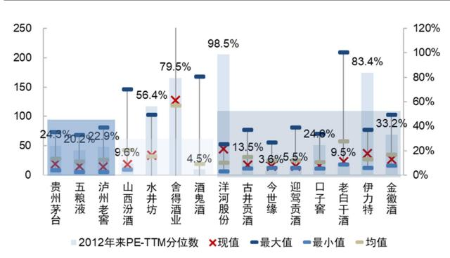  
资料来源:Wind,国信证券经济研究所整理;注:数据截至2025/12/9

图5：当前白酒指数 PE(TTM) 对应 2020 年来 7.4% 分位数  
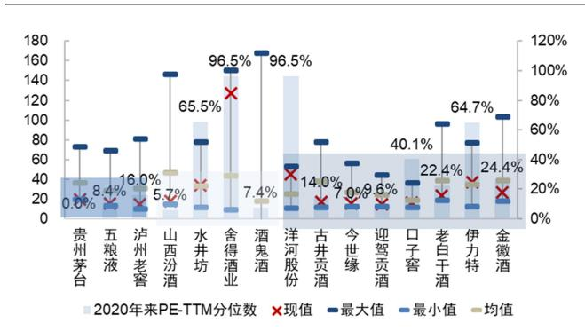  
资料来源：Wind，国信证券经济研究所整理；注：数据截至2025/12/9

图6：3Q25白酒板块基金重仓持股比例 $3.69\%$  
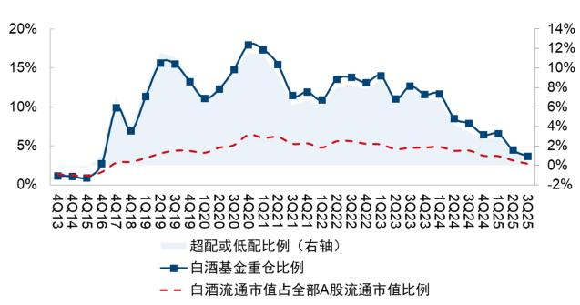  
资料来源：Wind，国信证券经济研究所整理；注：采用主动偏股基金持仓数据，基准为自由流通市值在 A 股中的占比

图7：3Q25 白酒(剔除茅台)基金重仓持股比例 2.21%  
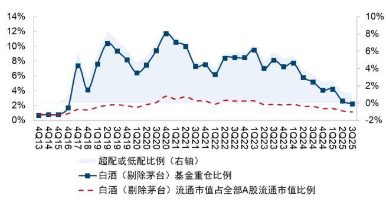  
资料来源：Wind，国信证券经济研究所整理；注：采用主动偏股基金持仓数据，基准为自由流通市值在 A 股中的占比

## 1.2 市场动销环比第二季度略有修复，批价仍在下跌筑底

今年白酒行业市场动销在经历较大幅度下滑后环比略有修复。过去几年白酒动销受商务场景承压、居民消费意愿和能力降低的影响逐步走弱，2025年《节约反对浪费条例》进一步削弱消费场景和消费人群，预计2025Q2整体动销是2022年以来同比降幅最大的时点。但从中也可以发现，白酒消费的社交需求仍具有较强韧性：1）春节实际动销反馈往往好于预期，主因走亲访友、聚饮、礼赠等需求在节中仍会集中释放出来；2）2025年中秋国庆动销环比Q2-3有明显改善，尤其节中的小规模宴席、大众消费表现较好；3）流通属性突出的名酒大单品如飞天茅台、八代五粮液、青花20、剑南春等开瓶端延续韧性，持续获得份额。

表1：2025年白酒行业市场动销在第二季度大幅下降后略有修复

<table><tr><td></td><td>2023年春节</td><td>2023年中秋国庆</td><td>2024年春节</td><td>2024年中秋国庆</td><td>2025年春节</td><td>2025年五一端午</td><td>2025年中秋国庆</td></tr><tr><td>宏观环境背景</td><td>疫情影响弱化,返乡人口增加,高端礼品需求率先复苏,走亲访友、聚饮需求表现强劲。</td><td>双节超长假期返乡人口较多,宴席场景受益于前置性需求超预期增长;宏观经济降速,次高端及商务场景开始走弱。</td><td>返乡+出行热情拉动消费氛围,尤其餐饮场景火热。消费降级趋势延续,但春节社交刚需催化,呈现K型分化。</td><td>中秋及国庆相距较远、日历效应一般;部分城市执行廉洁政策,礼赠需求受到较大影响。</td><td>春节消费氛围弱于往年,居民消费意愿政策影响下,政商务氛围较好,低线市场和能力弱。但春节虹场景大幅收缩,日常返乡人数有限,宴席吸效应进一步加强,餐饮也受到影响,各预订量一般。此前被社交需求具有刚需价位、各品牌均有较属性,大众需求韧性大幅度下滑。凸显。</td><td>双节超长假期,旅游</td><td></td></tr><tr><td>白酒动销情况</td><td>整体略超预期,恢复动销增长个位数。高到22年90%左右的消费量。高端同比正位数;大众表现有所增长,次高端恢复至超预期,增长双位22年80%左右;徽酒数;次高端动销承动销更强势。</td><td>符合预期,预计整体动销增长个位数。高端动销预计增长个位数;大众表现有所增长,次高端恢复至超预期,增长双位22年80%左右;徽酒数;次高端动销承动销更强势。</td><td>超预期,预计整体动销略有增长。高端平稳,节前礼赠需求释放;300-500元承接商务降级和宴席升级动销增长;大众价位增长最快。</td><td>不及预期,预计整体动销下滑20%左右。高端平均下滑幅度、五粮液表现略好;次高端下滑更大;区域酒大众价位平稳。</td><td>符合节前低预期,预计整体动销下滑双位数左右。高端预计30-50%。高端预计下滑双位数;次高端滑30%左右,但茅五下滑幅度更大,流行线上渠道有所弥补;单品青花20、水晶次高端下滑幅度更剑、四开表现较好;大;大众价位下滑幅200元以下大众价位度预计小于平均。具有韧性。</td><td>符合预期,预计整体动销下滑15-20%。高端茅五性价比凸显后开瓶较好,下滑双位数左右;次高端500+元下滑最大,300-500元平均下滑幅度;江苏、河南等区域大众宴席好于预期。</td><td></td></tr></table>

资料来源：酒业家、微酒、公司公告，国信证券经济研究所整理

核心产品批价持续走弱，反映供需仍有缺口。2025年5月以来，飞天茅台批价从高点下降 $25\%$ 至当前1500元；八代五粮液下降 $15\%$ 至当前790元。其中在中秋国庆期间，两者批价均有小幅回升，茅五作为全国流通属性大单品，对需求变化有较高敏感度。我们认为伴随收入目标降速，高端酒新的供需平衡点也有支撑：1）当前飞天批价已接近城镇居民人均可支配收入1/3水平，高端产品性价比进一步凸显后会加速开瓶需求和社会库存去化；2）春节虹吸效应作用下，各场景对高端

酒的需求有望环比提升。

图8：2020-25年飞天（箱装）批价  
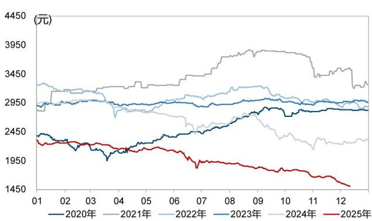  
资料来源：今日酒价，国信证券经济研究所整理；注：数据截至2025/12/11

图9：2020-25年八代五粮液批价  
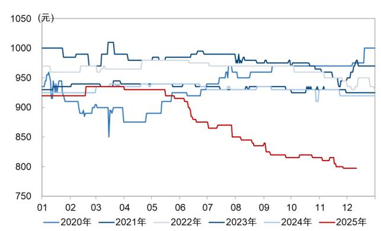  
资料来源：百荣酒价，国信证券经济研究所整理；注：数据截至2025/12/11

## 2 展望 2026 年：供给优化、渠道磨底，重视优质公司配置机会

## 2.1 行业整体：需求仍待磨底，酒企预计理性定调、份额优先

展望 2026 年消费环境，供需缺口仍然存在，但积极信号边际增加。当前看消费信心未有明显恢复，PPI 及居民贷款数据仍有压力，烟酒类销售收入及价格数据也表现疲弱；但后续看压制因素有望逐步减弱，叠加政策端持续保驾护航，2026 年内需消费数据有望表现温和：1）2025 年 10 月以来餐饮、酒店等数据已有恢复趋势；2）中央经济工作会议将内需主导作为 2026 年首要任务，提出“清理消费领域不合理限制措施，释放服务消费潜力”，政策加持下此前抑制的场景需求有望回补；3）房地产及基建行业景气度仍低迷，但过去几年与地产链上相关的消费已至低位，政策聚焦新质生产力，虽然这部分短期销量贡献有限，但于中长期而言是白酒消费人群和消费升级的主要驱动力。

图 10: 飞天批价同比与居民中长期贷款情况  
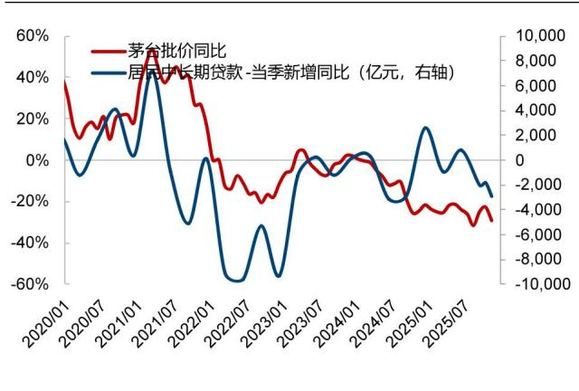  
资料来源：今日酒价、Wind，国信证券经济研究所整理

图11：飞天批价同比与PPI同比  
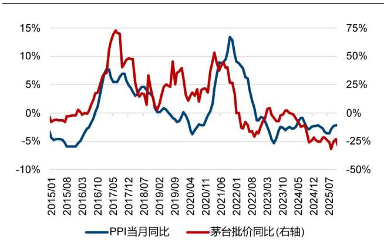  
资料来源：今日酒价、Wind，国信证券经济研究所整理

图 12: 社零收入增速 25M10 餐饮有所恢复, 烟酒类继续承压  
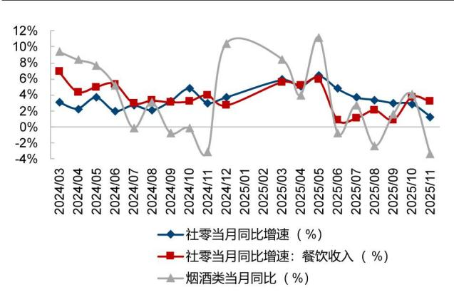  
资料来源：今日酒价、Wind，国信证券经济研究所整理

图13: 2025年商品房销售面积同比降幅扩大  
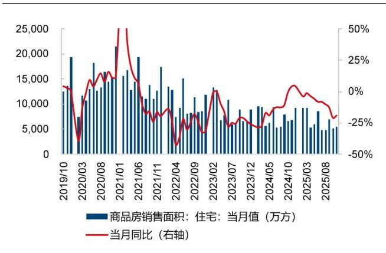  
资料来源：今日酒价、Wind，国信证券经济研究所整理

展望 2026 年白酒行业节奏，春节动销高基数下有压力、但下滑幅度有望收窄，2026Q2 进入动销低基数期。2025 年春节动销平稳、大众价位基数较高，但我们认为春节消费需求仍具有韧性，环比 2025 年中秋国庆动销改善，主因 1）9 天假期带来销量边际增加；2）春节本身场景结构以宴席、聚饮、礼赠为主，具有较强的社交属性，临近节庆将集中释放；3）此前被抑制的政商务需求也有望环比改善。若春节顺利度过压力测试，第二季度行业步入动销量、价格低基数期，在阶段脉冲后有望回归稳健；第三季度板块步入报表低基数期，建议关注酒企营运资金净变化，若渠道现金流改善，酒企对下游议价权提升，后续具有收入释放动力。

图14: 春节白酒消费场景构成  
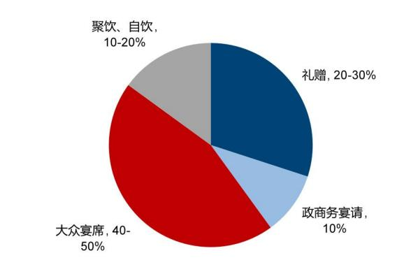  
资料来源：酒业家、微酒，国信证券经济研究所整理

图15: 历史白酒企业营运资金变化情况  
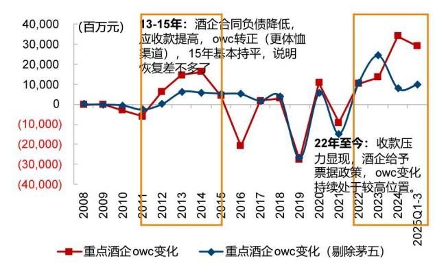  
资料来源：公司公告，国信证券经济研究所整理

展望酒企经营，预计“理性”与“积极”并存。在需求端恢复的不确定性下，酒企或将在供给端加强调控，保证在下一轮周期中自身的发展基本盘，预计表现为1）整体目标制定理性，不强调增长，维护渠道健康和市场秩序，但会追求好于行业平均的发展；2）调整产品结构和强化渠道管理，精准匹配消费者需求，以提升优势价格带、优势区域中的份额。

表2：上轮及本轮周期酒企收入目标达成情况，2026年目标预计制定理性，但会进一步扩大自己的优势

<table><tr><td>公司</td><td>目标</td><td>2013年</td><td>2014年</td><td>2015年</td><td>2016年</td><td>2023年</td><td>2024年</td><td>2025E</td><td>2026年增长工具分析</td></tr><tr><td rowspan="2">贵州茅台</td><td>报表目标</td><td>20%</td><td>3%</td><td>1%</td><td>4%</td><td>15%</td><td>15%</td><td>9%</td><td rowspan="2">1)改善渠道利润后飞天仍有议价权;2)消费群体的扩大;3)当前仍未放开经销权</td></tr><tr><td>实际完成</td><td>17%</td><td>2%</td><td>3%</td><td>19%</td><td>18%</td><td>16%</td><td>预计+5%</td></tr><tr><td rowspan="2">五粮液</td><td>报表目标</td><td>15%</td><td>正增长</td><td>业绩平稳</td><td>10%</td><td>双位数</td><td>预计10%</td><td>5%左右</td><td rowspan="2">1)渠道政策较为灵活,稳定经销商打款意愿;2)普五仍有货币属性,1618扩大宴席市场份额</td></tr><tr><td>实际完成</td><td>-9%</td><td>-15%</td><td>3%</td><td>13%</td><td>13%</td><td>7%</td><td>预计-15%</td></tr><tr><td rowspan="2">泸州老窖</td><td>报表目标</td><td>140亿(+21.15%)</td><td>116.33亿(+11.52%)</td><td>77.78亿(+45.30%)</td><td>16%</td><td>15%</td><td>15%</td><td>稳中求进</td><td rowspan="2">1)38度国窖综合优势突出,借助公司精细化渠道管理全国份额提升;2)中腰部产品放量</td></tr><tr><td>实际完成</td><td>-10%</td><td>-49%</td><td>29%</td><td>20%</td><td>20%</td><td>3%</td><td>预计-13%</td></tr><tr><td rowspan="2">山西汾酒</td><td>报表目标</td><td>25%</td><td>业绩平稳增长</td><td>业绩平稳增长</td><td>10%</td><td>20%</td><td>20%</td><td>稳健增长</td><td rowspan="2">1)青花20&amp;玻汾产品势能突出,空白市场抢夺份额,经销商配合度较高;2)山西+环山西市场增强老白汾放量</td></tr><tr><td>实际完成</td><td>-6%</td><td>-36%</td><td>5%</td><td>7%</td><td>22%</td><td>13%</td><td>预计持平~个位数增长</td></tr><tr><td rowspan="2">洋河股份</td><td>报表目标</td><td>10%</td><td>基本持平</td><td>5%</td><td>10%</td><td>15%</td><td>预计5%</td><td>/</td><td rowspan="2">1)渠道信心逐步提升,经销商队伍稳定;2)产品焕新后推力高</td></tr><tr><td>实际完成</td><td>-13%</td><td>-2%</td><td>9%</td><td>7%</td><td>10%</td><td>-13%</td><td>预计-30%~40%</td></tr><tr><td rowspan="2">水井坊</td><td>报表目标</td><td>持平</td><td>3.35亿</td><td>扭亏为盈</td><td>10%</td><td>15%</td><td>正增长</td><td>/</td><td rowspan="2">1)低库运行,渠道稳定;2)臻酿8号提升宴席份额,井台18补充</td></tr><tr><td>实际完成</td><td>-70%</td><td>3.65</td><td>134%</td><td>38%</td><td>6%</td><td>5%</td><td>预计-30%~40%</td></tr><tr><td rowspan="2">酒鬼酒</td><td>报表目标</td><td></td><td></td><td>扭亏为盈</td><td></td><td></td><td>恢复增长</td><td>恢复增长</td><td rowspan="2">1)回款极低基数,渠道边际转好;2)自由爱补充增量</td></tr><tr><td>实际完成</td><td></td><td></td><td>55%</td><td>9%</td><td>-39%</td><td>-50%</td><td>预计-25%</td></tr><tr><td rowspan="2">舍得酒业</td><td>报表目标</td><td>22亿</td><td>17亿</td><td>18亿</td><td>73%</td><td></td><td>正增长</td><td>净利润+164%(未通过)</td><td rowspan="2">1)舍之道提升宴席份额;2)T68渠道扩张;3)电商、团购、餐饮等创新营销模式增量</td></tr><tr><td>实际完成</td><td>14.19</td><td>14.45</td><td>11.56</td><td>25%</td><td>17%</td><td>-24%</td><td>预计-15%</td></tr><tr><td rowspan="2">古井贡酒</td><td>报表目标</td><td></td><td></td><td>增长</td><td></td><td>22%</td><td>营收+21%</td><td>稳健增长</td><td rowspan="2">1)库存集中去化后仍有补库空间;2)省内各价位份额的进一步提升</td></tr><tr><td>实际完成</td><td></td><td></td><td>13%</td><td>15%</td><td>21%</td><td>16%</td><td>预计-15%</td></tr><tr><td rowspan="2">今世缘</td><td>报表目标</td><td></td><td></td><td>26亿</td><td>11%</td><td>收入100e</td><td>收入122e</td><td>5%-12%</td><td rowspan="2">1)淡雅等省内渗透率提升;2)四开等伴随省内政商务修复回补</td></tr><tr><td>实际完成</td><td></td><td></td><td>24.25</td><td>5%</td><td>收入101e</td><td>收入115e</td><td>预计-13%</td></tr></table>

资料来源：公司公告，国信证券经济研究所整理&预测；注：其中灰色格子为当年未完成目标，2025年实际完成为我们预测值

## 2.2 渠道状态：酒企聚焦去库、维护渠道信心，已有筑底迹象

复盘2013-15年周期，渠道最先感知供需失衡，估值提前于基本面反映市场变化。1）渠道端，伴随政策下高端白酒需求大幅下降，主品批价快速下跌，4月茅台渠道毛利率降至0附近、五粮液渠道毛利率为 $-25\%$ ；此后公司逐步放宽渠道政策（茅台拓商、五粮液补贴及降价）；同时渠道库存在13年双节达到历史高位，后逐步去化。2）估值端，13年三季报业绩降幅扩大充分释放压力，14年春节动销好于预期，14Q1板块股价及估值筑底，其中产品、品牌势能抗风险能力较强的洋河、茅台跑出超额。3）业绩端，14Q1-3收入及利润仍下滑双位数，供需不平衡的缺口收窄，14Q4-15Q2市场动销体感已好于表观（估值扩张明显），业绩拐点显现。

图16: 2013-2015年周期复盘，渠道利润磨底-股价触底-报表业绩降幅显著收窄  
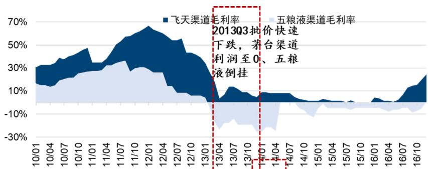

酒企放松渠道政策：

\- 茅台：13年7月放开经销权，放开票据打款，允许总经销产品计入任务；14年6月再度招商。

\- 五粮液：13年1218加大补贴；14年5月降价，9月计划外再降，维持渠道动态盈亏平衡。

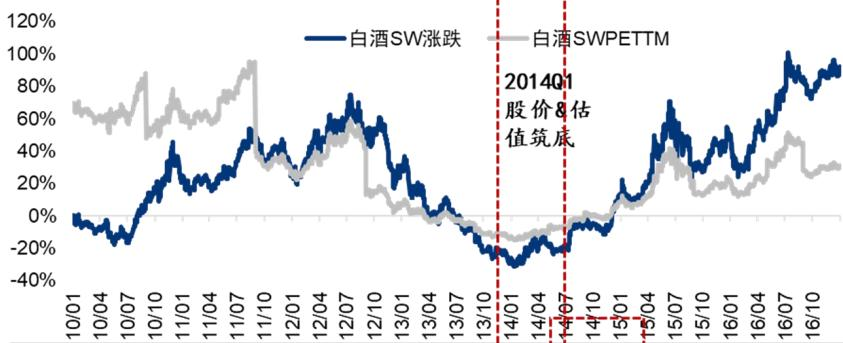

13Q4-14Q3期间股价涨跌幅领先的个股

<table><tr><td>40</td><td>公司</td><td>4Q13</td><td>1Q14</td><td>2Q14</td><td>3Q14</td></tr><tr><td rowspan="2">30</td><td>古井贡酒</td><td>24%</td><td>-12%</td><td>6%</td><td>43%</td></tr><tr><td>洋河股份</td><td>-6%</td><td>33%</td><td>9%</td><td>25%</td></tr><tr><td rowspan="2">20</td><td>贵州茅台</td><td>-4%</td><td>24%</td><td>5%</td><td>15%</td></tr><tr><td>顺鑫农业</td><td>19%</td><td>-1%</td><td>-4%</td><td>23%</td></tr><tr><td>10</td><td>舍得酒业</td><td>5%</td><td>-25%</td><td>-5%</td><td>46%</td></tr><tr><td rowspan="2">0</td><td>SW白酒</td><td>-5%</td><td>9%</td><td>1%</td><td>15%</td></tr><tr><td>上证指数</td><td>-2%</td><td>-3%</td><td>0%</td><td>16%</td></tr></table>

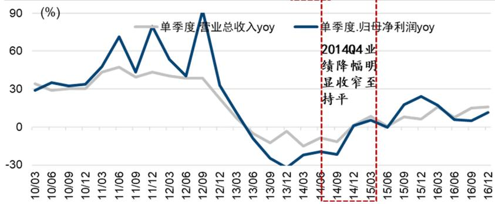

2013-15净利润同比增速，多数15年转正

<table><tr><td></td><td>2013A</td><td>2014A</td><td>2015A</td></tr><tr><td>古井贡酒</td><td>-14.3%</td><td>-4.0%</td><td>19.9%</td></tr><tr><td>洋河股份</td><td>-18.7%</td><td>-9.9%</td><td>19.0%</td></tr><tr><td>贵州茅台</td><td>13.7%</td><td>1.4%</td><td>1.0%</td></tr><tr><td>老白干酒</td><td>-41.6%</td><td>-9.8%</td><td>26.9%</td></tr><tr><td>五粮液</td><td>-19.7%</td><td>-26.8%</td><td>5.8%</td></tr><tr><td>舍得酒业</td><td>-96.8%</td><td>13.7%</td><td>-46.8%</td></tr><tr><td>山西汾酒</td><td>-27.6%</td><td>-63.0%</td><td>46.3%</td></tr><tr><td>泸州老窖</td><td>-21.7%</td><td>-74.4%</td><td>67.4%</td></tr><tr><td>酒鬼酒</td><td>-107.4%</td><td>-165.7%</td><td>190.9%</td></tr><tr><td>水井坊</td><td>-153.8%</td><td>-162.3%</td><td>121.8%</td></tr></table>

资料来源：Wind、公司公告、酒业家，国信证券经济研究所整理

当前周期看渠道状态的 2 个显性指标：库存在到达高位后环比去化，渠道利润在批价压力下继续走弱，但龙头公司多措并举（降低供给、让利渠道等方式）稳定经销商和终端信心，已有逐步筑底趋势。于投资角度而言也是较好的布局时间，渠道磨底说明行业逐步靠近新的供需平衡点，伴随茅台批价同比降幅磨底企稳，板块整体估值端也有望修复。

库存：25Q4 渠道库存环比年中高点去化，未来 1-2 个季度酒企仍将以去库存为主线。25Q2-3 伴随需求骤减、叠加此前回款小批量发货，库存达到高位，全国性和区域龙头库存环比增加明显，次高端酒企由于调整较早同比有所下降。展望看，渠道加杠杆意愿仍然很弱，双节后至年末酒企以自然动销带动库存去化，明年春节旺季补库为正常节奏，节后淡季预计延续去库，整体有望在动态调整中下降至合理水位。

图17：历史渠道库存情况，2013年双节达到历史高峰，当前库存环比25Q2-3有所去化

<table><tr><td>公司</td><td>2012年中秋</td><td>2013年春节</td><td>2013年中秋/国庆</td><td>2014年春节/中秋</td><td>2015年中秋/国庆</td><td>2023年10月</td><td>2024年4月</td><td>2024年10月</td><td>2025年3月</td><td>2025年8月</td><td>当前</td></tr><tr><td>贵州茅台</td><td>★★★</td><td>★★★★+</td><td>★★★★★</td><td>★★★★</td><td>★★</td><td>2周</td><td>★</td><td>★</td><td>3-4周</td><td>★+</td><td>★(飞天)</td></tr><tr><td>五粮液</td><td>★★★★</td><td>★★★★★★</td><td>★★★★★★</td><td>★★★★★</td><td>★★★</td><td>★★</td><td>★★</td><td>★★</td><td>★</td><td>★★</td><td>★+</td></tr><tr><td>泸州老窖</td><td></td><td></td><td>★★★★★★★</td><td></td><td>★★★★</td><td>★★★</td><td>★★★+</td><td>★★★+</td><td>★★+</td><td>★★★+</td><td>★★+</td></tr><tr><td>山西汾酒</td><td></td><td></td><td>★★★★★★</td><td></td><td>★★★★</td><td>★★</td><td>★+</td><td>★★</td><td>★★</td><td>★★★</td><td>★★+</td></tr><tr><td>舍得酒业</td><td></td><td></td><td>★★★★★★★★</td><td></td><td>★★★★+</td><td>★★★★+</td><td>★★★★+</td><td>★★★★★</td><td>★★★★</td><td>★★★★</td><td>★★★+</td></tr><tr><td>水井坊</td><td></td><td></td><td>★★★★★★</td><td></td><td>★★★</td><td>★★</td><td>★★★</td><td>★★★+</td><td>★★★</td><td>★★★+</td><td>★★★</td></tr><tr><td>酒鬼酒</td><td></td><td></td><td>★★★★★★★★★</td><td></td><td>★★★</td><td>★★★★</td><td>★★★★+</td><td>★★★★+</td><td>★★★★</td><td>★★★★</td><td>★★★+</td></tr><tr><td>古井贡酒</td><td></td><td></td><td>★★★★</td><td></td><td>★★★</td><td>★★★</td><td>★★★+</td><td>★★★★+</td><td>★★★+</td><td>★★★★★</td><td>★★★★</td></tr><tr><td>洋河股份</td><td></td><td></td><td>★★★★★</td><td></td><td>★★★</td><td>★★★+</td><td>★★★+</td><td>★★★★</td><td>★★★+</td><td>★★★+</td><td>★★★</td></tr><tr><td>今世缘</td><td></td><td></td><td></td><td></td><td></td><td>★★+</td><td>★★★</td><td>★★★</td><td>★★★+</td><td>★★★★</td><td>★★★+</td></tr></table>

资料来源：公司公告、酒业家，国信证券经济研究所整理；注：★只代表程度并不是精准值

渠道利润：2025年主流单品渠道赚钱效应进一步下降，当前看已有逐步筑底趋势。2025Q2以来茅五泸价格下跌加快，终端毛利率已降低至个位数，经销商环节的利润率也下降较多，茅台当前仅飞天仍维持顺价、经销商综合毛利率从2024年 $40\%$ 左右降至当前的 $0\%$ 至微亏，八代五粮液价格倒挂幅度进一步扩大；徽酒、苏酒主流产品在过去几个旺季中也呈现价跌、渠道利润收窄的趋势。另一方面酒企重视渠道信心的呵护，采用工具及节奏和上轮周期类似，我们认为在龙头寻求新供需平衡点的过程中渠道利润进入筑底阶段：茅台对除飞天外产品开放票据打款政策，计划外给经销商增配老酒改善盈利，12月采取控货政策，释放2026年非标减量预期，批价已小幅回升；五粮液今年以来持续放松渠道打款政策，加大对渠道补贴力度，经销商全年预计实现盈亏平衡，2026年普五预计降低出厂价，进一步缓解渠道资金压力；区域龙头大单品在双节后价格反馈平稳，其中洋河 $\mathrm{M}6+$ 、海之蓝等产品在控货挺价（供需缺口改善）和收缩无效费用（经销商甩货减少）组合拳下批价有所回升。

图18: 2025年飞天、普五经销商环节毛利率下降较多  
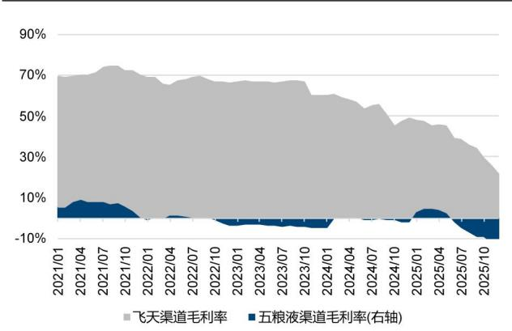  
资料来源：今日酒价、百荣酒价；国信证券经济研究所整理；注：数据截至2025/12/12

图19: 茅五泸高端单品终端毛利率降至低个位数  
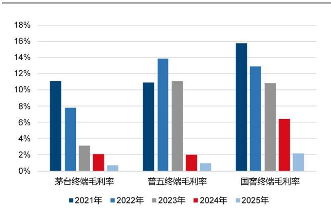  
资料来源：百荣酒价，国信证券经济研究所整理；注：数据截至2025/12/12

图20：徽酒大单品批价情况

<table><tr><td>产品</td><td>24年春节</td><td>24年双节</td><td>25年春节</td><td>25年双节</td></tr><tr><td>古井</td><td></td><td></td><td></td><td></td></tr><tr><td>古20</td><td>480</td><td>480</td><td>480</td><td>470</td></tr><tr><td>古16</td><td>320</td><td>315</td><td>310</td><td>305</td></tr><tr><td>古8</td><td>220</td><td>205</td><td>200</td><td>195</td></tr><tr><td>古5</td><td>110</td><td>105</td><td>105</td><td>100</td></tr><tr><td>迎驾</td><td></td><td></td><td></td><td></td></tr><tr><td>洞16</td><td>285</td><td>287</td><td>285</td><td>285</td></tr><tr><td>洞9</td><td>185</td><td>190</td><td>190</td><td>185</td></tr><tr><td>洞6</td><td>110</td><td>110</td><td>108</td><td>105</td></tr></table>

资料来源：今日酒价，国信证券经济研究所整理

图21：苏酒大单品批价情况

<table><tr><td>产品</td><td>24年春节</td><td>24年双节</td><td>25年春节</td><td>25年双节</td></tr><tr><td>洋河</td><td></td><td></td><td></td><td></td></tr><tr><td>M6+</td><td>550</td><td>530</td><td>520</td><td>525</td></tr><tr><td>水晶梦</td><td>390</td><td>380</td><td>350</td><td>355</td></tr><tr><td>天之蓝</td><td>270</td><td>270</td><td>270</td><td>260</td></tr><tr><td>海之蓝</td><td>122.5</td><td>120</td><td>115</td><td>115</td></tr><tr><td>今世缘</td><td></td><td></td><td></td><td></td></tr><tr><td>V3</td><td>520</td><td>510</td><td>500</td><td>490</td></tr><tr><td>四开</td><td>410</td><td>405</td><td>395</td><td>385</td></tr><tr><td>对开</td><td>255</td><td>255</td><td>255</td><td>240</td></tr><tr><td>淡雅</td><td>120</td><td>115</td><td>110</td><td>105</td></tr></table>

资料来源：今日酒价，国信证券经济研究所整理

## 2.3 竞争视角：优质公司夯实价位/区域优势，营销积极求变

本轮调整周期从各价位带 $\beta$ 的分化，到酒企α（品牌/组织/渠道/营销）的竞争。1）2022年以来伴随商务活跃度降低，次高端产品及渠道开启调整，高端、大众价位仍保持稳健增长，K型分化明显，如23年宴席需求带动100-300元整体繁荣。2）2024-25年白酒行业整体需求压力凸显，各价位需求均下降，竞争进一步聚焦到品牌、产品、渠道等。结果上看，价位、区域的份额向核心公司进一步集中，如茅台1935/38度国窖、青花20/水晶剑、区域酒主流单品在2025年政策影响下仍有稳健表现。

图22：白酒分价位带规模和增速情况，2025年在行业承压下个价位带大单品集中度持续提升  
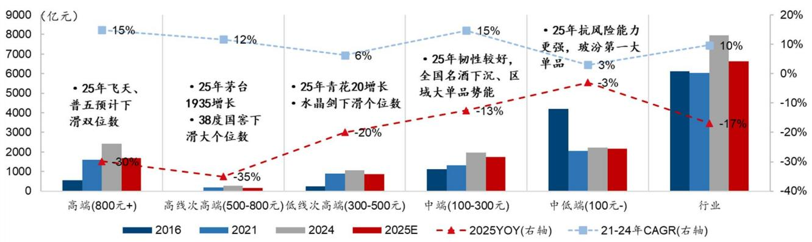  
资料来源：公司公告、酒业家、微酒，国信证券经济研究所整理&测算

展望 2026 年及后续的市场份额竞争和公司投资机会，我们认为酒企的能力比价位带的景气度更为重要。1）2013-15 年周期的复苏节奏本质在于供需关系：前半段，由于居民端对白酒日常消费量仍在增加，价位下沉且区域精耕能力强的洋河、古井获得超额；后半段伴随房地产行业高增，茅台、五粮液在高端优质产能供给不足的背景下获得红利，批价跟随需求快速上涨。2）本轮周期供需关系发生实质性改变：需求端面临人口结构和产业结构转型的挑战，中期视角各价位带的需求出现爆发式增长的概率不大；供给端各家酒企基本完成全价格带的产品布局，优质产能配备充足，因此获得某个价位或区域的定价权，或是率先培育新人群、渠道、场景的酒企能获得超额。

品牌力为稀缺资产，是各价位带中渠道和消费者的自然选择。1）贵州茅台仍具有绝对的品牌稀缺性，飞天茅台货币流通属性依然较高，当前零售价1650元、接近城镇居民收入1/3水平，大众消费的开瓶需求有望被激发出来；1935在高端宴席场景的开瓶表现预计延续稳健。2）五粮液在千元价位龙头地位夯实，我们测算2025年八代五粮液+1618在泛千元价位的市占率达到 $60 - 65\%$ ，消费者对千元品牌心智稳定。3）山西汾酒清香品牌势能延续，核心大单品玻汾、青花20在光瓶酒、400元价位仍有渗透率提升空间，当前经销商信心较优。

图23: 飞天茅台零售价接近城镇居民收入 1/3 水平  
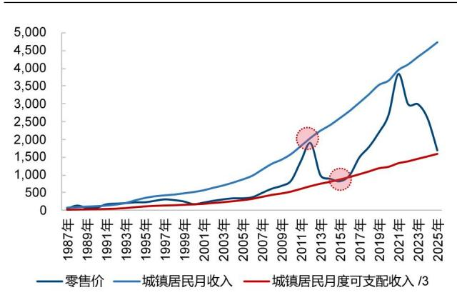  
资料来源：今日酒价、Wind，国信证券经济研究所整理

图24: 2025年分价位及对应产品规模情况预测

<table><tr><td>分价位带</td><td>2025年市场规模(亿元)</td><td>产品规模排序及预测份额</td></tr><tr><td>超高端1500元+</td><td>1000</td><td>飞天茅台、生肖、精品</td></tr><tr><td>泛千元800-1000元</td><td>700-800</td><td>普五+1618预计占比60%+,高度国窖预计占比10-15%</td></tr><tr><td>高线次高端500-800元</td><td>300</td><td>茅台1935预计占比30%,低度国窖预计占比25-30%</td></tr><tr><td>低线次高端300-500元</td><td>800-900</td><td>水晶剑预计占比17-20%,青花20+25预计占比15%+</td></tr><tr><td>中端100-300元</td><td>1800</td><td>茅台系列酒、五粮液系列酒、海之蓝等,区域各有地产酒大单品。格局比较分散。</td></tr><tr><td>低端100元-</td><td>2000</td><td>玻汾预计占比5%左右</td></tr></table>

资料来源：公司公告、酒业家、微酒、中国酒业协会，国信证券经济研究所整理&测算

大众消费价位带2026年胜率较高，考验酒企渠道管理、终端建设、消费者触达能力。1）山西汾酒在省内和环山西市场消费者基础较好，老白汾聚焦终端有效开瓶提升，倾斜费用支持，引导产品升级。2）泸州老窖资源倾斜中腰部，特曲60版团购培育+核心市场流通铺货，老字号、头曲、二曲通过经销商的能力下沉渠道。3）古井贡酒省内渠道精细化能力突出，阶段性聚焦古5、古8等，长期掌握省内消费升级定价权；迎驾贡酒渠道包袱去化较快，洞6、洞9在终端自点率突出。4）洋河股份对海之蓝升级，渠道重整、利润开始改善；今世缘加强厂商关系维护，省内100元份额向上，四开在商务场景自点率领先。

图25: 2025年部分区域及对应酒企规模情况预测

<table><tr><td>省份</td><td>2025年白酒市场规模(亿元)</td><td>主要酒企规模排序及预测份额</td></tr><tr><td>山西</td><td>155</td><td>山西汾酒占比预计80%</td></tr><tr><td>山东</td><td>500</td><td>茅台市场规模最大,五粮液、汾酒规模相当,洋河、老窖等</td></tr><tr><td>河南</td><td>550</td><td>茅台市场规模最大,五粮液其次,汾酒、老窖、洋河等</td></tr><tr><td>河北</td><td>300</td><td>茅台市场规模最大,老窖其次</td></tr><tr><td>安徽</td><td>330</td><td>古井贡酒预计占比35-40%,迎驾、口子窖预计占比10-15%</td></tr><tr><td>四川</td><td>400</td><td>五粮液、老窖市场规模相当,占比均在20%+</td></tr><tr><td>江苏</td><td>480</td><td>洋河、今世缘市场规模相当,占比均在20%左右</td></tr></table>

资料来源：公司公告、酒业家、微酒、中国酒业协会，国信证券经济研究所整理&测算

左侧布局商务消费低位下修复，进一步要求公司营销创新、消费者培育能力。2025年全A板块销售费用率同比降幅收窄，若2026年反内卷进一步传导，商务社交需求有望低位下修复（此前被抑制的部分需求也有望释放），次高端及以上产品势能领先的品种有望受益，如汾酒青花20、高低度国窖、品味舍得、国缘四开等。伴随产业结构转型和人口结构变化，新质生产力企业及年轻、女性消费群体白酒消费量有望边际提升，短期收入贡献预计有限，但率先进行营销模式创新的公司或在下一轮周期具有先发优势。1）泸州老窖国窖荟绑定高净值消费人群，品鉴会、体育赛事等促进开瓶；给予经销商动作付费奖励，鼓励和公司一起培育“专精特新”企业。2）舍得酒业主品部分延续传统渠道的控价分利，沱牌T68采取异业招商的“青创计划”渗透下沉市场，29度自在则采用城市前置仓模式。3）酒鬼酒与胖东来合作创新零售模式，压缩渠道环节的利润。

图26: 2025年全A销售费用降幅收窄  
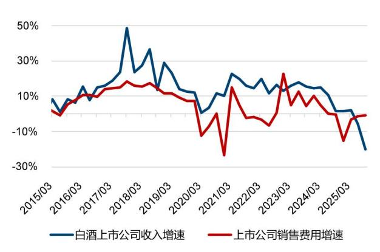  
资料来源：Wind，国信证券经济研究所整理

图27: 部分次高端酒企 2025 年创新渠道模式

<table><tr><td>公司</td><td>渠道模式创新</td><td>解决核心痛点</td></tr><tr><td>舍得酒业</td><td>“0资金、0进货、0库存”,经销商作为配送和宣传角色,极大地降低了参与门槛,并给予相应费用和奖金</td><td>减负经销商,轻资产运营</td></tr><tr><td>酒鬼酒</td><td>与胖东来达成合作,推出定价200元新品“自由爱”,公示毛利率16%</td><td>让利消费者,高性价比</td></tr><tr><td>珍酒李渡</td><td>推出战略产品大珍,万商联盟模式招商,只做团购、不乱价,享受顺价价差外赠与股权</td><td>改善经销商盈利,稳定渠道价值链</td></tr></table>

资料来源：公司公告、微酒、长江酒道，国信证券经济研究所整理

## 3 投资建议

当前白酒行业景气度仍处于磨底阶段，从投资角度逐步建议逐步加强配置：

1、消费场景及需求受政策持续保驾护航，压制因素边际弱化，预计大众消费仍具韧性，商务消费低基数下逐步改善，2026年动销下滑幅度有望逐步收窄。

2、渠道状态已有筑底迹象，头部酒企积极呵护厂商关系，渠道利润进一步下降空间有限，库存也自25Q3达到高位后边际去化，后续伴随茅台批价同比筑底企稳，对板块估值形成支撑。

3、板块估值、持仓均处于低位，红利资产属性逐步凸显，主要酒企股息率维持在3-4%以上；基本面上供需两端任何的积极信号均有望构成催化，优质龙头价值有待重估。

内需修复中性假设下，酒企综合竞争能力（品牌、生产、产品、渠道、组织等）决定发展空间，我们认为2026年白酒板块的个股布局思路如下：

1、绝对品牌力龙头，短期穿越周期、长期经营久期的确定性较高，价值有待重估，首推贵州茅台、山西汾酒。

2、已逐步掌握价格带、区域份额优势，在调整阶段中积极加强渠道建设、消费者培育，业绩包袱加速去化后，增长空间更加充足，推荐泸州老窖，关注古井贡酒、金徽酒等。

3、调整较早，渠道包袱加速去化，短期动作不变形，低基数下的底部反转标的，关注洋河股份、舍得酒业、迎驾贡酒等。

4、高股息或高综合股东回报，高现金流安全边际，长经营久期假设的五粮液。

$\diamond$ 贵州茅台:短期加强供需关系匹配能力,长期品牌力核心的商业模式没有动摇。1)飞天批价同比预计在26Q1-2筑底-30%左右,性价比突出后促进大众场景开瓶提升,寻求新的供需动态平衡的阶段中估值支撑力加强。2)仍有基本面穿越周期的能力,进一步推动市场化营销能力:公司或将减少部分非标类的分销渠道投放,部分产品市场化调价,经销商盈利能力有望得到改善,公司对渠道仍有议价权;公司预计将进一步加强不同产品、渠道、消费人群的精准化匹配,在维护价盘稳定的同时减少收入的波动。3)长期品牌稀缺性仍然突出,公司产能和工艺壁垒突出,超高端价位具备绝对定价权,构成估值溢价之源。盈利预测及估值:预计2025-2027年公司营业总收入1835.2/1920.6/2021.3亿元,同比+5.4%/+4.7%/+5.2%;预计归母净利润905.9/952.1/1005.2亿元,同比+5.1%/+5.1%/+5.6%;当前股价对应25/26年19.5/18.5xP/E。茅台作为全球性资产,伴随国内流动性改善打开重估空间,给予2026年22x目标估值,对应20%上行空间,维持“优于大市”评级。

山西汾酒：产品及区域势能领先于行业，长期增长空间和利润率提升能力强。产品及区域势能好于行业，决定了公司1）渠道流速较快，库存、价盘健康，不必大幅释放报表端的包袱；2）2026年基本面确定性较高，仍有持续获得价位带和区域份额的能力。产品看，青花 $20+$ 玻汾仍处于势能向上阶段，老白汾和青花26以上产品聚焦优势市场运作、提升费效比。区域看，华北优势突出，主要推动渗透率进一步提升和产品结构升级；长江以南品牌势能向上，增速预计更快。中长期空间看，青花20对标水晶剑高峰时期仍有40-50%的空间，“2030技改工程”产能逐步释放支撑玻汾需求，高端化也将有原酒品质支撑。盈利预测及估值：预计2025-2027年公司收入360.0/376.2/412.9亿元，同比0.0%/+4.5%/+9.7%；预计归母净利润118.7/124.7/138.6亿元，同比-3.1%/+5.1%/+11.2%；当前股价对应25/26年18.4/17.5xP/E，月初以来已跌至较低位置，公司EPS增长能力高于茅台，给予和茅台相同22x26年目标估值，对应26%空间，维持优于大市评级。

$\diamond$ 泸州老窖：产品矩阵抗风险能力加强，38度国窖全国化空间充足。产品布局纵深，大众价位产品放量支撑高度国窖以价为先：高度国窖通过数字化系统监控开瓶情况，虽然受竞品挤出，但整体销量可控，后续也有灵活调整空间；同时38度国窖、特曲60版、特曲老字号、头曲、二曲等产品优势区域给予资源倾斜，具有放量势能，熨平收入下滑。中期38度国窖优势突出，全国化中低度趋势有望抢占红利：当前中度酒符合白酒在新商务场景中的消费趋势，38度国窖品牌认知度先发、品质突出、在河北/环太湖地区成为价位领先单品，同时受益于公司精细化的渠道、终端运营能力，2-3年对标茅台1935规模对应 $15\%$ 的年复合增速。盈利预测及估值：预计2025-2027年公司收入272.2/280.7/311.1亿元，同比 $-12.8\% / + 3.1\% / + 10.8\%$ ；预计归母净利润113.4/118.3/132.8亿元，同比 $-15.8\% / + 4.3\% / + 12.2\%$ ；当前股价对应25/26年 $15.8 / 15.2xP / E$ ，26年目标估值对标汾酒当前 $18x$ ，对应 $21\%$ 上行空间，股息率 $4.5\%$ 安全边际，维持“优于大市”评级。

表3：主要白酒上市公司盈利预测及估值表

<table><tr><td>股票代码</td><td>公司名称</td><td>总市值(亿元)</td><td>25年收入</td><td>26年收入</td><td>25收入yoy</td><td>26收入yoy</td><td>25年净利润</td><td>26年净利润</td><td>25利润yoy</td><td>26利润yoy</td><td>PE(25)</td><td>PE(26)</td><td>分红率(25E)</td><td>股息率(25E)</td><td>股息率(TTM)</td></tr><tr><td>600519.SH</td><td>贵州茅台</td><td>17,657</td><td>1,835.2</td><td>1,920.6</td><td>5.4%</td><td>4.7%</td><td>905.9</td><td>952.1</td><td>5.1%</td><td>5.1%</td><td>19.5</td><td>18.5</td><td>75%</td><td>3.8%</td><td>3.7%</td></tr><tr><td>000858.SZ</td><td>五粮液</td><td>4,290</td><td>758.2</td><td>757.6</td><td>-15.0%</td><td>-0.1%</td><td>256.7</td><td>258.7</td><td>-19.4%</td><td>0.8%</td><td>16.7</td><td>16.6</td><td>78%</td><td>4.7%</td><td>5.2%</td></tr><tr><td>000568.SZ</td><td>泸州老窖</td><td>1,797</td><td>272.2</td><td>280.7</td><td>-12.8%</td><td>3.1%</td><td>113.4</td><td>118.3</td><td>-15.8%</td><td>4.3%</td><td>15.8</td><td>15.2</td><td>75%</td><td>4.7%</td><td>3.8%</td></tr><tr><td>600809.SH</td><td>山西汾酒</td><td>2,179</td><td>360.0</td><td>376.2</td><td>0.0%</td><td>4.5%</td><td>118.7</td><td>124.7</td><td>-3.1%</td><td>5.1%</td><td>18.4</td><td>17.5</td><td>60.4%</td><td>3.3%</td><td>2.0%</td></tr><tr><td>600702.SH</td><td>舍得酒业</td><td>193</td><td>46.2</td><td>51.0</td><td>-13.8%</td><td>10.3%</td><td>5.8</td><td>6.7</td><td>67.7%</td><td>15.3%</td><td>33.3</td><td>28.8</td><td>40.9%</td><td>1.2%</td><td>0.7%</td></tr><tr><td>000799.SZ</td><td>酒鬼酒</td><td>180</td><td>10.7</td><td>12.6</td><td>-25.0%</td><td>18.0%</td><td>0.1</td><td>1.2</td><td>-28.0%</td><td>1186%</td><td>2006.2</td><td>156.0</td><td></td><td>0.0%</td><td>1.1%</td></tr><tr><td>002304.SZ</td><td>洋河股份</td><td>945</td><td>195.6</td><td>200.1</td><td>-32.3%</td><td>2.3%</td><td>39.8</td><td>40.5</td><td>-40.3%</td><td>1.6%</td><td>23.7</td><td>23.3</td><td>176%</td><td>7.4%</td><td>3.7%</td></tr><tr><td>000596.SZ</td><td>古井贡酒</td><td>764</td><td>201.1</td><td>205.7</td><td>-14.7%</td><td>2.3%</td><td>45.1</td><td>45.6</td><td>-18.2%</td><td>1.0%</td><td>16.9</td><td>16.8</td><td>60.0%</td><td>3.5%</td><td>3.5%</td></tr><tr><td>603369.SH</td><td>今世缘</td><td>446</td><td>101.0</td><td>105.5</td><td>-12.5%</td><td>4.4%</td><td>27.4</td><td>28.0</td><td>-19.8%</td><td>2.3%</td><td>16.3</td><td>15.9</td><td>43.9%</td><td>2.7%</td><td>3.4%</td></tr><tr><td>603198.SH</td><td>迎驾贡酒</td><td>321</td><td>61.2</td><td>64.2</td><td>-16.7%</td><td>5.0%</td><td>19.9</td><td>21.6</td><td>-23.3%</td><td>8.6%</td><td>16.2</td><td>14.9</td><td>46.3%</td><td>2.9%</td><td>3.7%</td></tr><tr><td>603589.SH</td><td>口子窖</td><td>186</td><td>45.1</td><td>44.2</td><td>-25.0%</td><td>-2.0%</td><td>9.9</td><td>9.4</td><td>-40.0%</td><td>-5.0%</td><td>18.8</td><td>19.8</td><td>47.0%</td><td>2.5%</td><td>4.2%</td></tr><tr><td>603919.SH</td><td>金徽酒</td><td>102</td><td>29.9</td><td>31.3</td><td>-1.0%</td><td>4.5%</td><td>3.8</td><td>4.0</td><td>-2.9%</td><td>5.0%</td><td>27.1</td><td>25.8</td><td>64.0%</td><td>2.4%</td><td>2.4%</td></tr></table>

资料来源：Wind，国信证券经济研究所整理&预测；注：数据截至2025/12/19

## 风险提示

1、宏观经济的发展超预期或低于预期。文中我们对行业的展望主要基于宏观经济稳步增长、消费需求温和复苏的假设，若 AI 等科技产业的高速发展带动经济超预期增长，或国际贸易摩擦等不可控因素导致宏观经济发展低于预期，可能导致我们对于白酒行业需求恢复的判断不准确。

2、行业内卷式竞争，费用战加剧。虽然我们认为未来随着消费倾向从追求极致比价到追求平价高质的过程中，差异化供给的空间逐渐增大，但短期行业仍有可能因某些企业的竞争性策略而陷入失衡状态、出现内卷式竞争，导致行业利润空间被压缩。

3、市场资金波动加剧。2025年下半年以来全球风险资产的波动率有所放大，美联储的货币政策、地缘政治冲突等因素均可能导致市场资金波动加剧，从而导致权益资产价格偏离合理区间。

## 免责声明

分析师声明

作者保证报告所采用的数据均来自合规渠道；分析逻辑基于作者的职业理解，通过合理判断并得出结论，力求独立、客观、公正，结论不受任何第三方的授意或影响；作者在过去、现在或未来未就其研究报告所提供的具体建议或所表述的意见直接或间接收取任何报酬，特此声明。

## 国信证券投资评级

<table><tr><td>投资评级标准</td><td>类别</td><td>级别</td><td>说明</td></tr><tr><td rowspan="7">报告中投资建议所涉及的评级(如有)分为股票评级和行业评级(另有说明的除外)。评级标准为报告发布日后6到12个月内的相对市场表现,也即报告发布日后的6到12个月内公司股价(或行业指数)相对同期相关证券市场代表性指数的涨跌幅作为基准。A股市场以沪深300指数(000300.SH)作为基准;新三板市场以三板成指(899001.CSI)为基准;香港市场以恒生指数(HSI.HI)作为基准;美国市场以标普500指数(SPX.GI)或纳斯达克指数(IXIC.GI)为基准。</td><td rowspan="4">股票投资评级</td><td>优于大市</td><td>股价表现优于市场代表性指数10%以上</td></tr><tr><td>中性</td><td>股价表现介于市场代表性指数±10%之间</td></tr><tr><td>弱于大市</td><td>股价表现弱于市场代表性指数10%以上</td></tr><tr><td>无评级</td><td>股价与市场代表性指数相比无明确观点</td></tr><tr><td rowspan="3">行业投资评级</td><td>优于大市</td><td>行业指数表现优于市场代表性指数10%以上</td></tr><tr><td>中性</td><td>行业指数表现介于市场代表性指数±10%之间</td></tr><tr><td>弱于大市</td><td>行业指数表现弱于市场代表性指数10%以上</td></tr></table>

## 重要声明

本报告由国信证券股份有限公司（已具备中国证监会许可的证券投资咨询业务资格）制作；报告版权归国信证券股份有限公司

关本报告的摘要或节选都不代表本报告正式完整的观点，一切须以我公司向客户发布的本报告完整版本为准。

本报告基于已公开的资料或信息撰写，但我公司不保证该资料及信息的完整性、准确性。本报告所载的信息、资料、建议及推测仅反映我公司于本报告公开发布当日的判断，在不同时期，我公司可能撰写并发布与本报告所载资料、建议及推测不一致的报告。我公司不保证本报告所含信息及资料处于最新状态；我公司可能随时补充、更新和修订有关信息及资料，投资者应当自行关注相关更新和修订内容。我公司或关联机构可能会持有本报告中所提到的公司所发行的证券并进行交易，还可能为这些公司提供或争取提供投资银行、财务顾问或金融产品等相关服务。本公司的资产管理部门、自营部门以及其他投资业务部门可能独立做出与本报告中意见或建议不一致的投资决策。

本报告仅供参考之用，不构成出售或购买证券或其他投资标的要约或邀请。在任何情况下，本报告中的信息和意见均不构成对任何个人的投资建议。任何形式的分享证券投资收益或者分担证券投资损失的书面或口头承诺均为无效。投资者应结合自己的投资目标和财务状况自行判断是否采用本报告所载内容和信息并自行承担风险，我公司及雇员对投资者使用本报告及其内容而造成的一切后果不承担任何法律责任。

## 证券投资咨询业务的说明

本公司具备中国证监会核准的证券投资咨询业务资格。证券投资咨询，是指从事证券投资咨询业务的机构及其投资咨询人员以下列形式为证券投资人或者客户提供证券投资分析、预测或者建议等直接或者间接有偿咨询服务的活动：接受投资人或者客户委托，提供证券投资咨询服务；举办有关证券投资咨询的讲座、报告会、分析会等；在报刊上发表证券投资咨询的文章、评论、报告，以及通过电台、电视台等公众传播媒体提供证券投资咨询服务；通过电话、传真、电脑网络等电信设备系统，提供证券投资咨询服务；中国证监会认定的其他形式。

发布证券研究报告是证券投资咨询业务的一种基本形式，指证券公司、证券投资咨询机构对证券及证券相关产品的价值、市场走势或者相关影响因素进行分析，形成证券估值、投资评级等投资分析意见，制作证券研究报告，并向客户发布的行为。

## 国信证券经济研究所

深圳  
深圳市福田区福华一路125号国信金融大厦36层  
邮编：518046 总机：0755-82130833

上海  
上海浦东民生路1199弄证大五道口广场1号楼12层  
邮编：200135

北京  
北京西城区金融大街兴盛街6号国信证券9层  
邮编：100032