# 食品饮料行业2026年投资策略

# 白酒有望调整结束，大众品优选个股

西南证券研究院
食品饮料研究团队
2026年1月

## 核心观点

☐ 白酒：有望调整结束，中长期配置价值凸显：目前看，高端白酒呈现不同程度的压力，普飞批价从25年春节2200元左右下降至当前1560元左右，6月以来批价走弱明显；地产酒，宴席场景有所承压，批价略有下降；次高端，商务影响较大，导致销量不及预期，静待需求复苏；重点推荐高端和部分地产酒。我们依然看到，厂家主动调整库存，渠道逐步向健康发展，高端酒亦尊重市场规模，不再强制要求做增量，高端酒批价有望企稳；从中长期看配置价值凸显：白酒自身的行业属性并未发生大的变化，名酒市占率提升逻辑依然成立；消费升级只是短期受到影响，中长期升级的趋势并未发生变化；中长期看白酒主力饮酒人群相对稳健；深度调整后，白酒龙头26年估值15-20倍左右，已处于历史低位。

☐ 啤酒：1）25年存在明显旺季不旺，导致26年夏天存在一定低基数效应，尤其是全国性龙头有望充分受益于此。2）随着歪马、酒小二等酒类即时零售配送商逐渐兴起，非现饮啤酒有望充分受益于新兴消费模式实现高增。3）从大环境方面来看，国家目前已在多个省份通过发放餐饮消费券等方式鼓励消费，随着26年经济刺激政策持续加码，整体餐饮消费有望持续回暖，啤酒作为餐饮强相关行业有望实现良好恢复。4）大麦价格目前仍处于低位，且酒企多在年末即锁定次年全年大麦价格，包材亦处于低位，有望在26年持续贡献成本红利。

☐ 乳制品：短期看，目前国内奶业仍处于上游牧业库存与下游乳企渠道库存持续去化的调整期，整体奶价尚处于低位。预计未来随着乳制品终端需求持续改善以及原奶产量止跌企稳后所带来的供需关系再平衡，奶价重回上行周期后对乳制品上下游企业的盈利能力均有改善作用。中长期看，乳制品消费升级仍有空间，随着消费逐渐复苏，高端白奶、鲜奶及奶酪等产品更受消费者欢迎，产品结构将持续改善。

☐ 调味品：从B端来看，26年餐饮消费有望在政策刺激下实现逐步修复，而餐饮渠道作为调味品消费的主力战场有望充分受益于餐饮复苏，动销提速下B端销量或有明显改善；而C端方面，在居民消费力的持续复苏与调味品整体健康化大趋势的双重拉动下，调味品行业产品结构有望持续改善，此外以复合调味料为代表的新品持续涌现，带动吨价稳步上行。

☐ 速冻食品：随着26年国家促消费政策不断出台，餐饮消费场景有望持续恢复，则大B自身有望受益于此，提升拓店速度与单店业绩，小B渠道在整体社会餐饮复苏的大环境下亦将实现较快恢复。中长期看，万亿餐饮供应链市场下，餐企对于降本提效的需求永不停息，速冻企业有望充分受益。社会餐饮的持续复苏，将拉动小B客户对速冻面点及火锅料需求回升，速冻行业整体有望实现高增。

☐ 风险提示：高端酒价格大幅下滑风险；原材料价格波动风险；食品安全风险；消费恢复不及预期风险；产品升级不及预期风险。

## 目录

白酒：有望调整结束，中长期配置价值凸显
啤酒：低基数与成本红利下，行业需求复苏可期
乳制品：生鲜乳依然位于低位，高质量增长为主线
调味品：必需消费需求稳健，健康化发展主线可期
速冻食品：期待餐饮好转
食品添加剂：成长空间广阔，天然健康为发展趋势
食品综合：优选优质子板块龙头
2026年重点关注标的

## 2025年行业回顾：食品饮料涨幅靠后，零食和饮料表现相对较优

2025年食品饮料行业涨跌幅靠后  
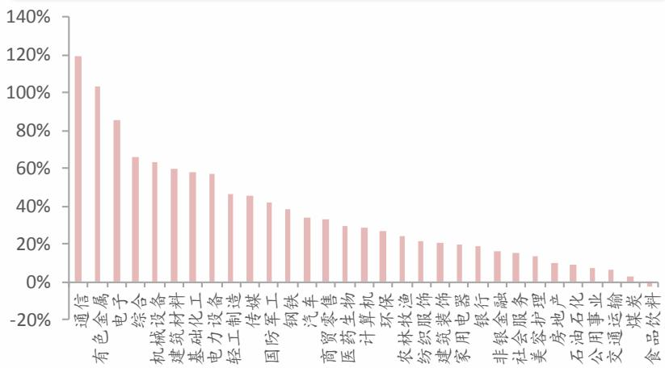

2025年休闲食品/软饮料子板块表现较优  
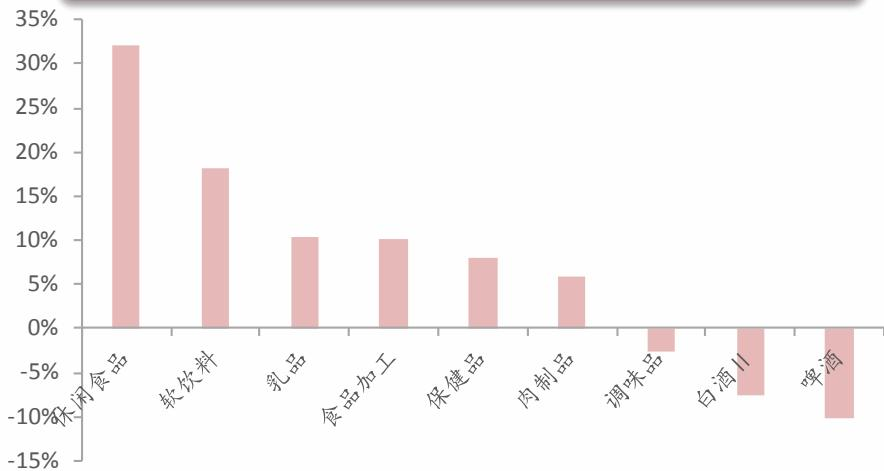

整体PE22倍（预测TTM），近几年较低水平  
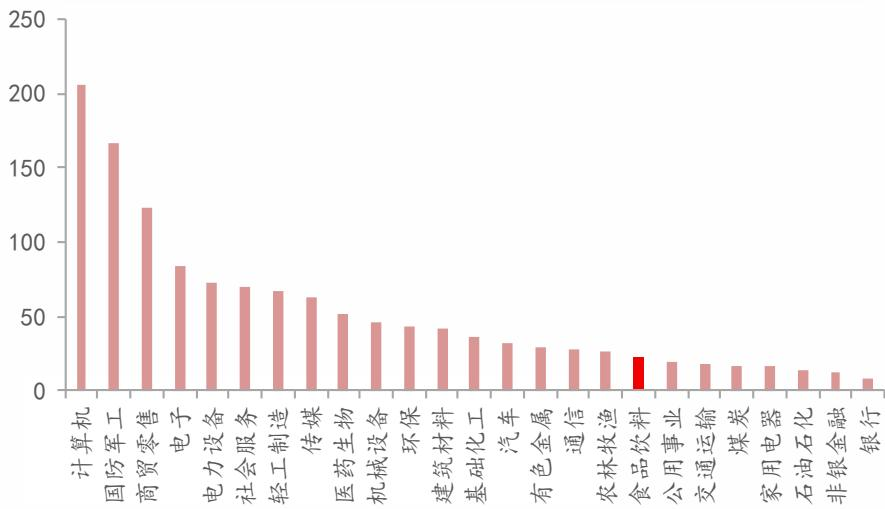

食品饮料/A股的PE(TTM)二季度以来明显回落  
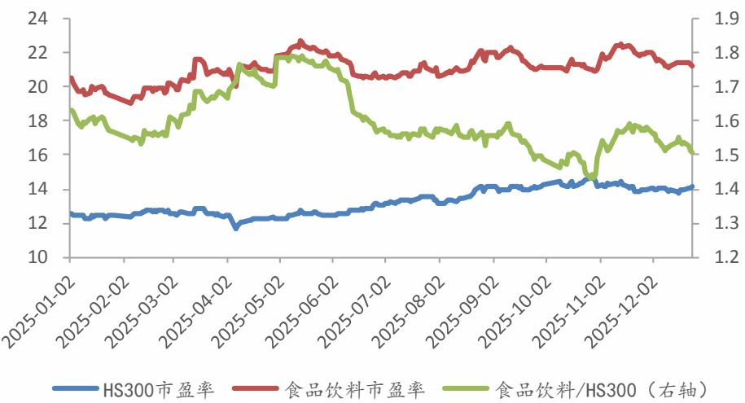

## 2025年行业回顾：板块内部分化明显，顺周期消费表现承压

☐ 从涨幅榜上看，受益于零售渠道变迁、企业主动推新，叠加市场风格倾向于新消费，相关标的股价表现突出，万辰集团和会稽山等新消费概念股领涨。伴随消费者健康意识和对功能性需求的提升，功能饮料、无糖茶等高景气赛道成长性延续。

☐ 在宏观经济承压和消费场景受限的背景下，白酒板块需求显著承压，次高端白酒业绩压力尤为显著；部分零食标的由于产品和渠道调整，回调幅度相对较大。

食品饮料板块涨幅前十名  
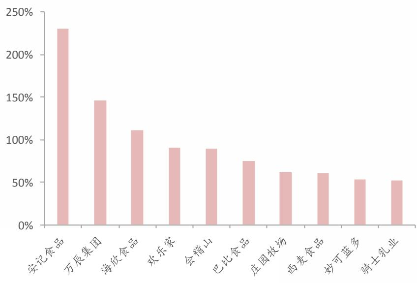

食品饮料板块跌幅前十名  
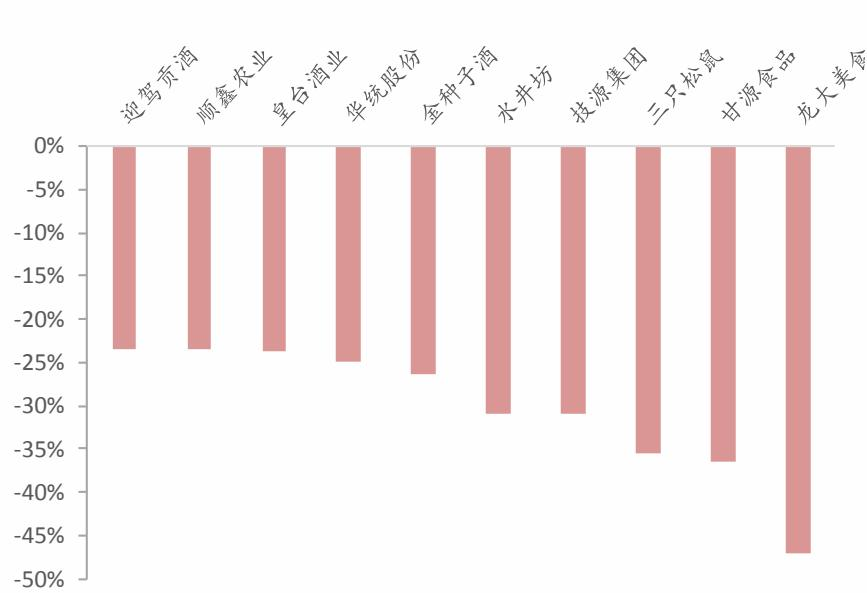

## 白酒：产量延续下降趋势，酒企竞争有所加剧

白酒产量延续下降  
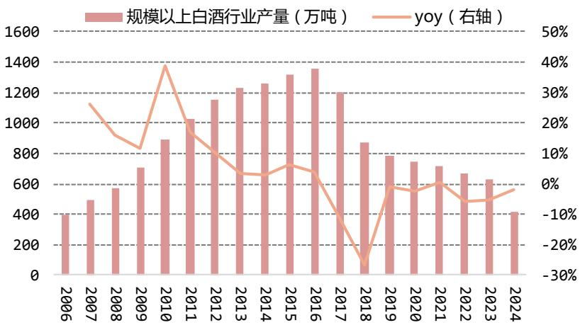

规模以上白酒企业数量（个）  
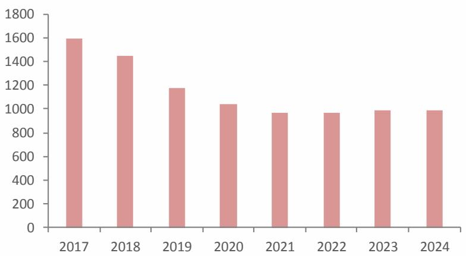

24年上市公司收入市占率提升至54.8%  
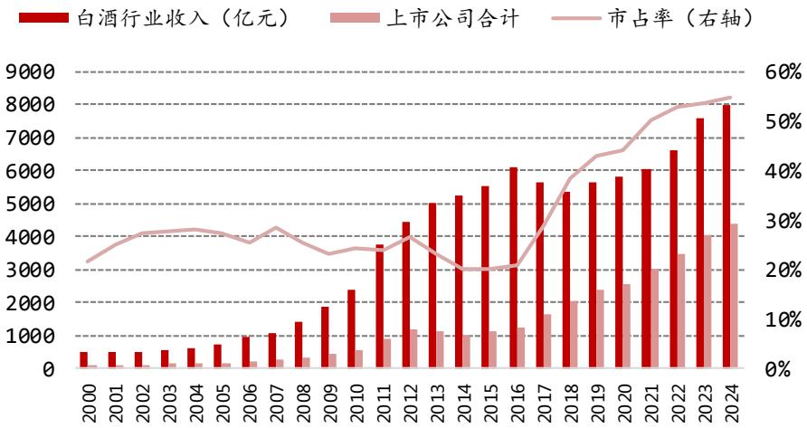

24年上市公司利润市占率提升至91.9%  
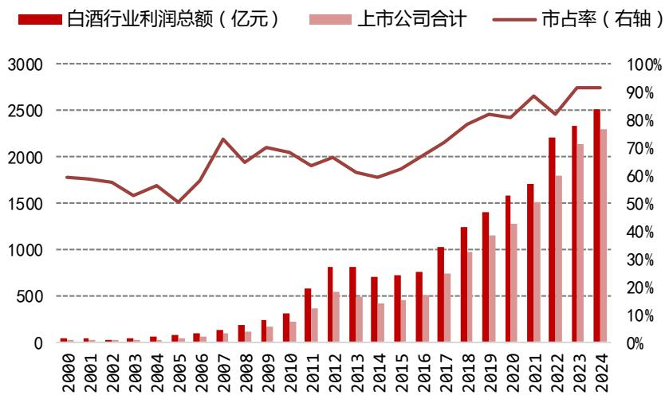

## 白酒：淡季需求显著承压，普飞批价边际走弱

☐ 高端：25Q2以来白酒需求疲软，消费场景大幅减少，高端酒量价均显著承压，普飞批价从年初2200元左右下行至当前1560元左右震荡，普五和国窖批价也小幅下行。

◆ 茅台：25年Q2淡季以来，伴随着饮酒政策趋严，餐饮环比走弱，商务需求低迷，供需矛盾有所放大，普飞批价出现下跌，批价从春节2200元左右下降至当前1560元左右；

◆ 五粮液：在商务消费低迷和飞天批价下行的影响下，渠道备货意愿低迷，普五批价从春节920元下行至当前800元左右；公司三季度以来主动控量消化渠道库存，减轻经销商回款压力，并积极开拓消费场景；

◆ 国窖：在商务消费低迷，茅五需求疲软的压制下，国窖动销呈现出一定程度的压力，目前高度国窖批价820元左右，公司坚持长期主义，以价为先，积极开拓薄弱市场。

高端酒销量持续稳定增长  
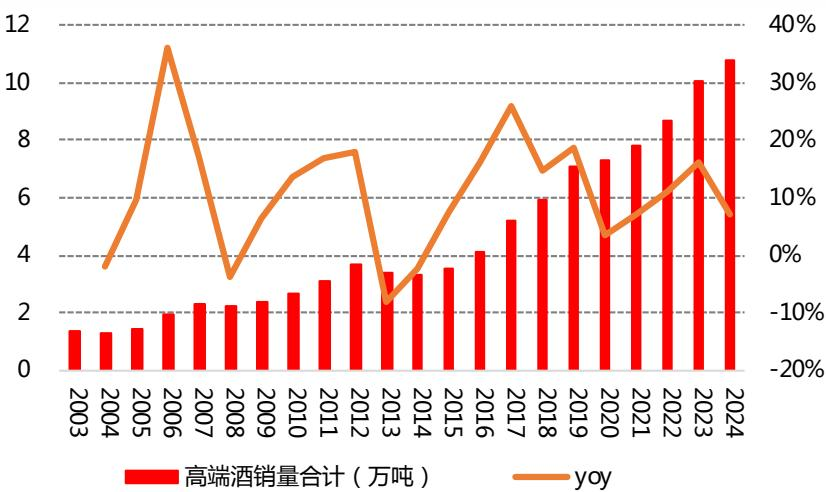

2024年高端酒销量市场份额  
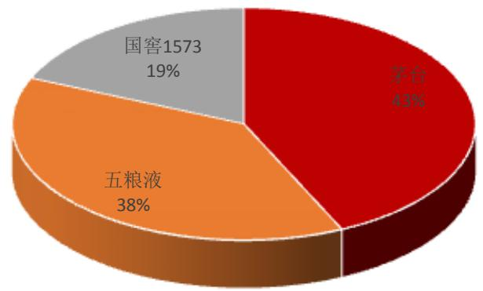

## 白酒：高端酒批价——行业景气度风向标

☐ 高端酒批价对于白酒行业尤其重要，直接反映行业景气度和供需状况。当前白酒行业正处于“政策调整、消费结构转型、存量竞争”三期叠加的深度调整期，高端酒需求弱，渠道备货意愿变差，供需矛盾有所放大。加之茅台酒具有较强的金融属性，消费环境低迷的情况下，电商渠道和部分黄牛出现低价甩货，叠加自媒体的传播放大，导致市场恐慌情绪加剧，造成短期价格非理性下跌；散瓶飞天批价从年初2200元左右下降至1560元左右，生肖、精品的批价亦不同程度下滑。受终端需求疲软和茅台酒价格下行挤压，普五批价有所下行，当前批价800元左右；国窖坚持以价为先，兼顾价盘和动销，当前高度国窖批价820元左右，批价表现较为稳定。

高端酒一批价变化趋势（元）

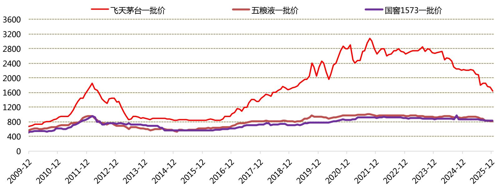

## 白酒：名优白酒占位品牌优势，次高端阶段性承压

☐ 次高端：需求端有所承压，品牌分化有所加剧。Q2淡季以来商务消费表现疲软，餐饮和宴席亦环比走弱，行业挤压式竞争有所加剧，次高端动销均显著承压，品牌分化进一步加剧。

☐ 汾酒：青花和玻汾双轮驱动，产品矩阵多点开花。得益于汾酒势能释放和产品矩阵完备，青花、玻汾、巴拿马等核心单品表现稳定；青花汾酒品牌积淀深厚，消费者基础优异，动销和批价表现优于次高端竞品。

◆ 舍得、酒鬼酒、水井坊：25年经济复苏缓慢，叠加政策冲击，商务消费比较疲软，烟酒店终端拿货意愿低迷，舍得、酒鬼酒、水井坊动销端均显著承压。

◆ 区域地产酒次高端：25Q2以来商务消费表现疲软，宴席场次同比回落明显，500-800元价格带需求显著承压，主流单品增速均显著放缓；大众宴席场次减少，100-300元大众价格带需求有韧性，洞9、对开、古8/16等动销相对稳健。

次高端步入深度竞争阶段  
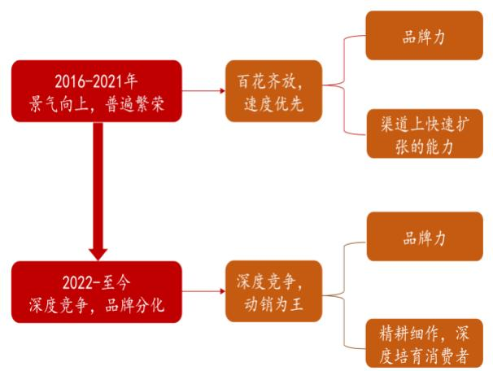  
2024年次高端市场份额

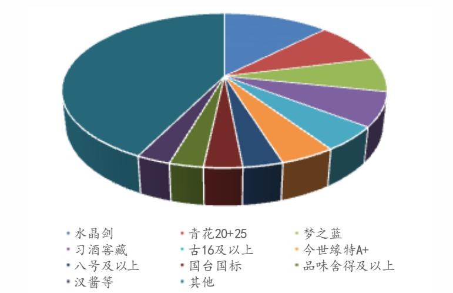

## 白酒：渠道——名酒引流效应显著，渠道优化加速集中度提升

## ☐ 渠道角度：名酒引流效应显著，渠道优化加速集中度提升

名酒引流效应越发显著，经销商是否具有名酒代理权成为核心竞争力，拥有茅台、五粮液代理权占据制高点；同时，在行业并不乐观的大环境下，渠道对于品牌择优选择，加速行业集中度提升。

名酒厂家投入力度大，渠道费用支持；同时，渠道更加侧重于与厂家配合，积极开拓市场，注重终端动销；在信息化为主的管理系统下，厂家议价权增强，对于渠道的管控更加趋严。

<table><tr><td>层级</td><td>特征</td><td>渠道模式</td></tr><tr><td>高端</td><td>品牌为主,渠道为辅</td><td>直营+经销商,团购占比较大,经销商也以专卖店为主,厂家和经销商可同时供货大型KA,厂家有直接合作电商。厂家侧重于文化和品鉴,茅台直营占比持续提升。</td></tr><tr><td>次高端</td><td>品牌和渠道双轮驱动</td><td>经销商为主,烟酒店流通渠道走货为主。次高端既要有好的品牌,又需要强渠道运营能力,品牌数量众多,竞争比高端更加激烈,渠道的通路和消费者重复购买率至关重要。</td></tr><tr><td>中低端</td><td>渠道驱动为主,份额向强势品牌集中的趋势明显</td><td>经销商为主,主要以烟酒店和KA零售为主。消费者品牌忠诚度不高,品牌之间转换成本低;但近年来,中低端酒市场份额向该价位段强势品牌集中的趋势明显。</td></tr></table>

## 白酒：库存—大商库存压力仍存，终端主动去化库存

☐ 2016年白酒复苏以来，库存虽有所增加（尤其是近两年），经销商压力变大，但基本处于相对良性状态（部分品牌压力较大），随着厂家调控和信息化系统渗透，名优白酒库存周期有望平滑。25Q2受外部环境冲击，短期动销承压明显，厂家控制发货节奏，积极消化库存压力。

☐ 名酒厂家关注可持续增长，不会主动压很多库存，一旦发现库存高企，主动控量保价。2018年6、7月份五粮液和国窖控量；2020年疫情之下，3月份开始各大酒厂控货；2022年四季度、2024年二季度厂家控货。

◆ 名优厂家均采用更加精细化，对于库存的把控能力较强。

基本采用扁平化运作+深度分销模式，厂家销售人员大幅增加，对于市场管控更加到位。

➢ 信息化系统的导入和使用，增强厂家对于渠道和终端的管理能力。

名优白酒价格，除茅台外，渠道利润并不丰厚，并未触发渠道大规模囤货行为。类比于2012年之前白酒的黄金十年期，此轮白酒复苏周期较短，除茅台外，鲜有渠道暴利的情况，经销商基本没有主动大规模囤货行为。

## 目录

白酒：有望调整结束，中长期配置价值凸显
啤酒：低基数与成本红利下，行业需求复苏可期
乳制品：生鲜乳依然位于低位，高质量增长为主线
调味品：必需消费需求稳健，健康化发展主线可期
速冻食品：期待餐饮好转
食品添加剂：成长空间广阔，天然健康为发展趋势
食品综合：优选优质子板块龙头
2026年重点关注标的

## 啤酒：25年低基数+渠道低库存+新兴渠道动能充沛

☐ 回望2025年国内啤酒市场：啤酒行业高端化已至下半场，结构升级走向精耕。2025年行业整体需求仍较为平淡；新兴渠道崛起带动场景重构，此外中高端以上产品竞争烈度仍在提升，多数啤酒企业聚焦渠道库存优化与出清。在餐饮场景低迷背景下，啤酒企业仍在持续优化产品与精耕渠道，以顺应当前碎片化趋势。吨价方面，行业结构升级仍在逆势前行，经济及中档产品持续承压，次高档延续强劲表现稳固吨价中枢，10元以上虽仍在缩量但部分产品亦有亮眼表现。考虑当前餐饮消费场景逐步修复，企业前期去库效果有望显现，叠加来年旺季催化，销量、吨价均有望修复，次高及以上价格带扩容仍有空间。

☐ 展望26年啤酒表现：1）从销量基数上看，25年存在明显旺季不旺，导致26年夏天存在一定低基数效应，尤其是全国性龙头有望充分受益于此。2）从产品结构升级方面来看，8元次高价格带仍有持续扩容空间，此外部分10元档大单品亦有亮眼表现可期。3）随着歪马、酒小二等酒类即时零售配送商逐渐兴起，非现饮啤酒有望充分受益于新兴消费模式实现高增。4）从大环境方面来看，国家目前已在多个省份通过发放餐饮消费券等方式鼓励消费，随着26年经济刺激政策持续加码，整体餐饮消费有望持续回暖，啤酒作为餐饮强相关行业有望实现良好恢复。

☐ 成本端保持平稳态势：从啤酒主要原材料来看，大麦价格目前仍处于低位，且酒企多在年末即锁定次年全年大麦价格，大麦有望在26年持续贡献成本红利；而从铝材、玻瓶等包材类原料价格走势看，虽价格存在一定波动，但整体上涨程度仍在温和可控范围。综合来看，26年啤酒成本端基本维持平稳态势，行业利润端弹性充足。

## 啤酒：寡头垄断格局确立，高端化成行业共识

□行业进入寡头垄断阶段，CR5突破 $90\%$ 。历经多年跑马圈地与扩张并购，目前绝大部分省份竞争格局已确立，牢固的基地市场保证了龙头公司业绩下限。此外2010-2015年间啤酒行业价格战激烈，一方面拉低行业整体利润率，另一方面加速中小产能出清；行业CR5由 $70\%$ 迅速提升至 $90\%$ 以上，寡头垄断格局十分稳固。纵观食品饮料众多子板块，啤酒享有极佳的竞争格局，行业竞争趋于理性。

☐ 高端化成为行业共识，啤酒步入发展快车道。在行业利润率持续低下、低端啤酒消费下滑、进口啤酒连年高增等因素共振下，行业由规模为先向利润导向转变，产品结构升级成为行业主线逻辑。各大龙头近年来产品结构升级态势明显，例如华润次高及以上占比由19年11%快速提升至24年24%水平。

啤酒行业CR5（以销量计）突破90%

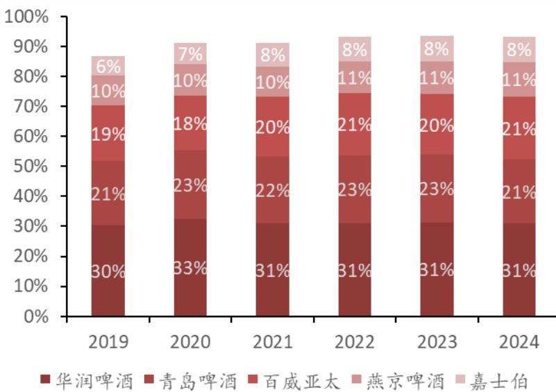  
各品牌高档啤酒占比持续提升

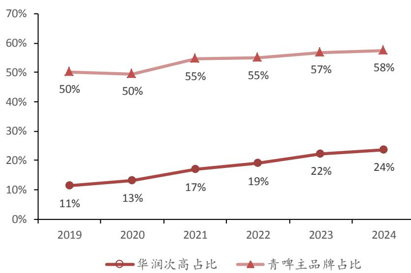

## 啤酒：行业布入成熟期，量稳价增为常态

◆ 量：受老龄化趋势加重、消费者健康意识觉醒、其他低度酒精饮料兴起等多种因素影响，中国啤酒产量自2013年达到历史顶峰4983万吨后开始逐年下滑，行业步入成熟期。对标海外，美国啤酒行业自1980年进入成熟期后，行业增速长期维持在低个位数水平；国内啤酒产量长期保持平稳成为常态。

◆ 价：从需求端看以Z世代为主的年轻人作为啤酒的主力消费群体，其对于差异化和高端化啤酒的需求日渐旺盛；而供给端各啤酒企业纷纷通过主动提价+产品结构升级推动吨价上行，2019-2024年行业平均吨价年复合增速为2.9%；且目前行业内低档啤酒仍占比过半，未来价增空间广阔。

国内啤酒产量基本企稳  
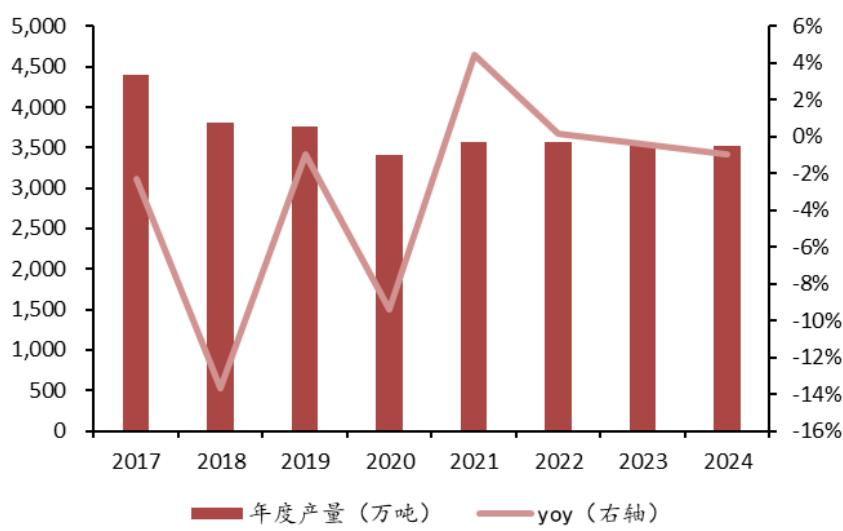  
数据来源：国家统计局，西南证券整理  
啤酒企业近年吨价表现（元/吨）

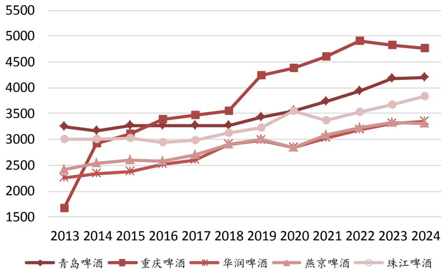  
数据来源：公司公告，西南证券整理

## 啤酒：2026年啤酒行业成本端呈现温和态势

☐ 啤酒受原材料价格波动影响较大。从啤酒的原材料构成来看，占比最大的两个部分分别是占比接近50%的包装材料和占比约25%的酿酒原料，具体来看：包装物中铝材、玻瓶以及纸箱分别占比约40%+、30%和20%；而酿酒材料中大麦占比超过50%。

☐ 展望2026年啤酒成本端：从啤酒主要原材料来看，大麦价格目前仍处于低位，且酒企多在年末即锁定次年全年大麦价格，大麦有望在26年持续贡献成本红利；而从铝材、玻瓶等包材类原料价格走势看，虽价格相较去年有所波动但整体上涨程度温和可控。综合来看，26年啤酒成本端基本维持平稳态势，行业利润端弹性充足。

大麦价格变动走势（美元/吨）  
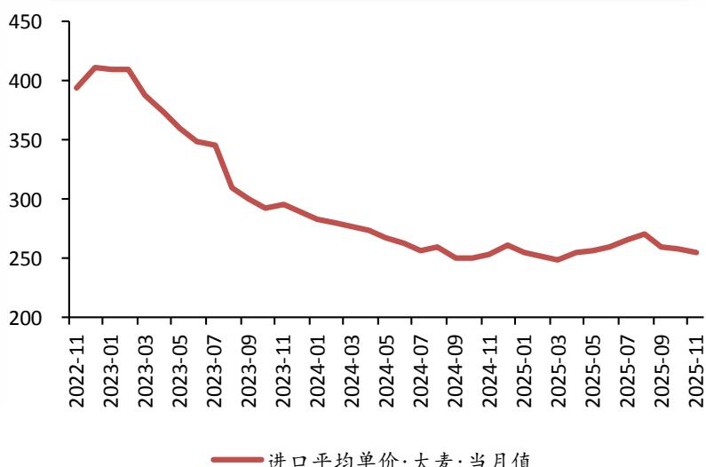

啤酒原材料成本构成  
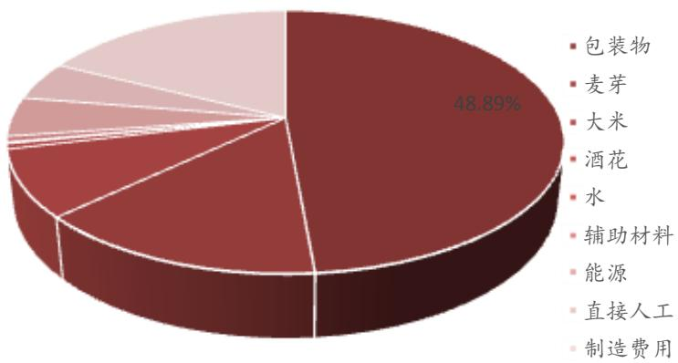  
数据来源：青岛啤酒2013年报，西南证券整理

## 啤酒：高端化关键抓手，大单品之争愈演愈烈

☐ 高端化时代品牌数量激增，各酒企倾力打造高端大单品。随着行业高端化进程的推进，各大酒企均通过增加品牌数量来更好的匹配消费者越发差异化的需求，因此具备体量优势、盈利支撑和高消费者认知的高端大单品，在目前啤酒品牌林立的当下显得弥足珍贵。具体来看24年各龙头表现：

◆ 华润啤酒：24年次高及以上销量约260万吨，其中大单品喜力销量已突破70万吨；

◆ 重庆啤酒：24年高档销量146万吨，其中大单品乌苏体量约75万吨，重庆及乐堡均超60万吨；

◆ 珠江啤酒：24年高档啤酒销量约90万吨+，其中大单品97纯生销量已接近40万吨；

燕京啤酒：24年大单品U8销量已接近70万吨。

2022-2024重庆啤酒分档次结构变化

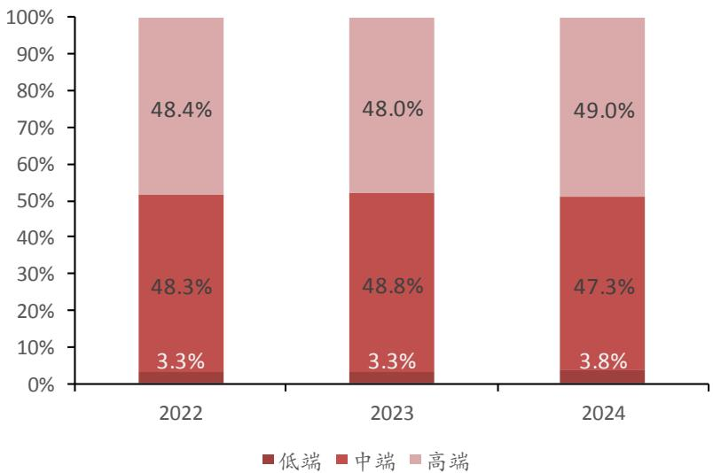

2022-2024青岛啤酒分档次结构变化  
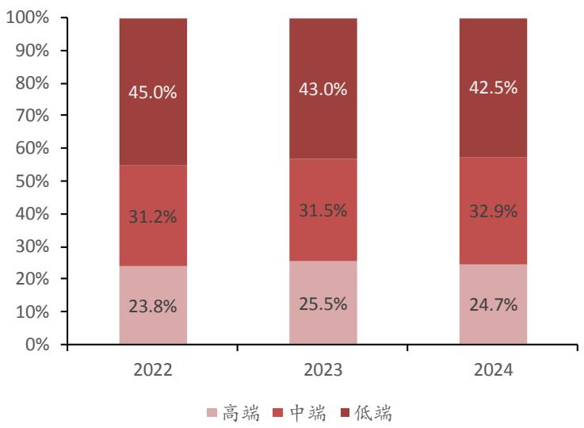

## 目录

白酒：有望调整结束，中长期配置价值凸显  
啤酒：低基数与成本红利下，行业需求复苏可期  
乳制品：生鲜乳依然位于低位，高质量增长为主线  
调味品：必需消费需求稳健，健康化发展主线可期  
速冻食品：期待餐饮好转  
食品添加剂：成长空间广阔，天然健康为发展趋势  
食品综合：优选优质子板块龙头  
2026年重点关注标的

## 乳制品：成本、费用下降共振，高质量增长为主线

◆ 奶价仍处下行周期，头部乳企盈利能力提升。2021年以来，国内奶价进入下行周期，同时头部乳企进入追求盈利能力的高质量增长阶段，价格战等竞争明显减少，费用投放力度减弱，形成成本、费用共振，毛销差水平明显改善。当前，原奶供需差已逐渐收窄，奶价下跌趋势已有所放缓，预计自2026年起原奶供需将逐步实现平衡、奶价有望企稳回升。

国内生鲜乳价格（元/kg）  
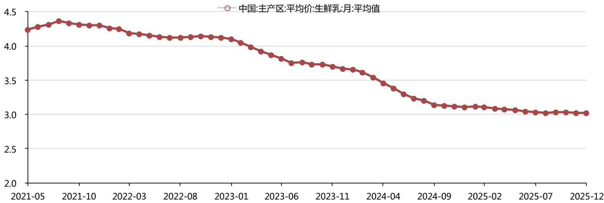

## 乳制品：成本、费用下降共振，高质量增长为主线

## □ 乳制品需求偏刚性，仍有较大增长空间

◆ 人口基数保障乳制品需求空间。我国人口基数庞大，伴随三胎政策出台、人口老龄化等因素，人口数量较为稳定，对乳制品的需求空间广阔。此外，2024年人均可支配收入达到4.1万元，近五年人均可支配收入复合增速为6.1%，居民收入水平稳步提高，消费升级趋势明显，为乳制品消费增长提供动力。

◆ 乳制品需求韧性强，长期仍将持续增长。2024年，我国居民人均奶类消费量12.6kg，同时城乡差距较大，农村居民人均消费量仅为城镇居民的大约一半，增长空间巨大。此外，《中国居民膳食指南2022》将每人每天乳制品摄入量提高至300-500g，长期看仍有增长空间。疫情结束以来乳制品行业需求复苏偏弱，白奶消费韧性相对较强。

全国居民人均可支配收入  
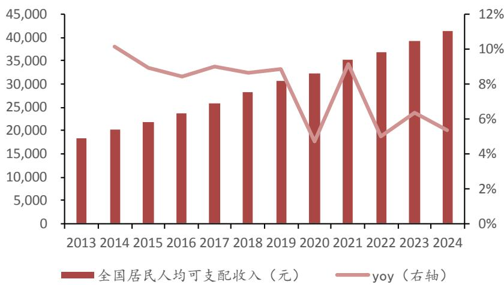

全国居民人均奶类消费量  
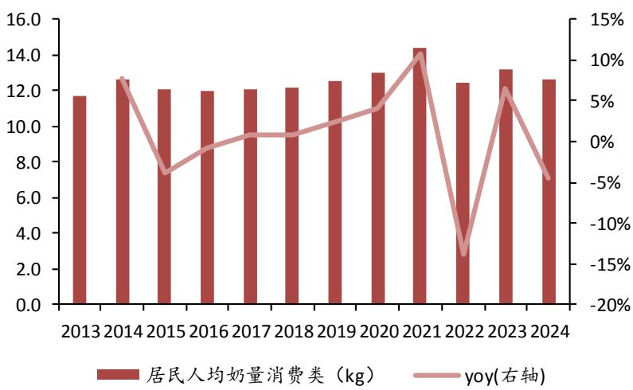

## 乳制品：成本、费用下降共振，高质量增长为主线

## □ 原奶供给稳健增长

奶牛数量下降后稳中有升。国内奶牛数量自2015年起下降，由于国内环保政策收紧，散户和中小牧场逐渐退出，规模化牧场占比提升。2019年下降至最低点610万头，2024年奶牛数量约为660万头，基本保持稳中有升态势。

奶牛单产提升。随着中小牧场退出和奶牛养殖规模化程度的快速提升，奶牛单产保持上升趋势，已从2010年的4387kg/年提升至2024年的6296kg/年。

◆ 从国内总量上看，2024年全国牛奶产量达4155万吨，同比下降2.9%，近五年复合增长率为4.7%，整体供给量充足。

全国奶牛数量  
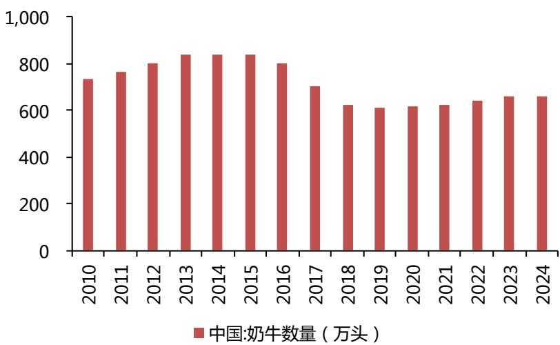

全国奶牛年单产（kg/年）  
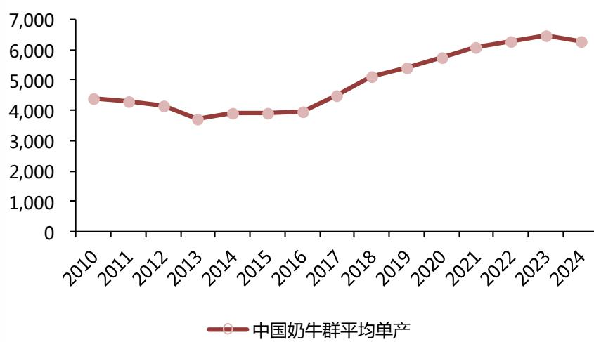

## 乳制品：成本、费用下降共振，高质量增长为主线

## □ 饲料价格高涨后逐步回落

◆ 玉米、豆粕价格有所回落。奶牛饲料分为精饲料、粗饲料、补充饲料，其中玉米和豆粕等精饲料占奶牛每日饲料消耗量的40%-50%。2020年下半年以来，玉米、豆粕等奶牛主要饲料价格保持高位后有所回落。截至2025年12月末，玉米、豆粕现货价分别为2.3元/kg、3.1元/kg，饲料价格对原奶价格形成一定支撑。

◆ 高品质苜蓿进口为主。苜蓿对提高奶牛产奶量和乳蛋白水平有重要作用。随着奶牛养殖规模扩大、大型牧场占比提高，高品质苜蓿需求快速增长。我国优质苜蓿生产得到有效发展，苜蓿种植面积增加，但目前仍无法满足需求，需要大量进口。2022年苜蓿价格高涨，2023-2024年间开始缓慢回落，2025年逐步企稳。

玉米现货平均价（元/吨）  
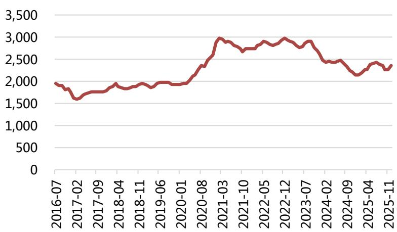

豆粕现货平均价（元/吨）  
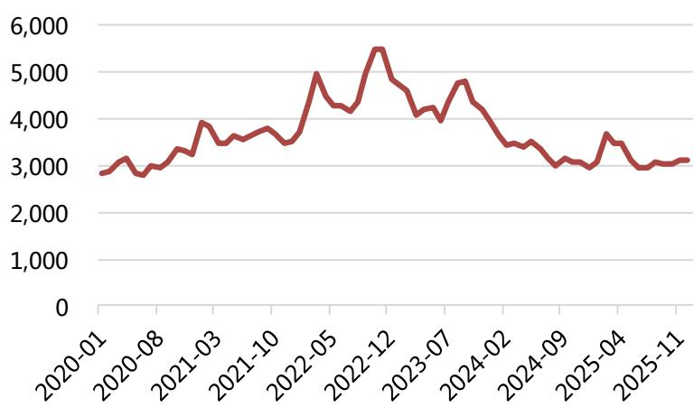

## 乳制品：成本、费用下降共振，高质量增长为主线

## □ 全球原奶产量平稳，大包粉进口价格回落

我国减少进口，国际奶价低位。除国产原奶外，进口大包粉也是国内乳制品重要的来源。2024年我国大包粉进口量63.8万吨，同比下降 $17.5\%$ ；进口奶粉年平均价格为3636美元/吨，同比下降 $3.4\%$ 。2024年我国对新西兰、欧盟、澳大利亚大包粉进口量分别下降 $1.9\%$ 、 $52.5\%$ 、 $42.3\%$ 。GDT拍卖价格大幅下降，2025年11月全脂奶粉拍卖价格3452美元/吨，同比下降 $1.9\%$ ，在我国进口需求没有较大提升的情况下，预计国际奶价仍将保持低位。

大包粉进口数量情况  
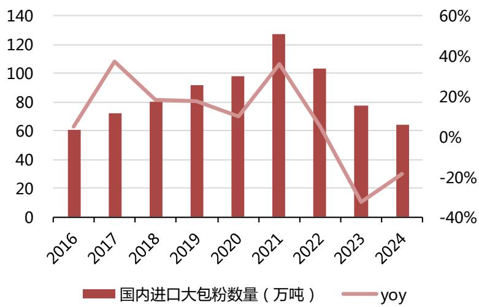

大包粉进口金额情况  
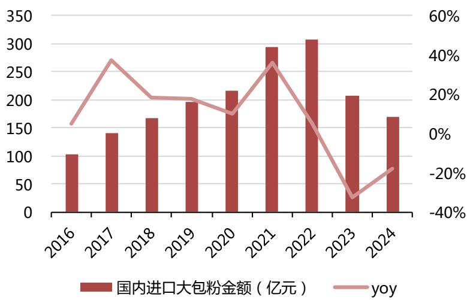

## 乳制品：成本、费用下降共振，高质量增长为主线

## □ 乳制品短期供需逐步优化，长期盈利稳步向上

◆ 短期看：1）供给端，年内上游奶牛存栏延续温和去化态势，结合上游牧场现金流仍存压，预计后续产能去化趋势仍将持续。2）需求端，国内乳制品需求仍处于相对疲软态势，产品结构亦相对承压；但25H2 国内精深加工产能陆续投产带来增量需求，供需格局已在改善。3）乳制品企业费用投放效率普遍提高，进一步提高盈利水平。

◆ 中长期看，乳制品板块整体盈利有望持续向上：1）牧业规模化程度加大，供给端非理性行为引起原奶价格波动的因素逐渐消退，原奶价格有望企稳。2）乳制品消费升级仍有空间，随着消费逐渐复苏，高端白奶、高端鲜奶等产品更受消费者欢迎，产品结构将持续改善。3）乳制品企业普遍对费用管控力度加大，多数企业提出利润率提升的目标，长期盈利能力将稳步提高。

## 目录

白酒：有望调整结束，中长期配置价值凸显  
啤酒：低基数与成本红利下，行业需求复苏可期  
乳制品：生鲜乳依然位于低位，高质量增长为主线  
调味品：必需消费需求稳健，健康化发展主线可期  
速冻食品：期待餐饮好转  
食品添加剂：成长空间广阔，天然健康为发展趋势  
食品综合：优选优质子板块龙头  
2026年重点关注标的

## 调味品：25年行业内部表现分化，期待26年餐饮场景修复

□回顾25年调味品行业：调味品作为与居民日常消费息息相关的必需消费品，同时也是餐饮供应链中的重要一环。B端方面，25年开年以来餐饮需求复苏仍较为缓慢，25年1-11月社零餐饮实现收入5.2万亿元，同比 $+3.3\%$ ，且单月增速基本维持在中低位数，整体复苏态势相对疲软。C端方面，25年调味品C端消费延续了去年以来的销量平稳 $+$ 单价微降的突出性价比消费趋势，整体调味品行业25年仍在量价层面处于相对承压态势。调味品行业内部出现分化：由于基础调味品行业增速放缓陷入存量竞争，行业内部表现存在明显分化，如海天经过近两年渠道调整后25年保持高单位数稳健增长而千禾受舆情事件影响进入调整期，中炬同样梳理渠道体系导致报表承压，恒顺榨菜等维持平稳表现。

☐ 展望26年调味品行业：从B端来看，26年餐饮消费有望在政策刺激下实现逐步修复，而餐饮渠道作为调味品消费的主力战场有望充分受益于餐饮复苏，动销提速下B端销量或有明显改善；而C端方面，在居民消费力的持续复苏与调味品整体健康化大趋势的双重拉动下，调味品行业产品结构有望持续改善，此外以复合调味料为代表的新品持续涌现，带动吨价稳步上行。

☐ 调味品行业成本端26年展望：目前国产大豆价格相较22年高点下降幅度超30%，且同环比来看均呈下行趋势；其他原材料如包材等亦处于相对低位。综合考虑酱油酿造周期及原料锁价等因素影响，26年调味品行业成本端仍具备部分红利，有助于行业整体业绩保持平稳增长态势。

## 调味品：行业空间广阔，未来持续稳定增长

☐ 纵观食品饮料诸多子板块，调味品赛道景气度始终不减。得益于其发酵后的独特风味形成的口味壁垒，以及其必选消费品属性带来的强消费者粘性，过去5年行业维持稳定增长，复合增速约为13.2%，2024年调味品市场规模已突破6500亿元。

☐ 随着经济发展和城镇化率提升，一方面带来消费能力的提升，家庭调味品往量价齐升方向发展；另一方面人口大量聚集带来生活习惯改变，外出就餐及外卖频次显著增加，拉动餐饮市场规模迅速提升，近五年整体餐饮市场CAGR约为3.6%，其中外卖市场规模CAGR约为23.1%。

调味品行业持续稳定增长  
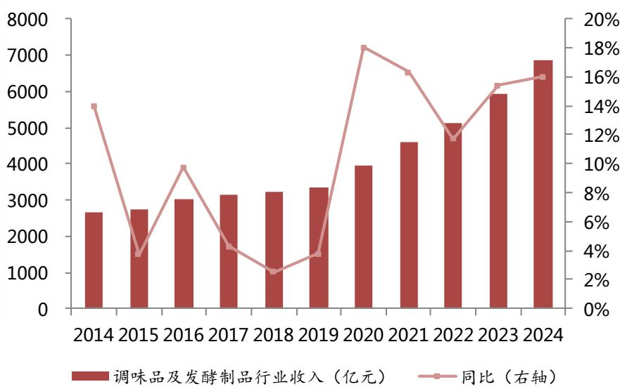

外卖渠道规模持续增长  

## 调味品：B端餐饮持续复苏，行业集中度加速提升

☐ 下游餐饮持续复苏，改善行业整体供需结构。从调味品行业下游渠道占比来看，餐饮渠道占比仍维持在半数以上，C端渠道占比约37%。线下B端需求遭受持续冲击，进而带动行业整体表现低迷；随着下游餐饮端需求的持续复苏以及连锁化率的持续提升，调味品企业B端增速有望实现边际改善。

☐ 相较海外成熟市场，集中度提升空间广阔：中国调味品行业集中度仍处于较低水平，以酱油行业为例：根据海天港股招股书，以收入计2024年国内酱油CR5仅为 $25.1\%$ ，与美国（ $41\%$ ）、日本（ $44\%$ ）等海外成熟市场相比，前五大企业市占率仍有巨大提升空间。随着行业走向成熟市场竞争逐步加剧，区域性中小产能将会加速出清，未来调味品将进入挤压式增长阶段，利好头部企业持续享受集中度提升红利。

调味品下游渠道占比  
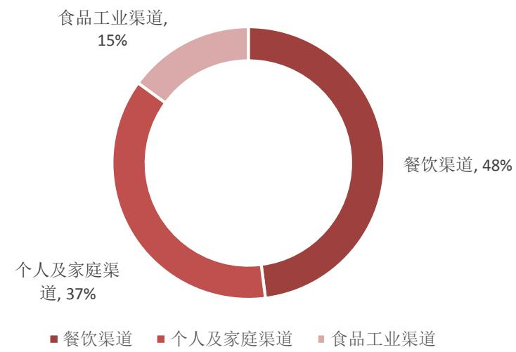  
2024年各国酱油行业CR5集中度对比

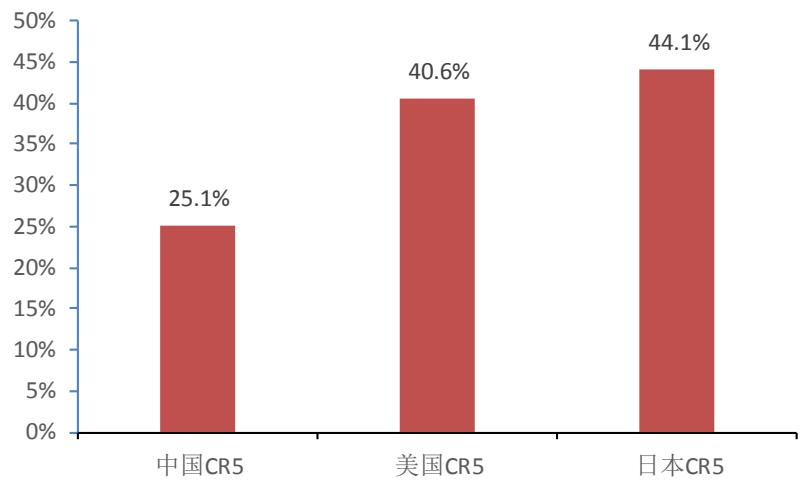

## 调味品：复合化及健康化为行业未来两大发展趋势

☐ 复合化：降本增效需求催生复合调味品渗透率不断提升。分B/C两端来看：1）餐饮企业随着连锁化率的持续提升，对菜品标准化及去厨师化的追求日益增加，而复合调味品可以帮助餐企解决这两大痛点；2）随着家庭结构变化与居民生活节奏加快，消费者愿意为烹饪锁花费的时间愈发减少，催生了对复调的需求。2024年复调行业规模已接突破2300亿元，近五年CAGR约为12.1%。

☐ 健康化：随着居民对生活品质的要求不断提高以及老龄化程度的持续提升，叠加22Q3以来零添加酱油风波事件的影响，在消费升级大趋势逐步放缓的背景下，基础调味品向健康化方向发展，已逐渐成为行业未来结构升级的关键动能。

复合调味品行业市场规模  

零添加调味品市场规模  

## 目录

白酒：有望调整结束，中长期配置价值凸显  
啤酒：低基数与成本红利下，行业需求复苏可期  
乳制品：生鲜乳依然位于低位，高质量增长为主线  
调味品：必需消费需求稳健，健康化发展主线可期  
速冻食品：期待餐饮好转  
食品添加剂：成长空间广阔，天然健康为发展趋势  
食品综合：优选优质子板块龙头  
2026年重点关注标的

## 速冻食品：借力餐饮连锁化，行业高景气延续

☐ 无序扩张带来价格战：疫情期间受居家需求激增影响，速冻行业产能出现无序扩张从而带来供给过剩的问题；此外汤圆水饺等传统速冻产品自身同样存在同质化程度高等问题，因而致使行业在C端和小B端存在较为激烈的价格战。尽管速冻行业在需求端有所承压，但龙头企业仍旧凭借其渠道、产品及规模优势，不断攫取中小企业市场份额，充分享受行业集中度提升红利。

☐ 展望26年速冻食品行业：随着26年国家促消费政策不断出台，餐饮消费场景有望持续恢复，大B自身有望受益于此，提升拓店速度与单店业绩，小B渠道在整体社会餐饮复苏的大环境下亦将实现较快恢复。中长期看，万亿餐饮供应链市场下，餐企对于降本提效的需求永不停息，速冻企业有望充分受益。社会餐饮的持续复苏，将拉动小B客户对速冻面点及火锅料需求回升，速冻行业整体有望实现高增。

## 速冻食品：餐饮行业高景气，连锁化率持续提升

☐ 据国家统计局数据，2024年全国餐饮收入5.6万亿元，同比增长5.3%，受消费力下滑和大环境影响，24年整体餐饮行业呈现弱复苏态势。但随着下游餐饮连锁化率从18年12%持续提升至24年23%水平，作为行业中上游的餐饮供应链将维持高景气。

◆ 需求端：城镇化程度逐渐升高带动居民收入水平提升，外出就餐机会和频次增长，餐饮行业维持较快增长，2019-2024年CAGR为3.6%；

◆ 供给端：行业竞争加剧叠加人力与店租成本上升，倒逼商家降本增效，通过提升流程标准化程度，不断优化整体供应链成本。

中国餐饮市场规模持续增长  

国内餐饮连锁化率持续增长  

## 速冻食品：对标海外，B端占比尚有大幅提升空间

☐ 速冻食品作为餐饮供应链中重要的组成部分，尤其是针对B端餐饮客户的速冻火锅料、速冻面米制品、速冻菜肴等标准化半成品将极大提升后厨效率，迎来巨大的需求爆发。

◆ 餐饮连锁化趋势拉动食材标准化需求：根据美团统计，2024年我国餐饮连锁化率约为23%，相较日本51%水平仍有大幅提升空间。

◆ 社会餐饮渠道有望加速渗透：目前国内餐饮渠道里小B端社会餐饮仍占据主流，此外亦存在大量乡厨及团餐等消费场景，具备性价比优势的冻品产品在小B端有望实现加速渗透。

## 速冻企业在整体餐饮供应链中处于行业中游

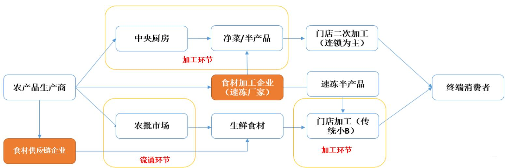

## 速冻食品：B端需求爆发，拉动火锅料高速增长

## □ 速冻火锅料

◆ 行业规模：2024年速冻火锅料的市场规模约740亿元，近五年行业整体复合增速约为8.1%。受益于B端连锁火锅类及烧烤类餐饮的快速发展，预计未来五年B端火锅料将保持约双位数增长。

◆ 竞争格局：1）速冻火锅料行业格局较为分散，2024年CR5尚未达到20%；其中安井作为绝对龙头，市占率已超10%；2）随着行业竞争烈度逐步提升，成本能力控制弱、品牌力弱且缺乏提价能力的小企业呈现加速退出态势，行业集中度持续提升。

速冻火锅料行业保持高速增长

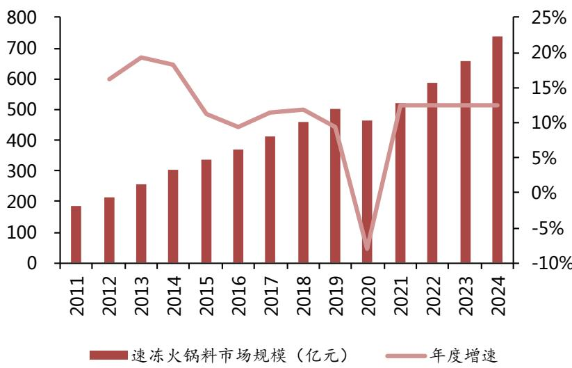  
数据来源：华经产业研究院，西南证券整理  
中国消费者速冻食品购买品类占比

  
数据来源：艾媒咨询，西南证券整理

## 速冻食品：传统米面增速放缓，新式面点蓄势待发

## □ 速冻面米制品

◆ 行业规模：2024年速冻米面行业规模约为970亿元。分品类看，传统米面进入成熟期，行业维持中单位数增长；新式面点正处于快速发展阶段，预计维持双位数以上增速。

◆ 竞争格局：1）C端零售市场集中度较高，传统的汤圆水饺等产品市场份额主要集中在三全、湾仔码头、思念等头部品牌；2）B端餐饮快速发展，手抓饼、油条、蒸饺等一系列符合餐饮渠道消费的小吃类新品推出，其中千味央厨、三全、正大、安井等企业为头部玩家。

速冻米面整体增速平稳  
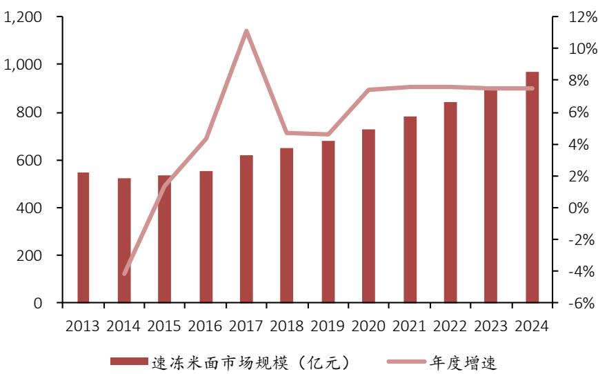  
数据来源：华经产业研究院，西南证券整理

速冻小吃市场维持高速增长  
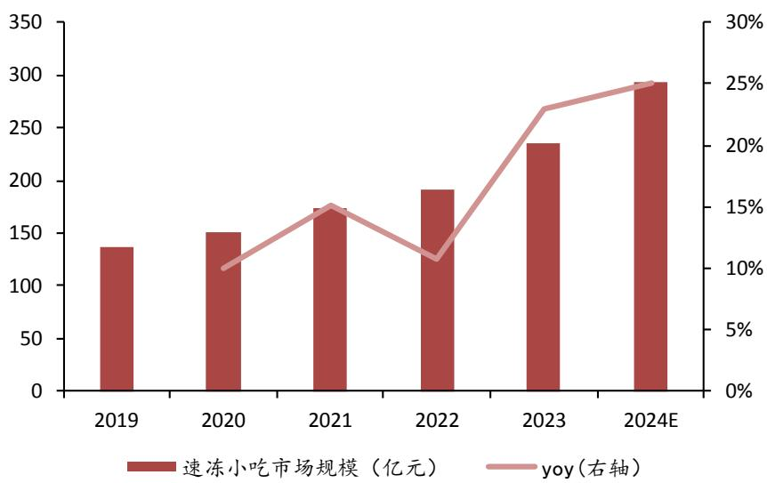  
数据来源：中商产业研究院，西南证券整理

## 目录

白酒：有望调整结束，中长期配置价值凸显  
啤酒：低基数与成本红利下，行业需求复苏可期  
乳制品：生鲜乳依然位于低位，高质量增长为主线  
调味品：必需消费需求稳健，健康化发展主线可期  
速冻食品：期待餐饮好转  
食品添加剂：成长空间广阔，天然健康为发展趋势  
食品综合：优选优质子板块龙头  
2026年重点关注标的

## 食品添加剂：成长空间广阔，天然健康为发展趋势

## ☐ 甜味剂：借无糖之风乘势而上，品类向天然健康升级迭代

代糖市场加速扩容，渗透率持续提升。随着消费者健康意识的觉醒以及越来越多无糖产品的问世，代糖的渗透率提升呈现加速趋势，我国甜味剂产量由2017年的15.9万吨提升至2024年的31.5万吨，近5年CAGR达 $12.3\%$ ，长期增长趋势明确。

◆ 多应用场景广泛使用，减糖风潮席卷市场。代糖应用场景广泛，除饮料外还广泛应用于餐桌调味品、个人护理产品、烘焙食品、药品、保健类食品、糖果巧克力、医药类用品、化工类制品等多个领域。饮料领域是代糖主要应用领域，占比约50%。

我国甜味剂产量  
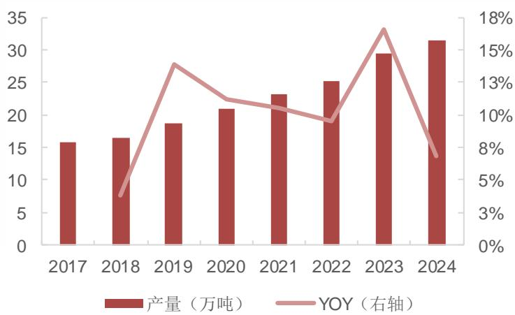

甜味剂应用领域构成  
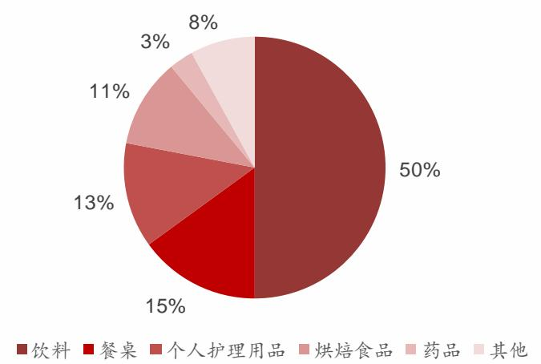

## 食品添加剂：成长空间广阔，天然健康为发展趋势

## ☐ 甜味剂：借无糖之风乘势而上，品类向天然健康升级迭代

成本优势推动人工甜味剂增长，健康优势打造天然甜味剂广阔空间。人工甜味剂经历了从糖精 $\rightarrow$ 甜蜜素 $\rightarrow$ 阿斯巴甜 $\rightarrow$ 安赛蜜 $\rightarrow$ 三氯蔗糖的迭代发展，在口味（更像蔗糖）与安全（对健康影响更小）方面持续优化，从具体品类看，糖精、甜蜜素、阿斯巴甜作为前三代合成甜味剂，价甜比低、性价比高，应用仍较广泛，但由于安全性不足，产销量增长动能较弱。安赛蜜与三氯蔗糖作为第四、五代合成甜味剂，相对安全且价甜比高，产量增速较快。天然甜味剂作为健康进阶产品，高安全性打开未来成长空间，甜菊糖苷/赤藓糖醇优势更加突出。通过植物萃取和生物发酵取得的天然甜味剂更为健康，广泛应用于饮料、调味品和糖果中。

代糖类产品特性对比

<table><tr><td>分类</td><td>产品</td><td>甜度系数</td><td>价甜比</td><td>热量(卡路里)</td><td>口感</td><td>安全性</td></tr><tr><td>天然糖</td><td>蔗糖</td><td>1</td><td>1.00</td><td>4</td><td>纯正</td><td>好</td></tr><tr><td rowspan="6">人工甜味剂</td><td>糖精</td><td>300</td><td>0.01</td><td>0</td><td>苦味、涩味、金属味</td><td>较差,有一定致癌性</td></tr><tr><td>甜蜜素</td><td>50</td><td>0.05</td><td>0</td><td>涩味</td><td>较差</td></tr><tr><td>阿斯巴甜</td><td>200</td><td>0.08</td><td>4</td><td>纯正</td><td>较好,有一定争议</td></tr><tr><td>安赛蜜</td><td>200</td><td>0.06</td><td>0</td><td>涩味、金属味</td><td>较好</td></tr><tr><td>三氯蔗糖</td><td>600</td><td>0.06</td><td>0</td><td>略有涩后味</td><td>好</td></tr><tr><td>纽甜</td><td>7000-13000</td><td>0.01</td><td>1</td><td>纯正</td><td>好</td></tr><tr><td rowspan="4">天然甜味剂</td><td>木糖醇</td><td>1</td><td>0.70</td><td>2.4</td><td>微清凉感</td><td>有腹泻风险</td></tr><tr><td>赤藓糖醇</td><td>0.6-0.8</td><td>3.95</td><td>0.21</td><td>微清凉感</td><td>有腹泻风险</td></tr><tr><td>甜菊糖苷</td><td>200-300</td><td>0.12</td><td>0</td><td>微苦涩</td><td>好</td></tr><tr><td>罗汉果糖苷</td><td>300</td><td>0.60</td><td>0</td><td>甘苦味</td><td>好</td></tr></table>

www.swsc.com.cn

## 食品添加剂：成长空间广阔，天然健康为发展趋势

☐ 甜味剂：借无糖之风乘势而上，品类向天然健康升级迭代

◆ 人工甜味剂（化学合成）占主导地位，天然甜味剂（植物提取、生物发酵）份额不断提升。从目前的甜味剂配料市场来看，人工甜味剂（化学合成）依旧占据了较大的市场份额。随着消费者对于甜味剂的来源及安全问题关注度的不断加强，天然甜味剂需求还将保持高速增长，预计通过植物提取（甜菊糖苷）和生物发酵（赤藓糖醇）得到的天然代糖份额将逐年增高。

全球甜味剂品类份额（按产量）

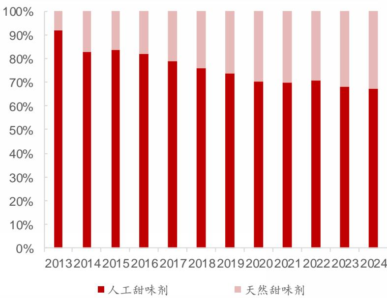  
全球甜味剂市场结构（按产量）

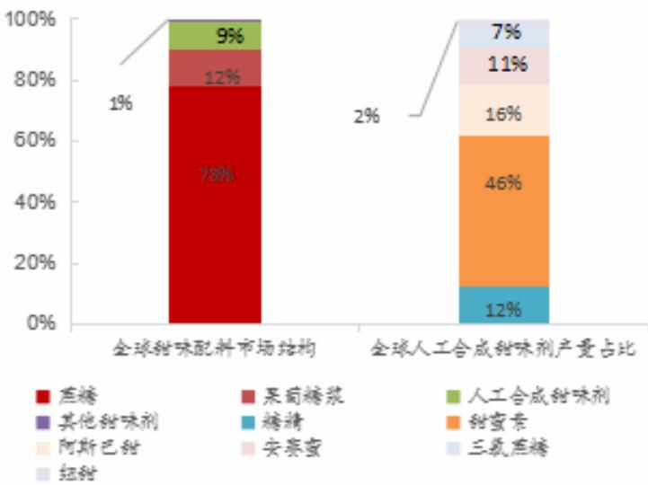

## 食品添加剂：成长空间广阔，天然健康为发展趋势

## □ 植物提取物：需求蓬勃发展，行业格局分散

全球植提市场持续扩张，中国植提市场规模稳中有升。植物提取物可作为原料，参与制成食品、中药、保健食品、日化产品、化妆品、养殖投入品。2024年全球植提市场达到422.5亿美元，同比增长 $5.0\%$ 。中国植提行业起步于20世纪70年代部分中药厂在生产环节对植物成分的提取，近年来随着消费者对天然健康概念的重视迎来快速发展，由2017年的275亿元增至2024年的546亿元，CAGR达 $10.3\%$ 。预计2025年中国植提市场规模有望突破600亿元。

全球植提市场规模及同比增速  
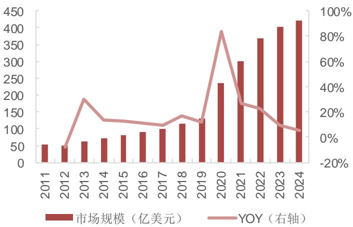

中国植提市场规模及同比增速  
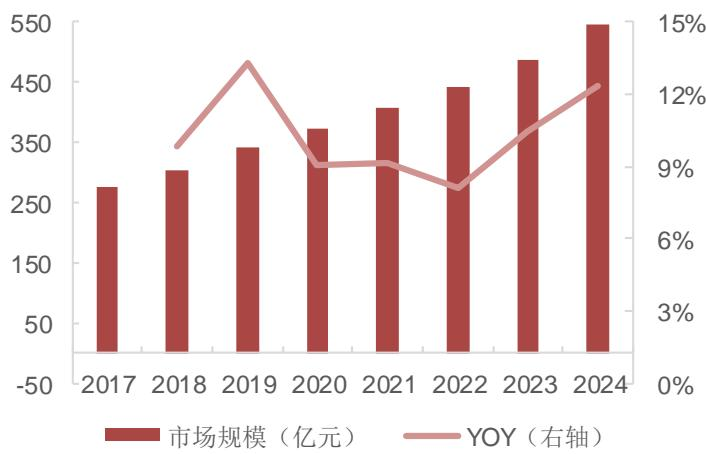

## 食品添加剂：成长空间广阔，天然健康为发展趋势

☐ 植物提取物：需求蓬勃发展，行业格局分散

◆ 格局相对分散，龙头占据细分领域。植物提取细分产品种类多、应用领域涉及范围广阔，具有小而美的特性，因此行业格局相对分散。各个细分领域均有不同龙头占据，大部分企业仅提供几个或者十几个品类的初级产品。譬如辣椒红、辣椒精及叶黄素的全球市场份额由晨光生物主导，番茄红素的全球份额则主要由以色列的Lycored（利库德）占据，国内天然甜味剂则是莱茵生物处于领先地位。行业细分龙头凭借自身研发技术、生产工艺、机械设备、原料掌控和销售渠道等方面的优势，逐渐建立了自身的优势壁垒，头部企业走向平台化。

中国植物提取物行业市场竞争格局

<table><tr><td>排名</td><td>市场规模(亿元)</td><td>代表公司</td><td>植提业务占比</td><td>市场分布</td><td>主要产品</td></tr><tr><td rowspan="3">第一梯队</td><td>48.7</td><td>晨光生物</td><td>51%</td><td>国内81%、国外19%</td><td>天然色素、香辛料提取物和精油、营养及药用提取物等</td></tr><tr><td>10.5</td><td>莱茵生物</td><td>94%</td><td>国内38%、国外58%</td><td>天然甜味剂、茶叶提取物、工业大麻提取物等</td></tr><tr><td>3.0</td><td>欧康医药</td><td>100%</td><td>国内75%、国外25%</td><td>槐米提取物、枳实提取物、黄连提取物等</td></tr><tr><td rowspan="5">第二梯队</td><td>1.6</td><td>天然谷</td><td>99%</td><td>国内54%、国外46%</td><td>淫羊藿提取物、刺蒺藜提取物、红景天提取物等</td></tr><tr><td>0.9</td><td>康隆生物</td><td>100%</td><td>绝大部分为海外市场</td><td>植物提取物</td></tr><tr><td>0.8</td><td>华康生物</td><td>100%</td><td>国内15%、国外85%</td><td>人参造甙提取物、蓝莓提取物、卡瓦提取物等</td></tr><tr><td>0.3</td><td>岳达生物</td><td>77%</td><td>西北、华北地区</td><td>人参提取物、万寿菊提取物、葛根提取物等</td></tr><tr><td>0.2</td><td>红星药业</td><td>100%</td><td>——</td><td>茶多酚、咖啡因等</td></tr></table>

www.swsc.com.cn  
数据来源：华经产业研究院，西南证券整理

## 食品添加剂：成长空间广阔，天然健康为发展趋势

## □ 植物提取物：需求蓬勃发展，行业格局分散

市场集中度逐渐提高，头部企业走向平台化。虽然部分细分领域出现龙头企业，但大多基于自身业务进行纵向布局，其植物提取业务的整体市占率并不高，尚未达到寡头垄断的程度。市场上存在多个具有一定规模和影响力的企业，竞争较为激烈。近几年中国植物提取物市场集中度呈上升态势，由2016年的 $2.3\%$ 上涨至2024年的 $18.3\%$ 。植物提取物行业内的头部企业优势日益明显，晨光生物的市场占有率位列国内植物提取物相关企业的首位，2024年占据约 $9.7\%$ 的市场份额；其次为莱茵生物和欧康医药，市场占有率分别为 $4.2\%$ 和 $2.5\%$ 。

中国植物提取行业市场集中度  
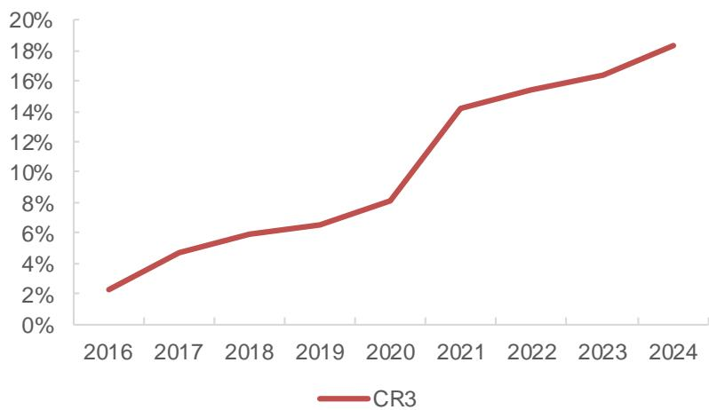

2024年中国植物提取行业竞争格局  
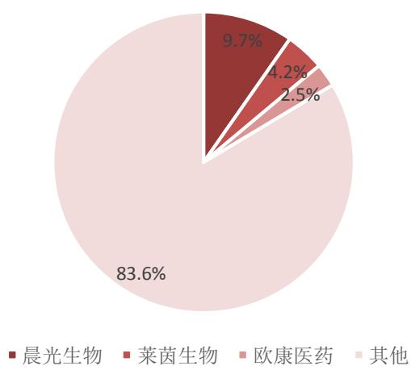

## 目录

白酒：有望调整结束，中长期配置价值凸显  
啤酒：低基数与成本红利下，行业需求复苏可期  
乳制品：生鲜乳依然位于低位，高质量增长为主线  
调味品：必需消费需求稳健，健康化发展主线可期  
速冻食品：期待餐饮好转  
食品添加剂：成长空间广阔，天然健康为发展趋势  
食品综合：优选优质子板块龙头  
2026年重点关注标的

## 食品综合：优选优质子板块龙头

## □ 休闲食品：成长空间广阔，中式品类望孕本土巨头

万亿市场多强角力，竞争格局分散。中国休闲食品历经多年发展，进入稳态扩容阶段。行业品类繁多，集中度较低，消费者喜好差异程度大导致零食品类供需两端分散，单品难以上量，仅有细分品类龙头，尚无综合性大规模龙头出现。

传统西式零食增长趋缓，中式零食崛起正当时。早期零食作为舶来品以西式品类为主，品类内部格局以西方头部企业为主导。近年来中式零食概念加速崛起，目前辣味零食、卤味零食等传统中式品类已占据国内零食市场近4成份额，且仍处于总量扩张状态。中国辣味零食市场规模近5年的年复合增速为 $8.7\%$ ，高于非辣味零食的 $5.1\%$ ，预计2027年规模超2700亿元。随着中式品类热潮兴起，本土企业面临机遇。

中国休闲食品行业市场规模  
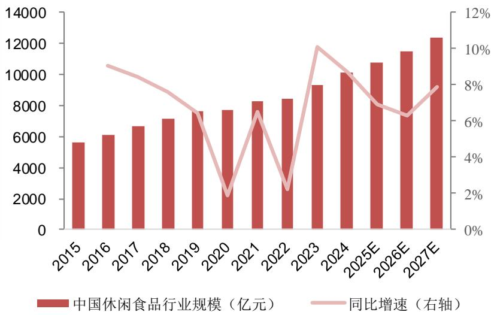

按口味划分中国休闲食品行业零售额（亿元）  
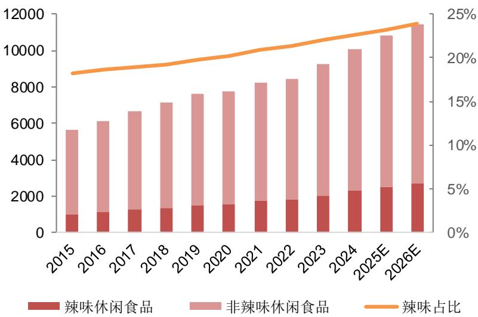

## 食品综合：优选优质子板块龙头

## □ 休闲食品：全渠道战略转型，渠道变迁推动行业成长

◆ 休闲食品具有全渠道销售的特点，行业渠道结构持续变革。2000-2012年传统流通和连锁商超渠道占据主导位置，2013年开始货架电商逐步兴起并成为主要增量渠道，2018年电商渠道去中心化、拼多多开始起量，2020年疫情加速直播电商成长，2020年之后会员超市渠道、量贩零食店渠道逆势增长，成为品牌商争夺的增量渠道。当下，传统商超调改如火如荼、腾讯开始发力微信小店、即时零售稳步成长。

◆ 零食并不是一个强品牌属性的品类，渠道变迁对行业影响较大。面对外部渠道变迁，零食企业若能根据新渠道特征，及时调整供应链、产品、组织团队等，可以获得持续不断的增长、保持份额提升。每一轮零食系统性行情基本都对应一轮渠道变迁。

2007\~2024年中国零食行业渠道结构情况

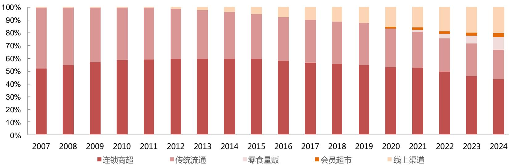

## 食品综合：优选优质子板块龙头

## □ 休闲食品：新兴渠道红利释放，拥抱性价比和下沉市场

◆ 零食量贩“高性价比+高周转”冲击市场。零食量贩作为新兴渠道，整体效率较高，通过优化供应链，可实现多品种高品质低价格的产品供应。量贩零食店SKU深度及宽度均较高，可通过提供散装、称重零食，解决消费者选择困难问题，及时更新爆品。零食折扣店区域化特征明显、全国化难度较大，预计少数龙头可以实现全国化布局，绝大多数则是区域连锁门店。部分具备供应链优势的企业随零食量贩渠道拓展有望迎来加速成长，实现份额提升和推进渠道下沉。

全国连锁零食集合店部分地区分布

## 食品综合：优选优质子板块龙头

## □坚果炒货：坚果炒货两千亿大市场，集中度提升趋势明显

◆ 消费者基础坚实，扩张势头强劲。坚果消费者以85后年轻人、一二线城市人群为主，消费人群不断扩大为行业扩容提供有力支撑。现制坚果炒货行业中，以散装为大头，而连锁化现制坚果炒货品牌采用散装的销售方式，创新产品、升级品牌、全国扩展，是具有万店潜力的赛道。

◆ 籽坚果格局分散，树坚果发展潜力大。2021年坚果炒货行业规模1512亿元、未来5年CAGR为8%；籽坚果、树坚果行业规模分别为529、983亿元，预计21-26年CAGR分别为4.0%、9.9%。

◆ 集中度提升趋势明显。由于进入门槛较低，坚果炒货行业经营主体数量众多，行业集中度较低，存在巨大整合空间。近年来行业集中度不断提升。随着国家的行业标准不断出台和执行，休闲食品企业在生产加工、质量检测等方面更加规范化、标准化，叠加消费者健康意识提升，市场份额将进一步向头部企业集中。

2016-2026E坚果炒货行业规模（亿元）

<table><tr><td></td><td>2016</td><td>2021</td><td>2026E</td><td>16-21CAGR</td><td>21-26CAGR</td></tr><tr><td>坚果炒货行业规模</td><td>1042</td><td>1512</td><td>2220</td><td>7.7%</td><td>8.0%</td></tr><tr><td>籽坚果规模</td><td>427</td><td>529</td><td>644</td><td>4.4%</td><td>4.0%</td></tr><tr><td>其中:包装瓜子</td><td>90</td><td>120</td><td>150</td><td>5.9%</td><td>4.6%</td></tr><tr><td>其中:包装花生</td><td>100</td><td>120</td><td>140</td><td>3.7%</td><td>3.1%</td></tr><tr><td>其中:包装豆类</td><td>30</td><td>40</td><td>50</td><td>5.9%</td><td>4.6%</td></tr><tr><td>其中:其他(含散装)</td><td>207</td><td>249</td><td>304</td><td>3.7%</td><td>4.1%</td></tr><tr><td>树坚果规模</td><td>615</td><td>983</td><td>1576</td><td>9.8%</td><td>9.9%</td></tr><tr><td>其中:混合坚果</td><td>10</td><td>115</td><td>263</td><td>63.0%</td><td>18.0%</td></tr><tr><td>其中:单品类坚果</td><td>605</td><td>868</td><td>1313</td><td>7.5%</td><td>8.6%</td></tr><tr><td>口味性坚果</td><td>10</td><td>20</td><td>120</td><td>14.9%</td><td>43.1%</td></tr></table>

www.swsc.com.cn

2024年中国树坚果及籽坚果竞争格局  
  
数据来源：Frost & Sullivan，前瞻产业研究院，公司公告，西南证券整理

## 目录

白酒：有望调整结束，中长期配置价值凸显  
啤酒：低基数与成本红利下，行业需求复苏可期  
乳制品：生鲜乳依然位于低位，高质量增长为主线  
调味品：必需消费需求稳健，健康化发展主线可期  
速冻食品：期待餐饮好转  
食品添加剂：成长空间广阔，天然健康为发展趋势  
食品综合：优选优质子板块龙头  
2026年重点推荐标的

## 贵州茅台（600519）：积极布局三个转型，主动控量稳定批价

## □ 投资逻辑

1、政策趋严扰动需求，普飞批价环比走弱。受外部饮酒政策趋严和经济结构调整影响，二季度进入淡季以来，白酒商务消费表现低迷，消费场景大幅减少，供需矛盾有所放大，散瓶普飞批价从春节2200元左右下降至当前1560元左右，生肖和精品批价亦有不同程度下跌。

2、积极推进“三个转型”，管控供给稳定信心。在“三期叠加”的压力下，公司积极推进“三个转型”，在寻找新人群、培养新场景、创新新模式方面积极作为，不断扩大消费者覆盖面；与此同时，公司降低26年非标酒的打款要求，缓解经销商资金压力，以此稳定价格体系和渠道信心。

3、行稳致远，穿越周期。展望未来，公司拥有行业最强品牌力，经销商实力强大，具备穿越周期的韧性和定力，长期向好趋势不变。

## □ 业绩预测与投资建议

预计2025/2026/2027年EPS分别为72.33元、78.40元、84.78元，“买入”评级。

## □ 风险提示

经济复苏不及预期风险，行业竞争加剧风险。

<table><tr><td colspan="5">业绩预测与估值指标</td></tr><tr><td>指标</td><td>2024A</td><td>2025E</td><td>2026E</td><td>2027E</td></tr><tr><td>营业收入(亿元)</td><td>1741.4</td><td>1826.3</td><td>1967.3</td><td>2110.6</td></tr><tr><td>营业收入增长率</td><td>15.7%</td><td>4.9%</td><td>7.7%</td><td>7.3%</td></tr><tr><td>归母净利润(亿元)</td><td>862.3</td><td>905.7</td><td>981.8</td><td>1061.7</td></tr><tr><td>归母净利润增长率</td><td>15.4%</td><td>5.0%</td><td>8.4%</td><td>8.1%</td></tr><tr><td>EPS(元)</td><td>68.64</td><td>72.33</td><td>78.40</td><td>84.78</td></tr><tr><td>P/E</td><td>20</td><td>19</td><td>18</td><td>17</td></tr></table>

www.swsc.com.cn  
数据来源：Wind，西南证券

股价表现  
  
数据来源：Wind，西南证券整理

## 五粮液（000858）：千元价位绝对龙头，长线布局正当时

## □ 投资逻辑

1、外部需求疲软，普五批价回落。在外部环境承压的背景下，白酒商务消费表现低迷，餐饮消费环比走弱，叠加茅台酒价格下跌挤压，供需矛盾有所放大，公司25Q3降低渠道回款要求，全力消化渠道库存，当前八代五粮液批价在800元左右。

2、提高分红比例，提振投资者信心。公司积极注重投资者回报，发布《2024-2026年度股东回报规划》，规划24-26年现金分红比例不低于 $70\%$ 且不低于200亿元（含税），分红比例进一步提升，真金白银回报投资者。

3、千元价位绝对龙头，长线布局正当时。公司千元价位绝对龙头地位稳固，按200亿及以上的分红总额来看，对应当前股息率 $4.7\%$ 及以上，配置价值凸显，长线布局正当时。

## □ 业绩预测

预计2025/2026/2027年EPS分别为6.71元、6.93元、7.61元。

## 口 风险提示

经济复苏不及预期风险，行业竞争加剧风险。

业绩预测与估值指标

<table><tr><td>指标</td><td>2024A</td><td>2025E</td><td>2026E</td><td>2027E</td></tr><tr><td>营业收入(亿元)</td><td>891.8</td><td>768.9</td><td>786.2</td><td>840.3</td></tr><tr><td>营业收入增长率</td><td>7.1%</td><td>-13.8%</td><td>2.3%</td><td>6.9%</td></tr><tr><td>归母净利润(亿元)</td><td>318.5</td><td>260.6</td><td>269.1</td><td>295.3</td></tr><tr><td>归母净利润增长率</td><td>5.4%</td><td>-18.2%</td><td>3.3%</td><td>9.8%</td></tr><tr><td>EPS(元)</td><td>8.21</td><td>6.71</td><td>6.93</td><td>7.61</td></tr><tr><td>P/E</td><td>13</td><td>16</td><td>16</td><td>14</td></tr></table>

www.swsc.com.cn  
数据来源：Wind，西南证券

股价表现  
  
数据来源：Wind，西南证券整理

## 泸州老窖（000568）：坚持以价为先，静待需求复苏

## □ 投资逻辑

1、行业需求疲软，动销端环比走弱。25Q2外部需求显著承压，商务消费低迷，餐饮端环比走弱，渠道加速去化库存，国窖和特曲短期表现较为承压。国窖坚持以价为先，但是茅台酒和普五批价明显走弱，对国窖动销和价格体系造成挤压效应。

2、管控供给稳定批价，彰显长期主义。在行业需求下滑的背景下，公司管理层彰显定力与担当，控制高端国窖的市场头发量，确保国窖批价保持在830元左右窄幅波动，价格表现优于竞品，品牌力得到显著提升。

3、深化消费者培育，静待需求改善。行业需求承压的背景下，公司通过数字化扫码体系优化投放，国窖批价保持在合理范围，并通过“百城计划”和“挖井工程”，积极发掘薄弱市场增长空间，持续做好消费者培育。

## □ 业绩预测与投资建议

预计2025/2026/2027年EPS分别为7.93元、8.23元、8.97元，“买入”评级。

## □ 风险提示

经济复苏不及预期风险，行业竞争加剧风险。

业绩预测与估值指标

<table><tr><td>指标</td><td>2024A</td><td>2025E</td><td>2026E</td><td>2027E</td></tr><tr><td>营业收入(亿元)</td><td>312.0</td><td>273.6</td><td>279.1</td><td>300.5</td></tr><tr><td>营业收入增长率</td><td>3.2%</td><td>-12.3%</td><td>2.0%</td><td>7.7%</td></tr><tr><td>归母净利润(亿元)</td><td>134.7</td><td>116.7</td><td>121.1</td><td>132.0</td></tr><tr><td>归母净利润增长率</td><td>1.7%</td><td>-13.4%</td><td>3.7%</td><td>9.0%</td></tr><tr><td>EPS(元)</td><td>9.15</td><td>7.93</td><td>8.23</td><td>8.97</td></tr><tr><td>P/E</td><td>13</td><td>15</td><td>15</td><td>13</td></tr></table>

www.swsc.com.cn  
数据来源：Wind，西南证券

股价表现  
  
数据来源：Wind，西南证券整理

## 山西汾酒（600809）：产品矩阵完备，动销表现稳定

## □ 投资逻辑

1、青花和玻汾双轮驱动，增长韧性充分体现。在外部环境承压的背景下，白酒商务消费表现低迷，行业竞争越发激烈，存量市场特征明显；公司依托强大的品牌势能和香型优势，动销表现优于行业；其中青花保持稳健态势，玻汾受益于强产品力和高性价比，动销延续亮眼。

2、持续推进“汾享礼遇”，渠道力持续提升。公司积极探索营销创新，不断完善“汾享礼遇”扫码体系，实现厂商-消费者闭环，终端盈利能力得到显著改善，渠道精细化程度实质提升。

3、产品矩阵多点开花，稳字当头穿越周期。2026年是汾酒复兴纲领第二阶段的起步之年，汾酒将坚持“拓展传统营销阵地”和“打造悦己消费标杆”两条战线，深耕市场线、产品线，以全国化、年轻化、国际化为方向，推动公司品牌和产品线的持续繁荣与发展。

## □ 业绩预测与投资建议

预计2025/2026/2027年EPS分别为10.00元、10.55元、11.53元，“买入”评级。

## □ 风险提示

经济复苏不及预期风险，行业竞争加剧风险。

业绩预测与估值指标

<table><tr><td>指标</td><td>2024A</td><td>2025E</td><td>2026E</td><td>2027E</td></tr><tr><td>营业收入(亿元)</td><td>360.1</td><td>364.8</td><td>381.1</td><td>410.9</td></tr><tr><td>营业收入增长率</td><td>12.8%</td><td>1.3%</td><td>4.5%</td><td>7.8%</td></tr><tr><td>归母净利润(亿元)</td><td>122.4</td><td>122.0</td><td>128.7</td><td>140.7</td></tr><tr><td>归母净利润增长率</td><td>17.3%</td><td>-0.3%</td><td>5.5%</td><td>9.3%</td></tr><tr><td>EPS(元)</td><td>10.04</td><td>10.00</td><td>10.55</td><td>11.53</td></tr><tr><td>P/E</td><td>17</td><td>18</td><td>17</td><td>15</td></tr></table>

www.swsc.com.cn  
数据来源：Wind，西南证券

股价表现  
  
数据来源：Wind，西南证券整理

## 水井坊（600779）：短期需求承压，静待需求改善

## □ 投资逻辑

1、短期需求环比走弱，次高端白酒承压明显。25Q2淡季以来，白酒商务消费表现低迷，宴席场次有所减少，叠加高端白酒批价持续下行，市场竞争显著加剧，严重挤压次高端白酒消费。面对需求疲软和经销商利润微薄的问题，公司重视渠道健康，三季度以消化库存为主，报表端理性务实降速。

2、扎实推进品牌高端化，不断强化营销能力。在当前白酒行业缩量市场、内卷加剧的背景下，公司坚持长期主义，通过继续强化井台及典藏品牌建设投入，提升品牌影响力，稳步提高消费者覆盖面。

3、次高端核心品牌，长期向好趋势不变。短期看，公司积极去化渠道库存，缓解经销商资金压力；中长期看，公司是次高端核心品种，未来伴随着经济持续复苏，公司有望持续受益，长期向好趋势不变。

## □ 业绩预测

预计2025/2026/2027年EPS分别为1.02元、1.16元、1.35元。

## □ 风险提示

经济复苏不及预期风险，行业竞争加剧风险。

业绩预测与估值指标

<table><tr><td>指标</td><td>2024A</td><td>2025E</td><td>2026E</td><td>2027E</td></tr><tr><td>营业收入(亿元)</td><td>52.2</td><td>36.4</td><td>38.5</td><td>41.6</td></tr><tr><td>营业收入增长率</td><td>5.3%</td><td>-30.3%</td><td>5.9%</td><td>8.1%</td></tr><tr><td>归母净利润(亿元)</td><td>13.4</td><td>5.0</td><td>5.7</td><td>6.6</td></tr><tr><td>归母净利润增长率</td><td>5.7%</td><td>-62.8%</td><td>13.7%</td><td>15.7%</td></tr><tr><td>EPS(元)</td><td>2.75</td><td>1.02</td><td>1.16</td><td>1.35</td></tr><tr><td>P/E</td><td>13</td><td>35</td><td>31</td><td>27</td></tr></table>

www.swsc.com.cn  
数据来源：Wind，西南证券

股价表现  
  
数据来源：Wind，西南证券整理

## 酒鬼酒（000799）：渠道深度变革，积极调整蓄力长远

## □ 投资逻辑

1、渠道创新显效，市场聚焦精耕。商务消费场景复苏较弱，次高端及以上产品消费需求仍待恢复，渠道现金周转变慢，主动去库情绪渐强。传统渠道仍在调整，公司深化推进渠道费用改革，将费用投放向终端消费者倾斜，改变过去依靠渠道驱动快速增长的模式，积极向动销拉动转变。坚持“价”在“量”前，聚焦核心单品的价盘稳定，通过价盘稳定保证经销商的渠道利润，并通过促动销、降库存恢复渠道信心，渠道总体库存逐步下降。

2、优化市场布局，蓄力布局长远。1）不断优化区域布局，由快速实现全国化覆盖向精耕细作转变。省内聚焦湖南大本营市场，以扫码活动、宴席活动为抓手，促进C端动销；省外实施“百强县工程”，推进精准营销和渠道下沉，24年已在全国建立15个样板市场。2）进一步聚焦酒鬼、内参两大产品系列，酒鬼系列聚焦红坛大单品，梳理产品体系，收缩非核心产品。内参系列以甲辰版为核心抓手，优化内参价值链，改善控盘分利运营模式，提振渠道活力。3、短期积极调整，中长期极具弹性。短期来看，公司仍处于营销模式转型阶段，库存压力逐渐缓解，拐点向上可期；长期来看，省内基本盘持续夯实，省外品牌影响力持续扩大，看好公司长期成长弹性。

## □ 业绩预测

预计2025/2026/2027年EPS分别为0.02元、0.10元、0.16元。

## 口 风险提示

经济复苏不及预期风险，商务消费复苏不及预期风险。

<table><tr><td colspan="5">业绩预测与估值指标</td></tr><tr><td>指标</td><td>2024A</td><td>2025E</td><td>2026E</td><td>2027E</td></tr><tr><td>营业收入(亿元)</td><td>14.23</td><td>10.32</td><td>10.82</td><td>11.74</td></tr><tr><td>营业收入增长率</td><td>-49.70%</td><td>-27.52%</td><td>4.91%</td><td>8.52%</td></tr><tr><td>归母净利润(亿元)</td><td>0.12</td><td>0.04</td><td>0.18</td><td>0.48</td></tr><tr><td>归母净利润增长率</td><td>-97.72%</td><td>-68.47%</td><td>354.19%</td><td>168.53%</td></tr><tr><td>EPS(元)</td><td>0.04</td><td>0.02</td><td>0.10</td><td>0.16</td></tr><tr><td>P/E</td><td>1440</td><td>4567</td><td>1005</td><td>374</td></tr></table>

www.swsc.com.cn  
数据来源：Wind，西南证券

股价表现  
  
数据来源：Wind，西南证券整理

## 洋河股份（002304）：主动调整蓄势，静待需求复苏

## □ 投资逻辑

1、坚定调整蓄势，静待需求复苏。当前白酒行业处在深度调整期，普遍面临渠道库存增加，价格体系透明，市场竞争加剧的问题，25Q2以来需求端更显承压；面对如此环境，公司主动控制发货节奏，平衡量价关系，梳理渠道体系，牺牲短期增长换取长期良性发展机遇。

2、持续聚焦大单品，深化营销体系改革。1）公司聚焦产品结构升级，持续推进海、天、梦等产品系列的结构优化。

2）公司立足长远发展和理性发展，结合当前环境把握经营节奏，以切实解决发展中的问题为主，聚焦主导产品和重点市场，强化品质表达和口碑引领。

3、短期主动调整，未来改善可期。江苏白酒市场容量大，公司具有深厚的名酒基因和品牌护城河，主动调整后有望迎来恢复性增长；公司静态股息率较高，中长期配置价值凸显。

## □ 业绩预测

预计2025/2026/2027年EPS分别为3.11元、3.29元、3.52元。

## □ 风险提示

经济复苏不及预期风险，消费复苏不及预期风险。

<table><tr><td colspan="5">业绩预测与估值指标</td></tr><tr><td>指标</td><td>2024A</td><td>2025E</td><td>2026E</td><td>2027E</td></tr><tr><td>营业收入(亿元)</td><td>288.8</td><td>209.7</td><td>217.8</td><td>228.3</td></tr><tr><td>营业收入增长率</td><td>-12.8%</td><td>-27.4%</td><td>3.9%</td><td>4.8%</td></tr><tr><td>归母净利润(亿元)</td><td>66.7</td><td>46.8</td><td>49.6</td><td>53.1</td></tr><tr><td>归母净利润增长率</td><td>-33.4%</td><td>-29.8%</td><td>5.9%</td><td>7.0%</td></tr><tr><td>EPS(元)</td><td>4.43</td><td>3.11</td><td>3.29</td><td>3.52</td></tr><tr><td>P/E</td><td>14</td><td>20</td><td>19</td><td>18</td></tr></table>

www.swsc.com.cn  
数据来源：Wind，西南证券

股价表现  
  
数据来源：Wind，西南证券整理

## 古井贡酒（000596）：理性降速释放压力，加速去化渠道库存

## □ 投资逻辑

1、外部需求承压，报表理性降速。今年二季度以来，外部饮酒政策趋严，政商务和宴席需求端有所承压，白酒行业呈现出消费降级，量缩价跌、库存高企的现状；面对外部需求疲软和经销商利润微薄的问题，公司放宽渠道回款要求，消化省外市场库存，报表端理性务实降速。

2、综合竞争优势突出，市占率稳步提升。在需求承压的背景下，古井依托多年耕耘投入带来的强品牌力，主流价位的全面覆盖，基地市场的精耕细作，在行业深度调整期，市占率延续提升趋势。

3、龙头地位优势稳固，长期向好趋势不变。短期看，公司理性降低增速，积极消化渠道库存压力；中长期看，公司徽酒龙头地位牢固，未来将继续锚定“全国化、次高端”战略，深化通工程”，持续提升市场份额。

## □ 业绩预测

预计2025/2026/2027年EPS分别为8.58元、9.22元、10.18元。

## 口 风险提示

经济复苏不及预期风险，行业竞争加剧风险。

业绩预测与估值指标

<table><tr><td>指标</td><td>2024A</td><td>2025E</td><td>2026E</td><td>2027E</td></tr><tr><td>营业收入(亿元)</td><td>235.8</td><td>201.7</td><td>214.3</td><td>231.2</td></tr><tr><td>营业收入增长率</td><td>16.4%</td><td>-14.5%</td><td>6.3%</td><td>7.9%</td></tr><tr><td>归母净利润(亿元)</td><td>55.2</td><td>45.3</td><td>48.8</td><td>53.8</td></tr><tr><td>归母净利润增长率</td><td>20.2%</td><td>-17.8%</td><td>7.5%</td><td>10.4%</td></tr><tr><td>EPS(元)</td><td>10.44</td><td>8.58</td><td>9.22</td><td>10.18</td></tr><tr><td>P/E</td><td>14</td><td>17</td><td>15</td><td>14</td></tr></table>

www.swsc.com.cn  
数据来源：Wind，西南证券

股价表现  
  
数据来源：Wind，西南证券整理

## 迎驾贡酒（603198）：行业深度调整期，收入端有所承压

## □ 投资逻辑

1、需求端表现疲软，收入端短期承压。今年淡季以来，白酒行业分化与竞争加剧，酒类产业进入新一轮政策调整期，库存压力持续加大；中秋国庆旺季期间，需求疲软的压力延续，渠道备货意愿低迷，造成收入端有所承压。

2、省内竞争激烈，省外表现弱势。在外部环境相对承压的背景下，省内基本盘市场竞争较为激烈，整体处在渠道去库存阶段；省外市场洞藏系列开拓较晚，短期动销压力更大。

3、消费端承压明显，静待需求触底回升。展望未来，伴随着宏观经济和居民消费信心的逐步改善，商务消费和宴席场景的回归正常，洞藏系列持续成长可期；叠加公司将针对性地加大对省外市场的培育力度，加大对金银星和普酒的资源投放，预计动销有望迎来改善，省外市场恢复值得期待。

## □ 业绩预测

预计2025/2026/2027年EPS分别为2.37元、2.57元、2.79元。

## 口 风险提示

经济复苏不及预期风险，行业竞争加剧风险。

业绩预测与估值指标

<table><tr><td>指标</td><td>2024A</td><td>2025E</td><td>2026E</td><td>2027E</td></tr><tr><td>营业收入(亿元)</td><td>73.4</td><td>60.0</td><td>64.0</td><td>68.8</td></tr><tr><td>营业收入增长率</td><td>9.3%</td><td>-18.3%</td><td>6.6%</td><td>7.4%</td></tr><tr><td>归母净利润(亿元)</td><td>25.9</td><td>19.0</td><td>20.5</td><td>22.3</td></tr><tr><td>归母净利润增长率</td><td>13.2%</td><td>-26.7%</td><td>8.3%</td><td>8.7%</td></tr><tr><td>EPS(元)</td><td>3.24</td><td>2.37</td><td>2.57</td><td>2.79</td></tr><tr><td>P/E</td><td>12</td><td>17</td><td>15</td><td>14</td></tr></table>

www.swsc.com.cn  
数据来源：Wind，西南证券

股价表现  
  
数据来源：Wind，西南证券整理

## 口子窖（603589）：动销承压明显，静待需求改善

## □ 投资逻辑

1、需求较为疲软，收入端显著承压。25Q2以来外部饮酒政策趋严，渠道库存有所累积；今年中秋国庆期间，白酒行业需求端仍然没有改善，商务宴请表现尤为低迷，宴席场次同比下滑；在这样的背景下，渠道打款意愿低迷，收入端大幅承压。

2、加大消费者培育，全面调整战术打法。当前行业需求端显著承压，面对行业的严峻形势，公司聚焦“三个升级”的阶段目标（即市场升级、结构升级、品牌升级），积极调整战术打法，更好地服务消费者和经销商。

3、营销改革扎实推进，静待复苏迎来共振。在当前徽酒市场竞争白热化的背景下，公司坚持全面参与市场竞争，推动渠道转型和精耕细作，不断下沉县级及乡镇市场，以此巩固基本盘，并挖掘新的增长点；与此同时，公司主动控货缓解经销商资金压力，帮助渠道积极细化库存，为之后轻装上阵打下良好基础。

## □ 业绩预测

预计2025/2026/2027年EPS分别为1.57元、1.71元、1.86元。

## 口 风险提示

经济复苏不及预期风险，行业竞争加剧风险。

业绩预测与估值指标

<table><tr><td>指标</td><td>2024A</td><td>2025E</td><td>2026E</td><td>2027E</td></tr><tr><td>营业收入(亿元)</td><td>60.1</td><td>41.0</td><td>43.8</td><td>46.9</td></tr><tr><td>营业收入增长率</td><td>0.9%</td><td>-31.9%</td><td>7.0%</td><td>6.9%</td></tr><tr><td>归母净利润(亿元)</td><td>16.6</td><td>9.4</td><td>10.2</td><td>11.1</td></tr><tr><td>归母净利润增长率</td><td>-3.8%</td><td>-43.4%</td><td>8.8%</td><td>9.2%</td></tr><tr><td>EPS(元)</td><td>2.76</td><td>1.57</td><td>1.71</td><td>1.86</td></tr><tr><td>P/E</td><td>11</td><td>20</td><td>18</td><td>17</td></tr></table>

www.swsc.com.cn  
数据来源：Wind，西南证券

股价表现  
  
数据来源：Wind，西南证券整理

## 老白干酒（600559）：降本增效成效显著，利润弹性逐步释放

## □ 投资逻辑

1、多品牌分化延续，大众价位带相对稳健。老白干酒本部品牌在河北大本营市场表现平稳，逐步削减中低端产品收入占比，聚焦次高端及以上核心大单品培育，渠道严控价盘强化推力。武陵酒延续增长势头，资源聚焦于常德、长沙和省外市场，积极开拓空白市场，产能扩张伴随全省推广进程持续推进；板城围绕环承德市场，聚焦龙印系列；孔府家酒定位中高端及以上的阶梯型产品矩阵，实现低基高增；文王贡酒在安徽省内竞争加剧背景下阶段性承压。

2、降本增效效果显现，期待业绩弹性释放。公司战略聚焦，在宴席等大众消费场景发力，稳固百元价格带基本盘。公司持续深化内部改革，推进降本增效，费用管控已见成效。费销比下降趋势明显。在河北大本营市场的优势强化、产品结构向大众价位带的聚焦以及内部改革的持续深化，为公司穿越行业周期、实现长期稳健发展奠定基础。

3、短期受益本部势能改善，中长期利润弹性十足。短期来看，公司聚焦河北省内渠道结构调整，渠道力恢复持续夯实省内基本盘；长期来看，武陵酒放量优化产品结构，降本增效提升净利率水平，看好公司利润弹性。

## □ 业绩预测

预计2025/2026/2027年EPS分别为0.69元、0.82元、0.96元。

## □ 风险提示

消费复苏不及预期风险，产品结构升级不及预期风险。

<table><tr><td colspan="5">业绩预测与估值指标</td></tr><tr><td>指标</td><td>2024A</td><td>2025E</td><td>2026E</td><td>2027E</td></tr><tr><td>营业收入(亿元)</td><td>53.58</td><td>45.64</td><td>48.01</td><td>50.88</td></tr><tr><td>营业收入增长率</td><td>1.91%</td><td>-14.80%</td><td>5.18%</td><td>5.98%</td></tr><tr><td>归母净利润(亿元)</td><td>7.87</td><td>6.29</td><td>7.47</td><td>8.77</td></tr><tr><td>归母净利润增长率</td><td>18.19%</td><td>-20.10%</td><td>18.85%</td><td>17.35%</td></tr><tr><td>EPS(元)</td><td>0.86</td><td>0.69</td><td>0.82</td><td>0.96</td></tr><tr><td>P/E</td><td>19</td><td>23</td><td>20</td><td>17</td></tr></table>

www.swsc.com.cn  
数据来源：Wind，西南证券

股价表现  
  
数据来源：Wind，西南证券整理

## 金徽酒（603919）：经营质量稳健，全国化布局稳步推进

## □ 投资逻辑

1、省内夯实省外开拓，长期成长空间广阔。公司坚持“布局全国，深耕西北，重点突破”的战略方向，在甘肃大本营市场通过强化政商务公关、渠道精耕和区域延展，龙头地位持续巩固，夯实省内基地市场；滚动发展环甘肃西北市场，陕西、内蒙、宁夏、青海等省份稳步提升；逐步培育华东及北方市场第二增长曲线。

2、持续推进结构升级，区域布局不断完善。1）金徽28年发挥高端引领作用，金徽18/柔和金徽/能量金徽等300元以上产品销量稳健增长，产品体系结构升级凸显。2）在西北和北方市场，白酒主流消费价格带正向100-300元快节奏升级，公司聚焦核心价格带、核心产品，深化薄弱市场拓展。3）在华东市场，消费结构优异，公司聚集团购渠道积极导入，消费氛围渐起，未来随着流通渠道的拓展，华东市场有望成为公司营收重要增长源。4）公司高举高打进行品牌建设，持续加大消费者培育，持续推进C端实体用户工程，稳扎稳打寻求良性增长。

3、积极蓄势主动作为，激励充分势能强劲。短期来看，三百元以上高档产品增势强劲，核心管理层通过持股平台持股，激励到位，业绩稳健性较强。中长期来看，头部酒企通过产品线延伸、全国化突破增长动力仍足，公司持续受益全国化布局和产品结构升级，成长空间进一步打开。

## □ 业绩预测与投资建议

预计2025/2026/2027年EPS分别为0.76元、0.84元、0.92元，“买入”评级。

## 口 风险提示

经济复苏不及预期风险，产品结构升级不及预期风险。

<table><tr><td colspan="5">业绩预测与估值指标</td></tr><tr><td>指标</td><td>2024A</td><td>2025E</td><td>2026E</td><td>2027E</td></tr><tr><td>营业收入(亿元)</td><td>30.21</td><td>30.30</td><td>32.41</td><td>34.36</td></tr><tr><td>营业收入增长率</td><td>18.59%</td><td>0.29%</td><td>6.95%</td><td>6.01%</td></tr><tr><td>归母净利润(亿元)</td><td>3.88</td><td>3.86</td><td>4.28</td><td>4.66</td></tr><tr><td>归母净利润增长率</td><td>18.03%</td><td>-0.43%</td><td>10.78%</td><td>8.92%</td></tr><tr><td>EPS(元)</td><td>0.77</td><td>0.76</td><td>0.84</td><td>0.92</td></tr><tr><td>P/E</td><td>26</td><td>26</td><td>23</td><td>22</td></tr></table>

www.swsc.com.cn  
数据来源：Wind，西南证券

股价表现  
  
数据来源：Wind，西南证券整理

## 天佑德酒（002646）：全国化步伐坚定，静待转型成效

## □ 投资逻辑

1、产品矩阵优化，全国大单品突破可期。受益于消费升级、品牌意识增强、消费者偏好多元化，高端、次高端市场持续扩容，白酒细分品类持续丰富，公司是青稞酒细分品类龙头，充分受益于消费结构升级和口感多元化。公司聚焦天之德、国之德、人之德、出口型及星级系列产品，聚焦人之德核心大单品抢占150-200元价位，发布新产品家之德积极布局300元价位，青海全面导入国之德真年份产品，带动结构升级明显。

2、深度调整节奏显著，成长势能持续增强。省内青海市场基本盘稳固，公司通过深度分销模式，在竞品回撤的背景下抢占市场份额。省外市场应对团购渠道需求减弱，主动调整产品结构，增加百元及以下价位带产品导入，并选择重点县域市场进行深耕。海外市场取得突破，Tashi青稞酒已进入美国Costco渠道进行试点销售

3、营销转型持续深化，蓄力实干向上可期。公司聚焦出口型系列产品，推动第三代金标、国之德等高端产品形成良性生态，作为青稞酒龙头，具备坚实消费者基础，受益于产品结构升级和省外市场开拓，深度调整成效有望显现。

## □ 业绩预测

预计2025/2026/2027年EPS分别为0.09元、0.11元、0.12元。

## 口 风险提示

经济复苏不及预期风险，产品结构升级不及预期风险。

业绩预测与估值指标

<table><tr><td>指标</td><td>2024A</td><td>2025E</td><td>2026E</td><td>2027E</td></tr><tr><td>营业收入(亿元)</td><td>12.55</td><td>12.64</td><td>14.34</td><td>15.92</td></tr><tr><td>营业收入增长率</td><td>3.69%</td><td>0.75%</td><td>13.41%</td><td>11.00%</td></tr><tr><td>归母净利润(亿元)</td><td>0.42</td><td>0.42</td><td>0.51</td><td>0.57</td></tr><tr><td>归母净利润增长率</td><td>-52.96%</td><td>-0.51%</td><td>21.35%</td><td>12.55%</td></tr><tr><td>EPS(元)</td><td>0.09</td><td>0.09</td><td>0.11</td><td>0.12</td></tr><tr><td>P/E</td><td>101</td><td>101</td><td>84</td><td>74</td></tr></table>

www.swsc.com.cn  
数据来源：Wind，西南证券

股价表现  
  
数据来源：Wind，西南证券整理

## 伊力特（600197）：深度改革战略明晰，疆外高增势能延续

## □ 投资逻辑

1、经济环境极具潜力，将尽享升级红利。新疆百元以下消费占比在 $40\%$ 左右，主流消费价位在80-150元，相比内地省份消费结构相对偏低，新疆处于一带一路经济带核心位置，是亚欧黄金通道和我国向西开放的桥头堡，经济发展红利将有利支撑疆内消费升级，未来产品结构升级空间广阔。

2、疆内品牌龙头，综合势能强劲。1）公司巩固强化小老窖、大老窖、小酒海等核心单品的市场优势，聚焦次高端核心大单品打造，完成产品体系梳理+小老窖控货挺价后，战略单品伊力王、壹号窖、大新疆和伊力特曲T10（升级版）推进设计、封样。2）新品省外招商持续，公司重心向伊力王/大小老窖等集中，较高渠道推力有望驱动疆外增量体现。3）公司营销体系逐步优化，将销售员工薪酬考核和营销费用核销市场化管理，激发一线团队活力。

3、深化改革积极求变，中长期极具成长弹性。公司处于深度改革期，持续聚焦产品结构升级，积极推进销售模式转型，经营势能显著增强；新疆经济受益—一带一路战略布局，疆内消费升级空间广阔，看好公司长期成长弹性。

## □ 业绩预测

预计2025/2026/2027年EPS分别为0.38元、0.49元、0.55元。

## 口 风险提示

经济复苏不及预期风险，产品结构升级不及预期风险，渠道拓展不及预期风险。

业绩预测与估值指标

<table><tr><td>指标</td><td>2024A</td><td>2025E</td><td>2026E</td><td>2027E</td></tr><tr><td>营业收入(亿元)</td><td>22.03</td><td>18.01</td><td>18.87</td><td>20.48</td></tr><tr><td>营业收入增长率</td><td>-1.27%</td><td>-18.23%</td><td>4.78%</td><td>8.48%</td></tr><tr><td>归母净利润(亿元)</td><td>2.86</td><td>1.80</td><td>2.30</td><td>2.61</td></tr><tr><td>归母净利润增长率</td><td>-15.91%</td><td>-37.02%</td><td>28.03%</td><td>13.24%</td></tr><tr><td>EPS(元)</td><td>0.60</td><td>0.38</td><td>0.49</td><td>0.55</td></tr><tr><td>P/E</td><td>23</td><td>37</td><td>29</td><td>25</td></tr></table>

www.swsc.com.cn  
数据来源：Wind，西南证券

股价表现  
  
数据来源：Wind，西南证券整理

## 华润啤酒（0291.HK）：喜力走向全国化，推动大高档扩容

## □ 投资逻辑

1、产品方面，公司将持续推进喜力全国化，老雪、红爵等强势单品预计将维持高增，而超勇焕新后预计将恢复良好增长水平；此外公司进一步加强与阿里、美团闪购及歪马等新兴零售渠道合作力度，个性化定制产品亦值得期待。

2、渠道方面，公司提出建设厂商命运共同体，将长期维持渠道库存水平良性且健康。

3、展望未来，随着国家消费刺激政策的进一步落地、餐饮需求的持续改善，以及公司积极拥抱新消费需求+持续推进高端化，叠加成本红利延续，未来公司高质量发展可期。

## □ 业绩预测与投资建议

预计2025/2026/2027年EPS分别为1.80元、1.90元、2.04元，“买入”评级。

## □ 风险提示

原材料价格或大幅波动，餐饮需求恢复不及预期的风险。

业绩预测与估值指标

<table><tr><td>指标</td><td>2024A</td><td>2025E</td><td>2026E</td><td>2027E</td></tr><tr><td>营业收入(亿元)</td><td>386.4</td><td>390.3</td><td>398.2</td><td>405.6</td></tr><tr><td>营业收入增长率</td><td>-0.8%</td><td>1.0%</td><td>2.0%</td><td>1.8%</td></tr><tr><td>归母净利润(亿元)</td><td>47.4</td><td>58.3</td><td>61.6</td><td>66.1</td></tr><tr><td>归母净利润增长率</td><td>-8.0%</td><td>23.1%</td><td>5.6%</td><td>7.3%</td></tr><tr><td>EPS(元)</td><td>1.46</td><td>1.80</td><td>1.90</td><td>2.04</td></tr><tr><td>P/E</td><td>17</td><td>15</td><td>14</td><td>13</td></tr></table>

www.swsc.com.cn  
数据来源：Wind，西南证券

股价表现  
  
数据来源：Wind，西南证券整理

## 青岛啤酒（600600）：大经典战略拉动，结构升级稳扎稳打

## □ 投资逻辑

1、产品端方面，公司坚持“1+1+1+2+N”战略，持续推进产品结构优化升级，打造主力大单品、高端生鲜及超高端明星产品，实现全系列、多渠道产品覆盖。此外从低端崂山向中端经典的结构升级路径，仍将是整体吨价提升的重要引擎。

2、渠道端方面，公司将加速推进“一纵两横”战略带市场建设与布局，持续强化市场推广力度和深化市场销售网络建设，巩固和提高在基地市场的优势地位和新兴市场的占有率。

3、展望未来，在餐饮端需求持续复苏与整体结构升级的带动下，公司后续盈利能力有望稳步提升。

## □ 业绩预测与投资建议

预计2025/2026/2027年EPS分别为3.41元、3.61元、3.82元，“买入”评级。

## □ 风险提示

原材料价格波动风险，啤酒销量下滑风险，高端化进度不及预期风险。

业绩预测与估值指标

<table><tr><td>指标</td><td>2024A</td><td>2025E</td><td>2026E</td><td>2027E</td></tr><tr><td>营业收入(亿元)</td><td>321.38</td><td>326.51</td><td>339.37</td><td>349.04</td></tr><tr><td>营业收入增长率</td><td>-5.30%</td><td>1.60%</td><td>3.94%</td><td>2.85%</td></tr><tr><td>归母净利润(亿元)</td><td>43.45</td><td>46.52</td><td>49.23</td><td>52.06</td></tr><tr><td>归母净利润增长率</td><td>1.81%</td><td>7.07%</td><td>5.82%</td><td>5.76%</td></tr><tr><td>EPS(元)</td><td>3.19</td><td>3.41</td><td>3.61</td><td>3.82</td></tr><tr><td>P/E</td><td>19</td><td>18</td><td>17</td><td>16</td></tr></table>

www.swsc.com.cn  
数据来源：Wind，西南证券

股价表现  
  
数据来源：Wind，西南证券整理

## 重庆啤酒（600132）：腰部产品发力，大城市走向精耕

## □ 投资逻辑

1、产品方面，随着消费力的持续复苏，中高端品牌销量有望逐步回暖；此外公司非现饮渠道推新力度较强，风花雪月茶啤、乌苏秘酿等1L装产品持续铺货，叠加天山汽水、电池能量饮料等新品上市撑起多元化布局，产品结构有望持续提升。

2、渠道方面，公司持续加强非现饮渠道开发力度，罐化率提升为利润端贡献充足动能；同时亦积极加强与即时零售等新渠道合作力度。

3、成本方面，预计后续原材料价格下行趋势仍将持续。展望后续，随着公司渠道库存逐步出清，叠加消费场景持续复苏大背景下，公司盈利能力有望持续提升。

## □ 业绩预测与投资建议

预计2025/2026/2027年EPS分别为2.41元、2.60元、2.76元，“买入”评级。

## 口 风险提示

原材料价格大幅波动风险，现饮场景回暖不及预期风险，市场竞争加剧风险。

<table><tr><td colspan="5">业绩预测与估值指标</td></tr><tr><td>指标</td><td>2024A</td><td>2025E</td><td>2026E</td><td>2027E</td></tr><tr><td>营业收入(亿元)</td><td>146.45</td><td>147.27</td><td>151.38</td><td>154.80</td></tr><tr><td>营业收入增长率</td><td>-1.15%</td><td>0.56%</td><td>2.79%</td><td>2.26%</td></tr><tr><td>归母净利润(亿元)</td><td>11.15</td><td>11.64</td><td>12.57</td><td>13.37</td></tr><tr><td>归母净利润增长率</td><td>-16.61%</td><td>4.44%</td><td>7.97%</td><td>6.40%</td></tr><tr><td>EPS(元)</td><td>2.30</td><td>2.41</td><td>2.60</td><td>2.76</td></tr><tr><td>P/E</td><td>23</td><td>22</td><td>20</td><td>19</td></tr></table>

www.swsc.com.cn  
数据来源：Wind，西南证券

股价表现  
  
数据来源：Wind，西南证券整理

## 燕京啤酒（000729）：管理改革持续深化，长期业绩值得期待

## □ 投资逻辑

1、产品端：公司将在全国范围内坚定贯彻U8大单品战略，借助U8产品之利打入弱势市场攫取份额，且基地市场依托U8持续提升产品结构；公司亦积极推出高端新品满足消费者个性化需求，整体高端化升级势能强劲。

2、品牌端：公司25年在过往百县工程基础上启动百城工程，优选重点高线城市加大投入力度；此外公司亦积极开展与酒类即时零售平台等新兴渠道的合作，借力新渠道持续提升产品能见度和非主销区铺市率。

3、改革方面，公司将持续深化包括生产、市场和供应链在内的九大变革，总部职能不断强化以提升管理效能。展望未来，随着管理改革与成本下行的红利持续，在U8全国化扩张强劲势能带动下，公司未来业绩值得期待。

## □ 业绩预测与投资建议

预计2025/2026/2027年EPS分别为0.54元、0.64元、0.74元，“买入”评级。

## 口 风险提示

原材料价格大幅波动风险，现饮场景回暖不及预期的风险。

业绩预测与估值指标

<table><tr><td>指标</td><td>2024A</td><td>2025E</td><td>2026E</td><td>2027E</td></tr><tr><td>营业收入(亿元)</td><td>146.67</td><td>155.80</td><td>165.02</td><td>172.97</td></tr><tr><td>营业收入增长率</td><td>3.20%</td><td>6.22%</td><td>5.92%</td><td>4.82%</td></tr><tr><td>归母净利润(亿元)</td><td>10.56</td><td>15.20</td><td>18.14</td><td>20.91</td></tr><tr><td>归母净利润增长率</td><td>63.74%</td><td>44.00%</td><td>19.35%</td><td>15.26%</td></tr><tr><td>EPS(元)</td><td>0.37</td><td>0.54</td><td>0.64</td><td>0.74</td></tr><tr><td>P/E</td><td>32</td><td>22</td><td>19</td><td>16</td></tr></table>

www.swsc.com.cn  
数据来源：Wind，西南证券

股价表现  
  
数据来源：Wind，西南证券整理

## 珠江啤酒（002461）：97纯生势能强劲，省内份额持续扩张

## □ 投资逻辑

1、公司在华南拥有良好消费者基础，广东啤酒市场高端化程度位居全国前列，未来产品结构升级空间广阔。产品方面，公司高端化“3+N”品牌战略清晰，持续推进97纯生向普通纯生以及纯生对零度的替代升级。在巩固省内8元以上价格带市场地位的同时，持续攫取竞品丢失的次高价格带份额。

2、公司以文化产业提质升级促进协同发展，加快文化产业项目建设进度，深化“双主业”品牌融合。

3、展望未来，随着公司纯生系列产品占比以及罐化率稳步提升，叠加公司非现饮渠道动能充足，公司整体高端化升级态势良好；此外广东省内啤酒消费需求旺盛且高端化空间充足，后续公司业绩高增值得期待。

## □ 业绩预测与投资建议

预计2025/2026/2027年EPS分别为0.43元、0.49元、0.55元，“买入”评级。

## 口 风险提示

原材料价格大幅波动风险，现饮场景回暖不及预期的风险。

业绩预测与估值指标

<table><tr><td>指标</td><td>2024A</td><td>2025E</td><td>2026E</td><td>2027E</td></tr><tr><td>营业收入(亿元)</td><td>57.31</td><td>59.48</td><td>63.65</td><td>68.43</td></tr><tr><td>营业收入增长率</td><td>6.56%</td><td>3.79%</td><td>7.01%</td><td>7.50%</td></tr><tr><td>归母净利润(亿元)</td><td>8.10</td><td>9.48</td><td>10.85</td><td>12.18</td></tr><tr><td>归母净利润增长率</td><td>29.95%</td><td>17.01%</td><td>14.46%</td><td>12.22%</td></tr><tr><td>EPS(元)</td><td>0.37</td><td>0.43</td><td>0.49</td><td>0.55</td></tr><tr><td>P/E</td><td>26</td><td>23</td><td>20</td><td>18</td></tr></table>

www.swsc.com.cn  
数据来源：Wind，西南证券

股价表现  
  
数据来源：Wind，西南证券整理

## 伊利股份（600887）：渠道库存去化充分，业绩增长值得期待

## □ 投资逻辑

1、公司将继续以消费者需求为导向，聚焦健康食品领域，成为健康食品行业发展的引领者。

2、稳步推进国际化战略，提升全球品牌卓越运营能力；积极拓展新兴渠道，借助数智化和生成式人工智能技术打造全新业务模式。

3、随着渠道库存去化充分，26年液奶收入有望持续回暖；利润方面随着原奶供给端产能去化持续，奶价企稳回升可期，后续公司盈利能力改善空间充足。

## □ 业绩预测与投资建议。

预计2025/2026/2027年EPS分别为1.69元、1.82元、1.97元，“买入”评级。

## 口 风险提示

原奶价格持续上涨风险；行业竞争加剧风险；商誉计提大额减值损失风险；食品安全风险；乳制品下游需求持续疲软风险。

业绩预测与估值指标

<table><tr><td>指标</td><td>2024A</td><td>2025E</td><td>2026E</td><td>2027E</td></tr><tr><td>营业收入(亿元)</td><td>1157.80</td><td>1193.50</td><td>1237.83</td><td>1283.95</td></tr><tr><td>营业收入增长率</td><td>-8.24%</td><td>3.08%</td><td>3.72%</td><td>3.73%</td></tr><tr><td>归母净利润(亿元)</td><td>84.53</td><td>107.34</td><td>115.87</td><td>125.30</td></tr><tr><td>归母净利润增长率</td><td>-18.94%</td><td>26.99%</td><td>7.95%</td><td>8.13%</td></tr><tr><td>EPS(元)</td><td>1.33</td><td>1.69</td><td>1.82</td><td>1.97</td></tr><tr><td>P/E</td><td>22</td><td>17</td><td>16</td><td>15</td></tr></table>

www.swsc.com.cn  
数据来源：Wind，西南证券

股价表现  
  
数据来源：Wind，西南证券整理

## 新乳业（002946）：低温引领收入增长，净利率提升趋势明确

## □ 投资逻辑

1、根据公司23年发布的五年战略规划，确立了做强低温、科技创新、内生为主、并购为辅、分布经营、区域深耕的战略实现路径。

2、产品端：以鲜立方战略为核心，低温鲜奶、低温酸奶为重点品类，推动高端鲜奶五年收入复合增速不低于 $20\%$ ，通过产品创新带动低温特色酸奶增长，力争五年新品收入复合增速超过 $10\%$ 。

3、渠道端：以DTC业务作为渠道增长第一引擎，通过区域深耕提升市场渗透率，此外低温特色产品+DTC模式有望建立起公司核心护城河，长期来看公司业绩增长潜力十足。

4、展望未来，强管理赋能+新希望集团冷链配送加持下公司低温品类净利率同样高于常温品类，后续通过各子公司相互代工提高产能利用率、提高直销渠道收入占比，成本及费用端的优化持续提高低温品类盈利能力。

## □ 业绩预测与投资建议

预计公司2025/2026/2027年EPS分别为0.82元、0.95元、1.11元，“买入”评级。

## 口 风险提示

原奶价格大幅波动风险；高端化升级不及预期风险；食品安全风险。

业绩预测与估值指标

<table><tr><td>指标</td><td>2024A</td><td>2025E</td><td>2026E</td><td>2027E</td></tr><tr><td>营业收入(亿元)</td><td>106.65</td><td>110.28</td><td>115.86</td><td>121.25</td></tr><tr><td>营业收入增长率</td><td>-2.93%</td><td>3.40%</td><td>5.07%</td><td>4.65%</td></tr><tr><td>归母净利润(亿元)</td><td>5.38</td><td>7.05</td><td>8.18</td><td>9.55</td></tr><tr><td>归母净利润增长率</td><td>24.80%</td><td>31.14%</td><td>16.05%</td><td>16.70%</td></tr><tr><td>EPS(元)</td><td>0.62</td><td>0.82</td><td>0.95</td><td>1.11</td></tr><tr><td>P/E</td><td>30</td><td>23</td><td>20</td><td>17</td></tr></table>

www.swsc.com.cn  
数据来源：Wind，西南证券

股价表现  
  
数据来源：Wind，西南证券整理

## 海天味业（603288）：行业龙头壁垒深厚，渠道库存持续去化

## □ 投资逻辑

1、产品、品牌、渠道与供应链壁垒深厚。公司在产品力、品牌知名度、渠道广度和深度与供应链效率方面均领先其他业内竞争对手，构筑起强有力的壁垒，龙头优势明显竞争者难以撼动。

2、产品方面，公司在维持酱油、蚝油及酱类三大核心业务基础上，持续发力食醋、料酒等新品类，借助调味品平台及渠道优势提升市占率。渠道方面，公司B端借助餐饮渠道复苏趋势，业绩有望持续恢复；同时C端加快零添加等新品布局，不断优化产品结构。产能方面，公司将坚持用精益化和数字化结合的思路推进生产制造向工业4.0转型升级，不断提高柔性响应能力、提升生产效率，打造市场具有质价比的产品。

3、随着公司理顺渠道体系，近一步优化经销商结构，叠加渠道库存已完成去化，整体库存回归正常水平；公司持续推进整体结构升级，在餐饮及家庭端消费需求持续回暖背景下，长期稳健增长可期。

## □ 业绩预测与投资建议

预计2025/2026/2027年EPS分别为1.19元、1.33元、1.45元，“买入”评级。

## □ 风险提示

原材料价格大幅波动风险，食品安全风险，餐饮需求恢复不及预期风险。

<table><tr><td colspan="5">业绩预测与估值指标</td></tr><tr><td>指标</td><td>2024A</td><td>2025E</td><td>2026E</td><td>2027E</td></tr><tr><td>营业收入(亿元)</td><td>269.01</td><td>287.25</td><td>313.69</td><td>340.12</td></tr><tr><td>营业收入增长率</td><td>9.53%</td><td>6.78%</td><td>9.20%</td><td>8.43%</td></tr><tr><td>归母净利润(亿元)</td><td>63.44</td><td>69.93</td><td>77.92</td><td>85.10</td></tr><tr><td>归母净利润增长率</td><td>12.75%</td><td>10.23%</td><td>11.43%</td><td>9.21%</td></tr><tr><td>EPS(元)</td><td>1.08</td><td>1.19</td><td>1.33</td><td>1.45</td></tr><tr><td>P/E</td><td>34</td><td>31</td><td>28</td><td>26</td></tr></table>

www.swsc.com.cn  
数据来源：Wind，西南证券

股价表现  
  
数据来源：Wind，西南证券整理

## 中炬高新（600872）：内部改革持续推进，期待后续主业恢复

## □ 投资逻辑

1、公司内部持续推动大刀阔斧的组织变革，营销端建立事业部体制，充分放权给一线事业部，增添销售队伍活力。

2、产品层面公司加强趋势品减盐系列和有机系列的推广；通过场景化产品布局、品类结构优化、新品开发等持续推进品牌产品升级。

3、截至25Q3末，公司渠道库存已恢复至良性水平，产品价格倒挂情况已基本得到修正，终端市场趋势正持续改善。展望未来，随着内部改革持续理顺，公司将借助业绩调整期进一步做好清理渠道库存、维护市场价格等营销重点工作，后续主业有望逐步改善。

## □ 业绩预测

预计2025/2026/2027年EPS分别为0.74、0.86元、0.99元。

## 口 风险提示

餐饮端回暖不及预期风险，市场竞争加剧风险。

<table><tr><td colspan="5">业绩预测与估值指标</td></tr><tr><td>指标</td><td>2024A</td><td>2025E</td><td>2026E</td><td>2027E</td></tr><tr><td>营业收入(百万元)</td><td>5518.8</td><td>4582.6</td><td>4982.1</td><td>5349.7</td></tr><tr><td>营业收入增长率</td><td>7.39%</td><td>-16.96%</td><td>8.72%</td><td>7.38%</td></tr><tr><td>归母净利润(百万元)</td><td>893.1</td><td>579.5</td><td>669.6</td><td>772.6</td></tr><tr><td>归母净利润增长率</td><td>-47.37%</td><td>-35.11%</td><td>15.54%</td><td>15.39%</td></tr><tr><td>EPS(元)</td><td>1.15</td><td>0.74</td><td>0.86</td><td>0.99</td></tr><tr><td>P/E</td><td>15</td><td>23</td><td>20</td><td>17</td></tr></table>

www.swsc.com.cn  
数据来源：Wind，西南证券

股价表现  
  
数据来源：Wind，西南证券整理

## 千禾味业（603027）：挟零添加产品大势，全国化扩张提速

## □ 投资逻辑

1、渠道方面，公司持续深化渠道结构调整，着力提升现有网点及大商的经营质量，逐步转向高质量健康发展。

2、产品方面，公司将持续丰富零添加产品线，同时积极拓展食醋及料酒等品类，持续提升高毛利产品占比。

3、展望未来，消费健康化趋势下，零添加渗透率有望持续提升，行业受益于此维持高景气度。公司作为深耕零添加赛道多年的细分龙头，在产品矩阵持续丰富以及全国化扩张带动下，叠加渠道库存已逐步出清恢复良性，后续公司业绩稳健增长可期。

## □ 业绩预测与投资建议

预计公司2025/2026/2027年EPS分别为0.31元、0.38元、0.42元，“持有”评级。

## □ 风险提示

原材料价格波动风险，全国化扩张不及预期风险。

业绩预测与估值指标

<table><tr><td>指标</td><td>2024A</td><td>2025E</td><td>2026E</td><td>2027E</td></tr><tr><td>营业收入(百万元)</td><td>3073.4</td><td>2804.8</td><td>3083.6</td><td>3242.8</td></tr><tr><td>营业收入增长率</td><td>-4.16%</td><td>-8.74%</td><td>9.94%</td><td>5.16%</td></tr><tr><td>归母净利润(百万元)</td><td>514.2</td><td>406.7</td><td>507.4</td><td>557.5</td></tr><tr><td>归母净利润增长率</td><td>-3.07%</td><td>-20.91%</td><td>24.76%</td><td>9.89%</td></tr><tr><td>EPS(元)</td><td>0.39</td><td>0.31</td><td>0.38</td><td>0.42</td></tr><tr><td>P/E</td><td>25</td><td>32</td><td>26</td><td>23</td></tr></table>

www.swsc.com.cn  
数据来源：Wind，西南证券

股价表现  
  
数据来源：Wind，西南证券整理

## 恒顺醋业（600305）：改革持续深化，期待基本面改善

## □ 投资逻辑

1、产品方面，坚持聚焦大单品策略，推动“醋、酒、酱”三大品类同步发展，扩大主力市场品牌优势，增强全国市场的品牌地位。。

2、渠道方面，加大渠道拓展力度，推进餐饮、电商产品规划和渠道建设，依据市场体量匹配专项政策资源赋能发展，增强渠道竞争力。

3、公司将落实国企深化改革提升行动，持续优化组织结构，打造市场化薪酬绩效体系并建立全员营销推广激励政策。随着后续公司内部改革不断深化，产品结构及渠道开拓持续理顺，中长期公司稳健增长值得期待。

## □ 业绩预测与投资建议

预计2025/2026/2027年EPS分别为0.16元、0.18元、0.20元，“持有”评级。

## □ 风险提示

原材料价格波动风险，C端消费回暖不及预期风险。

业绩预测与估值指标

<table><tr><td>指标</td><td>2024A</td><td>2025E</td><td>2026E</td><td>2027E</td></tr><tr><td>营业收入(百万元)</td><td>2195.87</td><td>2320.41</td><td>2504.61</td><td>2678.13</td></tr><tr><td>营业收入增长率</td><td>4.25%</td><td>5.67%</td><td>7.94%</td><td>6.93%</td></tr><tr><td>归母净利润(百万元)</td><td>127.34</td><td>173.58</td><td>198.08</td><td>220.98</td></tr><tr><td>归母净利润增长率</td><td>46.54%</td><td>36.31%</td><td>14.11%</td><td>11.56%</td></tr><tr><td>EPS(元)</td><td>0.12</td><td>0.16</td><td>0.18</td><td>0.20</td></tr><tr><td>P/E</td><td>69</td><td>51</td><td>45</td><td>40</td></tr></table>

www.swsc.com.cn  
数据来源：Wind，西南证券

股价表现  
  
数据来源：Wind，西南证券整理

## 天味食品（603317）：复调行业龙头，外延并购打开增长曲线

## □ 投资逻辑

1、产品端：公司坚持贯彻大单品战略，手工火锅、不辣汤、酸菜鱼三大战略品类采用项目经理统筹制，大幅提升管理效率；同时品牌投资聚焦厚火锅和鲜汤料两大新品，带动整体品牌认知提升。

2、渠道端：公司将深化经销战略联盟建设与优商扶商政策，提升渠道精细化运营能力。大B方面，公司持续加强对连锁餐饮客户拓展力度。且收购食萃及加点滋味有助于公司小B及线上C端渠道份额持续提升。

3、展望未来，内生业务在新产品与新渠道的带动下，叠加外延并购持续打开增长曲线，预计后续收入端有望实现良好增长。

## □ 业绩预测与投资建议

预计2025/2026/2027年EPS分别为0.57元、0.64元、0.70元，“买入”评级。

## 口 风险提示

C端消费回暖不及预期风险，市场竞争加剧风险。

业绩预测与估值指标

<table><tr><td>指标</td><td>2024A</td><td>2025E</td><td>2026E</td><td>2027E</td></tr><tr><td>营业收入(百万元)</td><td>3476.25</td><td>3595.07</td><td>3937.05</td><td>4251.91</td></tr><tr><td>营业收入增长率</td><td>10.41%</td><td>3.42%</td><td>9.51%</td><td>8.00%</td></tr><tr><td>归母净利润(百万元)</td><td>624.64</td><td>607.88</td><td>676.61</td><td>745.35</td></tr><tr><td>归母净利润增长率</td><td>36.77%</td><td>-2.68%</td><td>11.31%</td><td>10.16%</td></tr><tr><td>EPS(元)</td><td>0.59</td><td>0.57</td><td>0.64</td><td>0.70</td></tr><tr><td>P/E</td><td>21</td><td>22</td><td>20</td><td>18</td></tr></table>

www.swsc.com.cn  
数据来源：Wind，西南证券

股价表现  
  
数据来源：Wind，西南证券整理

## 涪陵榨菜（002507）：主业经营稳健，期待后续新品

## □ 投资逻辑

1、品类规划方面，公司围绕“稳住榨菜，夯基拓新，寻求增长”的业务战略规划思路，家庭端紧抓榨菜、下饭菜及榨菜酱三大品类；餐饮端以“榨菜+”拓展亲缘品类，借“豆瓣酱+”进军川菜烹饪酱、川渝味复调领域，持续拓展非榨菜产品线。

2、品牌传播方面，公司将“轻盐/健康”与“大乌江”品牌传播相结合，同步推进地面推广及空中传播，深化乌江作为佐餐开胃菜的平台型品牌印象，为市场开拓及品类扩张实现品牌赋能。

3、渠道方面，公司借助大包装性价比产品，通过持续定向爆破等市场推广活动，逐步收复传统KA渠道市场份额。随着公司持续深化内部销售改革，逐步理顺新品开发思路，渠道资源倾斜有的放矢，公司业绩长期增长可期。

## □ 业绩预测与投资建议

预计公司2025/2026/2027年EPS分别为0.70元、0.74元、0.78元，“买入”评级。

## 口 风险提示

C端消费回暖不及预期风险，市场竞争加剧风险。

业绩预测与估值指标

<table><tr><td>指标</td><td>2024A</td><td>2025E</td><td>2026E</td><td>2027E</td></tr><tr><td>营业收入(亿元)</td><td>2387.13</td><td>2432.79</td><td>2551.03</td><td>2661.17</td></tr><tr><td>营业收入增长率</td><td>-2.56%</td><td>1.91%</td><td>4.86%</td><td>4.32%</td></tr><tr><td>归母净利润(亿元)</td><td>799.35</td><td>806.77</td><td>855.61</td><td>901.69</td></tr><tr><td>归母净利润增长率</td><td>-3.29%</td><td>0.93%</td><td>6.05%</td><td>5.39%</td></tr><tr><td>EPS(元)</td><td>0.69</td><td>0.70</td><td>0.74</td><td>0.78</td></tr><tr><td>P/E</td><td>19</td><td>19</td><td>18</td><td>17</td></tr></table>

www.swsc.com.cn  
数据来源：Wind，西南证券

股价表现  
  
数据来源：Wind，西南证券整理

## 安井食品（603345）：深耕优质赛道，龙头优势稳固

## □ 投资逻辑

1、速冻食品优质赛道。速冻食品行业景气度高，行业增长来源于C端便捷性生活消费需求+B端餐饮提升效率需求，行业未来5-10年提供较快的增长环境。速冻火锅制品行业集中度较低，大行业/小公司，且安井一家独大，龙头优势明显。

2、短期经营承压，期待后续业绩修复。1）产品方面，公司按照“主食发力、主菜上市”思路，B端产品坚持“高质中价”、C端产品采取“高质中高价”的定价策略，在不断提高产品性价比的同时，加快产品结构优化升级。2）渠道方面，公司坚持“BC兼顾、全渠发力”的渠道策略，在夯实传统流通、商超渠道的基础上，不断加深特通、新零售和兴趣电商等全渠道开发，通过合理渠道组合实现效益最大化。

3、展望未来，公司作为速冻行业龙头，有望凭借新品类及新渠道的充沛动能实现业绩持续增长。

## □ 业绩预测与投资建议

预计2025/2026/2027年EPS分别为4.29元、4.74、5.27元，“买入”评级。

## 口 风险提示

原材料价格波动风险，食品安全舆论风险。

<table><tr><td colspan="5">业绩预测与估值指标</td></tr><tr><td>指标</td><td>2024A</td><td>2025E</td><td>2026E</td><td>2027E</td></tr><tr><td>营业收入(亿元)</td><td>151.27</td><td>157.11</td><td>170.26</td><td>184.86</td></tr><tr><td>营业收入增长率</td><td>7.70%</td><td>3.86%</td><td>8.37%</td><td>8.57%</td></tr><tr><td>归母净利润(亿元)</td><td>14.85</td><td>14.31</td><td>15.81</td><td>17.57</td></tr><tr><td>归母净利润增长率</td><td>0.46%</td><td>-3.64%</td><td>10.46%</td><td>11.15%</td></tr><tr><td>EPS(元)</td><td>4.46</td><td>4.29</td><td>4.74</td><td>5.27</td></tr><tr><td>P/E</td><td>18</td><td>19</td><td>17</td><td>15</td></tr></table>

www.swsc.com.cn  
数据来源：Wind，西南证券

股价表现  
  
数据来源：Wind，西南证券整理

## 三全食品（002216）：主业维持稳健增长，新兴渠道持续开拓

## □ 投资逻辑

1、渠道方面，公司积极推进直营减亏，稳步建设经销体系；同时加大餐饮大客户开发力度与细分社会餐饮渠道建设，持续提升餐饮端渗透率；此外公司积极推进线上布局，公司积极加快线上渠道布局，同时加大与会员超市、零食折扣店等新兴业态合作力度，新零售渠道有望维持高增。此外，公司开始布局海外市场，后续有望成为收入贡献新增长极。

2、产品方面，产品端公司将在维持传统米面平稳增长基础上，通过降费增效提升其利润贡献率；同时不断加大健康化与个性化新式米面推新力度，新品及次新品有望贡献收入增量。

3、展望未来，公司速冻米面行业龙头地位稳固，改革成效逐步显现，产品推新加渠道优化共同推动下，公司长期业绩有望稳健增长。

## □ 业绩预测与投资建议

预计2025/2026/2027年EPS分别为0.62元、0.66元、0.69元，“持有”评级。

## □ 风险提示

原材料价格波动风险，餐饮市场回暖不及预期风险。

业绩预测与估值指标

<table><tr><td>指标</td><td>2024A</td><td>2025E</td><td>2026E</td><td>2027E</td></tr><tr><td>营业收入(亿元)</td><td>66.32</td><td>65.74</td><td>67.85</td><td>69.87</td></tr><tr><td>营业收入增长率</td><td>-6.00%</td><td>-0.87%</td><td>3.20%</td><td>2.99%</td></tr><tr><td>归母净利润(亿元)</td><td>5.42</td><td>5.48</td><td>5.78</td><td>6.04</td></tr><tr><td>归母净利润增长率</td><td>-27.64%</td><td>1.11%</td><td>5.43%</td><td>4.42%</td></tr><tr><td>EPS(元)</td><td>0.62</td><td>0.62</td><td>0.66</td><td>0.69</td></tr><tr><td>P/E</td><td>19</td><td>19</td><td>18</td><td>17</td></tr></table>

www.swsc.com.cn  
数据来源：Wind，西南证券

股价表现  
  
数据来源：Wind，西南证券整理

## 千味央厨（001215）：大B造就深厚壁垒，小B驱动后续增长

## □ 投资逻辑

1、1）大B方面，公司将持续加强对核心大客户的新品研发及服务力度，同时公司亦积极拓展腰部直营大客户，借助品类扩张持续带来收入增量。2）小B方面，虽整体社会餐饮需求仍存在一定压力，但公司将继续支持重点经销商做大做强，一方面对经销商赋能帮助其提升管理能力，另一方面与经销商携手开发团餐早餐等新渠道。

2、产品方面，公司在稳固自身在主食类产品上的领先地位的同时，持续加大烘焙类及冷冻调理菜肴类产品的开发和推广力度，新品有望持续贡献增量。公司作为餐饮供应链龙头企业，在生产能力及规模效应方面已形成坚实壁垒，伴随公司持续探索餐供行业需求并发掘新兴机会，长期业绩有望维持高增。

## □ 业绩预测与投资建议

预计公司2025/2026/2027年EPS分别为0.83元、0.94元、1.07元，“持有”评级。

## □ 风险提示

原材料价格波动风险，小B餐饮市场回暖不及预期风险。

业绩预测与估值指标

<table><tr><td>指标</td><td>2024A</td><td>2025E</td><td>2026E</td><td>2027E</td></tr><tr><td>营业收入(亿元)</td><td>1868.34</td><td>1910.71</td><td>2027.81</td><td>2152.29</td></tr><tr><td>营业收入增长率</td><td>-1.71%</td><td>2.27%</td><td>6.13%</td><td>6.14%</td></tr><tr><td>归母净利润(亿元)</td><td>83.69</td><td>80.18</td><td>91.75</td><td>104.17</td></tr><tr><td>归母净利润增长率</td><td>-37.67%</td><td>-4.20%</td><td>14.44%</td><td>13.53%</td></tr><tr><td>EPS(元)</td><td>0.86</td><td>0.83</td><td>0.94</td><td>1.07</td></tr><tr><td>P/E</td><td>45</td><td>47</td><td>41</td><td>36</td></tr></table>

www.swsc.com.cn  
数据来源：Wind，西南证券

股价表现  
  
数据来源：Wind，西南证券整理

## 安琪酵母（600298）：25Q3海外市场表现出色，成本红利持续释放

## □ 投资逻辑

1、产能方面，公司为全球最大的YE供应商和第二大酵母供应商，酵母总产能超45万吨，在全球16个城市拥有生产基地，产能建设稳步推进。

2、成本方面，国内糖蜜价格下降概率较大，同时埃及、俄罗斯公司扩建可进一步发挥海外成本优势。

3、展望后续，随着国内酵母市场需求持续改善，海外扩张态势良好，收入端有望持续增长；利润端方面随着糖蜜成本红利持续与海运费用持续优化，后续仍具备充足弹性。

## □ 业绩预测与投资建议

预计2025/2026/2027年EPS分别为1.78元、2.10元、2.43元，“买入”评级。

## □ 风险提示

原材料价格或大幅波动风险；汇率或大幅波动风险；产能建设进度不及预期的风险。

业绩预测与估值指标

<table><tr><td>指标</td><td>2024A</td><td>2025E</td><td>2026E</td><td>2027E</td></tr><tr><td>营业收入(亿元)</td><td>151.97</td><td>167.24</td><td>184.80</td><td>202.87</td></tr><tr><td>营业收入增长率</td><td>11.90%</td><td>10.05%</td><td>10.50%</td><td>9.78%</td></tr><tr><td>归母净利润(亿元)</td><td>13.25</td><td>15.49</td><td>18.22</td><td>21.11</td></tr><tr><td>归母净利润增长率</td><td>4.28%</td><td>16.97%</td><td>17.61%</td><td>15.83%</td></tr><tr><td>EPS(元)</td><td>1.53</td><td>1.78</td><td>2.10</td><td>2.43</td></tr><tr><td>P/E</td><td>29</td><td>25</td><td>21</td><td>18</td></tr></table>

www.swsc.com.cn  
数据来源：Wind，西南证券

股价表现  
  
数据来源：Wind，西南证券整理

## 洽洽食品（002557）：经营底部震荡，关注边际改善

## □ 投资逻辑

1、产品战略清晰，核心品类稳健增长。公司瓜子类整体维持平稳，打手与葵珍持续贡献增量；坚果类坚持两主（每日坚果+坚果礼盒）、两辅（壳果+风味坚果）战略，打造高档和性价比相结合的产品矩阵，礼盒销量持续提升；积极发展坚果乳、花生新品类，构建第三增长曲线。在巩固瓜子和坚果主业的同时，积极孵化魔芋、薯条等新品类。

2、渠道精耕全面开展，加码原料布局释放成本红利。1）公司不断挖掘县乡弱势市场空间，组建专门精耕团队配套以特定补贴，加大专门经销商扩展。量贩渠道增加SKU数量，沃尔玛、山姆等会员店持续推动新品进入。2）公司加码上游原料布局强化原料掌控，国葵种植面积进一步提升，新采购季葵花籽原材料价格后续有望回落带来成本改善，坚果业务规模效应逐步凸显以及原材料替代带来毛利提升，看好盈利能力持续优化。

3、经营节奏稳健，静待龙头穿越周期。公司拓展下沉市场专业经销商、探索核心城市联合业代模式，瓜子业务与餐饮、零食专营等新兴渠道深度合作，坚果业务加大年节坚果团购及礼盒渠道终端开拓迎合行业礼赠场景修复。以蓝袋加量不加价、加大量贩扩展、毛嗑等产品让利等方式积极应对短期压力，有望平稳穿越经营周期。

## □ 业绩预测

预计2025/2026/2027年EPS分别为0.68元、1.32元、1.56元。

## 口 风险提示

渠道拓展或不及预期风险，原材料价格或大幅波动风险，食品安全风险。

<table><tr><td colspan="5">业绩预测与估值指标</td></tr><tr><td>指标</td><td>2024A</td><td>2025E</td><td>2026E</td><td>2027E</td></tr><tr><td>营业收入(亿元)</td><td>71.31</td><td>66.90</td><td>70.84</td><td>73.76</td></tr><tr><td>营业收入增长率</td><td>4.79%</td><td>-6.18%</td><td>5.88%</td><td>4.13%</td></tr><tr><td>归母净利润(亿元)</td><td>8.49</td><td>3.43</td><td>6.68</td><td>7.90</td></tr><tr><td>归母净利润增长率</td><td>5.82%</td><td>-59.62%</td><td>94.68%</td><td>18.31%</td></tr><tr><td>EPS(元)</td><td>1.68</td><td>0.68</td><td>1.32</td><td>1.56</td></tr><tr><td>P/E</td><td>13</td><td>32</td><td>17</td><td>14</td></tr></table>

www.swsc.com.cn  
数据来源：Wind，西南证券

股价表现  
  
数据来源：Wind，西南证券整理

## 盐津铺子（002847）：经营转型提质，大单品势能向上

## □ 投资逻辑

1、打造品类品牌，铸造长期竞争力。中式零食红利风起。鹌鹑蛋、魔芋制品品类红利释放，盐津大魔王、蛋皇扶摇直上。公司以素毛肚和鹌鹑蛋作为抓手，通过跟随创新、引领上游原材料标准化等不断打磨提升产品力。大魔王麻酱素毛肚成为爆品，进入盒马等高势能渠道；定位高品质的蛋皇鹌鹑蛋子品牌顺利入驻山姆会员超市。

2、供应链为基，多措并举打造极致性价比。公司战略转型为低成本之上的高品质+高性价比，积极推进各渠道产品结构优化，流通渠道全面下沉抢占端架陈列提升市占率，电商渠道新推差异化溢价型产品，盈利较高的会员店新势能渠道持续上量，加码布局日韩和欧美等海外市场公司相继投建越南子公司及泰国基地，前瞻布局上游魔芋产业链，通过前期低价锁价，在魔芋成本上涨下保证原材料供应及成本稳定，强化竞争优势。

3、品类与渠道共振，成长势能强劲。在产品研发创新和高效品牌营销驱动下，公司大单品打造能力逐步得到验证，其他品类后续有望复制爆款单品快速成长路径，随着品牌费用投放效果显现，业绩成长性具备充分支撑。

## □ 业绩预测与投资建议

预计2025/2026/2027年EPS分别为2.95元、3.56元、4.20元，“买入”评级。

## 口 风险提示

原材料价格或大幅波动风险，渠道拓展或不及预期风险，新品开拓或不及预期风险，食品安全风险。

<table><tr><td colspan="5">业绩预测与估值指标</td></tr><tr><td>指标</td><td>2024A</td><td>2025E</td><td>2026E</td><td>2027E</td></tr><tr><td>营业收入(亿元)</td><td>53.04</td><td>62.85</td><td>74.87</td><td>86.56</td></tr><tr><td>营业收入增长率</td><td>28.89%</td><td>18.50%</td><td>19.12%</td><td>15.61%</td></tr><tr><td>归母净利润(亿元)</td><td>6.40</td><td>8.06</td><td>9.71</td><td>11.47</td></tr><tr><td>归母净利润增长率</td><td>26.53%</td><td>25.89%</td><td>20.55%</td><td>18.05%</td></tr><tr><td>EPS(元)</td><td>2.35</td><td>2.95</td><td>3.56</td><td>4.20</td></tr><tr><td>P/E</td><td>31</td><td>25</td><td>21</td><td>17</td></tr></table>

www.swsc.com.cn  
数据来源：Wind，西南证券

股价表现  
  
数据来源：Wind，西南证券整理

## 卫龙美味（9985.HK）：多品类全渠道战略落地，降本增效显著

## □ 投资逻辑

1、核心品类稳健增长，第二曲线高速发展。公司在辣味零食赛道头部地位稳固，精装款产品产能不断提升，规模效应逐渐凸显。目前行业市场格局较为分散，公司有望把握行业整合机遇逐渐取代小型经营者提升调味面制品市占率，同时通过蔬菜制品第二曲线高速成长和豆制品等新品推广带来收入与市占率的进一步爆发。

2、经营质量显著提升，品牌振兴路径清晰。1）公司聚焦中式辣味零食，坚持多品类大单品策略，核心单品魔芋爽凭借其健康属性和先发优势，正处于渠道加速渗透和品类红利爆发期，大单品和新品共同驱动规模提升。2）公司深化改革持续加强网点控制，自下而上进入高势能现代渠道，零食量贩在新消费趋势下亦贡献增益。3）公司逐步进入收入扩张周期，升级优化产线提高产能利用率，叠加原料成本持续改善，规模效应下利润弹性十足。

3、渠道扩张提质，期待后续动能释放。公司深化改革持续加强网点控制，自下而上进入高势能现代渠道，零食量贩在新消费趋势下亦贡献增益。公司积极把握新兴渠道带来的发展机遇，多维度加强全渠道建设，根据不同渠道的定位积极提供不同包装规格的差异化产品，转化更多目标客群。

## □ 业绩预测与投资建议

预计2025/2026/2027年EPS分别为0.58元、0.70元、0.82元，“买入”评级。

## □ 风险提示

行业竞争加剧风险；原材料价格波动风险；食品安全问题。

<table><tr><td colspan="5">业绩预测与估值指标</td></tr><tr><td>指标</td><td>2024A</td><td>2025E</td><td>2026E</td><td>2027E</td></tr><tr><td>营业收入(亿元)</td><td>62.66</td><td>75.81</td><td>87.98</td><td>99.69</td></tr><tr><td>营业收入增长率</td><td>28.63%</td><td>20.98%</td><td>16.05%</td><td>13.32%</td></tr><tr><td>归母净利润(亿元)</td><td>10.69</td><td>14.04</td><td>17.06</td><td>19.96</td></tr><tr><td>归母净利润增长率</td><td>21.37%</td><td>31.41%</td><td>21.53%</td><td>16.94%</td></tr><tr><td>EPS(元)</td><td>0.44</td><td>0.58</td><td>0.70</td><td>0.82</td></tr><tr><td>P/E</td><td>30</td><td>23</td><td>19</td><td>16</td></tr></table>

www.swsc.com.cn  
数据来源：Wind，西南证券

股价表现  
  
数据来源：Wind，西南证券整理

## 劲仔食品（003000）：大单品稳扎稳打，渠道调整加速成长

## □ 投资逻辑

1、大单品思维，矩阵式布局。公司产品矩阵为“1+X”型，核心单品深海小鱼基本盘稳固，稳居细分领域第一；第二曲线鹌鹑蛋品类红利释放，市占率有望持续提升；其他优质品类补充货架，助力单点产出增加。

2、流通起家，现渠发力，积极拓展新渠道。公司其十亿级品类小鱼干的构建依赖大量夫妻老婆店的自然动销，21年以来借助大包装和鹌鹑蛋加速现代渠道及新渠道渗透。历经两年结构调整，目前渠道势能及经销商质量均有较大提升，终端网点和单点卖力有望迎来量价齐升。公司加速布局新渠道，积极接洽会员制商超。转变线上渠道战略思路，在不扰乱价盘的情况下将电商定位为引流渠道，后续核心品类规模起量和费用结构优化有望对冲成本压力。

3、品类与渠道共振，利润弹性逐步释放。小鱼品规改革红利持续，在广宣投放配合下进一步上提产品形象，现代渠道保持增长，同时反哺小包装产品。鹌鹑蛋产能布局完成，新品中溏心鹌鹑蛋和豆干有望成为新突破点。因渠道及产品价格约束，过去公司毛利率和净利率均属于同行中较低水平。考虑目前主要原材料价格相对温和，叠加产品结构升级和新品放量，有望步入利润率提升窗口期。

## □ 业绩预测

预计2025/2026/2027年EPS分别为0.56元、0.71元、0.84元。

## □ 风险提示

新品拓展或不及预期，原材料价格波动风险，食品安全风险。

<table><tr><td colspan="5">业绩预测与估值指标</td></tr><tr><td>指标</td><td>2024A</td><td>2025E</td><td>2026E</td><td>2027E</td></tr><tr><td>营业收入(亿元)</td><td>24.12</td><td>24.40</td><td>27.52</td><td>30.17</td></tr><tr><td>营业收入增长率</td><td>16.79%</td><td>1.16%</td><td>12.77%</td><td>9.63%</td></tr><tr><td>归母净利润(亿元)</td><td>2.91</td><td>2.52</td><td>3.21</td><td>3.80</td></tr><tr><td>归母净利润增长率</td><td>39.01%</td><td>-13.33%</td><td>27.08%</td><td>18.43%</td></tr><tr><td>EPS(元)</td><td>0.65</td><td>0.56</td><td>0.71</td><td>0.84</td></tr><tr><td>P/E</td><td>18</td><td>21</td><td>17</td><td>14</td></tr></table>

www.swsc.com.cn  
数据来源：Wind，西南证券

股价表现  
  
数据来源：Wind，西南证券整理

## 甘源食品（002991）：渠道调整见效，出海空间广阔

## □ 投资逻辑

1、老三样延续稳增，综合豆果保持高增势能。公司聚焦豆类与口味坚果，豆类具备较强龙头地位，口味坚果研发能力已有验证。老三样为公司产品品类基本盘，综合果仁及豆果受益于新品放量以及海外市场扩张实现增速领跑。公司以高品质多迭代的老三样为基，以强研发能力持续推出口味坚果与米饼等新品，以强产品力推进全渠道增长。

2、渠道调整亮点纷呈，改革成果逐步体现。公司将零食量贩与会员制商超作为主要抓手，通过聚焦风味坚果与风味小吃上新保持竞争力，系列产品铺开有望驱动月销持续爬坡，预计仍延续快速增长趋势。公司海外市场拓展取得阶段性成果，扩充海外销售团队，做本土化招商运营，越南月销稳步提升，印尼突破蓄势待发，增量贡献可期。市场渠道调整和产品创新并行，传统商超匹配直营销售人员聚焦核心系统，电商渠道与多平台展开深度合作。

3、渠道调整和成本优化并举，利润修复可期。公司不断推新补全产品矩阵，渠道梳理顺畅后向上、向下均有望加速扩张，叠加当前零食渠道变革红利有望延续，有望以产品力巩固品牌力、凭借新品叠加全渠道扩张实现较快增速。后续通过棕榈油锁价、增加主要原材料直采比例、原材料产地多元化等方式优化成本，利润率有望环比改善。

## □ 业绩预测

预计2025/2026/2027年EPS分别为2.76元、3.59元、4.35元。

## □ 风险提示

行业竞争加剧风险，新品推广不及预期风险，食品安全风险。

<table><tr><td colspan="5">业绩预测与估值指标</td></tr><tr><td>指标</td><td>2024A</td><td>2025E</td><td>2026E</td><td>2027E</td></tr><tr><td>营业收入(亿元)</td><td>22.57</td><td>22.16</td><td>25.73</td><td>29.58</td></tr><tr><td>营业收入增长率</td><td>22.18%</td><td>-1.83%</td><td>16.12%</td><td>14.95%</td></tr><tr><td>归母净利润(亿元)</td><td>3.76</td><td>2.58</td><td>3.35</td><td>4.05</td></tr><tr><td>归母净利润增长率</td><td>14.32%</td><td>-31.49%</td><td>29.93%</td><td>20.99%</td></tr><tr><td>EPS(元)</td><td>4.04</td><td>2.76</td><td>3.59</td><td>4.35</td></tr><tr><td>P/E</td><td>14</td><td>20</td><td>16</td><td>13</td></tr></table>

www.swsc.com.cn  
数据来源：Wind，西南证券

股价表现  
  
数据来源：Wind，西南证券整理

## 西麦食品（002956）：品类边界持续拓展，利润弹性逐步释放

## □ 投资逻辑

1、燕麦主业保持高增，产品结构持续优化。公司各品类均保持良好增速，复合燕麦片和冷食系列营收占比提升，带动整体实现量价齐升，围绕健康化持续开发新品。燕麦产品外积极开发即食啵啵粥、藕粉、芝麻糊、益生菌蛋白质粉等新赛道产品，战略合作纯澳布局燕麦奶，收购德赛康谷拓展酸奶谷物盖业务，不断拓宽品类边界。

2、内生外延发力大健康领域，渠道表现优异。公司10月推出“西麦食养”药食同源系列新品，市场反馈积极，蛋白肽类功能性产品完成生产即将上市试销；并购的德赛康谷下半年经营好转，Q3开始盈利。线上渠道中抖音、拼多多等平台增速亮眼，山姆会员店渠道已于10月上架3款新品，合作顺利推进；零食量贩通过新品迭代重回高增通道。

3、成本下降有望释放利润弹性。公司成本结构中谷麦粒占比较高，主要进口自澳大利亚，澳大利亚燕麦供给大幅增加后燕麦原材料价格下滑，预计26年燕麦原料采购成本在今年基础上有望再下降，为未来利润释放提供充足弹性。

## □ 业绩预测与投资建议

预计2025/2026/2027年EPS分别为0.74元、0.94元、1.14元，“买入”评级。

## □ 风险提示

原材料价格波动风险，渠道拓展不及预期风险，食品安全风险。

<table><tr><td colspan="5">业绩预测与估值指标</td></tr><tr><td>指标</td><td>2024A</td><td>2025E</td><td>2026E</td><td>2027E</td></tr><tr><td>营业收入(亿元)</td><td>18.96</td><td>22.71</td><td>26.71</td><td>30.74</td></tr><tr><td>营业收入增长率</td><td>20.16%</td><td>19.77%</td><td>17.63%</td><td>15.06%</td></tr><tr><td>归母净利润(亿元)</td><td>1.33</td><td>1.64</td><td>2.09</td><td>2.54</td></tr><tr><td>归母净利润增长率</td><td>15.36%</td><td>23.39%</td><td>27.25%</td><td>21.57%</td></tr><tr><td>EPS(元)</td><td>0.60</td><td>0.74</td><td>0.94</td><td>1.14</td></tr><tr><td>P/E</td><td>44</td><td>36</td><td>28</td><td>23</td></tr></table>

www.swsc.com.cn  
数据来源：Wind，西南证券

股价表现  
  
数据来源：Wind，西南证券整理

## 东鹏饮料（605499）：赛道坡长雪厚，出海启航可期

## □ 投资逻辑

1、构建多元矩阵，成长空间打开。公司产品矩阵以能量饮料为核心，RTD咖啡、电解质饮料、无糖茶、预调鸡尾酒、植物蛋白饮料为战略协同，逐步从单一品类向多品类的综合性饮料集团发展。积极培育补水啦、大咖、鸡尾酒等新品，泛功能化布局，打造新增长极。公司推出1L大包装等产品，产品定位从运动场景拓展至所有“汗点”场景。

2、竞争格局优化，覆盖率仍有提升空间。红牛和东鹏进入寡头竞争阶段，由于近年来中国红牛与泰国红牛纷争不断，发展进入瓶颈，且尾部品牌渠道基础和消费者认知一般，份额竞争能力不强。未来成长空间看，广东、广西预计更多靠冰冻化陈列和新品拉动稳健增长，渠道基础较好、消费习惯接近的华中、华东、西南单点卖力提升，有望维持景气增长；而华北、线上和直营渠道基数较低，覆盖率有较大提升空间。

3、出海战略落地，迈步走向全球。亚太区域具备坚实的消费者基础，劳动密集型产业聚集，人口基数度大，在红牛此前教育下品类认知度高。东鹏计划在印尼设立生产基地，通过入驻Shopee、711等本土电商及线下渠道推动本地化生产销售。公司国内多层级渠道精耕+百万级网点数字化管理经验可复制至海外市场，进一步提升品牌影响力。

## □ 业绩预测与投资建议

预计2025/2026/2027年EPS分别为8.87元、11.19元、13.71元，“买入”评级。

## 口 风险提示

全国化推广不及预期、原材料价格大幅波动、食品安全等风险。

业绩预测与估值指标

<table><tr><td>指标</td><td>2024A</td><td>2025E</td><td>2026E</td><td>2027E</td></tr><tr><td>营业收入(亿元)</td><td>158.39</td><td>213.08</td><td>264.73</td><td>316.78</td></tr><tr><td>营业收入增长率</td><td>40.63%</td><td>34.53%</td><td>24.24%</td><td>19.66%</td></tr><tr><td>归母净利润(亿元)</td><td>33.27</td><td>46.13</td><td>58.21</td><td>71.29</td></tr><tr><td>归母净利润增长率</td><td>63.09%</td><td>38.68%</td><td>26.17%</td><td>22.48%</td></tr><tr><td>EPS(元)</td><td>6.40</td><td>8.87</td><td>11.19</td><td>13.71</td></tr><tr><td>P/E</td><td>43</td><td>31</td><td>25</td><td>20</td></tr></table>

www.swsc.com.cn  
数据来源：Wind，西南证券

股价表现  
  
数据来源：Wind，西南证券整理

## 农夫山泉（9633.HK）：双引擎格局发力，期待旺季修复

## □ 投资逻辑

1、包装水推新完善产品线，茶饮加速放量。业务受去年网络舆情影响逐步消退，销售稳健回升，25年公司包装水份额迎来回补，销量回升有助于规模效应带动毛利率修复。无糖茶赛道延续高景气趋势，东方树叶在下沉市场渗透率仍有提升空间。功能饮料推进尖叫老品焕新，培育新品“等渗尖叫”切入运动领域。农夫果园完成经典产品 $100\%$ 纯果汁的升级回归，进行配方、原料、工艺的全方面更新迭代，NFC系列推出混合汁大瓶装丰富产品矩阵。

2、盈利能力显著提升，费用率改善卓有成效。产品结构优化升级叠加规模效应费率下降的持续改善下，公司的净利润率长期高于同业。公司多维度探索与改进上游原料和工艺，规模化采购锁价精准，全国水源地布局缩短运输距离，成本进入下行通道。

3、产品品类多点开花，中长期高质增长具备支撑。公司在包装水市场中具备较强地位，且当前茶饮料业务高增态势不变，公司在敏锐的消费者洞察与强渠道力支撑下持续拓新，各赛道布局具有前瞻性，在多领域打造出完整优秀的SKU矩阵，大单品长盛不衰。公司产品矩阵以天然健康为主基调，有望享受健康化趋势红利。

## □ 业绩预测与投资建议

预计2025/2026/2027年EPS分别为1.33元、1.56元、1.80元，“买入”评级。

## □ 风险提示

终端需求低迷；新品拓展不及预期；原材料价格大幅波动等。

<table><tr><td colspan="5">业绩预测与估值指标</td></tr><tr><td>指标</td><td>2024A</td><td>2025E</td><td>2026E</td><td>2027E</td></tr><tr><td>营业收入(亿元)</td><td>428.96</td><td>502.89</td><td>580.69</td><td>658.28</td></tr><tr><td>营业收入增长率</td><td>0.54%</td><td>17.24%</td><td>15.47%</td><td>13.36%</td></tr><tr><td>归母净利润(亿元)</td><td>121.23</td><td>150.01</td><td>175.67</td><td>201.97</td></tr><tr><td>归母净利润增长率</td><td>0.36%</td><td>23.74%</td><td>17.10%</td><td>14.97%</td></tr><tr><td>EPS(元)</td><td>1.08</td><td>1.33</td><td>1.56</td><td>1.80</td></tr><tr><td>P/E</td><td>41</td><td>33</td><td>28</td><td>25</td></tr></table>

www.swsc.com.cn  
数据来源：Wind，西南证券

股价表现  
  
数据来源：Wind，西南证券整理

## 承德露露（000848）：股权激励到位，期待新品成效

## □ 投资逻辑

1、品类基本盘稳固，新品梯次面世。公司已牢固掌握杏仁露的从原料采购到生产工艺再到市场品牌的全链条，稳据杏仁露品类龙头位置，市占率超 $90\%$ 。近年来加大研发投入，推新面市杏仁奶、杏仁大咖、巴旦木奶、有杏寻茶植物奶茶、汽心动力果汁碳酸饮料和草本养生水，研发储备燕窝杏仁奶和特色品类/地域性饮料。

2、市场精耕和开拓并举。除在优势区域继续精细化和下沉，公司选定西南（川渝）和华东重点省市（上海，杭州，南京、合肥等）优先布局突破，22年完成初步人员布局和流通渠道经销商开户。随着草本养生水市场兴起，公司起步及时，已在北方市场加快铺市，同时借力承德露露“南拓”战略的资源优势，依托杭州生产基地辐射江浙沪皖等核心区域，建成后将有效辐射江浙沪皖等核心区域。

3、公司治理进入新篇章，机制改革逐步推进。公司于19年换届以后推进组织架构调整，重建销售队伍，20-22年连续推出2次回购，期间渠道拓展和产品推新有序推进。公司已落地股权激励和员工持股计划，深度绑定管理层及核心骨干利益，业绩释放动力增强。

## 业绩预测与投资建议

预计2025/2026/2027年EPS分别为0.60元、0.68元、0.75元，“买入”评级。

## 口 风险提示

市场竞争加剧、原材料供应及价格波动、新品推广不达预期等风险。

<table><tr><td colspan="5">业绩预测与估值指标</td></tr><tr><td>指标</td><td>2024A</td><td>2025E</td><td>2026E</td><td>2027E</td></tr><tr><td>营业收入(亿元)</td><td>32.87</td><td>30.01</td><td>33.25</td><td>36.21</td></tr><tr><td>营业收入增长率</td><td>11.26%</td><td>-8.72%</td><td>10.82%</td><td>8.87%</td></tr><tr><td>归母净利润(亿元)</td><td>6.66</td><td>6.27</td><td>7.14</td><td>7.88</td></tr><tr><td>归母净利润增长率</td><td>4.41%</td><td>-5.92%</td><td>13.89%</td><td>10.36%</td></tr><tr><td>EPS(元)</td><td>0.63</td><td>0.60</td><td>0.68</td><td>0.75</td></tr><tr><td>P/E</td><td>14</td><td>15</td><td>13</td><td>12</td></tr></table>

www.swsc.com.cn  
数据来源：Wind，西南证券

股价表现  
  
数据来源：Wind，西南证券整理

## 香飘飘（603711）：渠道库存回归良性，多渠道构筑新增长点

## □ 投资逻辑

1、冲泡业务稳居龙头。公司是杯装奶茶品类开创者，顺应健康化趋势推出如鲜系列，力争打造冲泡业务中的第二增长曲线。公司从保障经销商权益、维护销售渠道健康及可持续发展的长远视角考虑，积极消化冲泡奶茶渠道库存，维护产品价盘，稳定经销商及渠道的积极性，渠道库存目前已回归良性健康状态，最大程度保障整体渠道利益。

2、即饮品类创新持续进行。作为双轮驱动第二成长曲线，公司结合前期探索瓶装形态的验证结果及杯装形态产品的市场销售表现和消费者反馈，坚定打造差异化杯装形态的策略路线。Meco果茶矩阵扩容，针对性开发渠道定制产品，基于产品特性及目标市场定位，实施整合营销，实现品牌认知度与市场渗透率的双重提升。目前渠道库存良性健康，随着新产品的研发推出、顺应健康化年轻化市场趋势，业绩有望迎来底部反转。

3、渠道调整稳步推进。公司通过精细化运营（如冰柜投放、货架生动化陈列、高频次终端拜访等）加强校园、CVS等原点渠道精耕，同时亦筹划借助渠道多元化拓展（如餐饮、特渠等渠道打磨），效果有望显现。

## □ 业绩预测

预计2025/2026/2027年EPS分别为0.08元、0.17元、0.22元。

## 口 风险提示

食品安全问题，原材料价格波动风险，渠道开拓不及预期风险。

<table><tr><td colspan="5">业绩预测与估值指标</td></tr><tr><td>指标</td><td>2024A</td><td>2025E</td><td>2026E</td><td>2027E</td></tr><tr><td>营业收入(亿元)</td><td>32.87</td><td>29.05</td><td>31.38</td><td>33.02</td></tr><tr><td>营业收入增长率</td><td>-9.32%</td><td>-11.64%</td><td>8.04%</td><td>5.21%</td></tr><tr><td>归母净利润(亿元)</td><td>2.53</td><td>0.35</td><td>0.72</td><td>0.91</td></tr><tr><td>归母净利润增长率</td><td>-9.67%</td><td>-86.37%</td><td>109.36%</td><td>25.53%</td></tr><tr><td>EPS(元)</td><td>0.61</td><td>0.08</td><td>0.17</td><td>0.22</td></tr><tr><td>P/E</td><td>24</td><td>181</td><td>86</td><td>69</td></tr></table>

www.swsc.com.cn  
数据来源：Wind，西南证券

股价表现  
  
数据来源：Wind，西南证券整理

## 李子园（605337）：新品卡位高势能赛道，多元拓展渠道放量

## □ 投资逻辑

1、前瞻性布局新品。公司持续优化主业产品结构布局，精准定位年轻消费群体，在产品形象、品牌定位、营销模式等方面着力突破。25年新进研发植物蛋白系列饮品与高含量的维生素水系列，推出“VitaYoung活力维他命”维生素水，满足消费者对健康饮品的高标准需求。

2、渠道多元拓展进行时。公司一方面推动传统渠道精耕下沉，针对不同渠道差异化推出产品，产品规格细分与品类裂变并进；另一方面积极拓展零食量贩、早餐、餐饮等渠道。不断优化渠道管理体系，进行分区域分渠道管理，根据渠道特点和诉求适配不同产品，对新渠道销售人员给予差异化薪酬待遇并进行单独考核，以推动新渠道放量。

3、营销投放策略转变，品牌年轻化焕新。新接班管理层年轻化视野和电商经验较为丰富，对新渠道感知较为敏锐、健康化转型决心坚定。公司积极适应渠道变革趋势，推出定制化产品、调整产能，同时加强营销费用投放管理，减少传统媒体费用投入，加强线上新媒体平台渗透，加大品牌曝光并占领年轻消费群体心智，期待调整成效逐步显现。

## □ 业绩预测

预计2025/2026/2027年EPS分别为0.54元、0.60元、0.65元。

## □ 风险提示

原材料成本大幅波动风险，全国化拓展不及预期风险，产能投放不及预期风险。

<table><tr><td colspan="5">业绩预测与估值指标</td></tr><tr><td>指标</td><td>2024A</td><td>2025E</td><td>2026E</td><td>2027E</td></tr><tr><td>营业收入(亿元)</td><td>14.15</td><td>13.02</td><td>13.90</td><td>14.47</td></tr><tr><td>营业收入增长率</td><td>0.22%</td><td>-8.02%</td><td>6.77%</td><td>4.15%</td></tr><tr><td>归母净利润(亿元)</td><td>2.24</td><td>2.09</td><td>2.33</td><td>2.53</td></tr><tr><td>归母净利润增长率</td><td>-5.55%</td><td>-6.47%</td><td>11.39%</td><td>8.58%</td></tr><tr><td>EPS(元)</td><td>0.57</td><td>0.54</td><td>0.60</td><td>0.65</td></tr><tr><td>P/E</td><td>22</td><td>23</td><td>21</td><td>19</td></tr></table>

www.swsc.com.cn  
数据来源：Wind，西南证券

股价表现  
  
数据来源：Wind，西南证券整理

## 欢乐家（300997）：新品迭代渠道赋能，调整改革主动求变

## □ 投资逻辑

1、椰汁罐头双轮驱动，长期耕耘壁垒深厚。公司深耕椰子汁和水果罐头业务，在全国重点区域市场已形成较强品牌力。公司针对水果罐头加快健康化、性价比、轻量化/休闲化产品研发，聚焦 $100\%$ 椰子水并开发周边衍生产品。

2、区域渠道精耕推进，供应链稳步进阶。1）采取扁平化和下沉式渠道管理模式，加强对网点质量建设的重视，积极与头部专营门店建立合作。2）构建“国内四大水果主产区+东南亚谋划建厂”的垂直整合网络，依托订单农业与就近建厂模式，对冲原料价格波动；叠加自动化产线升级与冷链物流体系，实现从原料采购到终端配送的闭环。

3、经营思路调整，产品渠道多元并进。公司行业层面受益于水果罐头集中度提升与椰饮扩容红利，业务延展过程中竞争优势依旧，新总裁上任后经营思路良性调整。产品端锚定渠道需求定制研发（如减糖罐头），渠道端强化区域网点质量，费用端收缩低效促销转向品牌心智建设。25Q4公司将继续围绕年度重点工作，借助年底节日销售旺季，做好相关产品堆箱陈列布建、渠道拓展、网点维护等工作，积极抢占春节市场，后续成效有待显示。

## □ 业绩预测

预计2025/2026/2027年EPS分别为0.08元、0.15元、0.25元。

## □ 风险提示

市场竞争激烈风险；原材料价格波动风险；To B业务进展较慢风险。

<table><tr><td colspan="5">业绩预测与估值指标</td></tr><tr><td>指标</td><td>2024A</td><td>2025E</td><td>2026E</td><td>2027E</td></tr><tr><td>营业收入(亿元)</td><td>18.55</td><td>14.81</td><td>16.18</td><td>17.31</td></tr><tr><td>营业收入增长率</td><td>-3.53%</td><td>-20.14%</td><td>9.24%</td><td>6.99%</td></tr><tr><td>归母净利润(亿元)</td><td>1.47</td><td>0.34</td><td>0.64</td><td>1.10</td></tr><tr><td>归母净利润增长率</td><td>-47.06%</td><td>-76.95%</td><td>89.31%</td><td>70.34%</td></tr><tr><td>EPS(元)</td><td>0.34</td><td>0.08</td><td>0.15</td><td>0.25</td></tr><tr><td>P/E</td><td>86</td><td>372</td><td>196</td><td>115</td></tr></table>

www.swsc.com.cn  
数据来源：Wind，西南证券

股价表现  
  
数据来源：Wind，西南证券整理

## 晨光生物（300138）：棉籽业务扭亏为盈，经营重回上升通道

## □ 投资逻辑

1、棉籽触底反弹，利润如期改善。随着原材料行情企稳，棉籽加工产品恢复至顺价状态，公司严格执行对锁策略平滑价格波动风险，25年以来棉籽行情回暖，25Q2棉籽业务持续扭亏，全年盈利改善趋势确定。

2、各品类以量补价，植提景气向上。多产品已处于价格周期底部，价格环比企稳，目前公司已完成库存储备，向后展望随着价格改善将释放额外业绩弹性。公司作为行业领先的龙头企业，技术壁垒造就显著成本优势，多个品种的市场份额稳步提升。25年4月，美国FDA宣布计划将于26年底前实现部分天然色素对合成色素的完全替代，25Q2以来雀巢、卡夫亨氏、好时等全球食品巨头已宣布相关替换计划。此举有望推动全球人工色素的加速淘汰，天然色素发展空间伴随食品健康安全需求进一步打开，利好公司的辣椒红、叶黄素、番茄红素等天然色素需求增长。

3、关注重启顺周期弹性释放。24年多产品价格下跌使公司经营阶段性承压，而销量上总体呈现向上势头。展望25年，上游原材料价格仍处低位，公司定价亦有所下降以谋求份额提升，销量增长有望拉动经营利润增长。公司重视长期优势积累，领先布局海外种植基地，并在中药、保健品等新业务上持续取得突破，源源不断丰富潜在增长点。

## □ 业绩预测与投资建议

预计2025/2026/2027年EPS分别为0.79元、1.03元、1.33元，“买入”评级。

## □ 风险提示

市场需求低迷风险，原材料价格波动风险，资产减值损失风险，投资收益波动风险。

业绩预测与估值指标

<table><tr><td>指标</td><td>2024A</td><td>2025E</td><td>2026E</td><td>2027E</td></tr><tr><td>营业收入(百万元)</td><td>69.94</td><td>73.65</td><td>79.10</td><td>83.99</td></tr><tr><td>营业收入增长率</td><td>1.79%</td><td>5.30%</td><td>7.40%</td><td>6.19%</td></tr><tr><td>归母净利润(百万元)</td><td>0.94</td><td>3.82</td><td>4.98</td><td>6.40</td></tr><tr><td>归母净利润增长率</td><td>-80.39%</td><td>306.63%</td><td>30.18%</td><td>28.63%</td></tr><tr><td>EPS(元)</td><td>0.19</td><td>0.79</td><td>1.03</td><td>1.33</td></tr><tr><td>P/E</td><td>69</td><td>17</td><td>13</td><td>10</td></tr></table>

www.swsc.com.cn  
数据来源：Wind，西南证券

股价表现  
  
数据来源：Wind，西南证券整理

重点公司估值表

<table><tr><td rowspan="2">代码</td><td rowspan="2">公司</td><td rowspan="2">股价(元/港元)</td><td colspan="4">EPS(元)</td><td colspan="4">PE(倍)</td><td rowspan="2">投资评级</td></tr><tr><td>2024A</td><td>2025E</td><td>2026E</td><td>2027E</td><td>2024A</td><td>2025E</td><td>2026E</td><td>2027E</td></tr><tr><td>600519</td><td>贵州茅台</td><td>1400.90</td><td>68.64</td><td>72.33</td><td>78.40</td><td>84.78</td><td>20</td><td>19</td><td>18</td><td>17</td><td>买入</td></tr><tr><td>000858</td><td>五粮液</td><td>109.28</td><td>8.21</td><td>6.71</td><td>6.93</td><td>7.61</td><td>13</td><td>16</td><td>16</td><td>14</td><td>-</td></tr><tr><td>000568</td><td>泸州老窖</td><td>119.94</td><td>9.15</td><td>7.93</td><td>8.23</td><td>8.97</td><td>13</td><td>15</td><td>15</td><td>13</td><td>买入</td></tr><tr><td>600809</td><td>山西汾酒</td><td>175.60</td><td>10.04</td><td>10.00</td><td>10.55</td><td>11.53</td><td>17</td><td>18</td><td>17</td><td>15</td><td>买入</td></tr><tr><td>600779</td><td>水井坊</td><td>36.18</td><td>2.75</td><td>1.02</td><td>1.16</td><td>1.35</td><td>13</td><td>35</td><td>31</td><td>27</td><td>-</td></tr><tr><td>000799</td><td>酒鬼酒</td><td>55.36</td><td>0.04</td><td>0.02</td><td>0.10</td><td>0.16</td><td>1440</td><td>4567</td><td>1005</td><td>374</td><td>-</td></tr><tr><td>002304</td><td>洋河股份</td><td>62.10</td><td>4.43</td><td>3.11</td><td>3.29</td><td>3.52</td><td>14</td><td>20</td><td>19</td><td>18</td><td>-</td></tr><tr><td>000596</td><td>古井贡酒</td><td>141.84</td><td>10.44</td><td>8.58</td><td>9.22</td><td>10.18</td><td>14</td><td>17</td><td>15</td><td>14</td><td>-</td></tr><tr><td>603198</td><td>迎驾贡酒</td><td>39.78</td><td>3.24</td><td>2.37</td><td>2.57</td><td>2.79</td><td>12</td><td>17</td><td>15</td><td>14</td><td>-</td></tr><tr><td>603589</td><td>口子窖</td><td>30.76</td><td>2.76</td><td>1.57</td><td>1.71</td><td>1.86</td><td>11</td><td>20</td><td>18</td><td>17</td><td>-</td></tr><tr><td>600559</td><td>老白干酒</td><td>16.12</td><td>0.86</td><td>0.69</td><td>0.82</td><td>0.96</td><td>19</td><td>23</td><td>20</td><td>17</td><td>-</td></tr><tr><td>603919</td><td>金徽酒</td><td>19.82</td><td>0.77</td><td>0.76</td><td>0.84</td><td>0.92</td><td>26</td><td>26</td><td>23</td><td>22</td><td>买入</td></tr><tr><td>002646</td><td>天佑德酒</td><td>10.07</td><td>0.09</td><td>0.09</td><td>0.11</td><td>0.12</td><td>101</td><td>101</td><td>84</td><td>74</td><td>-</td></tr><tr><td>600197</td><td>伊力特</td><td>14.06</td><td>0.60</td><td>0.38</td><td>0.49</td><td>0.55</td><td>23</td><td>37</td><td>29</td><td>25</td><td>-</td></tr><tr><td>0291.HK</td><td>华润啤酒</td><td>27.32</td><td>1.46</td><td>1.80</td><td>1.90</td><td>2.04</td><td>17</td><td>15</td><td>14</td><td>13</td><td>买入</td></tr><tr><td>600600</td><td>青岛啤酒</td><td>61.89</td><td>3.19</td><td>3.41</td><td>3.61</td><td>3.82</td><td>19</td><td>18</td><td>17</td><td>16</td><td>买入</td></tr><tr><td>600132</td><td>重庆啤酒</td><td>52.88</td><td>2.30</td><td>2.41</td><td>2.60</td><td>2.76</td><td>23</td><td>22</td><td>20</td><td>19</td><td>买入</td></tr><tr><td>000729</td><td>燕京啤酒</td><td>11.95</td><td>0.37</td><td>0.54</td><td>0.64</td><td>0.74</td><td>32</td><td>22</td><td>19</td><td>16</td><td>买入</td></tr><tr><td>002461</td><td>珠江啤酒</td><td>9.68</td><td>0.37</td><td>0.43</td><td>0.49</td><td>0.55</td><td>26</td><td>23</td><td>20</td><td>18</td><td>买入</td></tr><tr><td>600887</td><td>伊利股份</td><td>28.88</td><td>1.33</td><td>1.69</td><td>1.82</td><td>1.97</td><td>22</td><td>17</td><td>16</td><td>15</td><td>买入</td></tr></table>

重点公司估值表

<table><tr><td rowspan="2">代码</td><td rowspan="2">公司</td><td rowspan="2">股价(元/港元)</td><td colspan="4">EPS(元)</td><td colspan="4">PE(倍)</td><td rowspan="2">投资评级</td></tr><tr><td>2024A</td><td>2025E</td><td>2026E</td><td>2027E</td><td>2024A</td><td>2025E</td><td>2026E</td><td>2027E</td></tr><tr><td>002946</td><td>新乳业</td><td>18.62</td><td>0.62</td><td>0.82</td><td>0.95</td><td>1.11</td><td>30</td><td>23</td><td>20</td><td>17</td><td>买入</td></tr><tr><td>603288</td><td>海天味业</td><td>37.35</td><td>1.08</td><td>1.19</td><td>1.33</td><td>1.45</td><td>34</td><td>31</td><td>28</td><td>26</td><td>买入</td></tr><tr><td>600872</td><td>中炬高新</td><td>17.20</td><td>1.15</td><td>0.74</td><td>0.86</td><td>0.99</td><td>15</td><td>23</td><td>20</td><td>17</td><td>-</td></tr><tr><td>603027</td><td>千禾味业</td><td>9.79</td><td>0.39</td><td>0.31</td><td>0.38</td><td>0.42</td><td>25</td><td>32</td><td>26</td><td>23</td><td>持有</td></tr><tr><td>600305</td><td>恒顺醋业</td><td>7.99</td><td>0.12</td><td>0.16</td><td>0.18</td><td>0.20</td><td>69</td><td>51</td><td>45</td><td>40</td><td>持有</td></tr><tr><td>603317</td><td>天味食品</td><td>12.54</td><td>0.59</td><td>0.57</td><td>0.64</td><td>0.70</td><td>21</td><td>22</td><td>20</td><td>18</td><td>买入</td></tr><tr><td>002507</td><td>涪陵榨菜</td><td>13.11</td><td>0.69</td><td>0.70</td><td>0.74</td><td>0.78</td><td>19</td><td>19</td><td>18</td><td>17</td><td>买入</td></tr><tr><td>603345</td><td>安井食品</td><td>80.85</td><td>4.46</td><td>4.29</td><td>4.74</td><td>5.27</td><td>18</td><td>19</td><td>17</td><td>15</td><td>买入</td></tr><tr><td>001215</td><td>千味央厨</td><td>38.80</td><td>0.86</td><td>0.83</td><td>0.94</td><td>1.07</td><td>45</td><td>47</td><td>41</td><td>36</td><td>持有</td></tr><tr><td>002216</td><td>三全食品</td><td>11.61</td><td>0.62</td><td>0.62</td><td>0.66</td><td>0.69</td><td>19</td><td>19</td><td>18</td><td>17</td><td>持有</td></tr><tr><td>600298</td><td>安琪酵母</td><td>44.05</td><td>1.53</td><td>1.78</td><td>2.10</td><td>2.43</td><td>29</td><td>25</td><td>21</td><td>18</td><td>买入</td></tr><tr><td>002557</td><td>洽洽食品</td><td>21.92</td><td>1.68</td><td>0.68</td><td>1.32</td><td>1.56</td><td>13</td><td>32</td><td>17</td><td>14</td><td>-</td></tr><tr><td>002847</td><td>盐津铺子</td><td>70.39</td><td>2.35</td><td>2.95</td><td>3.56</td><td>4.20</td><td>31</td><td>25</td><td>21</td><td>17</td><td>买入</td></tr><tr><td>9985.HK</td><td>卫龙美味</td><td>11.58</td><td>0.44</td><td>0.58</td><td>0.70</td><td>0.82</td><td>30</td><td>23</td><td>19</td><td>16</td><td>买入</td></tr><tr><td>002991</td><td>甘源食品</td><td>57.34</td><td>4.04</td><td>2.76</td><td>3.59</td><td>4.35</td><td>14</td><td>20</td><td>16</td><td>13</td><td>-</td></tr><tr><td>003000</td><td>劲仔食品</td><td>11.70</td><td>0.65</td><td>0.56</td><td>0.71</td><td>0.84</td><td>18</td><td>21</td><td>17</td><td>14</td><td>-</td></tr><tr><td>002956</td><td>西麦食品</td><td>26.26</td><td>0.60</td><td>0.74</td><td>0.94</td><td>1.14</td><td>44</td><td>36</td><td>28</td><td>23</td><td>买入</td></tr><tr><td>605499</td><td>东鹏饮料</td><td>275.55</td><td>6.40</td><td>8.87</td><td>11.19</td><td>13.71</td><td>43</td><td>31</td><td>25</td><td>20</td><td>买入</td></tr></table>

重点公司估值表

<table><tr><td rowspan="2">代码</td><td rowspan="2">公司</td><td rowspan="2">股价(元/港元)</td><td colspan="4">EPS(元)</td><td colspan="4">PE(倍)</td><td rowspan="2">投资评级</td></tr><tr><td>2024A</td><td>2025E</td><td>2026E</td><td>2027E</td><td>2024A</td><td>2025E</td><td>2026E</td><td>2027E</td></tr><tr><td>9633.HK</td><td>农夫山泉</td><td>48.62</td><td>1.08</td><td>1.33</td><td>1.56</td><td>1.80</td><td>41</td><td>33</td><td>28</td><td>25</td><td>买入</td></tr><tr><td>000848</td><td>承德露露</td><td>8.65</td><td>0.63</td><td>0.60</td><td>0.68</td><td>0.75</td><td>14</td><td>15</td><td>13</td><td>12</td><td>买入</td></tr><tr><td>603711</td><td>香飘飘</td><td>14.49</td><td>0.61</td><td>0.08</td><td>0.17</td><td>0.22</td><td>24</td><td>181</td><td>86</td><td>69</td><td>-</td></tr><tr><td>605337</td><td>李子园</td><td>12.35</td><td>0.57</td><td>0.54</td><td>0.60</td><td>0.65</td><td>22</td><td>23</td><td>21</td><td>19</td><td>-</td></tr><tr><td>300997</td><td>欢乐家</td><td>28.92</td><td>0.34</td><td>0.08</td><td>0.15</td><td>0.25</td><td>86</td><td>372</td><td>196</td><td>115</td><td>-</td></tr><tr><td>300138</td><td>晨光生物</td><td>12.83</td><td>0.19</td><td>0.79</td><td>1.03</td><td>1.33</td><td>69</td><td>17</td><td>13</td><td>10</td><td>买入</td></tr></table>

分析师：朱会振

执业证号：S1250513110001

电话：023-63786049

邮箱：zhz@swsc.com.cn

分析师：王书龙

分析师：舒尚立

分析师：杜雨聪

执业证号：S1250523070003

执业证号：S1250523070009

执业证号：S1250524070007

电话：023-63786049

电话：023-63786049

邮箱：wsl@swsc.com.cn

电话：023-63786049

邮箱：ssl@swsc.com.cn

邮箱：dyuc@swsc.com.cn

## 西南证券投资评级说明

<table><tr><td rowspan="8">报告中投资建议所涉及的评级分为公司评级和行业评级(另有说明的除外)。评级标准为报告发布日后6个月内的相对市场表现,即:以报告发布日后6个月内公司股价(或行业指数)相对同期相关证券市场代表性指数的涨跌幅作为基准。其中:A股市场以沪深300指数为基准,新三板市场以三板成指(针对协议转让标的)或三板做市指数(针对做市转让标的)为基准;香港市场以恒生指数为基准;美国市场以纳斯达克综合指数或标普500指数为基准。</td><td rowspan="5">公司评级</td><td>买入:未来6个月内,个股相对同期相关证券市场代表性指数涨幅在20%以上</td></tr><tr><td>持有:未来6个月内,个股相对同期相关证券市场代表性指数涨幅介于10%与20%之间</td></tr><tr><td>中性:未来6个月内,个股相对同期相关证券市场代表性指数涨幅介于-10%与10%之间</td></tr><tr><td>回避:未来6个月内,个股相对同期相关证券市场代表性指数涨幅介于-20%与-10%之间</td></tr><tr><td>卖出:未来6个月内,个股相对同期相关证券市场代表性指数涨幅在-20%以下</td></tr><tr><td rowspan="3">行业评级</td><td>强于大市:未来6个月内,行业整体回报高于同期相关证券市场代表性指数5%以上</td></tr><tr><td>跟随大市:未来6个月内,行业整体回报介于同期相关证券市场代表性指数-5%与5%之间</td></tr><tr><td>弱于大市:未来6个月内,行业整体回报低于同期相关证券市场代表性指数-5%以下</td></tr></table>

## 分析师承诺

报告署名分析师具有中国证券业协会授予的证券投资咨询执业资格并注册为证券分析师，报告所采用的数据均来自合法合规渠道，分析逻辑基于分析师的职业理解，通过合理判断得出结论，独立、客观地出具本报告。分析师承诺不曾因，不因，也将不会因本报告中的具体推荐意见或观点而直接或间接获取任何形式的补偿。

## 重要声明

西南证券股份有限公司（以下简称“本公司”）具有中国证券监督管理委员会核准的证券投资咨询业务资格。

本公司与作者在自身所知情范围内，与本报告中所评价或推荐的证券不存在法律法规要求披露或采取限制、静默措施的利益冲突。

《证券期货投资者适当性管理办法》于2017年7月1日起正式实施，本报告仅供本公司签约客户使用，若您并非本公司签约客户，为控制投资风险，请取消接收、订阅或使用本报告中的任何信息。本公司也不会因接收人收到、阅读或关注自媒体推送本报告中的内容而视其为客户。本公司或关联机构可能会持有报告中提到的公司所发行的证券并进行交易，还可能为这些公司提供或争取提供投资银行或财务顾问服务。

本报告中的信息均来源于公开资料，本公司对这些信息的准确性、完整性或可靠性不作任何保证。本报告所载的资料、意见及推测仅反映本公司于发布本报告当日的判断，本报告所指的证券或投资标的的价格、价值及投资收入可升可跌，过往表现不应作为日后的表现依据。在不同时期，本公司可发出与本报告所载资料、意见及推测不一致的报告，本公司不保证本报告所含信息保持在最新状态。同时，本公司对本报告所含信息可在不发出通知的情形下做出修改，投资者应当自行关注相应的更新或修改。

本报告仅供参考之用，不构成出售或购买证券或其他投资标的要约或邀请。在任何情况下，本报告中的信息和意见均不构成对任何个人的投资建议。投资者应结合自己的投资目标和财务状况自行判断是否采用本报告所载内容和信息并自行承担风险，本公司及雇员对投资者使用本报告及其内容而造成的一切后果不承担任何法律责任。

本报告及附录版权为西南证券所有，任何机构和个人不得以任何形式翻版、复制和发布。如引用须注明出处为“西南证券”，且不得对本报告及附录进行有悖原意的引用、删节和修改。未经授权刊载或者转发本报告及附录的，本公司将保留向其追究法律责任的权利。

## 西南证券研究院

## 上海

地址：上海市浦东新区陆家嘴21世纪大厦10楼

邮编：200120

## 北京

地址：北京市西城区金融大街35号国际企业大厦A座8楼

邮编：100033

## 深圳

地址：深圳市福田区益田路6001号太平金融大厦22楼

邮编：518038

## 重庆

地址：重庆市江北区金沙门路32号西南证券总部大楼21楼

邮编：400025

西南证券机构销售团队

<table><tr><td>区域</td><td>姓名</td><td>职务</td><td>手机</td><td>邮箱</td><td>姓名</td><td>职务</td><td>手机</td><td>邮箱</td></tr><tr><td rowspan="6">上海</td><td>蒋诗烽</td><td>院长助理、研究销售部经理、上海销售主管</td><td>18621310081</td><td>jsf@swsc.com.cn</td><td>欧若诗</td><td>销售岗</td><td>18223769969</td><td>ors@swsc.com.cn</td></tr><tr><td>崔露文</td><td>销售岗</td><td>15642960315</td><td>clw@swsc.com.cn</td><td>蒋宇洁</td><td>销售岗</td><td>15905851569</td><td>jyj@swsc.com.cn</td></tr><tr><td>李煜</td><td>销售岗</td><td>18801732511</td><td>yfliyu@swsc.com.cn</td><td>贾文婷</td><td>销售岗</td><td>13621609568</td><td>jiawent@swsc.com.cn</td></tr><tr><td>汪艺</td><td>销售岗</td><td>13127920536</td><td>wyyf@swsc.com.cn</td><td>张嘉诚</td><td>销售岗</td><td>18656199319</td><td>zhangjc@swsc.com.cn</td></tr><tr><td>戴剑箫</td><td>销售岗</td><td>13524484975</td><td>daijx@swsc.com.cn</td><td>毛玮琳</td><td>销售岗</td><td>18721786793</td><td>mwl@swsc.com.cn</td></tr><tr><td>李嘉隆</td><td>销售岗</td><td>15800507223</td><td>ljlong@swsc.com.cn</td><td></td><td></td><td></td><td></td></tr><tr><td rowspan="5">北京</td><td>李杨</td><td>北京销售主管</td><td>18601139362</td><td>yfly@swsc.com.cn</td><td>王一菲</td><td>销售岗</td><td>18040060359</td><td>wyf@swsc.com.cn</td></tr><tr><td>张岚</td><td>销售岗</td><td>18601241803</td><td>zhanglan@swsc.com.cn</td><td>张鑫</td><td>销售岗</td><td>15981953220</td><td>zhxin@swsc.com.cn</td></tr><tr><td>姚航</td><td>销售岗</td><td>15652026677</td><td>yhang@swsc.com.cn</td><td>马冰竹</td><td>销售岗</td><td>13126590325</td><td>mbz@swsc.com.cn</td></tr><tr><td>杨薇</td><td>销售岗</td><td>15652285702</td><td>yangwei@swsc.com.cn</td><td>刘艳</td><td>销售岗</td><td>18456565475</td><td>liuyanyj@swsc.com.cn</td></tr><tr><td>王宇飞</td><td>销售岗</td><td>18500981866</td><td>wangyuf@swsc.com.cn</td><td></td><td></td><td></td><td></td></tr><tr><td rowspan="2">广深</td><td>龚之涵</td><td>销售岗</td><td>15808001926</td><td>gongzh@swsc.com.cn</td><td>文柳茜</td><td>销售岗</td><td>13750028702</td><td>wlq@swsc.com.cn</td></tr><tr><td>唐茜露</td><td>销售岗</td><td>18680348593</td><td>txl@swsc.com.cn</td><td>林哲睿</td><td>销售岗</td><td>15602268757</td><td>lzr@swsc.com.cn</td></tr></table>