食品饮料

2026 年 05 月 31 日

投资评级：看好（维持）

## 行业走势图

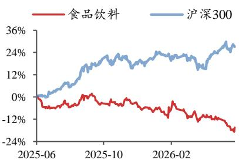  
数据来源：聚源

## 相关研究报告

# 食饮行至低谷，蓄势静待东升

《4月社零数据走弱，新鲜零食业态萌芽—行业周报》-2026.5.24

《千帆过尽，万木逢春—行业投资策略》-2026.5.20

《茅台非标产品提价，看好原奶产业链机会—行业周报》-2026.5.17

## ——行业投资策略

## 张宇光（分析师）

zhangyuguang@kysec.cn

张恒玮（分析师）

zhanghengwei@kysec.cn

# 张思敏（分析师）

证书编号：S0790520030003

证书编号：S0790524010001

zhangsimin@kysec.cn

##  市场表现：食品饮料年初至今跑输大盘

证书编号：S0790525080001

食品饮料跑输大盘，预加工食品板块表现较好。2026 年 1-4 月食品饮料板块下降2.0%，跑输沪深300约7.9pct，在一级子行业中排名靠后。分子行业看，预加工食品板块涨幅较好（+20.3%），熟食（+17.6%）、啤酒（+18.4%）表现相对靠前。保健品（-15.1%）、其他酒类（-7.2%）、烘焙食品（-6.8%）走势较弱。预加工食品板块表现较好，主要是安井食品（+38.0%）、三全食品（+27.4%）、千味央厨（+21.7%）涨幅较多。整体来看在市场更多关注科技主题的背景下，食品饮料传统板块表现相对偏弱。

##  总量判断：消费环境压力仍存

从宏观层面来看，2026Q1 我国 GDP 增速为 5.0%，环比 2025Q4 有所回升，也在市场预期之内。观测季度数据变化情况，2026年 Q1消费品零售额同比+2.4%，增速相较 2025Q4回升 0.8pct，居民消费需求有所改善，复苏进度有所好转，部分原因在于春节时间错配。整体来看宏观经济增速与社零数据基本匹配，也反映一季度消费有企稳趋势。从微观层面来看产业表现，产量增速回暖，收入与利润增速也逐渐回升。与 2025年相比，2026年 1-3 月除鲜冷藏肉与软饮料产量增速回落外，其余子行业产量增速均有回暖。整体来看行业产量压力逐渐好转。

##  2026年一季报总结：复苏与分化并存

上市公司一季报已经全部披露，整体来看 2026Q1食品饮料板块营收同比下降 0.1%，增速较 2025Q4（-11.7%）已有大幅回升；利润同比增长 3.0%，增速较 2025Q4（-40.2%）也有较大幅度回暖。2026Q1 各子行业营收与利润增速基本均高于 2025Q4，主因在于春节错期导致更多备货行为在 发生。我们排除春节错期因素，多数子行业合并营收增速均高于 ，表明行业整体还是延续了复苏势头。但各子行业表现不同，白酒（剔除五粮液）下滑幅度较大，预加工食品、软饮料、调味发酵品表现较好，得益于餐饮行业复苏带动需求提升，以及行业竞争格局优化。整体来看行业复苏与分化并存。

##  投资机会展望：白酒底部布局，大众品把握三条主线

年初全国四中全会召开，同时发表十五五规划建议，对于拉动内需给予更高的重视程度。 年初至今，食品饮料显著跑输大盘，原因与消费环境、市场风格变化有关。（1）消费环境虽有边际向好趋势，但整体弹性不大，尚未构成产业逻辑的重大转变；（ ）科技板块行情明显，导致部分资金流出。当前板块底层逻辑是基本面已接近底部区间，后续复苏预期逐渐升温。我们认为白酒板块已接近周期底部，预计2026Q2 行业降幅收窄，下半年随商务回暖、低基数共振有望实现增速转正，全年复苏节奏应是前低后高。建议布局强品牌、稳动销、渠道健康的高端及次高端龙头，重点关注贵州茅台、泸州老窖、山西汾酒等。大众品作为刚需属性突出的板块，结合业绩确定性与成长性双重原则，我们梳理出三条核心投资主线。一是寻找短期收入修复弹性明确的机会，啤酒板块受益于旺季催化与低基数效应，需求复苏动能充足；二是寻找产业周期有望触底反转的机会，原奶价格历经长期低迷后，受供给端收缩与需求端改善支撑，大概率迎来止跌回升，上游牧场及下游乳制品板块将持续受益；三是餐饮行业持续修复，带动餐饮供应链需求提升，其中调味品、速冻食品作为餐饮场景核心配套，将充分享受行业复苏红利。整体来看，大众品板块估值处于合理区间，叠加基本面持续改善，具备较高配置价值，建议围绕三条主线布局优质标的。

 风险提示：宏观经济波动风险、消费复苏低于预期风险、原料价格波动风险。

## 目 录

1、食品饮料跑输市场，预加工食品板块表现较好....5
1.1、2026年1-4月食品饮料板块跑输市场....5
1.2、个股涨跌幅：行业景气度较高、业绩较好的股票表现较好....7
1.3、2026Q1食品饮料配置比例降至新低，成交金额占比收缩....8
2、投资主线：底部布局，柳暗花明....9
2.1、总量判断：消费环境压力仍存....9
2.2、2026年一季报总结：复苏与分化并存....10
2.3、投资机会展望：白酒底部布局，大众品把握三条主线....12
3、行业：白酒筑底，大众品复苏....13
3.1、白酒：酒企普遍增长承压，行业进入底部区间....13
3.1.1、行业出现明显降速，酒企分化进一步加剧....13
3.1.2、2026年春节白酒报表下滑幅度进一步加大....14
3.2、啤酒：守盘提质，蓄力旺季....19
3.3、乳制品：一季度需求改善，行业有望企稳向上....22
3.4、肉制品：低猪价背景下行业承压，龙头稳利扩量....24
3.5、调味品：行业需求复苏明显，2026Q1板块营收利润均修复....26
3.6、休闲食品：2026Q1零食企业对产品和渠道结构主动调整....29
4、重点个股：优选龙头，关注消费复苏机会....31
4.1、贵州茅台：大单品放量价稳，触底信号明确....31
4.2、山西汾酒：山西汾酒：渠道回款积极，实际动销顺畅....31
4.3、舍得酒业：营收逐步筑底，盈利能力承压....32
4.4、古井贡酒：风险逐步释放，报表压力减轻....32
4.5、青岛啤酒：结构升级巩固龙头优势，业绩稳增彰显经营韧性....33
4.6、重庆啤酒：高端化进程持续兑现，静待旺季需求回暖....33
4.7、伊利股份：龙头营收重回增长，盈利改善超预期....34
4.8、新乳业：业绩再超预期，盈利能力持续提升....35
4.9、双汇发展：一季度业绩表现良好，肉类销量高增验证改革成效....35
4.10、海天味业：收入利润稳健增长，未来发展空间可期....36
4.11、中炬高新：改革成效显现，2026Q1经营明显改善....36
4.12、天味食品：2026Q1收入利润超预期，内部激励持续优化....37
4.13、涪陵榨菜：2026Q1稳健增长，收入利润符合预期....37
4.14、盐津铺子：渠道结构主动调整，净利率持续提升....38
4.15、甘源食品：环比持续改善，关注后续旺季增长....38
4.16、劲仔食品：收入环比改善，期待旺季表现....39
4.17、万辰集团：收入维持高增，净利率水平超预期....39
4.18、东鹏饮料：特饮稳增+其它饮料放量，多品类战略持续深化....40
5、风险提示....41

## 图表目录

图1：2026年1-4月食品饮料涨跌幅市场排名26/31....5  
图2：2026年1-4月预加工食品在食品饮料子行业中表现较好....5  
图3：2026年1-4月食品饮料板块市值下降，主要来自于估值下降....6

图4：2026年4月末食品饮料估值处于行业中等偏下....6
图5：2026年4月末食品饮料估值环比基本持平....6
图6：2026年4月食品饮料涨跌幅市场排名靠后....7
图7：2026年4月预加工食品在食品饮料子行业中涨幅最好....7
图8：2026年1-4月行业景气度高、成长性较好的股票表现居前....8
图9：2026Q1食品饮料基金重仓比例回落至5.3%....8
图10：主动权益基金食品饮料重仓比例略回落至3.98%....8
图11：2026Q1白酒重仓比例回落....9
图12：2026Q1非白酒子行业配置比例持平....9
图13：2026Q1GDP增5.0%....9
图14：2026Q1社零同比增速+2.4%，环比回升....9
图15：2026年1-3月食品制造企业营收与利润增速呈回暖趋势....10
图16：2026年1-3月多数子行业产量增速较2025年有所回暖....10
图17：2017年起全国白酒企业产量下滑（万千升）....14
图18：规模以上白酒企业数量2018年以来下降明显....14
图19：2026Q1上市白酒企业收入同比减少0.7%....14
图20：2026Q1上市白酒企业利润同比减少1.7%....14
图21：2026Q1白酒企业预收账款规模环比减少....15
图22：2026Q1白酒企业经营性现金净流入同比增加....15
图23：2026Q1白酒企业整体毛利率同比下降....15
图24：2026Q1上市白酒企业净利率同比下降....15
图25：2026Q1白酒企业管理费用率同比下降....15
图26：2026Q1白酒企业销售费用率同比上升....15
图27：2026Q1高端收入增速相对较好....16
图28：2026Q1高端利润增速相对较好....16
图29：飞天（散瓶）价格2022年相对平稳（单位：元）....19
图30：五粮液和国窖价格波动前行（单位：元）....19
图31：2026年3月啤酒产量同比+0.2%....19
图32：2026年1-3月啤酒累计产量同比+4.2%....19
图33：2026年进口大麦数量稳步增加....22
图34：2026年进口大麦价格仍在底部位置....22
图35：2026Q1A股上市乳企营收同比增4.9%，归母净利同比增11.6%....22
图36：2026年5月5日全脂奶粉中标价同比-14.5%....23
图37：2026年4月30日生鲜乳价格同比-1.9%....23
图38：2026Q1不同类型乳企营收均增长....24
图39：2026Q1地方乳企归母净利扭亏为盈....24
图40：2026Q1A股上市肉企营收同比减少1.4%，归母净利同比减少11.2%....25
图41：2026年5月9日生猪出栏价格同比-34.5%....25
图42：2026年一季度生猪定点屠宰量回3%增....25
图43：2026年3月生猪存栏数量5%比....26
图44：2026年3月能繁母猪数量同比-3.3%....26
图45：2026Q1调味品公司营收净利分别同比+11.3%/+16.7%....27
图46：2026Q1酱醋公司营收净利分别同比+7.9%/+12.2%....27
图47：2026Q1调味品上市公司毛销差同比+2.7pct....27
图48：2026Q1调味品上市公司归母净利率同比+1.1pct....27

图 49: 2025 年 1-9 月大豆市场价同比下降，此后逐渐回升 ..... 27
图 50: 2026Q1 休闲食品行业整体营收增速环比有所下降，利润增速环比提升 ..... 29
图 51: 2026Q1 零食上市公司毛销差环比扩大 ..... 30
图 52: 2026Q1 零食上市公司整体净利率环比明显提升 ..... 30

表 1: 2026Q1 食品饮料板块整体营收与利润增速回升 ..... 11
表 2: 高端白酒 2026Q1 营收环比改善 ..... 16
表 3: 2026Q1 次高端品牌收入增长分化 ..... 17
表 4: 大众高端白酒 2026Q1 业绩仍承压 ..... 18
表 5: 2026Q1 单季啤酒上市公司营收增速有所分化 ..... 20
表 6: 2026Q1 多数啤酒企业毛利率同比提升 ..... 20
表 7: 2026Q1 多数主流酒企销售费用率同比略有上升 ..... 21
表 8: 2026Q1 大多数啤酒企业净利率同比提升 ..... 21
表 9: 2026Q1 珠江和燕京啤酒弹性更大 ..... 21
表 10: 调味品重点公司 2025Q3 营收增长分化，龙头优势凸显 ..... 28
表 11: 2025Q3 休闲食品重点公司经营表现不乏亮点 ..... 30
表 12: 重点公司盈利预测及估值 ..... 40

## 1、 食品饮料跑输市场，预加工食品板块表现较好

## 1.1、 2026年 1-4月食品饮料板块跑输市场

食品饮料跑输大盘，预加工食品板块表现较好。2026 年 1-4 月食品饮料板块下降 2.0%，跑输沪深300约7.9pct，在一级子行业中排名靠后（第二十六）。分子行业看，预加工食品板块涨幅较好（+20.3%），熟食（+17.6%）、啤酒（+18.4%）表现相对靠前。保健品（-15.1%）、其他酒类（-7.2%）、烘焙食品（-6.8%）走势较弱。预加工食品板块表现较好，主要是安井食品（+38.0%）、三全食品（+27.4%）、千味央厨（+21.7%）涨幅较多。整体来看在市场更多关注科技主题的背景下，食品饮料传统板块表现相对偏弱。

图1：2026年 1-4月食品饮料涨跌幅市场排名 26/31  
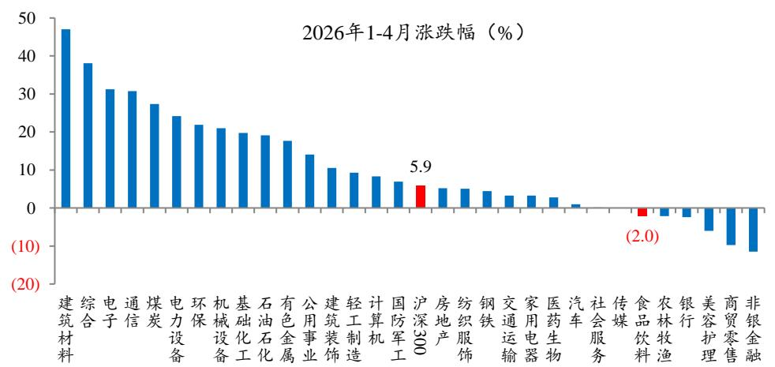  
数据来源：Wind、开源证券研究所  
备注：板块涨跌幅为总市值加权平均，股价涨跌幅截至 2026年 4月 30日

图2：2026年 1-4月预加工食品在食品饮料子行业中表现较好  
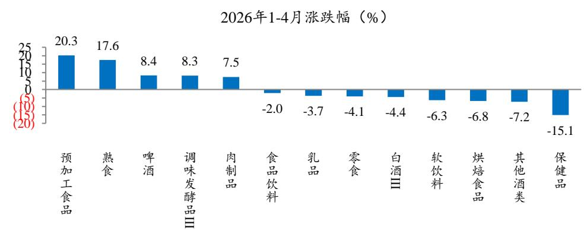  
数据来源： 、开源证券研究所

块涨跌幅为总市值加权平均，股价涨跌幅截至 2026年 4月 30日

2026 年 1-4 月食品饮料板块市值下降，主要来自于估值下降。我们从市值分解角度观察，食品饮料 2026年1-4 月PE 较2025年底回落19.2%，预计2026年净利增长 18.5%，两者共同作用，年初至今板块市值下降 4.2%。其中：白酒估值同比下降20.0.%，预计2026年净利增长18.7%，白酒板块市值下降5.1%；非白酒估值下降17.5%，预计 2026 年净利增长 18.1%，板块市值下降 2.6%。整体来看 2026 年初以来食品饮料板块市值下降，估值下降是主要原因。

图3：2026年 1-4月食品饮料板块市值下降，主要来自于估值下降  
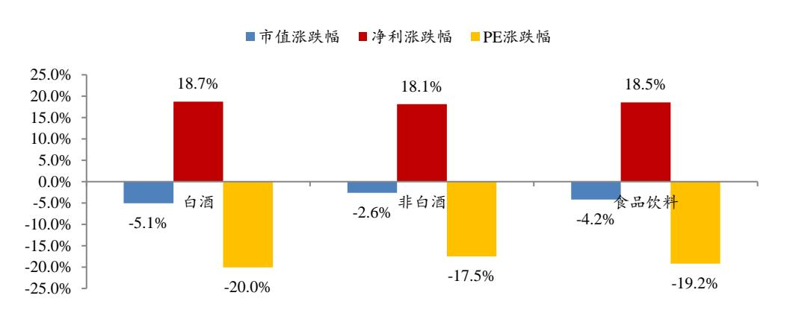  
数据来源：Wind、开源证券研究所  
备注：股价涨跌幅截至 2026年 4月 30日

食品饮料板块估值在 31个行业处于中等偏下水平，环比基本持平。当前食品饮料估值（TTM）约20.3倍，与其他行业相比处于中等偏下位置，近期估值环比变化不大，但当前估值水平仍低于 2019年初水平。

图4：2026年 4月末食品饮料估值处于行业中等偏下  
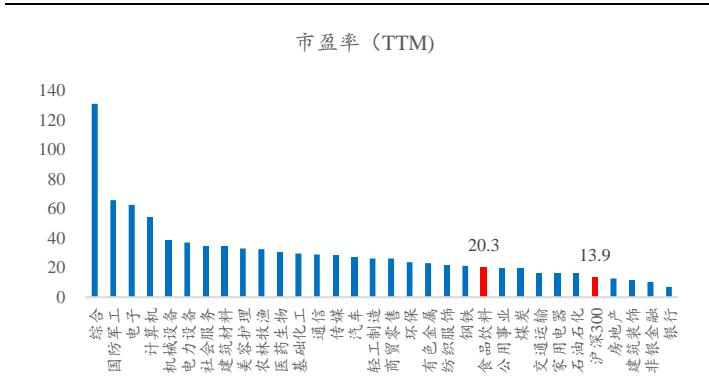  
数据来源：Wind、开源证券研究所  
备注：市盈率截至 2026年 4月 30日

图5：2026年 4月末食品饮料估值环比基本持平  
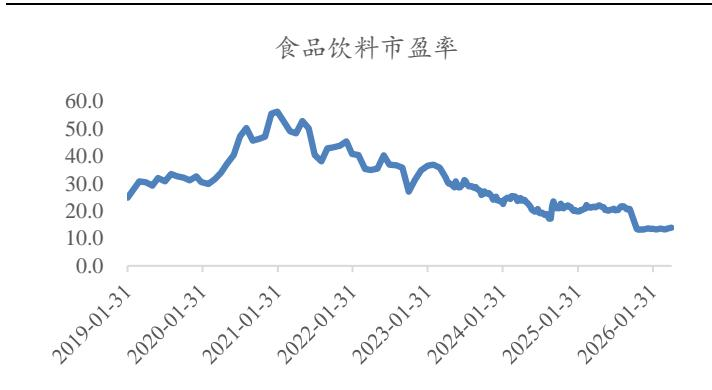  
数据来源：Wind、开源证券研究所  
备注：估值截至 2026年 4月 30日

2026 年 4 月食品饮料股价跑输市场。2026 年 4 月食品饮料板块下跌 1.0%，跑输沪深300约7.9pct，在一级子行业中排名靠后。分子行业看，预加工食品（+12.0%）、熟食（+11.6%）、软饮料（+6.9%）增速较快。

图6：2026年 4月食品饮料涨跌幅市场排名靠后  
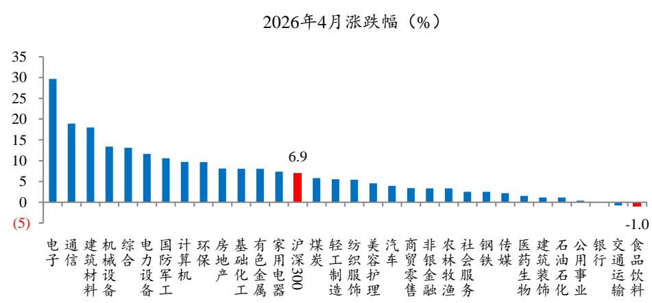  
数据来源：Wind、开源证券研究所、备注：股价涨跌幅截至 2026年 4月 30日

图7：2026年 4月预加工食品在食品饮料子行业中涨幅最好  
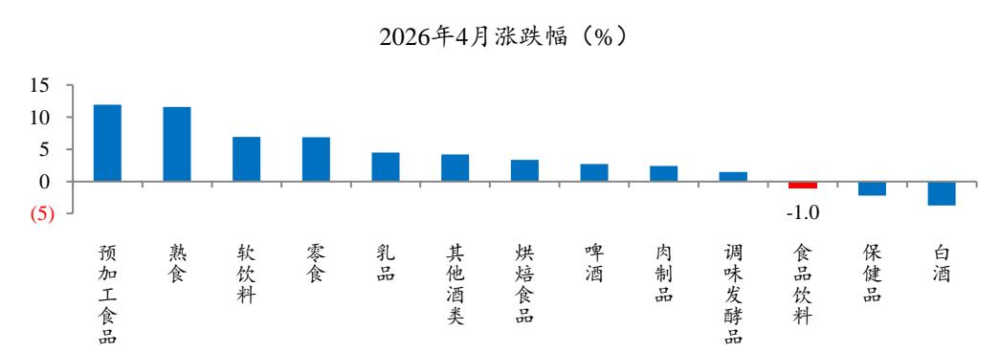  
数据来源：Wind、开源证券研究所  
备注：股价涨跌幅截至 2026年 4月 30日

## 1.2、 个股涨跌幅：行业景气度较高、业绩较好的股票表现较好

行业景气度高、业绩较好的公司股价表现居前。2026 年 1-4 月食品饮料板块整体呈现震荡复苏、结构分化格局，核心受益于餐饮消费场景持续回暖、促消费政策加码及板块一季报盈利拐点确认，白酒板块表现仍相对偏弱，资金持续向高景气、高成长、业绩确定性强的细分龙头集中。2026 年 1-4 月板块涨幅前10股票中：莲花控股（+79.3%）除调味品主业高增外，AI算力赛道红利带动公司估值与市场关注度大幅提升；安井食品（+38.0%）、天味食品（+36.8%）分别依托速冻食品、复合调味品赛道的高景气与自身业绩超预期增长，带动股价大幅上行。

图8：2026年 1-4月行业景气度高、成长性较好的股票表现居前  
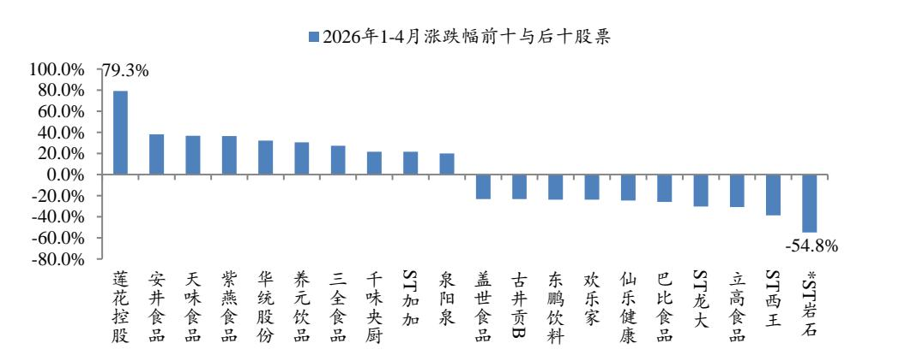  
数据来源：Wind、开源证券研究所  
备注：股价涨跌幅截至 2026年 4月 30日

## 1.3、 2026Q1食品饮料配置比例降至新低，成交金额占比收缩

2026Q1 全市场基金食品饮料配置比例降至新低。从基金重仓持股情况来看（Wind中全部市场基金，一级子行业），2026Q1 食品饮料配置比例（重仓持股市值占重仓股票总市值比例）由 2025Q4 的 6.5%回落至 5.3%水平，环比回落 1.2pct，处于 2020 年以来新低位置。

2026Q1 主动权益基金持仓食品饮料比例小幅缩减，减仓势头明显收窄。我们选取主动权益基金（普通股票、偏股混合、灵活配置三类基金），从基金重仓持股情况来看，2026Q1 食品饮料配置比例为 3.98%，和 2025Q4 的 4.04%相比，略下降 0.05pct。说明一季度主动权益基金虽有小幅度减少食品饮料配置，但减仓势头明显收窄。一季度消费仍在修复进程中，白酒板块茅台市场化改革初见成效，板块触底趋势明显。大众品受到春节错期影响，一季度普遍增速较好。当前估值、基本面均处于较低位置，预计 2026Q2行业板块轮动，叠加科技、周期板块已有明显超额收益，部分资金有换仓需求，我们估算会有部分资金回流。但整体来看，食品饮料板块配置比例仍是处于低位。

图9：2026Q1食品饮料基金重仓比例回落至 5.3%  
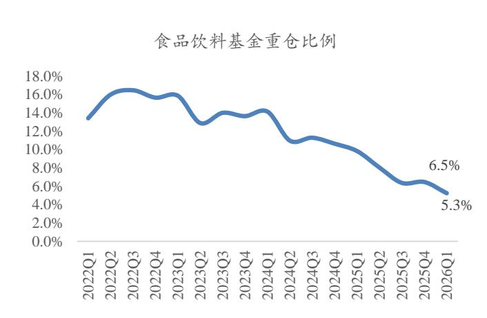  
数据来源：Wind、开源证券研究所

图10：主动权益基金食品饮料重仓比例略回落至 3.98%  
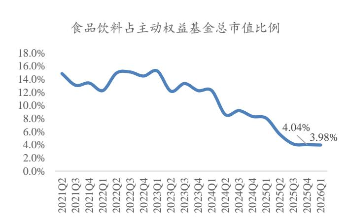  
数据来源：Wind、开源证券研究所

从子行业分解来看，基金重仓白酒比例由 2025Q4 的 2.93%略微回落至 2026Q1的 2.91%水平，环比回落 0.02pct，基金虽然对于白酒公司仍有减仓，但减仓幅度已经大幅收窄。2026Q1 扣除贵州茅台后的白酒重仓比例为 1.32%，较 2025Q4 回落

0.27pct，说明市场持仓向茅台集中。如果观察全市场基金口径，基金重仓白酒比例由 2025Q4 的 6.8%回落到 2026Q1 的 5.5%。这反映出被动基金减配白酒明显，主动权益基金减持幅度收窄。从主动权益基金一季度重仓白酒的持股数量来看，五粮液、洋河股份、贵州茅台、舍得酒业、水井坊等被基金增持（持仓变动股份数为正）；多数酒企被基金减持。从持仓市值（金额）变化情况来看，仍然是贵州茅台、五粮液、洋河股份、水井坊等基金持仓市值是正向变动，与持股数量变化方向一致。这反映出白酒配置思路趋同，在整体减仓的背景下，头部酒企贵州茅台、五粮液，以及市场提前出清的洋河股份、水井坊等被市场青睐，持股也趋向于集中。

图11：2026Q1白酒重仓比例回落  
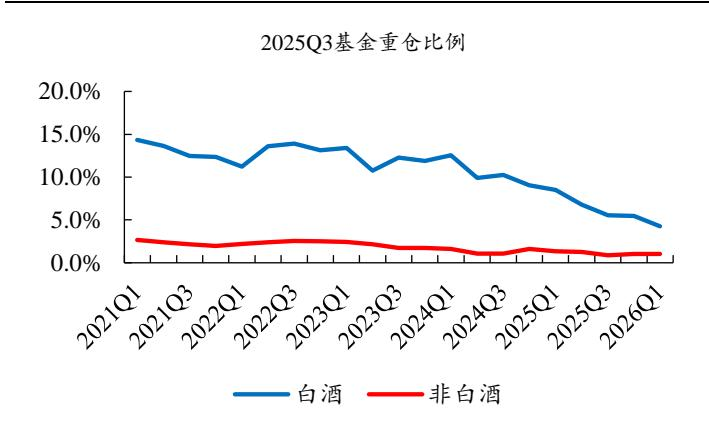  
数据来源：Wind、开源证券研究所

图12：2026Q1非白酒子行业配置比例持平  
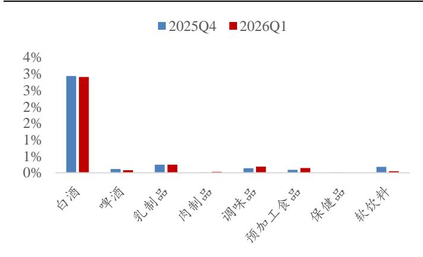  
数据来源：Wind、开源证券研究所

## 2、 投资主线：底部布局，柳暗花明

## 2.1、 总量判断：消费环境压力仍存

从宏观层面来看，2026Q1 我国 GDP 增速为 5.0%，环比 2025Q4 有所回升，也在市场预期之内。观测季度数据变化情况，2026年Q1消费品零售额同比+2.4%，增速相较 2025Q4回升 0.8pct，居民消费需求有所改善，复苏进度有所好转，部分原因在于春节时间错配。整体来看宏观经济增速与社零数据基本匹配，也反映一季度消费有企稳趋势。展望 2026 年，我们预判消费复苏仍在缓慢进行中，在基数效应下，预计下半年消费可能会有较为明显改善。

图13：2026Q1 GDP 增 5.0%  
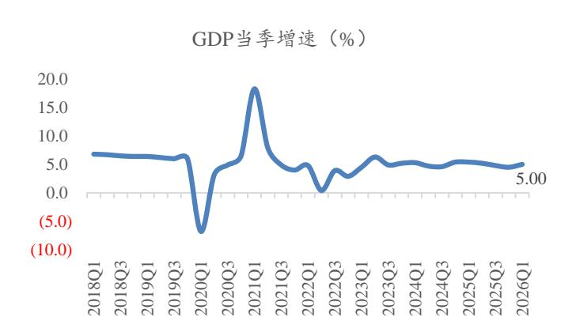  
数据来源：Wind、开源证券研究所

图14：2026Q1社零同比增速+2.4%，环比回升  
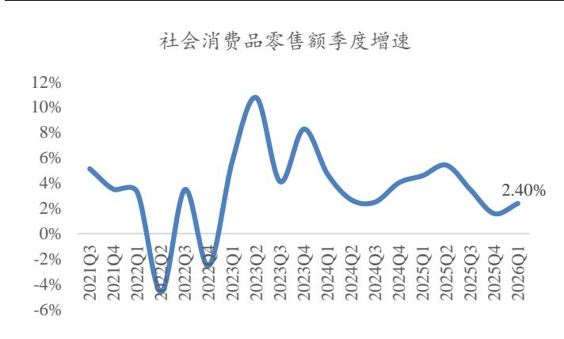  
数据来源：Wind、开源证券研究所

从微观层面来看产业表现，产量增速回暖，收入与利润增速也逐渐回升：食品制造企业 2026 年 1-3 月营收增速 7.8%，累计增速较 2025 年有上行趋势；利润总额同比增 7.4%，增速也呈回暖趋势。食品制造业数据与社零数据基本匹配，表明行业需求压力正逐渐减轻。观察行业产量数据，与 2025年相比，2026年1-3 月除鲜冷藏肉与软饮料产量增速回落外，其余子行业产量增速均有回暖。整体来看行业产量压力逐渐好转。

图15：2026年 1-3月食品制造企业营收与利润增速呈回暖趋势  
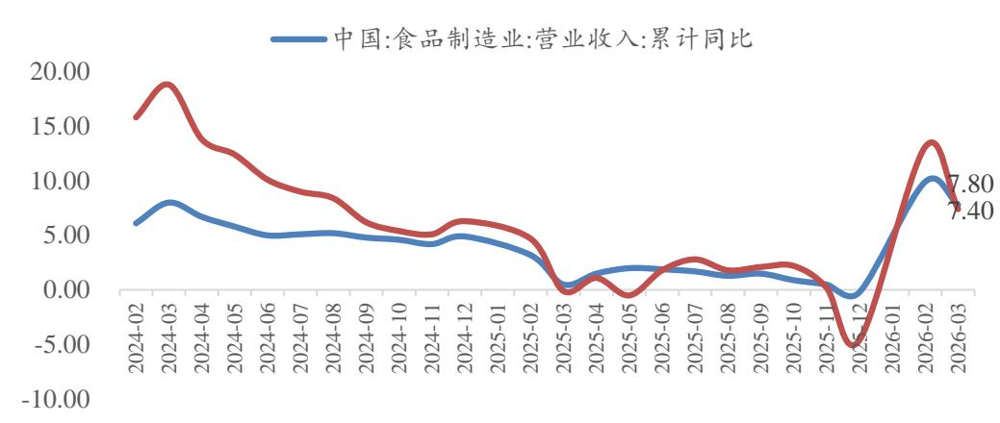  
数据来源：Wind、开源证券研究所

图16：2026年 1-3月多数子行业产量增速较 2025年有所回暖  
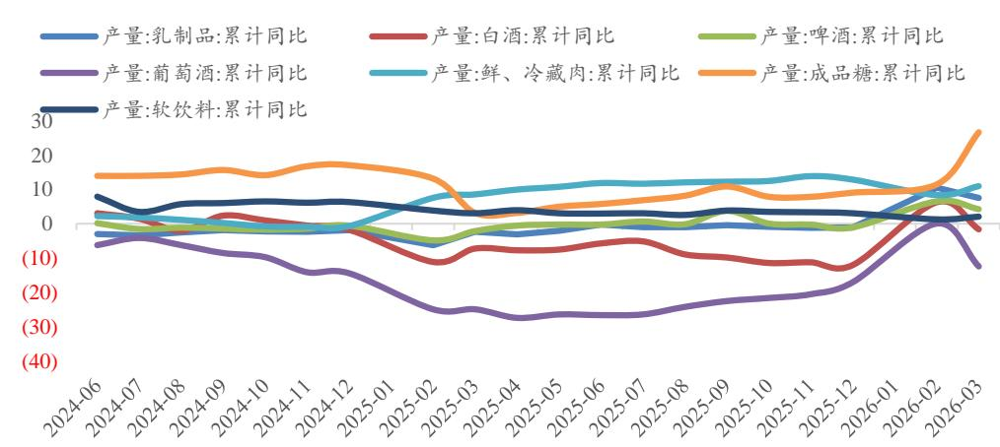  
数据来源：Wind、开源证券研究所

## 2.2、 2026年一季报总结：复苏与分化并存

上市公司一季报已经全部披露，整体来看 2026Q1 食品饮料板块营收同比下降0.1%，增速较 2025Q4（-11.7%）已有大幅回升；利润同比增长 3.0%，增速较 2025Q4（-40.2%）也有较大幅度回暖。2026Q1各子行业营收与利润增速基本均高于2025Q4，主因在于春节错期导致更多备货行为在 2026Q1 发生。我们排除春节错期因素，把2025Q4 与 2026Q1 合并来看，食品饮料板块营收增速为-5.4%，相较于 2025Q3（-5.3%）基本变化不大。从子行业来看，多数子行业 2025Q4+2026Q1 合并营收增速均高于

2025Q3，表明行业整体还是延续了复苏势头。

如果看 2026Q1 各子行业的表现，白酒 2026Q1 营收增速（-0.7%）略有下滑，但如果剔除五粮液，实际白酒 2026Q1营收约下滑6.7%，在子行业中下滑幅度最大。白酒仍处于深度调整周期，结构分化态势显著，呈现“两极稳健、中间承压”的格局。从一季报表现来看，白酒行业整体营收同比仍有下滑，但高端白酒与大众白酒展现出较强韧性，例证是一季度只有贵州茅台与迎驾贡酒实现收入同比正增长，成为行业调整期的核心支撑。当前白酒消费场景重构持续推进，传统商务、政务等社交用酒需求收缩，日常家庭、自饮等生活用酒需求占比提升，高性价比产品需求持续释放，低度、微醺类白酒成为消费新亮点，契合当下消费多元化趋势。同时渠道端处于去库存周期，头部酒企告别压货模式，为经销商减负，渠道库存正逐步回落至合理区间。当前白酒正经历新一轮周期，头部企业凭借品牌壁垒与渠道优势，通过价格调整重塑竞争格局，优势更加明显。我们认为在行业主动调整以及基数的作用下，二季度白酒行业营收降幅有望进一步收窄，预计下半年行业增速有望实现转正。投资端优先看好具备强品牌、稳动销优势的龙头企业，重点关注贵州茅台、泸州老窖、山西汾酒等。

大众品受到春节错期影响较大，我们采用2025Q4+2026Q1 合并增速来看，大众品呈现分化特点，营收增速较快的子行业包括：预加工食品、软饮料、调味发酵品，核心得益于餐饮行业复苏带动需求提升，以及行业竞争格局优化，头部企业份额持续提升，其中调味品企业轻装上阵实现业绩回暖。当前大众品行业面临两大核心变化，产品端向健康、营养、功能化升级，以及渠道端呈现碎片化趋势，会员商超、即时零售、零食量贩等新渠道贡献持续提升，我们认为产品创新能力与渠道运营效率，将成为后续企业核心竞争力的关键支撑。展望下半年，随着餐饮复苏持续深化、消费需求进一步释放，重点看好啤酒、牧场/乳制品、餐饮供应链三大赛道，投资逻辑聚焦业绩确定性强、成长性突出的行业龙头，优先选择具备成本控制能力、产品迭代能力与渠道优势的标的。

表1：2026Q1食品饮料板块整体营收与利润增速回升

<table><tr><td rowspan="2"></td><td colspan="6">营收增速</td><td colspan="6">利润增速</td></tr><tr><td>2024Q4</td><td>2025Q1</td><td>2025Q2</td><td>2025Q3</td><td>2025Q4</td><td>2026Q1</td><td>2024Q4</td><td>2025Q1</td><td>2025Q2</td><td>2025Q3</td><td>2025Q4</td><td>2026Q1</td></tr><tr><td>食品饮料</td><td>6.5%</td><td>-1.7%</td><td>1.6%</td><td>-5.3%</td><td>-11.7%</td><td>-0.1%</td><td>-12.7%</td><td>-12.6%</td><td>-11.8%</td><td>-14.5%</td><td>-40.2%</td><td>3.0%</td></tr><tr><td>肉制品</td><td>4.9%</td><td>1.9%</td><td>3.8%</td><td>-4.0%</td><td>-8.9%</td><td>-1.4%</td><td>-330.7%</td><td>2.1%</td><td>-8.3%</td><td>-14.2%</td><td>-73.2%</td><td>-11.2%</td></tr><tr><td>预加工食品</td><td>-1.6%</td><td>-4.5%</td><td>0.7%</td><td>1.6%</td><td>7.2%</td><td>18.1%</td><td>21.3%</td><td>-3.1%</td><td>-19.5%</td><td>5.4%</td><td>-14.1%</td><td>28.5%</td></tr><tr><td>保健品</td><td>21.5%</td><td>6.8%</td><td>22.4%</td><td>17.7%</td><td>6.0%</td><td>6.2%</td><td>236.9%</td><td>-19.9%</td><td>38.0%</td><td>122.1%</td><td>166.5%</td><td>-24.6%</td></tr><tr><td>白酒</td><td>1.2%</td><td>-11.5%</td><td>-15.1%</td><td>-19.5%</td><td>-29.6%</td><td>-0.7%</td><td>-3.4%</td><td>-14.6%</td><td>-20.6%</td><td>-22.7%</td><td>-46.1%</td><td>-1.8%</td></tr><tr><td>啤酒</td><td>1.5%</td><td>3.7%</td><td>1.8%</td><td>0.6%</td><td>2.1%</td><td>1.0%</td><td>13.7%</td><td>10.9%</td><td>12.8%</td><td>11.3%</td><td>-18.5%</td><td>6.1%</td></tr><tr><td>其他酒类</td><td>-12.4%</td><td>-4.3%</td><td>-3.9%</td><td>-2.7%</td><td>-3.1%</td><td>7.4%</td><td>-2.6%</td><td>-1.6%</td><td>-28.2%</td><td>9.9%</td><td>-86.1%</td><td>9.7%</td></tr><tr><td>软饮料</td><td>12.5%</td><td>3.7%</td><td>17.0%</td><td>13.1%</td><td>2.2%</td><td>22.1%</td><td>145.1%</td><td>-3.8%</td><td>18.8%</td><td>36.6%</td><td>-25.9%</td><td>29.9%</td></tr><tr><td>乳品</td><td>-5.1%</td><td>0.2%</td><td>3.4%</td><td>-1.8%</td><td>-3.0%</td><td>4.8%</td><td>-249.2%</td><td>-16.9%</td><td>42.6%</td><td>0.7%</td><td>-101.3%</td><td>11.6%</td></tr><tr><td>零食</td><td>9.0%</td><td>-4.8%</td><td>5.0%</td><td>1.8%</td><td>-15.8%</td><td>15.2%</td><td>-16.4%</td><td>-35.3%</td><td>-81.0%</td><td>-34.1%</td><td>104.9%</td><td>200.5%</td></tr><tr><td>烘焙食品</td><td>1.9%</td><td>2.3%</td><td>3.0%</td><td>-1.4%</td><td>4.2%</td><td>3.7%</td><td>-36.9%</td><td>-24.7%</td><td>-25.7%</td><td>-16.6%</td><td>-49.8%</td><td>-28.4%</td></tr><tr><td>熟食</td><td>-18.4%</td><td>-11.8%</td><td>-14.0%</td><td>-6.9%</td><td>1.4%</td><td>-1.1%</td><td>194.7%</td><td>-28.6%</td><td>-41.5%</td><td>-29.8%</td><td>78.0%</td><td>11.5%</td></tr><tr><td>调味发酵品</td><td>12.2%</td><td>3.2%</td><td>6.0%</td><td>2.3%</td><td>5.4%</td><td>14.2%</td><td>-46.0%</td><td>7.1%</td><td>9.1%</td><td>2.3%</td><td>1.8%</td><td>18.0%</td></tr></table>

数据来源：Wind、开源证券研究所

## 2.3、 投资机会展望：白酒底部布局，大众品把握三条主线

市场预期发生改变。年初全国四中全会召开，同时发表十五五规划建议，在发展目标中提到“居民消费率明显提高，内需拉动经济增长主动力作用持续增强，经济增长潜力得到充分释放”。在建设国内市场中也提到“大力提振消费。深入实施提振消费专项行动。统筹促就业、增收入、稳预期，合理提高公共服务支出占财政支出比重，增强居民消费能力。扩大优质消费品和服务供给”。我们对于消费政策释放的预期更加坚定，对消费板块后续呈乐观态度。食品饮料行业格局以及商业模式未变，近几年估值持续回调，更多是出于对宏观经济的担忧，对行业需求产生悲观情。随着当前政策改善预期扭转，市场悲观情绪应可得到缓解。食品饮料作为经济

顺周期的重要行业之一，在经济向好预期强化时，更容易获得市场青睐。

2026年初至今，食品饮料显著跑输大盘，原因与消费环境、市场风格变化有关。（1）消费环境虽有边际向好趋势，但整体弹性不大，尚未构成产业逻辑的重大转变；（2）科技板块行情明显，导致部分资金流出。当前板块底层逻辑是基本面已接近底部区间，后续复苏预期逐渐升温。基本面底部依据：（1）行业利空已基本释放，经过连续调整后，行业基数已低；（2）部分企业主动收缩供给，力求实现供需平衡，减少渠道压力，释放渠道风险。（3）消费呈现结构性分化，性价比消费、情绪消费处于稳健增长趋势，餐饮消费也有回暖迹象。当前基本面底部叠加板块估值已经回落至低点，基金持仓食品饮料比例一直维持较低位置，筹码结构相对较好，此时板块已无悲观必要。

我们认为白酒板块已接近周期底部、左侧布局窗口开启。2025 年受禁酒令、需求走弱影响，行业深度调整，目前呈现 “两头强、中间弱” 分化，高端酒与大众酒韧性凸显，次高端承压显著。酒企主动控量稳价、放缓压货，渠道库存环比改善、批价趋于稳定，行业利空充分释放。当前板块估值处历史低位、基金持仓偏低，筹码结构优化，安全边际充足。白酒行业筑底确认，2026 年复苏节奏应是前低后高，龙头企业凭借品牌壁垒、渠道掌控与现金流优势，有望率先企稳、引领修复。茅台酒需求刚性、年初直营改革深化，业绩确定性较强；泸州老窖、山西汾酒控量稳价、全国化推进，处于复苏进程中；洋河、舍得渠道改革见效，底部确认、修复可期。预计 2026年二季度行业降幅收窄，下半年随商务回暖、低基数共振有望实现增速转正。行业筑底、龙头先行，我们建议布局强品牌、稳动销、渠道健康的高端及次高端龙头，重点关注贵州茅台、泸州老窖、山西汾酒等。

我们判断，随着宏观经济逐步企稳回升，大众品行业需求正处于缓慢修复通道，线下消费场景有序释放，行业整体景气度边际改善，呈现结构性投资机会。大众品作为刚需属性突出的板块，结合业绩确定性与成长性双重原则，我们梳理出三条核心投资主线。一是寻找短期收入修复弹性明确的机会，啤酒板块受益于旺季催化与低基数效应，需求复苏动能充足；二是寻找产业周期有望触底反转的机会，原奶价格历经长期低迷后，受供给端收缩与需求端改善支撑，大概率迎来止跌回升，上游牧场及下游乳制品板块将持续受益；三是餐饮行业持续修复，带动餐饮供应链需求提升，其中调味品、速冻食品作为餐饮场景核心配套，将充分享受行业复苏红利。整体来看，大众品板块估值处于合理区间，叠加基本面持续改善，具备较高配置价值，建议围绕三条主线布局优质标的。

策略一：选择短期收入修复弹性明确的机会。我们坚定看好啤酒板块旺季表现，核心逻辑在于低基数叠加多重利好共振，板块短期修复确定性较强。2025 年中禁酒令对啤酒消费形成压制，导致行业基数偏低，为 年业绩同比修复奠定基础。当前行业已进入夏季销售旺季，终端动销逐步升温，量价修复趋势明朗。从催化因素来看，气象数据显示2026年下半年大概率发生厄尔尼诺现象，持续高温天气有望拉动全场景啤酒消费需求，成为销量增长的重要驱动力；同时，2026 美加墨世界杯贯穿旺季，将进一步催化消费情绪，有望带动即饮、非即饮渠道需求同步提升。中长期来看，啤酒行业高端化趋势持续，均价稳步上行，结构升级支撑行业长期增长。标的选择上，推荐青岛啤酒，其品牌壁垒深厚、产品结构优化，旺季业绩有望改善；建议关注重庆啤酒，受益标的包括华润啤酒，前者高端化布局成效凸显，后者渠道优势显著，均有望充分享受行业复苏红利。

策略二：寻找产业周期触底反转机会。牧场及乳制品板块已进入周期底部区域，产业周期有望触底反转，具备较高投资性价比。当前原奶市场供需格局持续优化，供给端方面，原奶价格长期低位，导致大量中小牧场持续出清，行业去产能进入深度阶段，龙头牧场凭借高效运营能力得以留存，行业供给收缩趋势明确；需求端方面，乳制品深加工产能陆续投放，叠加消费需求温和复苏，原奶需求稳步提升。我们判断，随着供需曲线逐步平衡，原奶价格有望迎来止跌企稳，上游牧场将率先受益于奶价加盟，利润水平有望实现改善，重点关注具备规模优势与成本控制能力的龙头牧场标的。同时，下游乳制品企业亦将间接受益，伊利股份、蒙牛乳业长期增长确定性较强，建议重点配置。优先推荐优然牧业、伊利股份等，受益标的包括蒙牛乳业等。

策略三：关注餐饮链相关的投资机会。餐饮行业持续修复向好，带动餐饮供应链相关板块迎来需求红利，调味品与速冻食品板块优先受益，龙头企业优势进一步凸显。供给侧来看，中小餐饮企业加速出清，行业集中度提升，连锁餐饮、专业餐饮运营商扩张速度加快，标准化、规模化需求提升，为餐饮供应链企业提供了广阔市场空间；需求侧来看，随着居民消费能力逐步恢复，消费者对餐饮的需求持续提升，高频、刚需、高性价比的餐饮需求占比不断增加，直接拉动调味品、速冻食品等配套产品的消费。同时，行业竞争格局持续改善，此前产能扩张带来的竞争压力逐步缓解，头部企业凭借品类创新、渠道深耕与成本控制能力，持续抢占市场份额，盈利稳定性与成长性优于行业平均水平。建议重点关注调味品龙头及速冻食品龙头，其业绩修复弹性较大、竞争优势明显，有望充分享受餐饮复苏带来的行业红利。优先推荐海天味业、中炬高新等，受益标的包括安井食品、三全食品、千味央厨等。

## 3、 行业：白酒筑底，大众品复苏

## 3.1、 白酒：酒企普遍增长承压，行业进入底部区间

## 3.1.1、 行业出现明显降速，酒企分化进一步加剧

2025年5月底开始的严格控制体制内聚餐饮酒对行业需求和渠道信心有明显影响。从消费端看，受宏观经济压力影响，白酒整体需求有明显下降，商务需求持续承压，但居民消费相对刚性。从酒企端来看，渠道信心受影响较大，拒绝压货，批价下行明显。2026 年春节，回款已经不再是酒厂的首要目标，保证价格稳定、进行库存去化成为酒企和渠道的共识，行业出清加速。

2025 年白酒出清加速，2026 年开始包括龙头也出现明显下滑压力。2024 年开始，飞天批价快速下滑，显示行业景气度下降，次高端酒企率先出现下滑，2025 年

2 季度开始，行业除个别龙头企业普遍出现下滑，进入三季度，即使最激进的酒企也主动放弃回款要求，2025年四季度和 2026年春节白酒上市公司报表下滑幅度进一步加大。

图17：2017年起全国白酒企业产量下滑（万千升）  
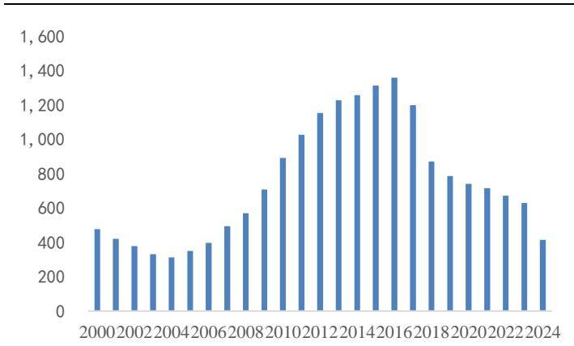  
数据来源：Wind、开源证券研究所

图18：规模以上白酒企业数量 2018年以来下降明显  
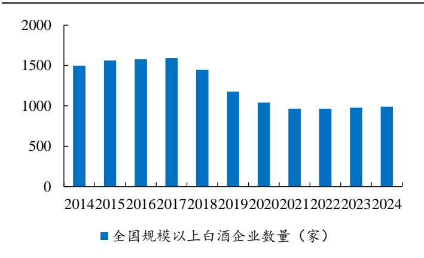  
数据来源：Wind、开源证券研究所

## 3.1.2、 2026年春节白酒报表下滑幅度进一步加大

2026年白酒上市公司整体放弃了回款要求，报表出现加速下滑。历史上的库存积累以及长达 2-3年的需求的下降，导致渠道资金压力几乎到达承受极限。因此即使是春节旺季，酒厂也必须放弃回款，以为渠道减负。因此我们可以看到，2026Q1上市白酒公司整体收入1322.2亿元，同比减少 0.7%，实现净利润520.0亿元，同比减少 1.7%。

图19：2026Q1上市白酒企业收入同比减少 0.7%  
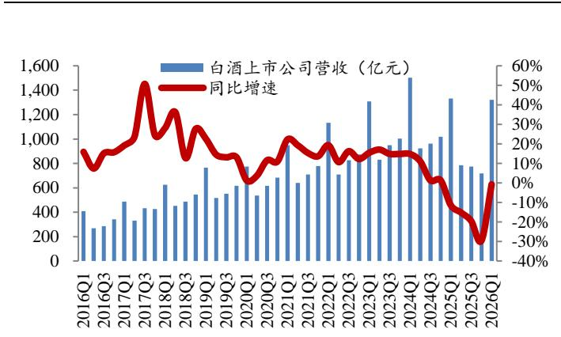  
数据来源：Wind、开源证券研究所

图20：2026Q1上市白酒企业利润同比减少 1.7%  
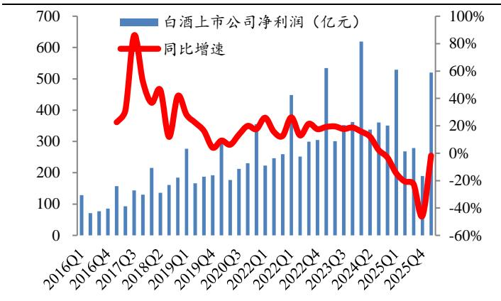  
数据来源：Wind、开源证券研究所

2026Q1末预收款规模环比减少，酒厂不再强制做回款要求。经历多年高库存运行，经销商资金压力很大，2026 年春节大部分厂家选择主动调整，帮助渠道消化库存为主，并未在回款上做过多要求，酒企整体预收款规模相对表现较弱。

2026Q1上市公司经营现金流入同比下降，主要系大部分酒企主动调整经营节奏。2025Q1-2026Q1 上市公司整体经营性现金净流入额同比增速分别为+34%、-53%、-28%、-66%、+9%。剔除贵州茅台和五粮液后，2026Q1其他公司经营现金净流入同比+25%。

图21：2026Q1白酒企业预收账款规模环比减少  
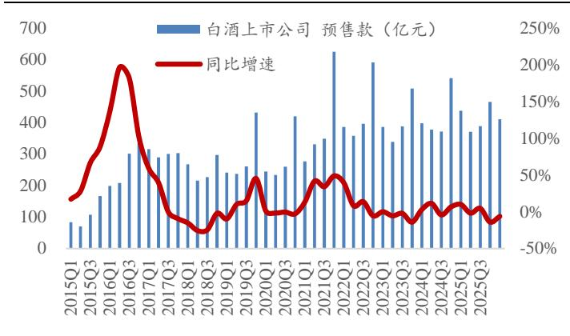  
数据来源：Wind、开源证券研究所

图22：2026Q1白酒企业经营性现金净流入同比增加  
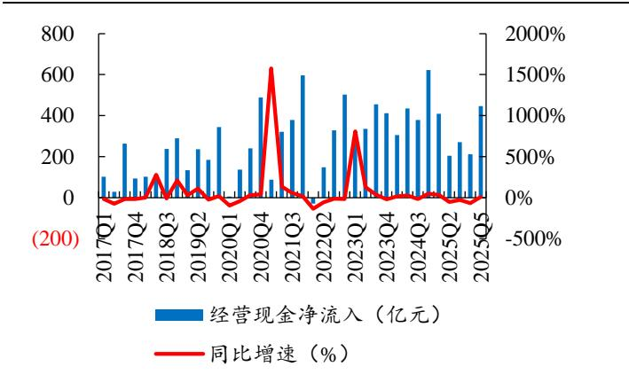  
数据来源：Wind、开源证券研究所

上市酒企毛利率下降，销售费用率提升下，净利率同比下降。为应对商务需求下降，头部公司开始做大众化产品，整体产品结构都有下移，从而影响盈利能力。2026Q1 上市白酒公司（剔除茅五）毛利率为 75.84%，同比 2025Q1 减少 1.9pct。下行过程底部，酒企开始缩减不必要开支，优化费用效率，费用率控制相对较好。2026Q1上市公司整体（剔除茅五）管理费用率和销售费用率分别为 5.45%和 13.75%，同比分别-2.34pct、-0.05pct；净利率为 31.73%，同比下降 3.09pct。

图23：2026Q1白酒企业整体毛利率同比下降  
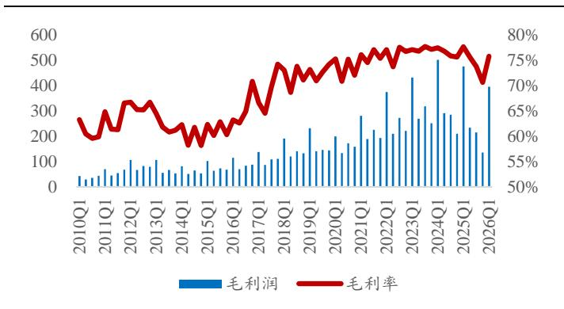  
数据来源：Wind、开源证券研究所

026Q1图24 上市白酒企业净利率同比下降  
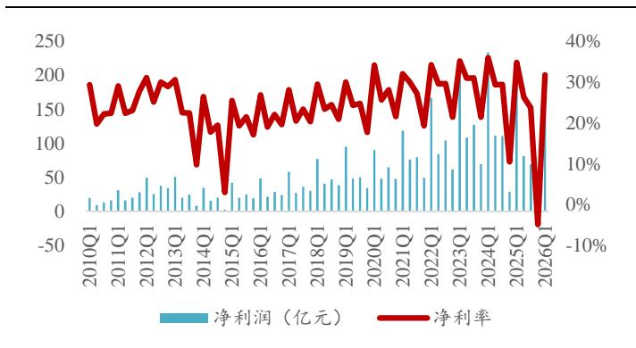  
数据来源：Wind、开源证券研究所

图25：2026Q1白酒企业管理费用率同比下降  
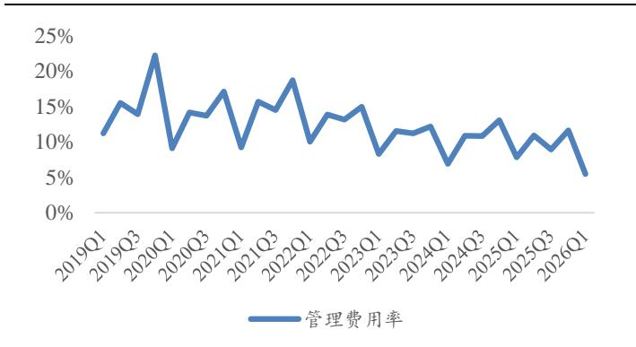  
数据来源：Wind、开源证券研究所

图26：2026Q1白酒企业销售费用率同比上升  
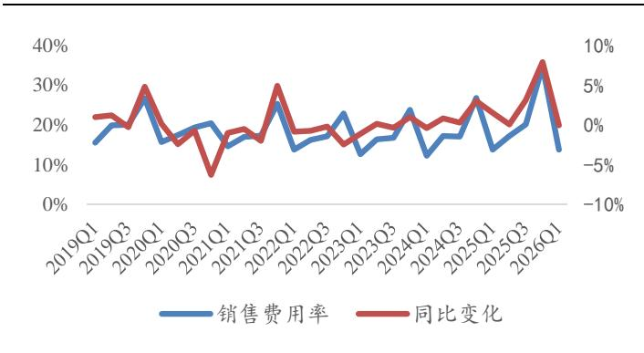  
数据来源：Wind、开源证券研究所

分价格带看： 高端白酒下滑幅度较大，大众高端价格带加速下跌，次高端降幅有所收敛。自2024年以来，需求承压时间太长，渠道压力对各个价格带都有传导。分价格带来看，2025Q2-2026Q1 高端酒收入同比增速分别为-12%、-17%、-32%、-10%，龙头酒企渠道体系也到达压力临界点。次高端由于前今年调整较早，在增速上反而出现下滑幅度收敛、逐步企稳的情况，2025Q2-2026Q1 次高端酒收入同比增速分别为-21%、-14%、+1%、-16%。大众区域酒变化最大，之前仍在稳健增长，25年二季度突发性事件影响，2025Q2-2026Q1大众高端酒收入增速分别为-20%、-42%、-39%、-16%。

图27：2026Q1高端收入增速相对较好  
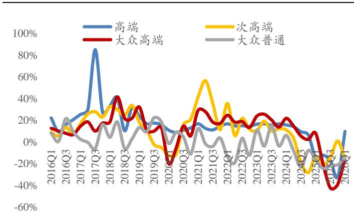  
数据来源：Wind、开源证券研究所

图28：2026Q1高端利润增速相对较好  
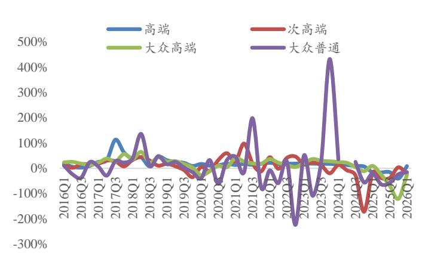  
数据来源：Wind、开源证券研究所

高端白酒业绩增速环比大幅下降，酒企主动进行调整，蓄力未来发展。高端酒企在此前依托品牌优势和多元化需求保持了相对稳健增长，但经销商渠道积累了较大压力，2026 年开始集中释放。贵州茅台通过价格、渠道的市场化改革，在 2026年 Q1收入实现了正增长。五粮液终于正视市场环境，开始报表大幅度出清。泸州老窖自 2024 年开始就通过五码系统严格控制库存，Q1 下滑在市场预期之中，这次老窖更加尊重市场规律和渠道健康，节奏相对可控，价格也相对坚挺。

表2：高端白酒2026Q1营收环比改善

<table><tr><td>简称</td><td>项目/时间</td><td>2024Q4</td><td>2025Q1</td><td>2025Q2</td><td>2025Q3</td><td>2025Q4</td><td>2026Q1</td></tr><tr><td rowspan="5">贵州茅台</td><td>营收增速</td><td>12.8%</td><td>10.7%</td><td>7.3%</td><td>0.3%</td><td>-19.3%</td><td>6.3%</td></tr><tr><td>净利润增速</td><td>16.2%</td><td>11.6%</td><td>5.2%</td><td>0.5%</td><td>-30.3%</td><td>1.5%</td></tr><tr><td>毛利率</td><td>93.0%</td><td>92.1%</td><td>90.6%</td><td>91.4%</td><td>91.0%</td><td>89.9%</td></tr><tr><td>销售费用率</td><td>2.8%</td><td>2.9%</td><td>4.5%</td><td>3.1%</td><td>6.7%</td><td>2.9%</td></tr><tr><td>净利率</td><td>49.8%</td><td>52.2%</td><td>46.8%</td><td>48.3%</td><td>43.0%</td><td>49.8%</td></tr><tr><td rowspan="5">五粮液</td><td>营收增速</td><td>2.5%</td><td>-50.9%</td><td>-59.4%</td><td>-58.7%</td><td>-53.5%</td><td>33.7%</td></tr><tr><td>净利润增速</td><td>-6.2%</td><td>-68.6%</td><td>-95.9%</td><td>-68.5%</td><td>-64.2%</td><td>82.6%</td></tr><tr><td>毛利率</td><td>77.0%</td><td>79.1%</td><td>74.7%</td><td>68.7%</td><td>83.2%</td><td>81.4%</td></tr><tr><td>销售费用率</td><td>13.7%</td><td>8.7%</td><td>31.2%</td><td>17.3%</td><td>29.3%</td><td>16.1%</td></tr><tr><td>净利率</td><td>32.6%</td><td>25.8%</td><td>3.2%</td><td>26.0%</td><td>25.1%</td><td>35.3%</td></tr><tr><td rowspan="5">泸州老窖</td><td>营收增速</td><td>-16.9%</td><td>1.8%</td><td>-8.0%</td><td>-9.8%</td><td>-62.2%</td><td>-14.2%</td></tr><tr><td>净利润增速</td><td>-29.9%</td><td>0.4%</td><td>-11.1%</td><td>-13.1%</td><td>-96.4%</td><td>-19.3%</td></tr><tr><td>毛利率</td><td>84.4%</td><td>86.5%</td><td>87.9%</td><td>87.2%</td><td>82.3%</td><td>85.8%</td></tr><tr><td>销售费用率</td><td>15.1%</td><td>8.2%</td><td>10.6%</td><td>13.5%</td><td>31.4%</td><td>8.6%</td></tr><tr><td>净利率</td><td>27.3%</td><td>49.1%</td><td>43.2%</td><td>46.4%</td><td>2.6%</td><td>46.2%</td></tr></table>

数据来源：Wind、开源证券研究所

商务消费活动受政策影响较大，次高端酒企仍处于承压阶段，业绩延续分化增长。受宏观经济影响，商务消费场景恢复节奏相对较慢，次高端酒企由于品牌势能、渠道建设和库存情况不同，因此在业绩表现上存在较大差异。分品牌看，山西汾酒在压力下仍然实现了增长，主要得益于丰富的产品结构，以及前几年有节奏的做好了库存的管理，做好了速度和质量的平衡。舍得酒业、酒鬼酒等 2026Q1下滑幅度大幅收窄，是由于 2024年已经开始主动出清。同时开始积极探索新渠道、新产品等新模式，比如酒鬼和胖东来合作的“自由爱”产品，对收入有较大的贡献作用。

表3：2026Q1次高端品牌收入增长分化

<table><tr><td>简称</td><td>项目/时间</td><td>2024Q4</td><td>2025Q1</td><td>2025Q2</td><td>2025Q3</td><td>2025Q4</td><td>2026Q1</td></tr><tr><td rowspan="5">水井坊</td><td>营收增速</td><td>4.7%</td><td>2.7%</td><td>-31.4%</td><td>-58.9%</td><td>-51.7%</td><td>-14.9%</td></tr><tr><td>净利润增速</td><td>-12.3%</td><td>2.1%</td><td>-251.2%</td><td>-75.0%</td><td>-63.0%</td><td>-10.1%</td></tr><tr><td>毛利率</td><td>82.3%</td><td>82.0%</td><td>74.4%</td><td>81.8%</td><td>78.7%</td><td>79.8%</td></tr><tr><td>销售费用率</td><td>38.7%</td><td>27.5%</td><td>52.1%</td><td>22.2%</td><td>17.4%</td><td>24.0%</td></tr><tr><td>净利率</td><td>15.1%</td><td>19.8%</td><td>-15.8%</td><td>25.9%</td><td>11.6%</td><td>21.0%</td></tr><tr><td rowspan="5">舍得酒业</td><td>营收增速</td><td>-51.1%</td><td>-25.1%</td><td>-3.4%</td><td>-15.9%</td><td>-20.0%</td><td>-6.0%</td></tr><tr><td>净利润增速</td><td>-167.9%</td><td>-37.1%</td><td>139.5%</td><td>-63.2%</td><td>-22.9%</td><td>-33.1%</td></tr><tr><td>毛利率</td><td>53.7%</td><td>69.4%</td><td>60.6%</td><td>62.1%</td><td>48.1%</td><td>66.3%</td></tr><tr><td>销售费用率</td><td>36.0%</td><td>19.4%</td><td>23.7%</td><td>25.3%</td><td>43.8%</td><td>21.3%</td></tr><tr><td>净利率</td><td>-36.0%</td><td>22.0%</td><td>8.6%</td><td>2.9%</td><td>-34.7%</td><td>15.6%</td></tr><tr><td rowspan="5">山西汾酒</td><td>营收增速</td><td>-10.2%</td><td>7.7%</td><td>0.4%</td><td>4.1%</td><td>24.5%</td><td>-9.7%</td></tr><tr><td>净利润增速</td><td>-11.3%</td><td>6.2%</td><td>-13.5%</td><td>-1.4%</td><td>-5.7%</td><td>-19.0%</td></tr><tr><td>毛利率</td><td>77.4%</td><td>78.8%</td><td>71.9%</td><td>74.6%</td><td>67.8%</td><td>75.0%</td></tr><tr><td>销售费用率</td><td>17.6%</td><td>9.2%</td><td>11.5%</td><td>10.2%</td><td>13.9%</td><td>8.9%</td></tr><tr><td>净利率</td><td>19.2%</td><td>40.2%</td><td>25.0%</td><td>32.4%</td><td>14.5%</td><td>36.1%</td></tr><tr><td rowspan="5">酒鬼酒</td><td>营收增速</td><td>-66.2%</td><td>-30.3%</td><td>-56.6%</td><td>0.8%</td><td>49.9%</td><td>-7.8%</td></tr><tr><td>净利润增速</td><td>-163.7%</td><td>-56.8%</td><td>-147.8%</td><td>-70.9%</td><td>-45.1%</td><td>4.6%</td></tr><tr><td>毛利率</td><td>69.1%</td><td>70.7%</td><td>65.2%</td><td>61.2%</td><td>61.1%</td><td>67.3%</td></tr><tr><td>销售费用率</td><td>58.4%</td><td>27.7%</td><td>40.3%</td><td>35.0%</td><td>30.8%</td><td>24.1%</td></tr><tr><td>净利率</td><td>-18.9%</td><td>9.2%</td><td>-10.5%</td><td>-9.5%</td><td>-6.9%</td><td>10.5%</td></tr><tr><td rowspan="5">洋河股份</td><td>营收增速</td><td>-52.2%</td><td>-31.9%</td><td>-43.7%</td><td>-29.0%</td><td>-17.6%</td><td>-26.0%</td></tr><tr><td>净利润增速</td><td>916.0%</td><td>-39.9%</td><td>-62.7%</td><td>-158.4%</td><td>-7.2%</td><td>-32.7%</td></tr><tr><td>毛利率</td><td>59.9%</td><td>75.6%</td><td>73.3%</td><td>53.5%</td><td>79.6%</td><td>75.4%</td></tr><tr><td>用率</td><td></td><td></td><td></td><td></td><td></td><td></td></tr><tr><td>净利率</td><td>-140.1%</td><td>32.9%</td><td>18.9%</td><td>-11.2%</td><td>-157.8%</td><td>29.9%</td></tr></table>

数据来源：Wind、开源证券研究所

区域头部酒企主动放缓经营节奏，整体增长骤降。三季度区域头部酒企业一改往日稳健增长，业绩增速骤降，主要系大众白酒消费需求表现平淡，江苏和安徽白酒需求环境承压，头部酒企主动调整经营节奏，释放报表压力，因此收入普遍下滑幅度较大。比如古井，过去一直对团队、经销商回款都有较高要求，春节也不在做强制性的回款要求，积极促进去库存，行业压力基本已到达峰值。但区域酒企需求场景其实相对稳定，因此报表下滑不代表市场失控，只是一次性压力集中释放，未来恢复难度会小，恢复节奏也会相对快。

表4：大众高端白酒2026Q1业绩仍承压

<table><tr><td>简称</td><td>项目/时间</td><td>2024Q4</td><td>2025Q1</td><td>2025Q2</td><td>2025Q3</td><td>2025Q4</td><td>2026Q1</td></tr><tr><td rowspan="5">古井贡酒</td><td>营收增速</td><td>4.8%</td><td>10.4%</td><td>-14.2%</td><td>-51.6%</td><td>-46.6%</td><td>-18.6%</td></tr><tr><td>净利润增速</td><td>-0.7%</td><td>12.8%</td><td>-11.6%</td><td>-74.6%</td><td>-153.3%</td><td>-31.0%</td></tr><tr><td>毛利率</td><td>80.7%</td><td>79.7%</td><td>80.2%</td><td>79.8%</td><td>75.1%</td><td>77.8%</td></tr><tr><td>销售费用率</td><td>30.1%</td><td>26.6%</td><td>22.8%</td><td>39.1%</td><td>39.5%</td><td>26.7%</td></tr><tr><td>净利率</td><td>17.1%</td><td>25.5%</td><td>28.1%</td><td>11.7%</td><td>-17.1%</td><td>21.6%</td></tr><tr><td rowspan="5">口子窖</td><td>营收增速</td><td>9.0%</td><td>2.4%</td><td>-48.5%</td><td>-46.2%</td><td>-50.6%</td><td>-24.0%</td></tr><tr><td>净利润增速</td><td>-7.5%</td><td>3.6%</td><td>-70.9%</td><td>-92.5%</td><td>-119.9%</td><td>-46.2%</td></tr><tr><td>毛利率</td><td>74.1%</td><td>76.2%</td><td>65.2%</td><td>62.7%</td><td>61.9%</td><td>67.6%</td></tr><tr><td>销售费用率</td><td>38.3%</td><td>13.3%</td><td>19.0%</td><td>30.0%</td><td>57.2%</td><td>14.8%</td></tr><tr><td>净利率</td><td>20.8%</td><td>33.7%</td><td>14.5%</td><td>4.2%</td><td>-8.4%</td><td>23.9%</td></tr><tr><td rowspan="5">今世缘</td><td>营收增速</td><td>-7.6%</td><td>9.2%</td><td>-29.7%</td><td>-26.8%</td><td>-18.9%</td><td>-15.2%</td></tr><tr><td>净利润增速</td><td>-34.8%</td><td>7.3%</td><td>-37.1%</td><td>-48.7%</td><td>-83.2%</td><td>-15.8%</td></tr><tr><td>毛利率</td><td>77.7%</td><td>73.6%</td><td>72.8%</td><td>75.0%</td><td>77.6%</td><td>74.4%</td></tr><tr><td>销售费用率</td><td>17.5%</td><td>16.8%</td><td>22.6%</td><td>22.6%</td><td>28.3%</td><td>15.6%</td></tr><tr><td>净利率</td><td>20.3%</td><td>32.2%</td><td>31.6%</td><td>16.6%</td><td>4.2%</td><td>32.0%</td></tr><tr><td rowspan="5">迎驾贡酒</td><td>营收增速</td><td>-4.5%</td><td>-11.9%</td><td>-23.8%</td><td>-21.6%</td><td>-17.9%</td><td>8.9%</td></tr><tr><td>净利润增速</td><td>-7.9%</td><td>-9.2%</td><td>-35.2%</td><td>-39.3%</td><td>-18.6%</td><td>0.7%</td></tr><tr><td>毛利率</td><td>72.9%</td><td>76.5%</td><td>68.3%</td><td>70.2%</td><td>72.4%</td><td>75.6%</td></tr><tr><td>销售费用率</td><td>11.4%</td><td>7.7%</td><td>13.4%</td><td>12.6%</td><td>12.8%</td><td>9.2%</td></tr><tr><td>净利率</td><td>31.9%</td><td>40.5%</td><td>27.1%</td><td>28.1%</td><td>31.6%</td><td>37.4%</td></tr></table>

数据来源：Wind、开源证券研究所

年一季度我们判断是白酒行业压力最大的一个季度，后续行业周期会逐步触底。判断依据如下：（1）首先标杆产品飞天茅台价格已经触底，2026 年春节旺季i茅台明显放量，但需求旺盛，价格反而较节前有明显上升，说明在1600-1800元区间飞天茅台有扎实的需求支撑。（2）报表压力连续逐渐释放，需求受影响最大的次高端酒企收入出现持续企稳迹象。（3）从报表基数节奏来看，2025 年 Q1 是基数最高的一个季度，从 2025Q2开始，基数逐步下降。

图29：飞天（散瓶）价格2022年相对平稳（单位：元）  
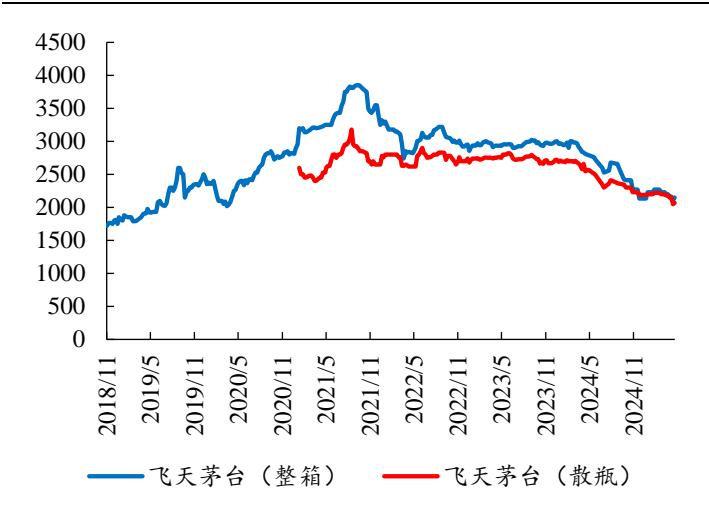  
数据来源：今日酒价、开源证券研究所

图30：五粮液和国窖价格波动前行（单位：元）  
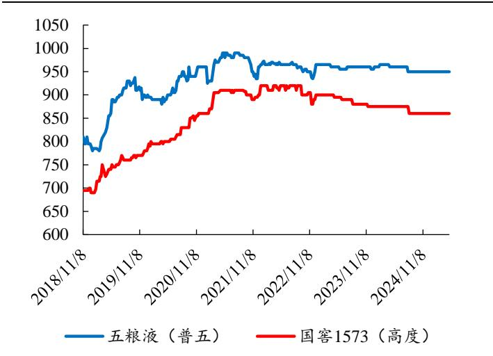  
数据来源：今日酒价、开源证券研究所

## 3.2、 啤酒：守盘提质，蓄力旺季

2026Q1春节消费带动啤酒产量修复性增长，夏天旺季有望带动销量回升。2026年 1-3月行业产量实现正向增长，同比+4.2%；其中1-2 月累计同比增长 6.5%，3月单月同比增长 0.2%，1-2 月受益于春节消费集中释放叠加餐饮聚饮场景持续复苏，

啤酒产量开年增长势头强劲，而 3 月增速环比显著回落，主因节后消费淡季切换、部分区域气温回升不及预期，终端动销节奏放缓。当前行业终端需求在场景分化中维持韧性，渠道方面呈现现饮餐饮渠道稳步修复、传统流通渠道平稳运行、新零售与即时零售渠道保持高速增长的多元变化，各大酒企纷纷加码产品结构升级与渠道精细化布局，积极挖掘行业新增长点。展望二季度，行业将迎来夏季传统消费旺季，叠加 2026 年美加墨世界杯带来的观赛消费催化，餐饮、夜宵、家庭囤货等全场景需求有望集中释放，啤酒行业整体销量有望迎来回升预期。

图31：2026 年 3 月啤酒产量同比+0.2%  
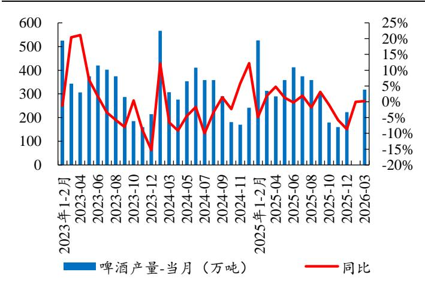  
数据来源：Wind、开源证券研究所

图32：2026 年 1-3 月啤酒累计产量同比+4.2%  
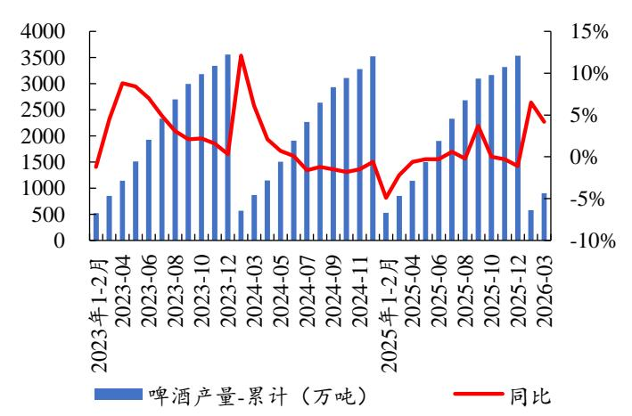  
数据来源：Wind、开源证券研究所

2026Q1各大企业业绩表现分化，高端化升级持续对冲销量端承压影响。2026Q1主要上市啤酒企业营收增速环比 2025Q4 呈现弱复苏态势，行业需求修复仍有分化，主因现饮渠道恢复节奏不及预期、春节错峰等因素影响。分公司来看，主要龙头青岛啤酒、重庆啤酒、珠江啤酒、燕京啤酒营收同比-1.54%、-0.12%、+5.86%、+7.06%，区域龙头仍保持稳健正增长，青岛啤酒、重庆啤酒略有下滑。我们认为，2026Q1啤酒行业呈现销量增长乏力、结构升级持续推进，销量方面行业未能在春节旺季实现较快增长，主要系行业存量竞争、大环境需求偏弱；结构上龙头企业持续在产品结构升级上寻找增量，以此弥补销量端承压带来的业绩影响，高端、次高端啤酒仍保持稳健增长，产品结构优化带动行业吨价实现稳步提升。

表5：2026Q1单季啤酒上市公司营收增速有所分化

<table><tr><td></td><td>2024Q3</td><td>2024Q4</td><td>2025Q1</td><td>2025Q2</td><td>2025Q3</td><td>2025Q4</td><td>2026Q1</td></tr><tr><td>青岛啤酒</td><td>-5.28%</td><td>7.44%</td><td>2.91%</td><td>1.28%</td><td>-0.17%</td><td>-2.26%</td><td>-1.54%</td></tr><tr><td>重庆啤酒</td><td>-7.11%</td><td>-11.45%</td><td>1.46%</td><td>-1.84%</td><td>0.41%</td><td>5.15%</td><td>-0.12%</td></tr><tr><td>珠江啤酒</td><td>6.89%</td><td>2.11%</td><td>10.69%</td><td>4.96%</td><td>-1.34%</td><td>-4.69%</td><td>5.86%</td></tr><tr><td>燕京啤酒</td><td>0.19%</td><td>1.32%</td><td>6.69%</td><td>6.11%</td><td>1.55%</td><td>4.35%</td><td>7.06%</td></tr><tr><td>惠泉啤酒</td><td>-0.38%</td><td>145.49%</td><td>0.35%</td><td>1.49%</td><td>-7.77%</td><td>15.29%</td><td>6.61%</td></tr><tr><td>兰州黄河</td><td>-4.94%</td><td>-23.54%</td><td>-11.49%</td><td>-19.63%</td><td>94.98%</td><td>358.51%</td><td>43.07%</td></tr><tr><td>*ST西发</td><td>8.02%</td><td>34.07%</td><td>15.80%</td><td>-9.72%</td><td>20.26%</td><td>-11.33%</td><td>-5.00%</td></tr></table>

数据来源：Wind、开源证券研究所

2026Q1延续原料价格低位下行红利，叠加产品结构升级助力，大多啤酒企业毛利率实现改善。从毛利率表现来看，2026Q1啤酒企业毛利率大多有所优化，其中青岛啤酒、重庆啤酒、珠江啤酒、燕京啤酒等毛利率同比+1.10pct、+1.24pct、+4.64pct、+3.53pct。啤酒板块毛利率同比改善主因成本端红利持续释放，其中大麦等核心原料价格延续下行趋势，同时叠加产品结构优化、中高档产品占比提升。从销售费用率来看，大部分主流酒企销售费用率略有上升，主因 2026Q1 春节需求恢复不及预期，行业动销持续承压，企业为备战传统旺季加大市场推广与渠道营销投放力度。

2026Q1龙头净利润增速大多实现正增长，区域龙头盈利弹性更大。2026Q1 行业内企业利润增速呈现明显分化，区域酒企净利润增速显著高于全国化龙头。分公司看，各企业业绩表现差异扩大，区域酒企盈利弹性更为突出，燕京啤酒、珠江啤酒等利润弹性较大，归母净利润分别同比增长 60.19%、14.07%；全国化龙头青岛啤酒维持相对稳定增长，归母净利润同比增长 5.23%；重庆啤酒受短期因素扰动，净利润同比有所下滑。

表6：2026Q1多数啤酒企业毛利率同比提升

<table><tr><td>证券简称</td><td>2024Q3</td><td>2024Q4</td><td>2025Q1</td><td>2025Q2</td><td>2025Q3</td><td>2025Q4</td><td>2026Q1</td></tr><tr><td>青岛啤酒</td><td>42.12%</td><td>26.24%</td><td>41.64%</td><td>45.84%</td><td>43.56%</td><td>24.72%</td><td>42.74%</td></tr><tr><td>重庆啤酒</td><td>49.17%</td><td>43.38%</td><td>48.42%</td><td>51.21%</td><td>50.87%</td><td>56.43%</td><td>49.66%</td></tr><tr><td>珠江啤酒</td><td>49.77%</td><td>28.84%</td><td>45.00%</td><td>56.11%</td><td>50.93%</td><td>28.30%</td><td>49.64%</td></tr><tr><td>燕京啤酒</td><td>47.99%</td><td>9.86%</td><td>42.79%</td><td>47.70%</td><td>50.15%</td><td>17.90%</td><td>46.32%</td></tr><tr><td>惠泉啤酒</td><td>35.87%</td><td>-4.01%</td><td>32.05%</td><td>37.06%</td><td>41.55%</td><td>10.94%</td><td>32.87%</td></tr><tr><td>兰州黄河</td><td>26.87%</td><td>-49.50%</td><td>15.25%</td><td>12.67%</td><td>25.28%</td><td>25.50%</td><td>3.68%</td></tr><tr><td>*ST西发</td><td>42.31%</td><td>39.43%</td><td>42.81%</td><td>41.56%</td><td>43.51%</td><td>40.06%</td><td>41.51%</td></tr></table>

数据来源：Wind、开源证券研究所

表7：2026Q1多数主流酒企销售费用率同比略有上升

<table><tr><td>证券简称</td><td>2024Q3</td><td>2024Q4</td><td>2025Q1</td><td>2025Q2</td><td>2025Q3</td><td>2025Q4</td><td>2026Q1</td></tr><tr><td>青岛啤酒</td><td>14.08%</td><td>37.18%</td><td>12.53%</td><td>8.74%</td><td>13.66%</td><td>34.91%</td><td>11.50%</td></tr><tr><td>重庆啤酒</td><td>14.74%</td><td>34.40%</td><td>12.74%</td><td>17.35%</td><td>16.68%</td><td>37.16%</td><td>13.34%</td></tr><tr><td>珠江啤酒</td><td>15.22%</td><td>15.96%</td><td>15.78%</td><td>13.36%</td><td>15.45%</td><td>17.35%</td><td>16.50%</td></tr><tr><td>燕京啤酒</td><td>13.86%</td><td>2.60%</td><td>15.65%</td><td>6.02%</td><td>13.80%</td><td>7.57%</td><td>15.60%</td></tr><tr><td>惠泉啤酒</td><td>1.72%</td><td>1.26%</td><td>6.88%</td><td>7.55%</td><td>-0.05%</td><td>17.14%</td><td>8.12%</td></tr><tr><td>兰州黄河</td><td>43.97%</td><td>33.88%</td><td>15.51%</td><td>25.35%</td><td>50.19%</td><td>111.10%</td><td>24.55%</td></tr><tr><td>*ST西发</td><td>4.16%</td><td>3.19%</td><td>8.61%</td><td>4.42%</td><td>6.17%</td><td>8.42%</td><td>6.97%</td></tr></table>

数据来源：Wind、开源证券研究所

表8：2026Q1大多数啤酒企业净利率同比提升

<table><tr><td>证券简称</td><td>2024Q3</td><td>2024Q4</td><td>2025Q1</td><td>2025Q2</td><td>2025Q3</td><td>2025Q4</td><td>2026Q1</td></tr><tr><td>青岛啤酒</td><td>15.85%</td><td>-20.09%</td><td>16.64%</td><td>22.26%</td><td>16.09%</td><td>-22.04%</td><td>17.82%</td></tr><tr><td>重庆啤酒</td><td>20.64%</td><td>-26.38%</td><td>21.61%</td><td>17.54%</td><td>17.90%</td><td>-0.28%</td><td>20.06%</td></tr><tr><td>珠江啤酒</td><td>16.47%</td><td>0.82%</td><td>13.16%</td><td>23.35%</td><td>17.83%</td><td>-4.61%</td><td>14.01%</td></tr><tr><td>燕京啤酒</td><td>13.37%</td><td>-10.45%</td><td>5.94%</td><td>22.03%</td><td>16.17%</td><td>-2.62%</td><td>8.89%</td></tr><tr><td>惠泉啤酒</td><td>20.02%</td><td>-27.01%</td><td>4.32%</td><td>15.87%</td><td>26.49%</td><td>-29.02%</td><td>5.33%</td></tr><tr><td>兰州黄河</td><td>-60.26%</td><td>-275.04%</td><td>4.88%</td><td>-53.50%</td><td>1.46%</td><td>-126.43%</td><td>-47.01%</td></tr><tr><td>*ST西发</td><td>26.03%</td><td>14.93%</td><td>18.57%</td><td>33.45%</td><td>158.98%</td><td>11.15%</td><td>19.90%</td></tr></table>

数据来源：Wind、开源证券研究所

表9：2026Q1珠江和燕京啤酒弹性更大

<table><tr><td></td><td>2024Q3</td><td>2024Q4</td><td>2025Q1</td><td>2025Q2</td><td>2025Q3</td><td>2025Q4</td><td>2026Q1</td></tr><tr><td>青岛啤酒</td><td>-9.03%</td><td>-0.79%</td><td>7.08%</td><td>7.32%</td><td>1.62%</td><td>-6.41%</td><td>5.23%</td></tr><tr><td>重庆啤酒</td><td>-10.10%</td><td>-2801.45%</td><td>4.59%</td><td>-12.70%</td><td>-12.71%</td><td>95.38%</td><td>-7.40%</td></tr><tr><td>珠江啤酒</td><td>10.60%</td><td>118.74%</td><td>29.83%</td><td>20.18%</td><td>8.16%</td><td>-1178.28%</td><td>14.07%</td></tr><tr><td>燕京啤酒</td><td>19.84%</td><td>25.35%</td><td>61.10%</td><td>43.00%</td><td>26.00%</td><td>60.70%</td><td>60.19%</td></tr><tr><td>惠泉啤酒</td><td>15.36%</td><td>4.08%</td><td>23.72%</td><td>25.86%</td><td>22.51%</td><td>-25.09%</td><td>30.20%</td></tr><tr><td>兰州黄河</td><td>-381.35%</td><td>-5.63%</td><td>934.62%</td><td>-161.09%</td><td>174.93%</td><td>-66.49%</td><td>-330.55%</td></tr><tr><td>*ST西发</td><td>203.76%</td><td>-92.01%</td><td>791.12%</td><td>104.95%</td><td>754.46%</td><td>-141.05%</td><td>9.05%</td></tr></table>

数据来源：Wind、开源证券研究所

2026年 Q1进口大麦市场呈现量增价稳态势，有效平稳企业成本压力。1-3月中国累计进口大麦349 万吨，同比大幅增长 37%，其中 3 月单月进口量达 134 万吨，同比增长 58%，稳定且集中的原理进口为行业筑牢了原料供应安全边际；进口价格整体保持低位平稳运行， 月进口均价保持在 美元 吨，同比基本持平，有效平稳啤酒企业成本端压力，为行业持续巩固销量基本盘、深化产品结构升级预留了充足的操作空间。

图33：2026年进口大麦数量稳步增加  
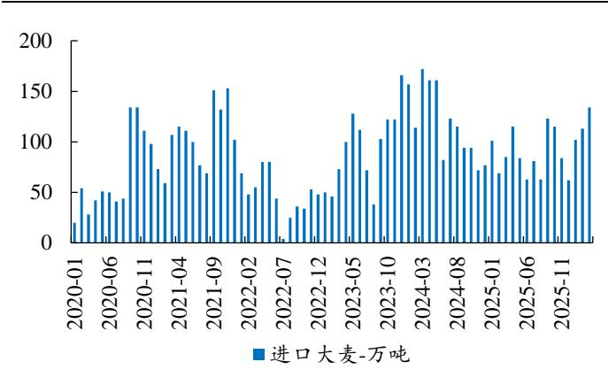  
数据来源：Wind、开源证券研究所

图34：2026年进口大麦价格仍在底部位置  
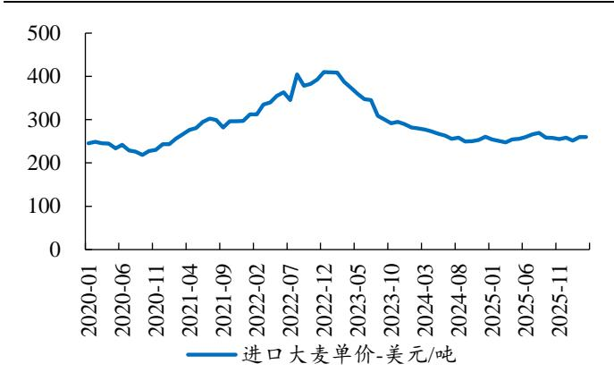  
数据来源：Wind、开源证券研究所

## 3.3、 乳制品：一季度需求改善，行业有望企稳向上

2026Q1 乳企营收、利润均有改善，行业改善在即。一季度行业进入春节旺季，需求相比 2025年同期有所改善，各乳企经过底部的经营调整，也显现出不同程度的业绩修复。A 股上市乳企 2026Q1 营收同比增 4.9%，同时乳企渠道库存也保持着相对健康的水平；2026Q1 上市乳企归母净利同比增 11.6%，增长幅度超过营收增幅，在需求偏弱、行业偏底部的环境下，乳企的经营方向更多以稳健为主，同时通过结构优化、降本增效去提升盈利能力。展望 2026年全年，液奶终端动销出现企稳信号，叠加下半年双节效应及全年深加工产能的持续释放，行业供需环境将持续改善，乳企经营压力有望降低。尽管短期发展承压，但长期看中国人均牛奶饮用量仅为世界平均水平的 1/3，近年来低温奶、固态奶产品发展势头良好，同时新兴渠道快速成长带来机遇，乳企也逐渐从C端向B 端渠道延伸，乳制品发展有望迎来新的增长引擎，行业空间仍然广阔。

图35：2026Q1 A股上市乳企营收同比增 4.9%，归母净利同比增 11.6%  
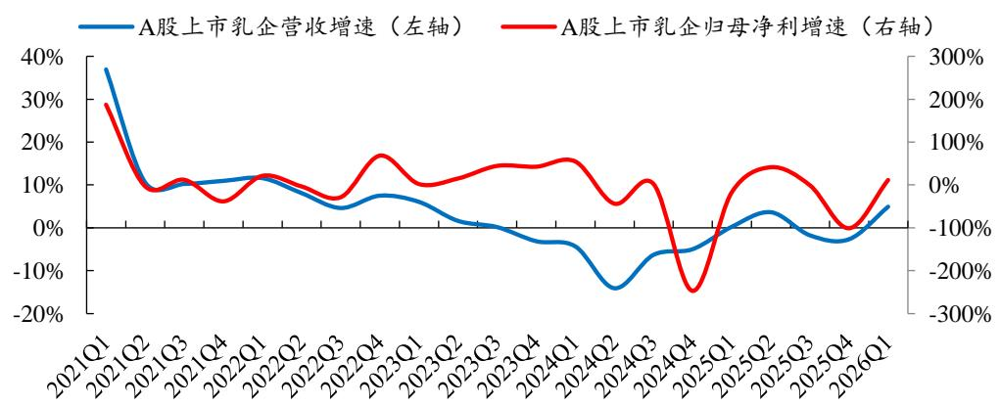  
数据来源：Wind、开源证券研究所

奶价持续磨底，预计2026年奶价压力趋缓。2026年春节旺季的影响下，原奶行业出现阶段性供需收紧，春节后供需再次回到宽松环境。4 月 30 日，国内生鲜乳价格 3.02 元/公斤，环比持平，同比-1.9%。进口方面，5 月 5 日，GDT 拍卖全脂奶粉中标价 3741美元/吨，环比+2.0%，同比-14.5%，进口大包粉价格下降，但国产大包粉仍有价格优势。展望全年，饲料价格受国际形势影响或有所上行，牧场经营压力仍然较大，长期亏损、贷款压力、口蹄疫防控等因素使得社会牧场奶牛补栏受到影响，进一步影响后续供给；同时，液奶企稳、下半年双节效应推动，叠加全年深加工产能持续释放，行业需求有望呈现改善态势，预计 2026 年奶价压力趋缓，有望于下半年企稳回升。长期看，牧场规模化趋势显著、产业链上下游合作深化，产能扩张越来越趋于理性，预计未来原奶供需将处于紧平衡状态，价格波动会相对平缓。

图36：2026年 5月5日全脂奶粉中标价同比-14.5%  
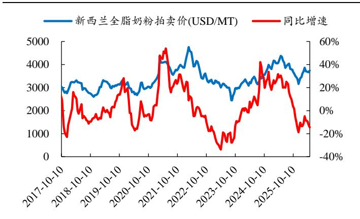  
数据来源：GDT、开源证券研究所

图37：2026 年 4 月 30 日生鲜乳价格同比-1.9%  
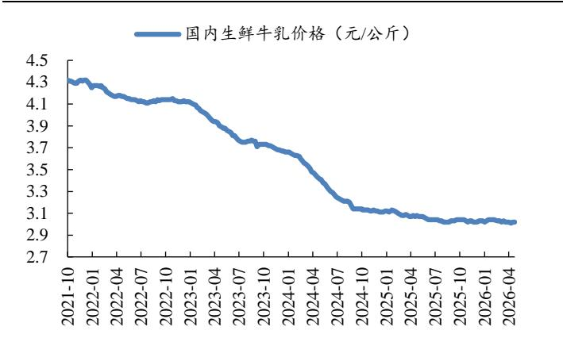  
数据来源：Wind、开源证券研究所

预计 2026 年促销费用继续优化，长期看行业竞争将较为理性。2026 年一季度属于属于春节旺季，节后渠道库存水平保持健康，促销力度平稳。展望全年，原奶价格有望企稳回升，市场竞争环境将有所好转，促销费用有望进一步优化。长期来看，龙头乳企伊利股份、蒙牛乳业均要求保证盈利能力基础上的收入增长，费用投放更倾向于品牌等方面，形成品牌渠道合力，进一步增强企业核心竞争力，预计行业竞争会较为理性。

龙头逐渐回收市场份额，领先优势稳固。近两年部分中小品牌利用较低原奶成本开发低价产品，挤占龙头份额，随着 2025年散奶价格持续走高，龙头逐渐回收市场份额。根据马上赢监测数据，2025Q2、Q3伊利股份常温纯牛奶线下市场份额均有所提升。龙头伊利股份、蒙牛乳业不断升级产品结构、坚持精耕策略、完善上游奶源战略布局、持续提升品牌力，领先优势稳固，毛利率持续提升，市场份额仍有望不断扩大，乳制品行业集中度有望继续提升。

全国性乳企经营稳健，区域乳企营收、净利均实现增长。根据乳企规模和经营地域大小分类来看，全国性乳业（如伊利股份）多业务发展，在终端需求延续弱势的背景下经营韧性十足，2026Q1 营收同比增5.5%，其中液体乳同比增 2.3%；2026Q1毛利率同比提升 0.7pct至38.4%，主要是受益于产品结构持续优化，终端售价与促销力度保持平稳；同时渠道库存健康、费用投放保持平稳，销售费用率同比-0.2pct；2026Q1 扣非后净利率同比增 2.7pct 至 16.8%。区域乳企（如光明乳业、新乳业、三元股份）2026Q1 营收同比增 1.3%，归母净利同比降 2.4%，毛利率同比降 1.5pct 至20.7%，归母净利率同比降 0.1pct 至 3.3%。区域性乳企收入端整体改善，利润端各有分化，新乳业通过深耕低温、结构优化，实现利润率继续提升；三元股份持续优化经销商和产品结构，经营改善趋势延续，天润乳业 2025 年同期受减值影响较大，2026Q1扭亏为盈。地区乳企（如燕塘乳业、天润乳业等）2026Q1 营收同比增9.6%，归母净利扭亏为盈，毛利率同比提升 1.4pct 至 20.3%，归母净利率同比提升 6.2pct至 2.2%。

图38：2026Q1不同类型乳企营收均增长  
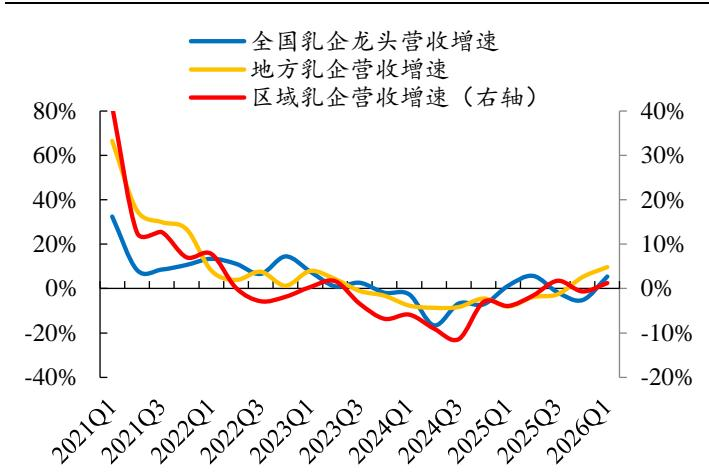  
数据来源：Wind、开源证券研究所

图39：2026Q1地方乳企归母净利扭亏为盈  
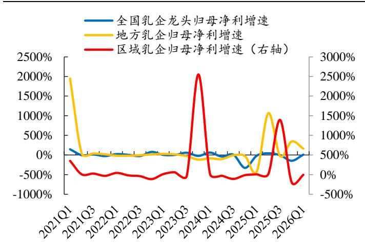  
数据来源：Wind、开源证券研究所

乳制品行业周期有望企稳向上，目前估值较低仍具配置价值。原奶周期反转在即，奶价回升后有望改善竞争环境，促进毛销差修复、收窄原奶相关减值，下游乳企有望收益。展望未来，龙头乳企方面，双寡头格局稳定、渠道及品牌壁垒深厚，在液奶产品同质化程度较高的背景下中小品牌很难复制龙头的成功路径，竞争趋缓后龙头有望回收市场份额；区域乳企方面，部分低温乳企在奶价下行期中相比龙头有更好的业绩表现和稳定性，主要是源于低温品类的渗透率提升空间较大，随着消费者对于健康、美味、功能性的追求，低温奶品类势能强劲，同时本土品牌在当地消费者的心智渗透很深、不易替代。此外，整体来看国内乳制品市场发展仍未完善，产品仍停留在初级加工的液态奶，渠道铺设率也已经较高，因此近年来乳企一方面不断进行产品功能创新、新兴渠道、B 端渠道的覆盖，有望在餐饮端、现制茶饮、烘焙店、零食量贩店、会员超市等渠道贡献增量，另一方面也在加快深加工产能布局，提升产品附加值，有望提升全产业链竞争力的同时平滑奶价波动影响、提升经营稳健性。

综合来看可关注：（1）行业整体复苏、原奶周期反转后，率先实现份额提升、报表修复确定性强、估值也有望修复的龙头乳企伊利股份、蒙牛乳业；（2）所处子行业仍快速增长、盈利能力持续改善的公司，如在低温板块壁垒深厚、结构优化支撑毛利率持续提升的新乳业。

## 3.4、 肉制品：低猪价背景下行业承压，龙头稳利扩量

2026Q1行业营收、净利均下降。肉制品上市企业2026Q1实现营收260.5亿元，同比降 1.4%；实现归母净利 11.2 亿元，同比降 11.2%。双汇发展 2026Q1 实现营收145.5 亿元，同比+1.96%，实现归母净利 12.9 亿元，同比+13.6%，表现大幅优于行业，主因肉制品改革成效持续显现，屠宰业务在低猪价窗口期稳步扩张。

图40：2026Q1A股上市肉企营收同比减少 1.4%，归母净利同比减少 11.2%  
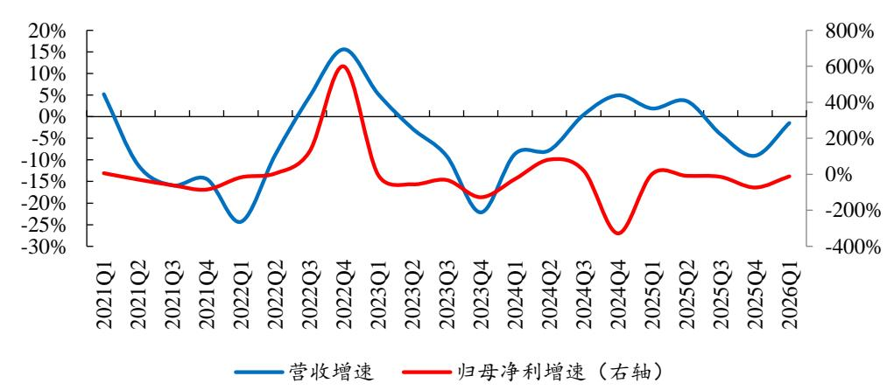  
数据来源：Wind、开源证券研究所

一季度生猪价格下降幅度较大。5月9日，生猪出栏价格9.7元/公斤，同比-34.5%，环比-1.0%；猪肉价格 15.1 元/公斤，同比-27.7%，环比-0.3%。2026 年一季度猪价呈现下降趋势，已下跌至历史较低水平。

一季度屠宰量稳步提升，能繁母猪同比降幅扩大，预计全年龙头屠宰量稳步提升。2026 年 3 月、2026Q1 生猪定点屠宰企业屠宰量同比分别为 3514 万头、11095万头，同比分别增14.7%、22.5%；生猪存栏同比上升，2026年3月生猪存栏同比+1.5%。2026年3月，能繁母猪存栏3904.0 万头，同比-3.3%，环比-1.5%，降幅有所扩大。2026年一季度双汇发展屠宰规模达382万头，同比+33.8%、增长显著，未来公司继续实行稳利扩量策略，保持头均利润稳定的前提下持续扩张屠宰量；同时加快新客户和网点开发，顺应消费趋势、优化产品结构，不断提升盈利水平。

图41：2026年 5月9日生猪出栏价格同比-34.5%  
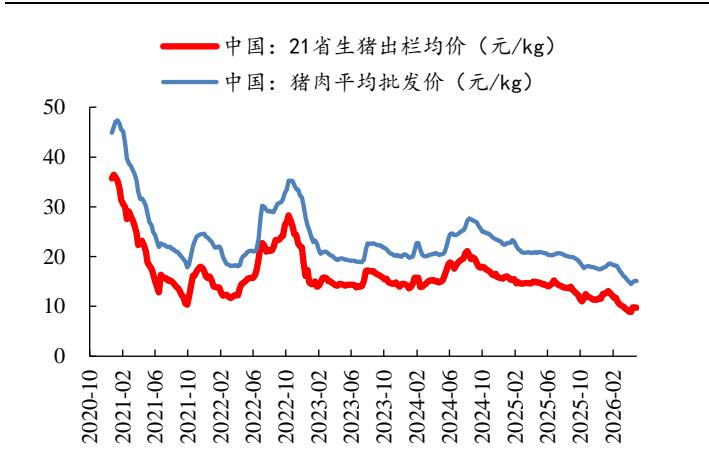  
数据来源：Wind、开源证券研究所

图42：2026年一季度生猪定点屠宰量同比增 22.5%  
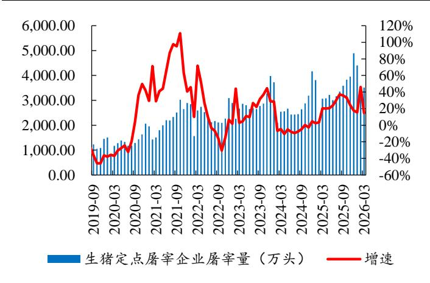  
数据来源：Wind、开源证券研究所

图43：2026年 3月生猪存栏数量同比+1.5%  
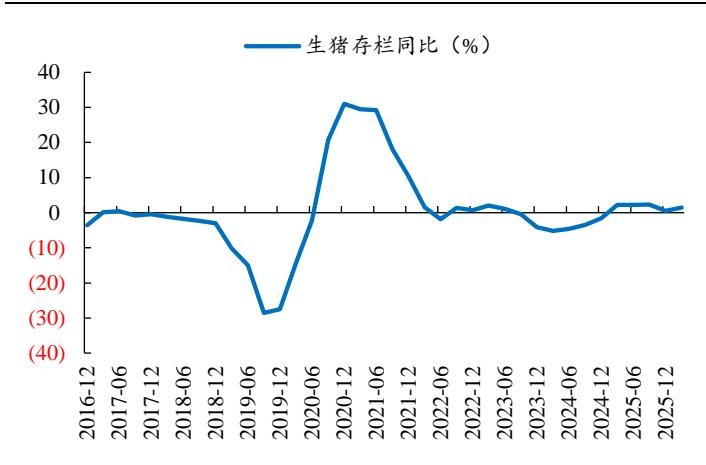  
数据来源：Wind、开源证券研究所

图44：2026年 3月能繁母猪数量同比-3.3%  
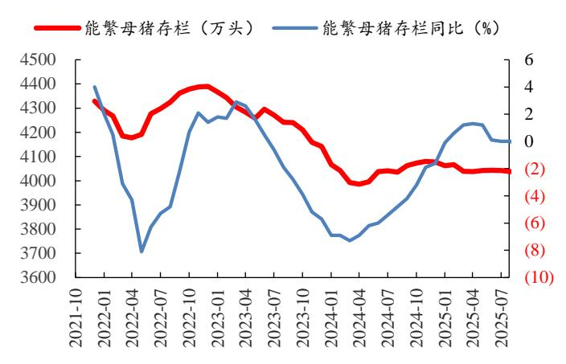  
数据来源：Wind、开源证券研究所

生猪价格低迷背景下肉制品吨利维持高位。2026Q1龙头双汇发展肉制品实现营收 63.9 亿元，同比增 14.4%，其中销量/单价分别约为 35.8 万吨、17.9 元/公斤，同比分别+15.1%、-0.6%，销量高增主要受益于 2025 年同期基数偏低，叠加内部专业化改革落地、市场端创新举措成效凸显。一季度肉制品营业利润 17.6 亿元，同比增长 19.4%，吨利润约4921元，同比小幅提升 3.7%，核心源于当期销售规模大幅增加、原材料成本下降。全年来看，公司将持续深化改革并加码市场投放，肉制品销量有望维持平稳扩容节奏；同时延续以利换量经营策略，预计全年吨利润小幅回落，但仍将维持高位水平。

推荐已形成产业闭环，布局新赛道，吨利长期保持高位的龙头双汇发展。双汇发展采用自繁自养方式布局养殖业，构建养殖、屠宰、肉制品加工和销售的产业闭环后，可进一步平滑成本波动，增强产业协同效应，提升屠宰及肉制品业务的盈利能力。2026Q1公司的专业化改革效果继续显现，传统渠道销量结束下滑态势，同比回升 7.4%；新兴渠道增长势能强劲，销量同比大增 53.6%，占比升至 22%。未来公司各项市场改革措施发力，增加市场费用且精准投放，有望实现销量继续增长。屠宰业务实行稳利扩量策略，在保持头均利润基本稳定的前提下持续扩张屠宰量。此外养禽业持续改善，大幅减亏，全年有望扭亏为盈；养猪利润仍然承压，但养殖指标已逐步改善。

## 3.5、 调味品：行业需求复苏明显，2026Q1板块营收利润均修复

春节错期+行业需求复苏，调味品上市公司 2026Q1 实现开门红。2026Q1 调味品上市公司（扣除莲花健康以及星湖科技，中炬高新采用调味品子公司美味鲜数据，下同）整体实现营业收入146.65 亿元，同比增长11.3%；整体归母净利润为 35.4 亿元，同比+16.7%。2026Q1调味品公司整体业绩亮眼，我们认为主要系春节错期因素、餐饮需求在以价换量的背景下实质性改善。

图45：2026Q1 调 味 品 公 司 营 收 净 利 分 别 同 比+11.3%/+16.7%  
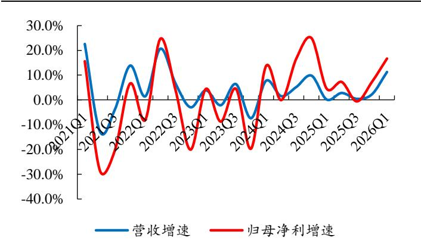  
数据来源：Wind、开源证券研究所（注：中炬高新采用调味品业务美味鲜子公司数据）

图46：2026Q1 酱 醋 公 司 营 收 净 利 分 别 同 比+7.9%/+12.2%  
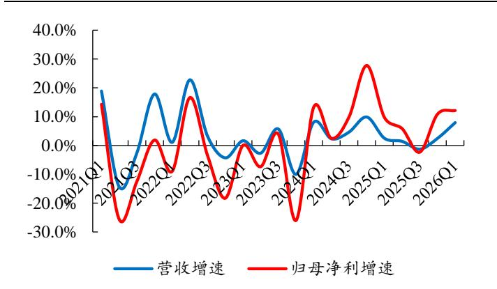  
数据来源：Wind、开源证券研究所（注：中炬高新采用调味品业务美味鲜子公司数据）

毛销差扩大，整体盈利能力提升。2026Q1调味品上市公司（扣除莲花健康以及星湖科技）毛利率为 42.4%，同比+2.3pct，主因 2025 年大豆成本下降的后置影响、糖的成本仍在低位等因素；2026Q1 调味品上市公司整体销售费用率为 8.5%，同比-0.3pct，销售费用率略有优化。毛销差角度来看，2026Q1毛销差呈现同比提升2.7pct。综合成本及费用投放情况，2026Q1调味品上市公司整体盈利能力有所提升，2026Q1调味品上市公司归母净利率为 24.1%，同比提升 1.1pct。

图47：2026Q1 调味品上市公司毛销差同比+2.7pct  
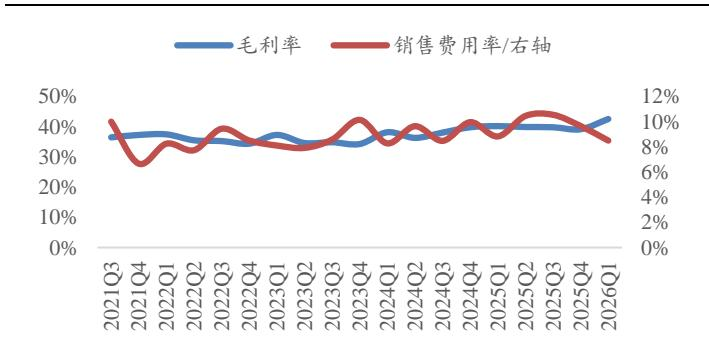  
数据来源：Wind、开源证券研究所

图48：2026Q1 调味品上市公司归母净利率同比+1.1pct  
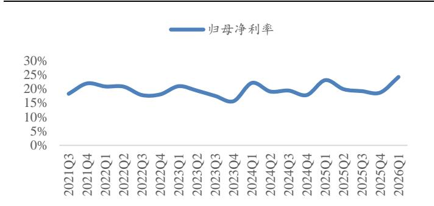  
数据来源：Wind、开源证券研究所（注：中炬高新采用调味品业务美味鲜子公司数据）

图49：2025年 1-9月大豆市场价同比下降，此后逐渐回升  
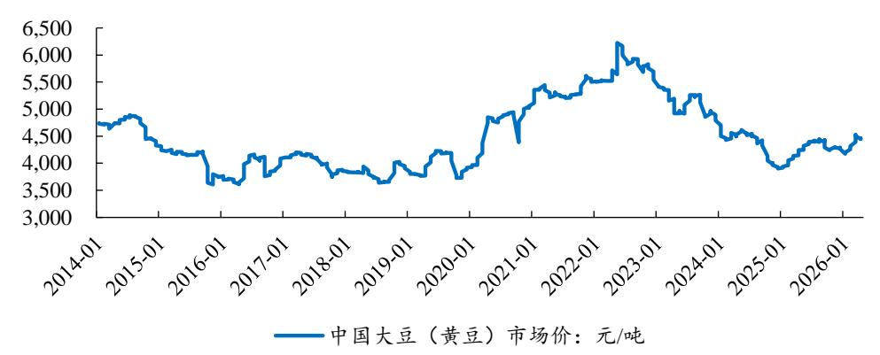  
数据来源： 、开源证券研究所

2026Q1调味品公司普遍改善，龙头海天味业最为稳健。就调味品六家重点公司（海天味业、中炬高新、恒顺醋业、千禾味业、涪陵榨菜、天味食品）来看，基础调味品板块海天味业龙头稳健性及优势尽显，2026Q1收入利润延续前 6个季度的正增长态势，海天味业收入/归母净利润分别增长 8.6%/11.0%。其他调味品公司中，第二梯队中炬高新收入及利润重回增长（分别为同比+19.9%/+45.1%），主因低基数叠加改革成效显现；千禾味业收入及利润仍有所下滑。复合调味料板块天味食品收入及利润增速跑赢大盘，2026Q1在同期基数低、春节错期、备货节奏调整、子公司并表等多重因素的影响下，收入及利润同比分别+76.2%/+234.7%。

表10：调味品重点公司2025Q3营收增长分化，龙头优势凸显

<table><tr><td></td><td></td><td>2024Q3</td><td>2024Q4</td><td>2025Q1</td><td>2025Q2</td><td>2025Q3</td><td>2025Q4</td><td>2026Q1</td></tr><tr><td rowspan="6">营收增速</td><td>海天味业</td><td>9.8%</td><td>10.0%</td><td>8.1%</td><td>7.0%</td><td>2.5%</td><td>11.4%</td><td>8.6%</td></tr><tr><td>中炬高新</td><td>2.2%</td><td>32.6%</td><td>-25.8%</td><td>-9.1%</td><td>-22.8%</td><td>-33.7%</td><td>19.9%</td></tr><tr><td>青业</td><td></td><td></td><td></td><td></td><td></td><td></td><td></td></tr><tr><td>千禾味业</td><td>-12.6%</td><td>-10.3%</td><td>-7.1%</td><td>-29.9%</td><td>-4.3%</td><td>-25.5%</td><td>-1.6%</td></tr><tr><td>涪陵榨菜</td><td>6.8%</td><td>-14.8%</td><td>-4.8%</td><td>7.6%</td><td>4.5%</td><td>2.0%</td><td>5.7%</td></tr><tr><td>天味食品</td><td>10.9%</td><td>21.6%</td><td>-24.8%</td><td>21.9%</td><td>13.8%</td><td>-6.7%</td><td>76.2%</td></tr><tr><td rowspan="6">毛利率</td><td>海天味业</td><td>36.6%</td><td>37.7%</td><td>40.0%</td><td>40.2%</td><td>39.6%</td><td>41.0%</td><td>42.0%</td></tr><tr><td>中炬高新</td><td>8.3%</td><td>11.1%</td><td>5.1%</td><td>5.9%</td><td>6.3%</td><td>5.6%</td><td>6.2%</td></tr><tr><td>恒顺醋业</td><td>35.6%</td><td>31.3%</td><td>35.5%</td><td>42.1%</td><td>34.7%</td><td>20.4%</td><td>35.8%</td></tr><tr><td>千禾味业</td><td>37.5%</td><td>40.1%</td><td>38.9%</td><td>32.6%</td><td>39.0%</td><td>39.3%</td><td>40.8%</td></tr><tr><td>涪陵榨菜</td><td>56.2%</td><td>43.4%</td><td>56.0%</td><td>52.0%</td><td>52.9%</td><td>41.9%</td><td>54.9%</td></tr><tr><td>天味食品</td><td>38.8%</td><td>40.8%</td><td>40.7%</td><td>37.0%</td><td>40.5%</td><td>43.5%</td><td>45.0%</td></tr><tr><td rowspan="6">销售费用率</td><td>海天味业</td><td>5.6%</td><td>6.6%</td><td>5.9%</td><td>7.0%</td><td>7.4%</td><td>6.7%</td><td>5.8%</td></tr><tr><td>中炬高新</td><td>6.3%</td><td>8.8%</td><td>8.6%</td><td>18.9%</td><td>14.3%</td><td>9.6%</td><td>8.6%</td></tr><tr><td>恒顺醋业</td><td>18.8%</td><td>19.0%</td><td>17.1%</td><td>19.4%</td><td>17.2%</td><td>13.1%</td><td>17.3%</td></tr><tr><td>千禾味业</td><td>14.9%</td><td>13.0%</td><td>12.5%</td><td>22.4%</td><td>16.9%</td><td>20.2%</td><td>14.3%</td></tr><tr><td>涪陵榨菜</td><td>17.2%</td><td>12.3%</td><td>12.9%</td><td>17.2%</td><td>18.1%</td><td>14.8%</td><td>13.2%</td></tr><tr><td>天味食品</td><td>7.8%</td><td>15.3%</td><td>22.3%</td><td>10.0%</td><td>10.9%</td><td>15.5%</td><td>12.8%</td></tr><tr><td rowspan="6">净利率</td><td>海天味业</td><td>21.8%</td><td>23.5%</td><td>26.5%</td><td>24.8%</td><td>22.0%</td><td>23.7%</td><td>27.1%</td></tr><tr><td>中炬高新</td><td>17.1%</td><td>20.1%</td><td>16.4%</td><td>7.4%</td><td>12.0%</td><td>15.1%</td><td>19.9%</td></tr><tr><td>恒顺醋业</td><td>5.0%</td><td>1.1%</td><td>9.0%</td><td>10.8%</td><td>6.2%</td><td>0.3%</td><td>10.3%</td></tr><tr><td>千禾味业</td><td>14.4%</td><td>20.7%</td><td>19.3%</td><td>2.6%</td><td>12.9%</td><td>15.0%</td><td>18.1%</td></tr><tr><td>涪陵榨菜</td><td>33.9%</td><td>30.3%</td><td>38.2%</td><td>28.1%</td><td>33.9%</td><td>21.9%</td><td>36.2%</td></tr><tr><td>天味食品</td><td>20.7%</td><td>17.3%</td><td>11.6%</td><td>15.4%</td><td>19.8%</td><td>17.1%</td><td>22.1%</td></tr><tr><td rowspan="6">净利增速</td><td>海天味业</td><td>10.5%</td><td>17.8%</td><td>14.8%</td><td>11.6%</td><td>3.4%</td><td>12.2%</td><td>11.0%</td></tr><tr><td>中炬高新</td><td>32.9%</td><td>-89.3%</td><td>-24.2%</td><td>-31.6%</td><td>-45.7%</td><td>-50.4%</td><td>45.1%</td></tr><tr><td>恒顺醋业</td><td>80.0%</td><td>-114.0%</td><td>2.4%</td><td>40.6%</td><td>17.7%</td><td>-73.6%</td><td>17.9%</td></tr><tr><td>千禾味业</td><td>-22.6%</td><td>13.4%</td><td>3.7%</td><td>-86.7%</td><td>-14.6%</td><td>-45.9%</td><td>-7.7%</td></tr><tr><td>涪陵榨菜</td><td>17.9%</td><td>-23.1%</td><td>0.2%</td><td>-4.6%</td><td>4.3%</td><td>-26.1%</td><td>0.1%</td></tr><tr><td>天味食品</td><td>64.8%</td><td>41.0%</td><td>-57.5%</td><td>62.7%</td><td>8.9%</td><td>-7.6%</td><td>234.7%</td></tr></table>

数据来源：Wind、开源证券研究所

展望 2026 年全年，预计餐饮需求持续复苏，龙头有望优先受益终端需求复苏。收入端来看：（1）调味品需求与餐饮渠道相关性较大；（2）部分调味品公司内部改革仍在推进，改革效果尚未充分释放，随着改革的进一步深化，我们预期改革效果有望逐步推动经营改善。盈利端来看：目前成本红利已经逐步释放，在费用可控的前提下有望逐步释放利润弹性。从 2026年全年维度，我们仍然坚定我们的观点，建议调味品两条布局思路：一是关注高景气度复合调味料赛道；二是关注基础调味品板块行业龙头的个股改善性机会。

## 3.6、 休闲食品：2026Q1零食企业对产品和渠道结构主动调整

2026Q1 零食企业调整渠道产品结构调整，利润增速环比提升。2026Q1 休闲食品上市公司延续渠道变革和品类创新趋势。各零食生产企业中，洽洽食品、有友食品 2026Q1 收入增速分别达 41.5%、39.6%，表现较为亮眼，主要受益于春节旺季下会员店和零食量贩渠道高景气度，以及基数相对较低；渠道端零食量贩龙头万辰集团 2026Q1实现收入 131.1亿元，同比增长 53.7%，渠道产业趋势红利持续释放；除万辰集团外，休闲食品行业A 股上市公司2026Q1合计实现收入 131.1亿元，同比增长 14.0%，旺季实现稳健增长。2026Q1休闲食品行业A 股上市公司整体实现营业收入 297.5 亿元，同比增长 33.2%；整体归母净利润 26.5 亿元，同比增长 195.8%，其中万辰集团高景气和好想你投资鸣鸣很忙确认投资收益贡献较大。

图50：2026Q1休闲食品行业整体营收增速环比有所下降，利润增速环比提升  
  
数据来源：Wind、开源证券研究所

从盈利能力看，2026Q1 休闲食品A 股上市公司的平均毛利率为 27.2%，同比提升0.16pct，保持相对平稳；2026Q1休闲食品A股上市公司整体销售费用率为14.7%，同比下降 1.61pct，可以看出部分公司对抖音电商等高费用渠道主动调整，2026Q1整体毛销差环比有所扩大。2026Q1 休闲食品 A 股上市公司整体归母净利率为 8.91%，同比提升 4.9pct，好想你确认投资收益影响较大，剔除好想你和万辰集团影响，其他A 股上市公司归母净利润同比增长41.8%，可见春节旺季各家零食生产企业经营情况较好。

图51：2026Q1零食上市公司毛销差环比扩大  
  
数据来源：Wind、开源证券研究所

图52：2026Q1零食上市公司整体净利率环比明显提升  
  
数据来源：Wind、开源证券研究所

2026Q1休闲食品重点公司表现各有不同，优质公司受益于渠道变革和新品发展，取得较好增长。观察重点休闲食品六家 A 股上市公司（盐津铺子、劲仔食品、甘源食品、有友食品、洽洽食品、万辰集团）2026Q1表现，收入端增速各有不同，盐津铺子调整渠道策略和产品中心，收入小幅增长；其他重点公司受益于春节旺季错期和新兴渠道高景气，实现较快增长。毛利率端，各家公司原材料相对平稳，渠道结构影响，整体环比毛利率小幅下降；销售费用率端大部分重点公司 2026Q1采取收缩费用策略，环比稳中有降。万辰集团拥抱零食量贩产业趋势，规模效应下利润释放，净利润表现亮眼。

展望未来，重点关注各家零食企业新品新渠道表现。零食企业受益春节错期因素，整体 2026Q1在低基数下收入端实现较好增长，展望后续，我们持续看好后续积极拥抱零食量贩、抖快社交电商和海外市场等新渠道新市场的上市公司，以及看好积极拥抱魔芋、调味坚果等新品趋势的上市公司；另外关注各家零食企业出海市场拓展情况。

表11：2025Q3休闲食品重点公司经营表现不乏亮点

<table><tr><td></td><td></td><td>2024Q4</td><td>2025Q1</td><td>2025Q2</td><td>2025Q3</td><td>2025Q4</td><td>2026Q1</td></tr><tr><td rowspan="6">营收增速(%)</td><td>盐津铺子</td><td>30.0</td><td>25.7</td><td>13.5</td><td>6.0</td><td>-7.5</td><td>2.9</td></tr><tr><td>劲仔食品</td><td>11.9</td><td>10.3</td><td>-10.4</td><td>6.5</td><td>-0.9</td><td>24.2</td></tr><tr><td>甘源食品</td><td>22.0</td><td>-14.0</td><td>-3.4</td><td>4.4</td><td>-13.6</td><td>22.5</td></tr><tr><td>有友食品</td><td>42.9</td><td>39.2</td><td>52.4</td><td>32.7</td><td>16.4</td><td>39.6</td></tr><tr><td>洽洽食品</td><td>2.0</td><td>-13.8</td><td>9.7</td><td>-5.9</td><td>-12.7</td><td>41.5</td></tr><tr><td>万辰集团</td><td>166.7</td><td>124.0</td><td>93.3</td><td>44.2</td><td>27.2</td><td>53.7</td></tr><tr><td rowspan="6">毛利率(%)</td><td>盐津铺子</td><td>27.6</td><td>28.5</td><td>31.0</td><td>31.6</td><td>32.4</td><td>31.8</td></tr><tr><td>劲仔食品</td><td>31.0</td><td>29.9</td><td>28.9</td><td>28.9</td><td>29.4</td><td>27.0</td></tr><tr><td>甘源食品</td><td>35.1</td><td>34.3</td><td>32.8</td><td>37.1</td><td>34.2</td><td>33.9</td></tr><tr><td>有友食品</td><td>25.7</td><td>27.1</td><td>28.0</td><td>26.9</td><td>19.9</td><td>24.3</td></tr><tr><td>洽洽食品</td><td>25.8</td><td>19.5</td><td>21.4</td><td>24.5</td><td>26.6</td><td>25.1</td></tr><tr><td>万辰集团</td><td>11.3</td><td>11.0</td><td>11.8</td><td>12.1</td><td>14.2</td><td>12.9</td></tr><tr><td rowspan="4">销售费用率(%)</td><td>盐津铺子</td><td>11.5</td><td>11.2</td><td>9.8</td><td>8.6</td><td>12.5</td><td>11.2</td></tr><tr><td>劲仔食品</td><td>10.6</td><td>13.4</td><td>14.3</td><td>13.8</td><td>11.0</td><td>10.6</td></tr><tr><td>甘源食品</td><td>12.8</td><td>17.3</td><td>20.0</td><td>17.3</td><td>16.6</td><td>17.3</td></tr><tr><td>有友食品</td><td>10.0</td><td>8.9</td><td>8.0</td><td>8.3</td><td>11.0</td><td>6.9</td></tr><tr><td rowspan="2"></td><td>洽洽食品</td><td>9.8</td><td>10.6</td><td>14.1</td><td>10.1</td><td>11.0</td><td>11.7</td></tr><tr><td>万辰集团</td><td>4.57</td><td>3.31</td><td>2.88</td><td>2.65</td><td>3.20</td><td>2.64</td></tr><tr><td rowspan="6">净利率(%)</td><td>盐津铺子</td><td>10.0</td><td>11.5</td><td>13.8</td><td>15.6</td><td>10.6</td><td>14.6</td></tr><tr><td>劲仔食品</td><td>12.0</td><td>11.4</td><td>8.4</td><td>8.8</td><td>10.9</td><td>9.6</td></tr><tr><td>甘源食品</td><td>15.2</td><td>10.5</td><td>4.9</td><td>13.9</td><td>9.2</td><td>10.7</td></tr><tr><td>有友食品</td><td>12.2</td><td>13.1</td><td>15.0</td><td>13.8</td><td>3.4</td><td>12.3</td></tr><tr><td>洽洽食品</td><td>9.4</td><td>4.9</td><td>1.0</td><td>4.6</td><td>7.3</td><td>7.6</td></tr><tr><td>万辰集团</td><td>2.2</td><td>3.6</td><td>4.1</td><td>5.2</td><td>5.6</td><td>5.8</td></tr><tr><td rowspan="6">净利增速(%)</td><td colspan="7">子</td></tr><tr><td>劲仔食品</td><td>0.3</td><td>-8.2</td><td>-36.3</td><td>-14.8</td><td>-8.8</td><td>5.5</td></tr><tr><td>甘源食品</td><td>-13.9</td><td>-42.2</td><td>-71.0</td><td>-26.3</td><td>-47.2</td><td>25.7</td></tr><tr><td>有友食品</td><td>258.0</td><td>16.2</td><td>77.0</td><td>44.8</td><td>-67.4</td><td>30.7</td></tr><tr><td>洽洽食品</td><td>-24.8</td><td>-67.9</td><td>-88.2</td><td>-72.6</td><td>-32.6</td><td>117.8</td></tr><tr><td>万辰集团</td><td>894.27</td><td>3,344.13</td><td>4,940.33</td><td>361.22</td><td>133.76</td><td>193.12</td></tr></table>

数据来源：Wind、开源证券研究所

## 4、 重点个股：优选龙头，关注消费复苏机会

## 4.1、 贵州茅台：大单品放量价稳，触底信号明确

大单品放量价稳，触底信号明确。公司2026年一季度公司营收 539.09亿元，同比+6.54%；归母净利272.43亿元，同比+1.47%。2026年公司针对产品结构、产品价格、渠道结构均做了较大调整：飞天占比提升，同时飞天出厂价格做了适度提升，直销占比进一步提升，预计吨价下降幅度可控。同时预计随着直营渠道、代售制度、经销商渠道减负等改革落地，销量预计有较大幅度增长。

收入增长主要来自于销量，其中直营渠道增量明显。2026Q1 茅台酒/系列酒分别实现营收 460/79 亿元，同比+5.6%/+12.2%。2026Q1 直销/批发代理分别实现营收295/244 亿元，同比+27.1%/-10.9%；i 茅台 2026Q1 实现营收 215.5 亿元、同比+267%。2026下半年，预计公司将继续补充其他线上直销渠道，直销占比将持续提升。

回款表现符合渠道结构变化。2026Q1 末合同负债余额 30.3亿元，环比下降49.8亿元；2026Q1 销售收现 563.9 亿元同比+0.4%。主要原因是主动减负，经销商渠道回款下降幅度较大。

毛利率下降，盈利能力承压。由于产品结构下降，2026Q1毛利率-2.2pct至89.8%，税金及附加占比+1.1pct，其余费率保持相对稳定，归母净利率同比-2.4pct至49.8%。展望全年，收入增速也将高于利润增速。

## 4.2、 山西汾酒：山西汾酒：渠道回款积极，实际动销顺畅

渠道回款积极，实际动销顺畅。2026Q1 公司实现营业收入 149.23 亿元，同比-9.68%；归母净利润 53.83 亿元，同比-19.03%。2026 年一季度末预收款环比增长 9.1亿，对比 2025年一季度末预收款环比下降28.52亿。实际动销和回款好于收入表现。公司产品结构均衡、全国化基础好，清香型渗透率仍在提升，这些优势共同塑造了公司在低谷期的韧性，2026 年公司仍将直面压力，我们认为公司应该能做好产品之间、市场之间的平衡。

产品结构增长较为均衡。分产品看，2026Q1汾酒收入147.13亿元，同比-9.24%；其他酒类收入 1.68亿元，同比-37.25%。分区域看，省外有所下降，全国化势能不减，是季度间的节奏所致 Q1 省内收入 60.87 亿元，同比+0.06%；省外收入 87.94 亿元，同比-15.41%。

回款、现金流好于预期，报表质量高。2026年一季度末预收款环比增长 9.1亿，对比2025年一季度末预收款环比下降28.52亿。销售收现160.2亿，同比增长16.2%。因此实际动销和回款好于收入表现。

毛利率下降，费用率稳定，净利率下降。2026Q1 毛利率同比下降 3.75pct，营业税金及附加/销售/管理费用率同比分别变化+1.52/-0.36/+0.39pct，公司优化费用效率，费用率保持稳定。净利率同比下降 4.16pct。

## 4.3、 舍得酒业：营收逐步筑底，盈利能力承压

营收逐步筑底，盈利能力承压。2026年一季度公司实现营收14.8亿元，同比-6.0%；实现归母净利 2.3亿元，同比-33.1%；实现扣非归母净利2.2亿元，同比-34.9%。收入业绩符合预期。行业低谷期，公司积极调整产品结构和渠道结构，稳定了产品的市场秩序，待后续行业企稳，收入和业绩仍有较大弹性。

营收降幅收窄，百元及以下大众化产品成重要支撑点。分产品看，一季度中高档/普通酒/非酒类业务分别实现营收 10.5/3.0/1.3 亿元，同比分别-14.6%/+41.9%/-1.3%。舍之道、T68 等百元及以下价格带产品增速较快，品味舍得等次高端产品仍然受整体需求影响，表现较弱。

省内调整得当，电商发力明显。分区域看，一季度省内/省外分别实现营收5.2/8.3亿元，同比+6.1%/-13.0%。公司资源聚焦省内及山东、东北等优势地区，深耕基地市场增强低谷期韧性。一季度电商/批发分别实现营收2.3/11.2亿元，同比+14.2%/-9.9%，公司积极拥抱电商，顺应当下消费习惯开拓新的增长渠道。

渠道目前回款较为谨慎，产品结构下降，盈利能力承压。2026Q1末合同负债余额 1.3 亿元，环比-0.2 亿元，2026Q1 销售收现 12.21 亿元，同比-24.75%。由于产品结构下降，2026Q1毛利率同比-3.0pct至66.3%，公司严控管理支出的同时，对必要的市场动作仍给充分支持，管理费用率/销售费用率分别-1.0pct /+1.9pct，税金及附加占比同比+4.7pct，公司归母净利率同比-6.3pct 至 15.6%。

## 4.4、 古井贡酒：风险逐步释放，报表压力减轻

风险逐步释放，报表压力减轻。2025 年公司实现营收/归母净利润 188.32/35.49亿元，同比-20.13%/-35.67%。2025Q4 实现营收/归母净利润 24.07/-4.11 亿元，同比-46.61%/亏损；2026Q1 实现营收/归母净利润 74.46/16.07 亿元，同比-18.59%/-31.03%。下滑幅度符合预期。公司管理水平优秀，市场秩序稳定，在省内消费者基础尤其稳固，当下属于阶段性去库存，预计二季度起收入走势逐步改善。

产品结构下移，省外调整更大。分产品看，2025 年年份原浆/古井贡酒/黄鹤楼及其他收入分别为 145.9/19.2/20.3 亿元，同比-19.3%/-14.3%/-20.2%，预计年份原浆内部，产品结构整体下移。华中/华南/华北收入分别为 166.5/11.1/10.6 亿元，同比-17.4%/-21.9%/-46.5%，受需求环境影响，省外调整幅度更大。

合同负债下降，分红率提升。2026Q1 末合同负债 23.0 亿元，同比下降 13.7 亿元，原因是考虑到经销商资金压力，2026 年春节公司对回款不做强制性要求，主动缓解渠道压力。2025年拟合计分红 23亿元，（2024年分红32 亿），分红率 65.5%，同比提升 8.0pct，对应股息率 4%。

毛利率下降，费用率提升，盈利能力承压。由于产品结构下降，2025年毛利率79.3%，同比-0.6pct；税金/销售/管理费用率分别为同比+0.7/+2.8/+1.6pct，归母净利率同比-4.6pct至18.8%，Q4单季亏损主要系收入大幅下滑叠加黄鹤楼计提商誉减值所致。2026Q1 毛利率同比-1.8pct。税金/销售/管理费用率分别同比+1.8/+0.1/+0.8pct，净利率同比-3.9pct。

## 4.5、 青岛啤酒：结构升级巩固龙头优势，业绩稳增彰显经营韧性

公司业绩：2025 年实现收入 324.7 亿元，同比+1.0%；归母净利润 45.9 亿元，同比+5.6%。Q4 收入 31.1 亿元，同比-2.3%；归母净利润-6.9 亿元，同比-6.4%，全年业绩整体符合预期。

全年量增价稳结构升级，高端化战略稳步推进。2025 年啤酒实现收入 318.3 亿元，同比+0.8%，其中销量 764.8 万吨，同比+1.5%，吨价 4246 元/吨，同比-0.4%。分档次看，2025年主品牌/中高档以上产品分别实现销量 449.4/331.8万吨，分别同比+3.5%/+5.2%，中高端以上产品销量明显快于整体销量增速。公司产品结构持续优化，高端化战略进展较好，白啤、超高端系列等单品保持快速增长。

山东与华北基地市场韧性凸显，华东区域实现较好增长。分区域看，2025年山东/华北/华南/华东/东南区域分别实现营收 223.2/78.6/34.2 /25.9/6.7 亿元，同比+1.0%/+0.8%/+1.2%/+3.8%/-0.8%。山东基地市场与华北市场依托品牌壁垒与精细化运营保持稳健增长；华东区域通过结构升级与渠道拓展实现较快增长；华南、东南区域受消费复苏偏弱等影响，营收略有承压。

成本下行带动毛利率提升，销售费用率下降，净利率稳步提升。2025年毛利率同比+1.61pct41.84%至，主要受益于部分原材料价格回落，叠加产品结构升级共同拉动。 销售费用率／管理费用率／研发费用率／财务费用率分别同比-0.51pct／+0.13pct／+0.06pct／+0.51pct，销售费用率主要系部分区域业务宣传费用减少，其他费用率相对保持平稳。整体 2025 年归母净利率同比+0.55pct至14.53%，盈利水平实现稳步提升。

## 4.6、 重庆啤酒：高端化进程持续兑现，静待旺季需求回暖

公司业绩：公司 2026年Q1 实现营收43.50亿元，同比-0.12%，归母净利润4.38亿元，同比-7.40%，扣非归母净利润 4.34亿元，同比-7.07%。

高端产品驱动结构升级，主流产品有所承压。2026Q1啤酒收入同比微增0.19%，核心源于高档产品的增长韧性，有效对冲了行业需求环境带来的品类分化压力。分档次看，高档产品延续较好景气度，实现营收 26.66 亿元，同比+2.42%，贡献核心营收增量，高端化战略成效持续凸显。主流产品营收 14.92 亿元，同比-3.75%，主要受受区域消费环境影响有所承压。

渠道基本盘平稳，核心优势区域增长较好。2026Q1批发代理渠道实现营收 42.40亿元，同比+0.05%，渠道基本盘保持稳固，报告期末公司经销商数量 3280 家，较2025 年末净增 91 家。分区域看，西北区核心优势持续巩固，实现营收 12.26 亿元，同比+4.05%；南区营收 12.48 亿元，同比+1.37%，保持稳健增长；中区受区域消费环境影响营收同比-3.08%，后续有望随消费场景复苏逐步修复。

成本下降提升毛利率，费用率提升和所得税上行，净利率下降。2026Q1毛利率同比+1.24pct 至 49.66%，产品结构持续升级叠加原材料成本优化，毛利率上行。销售费用率/管理费用率/研发费用率同比分别+0.60pct/+0.06pct/+0.05pct，销售费用率提升主要系品牌宣传与市场推广投入增加。受费用投入增加与所得税费用上行影响，归母净利率同比-0.8pct 至 10.1%。

## 4.7、 伊利股份：龙头营收重回增长，盈利改善超预期

2025年盈利改善超预期。2025年实现收入1159.3亿元，同比+0.1%；归母净利润 115.65 亿元，同比+36.8%，其中 2025Q4 收入 253.7 亿元，同比-5.1%；归母净利润 11.4 亿元，同比扭亏。2026Q1 收入 348.2 亿元，同比+5.5%；归母净利润 53.95亿元，同比+10.7%。全年盈利改善超预期，Q1业绩符合预期。

2026Q1 液奶受益于春节错期实现正增长。（1）液奶：2025/2026Q1 收入同比-6.1%/+2.3%，2025 年毛利率 31.4%（YoY+0.46pct）。2025 年液奶线下及线上零售额市场份额稳居行业第一，公司不断进行产品推新，新品收入占比达 16.4%，为液奶发展提供内生驱动力，其中优酸乳在新品“嚼柠檬“的拉动下实现双位数增长。2026Q1液奶率先逆势实现正增长，一方面是受益于春节备货错期影响，另一方面也反映终端动销有所改善。（2）奶粉及奶制品：2025/2026Q1 收入同比+10.4%/+6.1%，2025年毛利率 41.6%（YoY+0.56pct）。2025 年婴配粉市场份额达 18.3%（YoY+1.0pct），位居行业第一；成人营养品市占率稳居行业第一；面向餐饮专业客户的奶酪、乳脂业务营收同比增长 30%以上。（3）冷饮：2025/2026Q1 收入同比+12.6%/+7.1%，2025年毛利率 37.9%（YoY+0.47pct），市占率连续 31 年位列第一。

2025Q4利润率修复主因减值减少，2026Q1经营质量显著提升。2025年归母净利率 10.0%（YoY+2.7pct），扣非净利率 9.6%（YoY+4.4pct），改善超预期。2025Q4在原奶红利影响下毛利率提升 1.1pct至 31.9%；澳优商誉减值、原奶相关损失的影响较大，资产减值损失和信用减值损失两项收窄共计修复利润率 13.5pct；综合影响下归母净利率 4.5%（YoY+13.6pct）。2026Q1 毛利率保持提升 0.7pct 至 38.4%；各项费用率均有优化，期间费用率同比-0.5pct；综合影响下归母净利率 15.5%（YoY+0.7pct）。

全年有望稳健增长，高股息凸显配置价值。公司 年经营目标为收入 利润总额分别实现 1215/136 亿元，同比分别+4.8%/+4.7%。展望全年，公司液奶业务力争增速快于行业，多元化业务（成人营养、乳品深加工）持续贡献增量。盈利方面，奶价若能企稳将带动行业竞争趋缓，毛销差及原奶相关减值的弹性有望进一步释放。同时，公司分红政策持续坚定：2025-2027 年现金分红比例不低于 75%，且每股分红不低于 1.22元，2025年实际分红率 75.5%，股息率5.0%，凸显较高配置价值。

## 4.8、 新乳业：业绩再超预期，盈利能力持续提升

2026Q1 公司利润超预期。公司 2026Q1 实现收入 28.43 亿元，同比+8.31%；归母净利润 1.86 亿元，同比+39.89%。业绩表现亮眼，利润超出市场预期。公司产品与渠道结构优化驱动盈利能力持续提升，五年战略规划有望提前达成，同时积极寻求港股上市以探索国际化及多元化品类战略。

低温延续双位数高增，常温业务企稳改善。分品类看，2026Q1核心品类延续强劲增长势头，低温业务延续双位数增长，是公司收入增长的核心驱动力；常温业务继 2025Q4 恢复正增长后，2026Q1 延续企稳改善趋势。公司重点品牌唯品、活润表现不错，新品表现仍亮眼，2026Q1新品延续双位数占比，与山姆合作的玫瑰酒酿酸奶和焦糖布丁表现良好，芭乐酸奶回归有望继续贡献增量；活润系列推出新品“开心芭”，迭代轻食瓶、轻食杯。渠道方面，DTC 模式整体表现良好，新兴渠道引领大盘增长。展望未来，随着公司产品创新能力的持续兑现和渠道的不断深耕，核心业务有望保持稳健增长。

盈利能力持续提升，结构优化成效显著。2026Q1 毛利率同比提升 0.47pct 至29.97%，主要得益于产品结构的持续优化。费用端，公司在加大品牌建设投入的同时 精 细 化 管 控 费 用 ， 2026Q1 销 售 / 管 理 / 研 发 / 财 务 费 用 率 分 别 为17.1%/3.5%/0.3%/0.7%，同比+0.1pct/-0.1pct/-0.1pct /+0.0pct。此外，联营企业投资收益增加使得投资收益有所改善、2026Q1未计提资产减值损失、淘牛价格上涨促进资产处置收益改善，三项累计对净利率的贡献+0.9pct。综合来看，公司盈利能力大幅提升，归母净利率达6.56%（YoY+1.48pct），再次验证了公司五年战略规划的有效性及优秀的盈利提升能力。

## 4.9、 双汇发展：一季度业绩表现良好，肉类销量高增验证改革成效

2026Q1 业绩表现良好。公司 2026Q1 实现营收 145.5 亿元，同比+1.96%；归母净利润 12.92 亿元，同比+13.59%；扣非后归母净利润 12.76 亿元，同比+20.24%。毛利率 19.7%（YoY+2.7pct），归母净利率 8.8%（YoY+0.9pct），业绩表现良好。

肉制品以量为先成效显著，新兴渠道延续高增。2026Q1 肉制品实现营收 63.9亿元，同比增14.4%，其中销量/单价分别约为35.8万吨、17.9元/公斤，同比分别+15.1%、-0.6%，销量改善一方面受到 2025 年同期低基数的影响，另一方面是由于专业化改革和市场创新成效显著。营业利润 17.6亿元，同比增19.4%，吨利约4921元，同比+3.7%，主因 2026Q1 规模提升幅度较大、成本有所下降。公司渠道改革持续深化，2026Q1传统渠道销量止跌回升，同比+7.4%，新兴渠道表现亮眼，销量同比增长53.6%，占比达 22%。展望全年，公司持续改革、加大市场投入，肉制品销量有望保持稳健增长，同时继续主动以利换量，预计全年吨利稳中有降、仍保持在高位。

屠宰板块坚持稳利扩量，养殖业务表现分化。2026Q1屠宰业务实现营业收入66.5亿元，同比降 5.0%，其中生鲜猪肉销量/单价（以外部交易收入/外销量计算）分别约为 39.9 万吨、14.8 元/公斤，同比分别+15.7%/-21.9%，屠宰量 382 万头，同增 33.8%，头均利润 31.2 元/头，同比降 25.4%。营业利润 1.19 亿元，同比降 0.2%。公司抓住低猪价窗口期，坚持“稳利扩量”策略，积极抢占市场份额。展望全年，预计屠宰量继续快速增长，头均利润稳中略降。2026Q1 养殖等其他业务营业利润亏损 1.62亿元，主要受养猪业影响（猪价低迷叠加规模提升），养禽业持续改善，大幅减亏。全年看养猪利润仍然承压，但养殖指标已逐步改善，而禽产业预计有望扭亏为盈。

## 4.10、 海天味业：收入利润稳健增长，未来发展空间可期

公司披露2026年一季报，收入利润符合预期。公司披露 2026年一季报。2026Q1公司营收/归母净利润分别为 90.29/24.44 亿元（同比+8.57%/+10.97%），收入利润符合预期。

核心品类稳中有进，其他品类延续高增态势。产品端：2026Q1 公司酱油/蚝油/调味酱营收分别同比+7.48%/+4.60%/+1.12%，醋、料酒、复合调味料等品类快速增长，带动其他品类营收同比+20.32%。渠道端：线下渠道基本盘稳固，营收同比+7.72%；公司持续推进线上渠道布局，新零售与电商渠道表现亮眼，带动线上渠道同比高增19.62%。产品结构持续优化，健康化、高端化趋势延续。

成本压力缓解+产品结构升级，盈利能力同比改善。2026Q1 公司毛利率/净利率分别同比+1.95/0.52pct至42.0%/27.1%。其中毛利率提升主要系受益于原材料成本下行以及产品结构升级。费用端，2026Q1公司整体费用同比+1.56pct，其中销售/管理研发/财务费用率分别同比-0.16/+0.33/+0.03/+1.36pct。

龙头优势明显，未来发展空间可期。展望 年，我们认为公司有望保持稳健增长势头，C 端保持产品结构升级，同时通过生产效率提升及规模效应释放，盈利水平仍有提升空间。同时公司已发布 2026年A股员工持股计划（草案），针对董事、高管及部分业务负责人考核期以2025年归母净利润为基数，要求 2025-2027年归母净利润年复合增长率不低于 11.5%（剔除并购重组影响），充分激发公司内部活力，看好公司长期发展空间。

## 4.11、 中炬高新：改革成效显现，2026Q1经营明显改善

2025 年年报及 2026 年一季度报告披露，2026Q1 基本面改善。公司披露 2025年年报及 年一季报。 年营收/归母净利润 / 亿元（同比 / ）；2026Q1 营收/归母净利润 13.2/2.6 亿元（同比+19.9%/+45.1%），美味鲜营收/归母净利润 12.4/2.4 亿元（同比+14.6%/34.3%）。2026Q1 收入利润略超预期。

改革调整成效初显，2026Q1 经营表现亮眼。公司改革调整持续推进，2025 年经营仍有所承压，但 2026Q1 经营明显改善，我们认为主要系：（1）2026 年春节时点后移叠加 2025Q1 营收基数较低；（2）改革效果逐步显现。分产品：2025 年酱油

鸡精鸡粉/食用油/其他产品营收均有所下滑，2026Q1 各品类营收增速分别为 13.1%／25.8%／113.0%／-10.5%；分地区：2025 年各区域营收均下滑，2026Q1 除北部区域营收同比微降，东部/中西部区域营收同比高增 38.2%/27.5%，南部区域营收亦增长 5.1%。

成本下降+产品结构优化+费用管控，2026Q1 盈利能力明显改善。2025 年公司毛利率/净利率同比-0.61/-4.56pct 至 39.2%/12.8%，2026Q1 毛利率/净利率同比+3.7/+3.5pct 至 42.4%/20.0%。我们认为 2026Q1 盈利能力改善主要系：（1）公司优化产品结构；（2）成本管控有效；（3）费用投放效率提升，2026Q1整体费用率同比-0.34pct，其中销售费用率同比微增 0.01pct,管理/研发/财务费用率分别同比-0.11/-0.12/-0.12pct。

产品渠道双管齐下，内生+外延有望共同支撑长期发展。报告期内公司收购四川味滋美 55%股权，以火锅底料为突破口切入复调赛道，同时主导大单品+细分定制策略，集中资源打造核心单品，强化餐饮端定制化服务能力，提升 B 端客户粘性。产品渠道双管齐下有望打开公司长期增长空间。

## 4.12、 天味食品：2026Q1收入利润超预期，内部激励持续优化

公司披露2026年一季报，收入利润超预期。公司2026年一季度报告发布，2026Q1公司营收/归母净利润11.3/2.5 亿元（同比+76.2%/+234.7%），收入利润超预期。

低基数下营收高增，线上线下快速增长。2026Q1公司收入同比增速超预期，我们认为主要系：（1）2025Q1 基数低且 2026 年春节时点后移；（2）备货节奏调整，2026Q1 将小龙虾调料备货节奏提前；（3）一品味享并表影响。分产品：2026Q1 火锅 调 料 / 菜 谱 式 调 料 / 香 肠 腊 肉 调 料 / 其 他 收 入 分 别 同 比+100.4%/+56.7%/+125.2%/+313.9% ；分渠道：2026Q1 线上/线下收入分别同比+48.0%/+90.5%。

费用投放节约+产品结构优化，2026Q1 净利率创新高。2026Q1 公司净利率为23.2%（同比+10.5pct），盈利大幅改善主要系：（1）高毛利率产品占比提升，2026Q1毛利率同比+4.3pct至 45.0%；（2）费用投放节约，尤其销售费用率2026Q1缩减明显（同比-9.5pct），管理/研发/财务费用率分别同比-3.1/-0.3/+0.1pct。

内生+外延多点发力，产品渠道双轮驱动长期增长。公司发布 2026 年员工持股计划，根据考核规划，设定 2026/2027 年两个考核期，以 2025 年营收为基数，要求2026/2027 年营收增速分别不低于 16%/30%。同时叠加个人绩效考核，形成“公司+个人”双重约束，激励核心团队聚焦业绩增长，有助于激发团队积极性。我们认为公司 C端渠道地位逐步稳固，且重点突破小 B渠道，外延收购不断补齐公司短板渠道，渠道完善有望打开公司长期增长天花板。

## 4.13、 涪陵榨菜：2026Q1稳健增长，收入利润符合预期

公司披露 2026 年一季报。2026Q1 营收/归母净利润分别为 7.5/2.7 亿元（同比+5.7%/+0.1%），收入利润符合预期。公司积极拓展新业务，新产品新渠道有望取得突破。

改革成效渐显，2026Q1 营收稳健增长。公司在 2025 年积极进行改革调整，改革成效渐显，扭转近两年下滑态势，带动 2025 年营收重归正增长（同比+1.9%），2026Q1营收增速进一步加速至 5.7%。目前公司在榨菜品类上实现多价格带布局，榨菜品类恢复稳健增长态势。同时 2026Q1萝卜以及其他品类增长表现比较好。

盈利能力同比略降，销售费用投放力度有所加大。2026Q1 公司归母净利润同比微增 0.07%至 2.7 亿元，2026Q1 公司毛利率 /净利率分别同比 -1.1/-2.0pct 至54.9%/36.2%，毛利率波动主要系原材料成本及产品结构影响。费用端，2026Q1 整体 费 用 率 同 比 +0.53pct ， 其 中 销 售 / 管 理 / 研 发 / 财 务 费 用 率 分 别 同 比+0.27/-0.23/+0.23/+0.26pct。

公司改革红利有望持续释放，未来稳健增长可期。公司通过多价位带、多规格等方式挖掘主力产品榨菜的增长点，同时积极挖掘萝卜、海带等品类的增长潜力。在渠道端，同时公司设立大客户群营业部，针对山姆、盒马等大型商超合作提供直营服务，并且积极拥抱抖音等新兴电商平台。有望通过渠道+产品双轮驱动，打开成长天花板。

## 4.14、 盐津铺子：渠道结构主动调整，净利率持续提升

产品聚焦魔芋，渠道结构主动调整。公司 2026Q1 实现收入 15.8 亿元，同比增长 2.9%，实现归母净利润 2.3 亿元，同比增长 29.5%，利润表现较亮眼。公司 2026一季度收入增速 2.9%，略低于市场预期，公司产品品类更聚焦魔芋等大单品，电商渠道主动战略收缩，对整体收入产生影响；线下渠道受益春节旺季表现较好，零食量贩渠道仍有较快增速，定量流通渠道大魔王产品持续铺货，贡献收入增长。魔芋零食有望成为对标薯片糖巧级别的大品类休闲零食，看好公司把握品类红利，展望未来大魔王扩展新口味，网点扩张和单店购买力共同提升，实现持续成长。

净利率明显提升，看好后续成长。2026Q1公司毛利率为31.8%，同比提升3.4pct，毛利率表现较好，主要受益于渠道结构和产品结构优化，电商渠道主动收缩低毛利品类改善盈利质量，另外公司魔芋原材料受益于前期主动战略囤货，其他各原材料价格相对平稳。公司2026Q1销售费用率为11.2%、管理费用率为 3.4%，保持平稳。公司 2026Q1净利率达14.6%，同比提升 3.0pct，利润表现亮眼。展望 2026年公司渠道结构持续优化，零食量贩拓店贡献增长，产品端储备海味零食、豆制品等潜力新品，看好后续成长。

## 4.15、 甘源食品：环比持续改善，关注后续旺季增长

春节旺季贡献增长，电商、海外实现高增。公司2025 年实现收入20.9亿元，同比下降 7.1%，实现归母净利润 2.08 亿元，同比下降 44.6%，其中 2025Q4 单季营收5.6 亿元，同比下降13.6%，归母净利润 0.52亿元，同比下降 47.2%，主要系春节错期所致；2026Q1 实现收入6.2 亿元，同比增长22.5%，归母净利润 0.66亿元，同比增长 ，受益于旺季销售较好，公司在产品端推陈出新，春糖推出风味豆类坚果延展品类，发力招商，在低基数下，公司有望实现困境反转。

分产品看，2025 年公司综合果仁、青豆、瓜子仁、蚕豆、其他系列分别实现收入 5.7、5.3、2.8、2.8、4.1 亿元，同比分别变化-18.6%、+1.1、-6.5%、+0.3%、-6.8%。分区域看，2025 年华东、电商、西南、华中、华南、华北、境外、西北、东北分别实现收入 6.5、3.3、2.7、2.5、1.9、1.6、1.2、0.7、0.5 亿元，同比分别变化-1.3%、+35.8%、-27.0%、-26.0%、+20.8%、-33.4%、+38.5%、-29.0%、-32.3%，其中电商和境外业务实现高增。公司推进渠道改革，部分商超经销转直营，2025 公司经销模式收入15.8亿元，同比下降17.7%，直营及其他模式收入1.6亿元，同比增长101.9%。2026Q1公司收入增长22.5%，受益于春节旺季，表现较好。

毛利率相对稳健，线上推广营销影响净利。2025Q4公司毛利率为 34.2%，同比下降 1.0pct，分品类看，2025 年公司综合果仁、青豆、瓜子仁、蚕豆、其他系列毛利率分别为 25.1%、43.9%、40.7%、42.0%、25.4%，同比分别-2.7、-2.0、-4.0、+1.0、+1.2pct，2026Q1 毛利率达 33.9%，同降 0.4pct，保持平稳。费用方面，公司 2025Q4、2026Q1 销售费用率分别为 16.6%、17.3%，同比+3.8pct、-0.1pct，其中 2025Q4 线上推广品牌营销支出有所影响；2025Q4、2026Q1 管理费用率 4.5%、3.5%，同比+0.8pct、-1.3pct，保持稳健。

## 4.16、 劲仔食品：收入环比改善，期待旺季表现

鱼制品稳健增长，线上渠道战略收缩。公司 2025年实现收入 24.4亿元，同比增长 1.3%，实现归母净利润 2.43 亿元，同比下滑 16.7%，其中 2025Q4 单季营收 6.3亿元，同比下降 0.9%，归母净利润 0.70 亿元，同比下降 8.8%，主要系春节错期所致；2026Q1 实现收入7.4亿元，同比增长 24.2%，归母净利润 0.71亿元，同比增长5.5%，公司春节旺季销售较好。

分产品看，鱼制品、禽类制品、豆制品2025年分别实现收入 16.5、4.5、2.3 亿元，同比分别变化+7.3%、-11.9%、-6.5%，鱼制品增长稳健，鹌鹑蛋品类有所回落。分区域看，华东、西南、华中、华南、线上分别实现收入 7.5、3.3、3.0、3.0、3.4亿元，同比分别变化+16.2%、+7.9%、+0.03%、+3.6%、-11.8%，线上渠道公司战略收缩有所回落；线下渠道方面零食量贩增速较好。

成本短期承压，员工计划锁定远期成长。公司2025Q4、2026Q1毛利率为29.4%、27.0%，同比下降 1.6pct、2.9pct，2025Q4 渔获季存储的高价鱼类原材料可能影响 2026全年毛利水平。分品类看，2025年公司鱼制品、禽类制品、豆制品毛利率分别为29.8%、24.6%、32.7%，同比变化-2.3、+3.6、+0.5pct。公司 2025Q4、2026Q1 销售费用率分别为 11.0%、10.6%，同比变化+0.4、-2.8pct，其中春节旺季品牌推广主动调整。公司 2025Q4、2026Q1 管理费用率为 5.3%、3.7%，同比变化+1.0、-0.3pct。公司已发布员工持股计划，其中考核目标 2026、2027 年收入目标增速分 2 档，分别为 20%、15%，设定员工持股计划有利于提升公司员工积极性和忠诚度，建立长期绩效激励体系。

## 4.17、 万辰集团：收入维持高增，净利率水平超预期

零食量贩业务持续成长，门店稳健提升。公司发布2026Q1 季报，实现营收166.3亿元，同比+53.7%，实现归母净利润 6.3 亿元，同比+193.1%。预计公司 2026 年保持稳步拓店，港股股票推进发行，看好公司后续经营效率持续提升。公司 2026Q1实现营收同比增长 53.7%，其中，量贩零食业务实现收入 164.37 亿元，主因量贩门店持续扩张，同时春节错期背景下，旺季销售表现亮眼，2025 年末公司门店达18314家，估计 2026 年一季度保持持续拓店，预计 2026 年公司持续向华南、西北、东北等相对空白区域扩张，公司 2026 全年有望拓店超过5000 家。公司2026Q1实现食用菌业务收入 1.97亿元，同增48.1%，基数较低，增速较快。

规模效应提升，利润率表现亮眼。公司2026Q1毛利率 12.9%，同增1.9pct，受益公司规模效应显现，门店经营效率提升。公司2026Q1销售费用率2.6%，同降0.7pct，受益于公司零食量贩业务在周转、拓展、人效和供应链方面持续优化，费效比提升；管理费用率 2.7%，同升 0.2pct，保持相对平稳。公司 2026Q1 年实现归母净利润 6.3亿元，归母净利率 3.8%，同增 1.8pct，扣除股份支付影响后实现净利润 9.6亿元，对应净利率为 5.8%，同增1.95pct，表现亮眼。

## 4.18、 东鹏饮料：特饮稳增+其它饮料放量，多品类战略持续深化

公司业绩：2026 年 Q1 实现营收 58.88 亿元，同比+21.46%，归母净利润 12.57亿元，同比+28.31%，扣非归母净利润 12.00 亿元，同比+25.15%。

能量饮料增长韧性较好，其它饮料放量高增。2026Q1 特饮营收44.12 亿元，同比+13.11%，增速环比改善，增长源于春节旺季经销商补库需求集中释放，叠加终端冰冻化资源落地带动单点卖力提升，主业增长韧性较好。电解质饮料补水啦营收 6.45亿元，同比+13.21%，增速回落主要系其它新品春节加大产能倾斜、焕新代言包装等，真实动销端更快。其他饮料营收 8.26亿元，同比+120.36%，成为Q1核心增量引擎，主要系茶饮、咖啡、椰汁等多品类协同放量，春节礼盒与大包装产品精准匹配消费场景，依托全国化渠道网络实现快速铺市。

华北华西等市场高速增长，华南基地市场保持稳健发展。2026Q1华东、华北战区延续高景气度，分别实现营收 10.53亿元、9.20亿元，同比分别+42.14%、+43.62%，全国化布局成效持续兑现；华中、华西战区分别实现营收 13.67亿元、9.70亿元，同比分别+17.85%、+19.24%，保持双位数稳健增长；华南大本营战区实现营收 14.07亿元，同比+2.97%，基本盘保持平稳。

成本优化带动毛利率稳增，费用投放效率持续提升，净利率稳步上行。2026Q1毛利率同比+2.42pct 至 46.89%，主要受益于公司提前锁价，PET、白砂糖等原料红利持续。销售费用率/管理费用率/研发费用率同比分别+0.61pct/+0.30pct/+0.02pct，销售费用同比增长主要系春节旺季营销与终端冰冻化建设投入增加。受毛利率提升带动，Q1 净利率同比+1.14pct 至 21.35%。

表12：重点公司盈利预测及估值

<table><tr><td rowspan="2">公司名称</td><td rowspan="2">评级</td><td rowspan="2">收盘价(元)</td><td colspan="3">EPS(元)</td><td colspan="3">PE</td></tr><tr><td>2026E</td><td>2027E</td><td>2028E</td><td>2026E</td><td>2027E</td><td>2028E</td></tr><tr><td>贵州茅台</td><td>买入</td><td>1285.9</td><td>68.02</td><td>71.60</td><td>74.56</td><td>18.9</td><td>18.0</td><td>17.2</td></tr><tr><td>泸州老窖</td><td>买入</td><td>91.9</td><td>6.55</td><td>6.86</td><td>7.14</td><td>14.0</td><td>13.4</td><td>12.9</td></tr><tr><td>山西汾酒</td><td>买入</td><td>128.6</td><td>10.15</td><td>10.53</td><td>11.35</td><td>12.7</td><td>12.2</td><td>11.3</td></tr><tr><td>古井贡酒</td><td>增持</td><td>93.6</td><td>7.05</td><td>7.85</td><td>8.67</td><td>13.3</td><td>11.9</td><td>10.8</td></tr><tr><td>金徽酒</td><td>增持</td><td>21.2</td><td>0.75</td><td>0.82</td><td>0.91</td><td>28.2</td><td>25.8</td><td>23.3</td></tr><tr><td>伊利股份</td><td>买入</td><td>26.3</td><td>1.93</td><td>2.13</td><td>2.29</td><td>13.6</td><td>12.3</td><td>11.5</td></tr><tr><td>新乳业</td><td>增持</td><td>16.9</td><td>1.00</td><td>1.13</td><td>1.28</td><td>16.9</td><td>14.9</td><td>13.2</td></tr><tr><td>双汇发展</td><td>增持</td><td>25.8</td><td>1.54</td><td>1.59</td><td>1.65</td><td>16.8</td><td>16.2</td><td>15.6</td></tr><tr><td>中炬高新</td><td>增持</td><td>19.2</td><td>0.91</td><td>1.01</td><td>1.14</td><td>21.0</td><td>19.0</td><td>16.8</td></tr><tr><td>涪陵榨菜</td><td>买入</td><td>11.7</td><td>0.71</td><td>0.75</td><td>0.81</td><td>16.5</td><td>15.6</td><td>14.5</td></tr><tr><td>海天味业</td><td>买入</td><td>35.7</td><td>1.35</td><td>1.51</td><td>1.68</td><td>26.4</td><td>23.6</td><td>21.2</td></tr><tr><td>西麦食品</td><td>增持</td><td>20.4</td><td>1.18</td><td>1.41</td><td>1.67</td><td>17.3</td><td>14.5</td><td>12.2</td></tr><tr><td>广州酒家</td><td>增持</td><td>14.2</td><td>0.95</td><td>1.00</td><td>1.04</td><td>14.9</td><td>14.2</td><td>13.6</td></tr><tr><td>甘源食品</td><td>买入</td><td></td><td></td><td></td><td></td><td></td><td></td><td></td></tr><tr><td>劲仔食品</td><td>增持</td><td>10.9</td><td>0.59</td><td>0.67</td><td>0.77</td><td>18.4</td><td>16.2</td><td>14.1</td></tr><tr><td>天味食品</td><td>增持</td><td>15.3</td><td>0.64</td><td>0.74</td><td>0.84</td><td>24.0</td><td>20.7</td><td>18.3</td></tr></table>

数据来源：Wind、开源证券研究所（收盘价日期为 2026年 5月 25日）

## 5、 风险提示

（1）宏观经济波动风险：宏观经济环境直接影响居民收入水平和消费意愿，如果宏观经济下行，将影响白酒、大众品消费需求。

（2）消费复苏进度低于预期风险：消费复苏进度影响终端需求，若复苏进度低于预期、市场需求偏弱，公司终端动销将会承压，进而影响业绩。

（3）原材料价格波动风险：部分子行业中原材料占成本的比例较高，若原材料价格波动较大，将影响企业生产成本，从而影响公司盈利能力。

## 特别声明

《证券期货投资者适当性管理办法》、《证券经营机构投资者适当性管理实施指引（试行）》已于2017年7月1日起正式实施。根据上述规定，开源证券评定此研报的风险等级为R4（中高风险），因此通过公共平台推送的研报其适用的投资者类别仅限定为专业投资者及风险承受能力为C4、C5的普通投资者。若您并非专业投资者及风险承受能力为C4、C5的普通投资者，请取消阅读，请勿收藏、接收或使用本研报中的任何信息。

因此受限于访问权限的设置，若给您造成不便，烦请见谅！感谢您给予的理解与配合。

## 分析师承诺

本研究报告的署名人员具有中国证券业协会授予的证券投资咨询执业资格或相当的专业胜任能力，以勤勉的职业态度，独立、客观地出具本报告，并对内容和观点负责。本报告清晰准确地反映了署名人员的研究观点，所包含的分析基于各种假设，不同假设可能导致分析结果出现重大不同。本报告采用的各种估值方法及模型均有其局限性，估值结果不保证所涉及证券能够在该价格交易。本报告署名人员保证他们报酬的任何一部分不曾与，不与，也将不会与本报告中具体的推荐意见或观点有直接或间接的联系。

## 股票投资评级说明

<table><tr><td></td><td>评级</td><td>说明</td></tr><tr><td rowspan="4">证券评级</td><td>买入(Buy)</td><td>预计相对强于市场表现20%以上;</td></tr><tr><td>增持(outperform)</td><td>预计相对强于市场表现5%~20%;</td></tr><tr><td>中性(Neutral)</td><td>预计相对市场表现在-5%~+5%之间波动;</td></tr><tr><td>减持(underperform)</td><td>预计相对弱于市场表现5%以下。</td></tr><tr><td rowspan="3">行业评级</td><td>看好(overweight)</td><td>预计行业超越整体市场表现;</td></tr><tr><td>中性(Neutral)</td><td>预计行业与整体市场表现基本持平;</td></tr><tr><td>看淡(underperform)</td><td>预计行业弱于整体市场表现。</td></tr><tr><td colspan="3">备注:评级标准为以报告日后的6~12个月内,证券相对于市场基准指数的涨跌幅表现,其中A股基准指数为沪深300指数、港股基准指数为恒生指数、新三板基准指数为三板成指(针对协议转让标的)或三板做市指数(针对做市转让标的)、美股基准指数为标普500或纳斯达克综合指数。我们在此提醒您,不同证券研究机构采用不同的评级术语及评级标准。我们采用的是相对评级体系,表示投资的相对比重建议;投资者买入或者卖出证券的决定取决于个人的实际情况,比如当前的持仓结构以及其他需要考虑的因素。投资者应阅读整篇报告,以获取比较完整的观点与信息,不应仅仅依靠投资评级来推断结论。</td></tr></table>

## 分析、估值方法的局限性说明

本报告所包含的分析基于各种假设，不同假设可能导致分析结果出现重大不同。本报告采用的各种估值方法及模型均有其局限性，估值结果不保证所涉及证券能够在该价格交易。

## 法律声明

开源证券股份有限公司是经中国证监会批准设立的证券经营机构，已具备证券投资咨询业务资格。

本报告仅供开源证券股份有限公司（以下简称“本公司”）的客户使用。本公司不会因接收人收到本报告而视其为客户。本报告是发送给开源证券客户的，属于商业秘密材料，只有开源证券客户才能参考或使用。

本报告是基于本公司认为可靠的已公开信息，但本公司不保证该等信息的准确性或完整性。本报告所载的资料、工具、意见及推测只提供给客户作参考之用，并非作为或被视为出售或购买证券或其他金融工具的邀请或向人做出邀请。本报告所载的资料、意见及推测仅反映本公司于发布本报告当日的判断，本报告所指的证券或投资标的的价格、价值及投资收入可能会波动，过往的业绩表现不应作为其日后表现的预示。在不同时期，本公司可发出与本报告所载资料、意见及推测不一致的报告。客户应当考虑到本公司可能存在可能影响本报告客观性的利益冲突，不应视本报告为做出投资决策的唯一因素。本报告中所指的投资及服务可能不适合个别客户，不构成客户私人咨询建议。本公司未确保本报告充分考虑到个别客户特殊的投资目标、财务状况或需要。本公司建议客户应考虑本报告的任何意见或建议是否符合其特定状况，以及（若有必要）咨询独立投资顾问。在任何情况下，本报告中的信息或所表述的意见并不构成对任何人的投资建议。在任何情况下，本公司不对任何人因使用本报告中的任何内容所引致的任何损失负任何责任。若本报告的接收人非本公司的客户，应在基于本报告做出任何投资决定或就本报告要求任何解释前咨询独立投资顾问。投资者应自主作出投资决策并自行承担投资风险，任何形式的分享证券投资收益或者分担证券投资损失的书面或口头承诺均为无效。

开源证券在法律允许的情况下可参与、投资或持有本报告涉及的证券或进行证券交易，或向本报告涉及的公司提供或争取提供包括投资银行业务在内的服务或业务支持。开源证券可能与本报告涉及的公司之间存在业务关系，并无需事先或在获得业务关系后通知客户。

本报告的版权归本公司所有。本公司对本报告保留一切权利。未经本公司事先书面授权，本报告的任何部分均不得以任何方式制作任何形式的拷贝、复印件或复制品，或再次分发给任何其他人，或以任何侵犯本公司版权的其他方式使用。所有本报告中使用的商标、服务标记及标记均为本公司的商标、服务标记及标记。

## 开源证券研究所

地址：上海市浦东新区世纪大道1788号陆家嘴金控广场1号楼3层邮编：200120邮箱：research@kysec.cn

北京地址：北京市西城区西直门外大街 号金贸大厦 座 层邮编：100044邮箱：research@kysec.cn

深圳地址：深圳市福田区金田路2030号卓越世纪中心1号楼45层邮编：518000邮箱：research@kysec.cn

西安地址：西安市高新区锦业路1号都市之门B座5层邮编：710065邮箱：research@kysec.cn