## 2026中国白酒市场中期研究报告

## 编委会

# 报告撰写：中国酒业协会市场专业委员会

撰写成员：

组 长：刘振国

副组长：闫一楠

成 员：陈赫名 程 浩

毕马威成员：孟 璐 刘世钦 梁颖红 吕桂萍 曾佩怡

© 2026 毕马威华振会计师事务所 (特殊普通合伙) — 中国合伙制会计师事务所，毕马威企业咨询 (中国) 有限公司 — 中国有限责任公司，毕马威会计师事务所 — 澳门特别行政区合伙制事务所，及毕马威会计师事务所 — 香港特别行政区合伙制事务所，均是与毕马威国际有限公司 (英国私营担保有限公司) 相关联的独立成员所全球组织中的成员。版权所有，不得转载。在中国印刷。

## 目 录

引言……1
第一部分 2026 年 1 月-6 月白酒市场表现……2
第二部分 2026 年 1 月-6 月白酒市场环境变化……10
第三部分 促进酒类市场健康发展的观点……22
结束语……25
关于《2026 国白酒市场中期研究报告》调查问卷……25
感谢……25
说明……25
声明……26

## 引 言

2026 年是“十五五”开局之年，也是中国酒业新旧动能转换的关键之年。继 2025 年深度结构性调整的发展惯性，行业正逐步告别规模扩张，向价值深耕的新发展周期迈进。但多重结构性矛盾持续凸显：存量博弈格局延续，产业态势进一步分化，消费动能偏弱，名酒企业持续下沉，传统与新兴渠道博弈加剧，消费场景加速迭代等行业态势，引发全行业广泛关注与深度思考。

为此，中国酒业协会发挥行业资源整合优势和桥梁纽带作用，以2026年1-6月白酒市场动态为观测窗口，观察酒类消费市场表现情况，并分析其背后逻辑及成因，判断未来趋势和需要关注的重点，力求全面、客观地反映酒类市场环境演变。

## 第一部分 2026年 1月-6月白酒市场表现

## 一、经营指标：陷入“三重收缩”困境，利润端遭受冲击

据国家统计局数据，2026 年一季度全国规模以上白酒企业产量 95.2 万千升，同比下降 1.7%1，较 2025 年同期（-7.2%）改善 5.5 个百分点，呈现“降幅收窄”的积极信号。2026 年一季度，20 家 A 股上市白酒企业合计实现营业收入 1,326.33 亿元，同比仅下滑 0.7%；归母净利润合计520.19 亿元，同比下滑 1.75%2。尽管营收、净利润同比依然双降，但对比 2025 年一季度的业绩表现，2026 年一季度同比近乎持平，行业展现出明确边际改善信号。

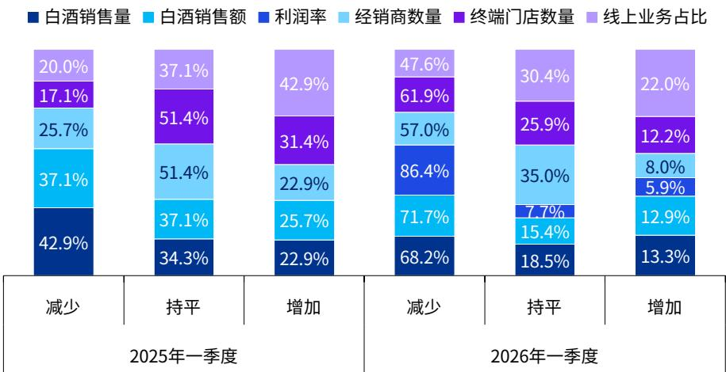

图 1-1：2025 年一季度与 2026 年一季度白酒调研企业经营指标变化情况 3《2026 中国白酒市场中期研究报告》调研数据显示，白酒生产企业经营情况与 2025 年同期相比仍旧下滑。白酒销售量和销售额的“减少”占比均超过 65%，销售额下滑幅度甚至超过销售量，说明不仅量在萎缩，价格端也可能存在下行压力。超过 86%的调研企业反馈利润率下降，利润率增加占比仅剩 5.9%，这反映出白酒行业正经历典型的“量价利三杀”。终端门店数量的收缩幅度最大（61.9%），经销商数量紧随其后。经销商和终端门店双双收缩，这反映出渠道端正在经历主动去库存、缩链路的过程。经销商和终端在需求不振的情况下减少进货、缩减网点，进一步加剧了酒企的出货压力。2025 年一季度线上业务还是最大的亮点，但到 2026 年一季度，调研数据显示线上占比增加的企业较去年同期占比回落一半，接近半数企业线上业务占比反而在下降。这意味着，线上零售模式正持续冲击白酒行业的固有经营优势，企业普遍面临业务逻辑调整难题。

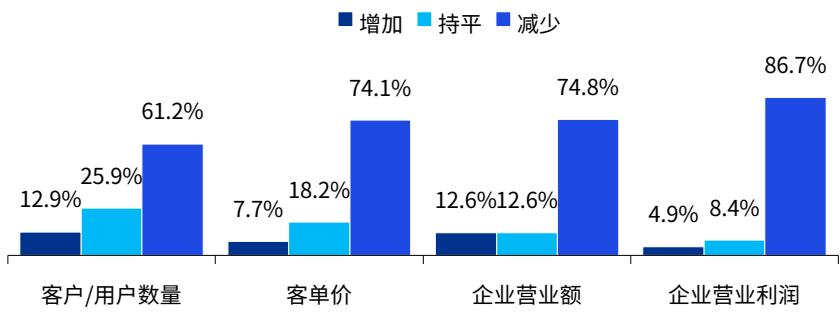  
图1-2：2026 年1-6月白酒行业经营指标变化情况 4

另一方面，根据调研数据，2026 年 1-6 月受访企业的客户数量、客单价、营业额、营业利润的减少比例均超过 60%。其中，仅有 4.9%的企业营业利润实现增长，下降的企业占比高达 86.7%，降幅远超营业额，白酒行业经销整体利润承压明显。

2026 年以来，仅有 12.9%的调研企业反馈客户数量增加，较去年的调研数据（21.1%）下滑 8.2个百分点，表明白酒消费需求端持续萎缩。2026 年上半年，商务宴请、婚宴规模等场景恢复不及预期，居民收入预期偏弱，非必需消费支出削减，白酒作为可选消费品首当其冲。同时，低度酒饮、精酿啤酒、果酒等分流轻度饮酒人群，白酒消费者流失较为普遍。

另一方面，有 74.1%的调研企业表示客单价下降，且“减少”比例远超客户数量。这意味着，消费者普遍降低购买档次或减少单次购买量，价格支撑力减弱；次高端、高端产品动销受阻，中低端产品占比被动提升；企业通过降价促销、布局低价位段产品维持市场份额，牺牲了以往的中高端价格结构。74.8%的企业营业额减少，与客单价、客户数量同步下降相吻合，企业营收压力突出。

2026年1-6月，调研数据显示，营业利润下降的企业占比（86.7%）较营业额下降（74.8%）高出 11.9 个百分点，是全部指标中最严峻的一项。究其原因，营收下滑，基础收入不足，同时，

## 第3页

生产、人工、渠道维护、营销费用等刚性支出难以同步缩减，企业盈利能力严重受挫，行业可能面临需求端结构性拐点。

## 二、供给端：浓香主导，清香加速追赶，多香型生态成型

根据调研数据，从供给端结构来看，仍以浓香、酱香为主，浓香型以 34.8%的占比仍居主导地位，显示其市场基础最为稳固，主要得益于生产工艺成熟、广泛的消费基础和稳定的产能布局。酱香型19.7%的占比反映出自2016年以来的酱酒热虽有所降温，但头部企业产能布局已基本完成，供给格局趋于稳定。

浓香型的主导占比意味着未来供给增量仍将集中于该赛道，竞争焦点在于品质升级和区域深耕。酱香型供给格局趋于稳定，头部企业产能释放将推动行业整合。

值得注意的是，受益于年轻化消费趋势和低门槛优势，清香型占比达15.2%，暗示其正迎来复苏周期。兼香型占比达到13.6%，反映企业多香型并举、分散风险的趋势，也契合消费端个性化需求。

凤香型及其他小众香型合计占比10.6%，虽占比较小，但代表特色化创新方向，可能成为差异化竞争突破口。整体来看，行业供给正从单一香型向多元化、细分化演进，企业通过香型组合优化来应对消费需求分层。

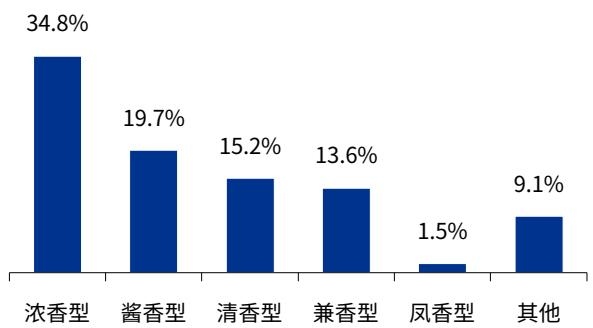  
图1-3：2026 年1-6月白酒生产企业主营产品香型情况 5

## 第4页

展望未来，白酒市场关注的白酒风味及香型格局有望呈现“三香鼎立、浓香为基、多元并存”的演进态势。调研数据显示，“浓、清、酱三足鼎立”是市场主流共识，占比达 42.7%，表明行业已从“酱香热”回归理性均衡。其中，32.5%的企业坚持认为浓香将持续主导，这与其深厚的产能基础、广泛的全国化受众及稳定的基本盘密不可分，浓香仍是行业压舱石。

尽管 9.1%的企业看好酱香热度回归，但比例较巅峰期显著回落，显示酱酒进入“品质洗牌”与“价值沉淀”期，盲目扩张终结。与此同时，清香（6.6%）凭借高性价比与国际化口感优势份额稳步提升，而 9.1%的企业关注到去香型化与小众特色香型的崛起，反映出消费者对个性化与品质表达的追求。整体而言，香型格局正从“品牌决定香型”向“香型服务品牌”转变，未来竞争将超越单一香型红利，转向品牌底蕴与品质综合实力的较量。

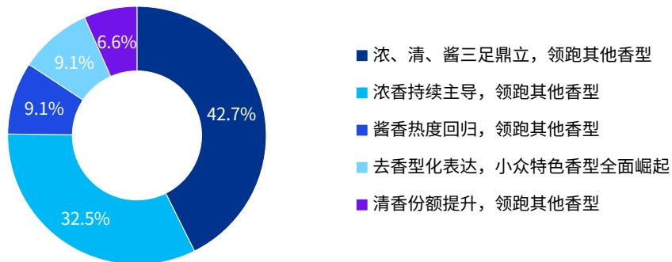  
图1-4：白酒生产及经销商企业对未来白酒香型格局发展趋势的看法 6

## 三、线上销售：线上化从“补充”走向“引擎”

2025 年 A 股上市 20 家企业中有 18 家披露了线上具体营收数据，线上销售收入共计 256.21 亿元，同比减少了22.87%7，占2025年白酒上市企业总营收（3,618.50亿元）不足一成。

线上渠道呈现出显著的结构性分化，部分酒企线上收入高速增长，而头部品牌则出现明显回调。口子窖（+47.2%）、金徽酒（+40.2%）、舍得酒业（+35.4%）、古井贡酒（+30.7%）等区域酒企线上增速领跑，显示出部分区域品牌正通过线上化实现突围。而茅台2025年线上收入同比

## 第5页

下滑 39.2%属于主动调整产品投放策略的结果，反映头部品牌在行业调整期主动收缩线上投放以维护价格体系。

从线上销售额占比总营收数据来看，2025 年披露线上数据的 18 家酒企中，15 家线上营收占比较 2024 年有所提升，线上化趋势明确。水井坊（21.5%）、酒鬼酒（14.1%）、舍得酒业（13.7%）、五粮液（11.7%）四家线上占比突破一成。对比传统线下经销渠道普遍倒退，线上渠道正在从“补充渠道”升级为白酒行业的“结构性增长线”。但不同酒企的线上化路径和成效差异巨大，头部品牌在主动调控中蓄力，区域酒企在差异化突围中加速。

不同梯队品牌 8的渠道策略与市场表现迥异，以茅台、五粮液、泸州老窖为代表的全国化头部品牌，2025 年线上销售收入为 195.66 亿元，同比下滑 30.1%，线上销售占比 8.21%，较去年回落 1.3 个百分点。山西汾酒、洋河股份、古井贡酒等线上销售收入合计 43.55 亿元，同比增长17.2%，线上销售占比 5.36%，较上一年提升 1.4 个百分点；区域品牌（今世缘、口子窖、金徽酒等）实现线上销售收入达 17 亿元，同比增长 13.48%，线上销售占比 5.84%，较去年提升 1.84个百分点。

全国化高端品牌主动收缩线上战线，反映了高端酒企更倾向于通过收紧线上供给来维护价格体系稳定。而泛全国化及区域品牌则加速线上渗透，通过线上营销有效触达更广泛的消费群体，实现了逆势增长。未来，随着消费者数字化消费习惯的固化与酒企全渠道运营能力的成熟，线上渠道将不再是单纯的销售通路，而是品牌差异化竞争、消费者数据资产沉淀以及渠道精细化运营的核心战场。

2025年各类品牌线上销售情况

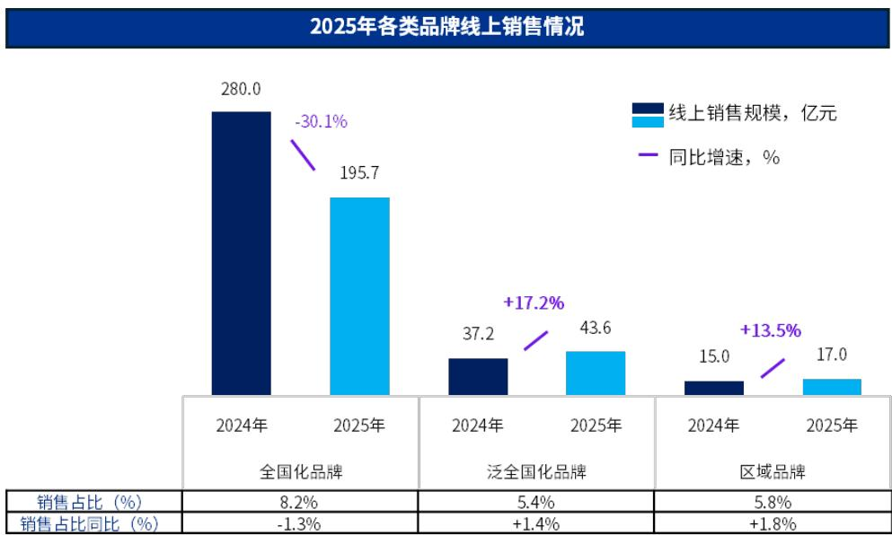  
图1-5：2025年白酒上市企业线上销售情况 9

调研数据 10显示，线上渠道占比超过 30%的经销商和终端零售商中，75%的企业为线上电商平台，这些企业均聚焦于一线城市布局，其中几家综合电商平台在2025年全年销售收入超500亿元，综合电商、即时零售电商除了深耕一线城市外，还加大对低线（二、三、四线）城市及县域城镇等新兴市场的拓展力度，提升市场渗透率。

## 四、市场动销：节日效应减弱，日常消费收缩

在节假日表现方面，调研数据显示，2026 年上半年白酒消费呈现明显的“节日效应减弱、日常消费疲软”特征。春节作为传统白酒消费旺季，仅有 11.3%的调研企业表示消费量增加，而高达60.9%的白酒企业出现下滑，反映出春节动销不及预期。而春节后日常消费，减少比例攀升至82.4%，增加比例降至 3.9%，显示节日透支效应显著，节后需求快速回落。“五一”假期表现同样疲软，增加比例仅为 4.3%，减少比例达 75.8%，虽略好于春节后日常，但整体消费信心不足的局面未改。

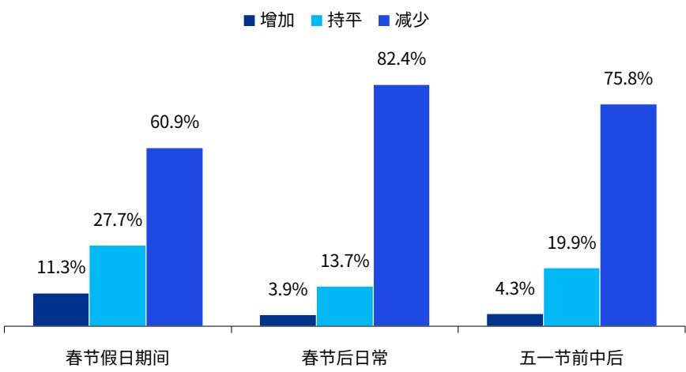  
图1-6：2026 年1-6月节假日白酒消费量同比变化情况 11

从渠道品牌集中度来看，头部效应进一步强化。调研数据显示，茅台与五粮液高端名酒仍是渠道商维持经营稳定性的核心资产。汾酒与泸州老窖得益于全国化布局的深化及省外市场的渗透率提升，两者已稳固占据白酒品牌的领先身位；次高端剑南春品牌具备深厚的渠道基础与稳定的市场表现，在行业调整期成为经销商配置的重点品种。习酒加速渠道布局，快速提升酱酒市场份额，展现出较强的品牌成长性。相比之下，洋河与郎酒的渠道覆盖度有所回落，折射出在存量竞争环境下面临的调整压力。

2025 年下半年以来，大型经销商及零售商 12数据显示白酒消费向头部名酒高度集中。茅台、剑南春、五粮液、泸州老窖、汾酒稳居第一阵营，郎酒、习酒、洋河、古井贡酒等品牌亦占据重要份额，牛栏山、西凤、舍得、今世缘、红星等品牌表现突出，反映出渠道资源加速向强品牌力产品聚集的趋势。

整体而言，渠道资源正加速向品牌力强、动销顺畅的头部名酒集中，中小品牌的渠道生存空间受到挤压，渠道端的分化趋势日益显著。

## 五、整体评价：行业延续深度调整，复苏共识尚未形成

2026 年上半年，从生产企业业绩来看，白酒行业整体营收与利润规模延续调整态势，增速较 2025年同期进一步放缓，行业深度调整特征显著。在行业进入“磨底筑基”的关键阶段，白酒企业分化进一步加剧。头部白酒企业凭借品牌影响力、渠道掌控力和资金实力持续稳固市场地位，贵州茅台、五粮液等高端酒企展现出较强韧性，营收与利润保持相对稳定；而多数区域中小酒企则面临销售承压、库存高企、利润大幅下滑的困境，部分企业甚至陷入亏损。

根据调研数据，白酒企业对 2026 年下半年市场走势的判断呈现明显分化，68.5%的受访企业认为行业将继续下行调整，多数企业仍在为更严峻的市场环境做准备。仅 2.1%的企业预期明显复苏，认为市场将触底震荡企稳或小幅回暖的企业合计占比不足三成，说明即便在相对乐观的阵营中，多数也仅预期弱复苏而非强劲反弹。这种预期结构暗示，渠道库存承压、消费场景修复、价格体系重建等核心矛盾在 2026 年下半年仍将构成持续压力。

综合来看，行业正处于“悲观者占多数、乐观者缺信心”的预期低谷期。若宏观经济与消费信心未能出现超预期改善，2026 年下半年白酒市场大概率延续存量博弈、结构分化的调整格局，企业需在收缩中寻找结构性机会。

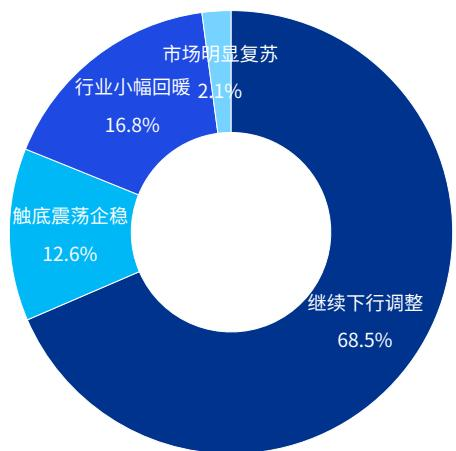  
图1-7：白酒企业对 2026年下半年白酒市场趋势的看法 13

## 第二部分 2026年 1月-6月白酒市场环境变化

## 一、 白酒产业政策从限制转向鼓励

2025 年 10 月，工信部发布《关于推动历史经典产业高质量发展的指导意见（征求意见稿）》，首次将酿酒、丝绸和茶叶等并列为“历史经典产业”。这一政策标志着白酒产业正式告别“限制性发展”的标签，转而成为具有文化传承意义的鼓励性产业。2026 年上半年，白酒行业延续了这一鼓励性政策基调。2026年 2月，工信部等部门联合发布《酿酒产业提质升级指导意见（2026―2030 年）》，为白酒产业的高质量发展提出了更为具体的目标。意见提出，到 2028 年，原料种植、生产酿造、流通消费融合发展水平持续优化，培育 3 个以上千亿级传统优势酒产区，10 个以上百亿级特色酿酒产业园区，形成“百亿园区、千亿集群、万亿产业”发展格局，到 2030 年，数智化、绿色化、国际化发展水平持续提升，发展质量效益大幅提高，产业规模稳中有进，产能布局、产品结构持续优化，形成产品种类丰富、生产流通有序、区域布局合理、产业生态健康的产业体系。

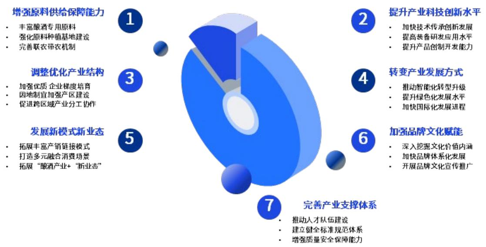  
图2-1：酿酒产业提质升级的重要任务 14

## 第10页

## 二、 白酒深度调整期下批发价延续探底，三类酒价走势分化显著

2026 年 1-6 月中国白酒批发价格总指数在 99.73-100.08 之间波动，整体呈现小幅震荡的态势。当前白酒行业仍处于深度调整期，在终端动销乏力，渠道库存高企，电商平台促销“破价”对传统定价体系形成冲击的情况下，全国白酒批发价格环比总指数除了 2026 年 2 月中下旬分别出现上升和持平的情况外，其他月份各旬出现不同程度下跌，跌幅在 0.02%-0.39%之间，整体走势偏弱。总的来看，在面对高库存、价格倒挂的压力时，价格成为市场最直接的反映。

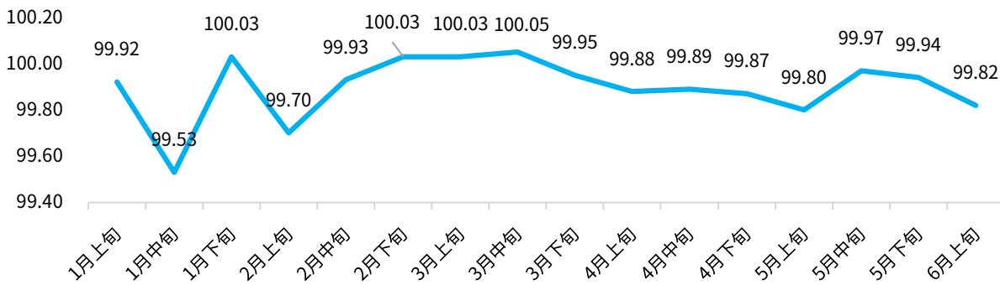

## 图2-2：2026 年1-6月中国白酒批发价格旬环比总指数 15

从具体分类来看，全国名酒、地方酒、基酒价格指数分化显著，呈现“名酒弱、地方酒韧性强、基酒稳”的特征。渠道端库存压力偏高，叠加消费者决策趋于理性，使得高端品牌逐步剥离金融属性，高端名酒价格中枢出现下移。截至 2026 年 6 月上旬，名酒在 1 月中旬跌幅最大，下旬则止跌回暖，反映了春节备货末期需求的升温。与此同时，大众消费更注重性价比，光瓶酒凭借“优质优价”的定位获得市场青睐，中低端价格带表现相对坚挺，为区域酒企提供了一定的缓冲空间。值得关注的是，尽管行业整体需求疲软、产量持续收缩，但基酒环节的价格波动并不显著。

## 第11页

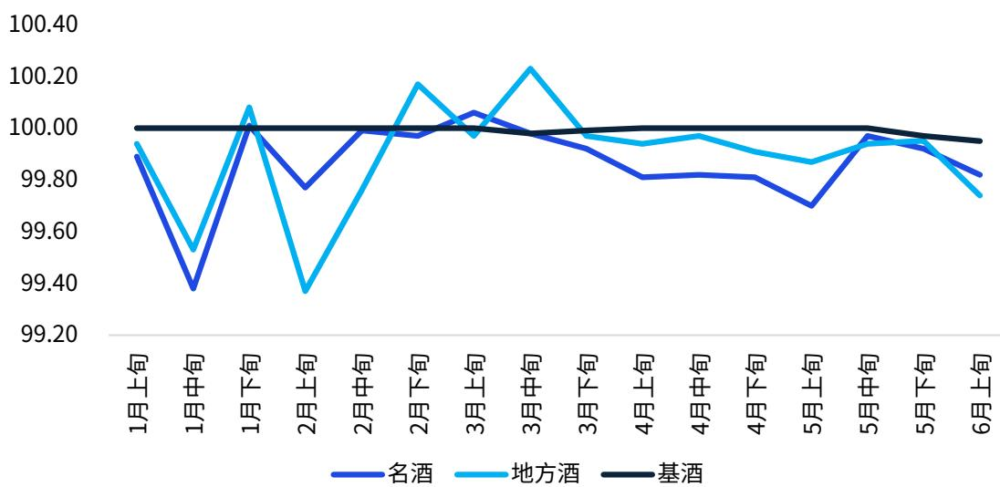  
图2-3：2026 年1-6月中国名酒、地方酒、基酒批发价格旬环比指数 16

## 三、 消费理性持续深化，场景与动机发生根本性转移

当前白酒消费行为正经历深刻的系统性重塑，理性化与性价比优先已成为绝对主流，高达86.4%的企业观察到这一变化。这表明在宏观经济承压背景下，消费者不再盲目追求品牌溢价，而是回归产品本质，追求“质价比”，迫使酒企重新审视定价策略与产品矩阵。

消费场景与动机同步发生根本性转移。49.3%的企业指出消费场景正从传统的商务礼赠向日常刚需渗透，同时 47.6%的企业认为消费动机由社交驱动转向悦己为主。这标志着白酒正逐步剥离其厚重的“社交货币”属性，回归饮品本源，高频、自饮的消费模式正在崛起。

此外，消费习惯与人群结构也在悄然演变。39.2%的企业关注到低度微醺与健康松弛的需求增长，而38.1%的企业敏锐捕捉到年轻化与女性化的代际更迭趋势。整体来看，白酒行业正从“面子消费”转向“里子消费”，未来具备高品质、适度化、健康化特征的产品将更具竞争力。

## 第12页

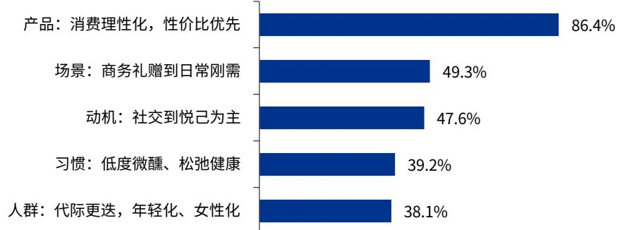  
图2-4：2026 年1-6月白酒企业认为当前白酒消费行为突出的变化 17

## 四、 消费群体迭代加速，年轻群体与女性群体成为重要增量

数据显示，商务及企业管理人群以81.5%的压倒性占比稳居核心，这是白酒的“基本盘”⸺消费能力强、场景刚需、价格敏感度低，短期内不可替代。85-94 年中年白领以 65.0%紧随其后，构成承上启下的中坚力量，其消费习惯兼具传统白酒的社交属性与品质自饮的个人诉求。

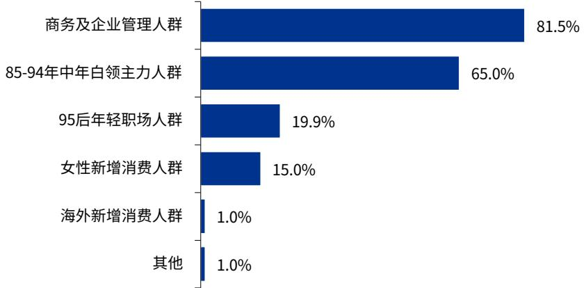  
图2-5：2026 年1-6月白酒消费市场的高潜消费人群 18

值得关注的是，95后年轻职场人群（19.9%）与女性新增消费人群（15.0%）虽然占比有限，却正成为近年酒企战略布局的焦点。近年来，越来越多年轻消费者偏好饮用低度白酒，消费动力由“悦人”向“悦己”延伸，个人独酌、轻社交场景占比显著提升，低度化、利口化成为产品重要创新方向。因此，多家酒企纷纷切入 30 度以下低度酒赛道，正是对这一增量人群的精准卡位。

年轻消费者偏好低醉感、好入口、高颜值的产品体验，女性消费者则更注重微醺场景与健康属性，低度酒恰好弥合了传统白酒与新兴需求之间的断层。这一布局本质上是“用新品类培育新人群，以品牌势能完成消费迁移”的长期战略，为白酒行业打开第二增长曲线。值得注意的是，白酒降度并非简单稀释酒精浓度，而是需要通过复杂的工艺调整来实现，因此中小型白酒厂家在产品转型过程中需谨慎布局。

表2-1：白酒企业布局 30度及以下超低度产品 19

<table><tr><td colspan="3">30度及以下超低度白酒产品布局</td></tr><tr><td>日期</td><td>企业名称</td><td>低度酒产品</td></tr><tr><td>2025年6月</td><td>泸州老窖</td><td>28度国窖1573</td></tr><tr><td>2025年7月</td><td>天佑德酒</td><td>28度柠檬风味青稞酒</td></tr><tr><td>2025年7月</td><td>酒鬼酒</td><td>33度、28度、21度、18度等酒体储备研发</td></tr><tr><td>2025年8月</td><td>五粮液</td><td>29度“一见倾心”系列</td></tr><tr><td>2025年8月</td><td>舍得酒业</td><td>29度“舍得自在”</td></tr><tr><td>2025年10月</td><td>今世缘</td><td>22度“今世缘·多少”</td></tr><tr><td>2026年2月</td><td>水井坊</td><td>珍心珍意·清漾29度等多款低度酒产品</td></tr><tr><td>2026年3月</td><td>古井贡酒</td><td>26度年份原浆轻度版</td></tr></table>

在消费场景方面，数据显示各类消费场景需求均有不同程度的减弱，其中商务礼赠需求减少最为明显，经销商和终端零售商反映商务礼赠消费需求减少居于首位，消费场景需求大幅收缩。日常自饮、亲朋聚会等社交场景有所增加。婚寿宴请的需求则相对稳定，受访经销商和零售商表示相关需求持平。总的来说，消费理念更趋务实，“少喝酒、喝好酒”共识强化，消费场景从商务主导转向家庭聚会、个人独酌、圈层社交等多元化模式。

## 第14页

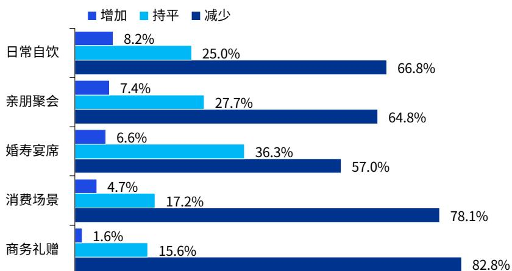  
图2-6：2026 年1-6月白酒经销商/零售商的消费场景变化情况 20

在消费场景的打造上，白酒企业将足球赛事作为构建消费新场景的核心阵地，形成了从国际顶级IP 到地方联赛的全方位赞助矩阵。在国际层面，五粮液与泸州老窖深度绑定世界杯，前者跻身FIFA 官方联名合作伙伴，后者连续三届亮相并推出多国国家队纪念酒；剑南春与舍得酒业则分别战略牵手英超曼城与狼队，加速品牌全球化布局。

下沉市场方面，相较于足球顶级赛事的高投放门槛和难以量化的转化效果，白酒酒企更愿意将营销触角延伸至省级城市联赛，将预算投向能直接拉动核心区域销量、维系本地消费者心智的地方足球联赛，从全球粗放流量争夺向精细化区域深耕转型，是当前白酒行业营销逻辑的一个核心变化趋势。今世缘、洋河、郎酒及五粮液等纷纷冠名江苏、四川、湖南及山东等地赛事，甚至直接冠名职业球队如“河南俱乐部彩陶坊队”。从全兴杯明星联赛到中乙赛场，白酒品牌通过“赛事冠名+球队绑定+场景互动”的组合拳，不仅强化了品牌露出，更成功将观赛激情转化为圈层社交与日常自饮的消费动能，精准捕捉体育迷群体的多元化需求。

表2-2：白酒酒企与足球赛事的深度绑定营销案例 21

<table><tr><td colspan="3">国际顶级赛事层面</td></tr><tr><td>酒企</td><td>足球赞助项目</td><td>合作层级</td></tr><tr><td>五粮液</td><td>2026 美加墨世界杯</td><td>FIFA 官方联名产品合作伙伴,央视总台转播黄金伙伴</td></tr></table>

## 第15页

<table><tr><td>泸州老窖</td><td>2018俄罗斯世界杯2022卡塔尔世界杯2026美加墨世界杯</td><td>品牌露出2018年:国窖1573成为俄罗斯世界杯官方款待唯一中国白酒品牌2022年:推出FIFA 2022卡塔尔世界杯官方授权白酒2026年:推出阿根廷国家足球队/葡萄牙国家足球队官方纪念酒</td></tr><tr><td>剑南春</td><td>英超曼城俱乐部</td><td>全球战略合作伙伴</td></tr><tr><td>舍得酒业</td><td>英超狼队</td><td>沱牌成为官方全球合作伙伴</td></tr><tr><td>......</td><td>......</td><td>......</td></tr></table>

<table><tr><td colspan="3">地方联赛层面</td></tr><tr><td>赞助酒企</td><td>赛事</td><td>合作形式</td></tr><tr><td>今世缘(国缘V3)</td><td rowspan="2">2026江苏省城市足球联赛(苏超)</td><td>官方战略合作伙伴;今世缘冠名淮安队</td></tr><tr><td>洋河(海之蓝)</td><td>官方战略合作伙伴;洋河冠名宿迁队</td></tr><tr><td>郎酒(红花郎/小郎酒)</td><td>2025/2026四川省城市足球联赛(川超)</td><td>青花郎为首席至尊合作伙伴;红花郎绑定成都队,小郎酒推出21款联名城市版</td></tr><tr><td>五粮液</td><td rowspan="2">2025湖南省足球联赛(湘超)</td><td>五粮液为战略合作伙伴</td></tr><tr><td>酒鬼酒</td><td>湘西赛区独家冠名合作伙伴;酒鬼酒场外互动营销</td></tr><tr><td>五粮液</td><td>齐鲁联赛(山东)</td><td>冠名赞助</td></tr><tr><td>仰韶酒业(彩陶坊)</td><td>河南队</td><td>球队冠名——“河南俱乐部彩陶坊队”</td></tr><tr><td>郎酒(红花郎)</td><td>2025年广东省足球超级联赛(“广超”)</td><td>官方唯一指定白酒</td></tr><tr><td>全兴酒业</td><td>2025年“全兴杯”传承足球明星联赛</td><td>赛事独家总冠名</td></tr><tr><td>舍得酒业</td><td>2026赛季中国足球协会乙级联赛(中乙联赛——大连赛区本土战事)</td><td>球队唯一指定白酒赞助商</td></tr><tr><td>新魂烧酒</td><td>2025年重庆市城市足球超级联赛(渝超)</td><td>组建球迷助威团,打造“看比赛+吃火锅+喝新魂”闭环</td></tr><tr><td>......</td><td>......</td><td>......</td></tr></table>

## 第16页

## 五、 传统零售渠道持续巩固，企业积极完善线上渠道矩阵建设

目前国内白酒生产企业采用经销模式为主的市场销售模式，销售渠道主要有线上渠道和线下渠道，其中线下经销是多数白酒生产企业主要的销售模式。调研数据显示，由于白酒消费具有强社交属性和场景依赖性，商务宴请、婚宴、礼品赠送等场景天然依赖经销商的地缘关系和终端网络，在白酒商家属性上，经销商家仍然把主营业务定位在传统批发经销上，以 46.4%的占比构成流通体系的核心，其中据经销商反馈已有超过 7 成的线下经销商已经开始或正在布局即时零售。即时零售门店/仓以 32.2%的占比构成第二大渠道。消费者在购买高端白酒时对真伪高度敏感，专卖店的授权资质和固定经营场所提供了天然的正品保障，因此烟草烟酒专卖店占比 13.9%。尽管餐饮酒店渠道仅占 3.2%，但餐饮作为白酒即饮消费的核心场景，具有品牌曝光和消费习惯培育的功能。此外，主营线上渠道的经销商占 2.4%，凸显了白酒线上化的结构性转型的困境。

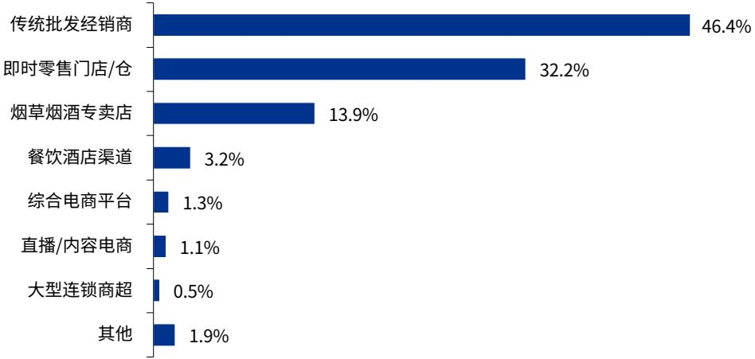  
图2-7：2026 年1-6月经销商/零售商流通端经营类型 22

值得关注的是，即时零售对白酒饮用即时性的渗透和内容电商对品牌认知路径的重塑，白酒产业的流通格局结构性变化值得持续跟踪。当白酒企业被问到 2026 年下半年重点布局的销售渠道，线下传统流通渠道仍占 86.7%的主导地位，反映白酒渠道长期的线下结构特征难以被完全线上替代。面对考验白酒业态固有线下优势的新业态模式，白酒企业正在积极联动即时零售（38.5%）、社交媒体内容电商（22.4%）、线上品牌商城（21.0%）和直播带货（18.2%）等新零售渠道，搭建多元化新兴渠道矩阵，推动传统经销商服务转型升级，培育业务新增长点。

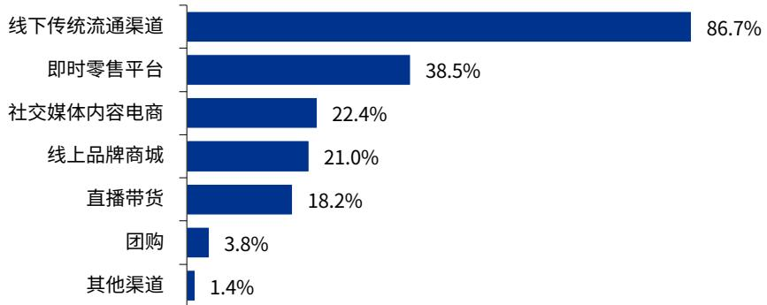  
图2-8：2026年下半年白酒企业重点布局的销售渠道 23

2026年 5月，在中国酒业协会主导下，茅台、五粮液、汾酒、泸州老窖、洋河、古井贡酒、郎酒、贵州习酒、剑南春等九大中国头部白酒品牌联合美团闪购共同发布 50ml“小酌瓶”24，精准匹配年轻消费者居家自饮、露营、宵夜等多元生活场景，以“轻量化产品+即时享用体验”的创新模式，助力白酒品牌高效渗透年轻消费圈层，锁定行业确定性增长新机遇。

## 六、 行业深度调整期下，企业推进营销体系市场化转型

2026 年上半年，白酒流通环节的核心压力源于终端动销偏弱。动销放缓直接导致渠道库存持续积压，供需失衡加剧；在高库存压力下，经销商与零售商被迫低价甩货以回笼资金，进而引发价格倒挂现象蔓延。数据显示，56.6%的经销商及终端零售商反映价格倒挂程度较上年同期有所增加，现金流紧张风险随之攀升。为缓解渠道资金周转困难，上游厂家纷纷推出纾困政策，主动减少压货力度并下调考核任务，51.2%的经销商和零售商回款减少。总体而言，2026 年上半年酒类流通领域呈现“库存与现金流双重挤压——厂家减负纾困——经销商回款收缩”的传导格局。

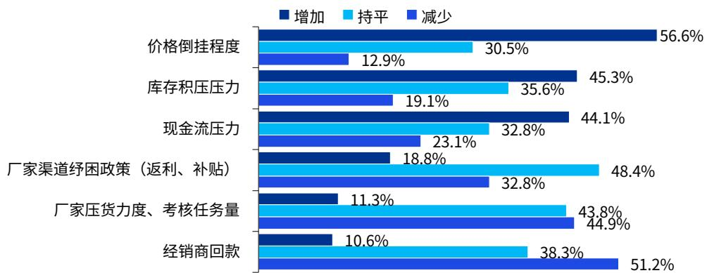  
图2-9：2026 年1-6月白酒企业经营指标同期变化情况 25

结合白酒行业当前“去库存、稳价格、求实效”的生存逻辑，面对行业周期调整，白酒企业认为亟须推动行业从“粗放式压货”向“精细化运营”转型，从“全品类覆盖”向“核心大单品”聚焦，从“传统渠道”向“全域融合”升级，建立从“压货分销”到“精准动销、用户直连”的流通运营体系。

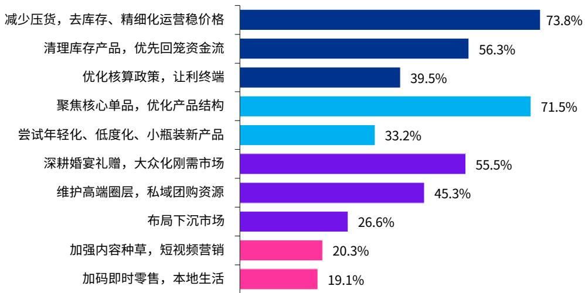  
图2-10：2026年 1-6月白酒企业认为当前有效的营销运营方法 26

## 第19页

在渠道与价格治理方面，过去“向渠道压货”换取报表增长的模式已失效，白酒厂家需要主动控制发货节奏，以牺牲短期的价格弹性与部分渠道灵活性为代价换取长期的品牌价格体系稳定。同时，白酒企业通过调整返利政策、费用核销方式，将利润直接让渡给终端门店，修复渠道信心，确保经销商有钱赚、有现金流。

在产品策略重构方面，在存量竞争下，白酒企业集中资源打造“大单品”以树立价格标杆。针对传统白酒“辛辣、高度、老气”的痛点，通过低度化（降低入口门槛）、小瓶装（降低试错成本、一人饮）和年轻化包装，主动适配 Z 世代及轻度饮酒人群的需求，寻找增量市场。

在客群与场景深耕方面，伴随商务宴请场景萎缩，白酒厂家转向确定性更强的“刚需场景”。针对大众消费，婚宴、寿宴、节庆礼赠是白酒稳固的基本盘，具有较强抗周期性。与此同时，县域是人情经济，受经济环境影响较小，县级市场经济压力较小，进一步下沉聚焦县域市场，构建下沉市场第二增长曲线。针对高端消费群体，传统营销失效，应转而依赖“圈层营销”和“私域团购”，通过品鉴会、企业定制等方式，直接触达高净值人群，实现精准转化。

在营销模式创新方面，白酒厂家需要从“广撒网”的广告投放转向“精准种草”和“即时满足”。在内容端，利用抖音、小红书等平台，通过剧情短视频、达人测评、文化故事进行“种草”，建立品牌认知，解决“谁来买”的问题。在渠道端，接入美团闪购、京东到家等“即时零售”平台，打通“线上下单、30 分钟送达”的本地生活链路，满足消费者“即想即喝”的即时性需求，解决“在哪买”和“多久到”的问题。

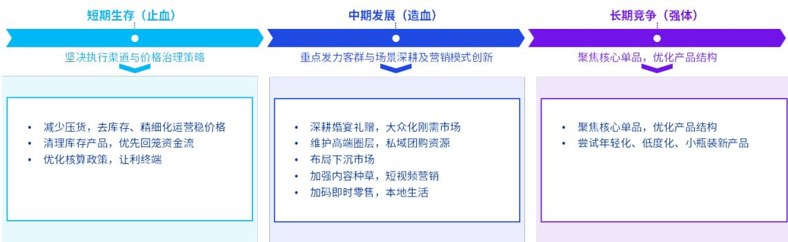  
图2-11：白酒企业营销运营方法矩阵

## 第20页

© 2026 毕马威华振会计师事务所(特殊普通合伙) — 中国合伙制会计师事务所，毕马威企业咨询 (中国) 有限公司 — 中国有限责任公司，毕马威会计师事务所 — 澳门特别行政区合伙制事务所，及毕马威会计师事务所 — 香港特别行政区合伙制事务所，均是与毕马威国际有限公司(英国私营担保有限公司)相关联的独立成员所全球组织中的成员。版权所有，不得转载。

## 七、 市场展望呈现理性回归与结构分化

白酒企业对行业中长期趋势的研判呈现出显著的“理性回归”与“结构分化”特征。超 1/4 的企业认为消费将更加理性，性价比成为核心决策因素，这标志着行业已彻底告别盲目扩张阶段。与此同时，24.9%的受访者看好品牌集中化，认为头部集聚效应将愈发显著，中小品牌生存空间将持续收窄。

在渠道策略上，21.4%的企业将“去库存、稳价格”视为常态，行业告别压货式增长，转向精细化渠道管理，厂商关系从博弈走向共生。值得注意的是，尽管“高端化”曾是过去十年的主旋律，但目前仅有7.8%的企业将其视为主要复苏路径，表明行业对价格天花板的预期趋于审慎。此外，年轻化与消费场景的变迁（如悦己自饮上升、商务宴请弱化）虽占比不高，但代表了结构性增量方向。整体而言，行业正从“总量增长”转向“存量博弈”，具备品牌壁垒与渠道掌控力的企业将更具韧性。

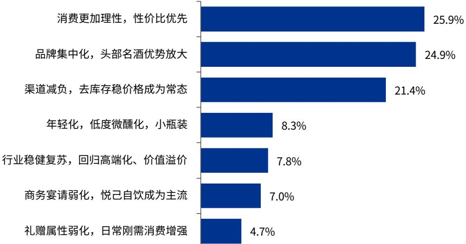  
图2-12：对白酒行业中长期发展趋势的看法 27

当被问到未来1-2年最看好的白酒细分赛道，35.2%的企业看好“大众口粮及光瓶白酒”，表明在宏观消费趋于理性的背景下，高性价比的刚需产品成为业绩压舱石，酒企纷纷下沉渠道以稳固基本盘。紧随其后的是25.6%的企业布局“低度酒与微醺休闲酒”，这反映了行业正积极拥抱年轻消费群体，试图通过场景创新打破传统商务宴请的局限，开辟第二增长曲线。

相比之下，传统强势的“高端商务与礼赠收藏”赛道获看好比例降至 17.1%，显示高端需求受商务活动减少及礼赠场景萎缩影响，增长预期明显收敛。而“小规格”与“年份定制”占比分别为13.6%和 8.5%，说明个性化与尝鲜式消费虽具潜力，但目前仍属补充性策略。整体而言，白酒企业正从“高端化”单极驱动转向“大众化+年轻化”的双轮驱动模式。

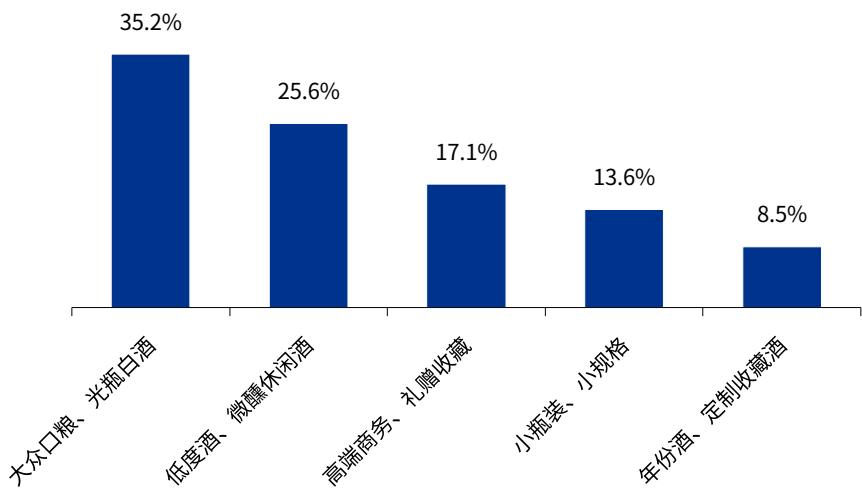  
图2-13：白酒企业认为未来1-2年最看好的白酒细分赛道 28

## 第三部分 促进酒类市场健康发展的观点

作为“十五五”开局之年，政策顶层设计与产业中长期发展规划形成合力，为白酒行业穿越周期、转型升级注入核心动能。结合当前白酒量价承压、库存高企、消费分化、渠道变革的市场现状，行业整体确立新经典、新酒巷、新场景三大高质量发展主线，通过产品重塑打造行业新经典、文化破圈构筑产业新酒巷、业态革新激活消费新场景，全方位推动白酒产业从存量内卷转向价值深耕，实现稳健可持续发展。

## 一、锚定经典产业定位，重塑行业价值生态

2026年，工信部等三部门正式将酿酒产业划定为历史经典产业、传统优势产业、基础民生产业，叠加《酿酒产业提质升级指导意见（2026—2030 年）》全面落地，行业彻底告别过往“限制性发展”阶段，迈入国家战略层面全面支持、系统培育的全新发展周期。在此政策拐点下，全行业需主动锚定核心定位，跳出过往规模内卷、价格竞争、重营销轻品质的发展误区，全面重塑产业价值体系与行业生态。

## 二、打造产业新经典：分层迭代产品矩阵，适配多元消费需求

打造白酒新经典是产业高质量发展的核心根基，紧扣政策“以高质量供给创造有效需求”的导向，顺应市场“少喝酒、喝好酒”的主流消费趋势，打破传统产品老化、同质化严重的发展瓶颈，构建分层化、多元化、品质化的全新产品体系。针对传统存量消费群体，坚守经典白酒酿造工艺与核心风味，依托千年酿造技艺结合现代化生产技术，持续夯实传统名酒品质口碑，稳固行业基本盘。针对新生代增量群体，紧跟健康化、轻量化消费潮流。结合当前哑铃型市场价格结构，精准分层布局产品矩阵，同时响应绿色低碳发展政策，优化产品包装、践行绿色生产，以高品质、新形态、高适配的产品体系，全面定义新时代白酒新经典。

## 三、激活消费新场景：拓宽业态边界，构建多元消费生态

培育白酒新场景是破解行业需求疲软、激活市场增量的关键抓手。当前白酒消费逻辑已从传统商务“悦人社交”全面转向个性松弛的“悦己体验”，叠加政策大力支持酒类新业态、新模式发展，行业需彻底打破传统渠道与消费场景壁垒，全域挖掘全新消费增量。同时借力数字新业态，根据消费者心情、偏好、场景实现个性化定制服务，以科技赋能场景创新，构建全覆盖、多元化、年轻化的白酒消费新生态。

## 四、创新内容传播矩阵：赋能酒文化破圈发展

传统酒类营销以品牌为核心单向输出，侧重工艺、产能等自证表达，难以触达消费者深层需求。创新传播矩阵，需推动传播逻辑升级，实现从品牌独白到双向共情共生的转变。跳出自证叙事误区，以消费者情绪与表达需求为核心，让品牌内容成为用户自我表达载体，达成情感同频；摒弃利益诱导的流量交易模式，打造兼具表达价值与调性的内容，匹配用户社交预期，驱动用户主动转述，实现口碑自然扩散。以场景与情感激发用户自发创作，深化用户信任与社交绑定，形成双向赋能的共生格局。

## 五、注入数智新动能：驱动新经典与新场景迭代升级

数字智能技术是迭代新经典产品、创新新消费场景、升级产业新酒巷的核心驱动力。紧抓政策对数智化转型、绿色技改的扶持机遇，将人工智能、工业互联网、数字孪生等新技术全面融入生产、研发、营销、服务全链条。生产端，推动传统酿造车间向智能车间升级，稳定新经典产品品质，实现降本增效、绿色生产。研发端，通过新技术分析消费数据、口感偏好，辅助企业迭代新经典产品、研发新型风味酒品，缩短研发周期。终端场景端，根据消费者心情、场景、喜好定制专属饮酒方案，丰富消费新场景，提升用户体验，以数字科技全方位赋能白酒产业高质量发展。

除此之外，对内革新人才培育体系，对外深化酒文化出海，二者同样是支撑产业高质量发展的重要基石。

## 第24页

## 结束语

2026 年作为“十五五”开局之年，也是白酒行业迎来政策拐点、价值拐点、发展拐点的关键之年。酿酒产业的发展逻辑彻底重塑：过往以管控约束为主的时代落幕，全面进入政策赋能、自主创新、价值深耕的战略发展新阶段。

全行业需紧抓历史机遇，以新经典、新酒巷、新场景为行业高质量发展核心主线。同心协力，摒弃低价内卷、盲目扩产等短期行为，立足产业长远发展。书写传统产业转型升级的崭新篇章，推动中国酒业行稳致远。

## 关于《2026 中国白酒市场中期研究报告》调查问卷

“《2026 中国白酒市场中期研究报告》调查问卷”是 2026 年 5 月下旬中国酒业协会市场专业委员会开展的线上线下市场调研走访行为，发出样本总计1,350 份，样本覆盖白酒生产企业 195 家、经销商 450 家、零售商 150 家、电商平台（含直播电商）10 家、商超 60 家、便利店 100 家、烟酒店 150 家。最终收到有效分析样本 1,115 份。

## 感 谢

感谢毕马威中国的技术支持。

感谢剑南春（集团）有限责任公司的行业协作支持。

感谢所有为该报告填写调查问卷的单位。

## 说 明

白酒行业从售价角度划分为五类：超高端（1,500元以上）、高端白酒（800-1,500 元）、次高端白酒（300-800 元）、中端白酒（100-300 元）和低端白酒（100元以下）。

## 第25页

## 声 明

本报告内容中所引资料、数据、论述均来自第三方公开或可以通过第三方途径查询的信息。调研数据仅用于本报告的研究目的，我方不保证上述信息与实际情况完全一致和没有新的变化，如认为上述信息存在问题，可与我们联系。

本报告仅供内部交流、学习和参考使用，未经允许，不得对报告内容进行引用、修改、编辑，也不得进行具有任何商业目的使用。

## 第26页

kpmg.com/cn/socialmedia

小红书

如需获取毕马威中国各办公室信息，请扫描二维码或登陆我们的网站：https://kpmg.com/cn/zh/about/office-locations.html

所载资料仅供一般参考用，并非针对任何个人或团体的个别情况而提供。虽然本所已致力提供准确和及时的资料，但本所不能保证这些资料在阁下收取时或日后仍然准确。任何人士不应在没有详细考虑相关的情况及获取适当的专业意见下依据所载资料行事。

© 2026 毕马威华振会计师事务所(特殊普通合伙) — 中国合伙制会计师事务所，毕马威企业咨询 (中国) 有限公司 — 中国有限责任公司，毕马威会计师事务所 — 澳门特别行政区合伙制事务所，及毕马威会计师事务所 — 香港特别行政区合伙制事务所，均是与毕马威国际有限公司(英国私营担保有限公司)相关联的独立成员所全球组织中的成员。版权所有，不得转载。在中国印刷。

毕马威的名称和标识均为毕马威全球组织中的独立成员所经许可后使用的商标。

刊物编号：1776738836329