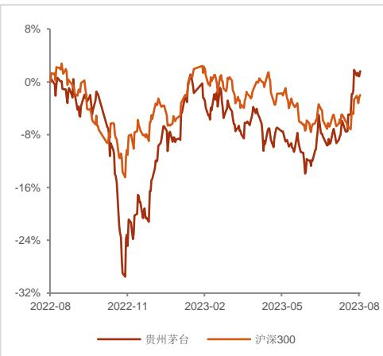

——贵州茅台（600519.SH）半年报点评

## 事件：

8 月 2 日，公司发布 2023 年半年报，上半年实现营业收入 695.8 亿元（同比+20.8%），实现归母净利润 359.8 亿元（同比+20.8%）；推算 23Q2 单季度实现营业总收入 316.1亿元（同比+20.4%），实现归母净利润 151.9亿元（同比+21%），略高于此前在 23年上半年经营数据公告中的披露。

## 投资摘要：

茅台酒基本盘稳如磐石，系列酒继续强势拉动收入增速。23H1 公司完成茅台基酒产量 4.46万吨（同比+4.9%），实现营收 592.8亿元（同比+18.6%），在面临不利的环境下持续行稳致远；系列酒基酒产量 2.4 万吨（同比+41.2%），实现营收100.7亿元（同比+32.6%），持续拉动公司业绩。系列酒的收入占比由去年同期的13.2%进一步提升至 14.5%，对公司的重要性进一步提高。

收入、利润增长的前提下，成本、费用占比微降，助力净利润率进一步提升。23H1公司营收/毛利润1/归母净利润分别增长 20.8%/20.35%/20.8%。推算 23Q2 实现营业总收入 316.1亿元（同比+20.4%），实现毛利润 287.7亿元（同比+19%），实现归母净利润 151.9亿元（同比+21%），公司收入利润均实现较好增长。23H1毛利率同比-0.3pct 至 91.8%，其中 23Q1/Q2 的毛利率同比分别+0.1pct/-1pct。尽管 Q2毛利率微降，但仍维持在很高的水平。23Q2 期间费用率降低 0.6pct 至 7.7%，属历史较低水平。Q2 期间费用率的下降主要来自销售费用率的贡献（销售费用率同比-0.5%）。

回款良好，现金流充裕。现金流方面，23H1销售回款690.7亿元2，同比增 12.9%，其中 23Q1/Q2 回款分别为 357.6 亿元/333.1 亿元，同比分别增长 13.6%/12.3%。22H1 实现经营性净现金流 303.9 亿元，其中 Q1/Q2 分别实现 52.4 亿元/251.4 亿元。公司自身现金流健康稳健。

持续推出非标新品，i茅台助力直销渠道高增。公司实施“五合营销法”，持续优化产品结构，推出兔年生肖、“二十四节气”系列新产品，持续开展“茅台 1935·喜相逢”等活动。“i 茅台”数字营销平台上线后效果显著，截至 23 年 6 月末，累计注册用户突破 4200万，成为数字营销典范和主阵地。受此推动下，23H1公司直销渠道实现营收 314.2 亿元，同比高增 50%，远高于批发代理渠道 3.6%的增速。

投资建议：我们预计公司 2023-2025年的营收分别为 1517.7亿元、1779.1亿元和2066.7 亿元，对应同比增长 19%、17.2%、16.2%，归母净利润分别为 747.4 亿元、880.2 亿元和 1025.3 亿元，对应同比增长 19.2%、17.8%、16.5%，EPS 分别为 59.49元、70.07元和 81.62元，对应报告日股价的 PE分别为 31.6倍、26.8倍和 23倍。参考高端白酒估值水平，考虑到公司较强的经营稳定性和业绩确定性，对应公司23 年预测净利润给予 36 倍 PE，对应目标价格 2141 元，维持对公司的“买入”评级。

风险提示：宏观经济不确定性，外资流出对市场的扰动，消费复苏不及预期，生态环境保护风险，食品安全风险。

## 财务指标预测

## 评级 买入（维持）

2023 年 08 月 04 日

曹旭特 分析师

SAC 执业证书编号：S166051904000

张弛 研究助理

SAC 执业证书编号：S1660121120005

Zhangchi03@shgsec.com

17621838100

## 时间 2023.8.4

交易数据

<table><tr><td>总市值/流通市值(亿元)</td><td>23,785.73/23,785.73</td></tr><tr><td>总股本(万股)</td><td>125,619.78</td></tr><tr><td>资产负债率(%)</td><td>13.39</td></tr><tr><td>每股净资产(元)</td><td>159.94</td></tr><tr><td>收盘价(元)</td><td>1,893.47</td></tr><tr><td>一年内最低价/最高价(元)</td><td>1,333.0/1,939.5</td></tr></table>

## 公司股价表现走势图

  
资料来源：iFind，申港证券研究所

1、《贵州茅台半年报点评：系列酒升级成新引擎 直销占比提升助推业绩》2022-08-04

<table><tr><td>指标</td><td>2021A</td><td>2022A</td><td>2023E</td><td>2024E</td><td>2025E</td></tr><tr><td>营业收入(百万元)</td><td>109,464.2</td><td>127,553.96</td><td>151,765.80</td><td>177,905.55</td><td>206,673.72</td></tr><tr><td>增长率(%)</td><td>11.71%</td><td>16.53%</td><td>18.98%</td><td>17.22%</td><td>16.17%</td></tr><tr><td>归母净利润(百万元)</td><td>52,460.14</td><td>62,716.44</td><td>74,736.81</td><td>88,021.67</td><td>102,525.64</td></tr><tr><td>增长率(%)</td><td>12.34%</td><td>19.55%</td><td>19.17%</td><td>17.78%</td><td>16.48%</td></tr><tr><td>净资产收益率(%)</td><td>27.68%</td><td>31.75%</td><td>31.95%</td><td>31.87%</td><td>31.51%</td></tr><tr><td>每股收益(元)</td><td>41.76</td><td>49.93</td><td>59.49</td><td>70.07</td><td>81.62</td></tr><tr><td>PE</td><td>44.98</td><td>37.62</td><td>31.97</td><td>27.23</td><td>23.44</td></tr><tr><td>PB</td><td>12.45</td><td>11.95</td><td>10.11</td><td>8.58</td><td>7.30</td></tr></table>

资料来源：iFind、申港证券研究所

表1：公司盈利预测表

<table><tr><td colspan="4">利润表</td><td colspan="2">单位:百万元</td><td colspan="4">资产负债表</td><td colspan="2">单位:百万元</td></tr><tr><td></td><td>2021A</td><td>2022A</td><td>2023E</td><td>2024E</td><td>2025E</td><td></td><td>2021A</td><td>2022A</td><td>2023E</td><td>2024E</td><td>2025E</td></tr><tr><td>营业收入</td><td>109464</td><td>127554</td><td>151766</td><td>177906</td><td>206674</td><td>流动资产合计</td><td>220766</td><td>216611</td><td>255443</td><td>300607</td><td>353407</td></tr><tr><td>营业成本</td><td>8983</td><td>10093</td><td>12636</td><td>14983</td><td>17784</td><td>货币资金</td><td>51810</td><td>58274</td><td>89569</td><td>125700</td><td>167718</td></tr><tr><td>营业税金及附加</td><td>15304</td><td>18496</td><td>21620</td><td>25306</td><td>29426</td><td>应收账款</td><td>0</td><td>21</td><td>0</td><td>0</td><td>0</td></tr><tr><td>营业费用</td><td>2737</td><td>3298</td><td>3888</td><td>4558</td><td>5295</td><td>其他应收款</td><td>33</td><td>32</td><td>38</td><td>44</td><td>52</td></tr><tr><td>管理费用</td><td>8450</td><td>9012</td><td>11137</td><td>12699</td><td>14339</td><td>预付款项</td><td>389</td><td>897</td><td>897</td><td>897</td><td>897</td></tr><tr><td>研发费用</td><td>62</td><td>135</td><td>161</td><td>189</td><td>219</td><td>存货</td><td>33394</td><td>38824</td><td>48606</td><td>57632</td><td>68407</td></tr><tr><td>财务费用</td><td>-935</td><td>-1392</td><td>-1294</td><td>-1884</td><td>-2567</td><td>其他流动资产</td><td>72</td><td>161</td><td>161</td><td>161</td><td>161</td></tr><tr><td>资产减值损失</td><td>0</td><td>0</td><td>215</td><td>242</td><td>277</td><td>非流动资产合计</td><td>34403</td><td>37753</td><td>42134</td><td>47061</td><td>52613</td></tr><tr><td>信用减值损失</td><td>13</td><td>15</td><td>0</td><td>0</td><td>0</td><td>长期股权投资</td><td>0</td><td>0</td><td>0</td><td>0</td><td>0</td></tr><tr><td>公允价值变动收益</td><td>-2</td><td>0</td><td>0</td><td>0</td><td>0</td><td>固定资产</td><td>17472</td><td>19743</td><td>21539</td><td>24233</td><td>27750</td></tr><tr><td>投资净收益</td><td>58</td><td>64</td><td>41</td><td>41</td><td>41</td><td>无形资产</td><td>6208</td><td>7083</td><td>7437</td><td>7809</td><td>8200</td></tr><tr><td>营业利润</td><td>74751</td><td>87880</td><td>103873</td><td>122337</td><td>142496</td><td>商誉</td><td>0</td><td>0</td><td>0</td><td>0</td><td>0</td></tr><tr><td>营业外收入</td><td>69</td><td>71</td><td>0</td><td>0</td><td>0</td><td>其他非流动资产</td><td>2060</td><td>0</td><td>0</td><td>0</td><td>0</td></tr><tr><td>营业外支出</td><td>292</td><td>249</td><td>0</td><td>0</td><td>0</td><td>资产总计</td><td>255168</td><td>254365</td><td>297577</td><td>347669</td><td>406020</td></tr><tr><td>利润总额</td><td>74528</td><td>87701</td><td>103873</td><td>122337</td><td>142496</td><td>流动负债合计</td><td>57914</td><td>49066</td><td>52666</td><td>56777</td><td>61570</td></tr><tr><td>所得税</td><td>18808</td><td>22326</td><td>25968</td><td>30584</td><td>35624</td><td>短期借款</td><td>0</td><td>0</td><td>0</td><td>0</td><td>0</td></tr><tr><td>净利润</td><td>55721</td><td>65375</td><td>77905</td><td>91753</td><td>106872</td><td>应付账款</td><td>2010</td><td>2408</td><td>2974</td><td>3526</td><td>4185</td></tr><tr><td>少数股东损益</td><td>3260</td><td>2659</td><td>3168</td><td>3731</td><td>4346</td><td>预收账款</td><td>12718</td><td>15472</td><td>18507</td><td>22065</td><td>26199</td></tr><tr><td>归属母公司净利润</td><td>52460</td><td>62716</td><td>74737</td><td>88022</td><td>102526</td><td>一年内到期的非流动负债</td><td>104</td><td>109</td><td>109</td><td>109</td><td>109</td></tr><tr><td>EBITDA</td><td>81370</td><td>95014</td><td>103992</td><td>122013</td><td>141595</td><td>非流动负债合计</td><td>296</td><td>334</td><td>343</td><td>343</td><td>343</td></tr><tr><td>EPS(元)</td><td>41.76</td><td>49.93</td><td>59.49</td><td>70.07</td><td>81.62</td><td>长期借款</td><td>0</td><td>0</td><td>0</td><td>0</td><td>0</td></tr><tr><td colspan="6">主要财务比率</td><td>应付债券</td><td>0</td><td>0</td><td>0</td><td>0</td><td>0</td></tr></table>

<table><tr><td></td><td>2021A</td><td>2022A</td><td>2023E</td><td>2024E</td><td>2025E</td></tr><tr><td colspan="6">成长能力</td></tr><tr><td>营业收入增长</td><td>11.71%</td><td>16.53%</td><td>18.98%</td><td>17.22%</td><td>16.17%</td></tr><tr><td>营业利润增长</td><td>12.18%</td><td>17.56%</td><td>18.20%</td><td>17.78%</td><td>16.48%</td></tr><tr><td>归属于母公司净利润增长</td><td>12.34%</td><td>19.55%</td><td>19.17%</td><td>17.78%</td><td>16.48%</td></tr><tr><td colspan="6">获利能力</td></tr><tr><td>毛利率(%)</td><td>91.79%</td><td>92.09%</td><td>91.67%</td><td>91.58%</td><td>91.39%</td></tr><tr><td>净利率(%)</td><td>50.90%</td><td>51.25%</td><td>51.33%</td><td>51.57%</td><td>51.71%</td></tr><tr><td>总资产净利润(%)</td><td>20.56%</td><td>24.66%</td><td>25.12%</td><td>25.32%</td><td>25.25%</td></tr><tr><td>ROE(%)</td><td>27.68%</td><td>31.75%</td><td>31.95%</td><td>31.87%</td><td>31.51%</td></tr><tr><td colspan="6">偿债能力</td></tr><tr><td>资产负债率(%)</td><td>23%</td><td>19%</td><td>18%</td><td>16%</td><td>15%</td></tr><tr><td>流动比率</td><td>3.81</td><td>4.41</td><td>4.85</td><td>5.29</td><td>5.74</td></tr><tr><td>速动比率</td><td>3.24</td><td>3.62</td><td>3.93</td><td>4.28</td><td>4.63</td></tr><tr><td colspan="6">营运能力</td></tr><tr><td>总资产周转率</td><td>0.47</td><td>0.50</td><td>0.55</td><td>0.55</td><td>0.55</td></tr><tr><td>应收账款周转率</td><td>-</td><td>12184</td><td>14497</td><td>-</td><td>-</td></tr><tr><td>应付账款周转率</td><td>65.31</td><td>57.74</td><td>56.40</td><td>54.74</td><td>53.60</td></tr><tr><td colspan="6">每股指标(元)</td></tr><tr><td>每股收益(最新摊薄)</td><td>41.76</td><td>49.93</td><td>59.49</td><td>70.07</td><td>81.62</td></tr><tr><td>每股净现金流(最新摊薄)</td><td>25.40</td><td>-20.91</td><td>24.91</td><td>28.76</td><td>33.45</td></tr><tr><td>每股净资产(最新摊薄)</td><td>150.88</td><td>157.23</td><td>186.24</td><td>219.87</td><td>259.05</td></tr><tr><td colspan="6">估值比率</td></tr><tr><td>P/E</td><td>44.98</td><td>37.62</td><td>31.97</td><td>27.23</td><td>23.44</td></tr><tr><td>P/B</td><td>12.45</td><td>11.95</td><td>10.11</td><td>8.58</td><td>7.30</td></tr><tr><td>EV/EBITDA</td><td>28.36</td><td>24.22</td><td>21.83</td><td>18.31</td><td>15.48</td></tr></table>

资料来源：iFind.申港证券研究所

<table><tr><td colspan="6">现金流量表 单位:百万元</td></tr><tr><td></td><td>2021A</td><td>2022A</td><td>2023E</td><td>2024E</td><td>2025E</td></tr><tr><td>经营活动现金流</td><td>64029</td><td>36699</td><td>72153</td><td>86720</td><td>100230</td></tr><tr><td>净利润</td><td>55721</td><td>65375</td><td>77905</td><td>91753</td><td>106872</td></tr><tr><td>折旧摊销</td><td>7553.19</td><td>8526.75</td><td>0.00</td><td>815.51</td><td>885.20</td></tr><tr><td>财务费用</td><td>-935</td><td>-1392</td><td>-1294</td><td>-1884</td><td>-2567</td></tr><tr><td>应收账款减少</td><td>0</td><td>0</td><td>21</td><td>0</td><td>0</td></tr><tr><td>预收账款增加</td><td>0</td><td>0</td><td>3035</td><td>3558</td><td>4133</td></tr><tr><td>投资活动现金流</td><td>-5562</td><td>-5537</td><td>-3859</td><td>-6702</td><td>-7466</td></tr><tr><td>公允价值变动收益</td><td>-2</td><td>0</td><td>0</td><td>0</td><td>0</td></tr><tr><td>长期股权投资减少</td><td>0</td><td>0</td><td>2124</td><td>0</td><td>0</td></tr><tr><td>投资收益</td><td>58</td><td>64</td><td>41</td><td>41</td><td>41</td></tr><tr><td>筹资活动现金流</td><td>-26564</td><td>-57425</td><td>-37000</td><td>-43888</td><td>-50746</td></tr><tr><td>应付债券增加</td><td>0</td><td>0</td><td>0</td><td>0</td><td>0</td></tr><tr><td>长期借款增加</td><td>0</td><td>0</td><td>0</td><td>0</td><td>0</td></tr><tr><td>普通股增加</td><td>0</td><td>0</td><td>0</td><td>0</td><td>0</td></tr><tr><td>资本公积增加</td><td>0</td><td>0</td><td>1831</td><td>0</td><td>0</td></tr><tr><td>现金净增加额</td><td>31902</td><td>-26263</td><td>31294</td><td>36131</td><td>42018</td></tr></table>

## 分析师承诺

负责本研究报告全部或部分内容的每一位证券分析师，在此申明，本报告的观点、逻辑和论据均为分析师本人独立研究成果，引用的相关信息和文字均已注明出处，不受任何第三方的影响和授意。本报告依据公开的信息来源，力求清晰、准确地反映分析师本人的研究观点。本人薪酬的任何部分过去不曾与、现在不与，未来也将不会与本报告中的具体推荐或观点直接或间接相关。

## 风险提示

本证券研究报告所载的信息、观点、结论等内容仅供投资者决策参考。在任何情况下，本公司证券研究报告均不构成对任何机构和个人的投资建议，任何形式的分享证券投资收益或者分担证券投资损失的书面或口头承诺均为无效。市场有风险，投资者在决定投资前，务必要审慎。投资者应自主作出投资决策，自行承担投资风险。

## 免责声明

申港证券股份有限公司（简称“本公司”）是具有合法证券投资咨询业务资格的机构。

本报告所载资料的来源被认为是可靠的，但本公司不保证其准确性和完整性，也不保证所包含的信息和建议不会发生任何变更。申港证券研究所已力求报告内容的客观、公正，但报告中的观点、结论和建议仅供参考，不构成所述证券的买卖出价或征价，投资者不应单纯依靠本报告而取代自身独立判断，应自主作出投资决策并自行承担投资风险，投资者据此做出的任何投资决策与本公司和作者无关。本公司并不对使用本报告所包含的材料产生的任何直接或间接损失或与此相关的其他任何损失承担任何责任。本报告所载资料、意见及推测仅反映申港证券研究所于发布本报告当日的判断，本报告所指证券或投资标的的价格、价值及投资收入可能会产生波动，在不同时期，申港证券研究所可能会对相关的分析意见及推测做出更改。本公司及其所属关联机构可能会持有报告中提到的公司所发行的证券头寸并进行交易，也可能为这些公司提供或者争取提供投资银行、财务顾问或者金融产品等相关服务。

本报告仅面向申港证券客户中的专业投资者，本公司不会因接收人收到本报告而视其为当然客户。本报告版权归本公司所有，未经事先许可，任何机构和个人不得以任何形式翻版、复制和发布。如转载或引用，需注明出处为申港证券研究所，且不得对本报告进行有悖原意的引用、删节和修改，否则由此造成的一切不良后果及法律责任由私自翻版、复制、发布、转载和引用者承担。

## 行业评级体系

申港证券行业评级体系：增持、中性、减持

增持 报告日后的 6个月内，相对强于市场基准指数收益率 5％以上

中性 报告日后的 6个月内，相对于市场基准指数收益率介于-5％～+5％之间

市场基准指数为沪深 300指数

## 申港证券公司评级体系：买入、增持、中性、减持

<table><tr><td>买入</td><td>报告日后的6个月内,相对强于市场基准指数收益率15%以上</td></tr><tr><td>增持</td><td>报告日后的6个月内,相对强于市场基准指数收益率5%~15%之间</td></tr><tr><td>中性</td><td>报告日后的6个月内,相对于市场基准指数收益率介于-5%~+5%之间</td></tr><tr><td>减持</td><td>报告日后的6个月内,相对弱于市场基准指数收益率5%以上</td></tr></table>