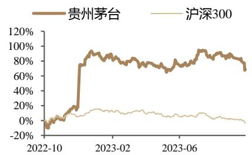

买入（维持）

所属行业：食品饮料/白酒Ⅱ

当前价格(元)：1,645.00

证券分析师

熊鹏

资格编号：S0120522120002

邮箱：xiongpeng＠tebon.com.cn

研究助理

## 市场表现

<table><tr><td>沪深300对比</td><td>1M</td><td>2M</td><td>3M</td></tr><tr><td>绝对涨幅(%)</td><td>-8.53</td><td>-8.15</td><td>-7.13</td></tr><tr><td>相对涨幅(%)</td><td>-4.12</td><td>-2.28</td><td>1.02</td></tr></table>

资料来源：德邦研究所，聚源数据

## 相关研究

1.《贵州茅台（600519）2023 中报点评：收入业绩符合前期预告，确定性成长性兼具》，2023.8.8

2.《贵州茅台（600519.SH）：股东增持显信心，价值底部布局时》，2022.11.30

# 贵州茅台（600519）2023三季报点评： 放慢步伐立足长远，基本面及业绩无忧

## 投资要点

收入业绩符合预期， 降速系完成进度较好的前提下，为强化市场秩序主动控制节奏。23Q3，公司实现营业收入/归母净利润 336.92/168.96 亿元，同比+14.04%/+15.68%，符合市场预期，三季度环比降速主要系公司上半年进度完成较好，进入下半年主动控制发货节奏，维持稳健长远发展。Q3 末合同负债 113.95 亿元，同比-3.73%，环比+40.6 亿元，预收款环比显著改善，同比恢复正常。

茅台酒增长稳健，系列酒放缓拖累整体增速。 23Q3，公司茅台酒/系列酒分别实现营业收入 279.91/55.20 亿元，分别同比+14.55%/+11.69%，茅台酒增速略高于系列酒。茅台酒经营节奏稳健，增速波动不大，与整体收入增速较为一致；系列酒同期基数较高，叠加三季度控货维护市场价格，导致系列酒增速放缓。

直销占比提升至 44%，各类直销渠道仍保持良好成长动力。 23Q3，公司批发代理/直销渠道分别实现营业收入 187.24/147.87 亿元，分别同比+1.52%/+35.26%，主营业务收入占比分别为 55.9%/44.1%，直销占比同比 22Q3 提升 6.9pcts。其中，23Q3 i 茅台贡献营收 55.33 亿元，同比+36.77%，主营业务收入占比达 16.5%，同比+2.7pcts，公司通过i 茅台的投放比例持续提升。剔除 i茅台来看，23Q3电商、KA、企业团购等直销渠道实现收入 92.54亿元，同比+34.37%，由此我们认为公司在各类直销渠道的成长动力仍然乐观。23Q3末，经销商数量环比 Q2 保持不变，经销体系稳定。

毛利率稳定，费率优化提升净利率。盈利能力方面， Q3 公司毛利率/净利率分别为 91.68%/49.22%，分别同比+0.03pct/+1.08pcts，毛利率保持稳定，税金附加率+期间费用率合计-0.84pct，净利率的提升主要得益于企业经营效率提升。费用率方面， Q3 公司销售/管理费用率分别+0.76pct/-0.84pct，我们推测三季度 1935在各地举办营销活动或导致销售费用有一定增加，管理费用则常态化优化。

投资建议：我们认为当下无论是对茅台酒的需求或公司的业绩都无需过于担忧，公司目前仍处于产品红利、渠道红利、品牌红利释放期，全年经营节奏稳健，15%的年度经营目标仍有望超额达成。对经营节奏适当调控，是为了让新品发展更健康，立足更长远经营，我们预计 2023-2025 年实现营收 1498.31/1747.47/2046.66亿元，实现归母净利润 741.34/879.32/1046.46 亿元，当前股价对应 PE 为27.9x/23.5x/19.8x，维持“买入”评级。

风险提示：消费税落地，新品推广不及预期，需求恢复不及预期

## [Table\_Ba股票数据

<table><tr><td>总股本(百万股):</td><td>1,256.20</td></tr><tr><td>流通A股(百万股):</td><td>1,256.20</td></tr><tr><td>52周内股价区间(元):</td><td>875.24-1897.00</td></tr><tr><td>总市值(百万元):</td><td>2,066,445.38</td></tr><tr><td>总资产(百万元):</td><td>247,756.92</td></tr><tr><td>每股净资产(元):</td><td>164.55</td></tr><tr><td colspan="2">资料来源:公司公告</td></tr></table>

[Table\_Finance] 主要财务数据及预测

<table><tr><td></td><td>2021</td><td>2022</td><td>2023E</td><td>2024E</td><td>2025E</td></tr><tr><td>营业收入(百万元)</td><td>109,464</td><td>127,554</td><td>149,831</td><td>174,747</td><td>204,666</td></tr><tr><td>(+/-)YOY(%)</td><td>11.7%</td><td>16.5%</td><td>17.5%</td><td>16.6%</td><td>17.1%</td></tr><tr><td>净利润(百万元)</td><td>52,460</td><td>62,716</td><td>74,134</td><td>87,932</td><td>104,646</td></tr><tr><td>(+/-)YOY(%)</td><td>12.3%</td><td>19.6%</td><td>18.2%</td><td>18.6%</td><td>19.0%</td></tr><tr><td>全面摊薄EPS(元)</td><td>41.76</td><td>49.93</td><td>59.01</td><td>70.00</td><td>83.30</td></tr><tr><td>毛利率(%)</td><td>91.5%</td><td>91.9%</td><td>93.0%</td><td>93.7%</td><td>94.2%</td></tr><tr><td>净资产收益率(%)</td><td>27.7%</td><td>31.8%</td><td>31.0%</td><td>26.9%</td><td>24.2%</td></tr></table>

资料来源：公司年报（ ），德邦研究所备注：净利润为归属母公司所有者的净利润

财务报表分析和预测

<table><tr><td>主要财务指标</td><td>2022</td><td>2023E</td><td>2024E</td><td>2025E</td></tr><tr><td>每股指标(元)</td><td></td><td></td><td></td><td></td></tr><tr><td>每股收益</td><td>49.93</td><td>59.01</td><td>70.00</td><td>83.30</td></tr><tr><td>每股净资产</td><td>157.23</td><td>190.33</td><td>260.33</td><td>343.63</td></tr><tr><td>每股经营现金流</td><td>29.21</td><td>71.55</td><td>70.45</td><td>94.59</td></tr><tr><td>每股股利</td><td>47.82</td><td>0.00</td><td>0.00</td><td>0.00</td></tr><tr><td>价值评估(倍)</td><td></td><td></td><td></td><td></td></tr><tr><td>P/E</td><td>34.59</td><td>27.87</td><td>23.50</td><td>19.75</td></tr><tr><td>P/B</td><td>10.98</td><td>8.64</td><td>6.32</td><td>4.79</td></tr><tr><td>P/S</td><td>16.20</td><td>13.79</td><td>11.83</td><td>10.10</td></tr><tr><td>EV/EBITDA</td><td>23.97</td><td>18.46</td><td>15.03</td><td>11.98</td></tr><tr><td>股息率%</td><td>2.8%</td><td>0.0%</td><td>0.0%</td><td>0.0%</td></tr><tr><td>盈利能力指标(%)</td><td></td><td></td><td></td><td></td></tr><tr><td>毛利率</td><td>91.9%</td><td>93.0%</td><td>93.7%</td><td>94.2%</td></tr><tr><td>净利润率</td><td>52.7%</td><td>53.4%</td><td>54.0%</td><td>54.6%</td></tr><tr><td>净资产收益率</td><td>31.8%</td><td>31.0%</td><td>26.9%</td><td>24.2%</td></tr><tr><td>资产回报率</td><td>24.7%</td><td>24.3%</td><td>21.9%</td><td>20.4%</td></tr><tr><td>投资回报率</td><td>31.4%</td><td>30.9%</td><td>26.6%</td><td>23.7%</td></tr><tr><td>盈利增长(%)</td><td></td><td></td><td></td><td></td></tr><tr><td>营业收入增长率</td><td>16.5%</td><td>17.5%</td><td>16.6%</td><td>17.1%</td></tr><tr><td>EBIT增长率</td><td>17.2%</td><td>20.2%</td><td>17.8%</td><td>17.9%</td></tr><tr><td>净利润增长率</td><td>19.6%</td><td>18.2%</td><td>18.6%</td><td>19.0%</td></tr><tr><td>偿债能力指标</td><td></td><td></td><td></td><td></td></tr><tr><td>资产负债率</td><td>19.4%</td><td>17.7%</td><td>14.6%</td><td>11.8%</td></tr><tr><td>流动比率</td><td>4.4</td><td>4.9</td><td>6.2</td><td>7.8</td></tr><tr><td>速动比率</td><td>1.2</td><td>2.1</td><td>3.4</td><td>5.2</td></tr><tr><td>现金比率</td><td>1.2</td><td>2.1</td><td>3.4</td><td>5.2</td></tr><tr><td>经营效率指标</td><td></td><td></td><td></td><td></td></tr><tr><td>应收帐款周转天数</td><td>0.0</td><td>0.0</td><td>0.0</td><td>0.0</td></tr><tr><td>存货周转天数</td><td>1,287.9</td><td>1,243.6</td><td>1,259.7</td><td>1,263.7</td></tr><tr><td>总资产周转率</td><td>0.5</td><td>0.5</td><td>0.4</td><td>0.4</td></tr><tr><td>固定资产周转率</td><td>6.5</td><td>7.2</td><td>8.1</td><td>9.0</td></tr></table>

<table><tr><td>现金流量表(百万元)</td><td>2022</td><td>2023E</td><td>2024E</td><td>2025E</td></tr><tr><td>净利润</td><td>62,716</td><td>74,134</td><td>87,932</td><td>104,646</td></tr><tr><td>少数股东损益</td><td>2,659</td><td>4,073</td><td>4,669</td><td>5,244</td></tr><tr><td>非现金支出</td><td>1,703</td><td>2,014</td><td>2,171</td><td>2,349</td></tr><tr><td>非经营收益</td><td>-1,253</td><td>72</td><td>-7</td><td>-21</td></tr><tr><td>营运资金变动</td><td>-29,127</td><td>9,582</td><td>-6,261</td><td>6,611</td></tr><tr><td>经营活动现金流</td><td>36,699</td><td>89,875</td><td>88,504</td><td>118,828</td></tr><tr><td>资产</td><td>-5,306</td><td>-3,650</td><td>-4,235</td><td>-4,187</td></tr><tr><td>投资</td><td>-210</td><td>-2</td><td>-3</td><td>-2</td></tr><tr><td>其他</td><td>-21</td><td>51</td><td>79</td><td>88</td></tr><tr><td>投资活动现金流</td><td>-5,537</td><td>-3,602</td><td>-4,160</td><td>-4,102</td></tr><tr><td>债权募资</td><td>0</td><td>0</td><td>0</td><td>0</td></tr><tr><td>股权募资</td><td>0</td><td>0</td><td>0</td><td>0</td></tr><tr><td>其他</td><td>-57,425</td><td>-32,549</td><td>0</td><td>0</td></tr><tr><td>融资活动现金流</td><td>-57,425</td><td>-32,549</td><td>0</td><td>0</td></tr><tr><td>现金净流量</td><td>-26,262</td><td>53,724</td><td>84,345</td><td>114,727</td></tr></table>

备注：表中计算估值指标的收盘价日期为 月 日  
资料来源：公司年报（ ），德邦研究所

<table><tr><td>利润表(百万元)</td><td>2022</td><td>2023E</td><td>2024E</td><td>2025E</td></tr><tr><td>营业总收入</td><td>127,554</td><td>149,831</td><td>174,747</td><td>204,666</td></tr><tr><td>营业成本</td><td>10,199</td><td>10,355</td><td>11,011</td><td>11,807</td></tr><tr><td>毛利率%</td><td>91.9%</td><td>93.0%</td><td>93.7%</td><td>94.2%</td></tr><tr><td>营业税金及附加</td><td>18,496</td><td>21,452</td><td>25,113</td><td>29,648</td></tr><tr><td>营业税金率%</td><td>14.9%</td><td>14.6%</td><td>14.7%</td><td>14.7%</td></tr><tr><td>营业费用</td><td>3,298</td><td>3,661</td><td>4,198</td><td>4,929</td></tr><tr><td>营业费用率%</td><td>2.7%</td><td>2.5%</td><td>2.5%</td><td>2.5%</td></tr><tr><td>管理费用</td><td>9,012</td><td>10,397</td><td>11,995</td><td>13,882</td></tr><tr><td>管理费用率%</td><td>7.3%</td><td>7.1%</td><td>7.0%</td><td>6.9%</td></tr><tr><td>研发费用</td><td>135</td><td>108</td><td>137</td><td>176</td></tr><tr><td>研发费用率%</td><td>0.1%</td><td>0.1%</td><td>0.1%</td><td>0.1%</td></tr><tr><td>EBIT</td><td>86,424</td><td>103,883</td><td>122,324</td><td>144,260</td></tr><tr><td>财务费用</td><td>-1,392</td><td>-874</td><td>-1,680</td><td>-2,945</td></tr><tr><td>财务费用率%</td><td>-1.1%</td><td>-0.6%</td><td>-1.0%</td><td>-1.5%</td></tr><tr><td>资产减值损失</td><td>0</td><td>0</td><td>0</td><td>0</td></tr><tr><td>投资收益</td><td>64</td><td>51</td><td>79</td><td>88</td></tr><tr><td>营业利润</td><td>87,880</td><td>104,808</td><td>124,083</td><td>147,293</td></tr><tr><td>营业外收支</td><td>-178</td><td>-122</td><td>-72</td><td>-66</td></tr><tr><td>利润总额</td><td>87,701</td><td>104,686</td><td>124,011</td><td>147,227</td></tr><tr><td>EBITDA</td><td>88,112</td><td>105,897</td><td>124,495</td><td>146,609</td></tr><tr><td>所得税</td><td>22,326</td><td>26,479</td><td>31,410</td><td>37,336</td></tr><tr><td>有效所得税率%</td><td>25.5%</td><td>25.3%</td><td>25.3%</td><td>25.4%</td></tr><tr><td>少数股东损益</td><td>2,659</td><td>4,073</td><td>4,669</td><td>5,244</td></tr><tr><td>归属母公司所有者净利润</td><td>62,716</td><td>74,134</td><td>87,932</td><td>104,646</td></tr></table>

<table><tr><td>资产负债表(百万元)</td><td>2022</td><td>2023E</td><td>2024E</td><td>2025E</td></tr><tr><td>货币资金</td><td>58,274</td><td>111,998</td><td>196,343</td><td>311,069</td></tr><tr><td>应收账款及应收票据</td><td>126</td><td>2,185</td><td>561</td><td>2,534</td></tr><tr><td>存货</td><td>38,824</td><td>31,828</td><td>44,309</td><td>37,645</td></tr><tr><td>其它流动资产</td><td>119,386</td><td>119,333</td><td>119,275</td><td>119,458</td></tr><tr><td>流动资产合计</td><td>216,611</td><td>265,344</td><td>360,487</td><td>470,707</td></tr><tr><td>长期股权投资</td><td>0</td><td>0</td><td>0</td><td>0</td></tr><tr><td>固定资产</td><td>19,743</td><td>20,702</td><td>21,701</td><td>22,690</td></tr><tr><td>在建工程</td><td>2,208</td><td>1,844</td><td>1,642</td><td>1,416</td></tr><tr><td>无形资产</td><td>7,083</td><td>7,868</td><td>8,885</td><td>9,778</td></tr><tr><td>非流动资产合计</td><td>37,753</td><td>39,270</td><td>41,265</td><td>43,039</td></tr><tr><td>资产总计</td><td>254,365</td><td>304,614</td><td>401,752</td><td>513,746</td></tr><tr><td>短期借款</td><td>0</td><td>0</td><td>0</td><td>0</td></tr><tr><td>应付票据及应付账款</td><td>2,408</td><td>1,550</td><td>2,795</td><td>1,968</td></tr><tr><td>预收账款</td><td>0</td><td>0</td><td>0</td><td>0</td></tr><tr><td>其它流动负债</td><td>46,657</td><td>52,107</td><td>55,400</td><td>58,330</td></tr><tr><td>流动负债合计</td><td>49,066</td><td>53,657</td><td>58,195</td><td>60,298</td></tr><tr><td>长期借款</td><td>0</td><td>0</td><td>0</td><td>0</td></tr><tr><td>其它长期负债</td><td>334</td><td>334</td><td>334</td><td>334</td></tr><tr><td>非流动负债合计</td><td>334</td><td>334</td><td>334</td><td>334</td></tr><tr><td>负债总计</td><td>49,400</td><td>53,991</td><td>58,529</td><td>60,633</td></tr><tr><td>实收资本</td><td>1,256</td><td>1,256</td><td>1,256</td><td>1,256</td></tr><tr><td>普通股股东权益</td><td>197,507</td><td>239,091</td><td>327,023</td><td>431,668</td></tr><tr><td>少数股东权益</td><td>7,458</td><td>11,531</td><td>16,200</td><td>21,445</td></tr><tr><td>负债和所有者权益合计</td><td>254,365</td><td>304,614</td><td>401,752</td><td>513,746</td></tr></table>

## 信息披露

## 分析师与研究助理简介

熊鹏，德邦证券大消费组组长 食品饮料首席分析师，上海交通大学及挪威科技大学双硕士。全面负责食品饮料行业各板块的研究，年行业研究经验，2022年卖方分析师水晶球奖公募榜单上榜。曾任职于西部证券、国信证券、安信证券等，2022年 12月加入德邦证券研究所。

## 分析师声明

本人具有中国证券业协会授予的证券投资咨询执业资格，以勤勉的职业态度，独立、客观地出具本报告。本报告所采用的数据和信息均来自市场公开信息，本人不保证该等信息的准确性或完整性。分析逻辑基于作者的职业理解，清晰准确地反映了作者的研究观点，结论不受任何第三方的授意或影响，特此声明。

## 投资评级说明

<table><tr><td rowspan="8">1. 投资评级的比较和评级标准:以报告发布后的6个月内的市场表现为比较标准,报告发布日后6个月内的公司股价(或行业指数)的涨跌幅相对同期市场基准指数的涨跌幅;2. 市场基准指数的比较标准:A股市场以上证综指或深证成指为基准;香港市场以恒生指数为基准;美国市场以标普500或纳斯达克综合指数为基准。</td><td>类别</td><td>评级</td><td>说明</td></tr><tr><td rowspan="4">股票投资评级</td><td>买入</td><td>相对强于市场表现20%以上;</td></tr><tr><td>增持</td><td>相对强于市场表现5%~20%;</td></tr><tr><td>中性</td><td>相对市场表现在-5%~+5%之间波动;</td></tr><tr><td>减持</td><td>相对弱于市场表现5%以下。</td></tr><tr><td rowspan="3">行业投资评级</td><td>优于大市</td><td>预期行业整体回报高于基准指数整体水平10%以上;</td></tr><tr><td>中性</td><td>预期行业整体回报介于基准指数整体水平-10%与10%之间;</td></tr><tr><td>弱于大市</td><td>预期行业整体回报低于基准指数整体水平10%以下。</td></tr></table>

## 法律声明

本报告仅供德邦证券股份有限公司（以下简称“本公司”）的客户使用。本公司不会因接收人收到本报告而视其为客户。在任何情况下，本报告中的信息或所表述的意见并不构成对任何人的投资建议。在任何情况下，本公司不对任何人因使用本报告中的任何内容所引致的任何损失负任何责任。

本报告所载的资料、意见及推测仅反映本公司于发布本报告当日的判断，本报告所指的证券或投资标的的价格、价值及投资收入可能会波动。在不同时期，本公司可发出与本报告所载资料、意见及推测不一致的报告。

市场有风险，投资需谨慎。本报告所载的信息、材料及结论只提供特定客户作参考，不构成投资建议，也没有考虑到个别客户特殊的投资目标、财务状况或需要。客户应考虑本报告中的任何意见或建议是否符合其特定状况。在法律许可的情况下，德邦证券及其所属关联机构可能会持有报告中提到的公司所发行的证券并进行交易，还可能为这些公司提供投资银行服务或其他服务。

本报告仅向特定客户传送，未经德邦证券研究所书面授权，本研究报告的任何部分均不得以任何方式制作任何形式的拷见，复印件或复制品，或再次分发给任何其他人，或以任何侵犯本公司版权的其他方式使用。所有本报告中使用的商标、服务标记及标记均为本公司的商标、服务标记及标记。如欲引用或转载本文内容，务必联络德邦证券研究所并获得许可，并需注明出处为德邦证券研究所，且不得对本文进行有悖原意的引用和删改。

根据中国证监会核发的经营证券业务许可，德邦证券股份有限公司的经营范围包括证券投资咨询业务。