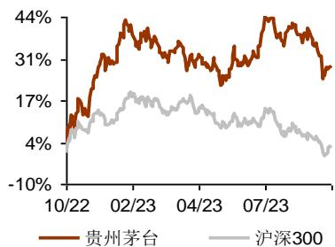

## 公司研究

# 提价落地，增长工具箱更加充足——贵州茅台（600519.SH）重大事项公告点评

## 要点

事件：10 月 31 日晚，贵州茅台发布重大事项公告，宣布自 2023 年 11 月 1 日起上调 53 度贵州茅台酒（飞天、五星）出厂价格，平均上调幅度约为 20%，此次调整不涉及公司产品的市场指导价格。

时隔五年主力大单品提价，提价幅度相对稳健。本次提价是继 2018 年年初提价之后、时隔五年对主力大单品提价，本次提价幅度约 20%，提价后飞天茅台出厂价将从 969 元/瓶提升至约 1163 元/瓶，对应 2018-2023 年五年间复合增速约4%，提价幅度整体较为稳健。今年以来飞天茅台批价表现较为平稳，本次提价一方面在考量当下市场环境的基础上、对经营层面进行调控，为公司后续报表层面增长提供更多驱动，另一方面，公司作为行业龙头时隔五年后再度提价，可以有效稳定市场预期、提振资本市场对于公司以及整体板块的信心。

飞天茅台提价有望明显增厚公司 24 年收入及利润。从报表层面来看，本次提价主要针对飞天、五星等飞天系列产品，且主要针对出厂价为 969 元/瓶、在传统渠道投放的产品，终端市场指导价仍为 1499 元/瓶。公司从 23 年 11 月开始执行新价格，考虑据渠道反馈截至 10 月底茅台酒回款进度已经达到 85%，估计对于 23 年增量贡献相对有限，24 年全年按照新的出厂价执行，考虑茅台酒销量以及传统批发渠道收入占比，假设销量增速不变的前提下，估计 24 年飞天茅台提价带来的收入增量有望达到约 60 亿元，结合茅台酒毛利率并扣除相关费用税金影响后，估计 24 年净利润增量有望达到约 45 亿元，收入/净利润同比增速较之前预测有望提升约 3.1/4.3pct，提价对业绩端带来的贡献较为可观。

提价后公司增长工具箱更加充足，且有望明显催化公司及白酒板块估值水平。对公司而言，本次提价有望直接增厚表观收入/业绩、公司后续增长加速的趋势进一步明确，亦可有效缓解此前市场对于公司增长放缓的担忧，同时提价后飞天茅台无需通过太多放量即可以实现较好增长，批价/渠道秩序有望保持企稳。从估值角度，本次超预期提价可以在较大程度上缓解市场对于公司 24 年估值继续调整的悲观预期，贵州茅台 24 年估值有望至少修复到 25-30 倍水平，对于白酒板块的估值抬升亦有较好支撑。从行业层面来看，作为高端白酒风向标，飞天茅台提价从长期角度有望进一步抬高行业价格天花板，利于行业整体向上发展。

盈利预测、估值与评级：维持 2023 年归母净利润预测 739.0 亿元，考虑提价带来的收入/净利润增量，上调2024/25年归母净利润预测为885.4/1014.6亿元（较前次预测上调 3.4%/3.1%），折合 EPS 为 58.83/70.49/80.76 元，当前股价对应 P/E 为 29/24/21 倍，维持“买入”评级。

风险提示：高端白酒需求疲软，渠道改革不及预期，飞天茅台批价下行。

公司盈利预测与估值简表

<table><tr><td>指标</td><td>2021</td><td>2022</td><td>2023E</td><td>2024E</td><td>2025E</td></tr><tr><td>营业收入(百万元)</td><td>109,464</td><td>127,554</td><td>1,501</td><td>177,823</td><td>203,480</td></tr><tr><td>营业收入增长率</td><td>11.71%</td><td>16.53%</td><td>17.42%</td><td>18.73%</td><td>14.43%</td></tr><tr><td>净利润(百万元)</td><td>52,460</td><td>62,716</td><td>73,904</td><td>88,543</td><td>101,456</td></tr><tr><td>净利润增长率</td><td>12.34%</td><td>19.55%</td><td>17.84%</td><td>19.81%</td><td>14.58%</td></tr><tr><td>EPS(元)</td><td>41.76</td><td>49.93</td><td>58.83</td><td>70.49</td><td>80.76</td></tr><tr><td>ROE(归属母公司)(摊薄)</td><td>27.68%</td><td>31.75%</td><td>31.08%</td><td>30.67%</td><td>29.46%</td></tr><tr><td>P/E</td><td>40</td><td>34</td><td>29</td><td>24</td><td>21</td></tr><tr><td>P/B</td><td>11.2</td><td>10.7</td><td>8.9</td><td>7.3</td><td>6.1</td></tr></table>

资料来源：Wind，光大证券研究所预测，股价时间为 2023-10-31

## 买入（维持）

当前价：1,684.58 元

## 作者

分析师：叶倩瑜

执业证书编号：S0930517100003

021-52523657

yeqianyu@ebscn.com

分析师：杨哲

执业证书编号：S0930522080001

021-52523795

yangz@ebscn.com

分析师：李嘉祺

执业证书编号：S0930523070005

021-52523658

lijq@ebscn.com

## 联系人：董博文

dongbowen@ebscn.com

## 市场数据

<table><tr><td>总股本(亿股)</td><td>12.56</td></tr><tr><td>总市值(亿元):</td><td>21161.69</td></tr><tr><td>一年最低/最高(元):</td><td>1321.62/1935.00</td></tr><tr><td>近3月换手率:</td><td>10.67%</td></tr></table>

## 股价相对走势

## 收益表现

<table><tr><td>%</td><td>1M</td><td>3M</td><td>1Y</td></tr><tr><td>相对</td><td>-2.16</td><td>-0.18</td><td>16.92</td></tr><tr><td>绝对</td><td>-5.20</td><td>-10.82</td><td>18.48</td></tr></table>

资料来源：Wind

## 相关研报

业绩符合预期，持续稳步向前——贵州茅台

（600519.SH）2023 年三季报点评

（2023-10-22）

加速增长，韧性凸显——贵州茅台（600519.SH）2023 年半年报点评（2023-08-03）

财务报表与盈利预测

<table><tr><td>利润表(百万元)</td><td>2021</td><td>2022</td><td>2023E</td><td>2024E</td><td>2025E</td></tr><tr><td>营业收入</td><td>109,464</td><td>127,554</td><td>149,774</td><td>177,823</td><td>203,480</td></tr><tr><td>营业成本</td><td>8,983</td><td>10,093</td><td>12,083</td><td>14,295</td><td>16,890</td></tr><tr><td>折旧和摊销</td><td>1,469</td><td>1,600</td><td>2,269</td><td>2,450</td><td>2,583</td></tr><tr><td>税金及附加</td><td>15,304</td><td>18,496</td><td>21,118</td><td>24,895</td><td>28,487</td></tr><tr><td>销售费用</td><td>2,737</td><td>3,298</td><td>3,744</td><td>4,357</td><td>4,985</td></tr><tr><td>管理费用</td><td>8,450</td><td>9,012</td><td>10,334</td><td>12,181</td><td>13,938</td></tr><tr><td>研发费用</td><td>62</td><td>135</td><td>75</td><td>89</td><td>102</td></tr><tr><td>财务费用</td><td>-935</td><td>-1,392</td><td>-50</td><td>-22</td><td>-23</td></tr><tr><td>投资收益</td><td>58</td><td>64</td><td>0</td><td>0</td><td>0</td></tr><tr><td>营业利润</td><td>74,751</td><td>87,880</td><td>102,506</td><td>122,064</td><td>139,141</td></tr><tr><td>利润总额</td><td>74,528</td><td>87,701</td><td>102,426</td><td>121,984</td><td>139,061</td></tr><tr><td>所得税</td><td>18,808</td><td>22,326</td><td>25,606</td><td>30,496</td><td>34,765</td></tr><tr><td>净利润</td><td>55,721</td><td>65,375</td><td>76,819</td><td>91,488</td><td>104,296</td></tr><tr><td>少数股东损益</td><td>3,260</td><td>2,659</td><td>2,915</td><td>2,945</td><td>2,839</td></tr><tr><td>归属母公司净利润</td><td>52,460</td><td>62,716</td><td>73,904</td><td>88,543</td><td>101,456</td></tr><tr><td>EPS(元)</td><td>41.76</td><td>49.93</td><td>58.83</td><td>70.49</td><td>80.76</td></tr></table>

<table><tr><td>现金流量表(百万元)</td><td>2021</td><td>2022</td><td>2023E</td><td>2024E</td><td>2025E</td></tr><tr><td>经营活动现金流</td><td>64,029</td><td>36,699</td><td>84,876</td><td>89,280</td><td>100,179</td></tr><tr><td>净利润</td><td>52,460</td><td>62,716</td><td>73,904</td><td>88,543</td><td>101,456</td></tr><tr><td>折旧摊销</td><td>1,469</td><td>1,600</td><td>2,269</td><td>2,450</td><td>2,583</td></tr><tr><td>净营运资金增加</td><td>8,979</td><td>949</td><td>1,037</td><td>8,839</td><td>10,523</td></tr><tr><td>其他</td><td>1,121</td><td>-28,566</td><td>7,665</td><td>-10,553</td><td>-14,383</td></tr><tr><td>投资活动产生现金流</td><td>-5,562</td><td>-5,537</td><td>-3,869</td><td>-4,125</td><td>-4,100</td></tr><tr><td>净资本支出</td><td>-3,406</td><td>-5,306</td><td>-3,859</td><td>-4,050</td><td>-4,050</td></tr><tr><td>长期投资变化</td><td>0</td><td>0</td><td>0</td><td>0</td><td>0</td></tr><tr><td>其他资产变化</td><td>-2,156</td><td>-231</td><td>-10</td><td>-75</td><td>-50</td></tr><tr><td>融资活动现金流</td><td>-26,564</td><td>-57,425</td><td>-33,570</td><td>-37,620</td><td>-45,721</td></tr><tr><td>股本变化</td><td>0</td><td>0</td><td>0</td><td>0</td><td>0</td></tr><tr><td>债务净变化</td><td>104</td><td>5</td><td>-9</td><td>0</td><td>0</td></tr><tr><td>无息负债变化</td><td>12,431</td><td>-8,816</td><td>3,917</td><td>3,863</td><td>3,402</td></tr><tr><td>净现金流</td><td>31,900</td><td>-26,262</td><td>47,436</td><td>47,536</td><td>50,358</td></tr></table>

<table><tr><td>资产负债表(百万元)</td><td>2021</td><td>2022</td><td>2023E</td><td>2024E</td><td>2025E</td></tr><tr><td>总资产</td><td>255,168</td><td>254,365</td><td>301,481</td><td>359,191</td><td>421,144</td></tr><tr><td>货币资金</td><td>51,810</td><td>58,274</td><td>105,711</td><td>153,247</td><td>203,605</td></tr><tr><td>交易性金融资产</td><td>0</td><td>0</td><td>10</td><td>10</td><td>10</td></tr><tr><td>应收账款</td><td>0</td><td>21</td><td>0</td><td>0</td><td>0</td></tr><tr><td>应收票据</td><td>0</td><td>105</td><td>75</td><td>89</td><td>102</td></tr><tr><td>其他应收款(合计)</td><td>33</td><td>32</td><td>0</td><td>0</td><td>0</td></tr><tr><td>存货</td><td>33,394</td><td>38,824</td><td>42,290</td><td>50,031</td><td>59,113</td></tr><tr><td>其他流动资产</td><td>135,139</td><td>116,334</td><td>116,889</td><td>117,590</td><td>118,232</td></tr><tr><td>流动资产合计</td><td>220,766</td><td>216,611</td><td>266,011</td><td>322,042</td><td>382,477</td></tr><tr><td>其他权益工具</td><td>0</td><td>0</td><td>0</td><td>0</td><td>0</td></tr><tr><td>长期股权投资</td><td>0</td><td>0</td><td>0</td><td>0</td><td>0</td></tr><tr><td>固定资产</td><td>17,472</td><td>19,743</td><td>21,489</td><td>21,091</td><td>20,988</td></tr><tr><td>在建工程</td><td>2,322</td><td>2,208</td><td>1,956</td><td>3,267</td><td>4,550</td></tr><tr><td>无形资产</td><td>6,208</td><td>7,083</td><td>6,991</td><td>6,901</td><td>6,812</td></tr><tr><td>商誉</td><td>0</td><td>0</td><td>0</td><td>0</td><td>0</td></tr><tr><td>其他非流动资产</td><td>5,485</td><td>4,135</td><td>4,135</td><td>4,135</td><td>4,135</td></tr><tr><td>非流动资产合计</td><td>34,403</td><td>37,753</td><td>35,470</td><td>37,148</td><td>38,667</td></tr><tr><td>总负债</td><td>58,211</td><td>49,400</td><td>53,308</td><td>57,171</td><td>60,572</td></tr><tr><td>短期借款</td><td>0</td><td>0</td><td>0</td><td>0</td><td>0</td></tr><tr><td>应付账款</td><td>2,010</td><td>2,408</td><td>2,779</td><td>3,574</td><td>4,222</td></tr><tr><td>应付票据</td><td>0</td><td>0</td><td>0</td><td>0</td><td>0</td></tr><tr><td>预收账款</td><td>0</td><td>0</td><td>0</td><td>0</td><td>0</td></tr><tr><td>其他流动负债</td><td>23,300</td><td>14,853</td><td>14,853</td><td>14,853</td><td>14,853</td></tr><tr><td>流动负债合计</td><td>57,914</td><td>49,066</td><td>53,306</td><td>57,169</td><td>60,570</td></tr><tr><td>长期借款</td><td>0</td><td>0</td><td>0</td><td>0</td><td>0</td></tr><tr><td>应付债券</td><td>0</td><td>0</td><td>0</td><td>0</td><td>0</td></tr><tr><td>其他非流动负债</td><td>0</td><td>0</td><td>0</td><td>0</td><td>0</td></tr><tr><td>非流动负债合计</td><td>296</td><td>334</td><td>2</td><td>2</td><td>2</td></tr><tr><td>股东权益</td><td>196,958</td><td>204,965</td><td>248,173</td><td>302,020</td><td>360,572</td></tr><tr><td>股本</td><td>1,256</td><td>1,256</td><td>1,256</td><td>1,256</td><td>1,256</td></tr><tr><td>公积金</td><td>26,518</td><td>33,898</td><td>33,898</td><td>33,898</td><td>33,898</td></tr><tr><td>未分配利润</td><td>160,717</td><td>161,302</td><td>202,657</td><td>253,559</td><td>309,271</td></tr><tr><td>归属母公司权益</td><td>189,539</td><td>197,507</td><td>237,800</td><td>288,702</td><td>344,414</td></tr><tr><td>少数股东权益</td><td>7,418</td><td>7,458</td><td>10,373</td><td>13,318</td><td>16,157</td></tr></table>

主要指标

<table><tr><td>盈利能力(%)</td><td>2021</td><td>2022</td><td>2023E</td><td>2024E</td><td>2025E</td></tr><tr><td>毛利率</td><td>91.8%</td><td>92.1%</td><td>91.9%</td><td>92.0%</td><td>91.7%</td></tr><tr><td>EBITDA率</td><td>68.9%</td><td>69.1%</td><td>69.9%</td><td>70.0%</td><td>69.6%</td></tr><tr><td>EBIT率</td><td>67.6%</td><td>67.8%</td><td>68.4%</td><td>68.6%</td><td>68.4%</td></tr><tr><td>税前净利润率</td><td>68.1%</td><td>68.8%</td><td>68.4%</td><td>68.6%</td><td>68.3%</td></tr><tr><td>归母净利润率</td><td>47.9%</td><td>49.2%</td><td>49.3%</td><td>49.8%</td><td>49.9%</td></tr><tr><td>ROA</td><td>21.8%</td><td>25.7%</td><td>25.5%</td><td>25.5%</td><td>24.8%</td></tr><tr><td>ROE(摊薄)</td><td>27.7%</td><td>31.8%</td><td>31.1%</td><td>30.7%</td><td>29.5%</td></tr><tr><td>经营性ROIC</td><td>34.2%</td><td>39.0%</td><td>46.6%</td><td>52.2%</td><td>55.6%</td></tr></table>

<table><tr><td>偿债能力</td><td>2021</td><td>2022</td><td>2023E</td><td>2024E</td><td>2025E</td></tr><tr><td>资产负债率</td><td>23%</td><td>19%</td><td>18%</td><td>16%</td><td>14%</td></tr><tr><td>流动比率</td><td>3.81</td><td>4.41</td><td>4.99</td><td>5.63</td><td>6.31</td></tr><tr><td>速动比率</td><td>3.24</td><td>3.62</td><td>4.20</td><td>4.76</td><td>5.34</td></tr><tr><td>归母权益/有息债务</td><td>1816.91</td><td>1806.17</td><td>2378.00</td><td>2887.02</td><td>3444.14</td></tr><tr><td>有形资产/有息债务</td><td>2363.72</td><td>2226.64</td><td>2944.28</td><td>3522.24</td><td>4142.64</td></tr></table>

资料来源：Wind，光大证券研究所预测

<table><tr><td>费用率</td><td>2021</td><td>2022</td><td>2023E</td><td>2024E</td><td>2025E</td></tr><tr><td>销售费用率</td><td>2.50%</td><td>2.59%</td><td>2.50%</td><td>2.45%</td><td>2.45%</td></tr><tr><td>管理费用率</td><td>7.72%</td><td>7.07%</td><td>6.90%</td><td>6.85%</td><td>6.85%</td></tr><tr><td>财务费用率</td><td>-0.85%</td><td>-1.09%</td><td>-0.03%</td><td>-0.01%</td><td>-0.01%</td></tr><tr><td>研发费用率</td><td>0.06%</td><td>0.11%</td><td>0.05%</td><td>0.05%</td><td>0.05%</td></tr><tr><td>所得税率</td><td>25%</td><td>25%</td><td>25%</td><td>25%</td><td>25%</td></tr></table>

<table><tr><td>每股指标</td><td>2021</td><td>2022</td><td>2023E</td><td>2024E</td><td>2025E</td></tr><tr><td>每股红利</td><td>21.68</td><td>25.91</td><td>29.96</td><td>36.41</td><td>41.51</td></tr><tr><td>每股经营现金流</td><td>50.97</td><td>29.21</td><td>67.57</td><td>71.07</td><td>79.75</td></tr><tr><td>每股净资产</td><td>150.88</td><td>157.23</td><td>189.30</td><td>229.82</td><td>274.17</td></tr><tr><td>每股销售收入</td><td>87.14</td><td>101.54</td><td>119.23</td><td>141.56</td><td>161.98</td></tr></table>

<table><tr><td>估值指标</td><td>2021</td><td>2022</td><td>2023E</td><td>2024E</td><td>2025E</td></tr><tr><td>PE</td><td>40</td><td>34</td><td>29</td><td>24</td><td>21</td></tr><tr><td>PB</td><td>11.2</td><td>10.7</td><td>8.9</td><td>7.3</td><td>6.1</td></tr><tr><td>EV/EBITDA</td><td>27.8</td><td>23.7</td><td>19.6</td><td>16.2</td><td>13.9</td></tr><tr><td>股息率</td><td>1.3%</td><td>1.5%</td><td>1.8%</td><td>2.2%</td><td>2.5%</td></tr></table>

## 行业及公司评级体系

<table><tr><td colspan="2">评级</td><td>说明</td></tr><tr><td rowspan="6">行业及公司评级</td><td>买入</td><td>未来6-12个月的投资收益率领先市场基准指数15%以上</td></tr><tr><td>增持</td><td>未来6-12个月的投资收益率领先市场基准指数5%至15%;</td></tr><tr><td>中性</td><td>未来6-12个月的投资收益率与市场基准指数的变动幅度相差-5%至5%;</td></tr><tr><td>减持</td><td>未来6-12个月的投资收益率落后市场基准指数5%至15%;</td></tr><tr><td>卖出</td><td>未来6-12个月的投资收益率落后市场基准指数15%以上;</td></tr><tr><td>无评级</td><td>因无法获取必要的资料,或者公司面临无法预见结果的重大不确定性事件,或者其他原因,致使无法给出明确的投资评级。</td></tr><tr><td colspan="2">基准指数说明:</td><td>A股市场基准为沪深300指数;香港市场基准为恒生指数;美国市场基准为纳斯达克综合指数或标普500指数。</td></tr></table>

## 分析、估值方法的局限性说明

本报告所包含的分析基于各种假设，不同假设可能导致分析结果出现重大不同。本报告采用的各种估值方法及模型均有其局限性，估值结果不保证所涉及证券能够在该价格交易。

## 分析师声明

本报告署名分析师具有中国证券业协会授予的证券投资咨询执业资格并注册为证券分析师，以勤勉的职业态度、专业审慎的研究方法，使用合法合规的信息，独立、客观地出具本报告，并对本报告的内容和观点负责。负责准备以及撰写本报告的所有研究人员在此保证，本研究报告中任何关于发行商或证券所发表的观点均如实反映研究人员的个人观点。研究人员获取报酬的评判因素包括研究的质量和准确性、客户反馈、竞争性因素以及光大证券股份有限公司的整体收益。所有研究人员保证他们报酬的任何一部分不曾与，不与，也将不会与本报告中具体的推荐意见或观点有直接或间接的联系。

## 法律主体声明

本报告由光大证券股份有限公司制作，光大证券股份有限公司具有中国证监会许可的证券投资咨询业务资格，负责本报告在中华人民共和国境内（仅为本报告目的，不包括港澳台）的分销。本报告署名分析师所持中国证券业协会授予的证券投资咨询执业资格编号已披露在报告首页。

中国光大证券国际有限公司和 Everbright Securities(UK) Company Limited 是光大证券股份有限公司的关联机构。

## 特别声明

光大证券股份有限公司（以下简称“本公司”）成立于 1996年，是中国证监会批准的首批三家创新试点证券公司之一，也是世界 500 强企业——中国光大集团股份公司的核心金融服务平台之一。根据中国证监会核发的经营证券期货业务许可，本公司的经营范围包括证券投资咨询业务。

本公司经营范围：证券经纪；证券投资咨询；与证券交易、证券投资活动有关的财务顾问；证券承销与保荐；证券自营；为期货公司提供中间介绍业务；证券投资基金代销；融资融券业务；中国证监会批准的其他业务。此外，本公司还通过全资或控股子公司开展资产管理、直接投资、期货、基金管理以及香港证券业务。

本报告由光大证券股份有限公司研究所（以下简称“光大证券研究所”）编写，以合法获得的我们相信为可靠、准确、完整的信息为基础，但不保证我们所获得的原始信息以及报告所载信息之准确性和完整性。光大证券研究所可能将不时补充、修订或更新有关信息，但不保证及时发布该等更新。

本报告中的资料、意见、预测均反映报告初次发布时光大证券研究所的判断，可能需随时进行调整且不予通知。在任何情况下，本报告中的信息或所表述的意见并不构成对任何人的投资建议。客户应自主作出投资决策并自行承担投资风险。本报告中的信息或所表述的意见并未考虑到个别投资者的具体投资目的，财务状况以及特定需求，投资者应当充分考虑自身特定状况，并完整理解和使用本报告内容，不应视本报告为做出投资决策的唯一因素。对依据或者使用本报告所造成的一切后果，本公司及作者均不承担任何法律责任。

不同时期，本公司可能会撰写并发布与本报告所载信息、建议及预测不一致的报告。本公司的销售人员、交易人员和其他专业人员可能会向客户提供与本报告中观点不同的口头或书面评论或交易策略。本公司的资产管理子公司、自营部门以及其他投资业务板块可能会独立做出与本报告的意见或建议不相一致的投资决策。本公司提醒投资者注意并理解投资证券及投资产品存在的风险，在做出投资决策前，建议投资者务必向专业人十资询并谨慎抉择。

在法律允许的情况下，本公司及其附属机构可能持有报告中提及的公司所发行证券的头寸并进行交易，也可能为这些公司提供或正在争取提供投资银行、财务顾问或金融产品等相关服务。投资者应当充分考虑本公司及本公司附属机构就报告内容可能存在的利益冲突，勿将本报告作为投资决策的唯一信赖依据。

本报告根据中华人民共和国法律在中华人民共和国境内分发，仅向特定客户传送。本报告的版权仅归本公司所有，未经书面许可，任何机构和个人不得以任何形式、任何目的进行翻版、复制、转载、刊登、发表、篡改或引用。如因侵权行为给本公司造成任何直接或间接的损失，本公司保留追究一切法律责任的权利。所有本报告中使用的商标、服务标记及标记均为本公司的商标、服务标记及标记。

光大证券股份有限公司版权所有。保留一切权利。

光大证券研究所

上海

北京

深圳

静安区南京西路 1266 号

西城区武定侯街 2 号

福田区深南大道 6011 号

恒隆广场 1 期办公楼 48 层

泰康国际大厦 7 层

NEO 绿景纪元大厦 A 座 17 楼

光大证券股份有限公司关联机构

香港

中国光大证券国际有限公司

香港铜锣湾希慎道 33 号利园一期 28 楼

英国

Everbright Securities(UK) Company Limited

6th Floor, 9 Appold Street, London, United Kingdom, EC2A 2AP