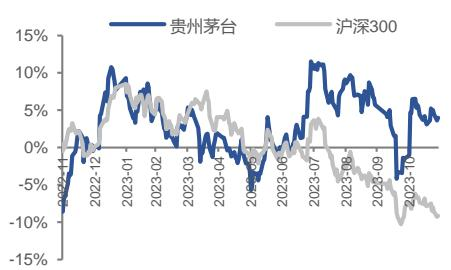

# 贵州茅台（600519.SH）

## 23 年高质量收官，24 年蓄势待发

➢ 事件：贵州茅台发布2023年度生产经营情况公告。经公司初步核算，2023年度公司预计实现营业总收入约1,495亿元，同比增长约17.2%；预计归母净利润约735亿元，同比增长约17.2%。公司年初制定的经营目标为营业总收入较上年增长15%左右，今年超额完成，龙头实力在压力环境下进一步凸显。

➢ 双轮驱动，茅台酒与系列酒增长稳健，茅台1935百亿目标顺利达成。分系列看，茅台酒23年预计实现营业收入约1,258亿元，同比增长约17%；系列酒营业收入约204亿元，同比增长约28%，其中，千元价格带大单品茅台1935今年销售额预计突破100亿元，茅台1935于2022年1月正式上市，去年完成营收50亿元，今年同比增长约100%，百亿目标顺利达成。

➢ 四季度利润增速略低，系产品结构调整所致。Q4单季度，公司预计实现营业收入约442亿元，同比增长约17%；实现归母净利润206亿元，同比增长约13%。其中，Q4茅台酒预计实现营业收入约385亿元，同比增长约15%；系列酒Q4营收约48亿元，同比增长41%，在去年的低基数的基础上提速较高。

➢ 产能有序释放，支撑销量稳步增长。2023年公司生产茅台酒基酒约5.72万吨，同比增长0.7%；生产系列酒基酒约4.29万吨，同比增长约23%，增速较去年变化不大。根据我们此前的测算，预计2023-2026年茅台成品酒产量CAGR约3.9%-7.4%，支撑公司销量稳步增长。

➢ 飞天提价后营收增厚，行业引领作用全方位深化。今年飞天提价后，茅台后续两年业绩增长确定性进一步明晰，同时茅台1935放量压力缓解，发展更为良性。在公司的渠道改革持续推进下，直销渠道占比持续提升，利润再分配持续推进，龙头茅台将持续引领白酒行业未来新模式。

➢ 盈利预测与投资建议：公司23年收官顺利，预计2023-25年归母净利为746.94/904.08/1048.36亿元（前值743.28/901.40/1044.78亿元），参照可比公司，给予公司2023年30倍PE，对应目标价2159元，维持买入评级。

➢ 风险提示：经济修复不及预期，公司高管更换导致策略变动风险等。

<table><tr><td>财务数据和估值</td><td>2021A</td><td>2022A</td><td>2023E</td><td>2024E</td><td>2025E</td></tr><tr><td>营业收入(百万元)</td><td>109,464</td><td>127,554</td><td>150,067</td><td>177,498</td><td>204,043</td></tr><tr><td>增长率</td><td>15%</td><td>17%</td><td>18%</td><td>18%</td><td>15%</td></tr><tr><td>净利润(百万元)</td><td>52,460</td><td>62,716</td><td>74,694</td><td>90,408</td><td>104,836</td></tr><tr><td>增长率</td><td>12%</td><td>20%</td><td>19%</td><td>21%</td><td>16%</td></tr><tr><td>EPS (元/股)</td><td>41.76</td><td>49.93</td><td>59.46</td><td>71.97</td><td>83.46</td></tr><tr><td>市盈率(P/E)</td><td>41</td><td>35</td><td>29</td><td>24</td><td>21</td></tr><tr><td>市净率(P/B)</td><td>11</td><td>11</td><td>9</td><td>7</td><td>5</td></tr></table>

数据来源：公司公告、华福证券研究所

## 买入(维持评级)

当前价格： 1726 元

目标价格： 2159 元

## 基本数据

<table><tr><td>总股本/流通股本(百万股)</td><td>1256/1256</td></tr><tr><td>总市值/流通市值(百万元)</td><td>2168197/21681</td></tr><tr><td>每股净资产(元)</td><td>154.28</td></tr><tr><td>资产负债率(%)</td><td>12.36</td></tr><tr><td>一年内最高/最低(元)</td><td>1875.36/1585.9</td></tr></table>

## 一年内股价相对走势

## 团队成员

分析师 刘畅

执业证书编号： S0210523050001

邮箱： lc30103@hfzq.com.cn

分析师 张东雪

执业证书编号： S021052306000

邮箱： zdx30145@hfzq.com.cn

## 相关报告

《贵州茅台（600519.SH）：岿然引领，时代中的茅台迎风发展》2023-11-29

图表 1：财务预测摘要  
资产负债表

<table><tr><td>单位:百万元</td><td>2022A</td><td>2023E</td><td>2024E</td><td>2025E</td></tr><tr><td>货币资金</td><td>58,274</td><td>224,389</td><td>320,615</td><td>429,107</td></tr><tr><td>应收票据及账款</td><td>126</td><td>130</td><td>156</td><td>182</td></tr><tr><td>预付账款</td><td>897</td><td>1,056</td><td>1,098</td><td>1,224</td></tr><tr><td>存货</td><td>38,824</td><td>43,072</td><td>45,485</td><td>51,189</td></tr><tr><td>合同资产</td><td>0</td><td>0</td><td>0</td><td>0</td></tr><tr><td>其他流动资产</td><td>118,489</td><td>662</td><td>968</td><td>1,378</td></tr><tr><td>流动资产合计</td><td>216,611</td><td>269,310</td><td>368,322</td><td>483,080</td></tr><tr><td>长期股权投资</td><td>0</td><td>0</td><td>0</td><td>0</td></tr><tr><td>固定资产</td><td>19,743</td><td>20,190</td><td>20,943</td><td>21,713</td></tr><tr><td>在建工程</td><td>2,208</td><td>1,966</td><td>1,828</td><td>1,695</td></tr><tr><td>无形资产</td><td>7,083</td><td>7,290</td><td>7,715</td><td>7,977</td></tr><tr><td>商誉</td><td>0</td><td>0</td><td>0</td><td>0</td></tr><tr><td>其他非流动资产</td><td>8,719</td><td>8,700</td><td>8,683</td><td>8,671</td></tr><tr><td>非流动资产合计</td><td>37,753</td><td>38,147</td><td>39,169</td><td>40,055</td></tr><tr><td>资产合计</td><td>254,365</td><td>307,457</td><td>407,490</td><td>523,135</td></tr><tr><td>短期借款</td><td>0</td><td>0</td><td>0</td><td>0</td></tr><tr><td>应付票据及账款</td><td>2,408</td><td>2,850</td><td>2,976</td><td>3,331</td></tr><tr><td>预收款项</td><td>0</td><td>0</td><td>0</td><td>0</td></tr><tr><td>合同负债</td><td>15,472</td><td>19,509</td><td>23,962</td><td>27,546</td></tr><tr><td>其他应付款</td><td>4,544</td><td>4,544</td><td>4,544</td><td>4,544</td></tr><tr><td>其他流动负债</td><td>26,642</td><td>30,108</td><td>31,826</td><td>34,882</td></tr><tr><td>流动负债合计</td><td>49,066</td><td>57,011</td><td>63,309</td><td>70,303</td></tr><tr><td>长期借款</td><td>0</td><td>0</td><td>0</td><td>0</td></tr><tr><td>应付债券</td><td>0</td><td>0</td><td>0</td><td>0</td></tr><tr><td>其他非流动负债</td><td>334</td><td>334</td><td>334</td><td>334</td></tr><tr><td>非流动负债合计</td><td>334</td><td>334</td><td>334</td><td>334</td></tr><tr><td>负债合计</td><td>49,400</td><td>57,346</td><td>63,643</td><td>70,637</td></tr><tr><td>归属母公司所有者权益</td><td>197,507</td><td>239,652</td><td>329,755</td><td>434,194</td></tr><tr><td>少数股东权益</td><td>7,458</td><td>10,459</td><td>14,092</td><td>18,304</td></tr><tr><td>所有者权益合计</td><td>204,965</td><td>250,111</td><td>343,847</td><td>452,498</td></tr><tr><td>负债和股东权益</td><td>254,365</td><td>307,457</td><td>407,490</td><td>523,135</td></tr></table>

现金流量表

<table><tr><td>单位:百万元</td><td>2022A</td><td>2023E</td><td>2024E</td><td>2025E</td></tr><tr><td>经营活动现金流</td><td>36,699</td><td>198,381</td><td>97,404</td><td>108,769</td></tr><tr><td>现金收益</td><td>65,700</td><td>78,588</td><td>93,674</td><td>107,718</td></tr><tr><td>存货影响</td><td>-5,430</td><td>-4,248</td><td>-2,413</td><td>-5,704</td></tr><tr><td>经营性应收影响</td><td>-635</td><td>-162</td><td>-68</td><td>-152</td></tr><tr><td>经营性应付影响</td><td>818</td><td>442</td><td>126</td><td>355</td></tr><tr><td>其他影响</td><td>-23,754</td><td>123,761</td><td>6,084</td><td>6,552</td></tr><tr><td>投资活动现金流</td><td>-5,537</td><td>-1,093</td><td>-3,561</td><td>-3,628</td></tr><tr><td>资本支出</td><td>-4,643</td><td>-2,682</td><td>-3,360</td><td>-3,317</td></tr><tr><td>股权投资</td><td>0</td><td>0</td><td>0</td><td>0</td></tr><tr><td>其他长期资产变化</td><td>-894</td><td>1,589</td><td>-201</td><td>-311</td></tr><tr><td>融资活动现金流</td><td>-57,425</td><td>-31,173</td><td>2,383</td><td>3,351</td></tr><tr><td>借款增加</td><td>5</td><td>0</td><td>0</td><td>0</td></tr><tr><td>股利及利息支付</td><td>-57,370</td><td>-317</td><td>-414</td><td>-507</td></tr><tr><td>股东融资</td><td>0</td><td>0</td><td>0</td><td>0</td></tr><tr><td>其他影响</td><td>-60</td><td>-30,856</td><td>2,797</td><td>3,858</td></tr></table>

数据来源：公司报告、华福证券研究所

利润表

<table><tr><td>单位:百万元</td><td>2022A</td><td>2023E</td><td>2024E</td><td>2025E</td></tr><tr><td>营业收入</td><td>127,554</td><td>150,067</td><td>177,498</td><td>204,043</td></tr><tr><td>营业成本</td><td>10,093</td><td>11,876</td><td>12,351</td><td>13,766</td></tr><tr><td>税金及附加</td><td>18,496</td><td>21,760</td><td>25,738</td><td>29,587</td></tr><tr><td>销售费用</td><td>3,298</td><td>4,030</td><td>4,731</td><td>5,336</td></tr><tr><td>管理费用</td><td>9,012</td><td>10,603</td><td>12,523</td><td>14,355</td></tr><tr><td>研发费用</td><td>135</td><td>159</td><td>188</td><td>216</td></tr><tr><td>财务费用</td><td>-4,740</td><td>-1,376</td><td>-2,688</td><td>-3,749</td></tr><tr><td>信用减值损失</td><td>-15</td><td>-13</td><td>-13</td><td>-13</td></tr><tr><td>资产减值损失</td><td>0</td><td>0</td><td>0</td><td>0</td></tr><tr><td>公允价值变动收益</td><td>0</td><td>0</td><td>0</td><td>0</td></tr><tr><td>投资收益</td><td>64</td><td>72</td><td>80</td><td>80</td></tr><tr><td>其他收益</td><td>25</td><td>23</td><td>23</td><td>23</td></tr><tr><td>营业利润</td><td>91,334</td><td>103,096</td><td>124,745</td><td>144,620</td></tr><tr><td>营业外收入</td><td>71</td><td>71</td><td>70</td><td>71</td></tr><tr><td>营业外支出</td><td>249</td><td>270</td><td>270</td><td>270</td></tr><tr><td>利润总额</td><td>91,156</td><td>102,897</td><td>124,545</td><td>144,421</td></tr><tr><td>所得税</td><td>22,327</td><td>25,202</td><td>30,504</td><td>35,373</td></tr><tr><td>净利润</td><td>68,829</td><td>77,695</td><td>94,041</td><td>109,048</td></tr><tr><td>少数股东损益</td><td>2,659</td><td>3,001</td><td>3,633</td><td>4,212</td></tr><tr><td>归属母公司净利润</td><td>66,170</td><td>74,694</td><td>90,408</td><td>104,836</td></tr><tr><td>EPS(按最新股本摊薄)</td><td>49.93</td><td>59.46</td><td>71.97</td><td>83.46</td></tr></table>

主要财务比率

<table><tr><td></td><td>2022A</td><td>2023E</td><td>2024E</td><td>2025E</td></tr><tr><td colspan="5">成长能力</td></tr><tr><td>营业收入增长率</td><td>16.5%</td><td>17.6%</td><td>18.3%</td><td>15.0%</td></tr><tr><td>EBIT 增长率</td><td>17.1%</td><td>17.5%</td><td>20.0%</td><td>15.4%</td></tr><tr><td>归母公司净利润增长率</td><td>19.6%</td><td>19.1%</td><td>21.0%</td><td>16.0%</td></tr><tr><td colspan="5">获利能力</td></tr><tr><td>毛利率</td><td>92.1%</td><td>92.1%</td><td>93.0%</td><td>93.3%</td></tr><tr><td>净利率</td><td>54.0%</td><td>51.8%</td><td>53.0%</td><td>53.4%</td></tr><tr><td>ROE</td><td>32.3%</td><td>29.9%</td><td>26.3%</td><td>23.2%</td></tr><tr><td>ROIC</td><td>44.5%</td><td>42.1%</td><td>36.5%</td><td>31.8%</td></tr><tr><td colspan="5">偿债能力</td></tr><tr><td>资产负债率</td><td>19.4%</td><td>18.7%</td><td>15.6%</td><td>13.5%</td></tr><tr><td>流动比率</td><td>4.4</td><td>4.7</td><td>5.8</td><td>6.9</td></tr><tr><td>速动比率</td><td>3.6</td><td>4.0</td><td>5.1</td><td>6.1</td></tr><tr><td colspan="5">营运能力</td></tr><tr><td>总资产周转率</td><td>0.5</td><td>0.5</td><td>0.4</td><td>0.4</td></tr><tr><td>应收账款周转天数</td><td>0</td><td>0</td><td>0</td><td>0</td></tr><tr><td>存货周转天数</td><td>1,288</td><td>1,241</td><td>1,291</td><td>1,264</td></tr><tr><td colspan="5">每股指标(元)</td></tr><tr><td>每股收益</td><td>49.93</td><td>59.46</td><td>71.97</td><td>83.46</td></tr><tr><td>每股经营现金流</td><td>29.21</td><td>157.92</td><td>77.54</td><td>86.59</td></tr><tr><td>每股净资产</td><td>157.23</td><td>190.78</td><td>262.50</td><td>345.64</td></tr><tr><td colspan="5">估值比率</td></tr><tr><td>P/E</td><td>35</td><td>29</td><td>24</td><td>21</td></tr><tr><td>P/B</td><td>11</td><td>9</td><td>7</td><td>5</td></tr><tr><td>EV/EBITDA</td><td>38</td><td>32</td><td>27</td><td>23</td></tr></table>

## 分析师声明

本人具有中国证券业协会授予的证券投资咨询执业资格并注册为证券分析师，以勤勉的职业态度，独立、客观地出具本报告。本报告清晰准确地反映了本人的研究观点。本人不曾因，不因，也将不会因本报告中的具体推荐意见或观点而直接或间接收到任何形式的补偿。

## 一般声明

华福证券有限责任公司（以下简称“本公司”）具有中国证监会许可的证券投资咨询业务资格。本报告仅供本公司的客户使用。本公司不会因接收人收到本报告而视其为客户。在任何情况下，本公司不对任何人因使用本报告中的任何内容所引致的任何损失负任何责任。

本报告的信息均来源于本公司认为可信的公开资料，该等公开资料的准确性及完整性由其发布者负责，本公司及其研究人员对该等信息不作任何保证。本报告中的资料、意见及预测仅反映本公司于发布本报告当日的判断，之后可能会随情况的变化而调整。在不同时期，本公司可发出与本报告所载资料、意见及推测不一致的报告。本公司不保证本报告所含信息及资料保持在最新状态，对本报告所含信息可在不发出通知的情形下做出修改，投资者应当自行关注相应的更新或修改。

在任何情况下，本报告所载的信息或所做出的任何建议、意见及推测并不构成所述证券买卖的出价或询价，也不构成对所述金融产品、产品发行或管理人作出任何形式的保证。在任何情况下，本公司仅承诺以勤勉的职业态度，独立、客观地出具本报告以供投资者参考，但不就本报告中的任何内容对任何投资做出任何形式的承诺或担保。投资者应自行决策，自担投资风险。

本报告版权归“华福证券有限责任公司”所有。本公司对本报告保留一切权利。除非另有书面显示，否则本报告中的所有材料的版权均属本公司。未经本公司事先书面授权，本报告的任何部分均不得以任何方式制作任何形式的拷贝、复印件或复制品，或再次分发给任何其他人，或以任何侵犯本公司版权的其他方式使用。未经授权的转载，本公司不承担任何转载责任。

## 特别声明

投资者应注意，在法律许可的情况下，本公司及其本公司的关联机构可能会持有本报告中涉及的公司所发行的证券并进行交易，也可能为这些公司正在提供或争取提供投资银行、财务顾问和金融产品等各种金融服务。投资者请勿将本报告视为投资或其他决定的唯一参考依据。

## 投资评级声明

<table><tr><td>类别</td><td>评级</td><td>评级说明</td></tr><tr><td rowspan="5">公司评级</td><td>买入</td><td>未来6个月内,个股相对市场基准指数涨幅在20%以上</td></tr><tr><td>持有</td><td>未来6个月内,个股相对市场基准指数涨幅介于10%与20%之间</td></tr><tr><td>中性</td><td>未来6个月内,个股相对市场基准指数涨幅介于-10%与10%之间</td></tr><tr><td>回避</td><td>未来6个月内,个股相对市场基准指数涨幅介于-20%与-10%之间</td></tr><tr><td>卖出</td><td>未来6个月内,个股相对市场基准指数涨幅在-20%以下</td></tr><tr><td rowspan="3">行业评级</td><td>强于大市</td><td>未来6个月内,行业整体回报高于市场基准指数5%以上</td></tr><tr><td>跟随大市</td><td>未来6个月内,行业整体回报介于市场基准指数-5%与5%之间</td></tr><tr><td>弱于大市</td><td>未来6个月内,行业整体回报低于市场基准指数-5%以下</td></tr></table>

备注：评级标准为报告发布日后的 6\~12 个月内公司股价（或行业指数）相对同期基准指数的相对市场表现。其中，A 股市场以沪深 指数为基准；香港市场以恒生指数为基准；美股市场以标普 指数或纳斯达克综合指数为基准（另有说明的除外）。

## 联系方式

华福证券研究所 上海

公司地址：上海市浦东新区浦明路 1436 号陆家嘴滨江中心MT 座 20 层

邮编：200120

邮箱：hfyjs@hfzq.com.cn