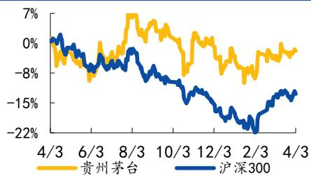

# 韧性强劲，量价齐升

## ——贵州茅台 2023 年报点评

## [Table\_Su 事件

公司公告2023年报。23年全年，公司实现总营收1,505.60亿元，同比+18.04%，归母净利 747.34 亿元，同比+19.16%。23Q4，公司实现总营收 452.44 亿元，同比+19.80%，归母净利 218.58 亿元，同比+19.33%。

##  23 年全年量价齐升，i茅台表现亮眼

1）23 年茅台酒、系列酒量价齐升。23 年全年，公司茅台酒/系列酒分别实现收入 1,265.89/206.30 亿元，同比分别+17.39%/+29.43%；分量价看，公司 23 年白酒销量 7.33万吨，同比+7.48%，其中茅台酒 4.21 万吨，同比+11.10%，系列酒 3.12 万吨，同比+2.94%，公司白酒平均出厂单价为 200.92 万元/吨，同比+10.67%，其中茅台酒出厂均价 300.62 元/吨，同比+5.66%，系列酒出厂均价 66.20 万元/吨，同比+25.74%。23Q4，公司茅台酒/系列酒分别实现收入393.20/50.36 亿元，同比分别+17.60%/+48.19%。

2）直销占比持续提升，i茅台渠道收入持续增长。23 年全年，公司直销/批发渠道分别实现收入 672.33/799.86 亿元，同比+36.16%/+7.52%，直销收入占主营业务收入的 45.67%，同比+5.77pct；i茅台平台为直销收入增长做出重要贡献，23 年全年实现收入 223.74 亿元，同比+88.29%，截至目前，i茅台注册人数超过 6,500 万。23Q4 公司直销/批发渠道分别实现收入 210.26/233.29 亿元，同比+20.17%/+20.66%。

3）基酒产储量持续提升。23 年公司茅台酒/系列酒基酒产量为 5.72/4.29 万吨，同比+0.69%/+22.41%，年末半成品酒（含基酒）库存 27.98 万吨，同比+5.94%。4）合同负债规模同比略降。23 年末，公司合同负债金额为 141.26 亿元，同比-8.70%，我们认为主要是 23 年春节日期较为靠后影响。

##  23 年全年盈利能力稳中略升

1）23 年公司毛利率及净利率稳中略升。23年全年，公司总收入毛利率/总收入净利率分别为 92.12%/51.49%，同比+0.03/+0.24pct；销售/管理/研发/财务费用率分别为 3.09%/6 46%/0.10%/-1.19%，同比分别 +0.50/-0.60/-0.00/-0.10pct，销售费用率小幅上升主要由于广告宣传及市场拓展费用和其他销售费用占总营收比重略增，管理费用率小幅优化主要由于规模效应。

2）23Q4 销售费用率小幅增加。23Q4，公司总收入毛利率/总收入净利率分别为 92.70%/50.16%，同比分别+0.67/-0.31pct；销售/管理/研发/财务费用率同比分别+1.14/-0.29/+0.07/+0.01pct。

##  营销模式持续优化，近期批价稳定

年公司调结构、促增长，终端市场价格保持稳定，经营韧性强。 年公司将建强产品矩阵；创优渠道生态，围绕自营、商超电商、团购渠道发力；联动多方力量，维护茅台酒良好市场秩序。飞天茅台最新散装/原箱批价 2,630/2,905元/瓶（数据来源：同花顺 Ifind，24/4/3），较年初小幅下行 60/55 元，考虑到淡旺季影响，基本保持稳定。

##  投资建议

我们预计公司 24/25/26 年归母净利为 875.93/1,017.82/1,180.51 亿元，增速17.21%/16.20%/15.98%，对应 4 月 3 日 PE 25/21/18 倍（市值 21,545 亿元），维持“买入”评级。

##  风险提示

政策调整风险、终端需求不及预期风险、食品安全风险。

## 附表：盈利预测[Table\_Finance]

<table><tr><td>财务数据和估值</td><td>2022A</td><td>2023A</td><td>2024E</td><td>2025E</td><td>2026E</td></tr><tr><td>营业总收入(百万元)</td><td>127553.96</td><td>150560.33</td><td>173982.91</td><td>200614.19</td><td>230921.28</td></tr><tr><td>收入同比(%)</td><td>16.53</td><td>18.04</td><td>15.56</td><td>15.31</td><td>15.11</td></tr><tr><td>归母净利润(百万元)</td><td>62717.47</td><td>74734.07</td><td>87592.69</td><td>101781.92</td><td>118051.46</td></tr><tr><td>归母净利润同比(%)</td><td>19.55</td><td>19.16</td><td>17.21</td><td>16.20</td><td>15.98</td></tr><tr><td>ROE(%)</td><td>31.76</td><td>34.65</td><td>33.12</td><td>31.73</td><td>30.58</td></tr><tr><td>每股收益(元)</td><td>49.93</td><td>59.49</td><td>69.73</td><td>81.02</td><td>93.98</td></tr><tr><td>市盈率(P/E)</td><td>34.35</td><td>28.83</td><td>24.60</td><td>21.17</td><td>18.25</td></tr></table>

资料来源： 、国元证券研究所整理

## 买入|维持

## [Table\_Ba基本数据

52 周最高/最低价（元）：1897.0 / 1577.0

A股流通股（百万股）： 1256.20

A股总股本（百万股）： 1256.20

流通市值（百万元）： 2154517.41

总市值（百万元）： 2154517.41

## [Table\_过去一年股价走势PicQuote]

  
资料来源：Ifind、国元证券研究所整理

## [Table\_ 相关研究报告DocRe

《国元证券公司研究-贵州茅台（600519）2023三季报点评：Q3 业绩增 16%，直销占比持续提升》2023.10.23

## [Table\_ 报告作者A

分析师 邓晖

执业证书编号 S0020522030002

电话 021-51097188

邮箱 denghui1@gyzq.com.cn

分析师 朱宇昊

执业证书编号 S0020522090001

电话 021-51097188

邮箱 zhuyuhao@gyzq.com.cn

联系人 单蕾

电话 021-51097188

邮箱 shanlei@gyzq.com.cn

<table><tr><td colspan="6">资产负债表 单位:百万元</td></tr><tr><td>会计年度</td><td>2022A</td><td>2023A</td><td>2024E</td><td>2025E</td><td>2026E</td></tr><tr><td>流动资产</td><td>216611.44</td><td>225172.52</td><td>277635.26</td><td>331954.14</td><td>399119.67</td></tr><tr><td>现金</td><td>58274.32</td><td>69070.14</td><td>104352.14</td><td>155946.15</td><td>215007.20</td></tr><tr><td>应收账款</td><td>20.94</td><td>60.37</td><td>69.77</td><td>80.44</td><td>92.60</td></tr><tr><td>其他应收款</td><td>31.82</td><td>27.50</td><td>31.78</td><td>36.65</td><td>42.18</td></tr><tr><td>预付账款</td><td>897.38</td><td>34.59</td><td>39.43</td><td>45.15</td><td>51.42</td></tr><tr><td>存货</td><td>38824.37</td><td>46435.19</td><td>52943.85</td><td>60620.26</td><td>69045.84</td></tr><tr><td>其他流动资产</td><td>118562.61</td><td>109544.74</td><td>120198.29</td><td>115225.49</td><td>114880.43</td></tr><tr><td>非流动资产</td><td>37889.39</td><td>47527.14</td><td>51991.04</td><td>55820.20</td><td>58667.00</td></tr><tr><td>长期投资</td><td>0.00</td><td>0.00</td><td>0.00</td><td>0.00</td><td>0.00</td></tr><tr><td>固定资产</td><td>19742.62</td><td>19909.28</td><td>25316.24</td><td>29685.34</td><td>33452.93</td></tr><tr><td>无形资产</td><td>7083.18</td><td>8572.27</td><td>8365.61</td><td>8150.95</td><td>7931.30</td></tr><tr><td>其他非流动资产</td><td>11063.59</td><td>19045.59</td><td>18309.19</td><td>17983.90</td><td>17282.78</td></tr><tr><td>资产总计</td><td>254500.83</td><td>272699.66</td><td>329626.30</td><td>387774.34</td><td>457786.67</td></tr><tr><td>流动负债</td><td>49065.67</td><td>48697.61</td><td>54021.69</td><td>53113.21</td><td>55160.74</td></tr><tr><td>短期借款</td><td>0.00</td><td>0.00</td><td>0.00</td><td>0.00</td><td>0.00</td></tr><tr><td>应付账款</td><td>2408.37</td><td>3093.09</td><td>3526.54</td><td>4037.86</td><td>4599.08</td></tr><tr><td>其他流动负债</td><td>46657.30</td><td>45604.52</td><td>50495.15</td><td>49075.34</td><td>50561.66</td></tr><tr><td>非流动负债</td><td>497.08</td><td>345.58</td><td>419.97</td><td>399.95</td><td>398.96</td></tr><tr><td>长期借款</td><td>0.00</td><td>0.00</td><td>0.00</td><td>0.00</td><td>0.00</td></tr><tr><td>其他非流动负债</td><td>497.08</td><td>345.58</td><td>419.97</td><td>399.95</td><td>398.96</td></tr><tr><td>负债合计</td><td>49562.74</td><td>49043.19</td><td>54441.66</td><td>53513.16</td><td>55559.70</td></tr><tr><td>少数股东权益</td><td>7458.04</td><td>7987.90</td><td>10710.89</td><td>13466.08</td><td>16205.18</td></tr><tr><td>股本</td><td>1256.20</td><td>1256.20</td><td>1256.20</td><td>1256.20</td><td>1256.20</td></tr><tr><td>资本公积</td><td>1374.96</td><td>1374.96</td><td>1374.96</td><td>1374.96</td><td>1374.96</td></tr><tr><td>留存收益</td><td>193798.13</td><td>211981.94</td><td>260788.27</td><td>317109.58</td><td>382336.23</td></tr><tr><td>归属母公司股东权益</td><td>197480.04</td><td>215668.57</td><td>264473.75</td><td>320795.10</td><td>386021.79</td></tr><tr><td>负债和股东权益</td><td>254500.83</td><td>272699.66</td><td>329626.30</td><td>387774.34</td><td>457786.67</td></tr></table>

<table><tr><td colspan="6">现金流量表 单位:百万元</td></tr><tr><td>会计年度</td><td>2022A</td><td>2023A</td><td>2024E</td><td>2025E</td><td>2026E</td></tr><tr><td>经营活动现金流</td><td>36698.60</td><td>66593.25</td><td>78688.62</td><td>101896.19</td><td>116374.29</td></tr><tr><td>净利润</td><td>65376.04</td><td>77521.48</td><td>90315.68</td><td>104537.12</td><td>120790.56</td></tr><tr><td>折旧摊销</td><td>1611.08</td><td>1864.97</td><td>2015.39</td><td>2554.87</td><td>3068.45</td></tr><tr><td>财务费用</td><td>-1391.81</td><td>-1789.50</td><td>-864.36</td><td>-1298.74</td><td>-1852.01</td></tr><tr><td>投资损失</td><td>-63.84</td><td>-34.03</td><td>-52.04</td><td>-49.97</td><td>-45.35</td></tr><tr><td>营运资金变动</td><td>-29126.70</td><td>-11667.45</td><td>-12863.49</td><td>-3291.61</td><td>-6219.68</td></tr><tr><td>其他经营现金流</td><td>293.83</td><td>697.78</td><td>137.44</td><td>-555.49</td><td>632.32</td></tr><tr><td>投资活动现金流</td><td>-5536.83</td><td>-9724.41</td><td>-5426.41</td><td>-6140.33</td><td>-6340.48</td></tr><tr><td>资本支出</td><td>5306.55</td><td>2619.76</td><td>6086.74</td><td>6143.44</td><td>6323.09</td></tr><tr><td>长期投资</td><td>210.00</td><td>7267.91</td><td>0.00</td><td>0.00</td><td>0.00</td></tr><tr><td>其他投资现金流</td><td>-20.28</td><td>163.25</td><td>660.33</td><td>3.10</td><td>-17.40</td></tr><tr><td>筹资活动现金流</td><td>-57424.53</td><td>-58889.10</td><td>-37980.21</td><td>-44161.84</td><td>-50972.76</td></tr><tr><td>短期借款</td><td>0.00</td><td>0.00</td><td>0.00</td><td>0.00</td><td>0.00</td></tr><tr><td>长期借款</td><td>0.00</td><td>0.00</td><td>0.00</td><td>0.00</td><td>0.00</td></tr><tr><td>普通股增加</td><td>0.00</td><td>0.00</td><td>0.00</td><td>0.00</td><td>0.00</td></tr><tr><td>资本公积增加</td><td>0.00</td><td>0.00</td><td>0.00</td><td>0.00</td><td>0.00</td></tr><tr><td>其他筹资现金流</td><td>-57424.53</td><td>-58889.10</td><td>-37980.21</td><td>-44161.84</td><td>-50972.76</td></tr><tr><td>现金净增加额</td><td>-26261.85</td><td>-2018.55</td><td>35282.00</td><td>51594.01</td><td>59061.05</td></tr></table>

资料来源： 、国元证券研究所整理

<table><tr><td colspan="6">利润表 单位:百万元</td></tr><tr><td>会计年度</td><td>2022A</td><td>2023A</td><td>2024E</td><td>2025E</td><td>2026E</td></tr><tr><td>营业总收入</td><td>127553.96</td><td>150560.33</td><td>173982.91</td><td>200614.19</td><td>230921.28</td></tr><tr><td>营业成本</td><td>10093.47</td><td>11867.27</td><td>13530.30</td><td>15492.08</td><td>17645.31</td></tr><tr><td>营业税金及附加</td><td>18495.82</td><td>22234.18</td><td>24514.19</td><td>28266.54</td><td>32536.81</td></tr><tr><td>营业费用</td><td>3297.72</td><td>4648.61</td><td>4610.55</td><td>5276.15</td><td>6073.23</td></tr><tr><td>管理费用</td><td>9012.19</td><td>9729.39</td><td>11134.91</td><td>12799.19</td><td>14732.78</td></tr><tr><td>研发费用</td><td>135.19</td><td>157.37</td><td>163.57</td><td>167.46</td><td>172.90</td></tr><tr><td>财务费用</td><td>-1391.81</td><td>-1789.50</td><td>-864.36</td><td>-1298.74</td><td>-1852.01</td></tr><tr><td>资产减值损失</td><td>0.00</td><td>0.00</td><td>0.00</td><td>0.00</td><td>0.00</td></tr><tr><td>公允价值变动收益</td><td>0.00</td><td>3.15</td><td>1.45</td><td>0.59</td><td>1.30</td></tr><tr><td>投资净收益</td><td>63.84</td><td>34.03</td><td>52.04</td><td>49.97</td><td>45.35</td></tr><tr><td>营业利润</td><td>87879.52</td><td>103708.66</td><td>120973.80</td><td>139990.64</td><td>161688.83</td></tr><tr><td>营业外收入</td><td>70.85</td><td>86.78</td><td>75.54</td><td>77.72</td><td>80.01</td></tr><tr><td>营业外支出</td><td>248.88</td><td>132.88</td><td>278.24</td><td>280.21</td><td>246.41</td></tr><tr><td>利润总额</td><td>87701.49</td><td>103662.55</td><td>120771.10</td><td>139788.16</td><td>161522.44</td></tr><tr><td>所得税</td><td>22325.45</td><td>26141.08</td><td>30455.42</td><td>35251.04</td><td>40731.88</td></tr><tr><td>净利润</td><td>65376.04</td><td>77521.48</td><td>90315.68</td><td>104537.12</td><td>120790.56</td></tr><tr><td>少数股东损益</td><td>2658.57</td><td>2787.40</td><td>2722.99</td><td>2755.20</td><td>2739.09</td></tr><tr><td>归属母公司净利润</td><td>62717.47</td><td>74734.07</td><td>87592.69</td><td>101781.92</td><td>118051.46</td></tr><tr><td>EBITDA</td><td>88098.79</td><td>103784.12</td><td>122124.83</td><td>141246.78</td><td>162905.27</td></tr><tr><td>EPS(元)</td><td>49.93</td><td>59.49</td><td>69.73</td><td>81.02</td><td>93.98</td></tr></table>

<table><tr><td>会计年度</td><td>2022A</td><td>2023A</td><td>2024E</td><td>2025E</td><td>2026E</td></tr><tr><td>成长能力</td><td></td><td></td><td></td><td></td><td></td></tr><tr><td>营业总收入(%)</td><td>16.53</td><td>18.04</td><td>15.56</td><td>15.31</td><td>15.11</td></tr><tr><td>营业利润(%)</td><td>17.56</td><td>18.01</td><td>16.65</td><td>15.72</td><td>15.50</td></tr><tr><td>归属母公司净利润(%)</td><td>19.55</td><td>19.16</td><td>17.21</td><td>16.20</td><td>15.98</td></tr><tr><td>获利能力</td><td></td><td></td><td></td><td></td><td></td></tr><tr><td>毛利率(%)</td><td>92.09</td><td>92.12</td><td>92.22</td><td>92.28</td><td>92.36</td></tr><tr><td>净利率(%)</td><td>49.17</td><td>49.64</td><td>50.35</td><td>50.74</td><td>51.12</td></tr><tr><td>ROE(%)</td><td>31.76</td><td>34.65</td><td>33.12</td><td>31.73</td><td>30.58</td></tr><tr><td>偿债能力</td><td></td><td></td><td></td><td></td><td></td></tr><tr><td>资产负债率(%)</td><td>19.47</td><td>17.98</td><td>16.52</td><td>13.80</td><td>12.14</td></tr><tr><td>净负债比率(%)</td><td>0.22</td><td>0.12</td><td>0.00</td><td>0.00</td><td>0.00</td></tr><tr><td>流动比率</td><td>4.41</td><td>4.62</td><td>5.14</td><td>6.25</td><td>7.24</td></tr><tr><td>速动比率</td><td>3.62</td><td>3.67</td><td>4.16</td><td>5.11</td><td>5.98</td></tr><tr><td>营运能力</td><td></td><td></td><td></td><td></td><td></td></tr><tr><td>总资产周转率</td><td>0.50</td><td>0.57</td><td>0.58</td><td>0.56</td><td>0.55</td></tr><tr><td>应收账款周转率</td><td>9548.60</td><td>3509.52</td><td>2596.03</td><td>2593.42</td><td>2591.34</td></tr><tr><td>应付账款周转率</td><td>4.57</td><td>4.31</td><td>4.09</td><td>4.10</td><td>4.09</td></tr><tr><td>每股指标(元)</td><td></td><td></td><td></td><td></td><td></td></tr><tr><td>每股收益(最新摊薄)</td><td>49.93</td><td>59.49</td><td>69.73</td><td>81.02</td><td>93.98</td></tr><tr><td>每股经营现金流(最新摊薄)</td><td>29.21</td><td>53.01</td><td>0.00</td><td>0.00</td><td>0.00</td></tr><tr><td>每股净资产(最新摊薄)</td><td>157.20</td><td>171.68</td><td>210.54</td><td>255.37</td><td>307.29</td></tr><tr><td>估值比率</td><td></td><td></td><td></td><td></td><td></td></tr><tr><td>P/E</td><td>34.35</td><td>28.83</td><td>24.60</td><td>21.17</td><td>18.25</td></tr><tr><td>P/B</td><td>10.91</td><td>9.99</td><td>8.15</td><td>6.72</td><td>5.58</td></tr><tr><td>EV/EBITDA</td><td>23.65</td><td>20.08</td><td>17.06</td><td>14.75</td><td>12.79</td></tr></table>

## 投资评级说明：

<table><tr><td colspan="2">(1)公司评级定义</td><td colspan="2">(2)行业评级定义</td></tr><tr><td>买入</td><td>预计未来6个月内,股价涨跌幅优于上证指数20%以上</td><td>推荐</td><td>预计未来6个月内,行业指数表现优于市场指数10%以上</td></tr><tr><td>增持</td><td>预计未来6个月内,股价涨跌幅优于上证指数5-20%之间</td><td>中性</td><td>预计未来6个月内,行业指数表现介于市场指数±10%之间</td></tr><tr><td>持有</td><td>预计未来6个月内,股价涨跌幅介于上证指数±5%之间</td><td>回避</td><td>预计未来6个月内,行业指数表现劣于市场指数10%以上</td></tr><tr><td>卖出</td><td>预计未来6个月内,股价涨跌幅劣于上证指数5%以上</td><td></td><td></td></tr></table>

## 分析师声明

作者具有中国证券业协会授予的证券投资咨询执业资格或相当的专业胜任能力，以勤勉的职业态度，独立、客观地出具本报告。本人承诺报告所采用的数据均来自合规渠道，分析逻辑基于作者的职业操守和专业能力，本报告清晰准确地反映了本人的研究观点并通过合理判断得出结论，结论不受任何第三方的授意、影响。

## 证券投资咨询业务的说明

根据中国证监会颁发的《经营证券业务许可证》(Z23834000)，国元证券股份有限公司具备中国证监会核准的证券投资咨询业务资格。证券投资咨询业务是指取得监管部门颁发的相关资格的机构及其咨询人员为证券投资者或客户提供证券投资的相关信息、分析、预测或建议，并直接或间接收取服务费用的活动。证券研究报告是证券投资咨询业务的一种基本形式，指证券公司、证券投资咨询机构对证券及证券相关产品的价值、市场走势或者相关影响因素进行分析，形成证券估值、投资评级等投资分析意见，制作证券研究报告，并向客户发布的行为。

## 一般性声明

本报告由国元证券股份有限公司（以下简称“本公司”）在中华人民共和国内地（香港、澳门、台湾除外）发布，仅供本公司的客户使用。本公司不会因接收人收到本报告而视其为客户。若国元证券以外的金融机构或任何第三方机构发送本报告，则由该金融机构或第三方机构独自为此发送行为负责。本报告不构成国元证券向发送本报告的金融机构或第三方机构之客户提供的投资建议，国元证券及其员工亦不为上述金融机构或第三方机构之客户因使用本报告或报告载述的内容引起的直接或连带损失承担任何责任。本报告是基于本公司认为可靠的已公开信息，但本公司不保证该等信息的准确性或完整性。本报告所载的信息、资料、分析工具、意见及推测只提供给客户作参考之用，并非作为或被视为出售或购买证券或其他投资标的的投资建议或要约邀请。本报告所指的证券或投资标的的价格、价值及投资收入可能会波动。在不同时期，本公司可发出与本报告所载资料、意见及推测不一致的报告。本公司建议客户应考虑本报告的任何意见或建议是否符合其特定状况、以及(若有必要)咨询独立投资顾问。在法律许可的情况下，本公司及其所属关联机构可能会持有本报告中所提到的公司所发行的证券头寸并进行交易，还可能为这些公司提供或争取投资银行业务服务或其他服务。

## 免责条款

本报告是为特定客户和其他专业人士提供的参考资料。文中所有内容均代表个人观点。本公司力求报告内容的准确可靠，但并不对报告内容及所引用资料的准确性和完整性作出任何承诺和保证。本公司不会承担因使用本报告而产生的法律责任。本报告版权归国元证券所有，未经授权不得复印、转发或向特定读者群以外的人士传阅，如需引用或转载本报告，务必与本公司研究所联系。网址：www.gyzq.com.cn

## 国元证券研究所

<table><tr><td>合肥</td><td>上海</td></tr><tr><td>地址:安徽省合肥市梅山路18号安徽国际金融中心A座国元证券</td><td>地址:上海市浦东新区民生路1199号证大五道口广场16楼国元证券</td></tr><tr><td>邮编:230000</td><td>邮编:200135</td></tr><tr><td>传真:(0551)62207952</td><td>传真:(021)68869125</td></tr><tr><td></td><td>电话:(021)51097188</td></tr></table>