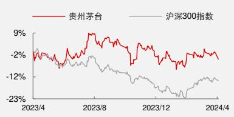

公司研究丨点评报告丨贵州茅台（600519.SH）

## [Table\_Title]贵州茅台 2023 年年报点评：2023 年量价齐升，2024 年指引积极

## 报告要点

[Table\_Summary]公司 2023 年营业总收入 1505.6 亿元（+18.04%）；归母净利润 747.34 亿元（+19.16%），扣非净利润 747.53 亿元（+19.05%）。公司 2023Q4 营业总收入 452.44 亿元（+19.8%）；归母净利润 218.58 亿元（+19.33%），扣非净利润 219.37 亿元（+19.23%），超额完成年初制定的营业总收入同比增长 15%的目标。

## 分析师及联系人

  
董思远

SAC：S0490517070016

  
徐爽SAC：S0490520030001

  
朱梦兰SAC：S0490522050003

  
石智坤SAC：S0490522090002

  
伍爽

SFC：BQK487

# [Table\_Title 贵州茅台 20232] 年年报点评：2023 年量价齐升，2024 年指引积极

## [Table\_S事件描述

公司 2023 年营业总收入 1505.6 亿元（同比+18.04%）；归母净利润 747.34 亿元（同比+19.16%），扣非净利润 747.53 亿元（同比+19.05%），超额完成年初制定的营业总收入同比增长 15%的目标。

## 事件评论

全年收入稳健增长，现金流表现稳定：公司 2023 年营业总收入+△合同负债为 1492.14亿元（同比+14.51%），其中 2023Q4 营业总收入+△合同负债为 479.76 亿元（同比+15.87%）。公司 2023 年销售商品及提供劳务收到的现金流 1637 亿元（同比+16.35%），其中 2023Q4 销售商品及提供劳务收到的现金流 524.46 亿元（同比+17.42%）。

⚫ 盈利能力有所提升，提价贡献在四季度初步体现。公司 2023 年归母净利率同比提升0.47pct 至 49.64%，毛利率同比+0.03pct 至 92.12%。公司 2023Q4 归母净利率同比下滑 0.19pct 至 48.31%，其中毛利率同比+0.67pct 至 92.7%，销售费用率同比+1.14pct 至3.51%。Q4 费用率上升是季度间的正常波动，全年看费用率基本保持平稳。四季度系列酒收入同比增长约 48%，系列酒放量背景下公司毛利率仍保持提升，预计系 2023 年 11月 1 日公司对飞天提价，对四季度毛利率有正贡献。

⚫ 茅台酒量增创 5 年新高，系列酒量价齐升。2023 年茅台酒收入 1265.89 亿元（同比+17.39%），2023 年系列酒收入 206.3 亿元（同比+29.43%）。量价拆分来看，2023 年茅台酒销量同比+11.1%，创下 2018 年以来的最高值，预计主要系节气酒放量形成一定贡献，2023 年茅台酒吨价+5.7%。系列酒方面，2023 年销量同比+2.9%，吨价同比+25.7%，实现量价齐升，吨价连续两年同比 25%+的增长，预计系 1935 贡献主要增量。

直销占比再创新高，i茅台贡献较大。2023 年直销收入 672.33 亿元（同比+36.16%），占比 46%，再创历史新高。2023 年批发收入 799.86 亿元（同比+7.52%），其中销量同比+1.14%，吨价同比+6.31%，量价在 2022 年低基数下均有所恢复。2023 年“i 茅台”数字营销平台实现酒类不含税收入 223.74 亿元（同比+88.29%），2023Q4 为 75.03 亿元（同比+119.32%），i 茅台仍然是 2023 年直营的主要贡献。

⚫ 产量稳定增长，24 年目标维持 15%左右目标。2024 年目标实现营业总收入较上年度增长 15%左右，整体指引规划仍较为积极。23 年茅台酒基酒产量 5.72 万吨(同比+0.69%)，系列酒基酒产量 4.29 吨(同比+22.41%)，产量实现稳定增长。

奠定基调，稳健成长。今年来看，量方面，预计 375ML 茅台、汉酱等产品放量将对销量形成一定贡献，同时，飞天提价 20%对全年价格贡献明显，预计公司仍能完成全年增长目标。长期看，茅台目前调节手段充足，渠道利润仍处于历史高位，长期增长空间仍然较大。预计 2024/2025 年公司 EPS 为 70.51/83.07 元，对应最新 PE 为 24/20 倍，维持“买入”评级。

## 风险提示

1、行业需求不及预期；

2、市场价格波动加大等。

k]投资评级 买入丨维持

## 公司基础数据

<table><tr><td>当前股价(元)</td><td>1,662.22</td></tr><tr><td>总股本(万股)</td><td>125,620</td></tr><tr><td>流通A股/B股(万股)</td><td>125,620/0</td></tr><tr><td>每股净资产(元)</td><td>171.68</td></tr><tr><td>近12月最高/最低价(元)</td><td>1,935/1,556</td></tr></table>

注：股价为2024 年4月9日收盘价

## 市场表现对比图(近 12 个月)

  
资料来源：Wind

## 相关研究

[Table\_Report] •《贵州茅台提价点评：提价靴子落地，未来有望 延续量价齐升》2023-11-22

•《贵州茅台 2023 年三季报点评：业绩经营稳健，现金流表现亮眼》2023-10-27

•《贵州茅台 2023 年半年报点评：上半年圆满收官，i 茅台表现亮眼》2023-08-06

  
更多研报请访问长江研究小程序

## 风险提示

1、行业需求不及预期：白酒行业需求与宏观经济相关度较高，其中大众消费与居民收入及消费者信心指数相关，商务宴席消费与投资活跃度相关度较高，公司产品价格带跨度较大，宏观经济的波动可能对大众消费需求及商务宴席消费需求造成一定影响。

2、市场价格波动加大：目前行业处于供需紧平衡阶段，供给端的持续扩张或需求端恢复不及预期，均有可能导致行业的价格波动。在目前价格水平下，渠道利润处于较为合理水平，价格的大幅波动可能会对渠道积极性造成损害。

财务报表及预测指标

<table><tr><td colspan="5">利润表(百万元)</td></tr><tr><td></td><td>2023A</td><td>2024E</td><td>2025E</td><td>2026E</td></tr><tr><td>营业总收入</td><td>150560</td><td>176534</td><td>206067</td><td>237351</td></tr><tr><td>营业成本</td><td>11981</td><td>13330</td><td>14327</td><td>15373</td></tr><tr><td>毛利</td><td>138579</td><td>163204</td><td>191740</td><td>221978</td></tr><tr><td>%营业收入</td><td>92%</td><td>92%</td><td>93%</td><td>94%</td></tr><tr><td>营业税金及附加</td><td>22234</td><td>25591</td><td>29882</td><td>34420</td></tr><tr><td>%营业收入</td><td>15%</td><td>14%</td><td>15%</td><td>15%</td></tr><tr><td>销售费用</td><td>4649</td><td>5119</td><td>5770</td><td>5696</td></tr><tr><td>%营业收入</td><td>3%</td><td>3%</td><td>3%</td><td>2%</td></tr><tr><td>管理费用</td><td>9729</td><td>11122</td><td>12982</td><td>14478</td></tr><tr><td>%营业收入</td><td>6%</td><td>6%</td><td>6%</td><td>6%</td></tr><tr><td>研发费用</td><td>157</td><td>88</td><td>103</td><td>119</td></tr><tr><td>%营业收入</td><td>0%</td><td>0%</td><td>0%</td><td>0%</td></tr><tr><td>财务费用</td><td>-1790</td><td>-1285</td><td>-1500</td><td>-1728</td></tr><tr><td>%营业收入</td><td>-1%</td><td>-1%</td><td>-1%</td><td>-1%</td></tr><tr><td>加:资产减值损失</td><td>0</td><td>0</td><td>0</td><td>0</td></tr><tr><td>信用减值损失</td><td>38</td><td>-90</td><td>-90</td><td>-90</td></tr><tr><td>公允价值变动收益</td><td>3</td><td>0</td><td>0</td><td>0</td></tr><tr><td>投资收益</td><td>34</td><td>60</td><td>60</td><td>60</td></tr><tr><td>营业利润</td><td>103709</td><td>122559</td><td>144493</td><td>168983</td></tr><tr><td>%营业收入</td><td>69%</td><td>69%</td><td>70%</td><td>71%</td></tr><tr><td>营业外收支</td><td>-46</td><td>-54</td><td>-161</td><td>-186</td></tr><tr><td>利润总额</td><td>103663</td><td>122505</td><td>144332</td><td>168797</td></tr><tr><td>%营业收入</td><td>69%</td><td>69%</td><td>70%</td><td>71%</td></tr><tr><td>所得税费用</td><td>26141</td><td>30626</td><td>36083</td><td>42199</td></tr><tr><td>净利润</td><td>77521</td><td>91879</td><td>108249</td><td>126598</td></tr><tr><td>归属于母公司所有者的净利润</td><td>74734</td><td>88575</td><td>104357</td><td>122046</td></tr><tr><td>少数股东损益</td><td>2787</td><td>3304</td><td>3892</td><td>4552</td></tr><tr><td>EPS(元)</td><td>59.49</td><td>70.51</td><td>83.07</td><td>97.16</td></tr></table>

<table><tr><td colspan="5">资产负债表(百万元)</td></tr><tr><td></td><td>2023A</td><td>2024E</td><td>2025E</td><td>2026E</td></tr><tr><td>货币资金</td><td>69070</td><td>134333</td><td>208522</td><td>297749</td></tr><tr><td>交易性金融资产</td><td>401</td><td>401</td><td>401</td><td>401</td></tr><tr><td>应收账款</td><td>60</td><td>45</td><td>59</td><td>70</td></tr><tr><td>存货</td><td>46435</td><td>50847</td><td>54926</td><td>58943</td></tr><tr><td>预付账款</td><td>35</td><td>505</td><td>495</td><td>467</td></tr><tr><td>其他流动资产</td><td>109172</td><td>109227</td><td>109242</td><td>109249</td></tr><tr><td>流动资产合计</td><td>225173</td><td>295357</td><td>373646</td><td>466879</td></tr><tr><td>长期股权投资</td><td>0</td><td>0</td><td>0</td><td>0</td></tr><tr><td>投资性房地产</td><td>4</td><td>2</td><td>-1</td><td>-4</td></tr><tr><td>固定资产合计</td><td>19909</td><td>23661</td><td>25972</td><td>28405</td></tr><tr><td>无形资产</td><td>8572</td><td>10643</td><td>12321</td><td>14098</td></tr><tr><td>商誉</td><td>0</td><td>0</td><td>0</td><td>0</td></tr><tr><td>递延所得税资产</td><td>4646</td><td>4646</td><td>4646</td><td>4646</td></tr><tr><td>其他非流动资产</td><td>14396</td><td>14664</td><td>14796</td><td>14945</td></tr><tr><td>资产总计</td><td>272700</td><td>348973</td><td>431379</td><td>528968</td></tr><tr><td>短期贷款</td><td>0</td><td>0</td><td>0</td><td>0</td></tr><tr><td>应付款项</td><td>3093</td><td>3257</td><td>3547</td><td>3817</td></tr><tr><td>预收账款</td><td>0</td><td>0</td><td>0</td><td>0</td></tr><tr><td>应付职工薪酬</td><td>5402</td><td>5981</td><td>6487</td><td>6934</td></tr><tr><td>应交税费</td><td>6950</td><td>10476</td><td>11142</td><td>12938</td></tr><tr><td>其他流动负债</td><td>33253</td><td>37478</td><td>38973</td><td>40551</td></tr><tr><td>流动负债合计</td><td>48698</td><td>57192</td><td>60149</td><td>64240</td></tr><tr><td>长期借款</td><td>0</td><td>0</td><td>0</td><td>0</td></tr><tr><td>应付债券</td><td>0</td><td>0</td><td>0</td><td>0</td></tr><tr><td>递延所得税负债</td><td>79</td><td>79</td><td>79</td><td>79</td></tr><tr><td>其他非流动负债</td><td>267</td><td>267</td><td>267</td><td>267</td></tr><tr><td>负债合计</td><td>49043</td><td>57538</td><td>60495</td><td>64586</td></tr><tr><td>归属于母公司所有者权益</td><td>215669</td><td>280144</td><td>355700</td><td>444646</td></tr><tr><td>少数股东权益</td><td>7988</td><td>11292</td><td>15184</td><td>19736</td></tr><tr><td>股东权益</td><td>223656</td><td>291435</td><td>370884</td><td>464382</td></tr><tr><td>负债及股东权益</td><td>272700</td><td>348973</td><td>431379</td><td>528968</td></tr></table>

<table><tr><td colspan="5">现金流量表(百万元)</td></tr><tr><td></td><td>2023A</td><td>2024E</td><td>2025E</td><td>2026E</td></tr><tr><td>经营活动现金流净额</td><td>66593</td><td>98679</td><td>109671</td><td>129413</td></tr><tr><td>取得投资收益收回现金</td><td>141</td><td>60</td><td>60</td><td>60</td></tr><tr><td>长期股权投资</td><td>0</td><td>0</td><td>0</td><td>0</td></tr><tr><td>资本性支出</td><td>-1656</td><td>-9054</td><td>-6448</td><td>-6812</td></tr><tr><td>其他</td><td>-8209</td><td>-322</td><td>-294</td><td>-334</td></tr><tr><td>投资活动现金流净额</td><td>-9724</td><td>-9316</td><td>-6682</td><td>-7086</td></tr><tr><td>债券融资</td><td>0</td><td>0</td><td>0</td><td>0</td></tr><tr><td>股权融资</td><td>0</td><td>0</td><td>0</td><td>0</td></tr><tr><td>银行贷款增加(减少)</td><td>0</td><td>0</td><td>0</td><td>0</td></tr><tr><td>筹资成本</td><td>-58755</td><td>-24100</td><td>-28800</td><td>-33100</td></tr><tr><td>其他</td><td>-134</td><td>0</td><td>0</td><td>0</td></tr><tr><td>筹资活动现金流净额</td><td>-58889</td><td>-24100</td><td>-28800</td><td>-33100</td></tr><tr><td>现金净流量(不含汇率变动影响)</td><td>-2019</td><td>65263</td><td>74189</td><td>89226</td></tr></table>

资料来源：公司公告，长江证券研究所

<table><tr><td colspan="5">基本指标</td></tr><tr><td></td><td>2023A</td><td>2024E</td><td>2025E</td><td>2026E</td></tr><tr><td>每股收益</td><td>59.49</td><td>70.51</td><td>83.07</td><td>97.16</td></tr><tr><td>每股经营现金流</td><td>53.01</td><td>78.55</td><td>87.30</td><td>103.02</td></tr><tr><td>市盈率</td><td>29.01</td><td>23.57</td><td>20.01</td><td>17.11</td></tr><tr><td>市净率</td><td>10.05</td><td>7.45</td><td>5.87</td><td>4.70</td></tr><tr><td>EV/EBITDA</td><td>20.24</td><td>15.69</td><td>12.92</td><td>10.54</td></tr><tr><td>总资产收益率</td><td>27.4%</td><td>25.4%</td><td>24.2%</td><td>23.1%</td></tr><tr><td>净资产收益率</td><td>34.7%</td><td>31.6%</td><td>29.3%</td><td>27.4%</td></tr><tr><td>净利率</td><td>49.6%</td><td>50.2%</td><td>50.6%</td><td>51.4%</td></tr><tr><td>资产负债率</td><td>18.0%</td><td>16.5%</td><td>14.0%</td><td>12.2%</td></tr><tr><td>总资产周转率</td><td>0.55</td><td>0.51</td><td>0.48</td><td>0.45</td></tr></table>

## 投资评级说明

<table><tr><td>行业评级</td><td colspan="2">报告发布日后的12个月内行业股票指数的涨跌幅相对同期相关证券市场代表性指数的涨跌幅为基准,投资建议的评级标准为:</td></tr><tr><td></td><td>看好:</td><td>相对表现优于同期相关证券市场代表性指数</td></tr><tr><td></td><td>中性:</td><td>相对表现与同期相关证券市场代表性指数持平</td></tr><tr><td></td><td>看淡:</td><td>相对表现弱于同期相关证券市场代表性指数</td></tr><tr><td>公司评级</td><td colspan="2">报告发布日后的12个月内公司的涨跌幅相对同期相关证券市场代表性指数的涨跌幅为基准,投资建议的评级标准为:</td></tr><tr><td></td><td>买入:</td><td>相对同期相关证券市场代表性指数涨幅大于10%</td></tr><tr><td></td><td>增持:</td><td>相对同期相关证券市场代表性指数涨幅在5%~10%之间</td></tr><tr><td></td><td>中性:</td><td>相对同期相关证券市场代表性指数涨幅在-5%~5%之间</td></tr><tr><td></td><td>减持:</td><td>相对同期相关证券市场代表性指数涨幅小于-5%</td></tr><tr><td></td><td>无投资评级:</td><td>由于我们无法获取必要的资料,或者公司面临无法预见结果的重大不确定性事件,或者其他原因,致使我们无法给出明确的投资评级。</td></tr><tr><td colspan="3">相关证券市场代表性指数说明:A股市场以沪深300指数为基准;新三板市场以三板成指(针对协议转让标的)或三板做市指数(针对做市转让标的)为基准;香港市场以恒生指数为基准。</td></tr></table>

## 办公地址

[Tabl上海Add /浦东新区世纪大道 1198号世纪汇广场一座 29 层P.C /（200122）

北京Add /西城区金融街 33 号通泰大厦 15 层P.C /（100032）

武汉Add /武汉市江汉区淮海路 88号长江证券大厦 37 楼P.C /（430015）

深圳Add /深圳市福田区中心四路1号嘉里建设广场 3 期 36 楼P.C /（518048）

## 分析师声明

本报告署名分析师以勤勉的职业态度，独立、客观地出具本报告。分析逻辑基于作者的职业理解，本报告清晰准确地反映了作者的研究观点。作者所得报酬的任何部分不曾与，不与，也不将与本报告中的具体推荐意见或观点而有直接或间接联系，特此声明。法律主体声明 法律主休声明

##

本报告由长江证券股份有限公司及/或其附属机构（以下简称「长江证券」或「本公司」）制作，由长江证券股份有限公司在中华人民共和国大陆地区发行。长江证券股份有限公司具有中国证监会许可的投资咨询业务资格，经营证券业务许可证编号为：10060000。本报告署名分析师所持中国证券业协会授予的证券投资咨询执业资格书编号已披露在报告首页的作者姓名旁。

在遵守适用的法律法规情况下，本报告亦可能由长江证券经纪（香港）有限公司在香港地区发行。长江证券经纪（香港）有限公司具有香港证券及期货事务监察委员会核准的“就证券提供意见”业务资格（第四类牌照的受监管活动），中央编号为：AXY608。本报告作者所持香港证监会牌照的中央编号已披露在报告首页的作者姓名旁。

## 其他声明

本报告并非针对或意图发送、发布给在当地法律或监管规则下不允许该报告发送、发布的人员。本公司不会因接收人收到本报告而视其为客户。本报告的信息均来源于公开资料，本公司对这些信息的准确性和完整性不作任何保证，也不保证所包含信息和建议不发生任何变更。本报告内容的全部或部分均不构成投资建议。本报告所包含的观点、建议并未考虑报告接收人在财务状况、投资目的、风险偏好等方面的具体情况，报告接收者应当独立评估本报告所含信息，基于自身投资目标、需求、市场机会、风险及其他因素自主做出决策并自行承担投资风险。本公司已力求报告内容的客观、公正，但文中的观点、结论和建议仅供参考，不包含作者对证券价格涨跌或市场走势的确定性判断。报告中的信息或意见并不构成所述证券的买卖出价或征价，投资者据此做出的任何投资决策与本公司和作者无关。本研究报告并不构成本公司对购入、购买或认购证券的邀请或要约。本公司有可能会与本报告涉及的公司进行投资银行业务或投资服务等其他业务(例如:配售代理、牵头经办人、保荐人、承销商或自营投资)。

本报告所包含的观点及建议不适用于所有投资者，且并未考虑个别客户的特殊情况、目标或需要，不应被视为对特定客户关于特定证券或金融工具的建议或策略。投资者不应以本报告取代其独立判断或仅依据本报告做出决策，并在需要时咨询专业意见。

本报告所载的资料、意见及推测仅反映本公司于发布本报告当日的判断，本报告所指的证券或投资标的的价格、价值及投资收入可升可跌，过往表现不应作为日后的表现依据；在不同时期，本公司可以发出其他与本报告所载信息不一致及有不同结论的报告；本报告所反映研究人员的不同观点、见解及分析方法，并不代表本公司或其他附属机构的立场；本公司不保证本报告所含信息保持在最新状态。同时，本公司对本报告所含信息可在不发出通知的情形下做出修改，投资者应当自行关注相应的更新或修改。本公司及作者在自身所知情范围内，与本报告中所评价或推荐的证券不存在法律法规要求披露或采取限制、静默措施的利益冲突。

本报告版权仅为本公司所有，本报告仅供意向收件人使用。未经书面许可，任何机构和个人不得以任何形式翻版、复制和发布给其他机构及/或人士（无论整份和部分）。如引用须注明出处为本公司研究所，且不得对本报告进行有悖原意的引用、删节和修改。刊载或者转发本证券研究报告或者摘要的，应当注明本报告的发布人和发布日期，提示使用证券研究报告的风险。本公司不为转发人及/或其客户因使用本报告或报告载明的内容产生的直接或间接损失承担任何责任。未经授权刊载或者转发本报告的，本公司将保留向其追究法律责任的权利。

本公司保留一切权利。