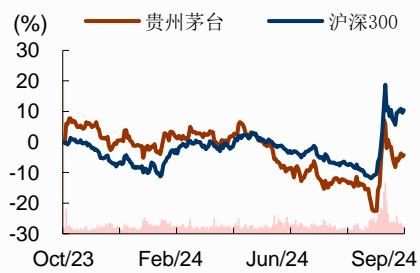
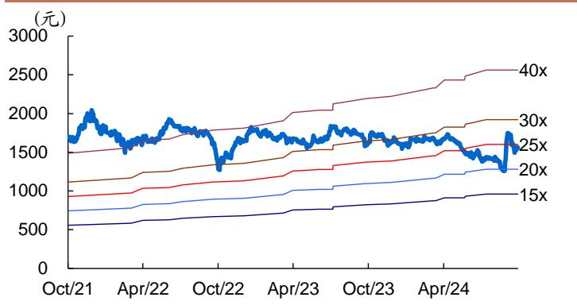
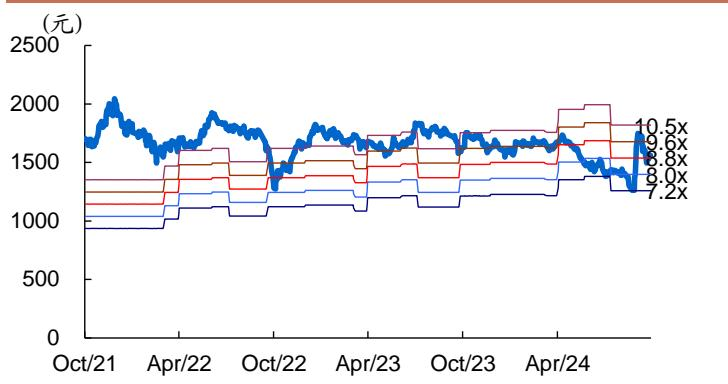

# 贵州茅台（600519.SH）

# 结构调整，韧性延续

公司在三季度行业需求转弱背景下营收/净利润同比+15.3%/+13.2%，环比略有降速，但业绩依然优秀，增长韧性延续，符合市场预期。同时公司此前在已经发布现金分红回报规划基础上，首次公布拟以自有资金实施股份回购以用于注销，在业绩具备较强确定性背景下增强对股东回报的重视。当前股价对应 24年23xPE，股息视角下配置价值仍高。

❑Q3 收入/利润同比+15.3%/+13.2%，业绩符合预期。公司 24 年前三季度实现营业收入/归母净利润 1207.8/608.3 亿（+17.0%/+15.0%），其中 Q3 收入/归母净利润388.5/191.3 亿，同比+15.3%/+13.2%，在需求转弱背景下环比略有降速，但业绩依然优秀，符合市场预期。现金流方面，24 年公司前三季度销售收现同比+16.6%至 1296.9 亿，与收入增长较为匹配，其中 Q3 公司销售收现同比+1.0%至 425.9 亿。Q3 末公司预收款 111.7 亿（同比-12.9%），环比 H1 末减少 0.6亿，去年同期增加 45.8 亿。24 年前三季度/24Q3 经营性现金流分别同比-11.2%/-60.2%，推测主要系财务公司资金划转影响。

❑批发提价、直销放量，系列酒和 i 茅台增速放缓。结构看，公司 24Q3 茅台酒/系列酒分别+16.3%/+13.1%至 325.6/62.5 亿，茅台酒环比提速，系列酒在 1935H1超进度完成任务后降速。分渠道看，公司 24Q3 直销/批发渠道分别+23.5%/+9.7%至 182.6/205.4 亿，其中 i 茅台不含税收入同比-18.4%至 45.2 亿。24 年前三季度公司直销渠道占比-1.7pcts 至 43%（H1 占比 41.2%）。公司根据 i 茅台申购情况动态调整市场投放量和投放结构，在 i 茅台供给收缩情况下，通过其他直销渠道实现增长，批发渠道增长预计主要由飞天提价贡献。分地区看，国内/国外 Q2 分别实现收入 375.3/12.8 亿，同比+15.2%/-20.1%。

❑税金和销售费用率提升，盈利能力高位回落。受毛利率较高的 i 茅台投放减少及产品结构影响，公司 24Q3 毛利率-0.44pct 至 91.2%。主营税金/销售/管理费用率分别+0.36/+0.36/-0.67pct 至 16.2%/4.1%/4.9%，财务费用由-4.6 亿增加至-2.8 亿。综合影响下，公司 23Q3 净利率高位回落 0.99pct 至 48.2%。

❑投资建议：结构调整，韧性延续。公司在三季度行业需求转弱背景下主动调整投放结构，增长韧性延续。同时公司此前在已经发布现金分红回报规划基础上，首次公布拟以自有资金实施股份回购以用于注销，在业绩具备较强确定性背景下增强对股东回报的重视。结合需求背景，调整 24-26 年 EPS 预测为 68.40、75.16、81.95 元，当前股价对应 24 年 23xPE，股息视角下配置价值仍高，维持“强烈推荐”评级。

❑风险提示：外资流出、税率上升、宏观经济影响、批价超预期下跌等

财务数据与估值

<table><tr><td>会计年度</td><td>2022</td><td>2023</td><td>2024E</td><td>2025E</td><td>2026E</td></tr><tr><td>营业总收入(百万元)</td><td>127554</td><td>150560</td><td>174503</td><td>192610</td><td>211104</td></tr><tr><td>同比增长</td><td>16.5%</td><td>18.0%</td><td>15.9%</td><td>10.4%</td><td>9.6%</td></tr><tr><td>营业利润(百万元)</td><td>87880</td><td>103709</td><td>119231</td><td>131014</td><td>142850</td></tr><tr><td>同比增长</td><td>17.6%</td><td>18.0%</td><td>15.0%</td><td>9.9%</td><td>9.0%</td></tr><tr><td>归母净利润(百万元)</td><td>62716</td><td>74734</td><td>85923</td><td>94418</td><td>102949</td></tr><tr><td>同比增长</td><td>19.6%</td><td>19.2%</td><td>15.0%</td><td>9.9%</td><td>9.0%</td></tr><tr><td>每股收益(元)</td><td>49.93</td><td>59.49</td><td>68.40</td><td>75.16</td><td>81.95</td></tr><tr><td>PE</td><td>31.2</td><td>26.2</td><td>22.8</td><td>20.7</td><td>19.0</td></tr><tr><td>PB</td><td>9.9</td><td>9.1</td><td>8.2</td><td>7.3</td><td>6.5</td></tr></table>

资料来源：公司数据、招商证券

## 强烈推荐（维持）

消费品/食品饮料

目标股价：2,100.00 元

当前股价：1558.85 元

## 基础数据

<table><tr><td>总股本(百万股)</td><td>1256</td></tr><tr><td>已上市流通股(百万股)</td><td>1256</td></tr><tr><td>总市值(十亿元)</td><td>1958.2</td></tr><tr><td>流通市值(十亿元)</td><td>1958.2</td></tr><tr><td>每股净资产(MRQ)</td><td>189.2</td></tr><tr><td>ROE(TTM)</td><td>34.8</td></tr><tr><td>资产负债率</td><td>13.6%</td></tr><tr><td>主要股东 中国贵州茅台酒厂(集团)有 主要股东持股比例</td><td>54.07%</td></tr></table>

## 股价表现

<table><tr><td>%</td><td>1m</td><td>6m</td><td>12m</td></tr><tr><td>绝对表现</td><td>14</td><td>-6</td><td>-2</td></tr><tr><td>相对表现</td><td>-3</td><td>-18</td><td>-15</td></tr></table>

  
资料来源：公司数据、招商证券

## 相关报告

1、《贵州茅台（600519）—分红提振信心，业绩略超预期》2024-08-092、《贵州茅台（600519）—行稳致远，自强不息——2023 年度股东大会调研反馈》2024-05-30

3、《贵州茅台（600519）—税金影响 利 润 ， 现 金 流 彰 显 潜 力 》2024-04-27

于佳琦 S1090518090005

yujiaqi@cmschina.com.cn

陈书慧 S1090523010003

chenshuhui@cmschina.com.cn

贵州茅台单季度利润表

<table><tr><td>单位:百万元</td><td>22Q4</td><td>23Q1</td><td>23Q2</td><td>23Q3</td><td>23Q4</td><td>24Q1</td><td>24Q2</td><td>24Q3</td><td>23Q1-3</td><td>24Q1-3</td></tr><tr><td>一、营业总收入</td><td>37768</td><td>39379</td><td>31608</td><td>34329</td><td>45244</td><td>46485</td><td>36966</td><td>39671</td><td>105316</td><td>123123</td></tr><tr><td>二、营业总成本</td><td>11873</td><td>10718</td><td>10407</td><td>11066</td><td>14732</td><td>13357</td><td>12598</td><td>13239</td><td>32191</td><td>39193</td></tr><tr><td>其中:营业成本</td><td>3011</td><td>2870</td><td>2837</td><td>2857</td><td>3304</td><td>3381</td><td>3370</td><td>3477</td><td>8564</td><td>10228</td></tr><tr><td>营业税金及附加</td><td>4855</td><td>5460</td><td>5140</td><td>5429</td><td>6205</td><td>7199</td><td>6295</td><td>6418</td><td>16029</td><td>19912</td></tr><tr><td>营业费用</td><td>892</td><td>757</td><td>1030</td><td>1276</td><td>1586</td><td>1141</td><td>1477</td><td>1618</td><td>3063</td><td>4235</td></tr><tr><td>管理费用</td><td>3443</td><td>2012</td><td>1818</td><td>1903</td><td>3996</td><td>2062</td><td>1774</td><td>1931</td><td>5733</td><td>5768</td></tr><tr><td>研发费用</td><td>20</td><td>23</td><td>50</td><td>28</td><td>56</td><td>28</td><td>64</td><td>48</td><td>101</td><td>140</td></tr><tr><td>财务费用</td><td>-386</td><td>-420</td><td>-451</td><td>-461</td><td>-457</td><td>-487</td><td>-408</td><td>-278</td><td>-1332</td><td>-1173</td></tr><tr><td>资产减值损失</td><td>0</td><td>0</td><td>0</td><td>0</td><td>-7</td><td>-13</td><td>-6</td><td>8</td><td>0</td><td>-10</td></tr><tr><td>三、其他经营收益</td><td>23</td><td>25</td><td>5</td><td>17</td><td>25</td><td>29</td><td>25</td><td>13</td><td>47</td><td>67</td></tr><tr><td>公允价值变动收益</td><td>7</td><td>21</td><td>8</td><td>5</td><td>1</td><td>14</td><td>2</td><td>2</td><td>34</td><td>18</td></tr><tr><td>投资收益</td><td>0</td><td>0</td><td>0</td><td>10</td><td>-6</td><td>14</td><td>22</td><td>5</td><td>9</td><td>41</td></tr><tr><td>其他收益</td><td>16</td><td>4</td><td>0</td><td>2</td><td>28</td><td>1</td><td>1</td><td>6</td><td>6</td><td>8</td></tr><tr><td>四、营业利润</td><td>25918</td><td>28686</td><td>21206</td><td>23280</td><td>30537</td><td>33157</td><td>24394</td><td>26446</td><td>73171</td><td>83997</td></tr><tr><td>加:营业外收入</td><td>22</td><td>14</td><td>32</td><td>24</td><td>16</td><td>16</td><td>11</td><td>26</td><td>71</td><td>54</td></tr><tr><td>减:营业外支出</td><td>155</td><td>0</td><td>14</td><td>2</td><td>117</td><td>0</td><td>0</td><td>2</td><td>16</td><td>2</td></tr><tr><td>五、利润总额</td><td>25785</td><td>28700</td><td>21224</td><td>23303</td><td>30436</td><td>33174</td><td>24405</td><td>26471</td><td>73227</td><td>84049</td></tr><tr><td>减:所得税</td><td>6724</td><td>7175</td><td>5417</td><td>5808</td><td>7742</td><td>8291</td><td>6110</td><td>6616</td><td>18400</td><td>21017</td></tr><tr><td>六、净利润</td><td>19061</td><td>21525</td><td>15807</td><td>17495</td><td>22694</td><td>24882</td><td>18295</td><td>19855</td><td>54827</td><td>63031</td></tr><tr><td>减:少数股东损益</td><td>745</td><td>730</td><td>622</td><td>599</td><td>836</td><td>817</td><td>664</td><td>723</td><td>1951</td><td>2204</td></tr><tr><td>七、归属母公司净利润</td><td>18317</td><td>20795</td><td>15186</td><td>16896</td><td>21858</td><td>24065</td><td>17630</td><td>19132</td><td>52876</td><td>60828</td></tr><tr><td>EPS</td><td>14.58</td><td>16.55</td><td>12.09</td><td>13.45</td><td>17.40</td><td>19.16</td><td>14.03</td><td>15.23</td><td>42.09</td><td>48.42</td></tr><tr><td>主要比率</td><td></td><td></td><td></td><td></td><td></td><td></td><td></td><td></td><td></td><td></td></tr><tr><td>毛利率</td><td>92.0%</td><td>92.7%</td><td>91.0%</td><td>91.7%</td><td>92.7%</td><td>92.7%</td><td>90.9%</td><td>91.2%</td><td>91.9%</td><td>91.7%</td></tr><tr><td>主营税金率</td><td>12.9%</td><td>13.9%</td><td>16.3%</td><td>15.8%</td><td>13.7%</td><td>15.5%</td><td>17.0%</td><td>16.2%</td><td>15.2%</td><td>16.2%</td></tr><tr><td>营业费率</td><td>2.4%</td><td>1.9%</td><td>3.3%</td><td>3.7%</td><td>3.5%</td><td>2.5%</td><td>4.0%</td><td>4.1%</td><td>2.9%</td><td>3.4%</td></tr><tr><td>管理费率</td><td>9.1%</td><td>5.1%</td><td>5.8%</td><td>5.5%</td><td>8.8%</td><td>4.4%</td><td>4.8%</td><td>4.9%</td><td>5.4%</td><td>4.7%</td></tr><tr><td>营业利润率</td><td>68.6%</td><td>72.8%</td><td>67.1%</td><td>67.8%</td><td>67.5%</td><td>71.3%</td><td>66.0%</td><td>66.7%</td><td>69.5%</td><td>68.2%</td></tr><tr><td>实际税率</td><td>26.1%</td><td>25.0%</td><td>25.5%</td><td>24.9%</td><td>25.4%</td><td>25.0%</td><td>25.0%</td><td>25.0%</td><td>25.1%</td><td>25.0%</td></tr><tr><td>净利率</td><td>48.5%</td><td>52.8%</td><td>48.0%</td><td>49.2%</td><td>48.3%</td><td>51.8%</td><td>47.7%</td><td>48.2%</td><td>50.2%</td><td>49.4%</td></tr><tr><td>YoY</td><td></td><td></td><td></td><td></td><td></td><td></td><td></td><td></td><td></td><td></td></tr><tr><td>收入增长率</td><td>16.5%</td><td>18.7%</td><td>20.4%</td><td>13.1%</td><td>19.8%</td><td>18.0%</td><td>17.0%</td><td>15.6%</td><td>17.3%</td><td>16.9%</td></tr><tr><td>营业利润增长率</td><td>19.3%</td><td>19.4%</td><td>20.4%</td><td>14.5%</td><td>17.8%</td><td>15.6%</td><td>15.0%</td><td>13.6%</td><td>18.1%</td><td>14.8%</td></tr><tr><td>净利润增长率</td><td>20.6%</td><td>20.6%</td><td>21.0%</td><td>15.7%</td><td>19.3%</td><td>15.7%</td><td>16.1%</td><td>13.2%</td><td>19.1%</td><td>15.0%</td></tr></table>

资料来源：公司报表

图 1：贵州茅台历史 PE Band  
  
资料来源：公司数据、招商证券

图2：贵州茅台历史PB Band  
  
资料来源：公司数据、招商证券

## 参考报告：

1、《贵州茅台（600519）—分红提振信心，业绩略超预期》2024-08-09

2、《贵州茅台（600519）—行稳致远，自强不息——2023年度股东大会调研反馈》2024-05-30

3、《贵州茅台（600519）—税金影响利润，现金流彰显潜力》2024-04-27

4、《贵州茅台（600519）—增长中枢延续，看好估值修复》2024-04-03

5、《贵州茅台（600519）—逆势提速，彰显实力》2024-01-01

6、《贵州茅台（600519）—竞争优势延展，量价游刃有余》2023-12-20

7、《贵州茅台（600519）—增速创五年新高，上调全年盈利预测》2023-08-03

8、《贵州茅台（600519）—业绩延续高增，战略性加配行业龙头》2023-07-14

9、《贵州茅台（600519）—改革持续推进，基本面稳健无虞，重申配置价值》2023-05-21

10、《贵州茅台（600519）—产业基金落地，估值超跌布局》2023-05-19

11、《贵州茅台（600519）—开门红奠基全年，逆向布局最佳窗口，上调盈利预测》2023-04-26

资产负债表

附：财务预测表

<table><tr><td>单位:百万元</td><td>2022</td><td>2023</td><td>2024E</td><td>2025E</td><td>2026E</td></tr><tr><td>流动资产</td><td>216611</td><td>225173</td><td>250796</td><td>284394</td><td>320462</td></tr><tr><td>现金</td><td>174447</td><td>174624</td><td>194037</td><td>220583</td><td>249757</td></tr><tr><td>交易性投资</td><td>0</td><td>401</td><td>401</td><td>401</td><td>401</td></tr><tr><td>应收票据</td><td>105</td><td>14</td><td>16</td><td>18</td><td>20</td></tr><tr><td>应收款项</td><td>21</td><td>60</td><td>57</td><td>63</td><td>69</td></tr><tr><td>其它应收款</td><td>32</td><td>28</td><td>32</td><td>35</td><td>39</td></tr><tr><td>存货</td><td>38824</td><td>46435</td><td>52069</td><td>58676</td><td>65114</td></tr><tr><td>其他</td><td>3182</td><td>3611</td><td>4184</td><td>4619</td><td>5063</td></tr><tr><td>非流动资产</td><td>37753</td><td>47527</td><td>49659</td><td>51679</td><td>53596</td></tr><tr><td>长期股权投资</td><td>0</td><td>0</td><td>0</td><td>0</td><td>0</td></tr><tr><td>固定资产</td><td>19743</td><td>19909</td><td>21251</td><td>22481</td><td>23608</td></tr><tr><td>无形资产商誉</td><td>7274</td><td>8790</td><td>10090</td><td>11390</td><td>12690</td></tr><tr><td>其他</td><td>10737</td><td>18828</td><td>18318</td><td>17808</td><td>17298</td></tr><tr><td>资产总计</td><td>254365</td><td>272700</td><td>300455</td><td>336073</td><td>374057</td></tr><tr><td>流动负债</td><td>49066</td><td>48698</td><td>52412</td><td>56833</td><td>61142</td></tr><tr><td>短期借款</td><td>0</td><td>0</td><td>0</td><td>0</td><td>0</td></tr><tr><td>应付账款</td><td>2408</td><td>3093</td><td>3468</td><td>3909</td><td>4337</td></tr><tr><td>预收账款</td><td>15472</td><td>14126</td><td>15840</td><td>17850</td><td>19809</td></tr><tr><td>其他</td><td>31185</td><td>31479</td><td>33103</td><td>35075</td><td>36996</td></tr><tr><td>长期负债</td><td>334</td><td>346</td><td>346</td><td>346</td><td>346</td></tr><tr><td>长期借款</td><td>0</td><td>0</td><td>0</td><td>0</td><td>0</td></tr><tr><td>其他</td><td>334</td><td>346</td><td>346</td><td>346</td><td>346</td></tr><tr><td>负债合计</td><td>49400</td><td>49043</td><td>52758</td><td>57179</td><td>61488</td></tr><tr><td>股本</td><td>1256</td><td>1256</td><td>1256</td><td>1256</td><td>1256</td></tr><tr><td>资本公积金</td><td>1375</td><td>1375</td><td>1375</td><td>1375</td><td>1375</td></tr><tr><td>留存收益</td><td>194876</td><td>213037</td><td>236173</td><td>266148</td><td>298284</td></tr><tr><td>少数股东权益</td><td>7458</td><td>7988</td><td>8893</td><td>10114</td><td>11654</td></tr><tr><td>归属于母公司所有者权益</td><td>197507</td><td>215669</td><td>238804</td><td>268780</td><td>300916</td></tr><tr><td>负债及权益合计</td><td>254365</td><td>272700</td><td>300455</td><td>336073</td><td>374057</td></tr></table>

现金流量表

<table><tr><td>单位:百万元</td><td>2022</td><td>2023</td><td>2024E</td><td>2025E</td><td>2026E</td></tr><tr><td>经营活动现金流</td><td>36699</td><td>66593</td><td>86486</td><td>94917</td><td>103915</td></tr><tr><td>净利润</td><td>62716</td><td>74734</td><td>85923</td><td>94418</td><td>102949</td></tr><tr><td>折旧摊销</td><td>1611</td><td>1865</td><td>1868</td><td>1980</td><td>2083</td></tr><tr><td>财务费用</td><td>12</td><td>13</td><td>(2000)</td><td>(2300)</td><td>(2300)</td></tr><tr><td>投资收益</td><td>(64)</td><td>(34)</td><td>(71)</td><td>(71)</td><td>(71)</td></tr><tr><td>营运资金变动</td><td>(29015)</td><td>(11638)</td><td>(2438)</td><td>(2633)</td><td>(2586)</td></tr><tr><td>其它</td><td>1437</td><td>1653</td><td>3204</td><td>3523</td><td>3841</td></tr><tr><td>投资活动现金流</td><td>(5537)</td><td>(9724)</td><td>(6229)</td><td>(6229)</td><td>(6229)</td></tr><tr><td>资本支出</td><td>(5307)</td><td>(2620)</td><td>(4000)</td><td>(4000)</td><td>(4000)</td></tr><tr><td>其他投资</td><td>(230)</td><td>(7105)</td><td>(2229)</td><td>(2229)</td><td>(2229)</td></tr><tr><td>筹资活动现金流</td><td>(57425)</td><td>(58889)</td><td>(60844)</td><td>(62142)</td><td>(68513)</td></tr><tr><td>借款变动</td><td>(31626)</td><td>(538)</td><td>(57)</td><td>0</td><td>0</td></tr><tr><td>普通股增加</td><td>0</td><td>0</td><td>0</td><td>0</td><td>0</td></tr><tr><td>资本公积增加</td><td>0</td><td>0</td><td>0</td><td>0</td><td>0</td></tr><tr><td>股利分配</td><td>(27228)</td><td>(60073)</td><td>(62787)</td><td>(64442)</td><td>(70813)</td></tr><tr><td>其他</td><td>1430</td><td>1722</td><td>2000</td><td>2300</td><td>2300</td></tr><tr><td>现金净增加额</td><td>(26263)</td><td>(2020)</td><td>19413</td><td>26546</td><td>29174</td></tr></table>

资料来源：公司数据、招商证券

利润表

<table><tr><td>单位:百万元</td><td>2022</td><td>2023</td><td>2024E</td><td>2025E</td><td>2026E</td></tr><tr><td>营业总收入</td><td>127554</td><td>150560</td><td>174503</td><td>192610</td><td>211104</td></tr><tr><td>营业成本</td><td>10093</td><td>11867</td><td>13308</td><td>14996</td><td>16641</td></tr><tr><td>营业税金及附加</td><td>18496</td><td>22234</td><td>27516</td><td>30371</td><td>33288</td></tr><tr><td>营业费用</td><td>3298</td><td>4649</td><td>5405</td><td>5945</td><td>6429</td></tr><tr><td>管理费用</td><td>9012</td><td>9729</td><td>10971</td><td>12378</td><td>13971</td></tr><tr><td>研发费用</td><td>135</td><td>157</td><td>182</td><td>201</td><td>221</td></tr><tr><td>财务费用</td><td>(1392)</td><td>(1790)</td><td>(2000)</td><td>(2300)</td><td>(2300)</td></tr><tr><td>资产减值损失</td><td>(15)</td><td>38</td><td>38</td><td>38</td><td>38</td></tr><tr><td>公允价值变动收益</td><td>0</td><td>3</td><td>3</td><td>3</td><td>3</td></tr><tr><td>其他收益</td><td>25</td><td>35</td><td>35</td><td>35</td><td>35</td></tr><tr><td>投资收益</td><td>64</td><td>34</td><td>34</td><td>34</td><td>34</td></tr><tr><td>营业利润</td><td>87880</td><td>103709</td><td>119231</td><td>131014</td><td>142850</td></tr><tr><td>营业外收入</td><td>71</td><td>87</td><td>87</td><td>87</td><td>87</td></tr><tr><td>营业外支出</td><td>249</td><td>133</td><td>133</td><td>133</td><td>133</td></tr><tr><td>利润总额</td><td>87701</td><td>103663</td><td>119184</td><td>130968</td><td>142804</td></tr><tr><td>所得税</td><td>22326</td><td>26141</td><td>30057</td><td>33029</td><td>36015</td></tr><tr><td>少数股东损益</td><td>2659</td><td>2787</td><td>3205</td><td>3522</td><td>3840</td></tr><tr><td>归属于母公司净利润</td><td>62716</td><td>74734</td><td>85923</td><td>94418</td><td>102949</td></tr></table>

主要财务比率

<table><tr><td></td><td>2022</td><td>2023</td><td>2024E</td><td>2025E</td><td>2026E</td></tr><tr><td colspan="6">年成长率</td></tr><tr><td>营业总收入</td><td>16.5%</td><td>18.0%</td><td>15.9%</td><td>10.4%</td><td>9.6%</td></tr><tr><td>营业利润</td><td>17.6%</td><td>18.0%</td><td>15.0%</td><td>9.9%</td><td>9.0%</td></tr><tr><td>归母净利润</td><td>19.6%</td><td>19.2%</td><td>15.0%</td><td>9.9%</td><td>9.0%</td></tr><tr><td colspan="6">获利能力</td></tr><tr><td>毛利率</td><td>92.1%</td><td>92.1%</td><td>92.4%</td><td>92.2%</td><td>92.1%</td></tr><tr><td>净利率</td><td>49.2%</td><td>49.6%</td><td>49.2%</td><td>49.0%</td><td>48.8%</td></tr><tr><td>ROE</td><td>31.8%</td><td>34.7%</td><td>36.0%</td><td>35.1%</td><td>34.2%</td></tr><tr><td>ROIC</td><td>31.4%</td><td>34.1%</td><td>35.4%</td><td>34.5%</td><td>33.6%</td></tr><tr><td colspan="6">偿债能力</td></tr><tr><td>资产负债率</td><td>19.4%</td><td>18.0%</td><td>17.6%</td><td>17.0%</td><td>16.4%</td></tr><tr><td>净负债比率</td><td>0.0%</td><td>0.0%</td><td>0.0%</td><td>0.0%</td><td>0.0%</td></tr><tr><td>流动比率</td><td>4.4</td><td>4.6</td><td>4.8</td><td>5.0</td><td>5.2</td></tr><tr><td>速动比率</td><td>3.6</td><td>3.7</td><td>3.8</td><td>4.0</td><td>4.2</td></tr><tr><td colspan="6">营运能力</td></tr><tr><td>总资产周转率</td><td>0.5</td><td>0.6</td><td>0.6</td><td>0.6</td><td>0.6</td></tr><tr><td>存货周转率</td><td>0.3</td><td>0.3</td><td>0.3</td><td>0.3</td><td>0.3</td></tr><tr><td>应收账款周转率</td><td>2018.0</td><td>1500.0</td><td>2365.0</td><td>2499.0</td><td>2491.0</td></tr><tr><td>应付账款周转率</td><td>4.6</td><td>4.3</td><td>4.1</td><td>4.1</td><td>4.0</td></tr><tr><td colspan="6">每股资料(元)</td></tr><tr><td>EPS</td><td>49.93</td><td>59.49</td><td>68.40</td><td>75.16</td><td>81.95</td></tr><tr><td>每股经营净现金</td><td>29.21</td><td>53.01</td><td>68.85</td><td>75.56</td><td>82.72</td></tr><tr><td>每股净资产</td><td>157.23</td><td>171.68</td><td>190.10</td><td>213.96</td><td>239.54</td></tr><tr><td>每股股利</td><td>47.82</td><td>49.98</td><td>51.30</td><td>56.37</td><td>61.46</td></tr><tr><td colspan="6">估值比率</td></tr><tr><td>PE</td><td>31.2</td><td>26.2</td><td>22.8</td><td>20.7</td><td>19.0</td></tr><tr><td>PB</td><td>9.9</td><td>9.1</td><td>8.2</td><td>7.3</td><td>6.5</td></tr><tr><td>EV/EBITDA</td><td>0.0</td><td>0.0</td><td>0.0</td><td>0.0</td><td>0.0</td></tr></table>

## 分析师承诺

负责本研究报告的每一位证券分析师，在此申明，本报告清晰、准确地反映了分析师本人的研究观点。本人薪酬的任何部分过去不曾与、现在不与，未来也将不会与本报告中的具体推荐或观点直接或间接相关。

## 评级说明

报告中所涉及的投资评级采用相对评级体系，基于报告发布日后 6-12 个月内公司股价（或行业指数）相对同期当地市场基准指数的市场表现预期。其中，A股市场以沪深300指数为基准；香港市场以恒生指数为基准；美国市场以标普500 指数为基准。具体标准如下：

## 股票评级

强烈推荐：预期公司股价涨幅超越基准指数 20%以上

增持：预期公司股价涨幅超越基准指数 5-20%之间

中性：预期公司股价变动幅度相对基准指数介于±5%之间

减持：预期公司股价表现弱于基准指数 5%以上

## 行业评级

推荐：行业基本面向好，预期行业指数超越基准指数

中性：行业基本面稳定，预期行业指数跟随基准指数

回避：行业基本面转弱，预期行业指数弱于基准指数

## 重要声明

本报告由招商证券股份有限公司（以下简称“本公司”）编制。本公司具有中国证监会许可的证券投资咨询业务资格。本报告基于合法取得的信息，但本公司对这些信息的准确性和完整性不作任何保证。本报告所包含的分析基于各种假设，不同假设可能导致分析结果出现重大不同，报告中的内容和意见仅供参考，并不构成对所述证券买卖的出价，在任何情况下，本报告中的信息或所表述的意见并不构成对任何人的投资建议。除法律或规则规定必须承担的责任外，本公司及其雇员不对使用本报告及其内容所引发的任何直接或间接损失负任何责任，本公司或关联机构可能会持有报告中所提到的公司所发行的证券头寸并进行交易，还可能为这些公司提供或争取提供投资银行业务服务。客户应当考虑到本公司可能存在可能影响本报告客观性的利益冲突。

本报告版权归本公司所有。本公司保留所有权利。未经本公司事先书面许可，任何机构和个人均不得以任何形式翻版、复制、引用或转载，否则，本公司将保留随时追究其法律责任的权利。