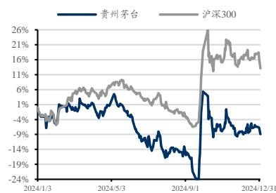

贵州茅台（600519）

# 全年目标稳健兑现，多产品均衡发力

买入（维持）

<table><tr><td>盈利预测与估值</td><td>2022A</td><td>2023A</td><td>2024E</td><td>2025E</td><td>2026E</td></tr><tr><td>营业总收入(百万元)</td><td>127554</td><td>150560</td><td>173800</td><td>188609</td><td>205272</td></tr><tr><td>同比(%)</td><td>16.53</td><td>18.04</td><td>15.44</td><td>8.52</td><td>8.83</td></tr><tr><td>归母净利润(百万元)</td><td>62717</td><td>74734</td><td>85700</td><td>91561</td><td>99313</td></tr><tr><td>同比(%)</td><td>19.55</td><td>19.16</td><td>14.67</td><td>6.84</td><td>8.47</td></tr><tr><td>EPS-最新摊薄(元/股)</td><td>49.93</td><td>59.49</td><td>68.22</td><td>72.89</td><td>79.06</td></tr><tr><td>P/E(现价&amp;最新摊薄)</td><td>29.80</td><td>25.01</td><td>21.81</td><td>20.42</td><td>18.82</td></tr></table>

## [Table\_Su投资要点

◼ 事件：公司公告24年生产经营情况，预计年度总营收为 1738亿元，同增 15.4%；归母净利为 857 亿元，同增 14.7%；茅台酒、系列酒营收分别同增 15.2%、19.2%。24Q4 公司总营收、归母净利分别同增 11.9%、13.8%，茅台酒、系列酒营收分别同增13.6%、3.4%。

◼ 茅台酒平稳收官，产品投放灵活调控。2024年公司茅台酒实现营收 1458亿元，同增 。年内公司根据市场表现，分渠道、分区域、分产品动态调控，全链路把控精度有所提升，为稳定 500ml飞天批价表现提供有力支撑。全年预计茅台酒销量基本符合年初 4.5万吨规划，增量主要向生肖、1L 装、100ml 小茅倾斜。24Q4 茅台酒营收 447 亿元，同增13.6%，增速边际略有放缓，预计与年内普茅投放节奏相对靠前有关。

◼ 酱香酒适时调整，优化产品销售策略。2024年公司酱香酒实现营收 246亿元，同增 。年内公司取消茅台 、汉酱（匠心传承）的“动态配额”制，全面实行合同制管理，并及时巩固厂商合作，出台市场促销政策，推动茅台 1935 仍逆势兑现销售增长。24Q4 系列酒营收 52 亿元，同增 3.4%，单季增长显著放慢，预计主因年末1935控货调整。

一 年营销管控更趋市场导向，看好公司打好调控组合拳。 年围绕“品质相符，质价匹配”，公司规划：①在产品布局上增强结构韧性；②在产品开发上带动引领消费风尚；③在产品推广上实行精准化营销。其中，茅台酒产品投放将与渠道结构更相匹配，预计增量主要体现在服务开瓶场景的多规格飞天、小批量/非流通的文创产品及蛇年生肖等产品。酱香酒强化单品打造，伴随茅台 重新锚定 元价位，预计市场投入政策亦有相应调整；同时王子酒渠道扩张也将加速推进。看好公司在更多元化的产品结构支撑下，统筹普飞量价表现更显从容。

◼ 盈利预测与投资评级： 年公司灵活调整销售政策、不断优化产品矩阵，保障全年经营计划顺利完成。 年预计经营目标更为理性客观，在“稳中求进、以进促稳、守正创新、先立后破、系统集成、协同配合”的主基调下，将围绕“供需适配”，优化产品、资源、渠道配称，更好统筹量价利平衡。期待公司通过产品创新、场景开拓（政商务消费之外的自饮、聚饮等场景）及服务升级（触达私域圈层并提供定制化服务等），更好实现需求挖掘，并引领白酒行业发展迸发新活力。根据 年经营数据，微调 年归母净利润为 、 、 亿元（前值为860、921、999亿元），当前市值对应PE 为22、20、19x，维持“买入”评级。

◼ 风险提示：宏观承压消费持续走弱，需求企稳不及预期；市场对合理降速的非理性反应等。

2025 年 01 月 03 日

证券分析师 苏铖

执业证书：S0600524120010

such@dwzq.com.cn

证券分析师 孙瑜

执业证书：S0600523120002

suny@dwzq.com.cn

股价走势  

市场数据

<table><tr><td>收盘价(元)</td><td>1,488.00</td></tr><tr><td>一年最低/最高价</td><td>1,245.83/1,910.00</td></tr><tr><td>市净率(倍)</td><td>7.86</td></tr><tr><td>流通A股市值(百万元)</td><td>1,869,222.33</td></tr><tr><td>总市值(百万元)</td><td>1,869,222.33</td></tr></table>

基础数据

<table><tr><td>每股净资产(元,LF)</td><td>189.23</td></tr><tr><td>资产负债率(%,LF)</td><td>13.63</td></tr><tr><td>总股本(百万股)</td><td>1,256.20</td></tr><tr><td>流通A股(百万股)</td><td>1,256.20</td></tr></table>

## 相关研究

《贵州茅台(600519)：2025 年经销商

大会：聚力转型发展，深化市场导向》

2024-12-29

《贵州茅台(600519)：股东回报持续完善，适配供需运筹决胜》

2024-11-28

贵州茅台三大财务预测表

<table><tr><td>资产负债表(百万元)</td><td>2023A</td><td>2024E</td><td>2025E</td><td>2026E</td></tr><tr><td>流动资产</td><td>225,173</td><td>251,141</td><td>274,405</td><td>304,667</td></tr><tr><td>货币资金及交易性金融资产</td><td>69,471</td><td>58,734</td><td>64,346</td><td>66,116</td></tr><tr><td>经营性应收款项</td><td>109</td><td>955</td><td>842</td><td>926</td></tr><tr><td>存货</td><td>46,435</td><td>60,452</td><td>65,131</td><td>79,118</td></tr><tr><td>合同资产</td><td>0</td><td>0</td><td>0</td><td>0</td></tr><tr><td>其他流动资产</td><td>109,158</td><td>131,000</td><td>144,085</td><td>158,507</td></tr><tr><td>非流动资产</td><td>47,527</td><td>49,270</td><td>52,331</td><td>54,674</td></tr><tr><td>长期股权投资</td><td>0</td><td>0</td><td>0</td><td>0</td></tr><tr><td>固定资产及使用权资产</td><td>20,223</td><td>21,936</td><td>23,116</td><td>23,569</td></tr><tr><td>在建工程</td><td>2,137</td><td>1,179</td><td>750</td><td>463</td></tr><tr><td>无形资产</td><td>8,572</td><td>9,824</td><td>11,029</td><td>12,344</td></tr><tr><td>商誉</td><td>0</td><td>0</td><td>0</td><td>0</td></tr><tr><td>长期待摊费用</td><td>160</td><td>160</td><td>160</td><td>160</td></tr><tr><td>其他非流动资产</td><td>16,434</td><td>16,171</td><td>17,276</td><td>18,137</td></tr><tr><td>资产总计</td><td>272,700</td><td>300,411</td><td>326,736</td><td>359,341</td></tr><tr><td>流动负债</td><td>48,698</td><td>53,754</td><td>58,668</td><td>62,792</td></tr><tr><td>短期借款及一年内到期的非流动负债</td><td>57</td><td>90</td><td>86</td><td>78</td></tr><tr><td>经营性应付款项</td><td>3,093</td><td>2,524</td><td>3,077</td><td>3,230</td></tr><tr><td>合同负债</td><td>14,126</td><td>15,166</td><td>16,803</td><td>18,354</td></tr><tr><td>其他流动负债</td><td>31,422</td><td>35,974</td><td>38,703</td><td>41,130</td></tr><tr><td>非流动负债</td><td>346</td><td>346</td><td>346</td><td>346</td></tr><tr><td>长期借款</td><td>0</td><td>0</td><td>0</td><td>0</td></tr><tr><td>应付债券</td><td>0</td><td>0</td><td>0</td><td>0</td></tr><tr><td>租赁负债</td><td>267</td><td>267</td><td>267</td><td>267</td></tr><tr><td>其他非流动负债</td><td>79</td><td>79</td><td>79</td><td>79</td></tr><tr><td>负债合计</td><td>49,043</td><td>54,100</td><td>59,014</td><td>63,137</td></tr><tr><td>归属母公司股东权益</td><td>215,669</td><td>235,169</td><td>253,259</td><td>278,087</td></tr><tr><td>少数股东权益</td><td>7,988</td><td>11,142</td><td>14,463</td><td>18,117</td></tr><tr><td>所有者权益合计</td><td>223,656</td><td>246,311</td><td>267,722</td><td>296,204</td></tr><tr><td>负债和股东权益</td><td>272,700</td><td>300,411</td><td>326,736</td><td>359,341</td></tr></table>

<table><tr><td>利润表(百万元)</td><td>2023A</td><td>2024E</td><td>2025E</td><td>2026E</td></tr><tr><td>营业总收入</td><td>150,560</td><td>173,800</td><td>188,609</td><td>205,272</td></tr><tr><td>营业成本(含金融类)</td><td>11,981</td><td>14,704</td><td>17,075</td><td>19,208</td></tr><tr><td>税金及附加</td><td>22,234</td><td>26,666</td><td>28,660</td><td>31,013</td></tr><tr><td>销售费用</td><td>4,649</td><td>5,929</td><td>7,743</td><td>9,016</td></tr><tr><td>管理费用</td><td>9,729</td><td>9,689</td><td>9,738</td><td>9,966</td></tr><tr><td>研发费用</td><td>157</td><td>156</td><td>111</td><td>210</td></tr><tr><td>财务费用</td><td>(1,790)</td><td>(1,926)</td><td>(1,625)</td><td>(1,719)</td></tr><tr><td>加:其他收益</td><td>35</td><td>35</td><td>39</td><td>43</td></tr><tr><td>投资净收益</td><td>34</td><td>72</td><td>71</td><td>69</td></tr><tr><td>公允价值变动</td><td>3</td><td>0</td><td>0</td><td>0</td></tr><tr><td>减值损失</td><td>38</td><td>38</td><td>38</td><td>38</td></tr><tr><td>资产处置收益</td><td>0</td><td>9</td><td>0</td><td>0</td></tr><tr><td>营业利润</td><td>103,709</td><td>118,735</td><td>127,055</td><td>137,727</td></tr><tr><td>营业外净收支</td><td>(46)</td><td>(104)</td><td>(109)</td><td>(87)</td></tr><tr><td>利润总额</td><td>103,663</td><td>118,631</td><td>126,945</td><td>137,641</td></tr><tr><td>减:所得税</td><td>26,141</td><td>29,776</td><td>32,064</td><td>34,674</td></tr><tr><td>净利润</td><td>77,521</td><td>88,854</td><td>94,882</td><td>102,966</td></tr><tr><td>减:少数股东损益</td><td>2,787</td><td>3,154</td><td>3,321</td><td>3,654</td></tr><tr><td>归属母公司净利润</td><td>74,734</td><td>85,700</td><td>91,561</td><td>99,313</td></tr><tr><td>每股收益-最新股本摊薄(元)</td><td>59.49</td><td>68.22</td><td>72.89</td><td>79.06</td></tr><tr><td>EBIT</td><td>101,882</td><td>116,653</td><td>125,283</td><td>135,864</td></tr><tr><td>EBITDA</td><td>103,820</td><td>118,813</td><td>127,608</td><td>138,304</td></tr><tr><td>毛利率(%)</td><td>91.96</td><td>91.52</td><td>90.91</td><td>90.60</td></tr><tr><td>归母净利率(%)</td><td>50.60</td><td>50.28</td><td>49.52</td><td>49.32</td></tr><tr><td>收入增长率(%)</td><td>18.04</td><td>15.44</td><td>8.52</td><td>8.83</td></tr><tr><td>归母净利润增长率(%)</td><td>19.16</td><td>14.67</td><td>6.84</td><td>8.47</td></tr></table>

<table><tr><td>现金流量表(百万元)</td><td>2023A</td><td>2024E</td><td>2025E</td><td>2026E</td></tr><tr><td>经营活动现金流</td><td>66,593</td><td>60,519</td><td>84,101</td><td>80,966</td></tr><tr><td>投资活动现金流</td><td>(9,724)</td><td>(5,080)</td><td>(5,006)</td><td>(4,695)</td></tr><tr><td>筹资活动现金流</td><td>(58,889)</td><td>(66,175)</td><td>(73,483)</td><td>(74,500)</td></tr><tr><td>现金净增加额</td><td>(2,019)</td><td>(10,736)</td><td>5,612</td><td>1,770</td></tr><tr><td>折旧和摊销</td><td>1,937</td><td>2,160</td><td>2,324</td><td>2,441</td></tr><tr><td>资本开支</td><td>(2,595)</td><td>(4,261)</td><td>(4,390)</td><td>(4,009)</td></tr><tr><td>营运资本变动</td><td>(11,667)</td><td>(31,643)</td><td>(12,695)</td><td>(24,323)</td></tr></table>

数据来源:Wind,东吴证券研究所，全文如无特殊注明，相关数据的货币单位均为人民币，预测均为东吴证券研究所预测。

<table><tr><td>重要财务与估值指标</td><td>2023A</td><td>2024E</td><td>2025E</td><td>2026E</td></tr><tr><td>每股净资产(元)</td><td>171.68</td><td>187.21</td><td>201.61</td><td>221.37</td></tr><tr><td>最新发行在外股份(百万股)</td><td>1,256</td><td>1,256</td><td>1,256</td><td>1,256</td></tr><tr><td>ROIC(%)</td><td>35.49</td><td>37.13</td><td>36.38</td><td>36.00</td></tr><tr><td>ROE-摊薄(%)</td><td>34.65</td><td>36.44</td><td>36.15</td><td>35.71</td></tr><tr><td>资产负债率(%)</td><td>17.98</td><td>18.01</td><td>18.06</td><td>17.57</td></tr><tr><td>P/E (现价&amp;最新股本摊薄)</td><td>25.01</td><td>21.81</td><td>20.42</td><td>18.82</td></tr><tr><td>P/B (现价)</td><td>8.67</td><td>7.95</td><td>7.38</td><td>6.72</td></tr></table>

## 免责声明

东吴证券股份有限公司经中国证券监督管理委员会批准，已具备证券投资咨询业务资格。

本研究报告仅供东吴证券股份有限公司（以下简称“本公司”）的客户使用。本公司不会因接收人收到本报告而视其为客户。在任何情况下，本报告中的信息或所表述的意见并不构成对任何人的投资建议，本公司及作者不对任何人因使用本报告中的内容所导致的任何后果负任何责任。任何形式的分享证券投资收益或者分担证券投资损失的书面或口头承诺均为无效。

在法律许可的情况下，东吴证券及其所属关联机构可能会持有报告中提到的公司所发行的证券并进行交易，还可能为这些公司提供投资银行服务或其他服务。

市场有风险，投资需谨慎。本报告是基于本公司分析师认为可靠且已公开的信息，本公司力求但不保证这些信息的准确性和完整性，也不保证文中观点或陈述不会发生任何变更，在不同时期，本公司可发出与本报告所载资料、意见及推测不一致的报告。

本报告的版权归本公司所有，未经书面许可，任何机构和个人不得以任何形式翻版、复制和发布。经授权刊载、转发本报告或者摘要的，应当注明出处为东吴证券研究所，并注明本报告发布人和发布日期，提示使用本报告的风险，且不得对本报告进行有悖原意的引用、删节和修改。未经授权或未按要求刊载、转发本报告的，应当承担相应的法律责任。本公司将保留向其追究法律责任的权利。

## 东吴证券投资评级标准

投资评级基于分析师对报告发布日后 6 至 12 个月内行业或公司回报潜力相对基准表现的预期（A 股市场基准为沪深 300 指数，香港市场基准为恒生指数，美国市场基准为标普指数，新三板基准指数为三板成指（针对协议转让标的）或三板做市指数（针对做市转让标的），北交所基准指数为北证 50指数），具体如下：

公司投资评级：

买入：预期未来6个月个股涨跌幅相对基准在 15%以上；

增持：预期未来6个月个股涨跌幅相对基准介于 5%与 15%之间；

中性：预期未来 6个月个股涨跌幅相对基准介于-5%与 5%之间；

减持：预期未来 6个月个股涨跌幅相对基准介于-15%与-5%之间；

卖出：预期未来 6个月个股涨跌幅相对基准在-15%以下。

行业投资评级：

增持： 预期未来6个月内，行业指数相对强于基准5%以上；

中性： 预期未来6个月内，行业指数相对基准-5%与5%；

减持： 预期未来6个月内，行业指数相对弱于基准5%以上。

我们在此提醒您，不同证券研究机构采用不同的评级术语及评级标准。我们采用的是相对评级体系，表示投资的相对比重建议。投资者买入或者卖出证券的决定应当充分考虑自身特定状况，如具体投资目的、财务状况以及特定需求等，并完整理解和使用本报告内容，不应视本报告为做出投资决策的唯一因素。

东吴证券研究所

苏州工业园区星阳街 5 号

邮政编码：215021

传真：（0512）62938527

公司网址： http://www.dwzq.com.cn