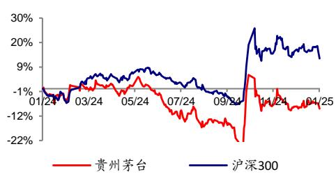

# [Table\_Title] 贵州茅台（600519.SH）

# 2024 圆满收官，经营韧性显现

## 核心观点：

事件：公司发布2024年度生产经营情况公告。经公司初步核算，2024年度公司生产茅台酒基酒5.6 万吨，系列酒基酒4.8万吨；预计实现营业总收入约1738亿元（其中茅台酒营业收入 1458亿元，系列酒营业收入 246 亿元），同增约 15.4%；预计实现归母净利润约 857 亿元，同增约 14.7%。单季度来看，2023Q4 公司实现营业总收入约 507 亿元，同增约12.0%；实现归母净利润约 249 亿元，同增约 13.8%。2024年度公司圆满收官，完成年初制定营收增长 目标任务。

茅台酒稳健增长，系列酒调整增长节奏。分产品来看，2024年公司茅台酒/系列酒分别实现收入约1458/246亿元，分别同比+15.2%/+19.2%左右，其中2024Q4 公司茅台酒/系列酒分别实现收入约 447/52 亿元，分别同比+13.6%/+3.4%左右。单四季度来看，收入增速环比略有放缓，主要系公司主动调控发货节奏，稳定市场秩序。

2024年圆满收官，龙头增长韧性凸显。在当前白酒行业调整阶段，作为行业龙头，2024年公司顺利实现年初制定增长目标，体现出较强的经营韧性。展望2025 年集团力争高质量完成“十四五”规划目标任务，为实现“十五五”良好开局打牢基础。

盈利预测与投资建议。结合公司最新披露收入利润预测数据，我们小幅调整全年盈利预测，预计公司 2024-2026 年收入为 1746/1899/2070亿元，同比+16%/9%/9%（原预测+16%/8%/9%），归母净利润为857/928/1016 亿元，同比+15%/8%/9%（原预测+14%/8%/10%）。对应 24-26 年 PE 为 22x/20x/18x。考虑到公司作为行业龙头，给予 25年 25倍PE，合理价值1847.68元/股，维持“买入”评级。

⚫ 风险提示：宏观经济下行影响需求；批价大幅波动；食品安全问题。

盈利预测：

<table><tr><td></td><td>2022A</td><td>2023A</td><td>2024E</td><td>2025E</td><td>2026E</td></tr><tr><td>营业收入(百万元)</td><td>127554</td><td>150560</td><td>174583</td><td>189894</td><td>207023</td></tr><tr><td>增长率(%)</td><td>16.5%</td><td>18.0%</td><td>16.0%</td><td>8.8%</td><td>9.0%</td></tr><tr><td>EBITDA(百万元)</td><td>88112</td><td>103820</td><td>120175</td><td>129867</td><td>141687</td></tr><tr><td>归母净利润(百万元)</td><td>62717</td><td>74734</td><td>85727</td><td>92842</td><td>101560</td></tr><tr><td>增长率(%)</td><td>19.6%</td><td>19.2%</td><td>14.7%</td><td>8.3%</td><td>9.4%</td></tr><tr><td>EPS(元/股)</td><td>49.93</td><td>59.49</td><td>68.24</td><td>73.91</td><td>80.85</td></tr><tr><td>市盈率(P/E)</td><td>34.59</td><td>29.01</td><td>21.80</td><td>20.13</td><td>18.41</td></tr><tr><td>ROE(%)</td><td>31.8%</td><td>34.7%</td><td>34.8%</td><td>32.6%</td><td>30.6%</td></tr><tr><td>EV/EBITDA</td><td>23.97</td><td>20.22</td><td>14.75</td><td>13.35</td><td>11.91</td></tr></table>

数据来源：公司财务报表，广发证券发展研究中心

[公司评级 Table\_Invest] 买入

当前价格 1488.00 元

合理价值 1847.68 元

前次评级 买入

报告日期 2025-01-03

## [Table\_PicQuote] 相对市场表现

[分析师：Table\_Author] 符蓉

同 SAC 执证号：S0260523120002

021-38003552

furong@gf.com.cn

分析师： 高鸿

SAC 执证号：S026052201000

SFC CE No. BUQ312

021-38003690

gfgaohong@gf.com.cn

请注意，符蓉并非香港证券及期货事务监察委员会的注册持牌人，不可在香港从事受监管活动。

## [Table\_ 相关研究：DocRep

贵州茅台（600519.SH）:业 2024-10-27 绩符合预期，稳步实现增长 目标

贵州茅台（600519.SH）:营 2024-08-09 收略超预期，三年分红提信 心

贵州茅台（600519.SH）:营 2024-04-28 收开门红，销售投入谋长远

[Table\_FinanceDetail]资产负债表  
单位：百万元

<table><tr><td>至12月31日</td><td>2022A</td><td>2023A</td><td>2024E</td><td>2025E</td><td>2026E</td></tr><tr><td>流动资产</td><td>216,611</td><td>225,173</td><td>260,956</td><td>304,081</td><td>356,017</td></tr><tr><td>货币资金</td><td>58,274</td><td>69,070</td><td>97,482</td><td>135,260</td><td>182,080</td></tr><tr><td>应收及预付</td><td>1,024</td><td>109</td><td>79</td><td>87</td><td>95</td></tr><tr><td>存货</td><td>38,824</td><td>46,435</td><td>54,832</td><td>61,168</td><td>66,773</td></tr><tr><td>其他流动资产</td><td>118,489</td><td>109,558</td><td>108,563</td><td>107,565</td><td>107,069</td></tr><tr><td>非流动资产</td><td>37,889</td><td>47,527</td><td>49,944</td><td>52,253</td><td>54,453</td></tr><tr><td>长期股权投资</td><td>0</td><td>0</td><td>0</td><td>0</td><td>0</td></tr><tr><td>固定资产</td><td>19,743</td><td>19,909</td><td>20,260</td><td>20,481</td><td>20,575</td></tr><tr><td>在建工程</td><td>2,208</td><td>2,137</td><td>1,924</td><td>1,731</td><td>1,558</td></tr><tr><td>无形资产</td><td>7,083</td><td>8,572</td><td>9,852</td><td>11,132</td><td>12,412</td></tr><tr><td>其他长期资产</td><td>8,855</td><td>16,908</td><td>17,908</td><td>18,908</td><td>19,908</td></tr><tr><td>资产总计</td><td>254,501</td><td>272,700</td><td>310,900</td><td>356,333</td><td>410,470</td></tr><tr><td>流动负债</td><td>49,066</td><td>48,698</td><td>52,721</td><td>56,597</td><td>60,133</td></tr><tr><td>短期借款</td><td>0</td><td>0</td><td>0</td><td>0</td><td>0</td></tr><tr><td>应付及预收</td><td>2,408</td><td>3,093</td><td>3,652</td><td>4,074</td><td>4,448</td></tr><tr><td>其他流动负债</td><td>46,657</td><td>45,605</td><td>49,069</td><td>52,522</td><td>55,685</td></tr><tr><td>非流动负债</td><td>497</td><td>346</td><td>346</td><td>346</td><td>346</td></tr><tr><td>长期借款</td><td>0</td><td>0</td><td>0</td><td>0</td><td>0</td></tr><tr><td>应付债券</td><td>0</td><td>0</td><td>0</td><td>0</td><td>0</td></tr><tr><td>其他非流动负债</td><td>497</td><td>346</td><td>346</td><td>346</td><td>346</td></tr><tr><td>负债合计</td><td>49,563</td><td>49,043</td><td>53,067</td><td>56,942</td><td>60,478</td></tr><tr><td>股本</td><td>1,256</td><td>1,256</td><td>1,256</td><td>1,256</td><td>1,256</td></tr><tr><td>资本公积</td><td>1,375</td><td>1,375</td><td>1,375</td><td>1,375</td><td>1,375</td></tr><tr><td>留存收益</td><td>194,860</td><td>213,043</td><td>244,019</td><td>282,109</td><td>328,917</td></tr><tr><td>归属母公司股东权益</td><td>197,480</td><td>215,669</td><td>246,644</td><td>284,734</td><td>331,543</td></tr><tr><td>少数股东权益</td><td>7,458</td><td>7,988</td><td>11,189</td><td>14,656</td><td>18,449</td></tr><tr><td>负债和股东权益</td><td>254,501</td><td>272,700</td><td>310,900</td><td>356,333</td><td>410,470</td></tr></table>

利润表  
单位：百万元

<table><tr><td>至12月31日</td><td>2022A</td><td>2023A</td><td>2024E</td><td>2025E</td><td>2026E</td></tr><tr><td>营业收入</td><td>127554</td><td>150560</td><td>174583</td><td>189894</td><td>207023</td></tr><tr><td>营业成本</td><td>10199</td><td>11981</td><td>14147</td><td>15782</td><td>17228</td></tr><tr><td>营业税金及附加</td><td>18496</td><td>22234</td><td>26537</td><td>28864</td><td>31467</td></tr><tr><td>销售费用</td><td>3298</td><td>4649</td><td>5587</td><td>6456</td><td>7039</td></tr><tr><td>管理费用</td><td>9012</td><td>9729</td><td>9951</td><td>10824</td><td>11593</td></tr><tr><td>研发费用</td><td>135</td><td>157</td><td>169</td><td>192</td><td>208</td></tr><tr><td>财务费用</td><td>-1392</td><td>-1790</td><td>-691</td><td>-975</td><td>-1353</td></tr><tr><td>资产减值损失</td><td>0</td><td>0</td><td>0</td><td>0</td><td>0</td></tr><tr><td>公允价值变动收益</td><td>0</td><td>3</td><td>0</td><td>0</td><td>0</td></tr><tr><td>投资净收益</td><td>64</td><td>34</td><td>0</td><td>0</td><td>0</td></tr><tr><td>营业利润</td><td>87880</td><td>103709</td><td>118908</td><td>128776</td><td>140865</td></tr><tr><td>营业外收支</td><td>-178</td><td>-46</td><td>-20</td><td>-20</td><td>-20</td></tr><tr><td>利润总额</td><td>87701</td><td>103663</td><td>118888</td><td>128756</td><td>140845</td></tr><tr><td>所得税</td><td>22325</td><td>26141</td><td>29960</td><td>32446</td><td>35493</td></tr><tr><td>净利润</td><td>65376</td><td>77521</td><td>88928</td><td>96309</td><td>105352</td></tr><tr><td>少数股东损益</td><td>2659</td><td>2787</td><td>3201</td><td>3467</td><td>3793</td></tr><tr><td>归属母公司净利润</td><td>62717</td><td>74734</td><td>85727</td><td>92842</td><td>101560</td></tr><tr><td>EBITDA</td><td>88112</td><td>103820</td><td>120175</td><td>129867</td><td>141687</td></tr><tr><td>EPS(元)</td><td>49.93</td><td>59.49</td><td>68.24</td><td>73.91</td><td>80.85</td></tr></table>

现金流量表  
单位：百万元

<table><tr><td>至12月31日</td><td>2022A</td><td>2023A</td><td>2024E</td><td>2025E</td><td>2026E</td></tr><tr><td>经营活动现金流</td><td>36,699</td><td>66,593</td><td>87,584</td><td>96,949</td><td>105,992</td></tr><tr><td>净利润</td><td>65,376</td><td>77,521</td><td>88,928</td><td>96,309</td><td>105,352</td></tr><tr><td>折旧摊销</td><td>1,688</td><td>1,937</td><td>1,983</td><td>2,092</td><td>2,199</td></tr><tr><td>营运资金变动</td><td>-29,127</td><td>-11,667</td><td>-3,347</td><td>-1,472</td><td>-1,580</td></tr><tr><td>其它</td><td>-1,239</td><td>-1,198</td><td>20</td><td>20</td><td>20</td></tr><tr><td>投资活动现金流</td><td>-5,537</td><td>-9,724</td><td>-4,420</td><td>-4,420</td><td>-4,420</td></tr><tr><td>资本支出</td><td>-5,306</td><td>-2,595</td><td>-3,420</td><td>-3,420</td><td>-3,420</td></tr><tr><td>投资变动</td><td>-210</td><td>-7,268</td><td>-1,000</td><td>-1,000</td><td>-1,000</td></tr><tr><td>其他</td><td>-21</td><td>138</td><td>0</td><td>0</td><td>0</td></tr><tr><td>筹资活动现金流</td><td>-57,425</td><td>-58,889</td><td>-54,751</td><td>-54,751</td><td>-54,751</td></tr><tr><td>银行借款</td><td>0</td><td>0</td><td>0</td><td>0</td><td>0</td></tr><tr><td>股权融资</td><td>0</td><td>0</td><td>0</td><td>0</td><td>0</td></tr><tr><td>其他</td><td>-57,425</td><td>-58,889</td><td>-54,751</td><td>-54,751</td><td>-54,751</td></tr><tr><td>现金净增加额</td><td>-26,262</td><td>-2,019</td><td>28,412</td><td>37,778</td><td>46,820</td></tr><tr><td>期初现金余额</td><td>178,641</td><td>152,379</td><td>69,070</td><td>97,482</td><td>135,260</td></tr><tr><td>期末现金余额</td><td>152,379</td><td>150,360</td><td>97,482</td><td>135,260</td><td>182,080</td></tr></table>

主要财务比率

<table><tr><td>至12月31日</td><td>2022A</td><td>2023A</td><td>2024E</td><td>2025E</td><td>2026E</td></tr><tr><td>成长能力</td><td></td><td></td><td></td><td></td><td></td></tr><tr><td>营业收入</td><td>16.5%</td><td>18.0%</td><td>16.0%</td><td>8.8%</td><td>9.0%</td></tr><tr><td>营业利润</td><td>17.6%</td><td>18.0%</td><td>14.7%</td><td>8.3%</td><td>9.4%</td></tr><tr><td>归母净利润</td><td>19.6%</td><td>19.2%</td><td>14.7%</td><td>8.3%</td><td>9.4%</td></tr><tr><td>获利能力</td><td></td><td></td><td></td><td></td><td></td></tr><tr><td>毛利率</td><td>92.0%</td><td>92.0%</td><td>91.9%</td><td>91.7%</td><td>91.7%</td></tr><tr><td>净利率</td><td>51.3%</td><td>51.5%</td><td>50.9%</td><td>50.7%</td><td>50.9%</td></tr><tr><td>ROE</td><td>31.8%</td><td>34.7%</td><td>34.8%</td><td>32.6%</td><td>30.6%</td></tr><tr><td>ROIC</td><td>31.4%</td><td>34.0%</td><td>34.2%</td><td>31.9%</td><td>29.8%</td></tr><tr><td>偿债能力</td><td></td><td></td><td></td><td></td><td></td></tr><tr><td>资产负债率</td><td>19.5%</td><td>18.0%</td><td>17.1%</td><td>16.0%</td><td>14.7%</td></tr><tr><td>净负债比率</td><td>24.2%</td><td>21.9%</td><td>20.6%</td><td>19.0%</td><td>17.3%</td></tr><tr><td>流动比率</td><td>4.41</td><td>4.62</td><td>4.95</td><td>5.37</td><td>5.92</td></tr><tr><td>速动比率</td><td>3.56</td><td>3.67</td><td>3.91</td><td>4.29</td><td>4.81</td></tr><tr><td>营运能力</td><td></td><td></td><td></td><td></td><td></td></tr><tr><td>总资产周转率</td><td>0.50</td><td>0.55</td><td>0.56</td><td>0.53</td><td>0.50</td></tr><tr><td>应收账款周转率</td><td>6092.23</td><td>2493.82</td><td>7300.00</td><td>7300.00</td><td>7300.00</td></tr><tr><td>存货周转率</td><td>3.29</td><td>3.24</td><td>3.18</td><td>3.10</td><td>3.10</td></tr><tr><td>每股指标(元)</td><td></td><td></td><td></td><td></td><td></td></tr><tr><td>每股收益</td><td>49.93</td><td>59.49</td><td>68.24</td><td>73.91</td><td>80.85</td></tr><tr><td>每股经营现金流</td><td>29.21</td><td>53.01</td><td>69.72</td><td>77.18</td><td>84.37</td></tr><tr><td>每股净资产</td><td>157.20</td><td>171.68</td><td>196.34</td><td>226.66</td><td>263.93</td></tr><tr><td>估值比率</td><td></td><td></td><td></td><td></td><td></td></tr><tr><td>P/E</td><td>34.59</td><td>29.01</td><td>21.80</td><td>20.13</td><td>18.41</td></tr><tr><td>P/B</td><td>10.99</td><td>10.05</td><td>7.58</td><td>6.56</td><td>5.64</td></tr><tr><td>EV/EBITDA</td><td>23.97</td><td>20.22</td><td>14.75</td><td>13.35</td><td>11.91</td></tr></table>

识别风险，发现价值

## [Table\_ResearchTeam] 广发食品饮料研究小组

符 蓉 ：首席分析师，金融学硕士，8 年证券与基金投研经验。投

郝 宇 新 ：资深分析师，金融学硕士，2023年加入广发证券发展研究中心。资

鸿 ：资深分析师，经济学硕士，2019年加入广发证券发展研究中心。

吴 思 颖 ：资深分析师，金融学硕士，2023年加入广发证券发展研究中心。

胡 慧 ：资深分析师，金融学硕士，2023年加入广发证券发展研究中心。

廖 承 帅 ：高级分析师，工程学硕士，2022年加入广发证券发展研究中心。

殷 卓 龙 ：高级研究员，管理学硕士，2023年加入广发证券发展研究中心。

## [Table\_IndustryInvestDescription] 广发证券—行业投资评级说明

买入： 预期未来12个月内，股价表现强于大盘10%以上。内

持有： 预期未来12个月内，股价相对大盘的变动幅度介于-10%～+10%。对

卖出： 预期未来12个月内，股价表现弱于大盘10%以上。

## [Table\_CompanyInvestDescription] 广发证券—公司投资评级说明

买入： 预期未来12个月内，股价表现强于大盘15%以上。

增持： 预期未来12个月内，股价表现强于大盘5%-15%。

持有： 预期未来12个月内，股价相对大盘的变动幅度介于-5%～+5%。

卖出： 预期未来12个月内，股价表现弱于大盘5%以上。

## [Table\_Address] 联系我们

<table><tr><td></td><td>广州市</td><td>深圳市</td><td>北京市</td><td>上海市</td><td>香港</td></tr><tr><td>地址</td><td>广州市天河区马场路26号广发证券大厦47楼</td><td>深圳市福田区益田路6001号太平金融大厦31层</td><td>北京市西城区月坛北街2号月坛大厦18层</td><td>上海市浦东新区南泉北路429号泰康保险大厦37楼</td><td>香港湾仔骆克道81号广发大厦27楼</td></tr><tr><td>邮政编码</td><td>510627</td><td>518026</td><td>100045</td><td>200120</td><td>-</td></tr><tr><td>客服邮箱</td><td>gfzqyf@gf.com.cn</td><td></td><td></td><td></td><td></td></tr></table>

## [Table\_Legal 法律主体Disclaimer 声明]

本报告由广发证券股份有限公司或其关联机构制作，广发证券股份有限公司及其关联机构以下统称为“广发证券”。本报告的分销依据不同不依据国家、地区的法律、法规和监管要求由广发证券于该国家或地区的具有相关合法合规经营资质的子公司/经营机构完成。

广发证券股份有限公司具备中国证监会批复的证券投资咨询业务资格，接受中国证监会监管，负责本报告于中国（港澳台地区除外）的分销。

广发证券（香港）经纪有限公司具备香港证监会批复的就证券提供意见（ 号牌照）的牌照，接受香港证监会监管，负责本报告于中国香港地区的分销。

本报告署名研究人员所持中国证券业协会注册分析师资质信息和香港证监会批复的牌照信息已于署名研究人员姓名处披露。

## [Table\_I 重要mportant 声明N

广发证券股份有限公司及其关联机构可能与本报告中提及的公司寻求或正在建立业务关系，因此，投资者应当考虑广发证券股份有限公司系 因此 者应当考虑及其关联机构因可能存在的潜在利益冲突而对本报告的独立性产生影响。投资者不应仅依据本报告内容作出任何投资决策。投资者应自主存 潜 利 冲突而 独 性产生影响 仅 容作出投资决策并自行承担投资风险，任何形式的分享证券投资收益或者分担证券投资损失的书面或者口头承诺均为无效。

本报告署名研究人员、联系人（以下均简称“研究人员”）针对本报告中相关公司或证券的研究分析内容，在此声明：（ ）本报告的全部分析结论、研究观点均精确反映研究人员于本报告发出当日的关于相关公司或证券的所有个人观点，并不代表广发证券的立场；（2）研究人员的部分或全部的报酬无论在过去、现在还是将来均不会与本报告所述特定分析结论、研究观点具有直接或间接的联系。

研究人员制作本报告的报酬标准依据研究质量、客户评价、工作量等多种因素确定，其影响因素亦包括广发证券的整体经营收入，该等经营收入部分来源于广发证券的投资银行类业务。

本报告仅面向经广发证券授权使用的客户/特定合作机构发送，不对外公开发布，只有接收人才可以使用，且对于接收人而言具有保密义务。广发证券并不因相关人员通过其他途径收到或阅读本报告而视其为广发证券的客户。在特定国家或地区传播或者发布本报告可能违反当地法律，广发证券并未采取任何行动以允许于该等国家或地区传播或者分销本报告。

本报告所提及证券可能不被允许在某些国家或地区内出售。请注意，投资涉及风险，证券价格可能会波动，因此投资回报可能会有所变化，过去的业绩并不保证未来的表现。本报告的内容、观点或建议并未考虑任何个别客户的具体投资目标、财务状况和特殊需求，不应被视为对特定客户关于特定证券或金融工具的投资建议。本报告发送给某客户是基于该客户被认为有能力独立评估投资风险、独立行使投资决策并独立承担相应风险。

本报告所载资料的来源及观点的出处皆被广发证券认为可靠，但广发证券不对其准确性、完整性做出任何保证。报告内容仅供参考，报告中的信息或所表达观点不构成所涉证券买卖的出价或询价。广发证券不对因使用本报告的内容而引致的损失承担任何责任，除非法律法规有明确规定。客户不应以本报告取代其独立判断或仅根据本报告做出决策，如有需要，应先咨询专业意见。

广发证券可发出其它与本报告所载信息不一致及有不同结论的报告。本报告反映研究人员的不同观点、见解及分析方法，并不代表广发证券的立场。广发证券的销售人员、交易员或其他专业人士可能以书面或口头形式，向其客户或自营交易部门提供与本报告观点相反的市场评论或交易策略，广发证券的自营交易部门亦可能会有与本报告观点不一致，甚至相反的投资策略。报告所载资料、意见及推测仅反映研究人员于发出本报告当日的判断，可随时更改且无需另行通告。广发证券或其证券研究报告业务的相关董事、高级职员、分析师和员工可能拥有本报告所提及证券的权益。在阅读本报告时，收件人应了解相关的权益披露（若有）。

本研究报告可能包括和或描述呈列期货合约价格的事实历史信息（“信息”）。请注意此信息仅供用作组成我们的研究方法分析中的部分论点/依据/证据，以支持我们对所述相关行业/公司的观点的结论。在任何情况下，它并不（明示或暗示）与香港证监会第5类受规管活动（就期货合约提供意见）有关联或构成此活动。

## [Table\_Interest 权益披露Disclosu

(1)广发证券（香港）跟本研究报告所述公司在过去12 个月内并没有任何投资银行业务的关系。

## [Table\_Copyright 版权声明]

未经广发证券事先书面许可，任何机构或个人不得以任何形式翻版、复制、刊登、转载和引用，否则由此造成的一切不良后果及法律责任由私自翻版、复制、刊登、转载和引用者承担。