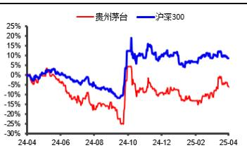

买入（维持）

2025 年 4 月 3 日

分析师：黄冬祎

SAC执业证书编号：

S0340523020001

电话：0769-22119410

邮箱：

huangdongyi@dgzq.com.cn

## 主要数据

<table><tr><td colspan="2">2025年4月2日</td></tr><tr><td>收盘价(元)</td><td>1549.02</td></tr><tr><td>总市值(亿元)</td><td>19458.76</td></tr><tr><td>总股本(亿股)</td><td>12.56</td></tr><tr><td>流通股本(亿股)</td><td>12.56</td></tr><tr><td>ROE(TTM)</td><td>34.78%</td></tr><tr><td>12月最高价(元)</td><td>1880.59</td></tr><tr><td>12月最低价(元)</td><td>1226.64</td></tr></table>

## 股价走势

  
资料来源：同花顺，东莞证券研究所

## 相关报告

# 2024 年圆满收官，彰显经营韧性

# 贵州茅台（600519）2024 年年报点评

## 投资要点：

事件：公司发布2024年年报。

## 点评

◼ 公司2024年圆满收官，2025年经营目标务实。公司2024年实现营业总收入1741.44亿元，同比增长15.66%；实现归母净利润862.28亿元，同比增长15.38%。单季度看，公司回款按目标正常推进，2024Q4实现营业总收入510.22亿元，同比增长12.77%；实现归母净利润254.01亿元，同比增长16.21%。公司规划2025年实现营业总收入同比增长9%左右，完成固定资产投资47.11亿元，经营目标务实理性。产能方面，2024年，公司生产茅台酒5.63万吨，同比下降1.63%；系列酒4.81万吨，同比增长12.05%。

◼ 公司2024Q4茅台酒营收增速快于系列酒，强化渠道协同。分产品看，公司茅台酒与系列酒双轮驱动，2024年实现茅台酒营业收入1459.28亿元，同比增长15.28%；系列酒实现营业收入246.84亿元，同比增长19.65%。2024年单四季度，公司实现茅台酒营业收入448.02亿元，同比增长13.94%，经营维持稳健；系列酒实现营业收入52.91亿元，同比增长5.06%。公司2024Q4系列酒增速放缓，主要系以茅台1935为代表的系列酒战略控货。分渠道看，2024年公司批发渠道实现营业收入957.69亿元，同比增长19.73%；直销渠道实现营业收入748.43亿元，同比增长11.32%。

◼ 公司2024Q4盈利水平同比提高。2024Q4公司茅台酒营收占比提升，带动公司毛利率同比增加0.33个百分点至92.89%。费用方面，2024Q4公司的销售费用率/管理费用率分别为2.75%/6.95%，同比分别-0.76pct/-1.88pct。综合毛利率与费用率的情况，2024Q4公司的净利率为52.48%，同比增加1.40个百分点。

◼ 公司发布2024年末分红方案。公司2024年末分红每10股拟派276.24元（含税），合计现金红利346.71亿元。此前，公司2024年的中期分红为每10股派238.82元（含税），合计现金红利300.01亿元。公司2024年中期与年末分红合计每10股派息515.06元（含税），合计现金红利646.72亿元，分红率为75%，对应4月2日收盘价股息率为3.33%。

维持买入评级。预计公司2025/2026年每股收益分别为74.63元和81.57元，对应PE估值分别为21倍和19倍。作为白酒行业龙头，公司2025年拟进一步优化产品与渠道结构，加大酱香酒费用投放，经营有望行稳致远。维持对公司的“买入”评级。

◼ 风险提示。产品升级不及预期，i茅台运营不及预期，渠道发展不及预期，产能释放不及预期，宏观经济波动等。

图1：公司盈利预测简表（截至 2025年 4月 2日）

<table><tr><td>科目(百万元)</td><td>2024A</td><td>2025E</td><td>2026E</td><td>2027E</td></tr><tr><td>营业总收入</td><td>174144</td><td>189817</td><td>207280</td><td>225728</td></tr><tr><td>营业总成本</td><td>54524</td><td>59698</td><td>65069</td><td>70732</td></tr><tr><td>营业成本</td><td>13789</td><td>15090</td><td>16417</td><td>17833</td></tr><tr><td>营业税金及附加</td><td>26926</td><td>29232</td><td>31921</td><td>34762</td></tr><tr><td>销售费用</td><td>5639</td><td>6739</td><td>7151</td><td>7562</td></tr><tr><td>管理费用</td><td>9316</td><td>10060</td><td>10986</td><td>11964</td></tr><tr><td>财务费用</td><td>-1470</td><td>-1800</td><td>-1810</td><td>-1820</td></tr><tr><td>研发费用</td><td>218</td><td>247</td><td>269</td><td>293</td></tr><tr><td>公允价值变动净收益</td><td>61</td><td>0</td><td>0</td><td>0</td></tr><tr><td>资产减值损失</td><td>0</td><td>0</td><td>0</td><td>0</td></tr><tr><td>营业利润</td><td>119689</td><td>130147</td><td>142240</td><td>155028</td></tr><tr><td>加:营业外收入</td><td>71</td><td>75</td><td>76</td><td>77</td></tr><tr><td>减:营业外支出</td><td>121</td><td>135</td><td>140</td><td>145</td></tr><tr><td>利润总额</td><td>119639</td><td>130087</td><td>142176</td><td>154960</td></tr><tr><td>减:所得税</td><td>30304</td><td>32951</td><td>36013</td><td>39251</td></tr><tr><td>净利润</td><td>89335</td><td>97136</td><td>106163</td><td>115709</td></tr><tr><td>减:少数股东损益</td><td>3107</td><td>3380</td><td>3694</td><td>4027</td></tr><tr><td>归母公司所有者的净利润</td><td>86228</td><td>93756</td><td>102468</td><td>111682</td></tr><tr><td>摊薄每股收益(元)</td><td>68.64</td><td>74.63</td><td>81.57</td><td>88.90</td></tr><tr><td>PE(倍)</td><td>22.57</td><td>20.75</td><td>18.99</td><td>17.42</td></tr></table>

数据来源：同花顺，东莞证券研究所

东莞证券研究报告评级体系：

<table><tr><td colspan="2">公司投资评级</td></tr><tr><td>买入</td><td>预计未来6个月内,股价表现强于市场指数15%以上</td></tr><tr><td>增持</td><td>预计未来6个月内,股价表现强于市场指数5%-15%之间</td></tr><tr><td>持有</td><td>预计未来6个月内,股价表现介于市场指数±5%之间</td></tr><tr><td>减持</td><td>预计未来6个月内,股价表现弱于市场指数5%以上</td></tr><tr><td>无评级</td><td>因无法获取必要的资料,或者公司面临无法预见结果的重大不确定性事件,或者其他原因,导致无法给出明确的投资评级;股票不在常规研究覆盖范围之内</td></tr><tr><td colspan="2">行业投资评级</td></tr><tr><td>超配</td><td>预计未来6个月内,行业指数表现强于市场指数10%以上</td></tr><tr><td>标配</td><td>预计未来6个月内,行业指数表现介于市场指数±10%之间</td></tr><tr><td>低配</td><td>预计未来6个月内,行业指数表现弱于市场指数10%以上</td></tr></table>

说明：本评级体系的“市场指数”，A 股参照标的为沪深 300 指数；新三板参照标的为三板成指。

证券研究报告风险等级及适当性匹配关系

<table><tr><td>低风险</td><td>宏观经济及政策、财经资讯、国债等方面的研究报告</td></tr><tr><td>中低风险</td><td>债券、货币市场基金、债券基金等方面的研究报告</td></tr><tr><td>中风险</td><td>主板股票及基金、可转债等方面的研究报告,市场策略研究报告</td></tr><tr><td>中高风险</td><td>创业板、科创板、北京证券交易所、新三板(含退市整理期)等板块的股票、基金、可转债等方面的研究报告,港股股票、基金研究报告以及非上市公司的研究报告</td></tr><tr><td>高风险</td><td>期货、期权等衍生品方面的研究报告</td></tr></table>

投资者与证券研究报告的适当性匹配关系：“保守型”投资者仅适合使用“低风险”级别的研报，“谨慎型”投资者仅适合使用风险级别不高于“中低风险”的研报，“稳健型”投资者仅适合使用风险级别不高于“中风险”的研报，“积极型”投资者仅适合使用风险级别不高于“中高风险”的研报，“激进型”投资者适合使用我司各类风险级别的研报。

## 证券分析师承诺：

本人具有中国证券业协会授予的证券投资咨询执业资格或相当的专业胜任能力，以勤勉的职业态度，独立、客观地在所知情的范围内出具本报告。本报告清晰准确地反映了本人的研究观点，不受本公司相关业务部门、证券发行人、上市公司、基金管理公司、资产管理公司等利益相关者的干涉和影响。本人保证与本报告所指的证券或投资标的无任何利害关系，没有利用发布本报告为自身及其利益相关者谋取不当利益，或者在发布证券研究报告前泄露证券研究报告的内容和观点。

## 声明：

东莞证券股份有限公司为全国性综合类证券公司，具备证券投资咨询业务资格。

本报告仅供东莞证券股份有限公司（以下简称 本公司 ）的客户使用。本公司不会因接收人收到本报告而视其为客户。本报告所载资料及观点均为合规合法来源且被本公司认为可靠，但本公司对这些信息的准确性及完整性不作任何保证。本报告所载的资料、意见及推测仅反映本公司于发布本报告当日的判断，可随时更改。本报告所指的证券或投资标的的价格、价值及投资收入可跌可升。本公司可发出其它与本报告所载资料不一致及有不同结论的报告，亦可因使用不同假设和标准、采用不同观点和分析方法而与本公司其他业务部门或单位所给出的意见不同或者相反。在任何情况下，本报告所载的资料、工具、意见及推测只提供给客户作参考之用，并不构成对任何人的投资建议。投资者需自主作出投资决策并自行承担投资风险，据此报告做出的任何投资决策与本公司和作者无关。在任何情况下，本公司不对任何人因使用本报告中的任何内容所引致的任何损失负任何责任，任何形式的分享证券投资收益或者分担证券投资损失的书面或口头承诺均为无效。本公司及其所属关联机构在法律许可的情况下可能会持有本报告中提及公司所发行的证券头寸并进行交易，还可能为这些公司提供或争取提供投资银行、经纪、资产管理等服务。本报告版权归东莞证券股份有限公司及相关内容提供方所有，未经本公司事先书面许可，任何人不得以任何形式翻版、复制、刊登。如引用、刊发，需注明本报告的机构来源、作者和发布日期，并提示使用本报告的风险，不得对本报告进行有悖原意的引用、删节和修改。未经授权刊载或者转发本证券研究报告的，应当承担相应的法律责任。

东莞证券股份有限公司研究所

广东省东莞市可园南路 1 号金源中心 24 楼

邮政编码：523000

电话：（0769）22115843

网址：www.dgzq.com.cn