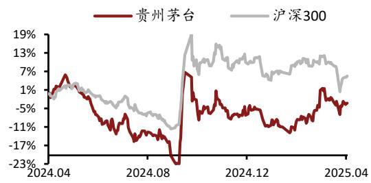

分析师：刘冉

登记编码：S0730516010001

liuran@ccnew.com 021-50586281

# 实现稳定增长，增幅略收窄

# ——贵州茅台(600519)年报点评

## 证券研究报告-年报点评

## 市场数据(2025-04-16)

<table><tr><td>收盘价(元)</td><td>1,559.17</td></tr><tr><td>一年内最高/最低(元)</td><td>1,770.00/1,261.00</td></tr><tr><td>沪深300指数</td><td>3,772.82</td></tr><tr><td>市净率(倍)</td><td>8.40</td></tr><tr><td>流通市值(亿元)</td><td>19,586.26</td></tr></table>

## 基础数据(2024-12-31)

<table><tr><td>每股净资产(元)</td><td>185.56</td></tr><tr><td>每股经营现金流(元)</td><td>73.61</td></tr><tr><td>毛利率(%)</td><td>91.93</td></tr><tr><td>净资产收益率_摊薄(%)</td><td>36.99</td></tr><tr><td>资产负债率(%)</td><td>19.04</td></tr><tr><td>总股本/流通股(万股)</td><td>125,619.78/125,619.78</td></tr><tr><td>B股/H股(万股)</td><td>0.00/0.00</td></tr></table>

## 个股相对沪深 300指数表现

  
资料来源：中原证券研究所，聚源

## 相关报告

联系人：李智

电话： 0371-65585629

地址： 郑州郑东新区商务外环路10号18楼

地址： 上海浦东新区世纪大道1788号T1座22楼

# 增持(首次)

## 投资要点：

发布日期：2025 年 04 月 17 日

2024 年，公司的营收维持常态增长，但增幅略回落。2024 年，公司实现营收1708.99亿元，同比增15.71%，增幅较上年回落3.3个百分点。其中，茅台酒实现营收 1459.28亿元，同比增15.28%，增幅较上年回落 2.12 个百分点，本期茅台酒在酒类收入中的占比85.39%，占比较上年回落 0.32 个百分点；系列酒实现营收 246.84亿元，同比增 19.65%，增幅较上年回落 9.78 个百分点，本期系列酒在主营收入中的占比 14.44%，占比较上年升高 0.48个百分点。

除三季度外，一、二、四季度的营收增长均同比回落。20241Q、20242Q、20244Q，公司分别营收 457.76、361.55、501.23 亿元，同比增 18.11%、17.31%、12.83%，增幅较上年同期回落 1.89、4.41 和7.43个百分点。2024年，淡旺季的收入增长均有所回落。

⚫ 茅台酒及系列酒销量增长。2024 年，茅台酒销量46412.95吨，同比增 10.22%，增幅较上年回落 0.88 个百分点；系列酒销量36919.81 吨，同比增 18.47%。我们估算，2024 年茅台酒出厂均价提升4.59%，增幅较上年回落1.07个百分点。2024 年茅台酒的量价均有所增长，但增幅较 2023年略回落。

茅台酒的毛利率略降，系列酒的毛利率上升。整体盈利水平略降，主要来自于茅台酒毛利率的下滑。2024 年，茅台酒录得毛利率94.06%，较上年下降0.06 个百分点；系列酒录得毛利率 79.87%，较上年升高0.11 个百分点。公司 2024年整体盈利保持稳定：录得综合毛利率 92.08%，较 2023 年略降 0.04 个百分点；录得净利率52.27%，同比略降0.22个百分点。2024年，销售期间费用率8.02%，同比降0.61个百分点，因而净利率下降主要来自于茅台酒毛利率的下降。

投资评级：我们预测公司 2025、2026、2027年的每股收益为74.38元、元和81.6489.30 元，参照 4 月 16 日收盘价 1559.17 元，对应的市盈率分别为 20.96倍、19.10倍和 17.46倍。我们给予公司“增

持”评级。

风险提示：社会消费持续疲弱，并波及高端消费。

<table><tr><td></td><td>2023A</td><td>2024A</td><td>2025E</td><td>2026E</td><td>2027E</td></tr><tr><td>营业收入(百万元)</td><td>150,560</td><td>174,144</td><td>189,698</td><td>208,668</td><td>227,448</td></tr><tr><td>增长比率(%)</td><td>18.04</td><td>15.66</td><td>8.93</td><td>10.00</td><td>9.00</td></tr><tr><td>净利润(百万元)</td><td>74,734</td><td>86,228</td><td>93,438</td><td>102,560</td><td>112,180</td></tr><tr><td>增长比率(%)</td><td>19.16</td><td>15.38</td><td>8.36</td><td>9.76</td><td>9.38</td></tr><tr><td>每股收益(元)</td><td>59.49</td><td>68.64</td><td>74.38</td><td>81.64</td><td>89.30</td></tr><tr><td>市盈率(倍)</td><td>26.21</td><td>22.71</td><td>20.96</td><td>19.10</td><td>17.46</td></tr></table>

资料来源：中原证券研究所，聚源

## 财务报表预测和估值数据汇总

[Table\_Finance2]资产负债表（百万元）

<table><tr><td>会计年度</td><td>2023A</td><td>2024A</td><td>2025E</td><td>2026E</td><td>2027E</td></tr><tr><td>流动资产</td><td>225,173</td><td>251,727</td><td>272,292</td><td>302,044</td><td>333,940</td></tr><tr><td>现金</td><td>69,070</td><td>59,296</td><td>61,592</td><td>70,674</td><td>78,952</td></tr><tr><td>应收票据及应收账款</td><td>74</td><td>2,003</td><td>2,182</td><td>2,386</td><td>2,583</td></tr><tr><td>其他应收款</td><td>28</td><td>30</td><td>32</td><td>35</td><td>38</td></tr><tr><td>预付账款</td><td>35</td><td>27</td><td>34</td><td>39</td><td>44</td></tr><tr><td>存货</td><td>46,435</td><td>54,343</td><td>62,425</td><td>70,882</td><td>79,297</td></tr><tr><td>其他流动资产</td><td>109,531</td><td>136,027</td><td>146,027</td><td>158,027</td><td>173,027</td></tr><tr><td>非流动资产</td><td>47,527</td><td>47,218</td><td>49,223</td><td>51,832</td><td>53,991</td></tr><tr><td>长期投资</td><td>0</td><td>0</td><td>0</td><td>0</td><td>0</td></tr><tr><td>固定资产</td><td>19,909</td><td>21,871</td><td>22,699</td><td>24,992</td><td>26,684</td></tr><tr><td>无形资产</td><td>8,572</td><td>8,850</td><td>9,744</td><td>9,912</td><td>10,341</td></tr><tr><td>其他非流动资产</td><td>19,046</td><td>16,496</td><td>16,780</td><td>16,928</td><td>16,967</td></tr><tr><td>资产总计</td><td>272,700</td><td>298,945</td><td>321,515</td><td>353,876</td><td>387,931</td></tr><tr><td>流动负债</td><td>48,698</td><td>56,516</td><td>54,963</td><td>60,135</td><td>64,925</td></tr><tr><td>短期借款</td><td>0</td><td>0</td><td>0</td><td>0</td><td>0</td></tr><tr><td>应付票据及应付账款</td><td>3,093</td><td>3,515</td><td>4,082</td><td>4,660</td><td>5,226</td></tr><tr><td>其他流动负债</td><td>45,605</td><td>53,001</td><td>50,881</td><td>55,475</td><td>59,700</td></tr><tr><td>非流动负债</td><td>346</td><td>417</td><td>440</td><td>428</td><td>400</td></tr><tr><td>长期借款</td><td>0</td><td>0</td><td>0</td><td>0</td><td>0</td></tr><tr><td>其他非流动负债</td><td>346</td><td>417</td><td>440</td><td>428</td><td>400</td></tr><tr><td>负债合计</td><td>49,043</td><td>56,933</td><td>55,403</td><td>60,563</td><td>65,326</td></tr><tr><td>少数股东权益</td><td>7,988</td><td>8,905</td><td>11,597</td><td>13,159</td><td>14,406</td></tr><tr><td>股本</td><td>1,256</td><td>1,256</td><td>1,256</td><td>1,256</td><td>1,256</td></tr><tr><td>资本公积</td><td>1,375</td><td>1,375</td><td>1,375</td><td>1,375</td><td>1,375</td></tr><tr><td>留存收益</td><td>213,043</td><td>230,485</td><td>253,842</td><td>279,482</td><td>307,526</td></tr><tr><td>归属母公司股东权益</td><td>215,669</td><td>233,106</td><td>254,515</td><td>280,154</td><td>308,198</td></tr><tr><td>负债和股东权益</td><td>272,700</td><td>298,945</td><td>321,515</td><td>353,876</td><td>387,931</td></tr></table>

利润表（百万元）

现金流量表（百万元）

<table><tr><td>会计年度</td><td>2023A</td><td>2024A</td><td>2025E</td><td>2026E</td><td>2027E</td></tr><tr><td>经营活动现金流</td><td>66,593</td><td>92,464</td><td>78,645</td><td>91,176</td><td>97,256</td></tr><tr><td>净利润</td><td>77,521</td><td>89,335</td><td>96,129</td><td>104,122</td><td>113,428</td></tr><tr><td>折旧摊销</td><td>1,937</td><td>2,085</td><td>2,290</td><td>2,500</td><td>2,605</td></tr><tr><td>财务费用</td><td>13</td><td>14</td><td>15</td><td>15</td><td>14</td></tr><tr><td>投资损失</td><td>-34</td><td>-9</td><td>-19</td><td>-21</td><td>-23</td></tr><tr><td>营运资金变动</td><td>-11,667</td><td>1,919</td><td>-19,837</td><td>-15,507</td><td>-18,836</td></tr><tr><td>其他经营现金流</td><td>-1,177</td><td>-881</td><td>68</td><td>67</td><td>68</td></tr><tr><td>投资活动现金流</td><td>-9,724</td><td>-1,785</td><td>-4,329</td><td>-5,145</td><td>-4,801</td></tr><tr><td>资本支出</td><td>-2,595</td><td>-4,678</td><td>-3,835</td><td>-4,851</td><td>-4,610</td></tr><tr><td>长期投资</td><td>-7,268</td><td>2,805</td><td>-500</td><td>-300</td><td>-200</td></tr><tr><td>其他投资现金流</td><td>138</td><td>88</td><td>6</td><td>6</td><td>9</td></tr><tr><td>筹资活动现金流</td><td>-58,889</td><td>-71,068</td><td>-72,019</td><td>-76,948</td><td>-84,178</td></tr><tr><td>短期借款</td><td>0</td><td>0</td><td>0</td><td>0</td><td>0</td></tr><tr><td>长期借款</td><td>0</td><td>0</td><td>0</td><td>0</td><td>0</td></tr><tr><td>普通股增加</td><td>0</td><td>0</td><td>0</td><td>0</td><td>0</td></tr><tr><td>资本公积增加</td><td>0</td><td>0</td><td>0</td><td>0</td><td>0</td></tr><tr><td>其他筹资现金流</td><td>-58,889</td><td>-71,068</td><td>-72,019</td><td>-76,948</td><td>-84,178</td></tr><tr><td>现金净增加额</td><td>-2,019</td><td>19,610</td><td>2,296</td><td>9,082</td><td>8,277</td></tr></table>

<table><tr><td>会计年度</td><td>2023A</td><td>2024A</td><td>2025E</td><td>2026E</td><td>2027E</td></tr><tr><td>营业收入</td><td>150,560</td><td>174,144</td><td>189,698</td><td>208,668</td><td>227,448</td></tr><tr><td>营业成本</td><td>11,981</td><td>13,895</td><td>15,309</td><td>16,777</td><td>18,264</td></tr><tr><td>营业税金及附加</td><td>22,234</td><td>26,926</td><td>30,086</td><td>34,430</td><td>37,529</td></tr><tr><td>营业费用</td><td>4,649</td><td>5,639</td><td>6,450</td><td>7,303</td><td>8,188</td></tr><tr><td>管理费用</td><td>9,729</td><td>9,316</td><td>10,149</td><td>11,018</td><td>11,896</td></tr><tr><td>研发费用</td><td>157</td><td>218</td><td>266</td><td>313</td><td>364</td></tr><tr><td>财务费用</td><td>-1,790</td><td>-1,470</td><td>-1,468</td><td>-1,525</td><td>-1,683</td></tr><tr><td>资产减值损失</td><td>0</td><td>0</td><td>0</td><td>0</td><td>0</td></tr><tr><td>其他收益</td><td>35</td><td>21</td><td>19</td><td>21</td><td>23</td></tr><tr><td>公允价值变动收益</td><td>3</td><td>61</td><td>0</td><td>0</td><td>0</td></tr><tr><td>投资净收益</td><td>34</td><td>9</td><td>19</td><td>21</td><td>23</td></tr><tr><td>资产处置收益</td><td>0</td><td>0</td><td>0</td><td>0</td><td>0</td></tr><tr><td>营业利润</td><td>103,709</td><td>119,689</td><td>128,930</td><td>140,383</td><td>152,927</td></tr><tr><td>营业外收入</td><td>87</td><td>71</td><td>72</td><td>75</td><td>81</td></tr><tr><td>营业外支出</td><td>133</td><td>121</td><td>125</td><td>132</td><td>141</td></tr><tr><td>利润总额</td><td>103,663</td><td>119,639</td><td>128,877</td><td>140,326</td><td>152,867</td></tr><tr><td>所得税</td><td>26,141</td><td>30,304</td><td>32,748</td><td>36,204</td><td>39,440</td></tr><tr><td>净利润</td><td>77,521</td><td>89,335</td><td>96,129</td><td>104,122</td><td>113,428</td></tr><tr><td>少数股东损益</td><td>2,787</td><td>3,107</td><td>2,692</td><td>1,562</td><td>1,248</td></tr><tr><td>归属母公司净利润</td><td>74,734</td><td>86,228</td><td>93,438</td><td>102,560</td><td>112,180</td></tr><tr><td>EBITDA</td><td>103,820</td><td>120,233</td><td>129,699</td><td>141,301</td><td>153,790</td></tr><tr><td>EPS(元)</td><td>59.49</td><td>68.64</td><td>74.38</td><td>81.64</td><td>89.30</td></tr></table>

资料来源：中原证券研究所，聚源

主要财务比率

<table><tr><td>会计年度</td><td>2023A</td><td>2024A</td><td>2025E</td><td>2026E</td><td>2027E</td></tr><tr><td>成长能力</td><td></td><td></td><td></td><td></td><td></td></tr><tr><td>营业收入(%)</td><td>18.04</td><td>15.66</td><td>8.93</td><td>10.00</td><td>9.00</td></tr><tr><td>营业利润(%)</td><td>18.01</td><td>15.41</td><td>7.72</td><td>8.88</td><td>8.94</td></tr><tr><td>归属母公司净利润(%)</td><td>19.16</td><td>15.38</td><td>8.36</td><td>9.76</td><td>9.38</td></tr><tr><td>获利能力</td><td></td><td></td><td></td><td></td><td></td></tr><tr><td>毛利率(%)</td><td>91.96</td><td>91.93</td><td>91.93</td><td>91.96</td><td>91.97</td></tr><tr><td>净利率(%)</td><td>50.60</td><td>50.46</td><td>49.26</td><td>49.15</td><td>49.32</td></tr><tr><td>ROE(%)</td><td>34.65</td><td>36.99</td><td>36.71</td><td>36.61</td><td>36.40</td></tr><tr><td>ROIC(%)</td><td>34.02</td><td>36.39</td><td>35.65</td><td>35.06</td><td>34.73</td></tr><tr><td>偿债能力</td><td></td><td></td><td></td><td></td><td></td></tr><tr><td>资产负债率(%)</td><td>17.98</td><td>19.04</td><td>17.23</td><td>17.11</td><td>16.84</td></tr><tr><td>净负债比率(%)</td><td>21.93</td><td>23.53</td><td>20.82</td><td>20.65</td><td>20.25</td></tr><tr><td>流动比率</td><td>4.62</td><td>4.45</td><td>4.95</td><td>5.02</td><td>5.14</td></tr><tr><td>速动比率</td><td>1.43</td><td>1.09</td><td>1.17</td><td>1.22</td><td>1.26</td></tr><tr><td>营运能力</td><td></td><td></td><td></td><td></td><td></td></tr><tr><td>总资产周转率</td><td>0.57</td><td>0.61</td><td>0.61</td><td>0.62</td><td>0.61</td></tr><tr><td>应收账款周转率</td><td>3632.83</td><td>4307.61</td><td>12512.59</td><td>19755.60</td><td>30974.86</td></tr><tr><td>应付账款周转率</td><td>4.31</td><td>4.17</td><td>4.03</td><td>3.84</td><td>3.70</td></tr><tr><td>每股指标(元)</td><td></td><td></td><td></td><td></td><td></td></tr><tr><td>每股收益(最新摊薄)</td><td>59.49</td><td>68.64</td><td>74.38</td><td>81.64</td><td>89.30</td></tr><tr><td>每股经营现金流(最新摊薄)</td><td>53.01</td><td>73.61</td><td>62.61</td><td>72.58</td><td>77.42</td></tr><tr><td>每股净资产(最新摊薄)</td><td>171.68</td><td>185.56</td><td>202.61</td><td>223.02</td><td>245.34</td></tr><tr><td>估值比率</td><td></td><td></td><td></td><td></td><td></td></tr><tr><td>P/E</td><td>26.21</td><td>22.71</td><td>20.96</td><td>19.10</td><td>17.46</td></tr><tr><td>P/B</td><td>9.08</td><td>8.40</td><td>7.70</td><td>6.99</td><td>6.36</td></tr><tr><td>EV/EBITDA</td><td>20.22</td><td>15.43</td><td>14.63</td><td>13.36</td><td>12.22</td></tr></table>

## 行业投资评级

强于大市：未来 6 个月内行业指数相对沪深 300 涨幅 10％以上；

同步大市：未来 6 个月内行业指数相对沪深 300 涨幅－10％至 10％之间；

弱于大市：未来 6 个月内行业指数相对沪深 300 跌幅 10％以上。

## 公司投资评级

买入： 未来 6 个月内公司相对沪深 300 涨幅 15％以上；

增持： 未来 6 个月内公司相对沪深 300 涨幅 5％至 15％；

谨慎增持：未来 6 个月内公司相对沪深 300 涨幅－10％至 5％；

减持： 未来 6 个月内公司相对沪深 300 涨幅－15％至－10％；

卖出： 未来 6 个月内公司相对沪深 300 跌幅 15％以上。

## 证券分析师承诺

本报告署名分析师具有中国证券业协会授予的证券分析师执业资格，本人任职符合监管机构相关合规要求。本人基于认真审慎的职业态度、专业严谨的研究方法与分析逻辑，独立、客观的制作本报告。本报告准确的反映了本人的研究观点，本人对报告内容和观点负责，保证报告信息来源合法合规。

## 重要声明

中原证券股份有限公司具备证券投资咨询业务资格。本报告由中原证券股份有限公司（以下简称“本公司”）制作并仅向本公司客户发布，本公司不会因任何机构或个人接收到本报告而视其为本公司的当然客户。

本报告中的信息均来源于已公开的资料，本公司对这些信息的准确性及完整性不作任何保证，也不保证所含的信息不会发生任何变更。本报告中的推测、预测、评估、建议均为报告发布日的判断，本报告中的证券或投资标的价格、价值及投资带来的收益可能会波动，过往的业绩表现也不应当作为未来证券或投资标的表现的依据和担保。报告中的信息或所表达的意见并不构成所述证券买卖的出价或征价。本报告所含观点和建议并未考虑投资者的具体投资目标、财务状况以及特殊需求，任何时候不应视为对特定投资者关于特定证券或投资标的的推荐。

本报告具有专业性，仅供专业投资者和合格投资者参考。根据《证券期货投资者适当性管理办法》相关规定，本报告作为资讯类服务属于低风险（R1）等级，普通投资者应在投资顾问指导下谨慎使用。

本报告版权归本公司所有，未经本公司书面授权，任何机构、个人不得刊载、转发本报告或本报告任何部分，不得以任何侵犯本公司版权的其他方式使用。未经授权的刊载、转发，本公司不承担任何刊载、转发责任。获得本公司书面授权的刊载、转发、引用，须在本公司允许的范围内使用，并注明报告出处、发布人、发布日期，提示使用本报告的风险。

若本公司客户（以下简称“该客户”）向第三方发送本报告，则由该客户独自为其发送行为负责，提醒通过该种途径获得本报告的投资者注意，本公司不对通过该种途径获得本报告所引起的任何损失承担任何责任。

## 特别声明

在合法合规的前提下，本公司及其所属关联机构可能会持有报告中提到的公司所发行的证券头寸并进行交易，还可能为这些公司提供或争取提供投资银行、财务顾问等各种服务。本公司资产管理部门、自营部门以及其他投资业务部门可能独立做出与本报告意见或者建议不一致的投资决策。投资者应当考虑到潜在的利益冲突，勿将本报告作为投资或者其他决定的唯一信赖依据。