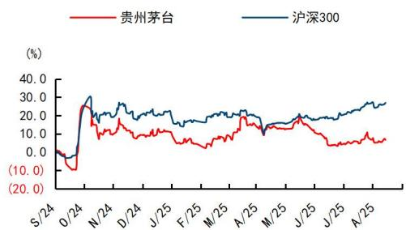
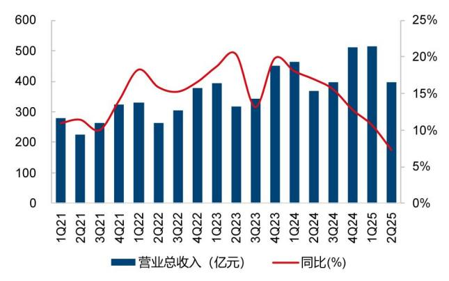
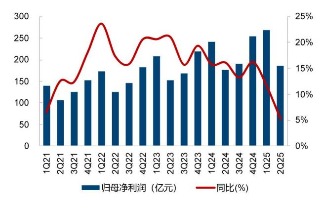
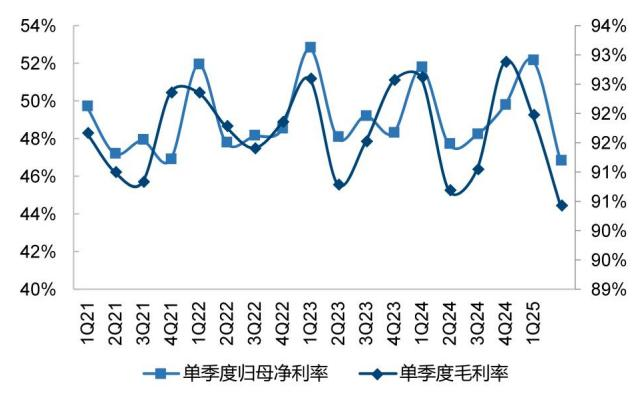
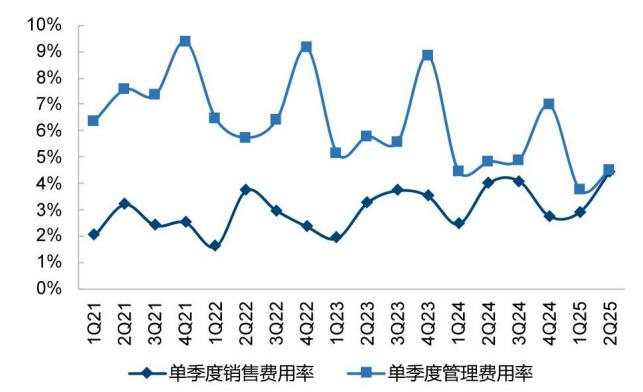

# 贵州茅台（600519.SH）

# 2025Q2 收入同比增长 9.2%，公司根据市场调整产品结构

## 核心观点

2025H1收入同比增长9.2%，展现经营韧性。2025H1公司实现营业总收入 910.9亿元/同比+9.2%，归母净利润 454.0 亿元/同比+8.9%；其中 2025Q2 营业总收入 396.5 亿元/同比+7.3%，归母净利润 185.6 亿元/同比+5.2%，利润率略有下降主因毛利率和费用率扰动影响。

第二季度茅台酒贡献主要增长，公司根据市场变化调整产品结构。分产品看，2025Q2 茅台酒收入 320.3 亿元/同比+11.0%，系列酒收入 67.4 亿元/同比-6.5%；我们预计第二季度飞天茅台发货进度略有加快，以应对行业整体需求下滑冲击；系列酒下滑预计系茅台 1935 综合打款成本下降、王子/迎宾等产品提前在 Q1 投放影响。分渠道看，2025H1/2025Q2 直销渠道收入分别同比+18.6%/+16.5%，增速快于整体预计与公斤装飞天加大投放、生肖/精品投放节奏快于去年有关；第二季度我们预计企业团购渠道有所下滑，经销商是公司业绩的稳定器，2025Q2批发渠道减去系列酒的收入部分同比+5.5%。

积极投放市场费用，增强营销能力。2025H1 公司整体毛利率同比-0.26pcts至 90.4%，茅台酒/系列酒毛利率分别同比-0.28pcts/-2.51pcts，系列酒下降较多预计主因加大市场投入（如宴席场景买赠等），上半年国内增加 160个经销商均来自系列酒。2025Q2 税金及附加率同比+0.07pcts/管理费用率同比-0.32pcts；销售费用率同比+0.46pcts，主要系广宣及市场投入费用增加较多，用于开拓渠道、主动触达消费者，践行“卖酒向卖生活方式”转变。

预收端体现需求压力，公司尊重市场规律。2025Q2公司销售收现 389.4亿元/同比-4.6%。截至 25Q2 末公司合同负债 55.1 亿元，环比 25Q1 末下降 32.8亿元，预计主因 7月配额占比较小、茅台酒加快发货节奏确认收入；应收票据环比增加 2亿元主要来自系列酒经销商汇票。第二季度行业需求走弱，茅台为渠道纾困，随市场变化调整产品结构和发货节奏，保证价格体系稳定。

盈利预测与投资建议：年初公司指引全年目标营收增长 9%左右，中报反映公司经营“时间过半，任务过半”；同时也要注意到行业需求侧的压力已逐步传导至龙头，我们预计公司将以稳定价格为先：1）公司积极推出文化 IP类、多规格类产品应对单消费场景下滑的影响；2）产品渠道利润仍高于行业平均，经销商有能力和意愿协助公司稳渠道、做市场。考虑到本轮行业调整为多周期叠加，需求仍在磨底，下调此前收入及盈利预测，预计 2025-2027年公司营业总收入 1898.2/1964.3/2075.2 亿元，同比+9.0%/+3.5%/+5.6%（前值+9.5%/+8.6%/+8.0%）；预计归母净利润 931.7/966.0/1022.0 亿元，同比+8.0%/+3.7%/+5.8%（前值+9.3%/+9.0%/+8.7%），当前股价对应 2025年 19.4xPE和 3.66%股息率，维持“优于大市”评级。

风险提示：宏观经济复苏不及预期致行业需求承压，食品安全问题等。

<table><tr><td>盈利预测和财务指标</td><td>2023</td><td>2024</td><td>2025E</td><td>2026E</td><td>2027E</td></tr><tr><td>营业收入(百万元)</td><td>150,560</td><td>174,144</td><td>189,816</td><td>196,432</td><td>207,518</td></tr><tr><td> $\left( {+/ - \% }\right)$ </td><td>18.0%</td><td>15.7%</td><td>9.0%</td><td>3.5%</td><td>5.6%</td></tr><tr><td>净利润(百万元)</td><td>74734</td><td>86228</td><td>93166</td><td>96598</td><td>102197</td></tr><tr><td> $\left( {+/ - \% }\right)$ </td><td>19.2%</td><td>15.4%</td><td>8.0%</td><td>3.7%</td><td>5.8%</td></tr><tr><td>每股收益(元)</td><td>59.49</td><td>68.64</td><td>74.16</td><td>76.90</td><td>81.35</td></tr><tr><td>EBIT Margin</td><td>67.7%</td><td>67.9%</td><td>66.4%</td><td>65.7%</td><td>65.6%</td></tr><tr><td>净资产收益率(ROE)</td><td>34.7%</td><td>37.0%</td><td>36.3%</td><td>34.4%</td><td>33.4%</td></tr><tr><td>市盈率(PE)</td><td>24.2</td><td>20.9</td><td>19.4</td><td>18.7</td><td>17.7</td></tr><tr><td>EV/EBITDA</td><td>17.9</td><td>15.5</td><td>14.5</td><td>14.2</td><td>13.5</td></tr><tr><td>市净率(PB)</td><td>8.37</td><td>7.74</td><td>7.04</td><td>6.43</td><td>5.90</td></tr></table>

资料来源：Wind、国信证券经济研究所预测  
注：摊薄每股收益按最新总股本计算

## 公司研究·财报点评

食品饮料·白酒Ⅱ

证券分析师：张向伟

证券分析师：张未艾

021-61761031

zhangxiangwei@guosen.com.cn zhangweiai@guosen.com.cn S0980523090001 S0980525070005

## 基础数据

<table><tr><td>投资评级</td><td>优于大市(维持)</td></tr><tr><td>合理估值</td><td></td></tr><tr><td>收盘价</td><td>1437.04元</td></tr><tr><td>总市值/流通市值</td><td>1805206/1805206 百万元</td></tr><tr><td>52周最高价/最低价</td><td>1910.00/1245.83元</td></tr><tr><td>近3个月日均成交额</td><td>4530.12百万元</td></tr></table>

## 市场走势

  
资料来源：Wind、国信证券经济研究所整理

## 相关研究报告

《贵州茅台（600519.SH）-2025Q1 收入同比增长 10.7%，销售收现表现较好》 ——2025-04-30

《贵州茅台（600519.SH）-2024 年稳健收官，2025 年目标收入增长 9%》 ——2025-04-03

《贵州茅台（600519.SH）-2024 年收入增长约 15%，2025 年经营目标理性务实》 ——2025-01-04

《贵州茅台（600519.SH）-持续加强消费者层面的触达和转化，国际化思路清晰》 ——2024-12-01

《贵州茅台（600519.SH）-第三季度茅台酒增速快于整体，全年15%收入增速可期》 ——2024-10-28

图1：2021Q1至今公司单季度营业总收入及同比增速  
  
资料来源：公司公告，国信证券经济研究所整理

图2：2021Q1至今公司单季度归母净利润及同比增速  
  
资料来源：公司公告，国信证券经济研究所整理

图3：2021Q1至今公司单季度毛利率及净利率  
  
资料来源：公司公告，国信证券经济研究所整理

图4：2021Q1至今公司单季度销售费用率及管理费用率  
  
资料来源：公司公告，国信证券经济研究所整理

表1：盈利预测调整表

<table><tr><td rowspan="2">项目</td><td colspan="3">原预测(调整前)</td><td colspan="2">现预测(调整后)</td><td colspan="2">调整幅度</td></tr><tr><td>2024A</td><td>2025E</td><td>2026E</td><td>2025E</td><td>2026E</td><td>2025E</td><td>2026E</td></tr><tr><td>营业收入(百万元)</td><td>174,144</td><td>190,754</td><td>207,065</td><td>189,816</td><td>196,432</td><td>-0.5%</td><td>-5.1%</td></tr><tr><td>收入同比增速%</td><td>15.66%</td><td>9.54%</td><td>8.55%</td><td>9.00%</td><td>3.49%</td><td>-0.54pcts</td><td>-5.06pcts</td></tr><tr><td>毛利率%</td><td>92.08%</td><td>92.14%</td><td>92.12%</td><td>92.10%</td><td>91.64%</td><td>-0.03pcts</td><td>-0.48pcts</td></tr><tr><td>销售费用率%</td><td>3.24%</td><td>4.30%</td><td>4.70%</td><td>4.50%</td><td>4.70%</td><td>0.2pcts</td><td>0pcts</td></tr><tr><td>归母净利润(百万元)</td><td>86,228</td><td>94,268</td><td>102,766</td><td>93,166</td><td>96,598</td><td>-1.2%</td><td>-6.0%</td></tr><tr><td>归母净利润同比增速%</td><td>15.38%</td><td>9.32%</td><td>9.01%</td><td>8.05%</td><td>3.68%</td><td>-1.28pcts</td><td>-5.33pcts</td></tr><tr><td>归母净利率%</td><td>49.52%</td><td>49.42%</td><td>49.63%</td><td>49.08%</td><td>49.18%</td><td>-0.34pcts</td><td>-0.45pcts</td></tr><tr><td>EPS(元)</td><td>68.64</td><td>75.04</td><td>81.81</td><td>74.16</td><td>76.90</td><td>-1.2%</td><td>-6.0%</td></tr></table>

资料来源: Wind、国信证券经济研究所预测

表2：可比公司估值表

<table><tr><td rowspan="2">公司代码</td><td rowspan="2">公司名称</td><td rowspan="2">投资评级</td><td rowspan="2">收盘价(元)2025/8/12</td><td rowspan="2">总市值(亿元)2025/8/12</td><td colspan="2">归母净利润(亿元)</td><td colspan="2">PE</td></tr><tr><td>2024A</td><td>2025E</td><td>2024A</td><td>2025E</td></tr><tr><td>600519.SH</td><td>贵州茅台</td><td>优于大市</td><td>1,437.0</td><td>18,052.1</td><td>862.3</td><td>931.7</td><td>20.9</td><td>19.4</td></tr><tr><td>000858.SZ</td><td>五粮液</td><td>优于大市</td><td>123.2</td><td>4,781.8</td><td>318.53</td><td>334.5</td><td>15.0</td><td>14.3</td></tr><tr><td>000568.SZ</td><td>泸州老窖</td><td>优于大市</td><td>125.4</td><td>1,846.3</td><td>134.73</td><td>137.6</td><td>13.7</td><td>13.4</td></tr><tr><td>600809.SH</td><td>山西汾酒</td><td>优于大市</td><td>186.8</td><td>2,278.9</td><td>122.43</td><td>133.9</td><td>18.6</td><td>17.0</td></tr><tr><td>002304.SZ</td><td>洋河股份</td><td>中性</td><td>69.3</td><td>1,043.2</td><td>66.73</td><td>56.3</td><td>15.6</td><td>18.5</td></tr><tr><td>000799.SZ</td><td>酒鬼酒</td><td>中性</td><td>49.1</td><td>159.5</td><td>0.12</td><td>1.1</td><td>1276.5</td><td>150.6</td></tr><tr><td>600702.SH</td><td>舍得酒业</td><td>中性</td><td>53.5</td><td>178.2</td><td>3.46</td><td>6.7</td><td>51.5</td><td>26.5</td></tr><tr><td>000596.SZ</td><td>古井贡酒</td><td>优于大市</td><td>146.3</td><td>716.0</td><td>55.17</td><td>61.5</td><td>13.0</td><td>11.6</td></tr><tr><td>603369.SH</td><td>今世缘</td><td>优于大市</td><td>39.8</td><td>496.5</td><td>34.12</td><td>36.7</td><td>14.6</td><td>13.5</td></tr><tr><td>603198.SH</td><td>迎驾贡酒</td><td>优于大市</td><td>42.1</td><td>336.9</td><td>25.89</td><td>26.5</td><td>13.0</td><td>12.7</td></tr><tr><td>603589.SH</td><td>口子窖</td><td>优于大市</td><td>34.4</td><td>205.7</td><td>16.55</td><td>16.8</td><td>12.4</td><td>12.3</td></tr></table>

资料来源：Wind、国信证券经济研究所整理；除贵州茅台以外其他公司采用Wind一致预期

## 风险提示

行业竞争加剧，行业需求恢复不及预期，供给增加下批价大幅下跌，食品安全问题等。

财务预测与估值

<table><tr><td>资产负债表(百万元)</td><td>2023</td><td>2024</td><td>2025E</td><td>2026E</td><td>2027E</td></tr><tr><td>现金及现金等价物</td><td>174624</td><td>186483</td><td>210894</td><td>237033</td><td>263964</td></tr><tr><td>应收款项</td><td>102</td><td>2033</td><td>2216</td><td>2294</td><td>2423</td></tr><tr><td>存货净额</td><td>46435</td><td>54343</td><td>60205</td><td>63215</td><td>66499</td></tr><tr><td>其他流动资产</td><td>3611</td><td>7407</td><td>8074</td><td>8356</td><td>8827</td></tr><tr><td>流动资产合计</td><td>225173</td><td>251727</td><td>282849</td><td>312356</td><td>343172</td></tr><tr><td>固定资产</td><td>22047</td><td>24021</td><td>24686</td><td>24123</td><td>23968</td></tr><tr><td>无形资产及其他</td><td>8572</td><td>8850</td><td>8496</td><td>8142</td><td>7788</td></tr><tr><td>投资性房地产</td><td>16908</td><td>14347</td><td>14347</td><td>14347</td><td>14347</td></tr><tr><td>长期股权投资</td><td>0</td><td>0</td><td>0</td><td>0</td><td>0</td></tr><tr><td>资产总计</td><td>272700</td><td>298945</td><td>330377</td><td>358968</td><td>389275</td></tr><tr><td>短期借款及交易性金融负债</td><td>57</td><td>112</td><td>0</td><td>0</td><td>0</td></tr><tr><td>应付款项</td><td>3093</td><td>3515</td><td>3880</td><td>4125</td><td>4308</td></tr><tr><td>其他流动负债</td><td>45547</td><td>52889</td><td>59942</td><td>63272</td><td>66930</td></tr><tr><td>流动负债合计</td><td>48698</td><td>56516</td><td>63822</td><td>67397</td><td>71239</td></tr><tr><td>长期借款及应付债券</td><td>0</td><td>0</td><td>0</td><td>0</td><td>0</td></tr><tr><td>其他长期负债</td><td>346</td><td>417</td><td>417</td><td>417</td><td>417</td></tr><tr><td>长期负债合计</td><td>346</td><td>417</td><td>417</td><td>417</td><td>417</td></tr><tr><td>负债合计</td><td>49043</td><td>56933</td><td>64239</td><td>67814</td><td>71656</td></tr><tr><td>少数股东权益</td><td>7988</td><td>8905</td><td>9741</td><td>10607</td><td>11523</td></tr><tr><td>股东权益</td><td>215669</td><td>233106</td><td>256397</td><td>280547</td><td>306096</td></tr><tr><td>负债和股东权益总计</td><td>272700</td><td>298945</td><td>330377</td><td>358968</td><td>389275</td></tr></table>

<table><tr><td>关键财务与估值指标</td><td>2023</td><td>2024</td><td>2025E</td><td>2026E</td><td>2027E</td></tr><tr><td>每股收益</td><td>59.49</td><td>68.64</td><td>74.16</td><td>76.90</td><td>81.35</td></tr><tr><td>每股红利</td><td>46.77</td><td>56.48</td><td>55.62</td><td>57.67</td><td>61.02</td></tr><tr><td>每股净资产</td><td>171.68</td><td>185.56</td><td>204.11</td><td>223.33</td><td>243.67</td></tr><tr><td>ROIC</td><td>76.0%</td><td>77.5%</td><td>76.6%</td><td>71.6%</td><td>74.1%</td></tr><tr><td>ROE</td><td>34.7%</td><td>37.0%</td><td>36.3%</td><td>34.4%</td><td>33.4%</td></tr><tr><td>毛利率</td><td>92.1%</td><td>92.1%</td><td>92.1%</td><td>91.6%</td><td>91.5%</td></tr><tr><td>EBIT Margin</td><td>67.7%</td><td>67.9%</td><td>66.4%</td><td>65.7%</td><td>65.6%</td></tr><tr><td>EBITDA Margin</td><td>68.9%</td><td>69.0%</td><td>67.8%</td><td>67.2%</td><td>67.1%</td></tr><tr><td>收入增长</td><td>18.0%</td><td>15.7%</td><td>9.0%</td><td>3.5%</td><td>5.6%</td></tr><tr><td>净利润增长率</td><td>19.2%</td><td>15.4%</td><td>8.0%</td><td>3.7%</td><td>5.8%</td></tr><tr><td>资产负债率</td><td>20.9%</td><td>22.0%</td><td>22.4%</td><td>21.8%</td><td>21.4%</td></tr><tr><td>股息率</td><td>3.3%</td><td>3.9%</td><td>3.9%</td><td>4.0%</td><td>4.2%</td></tr><tr><td>P/E</td><td>24.2</td><td>20.9</td><td>19.4</td><td>18.7</td><td>17.7</td></tr><tr><td>P/B</td><td>8.4</td><td>7.7</td><td>7.0</td><td>6.4</td><td>5.9</td></tr><tr><td>EV/EBITDA</td><td>17.9</td><td>15.5</td><td>14.5</td><td>14.2</td><td>13.5</td></tr></table>

资料来源：Wind、国信证券经济研究所预测

<table><tr><td>利润表(百万元)</td><td>2023</td><td>2024</td><td>2025E</td><td>2026E</td><td>2027E</td></tr><tr><td>营业收入</td><td>150560</td><td>174144</td><td>189816</td><td>196432</td><td>207518</td></tr><tr><td>营业成本</td><td>11867</td><td>13789</td><td>14987</td><td>16420</td><td>17549</td></tr><tr><td>营业税金及附加</td><td>22234</td><td>26926</td><td>29801</td><td>30840</td><td>32373</td></tr><tr><td>销售费用</td><td>4649</td><td>5639</td><td>8542</td><td>9232</td><td>9753</td></tr><tr><td>管理费用</td><td>9729</td><td>9316</td><td>10224</td><td>10667</td><td>11352</td></tr><tr><td>研发费用</td><td>157</td><td>218</td><td>238</td><td>246</td><td>260</td></tr><tr><td>财务费用</td><td>(1790)</td><td>(1470)</td><td>(2699)</td><td>(4479)</td><td>(5010)</td></tr><tr><td>投资收益</td><td>34</td><td>9</td><td>0</td><td>0</td><td>0</td></tr><tr><td>资产减值及公允价值变动</td><td>3</td><td>61</td><td>3</td><td>0</td><td>0</td></tr><tr><td>其他收入</td><td>(199)</td><td>(325)</td><td>(238)</td><td>(246)</td><td>(260)</td></tr><tr><td>营业利润</td><td>103709</td><td>119689</td><td>128726</td><td>133506</td><td>141240</td></tr><tr><td>营业外净收支</td><td>(46)</td><td>(50)</td><td>(50)</td><td>(90)</td><td>(90)</td></tr><tr><td>利润总额</td><td>103663</td><td>119639</td><td>128676</td><td>133416</td><td>141150</td></tr><tr><td>所得税费用</td><td>26141</td><td>30304</td><td>32169</td><td>33354</td><td>35288</td></tr><tr><td>少数股东损益</td><td>2787</td><td>3107</td><td>3341</td><td>3464</td><td>3665</td></tr><tr><td>归属于母公司净利润</td><td>74734</td><td>86228</td><td>93166</td><td>96598</td><td>102197</td></tr><tr><td>现金流量表(百万元)</td><td>2023</td><td>2024</td><td>2025E</td><td>2026E</td><td>2027E</td></tr></table>

<table><tr><td>现金流量表(百万元)</td><td>2023</td><td>2024</td><td>2025E</td><td>2026E</td><td>2027E</td></tr><tr><td>净利润</td><td>74734</td><td>86228</td><td>93166</td><td>96598</td><td>102197</td></tr><tr><td>资产减值准备</td><td>0</td><td>0</td><td>0</td><td>0</td><td>0</td></tr><tr><td>折旧摊销</td><td>1848</td><td>1970</td><td>2693</td><td>2917</td><td>3071</td></tr><tr><td>公允价值变动损失</td><td>(3)</td><td>(61)</td><td>(3)</td><td>0</td><td>0</td></tr><tr><td>财务费用</td><td>(1790)</td><td>(1470)</td><td>(2699)</td><td>(4479)</td><td>(5010)</td></tr><tr><td>营运资本变动</td><td>(18601)</td><td>(3240)</td><td>707</td><td>206</td><td>(43)</td></tr><tr><td>其它</td><td>596</td><td>550</td><td>835</td><td>866</td><td>916</td></tr><tr><td>经营活动现金流</td><td>58574</td><td>85448</td><td>97397</td><td>100587</td><td>106142</td></tr><tr><td>资本开支</td><td>0</td><td>(3756)</td><td>(3000)</td><td>(2000)</td><td>(2563)</td></tr><tr><td>其它投资现金流</td><td>12342</td><td>(22692)</td><td>127187</td><td>0</td><td>0</td></tr><tr><td>投资活动现金流</td><td>12342</td><td>(26449)</td><td>124187</td><td>(2000)</td><td>(2563)</td></tr><tr><td>权益性融资</td><td>2</td><td>0</td><td>0</td><td>0</td><td>0</td></tr><tr><td>负债净变化</td><td>0</td><td>0</td><td>0</td><td>0</td><td>0</td></tr><tr><td>支付股利、利息</td><td>(58755)</td><td>(70951)</td><td>(69874)</td><td>(72448)</td><td>(76648)</td></tr><tr><td>其它融资现金流</td><td>57387</td><td>73128</td><td>(112)</td><td>0</td><td>0</td></tr><tr><td>融资活动现金流</td><td>(60120)</td><td>(68774)</td><td>(69986)</td><td>(72448)</td><td>(76648)</td></tr><tr><td>现金净变动</td><td>10796</td><td>(9774)</td><td>151598</td><td>26139</td><td>26931</td></tr><tr><td>货币资金的期初余额</td><td>58274</td><td>69070</td><td>59296</td><td>210894</td><td>237033</td></tr><tr><td>货币资金的期末余额</td><td>69070</td><td>59296</td><td>210894</td><td>237033</td><td>263964</td></tr><tr><td>企业自由现金流</td><td>0</td><td>83276</td><td>94917</td><td>97893</td><td>102638</td></tr><tr><td>权益自由现金流</td><td>0</td><td>156404</td><td>96829</td><td>101253</td><td>106395</td></tr></table>

## 免责声明

分析师声明

作者保证报告所采用的数据均来自合规渠道；分析逻辑基于作者的职业理解，通过合理判断并得出结论，力求独立、客观、公正，结论不受任何第三方的授意或影响；作者在过去、现在或未来未就其研究报告所提供的具体建议或所表述的意见直接或间接收取任何报酬，特此声明。

## 国信证券投资评级

<table><tr><td>投资评级标准</td><td>类别</td><td>级别</td><td>说明</td></tr><tr><td rowspan="7">报告中投资建议所涉及的评级(如有)分为股票评级和行业评级(另有说明的除外)。评级标准为报告发布日后6到12个月内的相对市场表现,也即报告发布日后的6到12个月内公司股价(或行业指数)相对同期相关证券市场代表性指数的涨跌幅作为基准。A股市场以沪深300指数(000300.SH)作为基准;新三板市场以三板成指(899001.CSI)为基准;香港市场以恒生指数(HSI.HI)作为基准;美国市场以标普500指数(SPX.GI)或纳斯达克指数(IXIC.GI)为基准。</td><td rowspan="4">股票投资评级</td><td>优于大市</td><td>股价表现优于市场代表性指数10%以上</td></tr><tr><td>中性</td><td>股价表现介于市场代表性指数±10%之间</td></tr><tr><td>弱于大市</td><td>股价表现弱于市场代表性指数10%以上</td></tr><tr><td>无评级</td><td>股价与市场代表性指数相比无明确观点</td></tr><tr><td rowspan="3">行业投资评级</td><td>优于大市</td><td>行业指数表现优于市场代表性指数10%以上</td></tr><tr><td>中性</td><td>行业指数表现介于市场代表性指数±10%之间</td></tr><tr><td>弱于大市</td><td>行业指数表现弱于市场代表性指数10%以上</td></tr></table>

## 重要声明

本报告由国信证券股份有限公司（已具备中国证监会许可的证券投资咨询业务资格）制作；报告版权归国信证券股份有限公司

关本报告的摘要或节选都不代表本报告正式完整的观点，一切须以我公司向客户发布的本报告完整版本为准。

本报告基于已公开的资料或信息撰写，但我公司不保证该资料及信息的完整性、准确性。本报告所载的信息、资料、建议及推测仅反映我公司于本报告公开发布当日的判断，在不同时期，我公司可能撰写并发布与本报告所载资料、建议及推测不一致的报告。我公司不保证本报告所含信息及资料处于最新状态；我公司可能随时补充、更新和修订有关信息及资料，投资者应当自行关注相关更新和修订内容。我公司或关联机构可能会持有本报告中所提到的公司所发行的证券并进行交易，还可能为这些公司提供或争取提供投资银行、财务顾问或金融产品等相关服务。本公司的资产管理部门、自营部门以及其他投资业务部门可能独立做出与本报告中意见或建议不一致的投资决策。

本报告仅供参考之用，不构成出售或购买证券或其他投资标的要约或邀请。在任何情况下，本报告中的信息和意见均不构成对任何个人的投资建议。任何形式的分享证券投资收益或者分担证券投资损失的书面或口头承诺均为无效，投资者应结合自己的投资目标和财务状况自行判断是否采用本报告所载内容和信息并自行承担风险我公司及雇员对投资者使用本报告及其内容而造成的一切后果不承担任何法律责任。

## 证券投资咨询业务的说明

本公司具备中国证监会核准的证券投资咨询业务资格。证券投资咨询，是指从事证券投资咨询业务的机构及其投资咨询人员以下列形式为证券投资人或者客户提供证券投资分析、预测或者建议等直接或者间接有偿咨询服务的活动：接受投资人或者客户委托，提供证券投资咨询服务；举办有关证券投资咨询的讲座、报告会、分析会等；在报刊上发表证券投资咨询的文章、评论、报告，以及通过电台、电视台等公众传播媒体提供证券投资咨询服务；通过电话、传真、电脑网络等电信设备系统，提供证券投资咨询服务；中国证监会认定的其他形式。

发布证券研究报告是证券投资咨询业务的一种基本形式，指证券公司、证券投资咨询机构对证券及证券相关产品的价值、市场走势或者相关影响因素进行分析，形成证券估值、投资评级等投资分析意见，制作证券研究报告，并向客户发布的行为。

## 国信证券经济研究所

深圳深圳市福田区福华一路 125 号国信金融大厦 36 层邮编：518046 总机：0755-82130833

上海上海浦东民生路 1199 弄证大五道口广场 1 号楼 12 层邮编：200135

北京北京西城区金融大街兴盛街 6 号国信证券 9 层邮编：100032