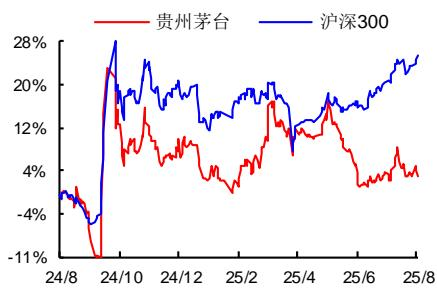

# 25H1 收入平稳增长，谋求长期高质量发展

## 投资要点

[Table\_Summary事件：公司发布] 2025年中报，上半年实现总营收 910.9亿元，同比+9.2%，归母净利润 454.0 亿元，同比+8.9%，其中 25Q2 实现总营收 396.5 亿元，同比+7.3%；归母净利润185.6亿元，同比+5.2%。

茅台酒保持稳健增长，顺利实现“时间过半，任务过半”。1、25Q2淡季以来，在外部政策趋严的背景下，餐饮消费环比走弱，商务场景受损严重，供需矛盾有所放大，普飞批价从春节 2200 元左右下降至当前 1900 元左右。2、在外部消费环境疲软的背景下，公司通过调整产品投放节奏，优化渠道结构等方式积极应对，25H1营业总收入同比+9.2%，沿着全年目标规划稳步兑现，彰显出强大的增长韧性。3、分产品，25Q2 茅台酒/系列酒分别实现收入 320/67 亿元，同比+11.0%/-6.5%，其中公斤装茅台投放量加大，带动茅台酒延续双位数以上稳健增长；系列酒下滑主要系茅台1935打款价下降以及大众价位酱酒需求整体疲软。4、分渠道，25Q2批发代理渠道实现收入 220亿元，同比+1.5%；直销渠道收入168亿元，同比+16.5%；此外，25Q2“i茅台”数字营销平台实现酒类不含税收入 亿元，同比 。

毛利率略有下降，合同负债环比减少。1、25Q2公司毛利率同比下滑 0.3个百分点至90.6%，预计主要系茅台1935调整打款策略。费用率方面，25Q2公司销售费用率上升0.5个百分点至4.5%，管理费用率下降0.3个百分点至4.5%，财务费用率提高 0.6 个百分点至-0.5%，整体费用率同比上升 0.7 个百分点至8.4%。25Q2净利率同比下降1.0个百分点至48.5%，盈利能力短期略有下降。2、现金流方面，公司上半年现金回款950.9亿元，同比+9.2%，现金流表现稳定。此外，截止二季度末公司合同负债55.1亿元，环比Q1末减少32.8亿元，预计系公司主动降低渠道回款要求，缓解经销商现金流压力。

积极推进“三个转型”，追求长期高质量发展。1、在外部消费环境疲软的背景下，茅台酒延续双位数增长，上半年顺利实现时间过半、任务过半，彰显出强大的增长韧性。2、在“三期叠加”的压力下，公司积极推进“三个转型”，在寻找新人群、培养新场景、创新新模式方面积极作为，不断扩大消费者覆盖面；与此同时，公司主动控制发货节奏，加大市场巡查力度，严查低价甩货现象。

 盈利预测与投资建议。预计 2025-2027年 EPS 分别为 74.87元、81.10元、87.63元，对应动态 PE 分别为 19倍、18倍、16倍。公司拥有行业最强品牌力，正积极推进国内市场“三个转型”，长线发展后劲十足，维持“买入”评级。

 风险提示：经济复苏或不及预期，市场竞争加剧风险。

<table><tr><td>指标/年度</td><td>2024A</td><td>2025E</td><td>2026E</td><td>2027E</td></tr><tr><td>营业收入(亿元)</td><td>1741.44</td><td>1899.93</td><td>2046.23</td><td>2195.14</td></tr><tr><td>增长率</td><td>15.66%</td><td>9.10%</td><td>7.70%</td><td>7.28%</td></tr><tr><td>归属母公司净利润(亿元)</td><td>862.28</td><td>940.49</td><td>1018.83</td><td>1100.79</td></tr><tr><td>增长率</td><td>15.38%</td><td>9.07%</td><td>8.33%</td><td>8.04%</td></tr><tr><td>每股收益EPS(元)</td><td>68.64</td><td>74.87</td><td>81.10</td><td>87.63</td></tr><tr><td>净资产收益率ROE</td><td>36.91%</td><td>33.00%</td><td>29.83%</td><td>27.35%</td></tr><tr><td>PE</td><td>21</td><td>19</td><td>18</td><td>16</td></tr><tr><td>PB</td><td>7.65</td><td>6.30</td><td>5.28</td><td>4.49</td></tr></table>

数据来源：Wind，西南证券

## 西南证券研究院

[Table\_Author]分析师：朱会振

执业证号：S1250513110001

电话：023-63786049

邮箱：zhz@swsc.com.cn

分析师：王书龙

执业证号：S1250523070003

电话：023-63786049

邮箱：wsl@swsc.com.cn

分析师：杜雨聪

执业证号：S1250524070007

电话：023-63786049

邮箱：dyuc@swsc.com.cn

## [Table\_Quote相 对指数表现

  
数据来源：聚源数据

## 基础数据

<table><tr><td>总股本(亿股)</td><td>12.56</td></tr><tr><td>流通A股(亿股)</td><td>12.56</td></tr><tr><td>52周内股价区间(元)</td><td>1261.0-1748.0</td></tr><tr><td>总市值(亿元)</td><td>17,838.64</td></tr><tr><td>总资产(亿元)</td><td>2,922.58</td></tr><tr><td>每股净资产(元)</td><td>189.98</td></tr></table>

## 相关研究

[Table\_Report]1. 贵州茅台（600519）：25Q1 收入双位数成长，顺利实现开门红 (2025-05-03)

2. 贵州茅台（600519）：24年顺利达成目标，25 年定调稳健增长 (2025-04-07)

3. 贵州茅台（600519）：24年顺利完成目标，25 年聚焦供需适配 (2025-01-06)

4. 贵州茅台（600519）：业绩符合预期，延续稳健增长 (2024-10-29)

附表：财务预测与估值

<table><tr><td>利润表(亿元)</td><td>2024A</td><td>2025E</td><td>2026E</td><td>2027E</td></tr><tr><td>营业收入</td><td>1741.44</td><td>1899.93</td><td>2046.23</td><td>2195.14</td></tr><tr><td>营业成本</td><td>137.89</td><td>150.97</td><td>163.24</td><td>175.98</td></tr><tr><td>营业税金及附加</td><td>269.26</td><td>286.33</td><td>310.01</td><td>333.13</td></tr><tr><td>销售费用</td><td>56.39</td><td>70.30</td><td>75.71</td><td>81.22</td></tr><tr><td>管理费用</td><td>93.16</td><td>104.50</td><td>110.50</td><td>116.34</td></tr><tr><td>财务费用</td><td>-14.70</td><td>-17.71</td><td>-27.19</td><td>-39.31</td></tr><tr><td>资产减值损失</td><td>0.00</td><td>0.00</td><td>0.00</td><td>0.00</td></tr><tr><td>投资收益</td><td>0.09</td><td>0.00</td><td>0.00</td><td>0.00</td></tr><tr><td>公允价值变动损益</td><td>0.61</td><td>0.32</td><td>0.37</td><td>0.39</td></tr><tr><td>其他经营损益</td><td>0.00</td><td>0.00</td><td>0.00</td><td>0.00</td></tr><tr><td>营业利润</td><td>1196.89</td><td>1305.87</td><td>1414.33</td><td>1528.17</td></tr><tr><td>其他非经营损益</td><td>-0.50</td><td>-1.25</td><td>-1.24</td><td>-1.24</td></tr><tr><td>利润总额</td><td>1196.39</td><td>1304.62</td><td>1413.09</td><td>1526.93</td></tr><tr><td>所得税</td><td>303.04</td><td>330.24</td><td>357.55</td><td>386.48</td></tr><tr><td>净利润</td><td>893.35</td><td>974.38</td><td>1055.54</td><td>1140.45</td></tr><tr><td>少数股东损益</td><td>31.07</td><td>33.88</td><td>36.71</td><td>39.66</td></tr><tr><td>归属母公司股东净利润</td><td>862.28</td><td>940.49</td><td>1018.83</td><td>1100.79</td></tr></table>

<table><tr><td>资产负债表(亿元)</td><td>2024A</td><td>2025E</td><td>2026E</td><td>2027E</td></tr><tr><td>货币资金</td><td>592.96</td><td>872.07</td><td>1337.27</td><td>1849.79</td></tr><tr><td>应收和预付款项</td><td>20.60</td><td>22.90</td><td>24.67</td><td>26.46</td></tr><tr><td>存货</td><td>543.43</td><td>594.96</td><td>643.32</td><td>693.53</td></tr><tr><td>其他流动资产</td><td>1360.27</td><td>1498.51</td><td>1613.71</td><td>1730.96</td></tr><tr><td>长期股权投资</td><td>0.00</td><td>0.00</td><td>0.00</td><td>0.00</td></tr><tr><td>投资性房地产</td><td>0.08</td><td>0.08</td><td>0.08</td><td>0.08</td></tr><tr><td>固定资产和在建工程</td><td>240.21</td><td>263.15</td><td>274.94</td><td>285.49</td></tr><tr><td>无形资产和开发支出</td><td>89.49</td><td>76.88</td><td>61.42</td><td>43.11</td></tr><tr><td>其他非流动资产</td><td>142.40</td><td>142.25</td><td>142.10</td><td>141.95</td></tr><tr><td>资产总计</td><td>2989.45</td><td>3470.81</td><td>4097.50</td><td>4771.38</td></tr><tr><td>短期借款</td><td>0.00</td><td>0.00</td><td>0.00</td><td>0.00</td></tr><tr><td>应付和预收款项</td><td>170.57</td><td>188.05</td><td>202.97</td><td>218.32</td></tr><tr><td>长期借款</td><td>0.00</td><td>0.00</td><td>0.00</td><td>0.00</td></tr><tr><td>其他负债</td><td>398.76</td><td>329.93</td><td>356.41</td><td>383.90</td></tr><tr><td>负债合计</td><td>569.33</td><td>517.98</td><td>559.38</td><td>602.22</td></tr><tr><td>股本</td><td>12.56</td><td>12.56</td><td>12.56</td><td>12.56</td></tr><tr><td>资本公积</td><td>13.75</td><td>13.75</td><td>13.75</td><td>13.75</td></tr><tr><td>留存收益</td><td>2294.23</td><td>2803.58</td><td>3352.17</td><td>3943.55</td></tr><tr><td>归属母公司股东权益</td><td>2331.06</td><td>2829.89</td><td>3378.48</td><td>3969.86</td></tr><tr><td>少数股东权益</td><td>89.05</td><td>122.94</td><td>159.64</td><td>199.30</td></tr><tr><td>股东权益合计</td><td>2420.11</td><td>2952.83</td><td>3538.13</td><td>4169.16</td></tr><tr><td>负债和股东权益合计</td><td>2989.45</td><td>3470.81</td><td>4097.50</td><td>4771.38</td></tr></table>

<table><tr><td>业绩和估值指标</td><td>2024A</td><td>2025E</td><td>2026E</td><td>2027E</td></tr><tr><td>EBITDA</td><td>1202.09</td><td>1317.98</td><td>1420.96</td><td>1526.77</td></tr><tr><td>PE</td><td>20.69</td><td>18.97</td><td>17.51</td><td>16.21</td></tr><tr><td>PB</td><td>7.65</td><td>6.30</td><td>5.28</td><td>4.49</td></tr><tr><td>PS</td><td>10.24</td><td>9.39</td><td>8.72</td><td>8.13</td></tr><tr><td>EV/EBITDA</td><td>14.23</td><td>12.76</td><td>11.51</td><td>10.38</td></tr><tr><td>股息率</td><td>3.86%</td><td>2.42%</td><td>2.64%</td><td>2.86%</td></tr></table>

数据来源：Wind.西南证券

<table><tr><td>现金流量表(亿元)</td><td>2024A</td><td>2025E</td><td>2026E</td><td>2027E</td></tr><tr><td>净利润</td><td>893.35</td><td>974.38</td><td>1055.54</td><td>1140.45</td></tr><tr><td>折旧与摊销</td><td>19.91</td><td>29.82</td><td>33.82</td><td>37.91</td></tr><tr><td>财务费用</td><td>-14.70</td><td>-17.71</td><td>-27.19</td><td>-39.31</td></tr><tr><td>资产减值损失</td><td>0.00</td><td>0.00</td><td>0.00</td><td>0.00</td></tr><tr><td>经营营运资本变动</td><td>-274.98</td><td>-254.41</td><td>-123.93</td><td>-126.42</td></tr><tr><td>其他</td><td>301.06</td><td>-0.31</td><td>-0.37</td><td>-0.39</td></tr><tr><td>经营活动现金流净额</td><td>924.64</td><td>731.76</td><td>937.88</td><td>1012.25</td></tr><tr><td>资本支出</td><td>-35.41</td><td>-40.00</td><td>-30.00</td><td>-30.00</td></tr><tr><td>其他</td><td>17.55</td><td>12.43</td><td>0.37</td><td>0.39</td></tr><tr><td>投资活动现金流净额</td><td>-17.85</td><td>-27.57</td><td>-29.63</td><td>-29.61</td></tr><tr><td>短期借款</td><td>0.00</td><td>0.00</td><td>0.00</td><td>0.00</td></tr><tr><td>长期借款</td><td>0.00</td><td>0.00</td><td>0.00</td><td>0.00</td></tr><tr><td>股权融资</td><td>0.00</td><td>0.00</td><td>0.00</td><td>0.00</td></tr><tr><td>支付股利</td><td>-687.87</td><td>-431.14</td><td>-470.25</td><td>-509.42</td></tr><tr><td>其他</td><td>-22.81</td><td>6.07</td><td>27.19</td><td>39.31</td></tr><tr><td>筹资活动现金流净额</td><td>-710.68</td><td>-425.07</td><td>-443.05</td><td>-470.11</td></tr><tr><td>现金流量净额</td><td>196.10</td><td>279.12</td><td>465.19</td><td>512.53</td></tr></table>

<table><tr><td>财务分析指标</td><td>2024A</td><td>2025E</td><td>2026E</td><td>2027E</td></tr><tr><td>成长能力</td><td></td><td></td><td></td><td></td></tr><tr><td>销售收入增长率</td><td>15.66%</td><td>9.10%</td><td>7.70%</td><td>7.28%</td></tr><tr><td>营业利润增长率</td><td>15.41%</td><td>9.11%</td><td>8.31%</td><td>8.05%</td></tr><tr><td>净利润增长率</td><td>15.24%</td><td>9.07%</td><td>8.33%</td><td>8.04%</td></tr><tr><td>EBITDA 增长率</td><td>15.83%</td><td>9.64%</td><td>7.81%</td><td>7.45%</td></tr><tr><td>获利能力</td><td></td><td></td><td></td><td></td></tr><tr><td>毛利率</td><td>92.08%</td><td>92.05%</td><td>92.02%</td><td>91.98%</td></tr><tr><td>三费率</td><td>7.74%</td><td>8.27%</td><td>7.77%</td><td>7.21%</td></tr><tr><td>净利率</td><td>51.30%</td><td>51.28%</td><td>51.58%</td><td>51.95%</td></tr><tr><td>ROE</td><td>36.91%</td><td>33.00%</td><td>29.83%</td><td>27.35%</td></tr><tr><td>ROA</td><td>29.88%</td><td>28.07%</td><td>25.76%</td><td>23.90%</td></tr><tr><td>ROIC</td><td>52.32%</td><td>48.41%</td><td>47.21%</td><td>47.74%</td></tr><tr><td>EBITDA/销售收入</td><td>69.03%</td><td>69.37%</td><td>69.44%</td><td>69.55%</td></tr><tr><td>营运能力</td><td></td><td></td><td></td><td></td></tr><tr><td>总资产周转率</td><td>0.61</td><td>0.59</td><td>0.54</td><td>0.50</td></tr><tr><td>固定资产周转率</td><td>8.34</td><td>8.54</td><td>8.88</td><td>9.18</td></tr><tr><td>应收账款周转率</td><td>4238.26</td><td>8999.18</td><td>8863.83</td><td>8847.05</td></tr><tr><td>存货周转率</td><td>0.27</td><td>0.27</td><td>0.26</td><td>0.26</td></tr><tr><td>销售商品提供劳务收到现金/营业收入</td><td>104.88%</td><td>—</td><td>—</td><td>—</td></tr><tr><td>资本结构</td><td></td><td></td><td></td><td></td></tr><tr><td>资产负债率</td><td>19.04%</td><td>14.92%</td><td>13.65%</td><td>12.62%</td></tr><tr><td>带息债务/总负债</td><td>0.00%</td><td>0.00%</td><td>0.00%</td><td>0.00%</td></tr><tr><td>流动比率</td><td>4.45</td><td>5.82</td><td>6.52</td><td>7.19</td></tr><tr><td>速动比率</td><td>3.49</td><td>4.66</td><td>5.36</td><td>6.03</td></tr><tr><td>股利支付率</td><td>79.77%</td><td>45.84%</td><td>46.16%</td><td>46.28%</td></tr><tr><td>每股指标</td><td></td><td></td><td></td><td></td></tr><tr><td>每股收益</td><td>68.64</td><td>74.87</td><td>81.10</td><td>87.63</td></tr><tr><td>每股净资产</td><td>185.56</td><td>225.27</td><td>268.95</td><td>316.02</td></tr><tr><td>每股经营现金</td><td>73.61</td><td>58.25</td><td>74.66</td><td>80.58</td></tr><tr><td>每股股利</td><td>54.76</td><td>34.32</td><td>37.43</td><td>40.55</td></tr></table>

## 分析师承诺

本报告署名分析师具有中国证券业协会授予的证券投资咨询执业资格并注册为证券分析师，报告所采用的数据均来自合法合规渠道，分析逻辑基于分析师的职业理解，通过合理判断得出结论，独立、客观地出具本报告。分析师承诺不曾因，不因，也将不会因本报告中的具体推荐意见或观点而直接或间接获取任何形式的补偿。

## 投资评级说明

报告中投资建议所涉及的评级分为公司评级和行业评级（另有说明的除外）。评级标准为报告发布日后 6 个月内的相对市场表现，即：以报告发布日后 个月内公司股价（或行业指数）相对同期相关证券市场代表性指数的涨跌幅作为基准。其中： 股市场以沪深 指数为基准，新三板市场以三板成指（针对协议转让标的）或三板做市指数（针对做市转让标的）为基准；香港市场以恒生指数为基准；美国市场以纳斯达克综合指数或标普 指数为基准。

<table><tr><td rowspan="5">公司评级</td><td>买入:未来6个月内,个股相对同期相关证券市场代表性指数涨幅在20%以上</td></tr><tr><td>持有:未来6个月内,个股相对同期相关证券市场代表性指数涨幅介于10%与20%之间</td></tr><tr><td>中性:未来6个月内,个股相对同期相关证券市场代表性指数涨幅介于-10%与10%之间</td></tr><tr><td>回避:未来6个月内,个股相对同期相关证券市场代表性指数涨幅介于-20%与-10%之间</td></tr><tr><td>卖出:未来6个月内,个股相对同期相关证券市场代表性指数涨幅在-20%以下</td></tr><tr><td rowspan="3">行业评级</td><td>强于大市:未来6个月内,行业整体回报高于同期相关证券市场代表性指数5%以上</td></tr><tr><td>跟随大市:未来6个月内,行业整体回报介于同期相关证券市场代表性指数-5%与5%之间</td></tr><tr><td>弱于大市:未来6个月内,行业整体回报低于同期相关证券市场代表性指数-5%以下</td></tr></table>

## 重要声明

西南证券股份有限公司（以下简称“本公司”）具有中国证券监督管理委员会核准的证券投资咨询业务资格。

本公司与作者在自身所知情范围内，与本报告中所评价或推荐的证券不存在法律法规要求披露或采取限制、静默措施的利益冲突。

《证券期货投资者适当性管理办法》于 2017 年 7月 1 日起正式实施，本报告仅供本公司签约客户使用，若您并非本公司签约客户，为控制投资风险，请取消接收、订阅或使用本报告中的任何信息。本公司也不会因接收人收到、阅读或关注自媒体推送本报告中的内容而视其为客户。本公司或关联机构可能会持有报告中提到的公司所发行的证券并进行交易，还可能为这些公司提供或争取提供投资银行或财务顾问服务。

本报告中的信息均来源于公开资料，本公司对这些信息的准确性、完整性或可靠性不作任何保证。本报告所载的资料、意见及推测仅反映本公司于发布本报告当日的判断，本报告所指的证券或投资标的的价格、价值及投资收入可升可跌，过往表现不应作为日后的表现依据。在不同时期，本公司可发出与本报告所载资料、意见及推测不一致的报告，本公司不保证本报告所含信息保持在最新状态。同时，本公司对本报告所含信息可在不发出通知的情形下做出修改，投资者应当自行关注相应的更新或修改。

本报告仅供参考之用，不构成出售或购买证券或其他投资标的要约或邀请。在任何情况下，本报告中的信息和意见均不构成对任何个人的投资建议。投资者应结合自己的投资目标和财务状况自行判断是否采用本报告所载内容和信息并自行承担风险，本公司及雇员对投资者使用本报告及其内容而造成的一切后果不承担任何法律责任。

## 本报告

须注明出处为“西南证券”，且不得对本报告及附录进行有悖原意的引用、删节和修改。未经授权刊载或者转发本报告及附录的，本公司将保留向其追究法律责任的权利。

## 西南证券研究院

上海

地址：上海市浦东新区陆家嘴 21世纪大厦 10楼

邮编：200120

北京

地址：北京市西城区金融大街 35号国际企业大厦 A 座 8楼

邮编：100033

深圳

地址：深圳市福田区益田路6001号太平金融大厦 22楼

邮编：518038

重庆

地址：重庆市江北区金沙门路 32号西南证券总部大楼21楼

邮编：400025

西南证券机构销售团队

<table><tr><td>区域</td><td>姓名</td><td>职务</td><td>座机</td><td>手机</td><td>邮箱</td></tr><tr><td rowspan="11">上海</td><td>蒋诗烽</td><td>院长助理、研究销售部经理、上海销售主管</td><td>021-68415309</td><td>18621310081</td><td>jsf@swsc.com.cn</td></tr><tr><td>崔露文</td><td>销售岗</td><td>15642960315</td><td>15642960315</td><td>clw@swsc.com.cn</td></tr><tr><td>李煜</td><td>销售岗</td><td>18801732511</td><td>18801732511</td><td>yfliyu@swsc.com.cn</td></tr><tr><td>汪艺</td><td>销售岗</td><td>13127920536</td><td>13127920536</td><td>wyyf@swsc.com.cn</td></tr><tr><td>戴剑箫</td><td>销售岗</td><td>13524484975</td><td>13524484975</td><td>daijx@swsc.com.cn</td></tr><tr><td>李嘉隆</td><td>销售岗</td><td>15800507223</td><td>15800507223</td><td>ljlong@swsc.com.cn</td></tr><tr><td>欧若诗</td><td>销售岗</td><td>18223769969</td><td>18223769969</td><td>ors@swsc.com.cn</td></tr><tr><td>蒋宇洁</td><td>销售岗</td><td>15905851569</td><td>15905851569</td><td>jyj@swsc.com.c</td></tr><tr><td>贾文婷</td><td>销售岗</td><td>13621609568</td><td>13621609568</td><td>jiawent@swsc.com.cn</td></tr><tr><td>张嘉诚</td><td>销售岗</td><td>18656199319</td><td>18656199319</td><td>zhangjc@swsc.com.cn</td></tr><tr><td>毛玮琳</td><td>销售岗</td><td>18721786793</td><td>18721786793</td><td>mwl@swsc.com.cn</td></tr><tr><td rowspan="5">北京</td><td>李杨</td><td>北京销售主管</td><td>18601139362</td><td>18601139362</td><td>yfly@swsc.com.cn</td></tr><tr><td>张岚</td><td>销售岗</td><td>18601241803</td><td>18601241803</td><td>zhanglan@swsc.com.cn</td></tr><tr><td>杨薇</td><td>销售岗</td><td>15652285702</td><td>15652285702</td><td>yangwei@swsc.com.cn</td></tr><tr><td>姚航</td><td>销售岗</td><td>15652026677</td><td>15652026677</td><td>yhang@swsc.com.cn</td></tr><tr><td>张鑫王一菲</td><td>销售岗销售岗</td><td>1598195322018040060359</td><td>1598195322018040060359</td><td>zhxin@swsc.com.cnwyf@swsc.com.cn</td></tr><tr><td rowspan="2"></td><td>王宇飞</td><td>销售岗</td><td>18500981866</td><td>18500981866</td><td>wangyuf@swsc.com</td></tr><tr><td>马冰竹</td><td>销售岗</td><td>13126590325</td><td>13126590325</td><td>mbz@swsc.com.cn</td></tr><tr><td rowspan="5">广深</td><td>龚之涵</td><td>销售岗</td><td>15808001926</td><td>15808001926</td><td>gongzh@swsc.com.cn</td></tr><tr><td>杨举</td><td>销售岗</td><td>13668255142</td><td>13668255142</td><td>yangju@swsc.com.cn</td></tr><tr><td>唐茜露</td><td>销售岗</td><td>18680348593</td><td>18680348593</td><td>txl@swsc.com.cn</td></tr><tr><td>文柳茜</td><td>销售岗</td><td>13750028702</td><td>13750028702</td><td>wlq@swsc.com.cn</td></tr><tr><td>林哲睿</td><td>销售岗</td><td>15602268757</td><td>15602268757</td><td>lzr@swsc.com.cn</td></tr></table>