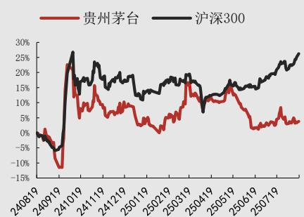

# [Table\_Title]茅台酒韧性强而系列酒承压，直销渠道增速亮眼

# ——贵州茅台（600519）点评报告

## [Table\_Summar报告关键要素:

公司披露 2025 年半年度报告，公司 2025 年上半年实现营业总收入910.94 亿元（YoY+9.16%），营业收入 893.89 亿元（YoY+9.10%），归母净利润 454.03 亿元（YoY+8.89%）。其中，2025Q2 实现营业总收入 396.50亿元（YoY+7.26%），营业收入 387.88 亿元（YoY+7.28%），归母净利润185.55 亿元（YoY+5.25%）。

## 投资要点:

盈利能力：毛利率、净利率均小幅下降。2025 年上半年公司销售毛利率/归母净利率分别为 91.30%/49.84%,同比-0.46pcts/-0.12pcts，销售/管理费用率分别为 3.58%/4.06%，同比+0.44pcts/-0.54pcts，其中销售费用率增长主要原因是本期广告宣传及市场费用增加。其中2025Q2 公司销售毛利率/归母净利率分别为 90.42%/46.80%,同比-0.26pcts/-0.90pcts，销售/管理费用率分别为 4.45%/4.48%，同比+0.46pcts/-0.32pcts。

分产品：茅台酒增长亮眼，系列酒承压。2025 年上半年茅台酒收入为755.90 亿元，YoY+10.24%，系列酒收入为 137.63 亿元，YoY+4.68%，均保持稳定增长。其中 2025Q2 公司茅台酒收入和系列酒收入分别为320.32 亿元和 67.40 亿元，同比增速分别为+10.99%和-6.53%，茅台酒收入增长亮眼，系列酒则承压，出现负增长。受渠道去库存以及“禁酒令”影响，2025年上半年茅台酒终端酒价承压，公司 10.24%的营收增速展示了其韧性。

分渠道：传统批发代理渠道增速趋缓，加大直销渠道投入。公司直销渠道包括自营和“i 茅台”等数字营销平台渠道，批发代理渠道包括社会经销商、商超、电商等渠道。2025 年上半年公司注重直销渠道投入，2025年上半年公司直销/批发代理收入分别为 400.10/493.34亿元，同增 18.62%/2.83%，占比分比为 44.78%/55.22%。公司 2025Q2 直销/批发代理实现营收 167.89/219.83 亿元，同比增长 16.52%/1.48%。其中“i茅台”App 在 2025 年上半年实现营收 107.60 亿元，同比 4.98%。

<table><tr><td></td><td>2024A</td><td>2025E</td><td>2026E</td><td>2027E</td></tr><tr><td>营业收入(百万元)</td><td>174144.07</td><td>190135.32</td><td>207802.01</td><td>227033.30</td></tr><tr><td>增长比率(%)</td><td>15.66</td><td>9.18</td><td>9.29</td><td>9.25</td></tr><tr><td>归母净利润(百万元)</td><td>86228.15</td><td>94179.08</td><td>102768.61</td><td>112134.56</td></tr><tr><td>增长比率(%)</td><td>15.38</td><td>9.22</td><td>9.12</td><td>9.11</td></tr><tr><td>每股收益(元)</td><td>68.64</td><td>74.97</td><td>81.81</td><td>89.27</td></tr><tr><td>市盈率(倍)</td><td>20.95</td><td>19.18</td><td>17.58</td><td>16.11</td></tr><tr><td>市净率(倍)</td><td>7.75</td><td>7.04</td><td>6.40</td><td>5.82</td></tr></table>

数据来源：携宁科技云估值，万联证券研究所

增持(维持)

2025 年 08 月 19 日

## [Table\_Bas基础数据

<table><tr><td>总股本(百万股)</td><td>1,256.20</td></tr><tr><td>流通A股(百万股)</td><td>1,256.20</td></tr><tr><td>收盘价(元)</td><td>1,428.50</td></tr><tr><td>总市值(亿元)</td><td>17,944.79</td></tr><tr><td>流通A股市值(亿元)</td><td>17,944.79</td></tr></table>

## [Table\_Chart] 个股相对沪深 300 指数表现

  
数据来源：聚源，万联证券研究所

## [Table\_Rep相关研究

业绩稳增长，茅台酒和批发渠道增速亮眼Q3 业绩保持稳增长，茅台酒增长亮眼系列酒增速亮眼，直销渠道占比有所下降

[Table\_A分析师: ] 陈雯

执业证书编号： S0270519060001

电话： 18665372087

邮箱： chenwen@wlzq.com.cn盈利预测与投资建议：我们认为，当前行业处于筑底阶段，随着渠道库存的逐步出清以及“禁酒令”的影响得到缓解，白酒需求将逐步回升。公司作为高端白酒龙头，具备强大的品牌力和极深的护城河，业绩有望保持稳健增长。我们维持此前盈利预测，预计公司 2025-2027年归母净利润 941.79/1027.69/1121.35 亿元，同比增长 9.22%/9.12%/9.11%，对应 EPS 为 74.97/81.81/89.27 元/股，8 月 19 日收盘价对应 PE 为19/18/16倍，维持“增持”评级。

风险因素：消费复苏不及预期风险，政策风险，宏观经济波动风险。

[Table\_ForecastDeta利润表（百万元）

<table><tr><td></td><td>2024A</td><td>2025E</td><td>2026E</td><td>2027E</td></tr><tr><td>营业收入</td><td>174144</td><td>190135</td><td>207802</td><td>227033</td></tr><tr><td>同比增速(%)</td><td>15.66</td><td>9.18</td><td>9.29</td><td>9.25</td></tr><tr><td>营业成本</td><td>13895</td><td>15093</td><td>16459</td><td>18006</td></tr><tr><td>毛利</td><td>157110</td><td>171746</td><td>187882</td><td>205392</td></tr><tr><td>营业收入(%)</td><td>91.93</td><td>91.98</td><td>92.00</td><td>91.99</td></tr><tr><td>税金及附加</td><td>26926</td><td>28454</td><td>31042</td><td>34050</td></tr><tr><td>营业收入(%)</td><td>15.76</td><td>15.24</td><td>15.20</td><td>15.25</td></tr><tr><td>销售费用</td><td>5639</td><td>5667</td><td>6455</td><td>7067</td></tr><tr><td>营业收入(%)</td><td>3.30</td><td>3.03</td><td>3.16</td><td>3.17</td></tr><tr><td>管理费用</td><td>9316</td><td>10083</td><td>11130</td><td>12132</td></tr><tr><td>营业收入(%)</td><td>5.45</td><td>5.40</td><td>5.45</td><td>5.43</td></tr><tr><td>研发费用</td><td>218</td><td>214</td><td>237</td><td>267</td></tr><tr><td>营业收入(%)</td><td>0.13</td><td>0.11</td><td>0.12</td><td>0.12</td></tr><tr><td>财务费用</td><td>-1470</td><td>0</td><td>0</td><td>0</td></tr><tr><td>营业收入(%)</td><td>-0.86</td><td>0.00</td><td>0.00</td><td>0.00</td></tr><tr><td>资产减值损失</td><td>0</td><td>0</td><td>0</td><td>0</td></tr><tr><td>信用减值损失</td><td>-23</td><td>0</td><td>0</td><td>0</td></tr><tr><td>其他收益</td><td>21</td><td>35</td><td>37</td><td>37</td></tr><tr><td>投资收益</td><td>9</td><td>50</td><td>37</td><td>37</td></tr><tr><td>净敞口套期收益</td><td>0</td><td>0</td><td>0</td><td>0</td></tr><tr><td>公允价值变动收益</td><td>61</td><td>0</td><td>0</td><td>0</td></tr><tr><td>资产处置收益</td><td>0</td><td>0</td><td>0</td><td>0</td></tr><tr><td>营业利润</td><td>119689</td><td>130709</td><td>142553</td><td>155586</td></tr><tr><td>营业收入(%)</td><td>70.03</td><td>70.00</td><td>69.80</td><td>69.68</td></tr><tr><td>营业外收支</td><td>-50</td><td>0</td><td>0</td><td>0</td></tr><tr><td>利润总额</td><td>119639</td><td>130709</td><td>142553</td><td>155586</td></tr><tr><td>营业收入(%)</td><td>70.01</td><td>70.00</td><td>69.80</td><td>69.68</td></tr><tr><td>所得税费用</td><td>30304</td><td>33114</td><td>36057</td><td>39393</td></tr><tr><td>净利润</td><td>89335</td><td>97595</td><td>106496</td><td>116193</td></tr><tr><td>营业收入(%)</td><td>52.27</td><td>52.27</td><td>52.15</td><td>52.04</td></tr><tr><td>归属于母公司的净利润</td><td>86228</td><td>94179</td><td>102769</td><td>112135</td></tr><tr><td>同比增速(%)</td><td>15.38</td><td>9.22</td><td>9.12</td><td>9.11</td></tr><tr><td>少数股东损益</td><td>3107</td><td>3416</td><td>3727</td><td>4058</td></tr><tr><td>EPS(元/股)</td><td>68.64</td><td>74.97</td><td>81.81</td><td>89.27</td></tr></table>

资产负债表（百万元）

<table><tr><td></td><td>2024A</td><td>2025E</td><td>2026E</td><td>2027E</td></tr><tr><td>货币资金</td><td>59296</td><td>90918</td><td>114015</td><td>140310</td></tr><tr><td>交易性金融资产</td><td>249</td><td>249</td><td>249</td><td>249</td></tr><tr><td>应收票据及应收账款</td><td>2003</td><td>824</td><td>1133</td><td>1614</td></tr><tr><td>存货</td><td>54343</td><td>58433</td><td>64030</td><td>70101</td></tr><tr><td>预付款项</td><td>27</td><td>468</td><td>197</td><td>270</td></tr><tr><td>合同资产</td><td>0</td><td>0</td><td>0</td><td>0</td></tr><tr><td>其他流动资产</td><td>135809</td><td>135324</td><td>135324</td><td>135328</td></tr><tr><td>流动资产合计</td><td>251727</td><td>286217</td><td>314948</td><td>347872</td></tr><tr><td>长期股权投资</td><td>0</td><td>0</td><td>0</td><td>0</td></tr><tr><td>固定资产</td><td>21871</td><td>23848</td><td>25253</td><td>26729</td></tr><tr><td>在建工程</td><td>2150</td><td>2828</td><td>2407</td><td>2271</td></tr><tr><td>无形资产</td><td>8850</td><td>9731</td><td>10613</td><td>11294</td></tr><tr><td>商誉</td><td>0</td><td>0</td><td>0</td><td>0</td></tr><tr><td>递延所得税资产</td><td>5520</td><td>5654</td><td>5654</td><td>5654</td></tr><tr><td>其他非流动资产</td><td>8827</td><td>8597</td><td>8606</td><td>8648</td></tr><tr><td>资产总计</td><td>298945</td><td>336874</td><td>367481</td><td>402467</td></tr><tr><td>短期借款</td><td>0</td><td>0</td><td>0</td><td>0</td></tr><tr><td>应付票据及应付账款</td><td>3515</td><td>3766</td><td>4178</td><td>4542</td></tr><tr><td>预收账款</td><td>0</td><td>0</td><td>0</td><td>0</td></tr><tr><td>合同负债</td><td>9592</td><td>17207</td><td>16605</td><td>17087</td></tr><tr><td>应付职工薪酬</td><td>5824</td><td>6749</td><td>7235</td><td>7842</td></tr><tr><td>应交税费</td><td>7718</td><td>9199</td><td>9631</td><td>10537</td></tr><tr><td>其他流动负债</td><td>29867</td><td>30789</td><td>31249</td><td>31783</td></tr><tr><td>流动负债合计</td><td>56516</td><td>67710</td><td>68897</td><td>71792</td></tr><tr><td>长期借款</td><td>0</td><td>0</td><td>0</td><td>0</td></tr><tr><td>应付债券</td><td>0</td><td>0</td><td>0</td><td>0</td></tr><tr><td>递延所得税负债</td><td>103</td><td>66</td><td>66</td><td>66</td></tr><tr><td>其他非流动负债</td><td>314</td><td>314</td><td>314</td><td>314</td></tr><tr><td>负债合计</td><td>56933</td><td>68090</td><td>69277</td><td>72172</td></tr><tr><td>归属于母公司的所有者权益</td><td>233106</td><td>256463</td><td>282155</td><td>310189</td></tr><tr><td>少数股东权益</td><td>8905</td><td>12321</td><td>16049</td><td>20107</td></tr><tr><td>股东权益</td><td>242011</td><td>268784</td><td>298204</td><td>330296</td></tr><tr><td>负债及股东权益</td><td>298945</td><td>336874</td><td>367481</td><td>402467</td></tr></table>

基本指标

<table><tr><td></td><td>2024A</td><td>2025E</td><td>2026E</td><td>2027E</td></tr><tr><td>EPS</td><td>68.64</td><td>74.97</td><td>81.81</td><td>89.27</td></tr><tr><td>BVPS</td><td>185.56</td><td>204.16</td><td>224.61</td><td>246.93</td></tr><tr><td>PE</td><td>20.95</td><td>19.18</td><td>17.58</td><td>16.11</td></tr><tr><td>PEG</td><td>1.36</td><td>2.08</td><td>1.93</td><td>1.77</td></tr><tr><td>PB</td><td>7.75</td><td>7.04</td><td>6.40</td><td>5.82</td></tr><tr><td>EV/EBITDA</td><td>15.43</td><td>12.88</td><td>11.66</td><td>10.51</td></tr><tr><td>ROE</td><td>36.99%</td><td>36.72%</td><td>36.42%</td><td>36.15%</td></tr><tr><td>ROIC</td><td>36.39%</td><td>36.26%</td><td>35.67%</td><td>35.14%</td></tr></table>

数据来源：携宁科技云估值，万联证券研究所

现金流量表（百万元）

<table><tr><td></td><td>2024A</td><td>2025E</td><td>2026E</td><td>2027E</td></tr><tr><td>经营活动现金流净额</td><td>92464</td><td>107748</td><td>104679</td><td>115328</td></tr><tr><td>投资</td><td>2805</td><td>-3</td><td>-4</td><td>-4</td></tr><tr><td>资本性支出</td><td>-4678</td><td>-6078</td><td>-4540</td><td>-4966</td></tr><tr><td>其他</td><td>88</td><td>833</td><td>37</td><td>37</td></tr><tr><td>投资活动现金流净额</td><td>-1785</td><td>-5247</td><td>-4506</td><td>-4932</td></tr><tr><td>债权融资</td><td>0</td><td>-57</td><td>0</td><td>0</td></tr><tr><td>股权融资</td><td>0</td><td>-202</td><td>0</td><td>0</td></tr><tr><td>银行贷款增加(减少)</td><td>0</td><td>0</td><td>0</td><td>0</td></tr><tr><td>筹资成本</td><td>-70951</td><td>-70634</td><td>-77076</td><td>-84101</td></tr><tr><td>其他</td><td>-116</td><td>11</td><td>0</td><td>0</td></tr><tr><td>筹资活动现金流净额</td><td>-71068</td><td>-70882</td><td>-77076</td><td>-84101</td></tr><tr><td>现金净流量</td><td>19610</td><td>31622</td><td>23097</td><td>26295</td></tr></table>

## [Table\_Inudstry行业投资评级

强于大市：未来6个月内行业指数相对大盘涨幅10％以上；

同步大市：未来6个月内行业指数相对大盘涨幅10％至-10％之间；

弱于大市：未来6个月内行业指数相对大盘跌幅10％以上。

## [Table\_StockRa公司投资评级

买入：未来6个月内公司相对大盘涨幅15％以上；

增持：未来6个月内公司相对大盘涨幅5％至15％；

观望：未来6个月内公司相对大盘涨幅-5％至5％；

卖出：未来6个月内公司相对大盘跌幅5％以上。

基准指数 ：沪深300指数

## [Table\_Ris风险提示

我们在此提醒您，不同证券研究机构采用不同的评级术语及评级标准。我们采用的是相对评级体系，表示投资的相对比重建议；投资者买入或者卖出证券的决定取决于个人的实际情况，比如当前的持仓结构以及其他需要考虑的因素。投资者应阅读整篇报告，以获取比较完整的观点与信息，不应仅仅依靠投资评级来推断结论。

## [Table\_PromiseInf证券分析师承诺

本人具有中国证券业协会授予的证券投资咨询执业资格并登记为证券分析师，以勤勉的执业态度，独立、客观地出具本报告。本报告清晰准确地反映了本人的研究观点。本人不曾因，不因，也将不会因本报告中的具体推荐意见或观点而直接或间接收到任何形式的补偿。

## [Tale\_Relie免责条款

万联证券股份有限公司（以下简称“本公司”）是一家覆盖证券经纪、投资银行、投资管理和证券咨询等多项业务的全国性综合类证券公司。本公司具有中国证监会许可的证券投资咨询业务资格。

本报告仅供本公司的客户使用。本公司不会因接收人收到本报告而视其为客户。在任何情况下，本报告中的信息或所表述的意见并不构成对任何人的投资建议。本报告中的信息或所表述的意见并未考虑到个别投资者的具体投资目的、财务状况以及特定需求。客户应自主作出投资决策并自行承担投资风险。本公司不对任何人因使用本报告中的内容所导致的损失负任何责任。在法律许可情况下，本公司或其关联机构可能会持有报告中提到的公司所发行的证券头寸并进行交易，还可能为这些公司提供或争取提供投资银行、财务顾问或类似的金融服务。

市场有风险，投资需谨慎。本报告是基于本公司认为可靠且已公开的信息撰写，本公司力求但不保证这些信息的准确性及完整性，也不保证文中的观点或陈述不会发生任何变更。在不同时期，本公司可发出与本报告所载资料、意见及推测不一致的报告。分析师任何形式的分享证券投资收益或者分担证券投资损失的书面或口头承诺均为无效。

本报告的版权仅为本公司所有，未经书面许可任何机构和个人不得以任何形式翻版、复制、刊登、发表和引用。未经我方许可而引用、刊发或转载的引起法律后果和造成我公司经济损失的概由对方承担，我公司保留追究的权利。

## [Table\_AdressInfo] 万联证券股份有限公司 研究所

上海浦东新区世纪大道 1528号陆家嘴基金大厦

北京西城区平安里西大街28 号中海国际中心

深圳福田区深南大道 2007号金地中心

广州天河区珠江东路 11号高德置地广场