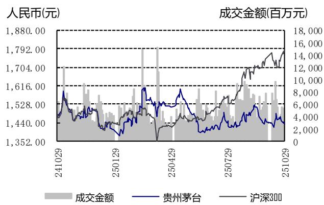

## 理性降速，关注龙头底部价值

## 业绩简评

2025 年 10月 29 日，公司披露 25 年三季报，期内实现营业总收入1309.0 亿元，同比+6.3%；实现归母净利 646.3 亿元，同比+6.2%。其中，25Q3 实现营业总收入 398.1 亿元，同比+0.3%；实现归母净利 192.2 亿元，同比+0.5%。

## 经营分析

分产品来看：25Q1-Q3 茅台酒/系列酒分别实现营收 1105.1/178.8亿元，同比+9.3%/-7.8%；25Q3 茅台酒/系列酒分别实现营收349.2/41.2 亿元，同比+7.3%/-34.0%。预计系列酒下滑主要受茅台 1935 拖累，茅台酒内部预计以非标产品量增为主，近期公司放宽非标票据回款政策，25Q3 末应收票据余额已由 Q2 末 28.2 亿提升至 52.1 亿。此外，期内公司新增 45 家国内经销商，均为系列酒经销商。

分渠道来看：25Q1-Q3 直销/批发代理分别实现营收 555.6/728.4亿元，同比+6.9%/+6.3%；25Q3 直销/批发代理分别实现营收155.5/235.0 亿元，同比-14.9%/+14.4%，直销渠道下滑主要受 i茅台拖累，i 茅台 25Q3 实现收入 19.3 亿元，同比-57.2%；剔除 i茅台后直销收入 136.1 亿元，同比-0.9%。期内公司推出 70 周年纪念/新走进系列/黄小西吃晚饭等文创产品，目前公司在 i 茅台推出蛇茅“日期酒”，满足消费端个性化需求。

报表结构方面：1）25Q3 归母净利同比+0.1pct 至 48.3%，其中毛利率+0.2pct、预计由相对高毛利茅台酒结构提升带动，销售费用率同比-1.0pct，管理费用率-0.3pct，税金及附加占比+0.6pct。2）25Q3 末合同负债余额 77.5 亿元，环比+22.4 亿元，考虑合同负债环比变量后营收+6.5%；25Q3 销售收现同比+2.6%。

## 盈利预测、估值与评级

我们预计 2025\~2027 年公司归母净利分别 906/952/1001 亿元，同比分别+5.0%/+5.1%/+5.2%，EPS 分别为 72.3/76.0/80.0 元，公司股票现价对应 PE 估值为 19.8/18.8/17.9 倍，维持“买入”评级。

## 风险提示

宏观经济恢复不及预期，行业政策风险，量价管控不及预期，食品安全风险。

## 食品饮料组

分析师：刘宸倩（执业 S1130519110005）

liuchenqian@gjzq.com.cn

分析师：叶韬（执业 S1130524040003)

yetao@gjzq.com.cn

市价（人民币）：1431.90元

## 相关报告：

1. 《贵州茅台公司点评：Q2业绩稳步兑现，看好龙头配置价值》，2025.8.13

2. 《贵州茅台公司点评：Q1业绩超预期，龙头持续变革转型》，2025.4.30

3.《贵州茅台公司点评：24年业绩平稳兑现，稳健配置首选》，2025.4.3

  
公司基本情况（人民币）

<table><tr><td>项目</td><td>2023</td><td>2024</td><td>2025E</td><td>2026E</td><td>2027E</td></tr><tr><td>营业收入(百万元)</td><td>150,560</td><td>174,144</td><td>182,967</td><td>192,173</td><td>201,782</td></tr><tr><td>营业收入增长率</td><td>18.0%</td><td>15.7%</td><td>5.1%</td><td>5.0%</td><td>5.0%</td></tr><tr><td>归母净利润(百万元)</td><td>74,734</td><td>86,228</td><td>90,575</td><td>95,213</td><td>100,120</td></tr><tr><td>归母净利润增长率</td><td>19.2%</td><td>15.4%</td><td>5.0%</td><td>5.1%</td><td>5.2%</td></tr><tr><td>摊薄每股收益(元)</td><td>59.5</td><td>68.6</td><td>72.3</td><td>76.0</td><td>80.0</td></tr><tr><td>每股经营性现金流净额</td><td>53.0</td><td>73.6</td><td>67.5</td><td>71.3</td><td>76.2</td></tr><tr><td>ROE(归属母公司)(摊薄)</td><td>34.7%</td><td>37.0%</td><td>35.4%</td><td>34.1%</td><td>32.9%</td></tr><tr><td>P/E</td><td>29.0</td><td>22.2</td><td>19.8</td><td>18.8</td><td>17.9</td></tr><tr><td>P/B</td><td>10.1</td><td>8.2</td><td>7.0</td><td>6.4</td><td>5.9</td></tr></table>

来源：公司年报、国金证券研究所

附录：三张报表预测摘要

<table><tr><td colspan="7">损益表(人民币百万元)</td></tr><tr><td></td><td>2022</td><td>2023</td><td>2024</td><td>2025E</td><td>2026E</td><td>2027E</td></tr><tr><td>主营业务收入</td><td>127,554</td><td>150,560</td><td>174,144</td><td>182,967</td><td>192,173</td><td>201,782</td></tr><tr><td>增长率</td><td></td><td>18.0%</td><td>15.7%</td><td>5.1%</td><td>5.0%</td><td>5.0%</td></tr><tr><td>主营业务成本</td><td>-10,093</td><td>-11,867</td><td>-13,789</td><td>-14,701</td><td>-15,409</td><td>-16,203</td></tr><tr><td>%销售收入</td><td>7.9%</td><td>7.9%</td><td>7.9%</td><td>8.0%</td><td>8.0%</td><td>8.0%</td></tr><tr><td>毛利</td><td>117,460</td><td>138,693</td><td>160,355</td><td>168,267</td><td>176,764</td><td>185,579</td></tr><tr><td>%销售收入</td><td>92.1%</td><td>92.1%</td><td>92.1%</td><td>92.0%</td><td>92.0%</td><td>92.0%</td></tr><tr><td>营业税金及附加</td><td>-18,496</td><td>-22,234</td><td>-26,926</td><td>-27,742</td><td>-29,137</td><td>-30,594</td></tr><tr><td>%销售收入</td><td>14.5%</td><td>14.8%</td><td>15.5%</td><td>15.2%</td><td>15.2%</td><td>15.2%</td></tr><tr><td>销售费用</td><td>-3,298</td><td>-4,649</td><td>-5,639</td><td>-6,291</td><td>-6,992</td><td>-7,543</td></tr><tr><td>%销售收入</td><td>2.6%</td><td>3.1%</td><td>3.2%</td><td>3.4%</td><td>3.6%</td><td>3.7%</td></tr><tr><td>管理费用</td><td>-9,012</td><td>-9,729</td><td>-9,316</td><td>-9,239</td><td>-9,511</td><td>-9,785</td></tr><tr><td>%销售收入</td><td>7.1%</td><td>6.5%</td><td>5.3%</td><td>5.0%</td><td>4.9%</td><td>4.8%</td></tr><tr><td>研发费用</td><td>-135</td><td>-157</td><td>-218</td><td>-229</td><td>-241</td><td>-253</td></tr><tr><td>%销售收入</td><td>0.1%</td><td>0.1%</td><td>0.1%</td><td>0.1%</td><td>0.1%</td><td>0.1%</td></tr><tr><td>息税前利润(EBIT)</td><td>86,520</td><td>101,924</td><td>118,255</td><td>124,766</td><td>130,882</td><td>137,403</td></tr><tr><td>%销售收入</td><td>67.8%</td><td>67.7%</td><td>67.9%</td><td>68.2%</td><td>68.1%</td><td>68.1%</td></tr><tr><td>财务费用</td><td>1,392</td><td>1,790</td><td>1,470</td><td>783</td><td>950</td><td>1,127</td></tr><tr><td>%销售收入</td><td>-1.1%</td><td>-1.2%</td><td>-0.8%</td><td>-0.4%</td><td>-0.5%</td><td>-0.6%</td></tr><tr><td>资产减值损失</td><td>-15</td><td>38</td><td>-23</td><td>0</td><td>0</td><td>0</td></tr><tr><td>公允价值变动收益</td><td>0</td><td>3</td><td>61</td><td>0</td><td>0</td><td>0</td></tr><tr><td>投资收益</td><td>64</td><td>34</td><td>9</td><td>0</td><td>0</td><td>0</td></tr><tr><td>%税前利润</td><td>0.1%</td><td>0.0%</td><td>0.0%</td><td>0.0%</td><td>0.0%</td><td>0.0%</td></tr><tr><td>营业利润</td><td>87,880</td><td>103,709</td><td>119,689</td><td>125,570</td><td>131,853</td><td>138,551</td></tr><tr><td>营业利润率</td><td>68.9%</td><td>68.9%</td><td>68.7%</td><td>68.6%</td><td>68.6%</td><td>68.7%</td></tr><tr><td>营业外收支</td><td>-178</td><td>-46</td><td>-50</td><td>-70</td><td>-20</td><td>-20</td></tr><tr><td>税前利润</td><td>87,701</td><td>103,663</td><td>119,639</td><td>125,500</td><td>131,833</td><td>138,531</td></tr><tr><td>利润率</td><td>68.8%</td><td>68.9%</td><td>68.7%</td><td>68.6%</td><td>68.6%</td><td>68.7%</td></tr><tr><td>所得税</td><td>-22,326</td><td>-26,141</td><td>-30,304</td><td>-31,663</td><td>-33,261</td><td>-34,951</td></tr><tr><td>所得税率</td><td>25.5%</td><td>25.2%</td><td>25.3%</td><td>25.2%</td><td>25.2%</td><td>25.2%</td></tr><tr><td>净利润</td><td>65,375</td><td>77,521</td><td>89,335</td><td>93,837</td><td>98,573</td><td>103,580</td></tr><tr><td>少数股东损益</td><td>2,659</td><td>2,787</td><td>3,107</td><td>3,262</td><td>3,360</td><td>3,461</td></tr><tr><td>归属于母公司的净利润</td><td>62,716</td><td>74,734</td><td>86,228</td><td>90,575</td><td>95,213</td><td>100,120</td></tr><tr><td>净利率</td><td>49.2%</td><td>49.6%</td><td>49.5%</td><td>49.5%</td><td>49.5%</td><td>49.6%</td></tr></table>

<table><tr><td colspan="7">现金流量表(人民币百万元)</td></tr><tr><td></td><td>2022</td><td>2023</td><td>2024</td><td>2025E</td><td>2026E</td><td>2027E</td></tr><tr><td>净利润</td><td>65,375</td><td>77,521</td><td>89,335</td><td>93,837</td><td>98,573</td><td>103,580</td></tr><tr><td>少数股东损益</td><td>2,659</td><td>2,787</td><td>3,107</td><td>3,262</td><td>3,360</td><td>3,461</td></tr><tr><td>非现金支出</td><td>1,703</td><td>1,900</td><td>2,108</td><td>2,066</td><td>2,303</td><td>2,581</td></tr><tr><td>非经营收益</td><td>-1,253</td><td>-1,160</td><td>-898</td><td>-458</td><td>-561</td><td>-620</td></tr><tr><td>营运资金变动</td><td>-29,127</td><td>-11,667</td><td>1,919</td><td>-10,631</td><td>-10,722</td><td>-9,799</td></tr><tr><td>经营活动现金净流</td><td>36,699</td><td>66,593</td><td>92,464</td><td>84,815</td><td>89,592</td><td>95,742</td></tr><tr><td>资本开支</td><td>-5,306</td><td>-2,595</td><td>-4,678</td><td>-2,602</td><td>-4,266</td><td>-4,768</td></tr><tr><td>投资</td><td>-210</td><td>-7,268</td><td>2,805</td><td>0</td><td>0</td><td>0</td></tr><tr><td>其他</td><td>-21</td><td>138</td><td>88</td><td>0</td><td>0</td><td>0</td></tr><tr><td>投资活动现金净流</td><td>-5,537</td><td>-9,724</td><td>-1,785</td><td>-2,602</td><td>-4,266</td><td>-4,768</td></tr><tr><td>股权募资</td><td>0</td><td>0</td><td>0</td><td>0</td><td>0</td><td>0</td></tr><tr><td>债权募资</td><td>0</td><td>0</td><td>0</td><td>-112</td><td>0</td><td>0</td></tr><tr><td>其他</td><td>-57,425</td><td>-58,889</td><td>-71,068</td><td>-67,945</td><td>-71,424</td><td>-75,106</td></tr><tr><td>筹资活动现金净流</td><td>-57,425</td><td>-58,889</td><td>-71,068</td><td>-68,057</td><td>-71,424</td><td>-75,106</td></tr><tr><td>现金净流量</td><td>-26,262</td><td>-2,019</td><td>19,610</td><td>14,156</td><td>13,903</td><td>15,869</td></tr></table>

来源：公司年报、国金证券研究所

<table><tr><td colspan="7">资产负债表(人民币百万元)</td></tr><tr><td></td><td>2022</td><td>2023</td><td>2024</td><td>2025E</td><td>2026E</td><td>2027E</td></tr><tr><td>货币资金</td><td>58,274</td><td>69,070</td><td>59,296</td><td>73,431</td><td>87,312</td><td>103,156</td></tr><tr><td>应收款项</td><td>158</td><td>102</td><td>2,033</td><td>3,760</td><td>2,988</td><td>2,128</td></tr><tr><td>存货</td><td>38,824</td><td>46,435</td><td>54,343</td><td>60,413</td><td>66,702</td><td>72,361</td></tr><tr><td>其他流动资产</td><td>123,489</td><td>111,696</td><td>138,435</td><td>147,227</td><td>157,228</td><td>167,230</td></tr><tr><td>流动资产</td><td>220,746</td><td>227,303</td><td>254,108</td><td>284,831</td><td>314,230</td><td>344,876</td></tr><tr><td>%总资产</td><td>86.8%</td><td>83.4%</td><td>85.0%</td><td>85.8%</td><td>86.3%</td><td>86.8%</td></tr><tr><td>长期投资</td><td>386</td><td>9,330</td><td>5,552</td><td>5,552</td><td>5,552</td><td>5,552</td></tr><tr><td>固定资产</td><td>21,951</td><td>22,047</td><td>24,021</td><td>25,116</td><td>26,485</td><td>28,085</td></tr><tr><td>%总资产</td><td>8.6%</td><td>8.1%</td><td>8.0%</td><td>7.6%</td><td>7.3%</td><td>7.1%</td></tr><tr><td>无形资产</td><td>7,420</td><td>8,950</td><td>9,101</td><td>9,681</td><td>10,253</td><td>10,816</td></tr><tr><td>非流动资产</td><td>33,619</td><td>45,396</td><td>44,837</td><td>47,116</td><td>49,715</td><td>52,601</td></tr><tr><td>%总资产</td><td>13.2%</td><td>16.6%</td><td>15.0%</td><td>14.2%</td><td>13.7%</td><td>13.2%</td></tr><tr><td>资产总计</td><td>254,365</td><td>272,700</td><td>298,945</td><td>331,947</td><td>363,945</td><td>397,476</td></tr><tr><td>短期借款</td><td>109</td><td>57</td><td>112</td><td>0</td><td>0</td><td>0</td></tr><tr><td>应付款项</td><td>6,952</td><td>8,306</td><td>8,944</td><td>9,999</td><td>10,737</td><td>11,374</td></tr><tr><td>其他流动负债</td><td>42,004</td><td>40,334</td><td>47,460</td><td>53,574</td><td>57,632</td><td>61,997</td></tr><tr><td>流动负债</td><td>49,066</td><td>48,698</td><td>56,516</td><td>63,572</td><td>68,369</td><td>73,371</td></tr><tr><td>长期贷款</td><td>0</td><td>0</td><td>0</td><td>0</td><td>0</td><td>0</td></tr><tr><td>其他长期负债</td><td>334</td><td>346</td><td>417</td><td>457</td><td>497</td><td>535</td></tr><tr><td>负债</td><td>49,400</td><td>49,043</td><td>56,933</td><td>64,030</td><td>68,865</td><td>73,906</td></tr><tr><td>普通股股东权益</td><td>197,507</td><td>215,669</td><td>233,106</td><td>255,750</td><td>279,553</td><td>304,583</td></tr><tr><td>其中:股本</td><td>1,256</td><td>1,256</td><td>1,256</td><td>1,256</td><td>1,256</td><td>1,256</td></tr><tr><td>未分配利润</td><td>161,302</td><td>172,983</td><td>182,787</td><td>205,431</td><td>229,234</td><td>254,264</td></tr><tr><td>少数股东权益</td><td>7,458</td><td>7,988</td><td>8,905</td><td>12,167</td><td>15,527</td><td>18,988</td></tr><tr><td>负债股东权益合计</td><td>254,365</td><td>272,700</td><td>298,945</td><td>331,947</td><td>363,945</td><td>397,476</td></tr></table>

<table><tr><td colspan="7">比率分析</td></tr><tr><td></td><td>2022</td><td>2023</td><td>2024</td><td>2025E</td><td>2026E</td><td>2027E</td></tr><tr><td colspan="7">每股指标</td></tr><tr><td>每股收益</td><td>49.926</td><td>59.492</td><td>68.642</td><td>72.329</td><td>76.032</td><td>79.951</td></tr><tr><td>每股净资产</td><td>157.226</td><td>171.684</td><td>185.565</td><td>204.229</td><td>223.237</td><td>243.225</td></tr><tr><td>每股经营现金净流</td><td>29.214</td><td>53.012</td><td>73.606</td><td>67.517</td><td>71.320</td><td>76.216</td></tr><tr><td>每股股利</td><td>47.821</td><td>49.982</td><td>51.506</td><td>54.077</td><td>56.846</td><td>59.775</td></tr><tr><td colspan="7">回报率</td></tr><tr><td>净资产收益率</td><td>31.75%</td><td>34.65%</td><td>36.99%</td><td>35.42%</td><td>34.06%</td><td>32.87%</td></tr><tr><td>总资产收益率</td><td>24.66%</td><td>27.41%</td><td>28.84%</td><td>27.29%</td><td>26.16%</td><td>25.19%</td></tr><tr><td>投入资本收益率</td><td>31.45%</td><td>34.06%</td><td>36.45%</td><td>34.81%</td><td>33.15%</td><td>31.74%</td></tr><tr><td colspan="7">增长率</td></tr><tr><td>主营业务收入增长率</td><td>16.53%</td><td>18.04%</td><td>15.66%</td><td>5.07%</td><td>5.03%</td><td>5.00%</td></tr><tr><td>EBIT增长率</td><td>17.03%</td><td>17.80%</td><td>16.02%</td><td>5.51%</td><td>4.90%</td><td>4.98%</td></tr><tr><td>净利润增长率</td><td>19.55%</td><td>19.16%</td><td>15.38%</td><td>5.04%</td><td>5.12%</td><td>5.15%</td></tr><tr><td>总资产增长率</td><td>-0.31%</td><td>7.21%</td><td>9.62%</td><td>11.04%</td><td>9.64%</td><td>9.21%</td></tr><tr><td colspan="7">资产管理能力</td></tr><tr><td>应收账款周转天数</td><td>0.0</td><td>0.1</td><td>0.1</td><td>0.1</td><td>0.1</td><td>0.1</td></tr><tr><td>存货周转天数</td><td>1,305.8</td><td>1,311.2</td><td>1,333.8</td><td>1,500.0</td><td>1,580.0</td><td>1,630.0</td></tr><tr><td>应付账款周转天数</td><td>79.9</td><td>84.6</td><td>87.5</td><td>97.0</td><td>102.0</td><td>104.0</td></tr><tr><td>固定资产周转天数</td><td>56.5</td><td>48.3</td><td>45.8</td><td>44.8</td><td>44.3</td><td>44.2</td></tr><tr><td colspan="7">偿债能力</td></tr><tr><td>净负债/股东权益</td><td>-28.38%</td><td>-31.04%</td><td>-24.56%</td><td>-27.50%</td><td>-29.67%</td><td>-31.96%</td></tr><tr><td>EBIT利息保障倍数</td><td>-62.2</td><td>-57.0</td><td>-80.4</td><td>-159.4</td><td>-137.8</td><td>-121.9</td></tr><tr><td>资产负债率</td><td>19.42%</td><td>17.98%</td><td>19.04%</td><td>19.29%</td><td>18.92%</td><td>18.59%</td></tr></table>

## 市场中相关报告评级比率分析

<table><tr><td>日期</td><td>一周内</td><td>一月内</td><td>二月内</td><td>三月内</td><td>六月内</td></tr><tr><td>买入</td><td>0</td><td>10</td><td>33</td><td>80</td><td>153</td></tr><tr><td>增持</td><td>0</td><td>0</td><td>1</td><td>6</td><td>3</td></tr><tr><td>中性</td><td>0</td><td>0</td><td>0</td><td>1</td><td>3</td></tr><tr><td>减持</td><td>0</td><td>0</td><td>0</td><td>0</td><td>0</td></tr><tr><td>评分</td><td>0.00</td><td>1.00</td><td>1.03</td><td>1.09</td><td>1.06</td></tr></table>

来源：聚源数据

## 投资评级的说明：

买入：预期未来 6－12个月内上涨幅度在 15%以上；

增持：预期未来 6－12个月内上涨幅度在 5%－15%；

中性：预期未来 6－12个月内变动幅度在 -5%－5%；

减持：预期未来 6－12个月内下跌幅度在 5%以上。

市场中相关报告评级比率分析说明：

市场中相关报告投资建议为“买入”得 1 分，为“增持”得 2 分，为“中性”得 3 分，为“减持”得 4 分，之后平均计算得出最终评分，作为市场平均投资建议的参考。

最终评分与平均投资建议对照：

1.00 =买入； 1.01\~2.0=增持 ； 2.01\~3.0=中性

3.01\~4.0=减持

## 特别声明：

国金证券股份有限公司经中国证券监督管理委员会批准，已具备证券投资咨询业务资格。

本报告版权归“国金证券股份有限公司”（以下简称“国金证券”）所有，未经事先书面授权，任何机构和个人均不得以任何方式对本报告的任何部分制作任何形式的复制、转发、转载、引用、修改、仿制、刊发，或以任何侵犯本公司版权的其他方式使用。经过书面授权的引用、刊发，需注明出处为“国金证券股份有限公司”，且不得对本报告进行任何有悖原意的删节和修改。

本报告的产生基于国金证券及其研究人员认为可信的公开资料或实地调研资料，但国金证券及其研究人员对这些信息的准确性和完整性不作任何保证。本报告反映撰写研究人员的不同设想、见解及分析方法，故本报告所载观点可能与其他类似研究报告的观点及市场实际情况不一致，国金证券不对使用本报告所包含的材料产生的任何直接或间接损失或与此有关的其他任何损失承担任何责任。且本报告中的资料、意见、预测均反映报告初次公开发布时的判断，在不作事先通知的情况下，可能会随时调整，亦可因使用不同假设和标准、采用不同观点和分析方法而与国金证券其它业务部门、单位或附属机构在制作类似的其他材料时所给出的意见不同或者相反。

本报告仅为参考之用，在任何地区均不应被视为买卖任何证券、金融工具的要约或要约邀请。本报告提及的任何证券或金融工具均可能含有重大的风险，可能不易变卖以及不适合所有投资者。本报告所提及的证券或金融工具的价格、价值及收益可能会受汇率影响而波动。过往的业绩并不能代表未来的表现。

客户应当考虑到国金证券存在可能影响本报告客观性的利益冲突，而不应视本报告为作出投资决策的唯一因素。证券研究报告是用于服务具备专业知识的投资者和投资顾问的专业产品，使用时必须经专业人士进行解读。国金证券建议获取报告人员应考虑本报告的任何意见或建议是否符合其特定状况，以及（若有必要）咨询独立投资顾问。报告本身、报告中的信息或所表达意见也不构成投资、法律、会计或税务的最终操作建议，国金证券不就报告中的内容对最终操作建议做出任何担保，在任何时候均不构成对任何人的个人推荐。

在法律允许的情况下，国金证券的关联机构可能会持有报告中涉及的公司所发行的证券并进行交易，并可能为这些公司正在提供或争取提供多种金融服务。

本报告并非意图发送、发布给在当地法律或监管规则下不允许向其发送、发布该研究报告的人员。国金证券并不因收件人收到本报告而视其为国金证券的客户。

本报告对于收件人而言属高度机密，只有符合条件的收件人才能使用。根据《证券期货投资者适当性管理办法》，本报告仅供国金证券股份有限公司客户中风险评级高于 C3 级(含 C3 级）的投资者使用；本报告所包含的观点及建议并未考虑个别客户的特殊状况、目标或需要，不应被视为对特定客户关于特定证券或金融工具的建议或策略。对于本报告中提及的任何证券或金融工具，本报告的收件人须保持自身的独立判断。使用国金证券研究报告进行投资，遭受任何损失，国金证券不承担相关法律责任。

若国金证券以外的任何机构或个人发送本报告，则由该机构或个人为此发送行为承担全部责任。本报告不构成国金证券向发送本报告机构或个人的收件人提供投资建议，国金证券不为此承担任何责任。

此报告仅限于中国境内使用。国金证券版权所有，保留一切权利。

上海

电话：021-80234211

北京

电话：010-85950438

深圳

电话：0755-86695353

邮箱：researchsh@gjzq.com.cn

邮箱：researchbj@gjzq.com.cn

邮箱：researchsz@gjzq.com.cn

邮编：201204

邮编：100005

邮编：518000

地址：上海浦东新区芳甸路 1088 号

地址：北京市东城区建内大街 26 号

地址：深圳市福田区金田路 2028 号皇岗商务中心

紫竹国际大厦 5 楼

新闻大厦 8 层南侧

18 楼 1806

  
【小程序】国金证券研究服务

  
【公众号】国金证券研究