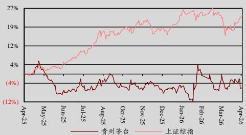

食品饮料 | 证券研究报告 — 调整盈利预测

2026 年 4 月 22 日

600519.SH

买入

原评级：买入

市场价格:人民币 1,410.89

板块评级:强于大市

## 本报告要点

贵州茅台公告 2025 年年报。4 季度业绩增速为负，公司卸下包袱，着眼长期健康发展，维持买入评级。

## 股价表现

<table><tr><td>(%)</td><td>今年</td><td>1</td><td>3</td><td>12</td></tr><tr><td></td><td>至今</td><td>个月</td><td>个月</td><td>个月</td></tr><tr><td>绝对</td><td>(1.1)</td><td>(2.4)</td><td>2.7</td><td>(9.9)</td></tr><tr><td>相对上证综指</td><td>(2.5)</td><td>(5.5)</td><td>3.5</td><td>(34.5)</td></tr></table>

<table><tr><td>发行股数(百万)</td><td>1,252.27</td></tr><tr><td>流通股(百万)</td><td>1,252.27</td></tr><tr><td>总市值(人民币 百万)</td><td>1,766,815.52</td></tr><tr><td>3个月日均交易额(人民币 百万)</td><td>6,721.13</td></tr><tr><td>主要股东</td><td></td></tr><tr><td>中国贵州茅台酒厂(集团)有限责任公司</td><td>54.4%</td></tr></table>

资料来源：公司公告，Wind，中银证券年 月 日收市价为标准

## 相关研究报告

《贵州茅台》20260402

《贵州茅台》20251209

《贵州茅台》20250819

中银国际证券股份有限公司

具备证券投资咨询业务资格

食品饮料：白酒Ⅱ

证券分析师：邓天娇

(8610)66229391

## 贵州茅台

tianjiao.deng@bocichina.com

证券投资咨询业务证书编号：S1300519080002

证券分析师：李育文

yuwen.li@bocichina.com

证券投资咨询业务证书编号：S1300526030002

## 卸下包袱，着眼长期健康发展，2026年开启新篇章

贵州茅台公告2025年年报。2025年贵州茅台实现营收1688.4亿元，同比-1.2%，归母净利823.2亿元，同比-4.5%。4Q25公司营收、归母净利分别为403.8亿元、176.9亿元，同比增速分别为-19.4%、-30.3%。公司上市以来首次年度业绩增速为负。面对外部市场环境变化，公司卸下包袱，敦本务实，着眼中长期健康发展。2026年在i茅台重启改革之下，开启新的篇章，我们维持买入评级。

## 支撑评级的要点

 4Q25 公司业绩增速同比大幅下滑，公司卸下包袱主动调整，厘清渠道矛盾，全面拥抱市场化改革。2025年公司营收及归母净利增速分别为-1.2%、-4.5%，此为公司上市以来首次年度业绩增速为负。从年内公司季度业绩表现来看，3Q25公司报表业绩降速调整，4Q25公司业绩增速同比大幅下滑（营收及归母净利增速分别为-19.4%、-30.3%）。公司新任董事长陈华在 2025年第一次临时股东大会上表态，公司将夯实质量基础，平衡好短期与长期的关系。不会“唯指标论”，为了短期业绩而违背市场规律强压指标，损害合作伙伴利益。我们认为，公司敦本务实，对于当前面临的供需不适配问题积极改革。截至2025年末，公司合同负债 80.1 亿元，环比 3季度末增加 2.6亿元，去年同期减少 3.4亿元，基本盘稳健。

 年茅台酒整体表现稳健，系列酒受产品政策影响，吨价同比下滑。（ ）分产品来看，年茅台酒实现营收 1465.0亿元，同比+0.4%，其中 4Q25营收 359.9 亿元，同比-19.7%。拆分量价，2025年茅台酒销量 4.7万吨，同比+0.7%，吨价 313.4万元/吨，同比-0.3%。2025年茅台酒整体表现稳健，但是 4季度茅台酒营收下滑幅度较大，结合吨价表现，我们判断与公司主动调整渠道发货节奏，收缩高价酒投放有关。2025年系列酒营收 222.7亿元，同比-9.8%，其中 4Q25营收 43.9亿元，同比-17.0%，降幅较3季度有所收窄。拆分量价来看，2025 年系列酒销量、吨价增速分别为+3.9%、-13.1%，吨价双位数下滑主要受产品结构下移影响。系列酒核心单品茅台 1935年内批价承压， 批价跌至 元以内（参考同花顺数据），根据公司股东大会信息，公司通过政策激励促进动销，依托动销情况优化投放，4季度 1935动销改善。（2）分渠道来看，2025年批发代理渠道营收 亿元，同比 ，直销渠道营收 亿元，同比 ，收入占比 ，同比提升 6.2pct。其中 4Q25直销渠道营收 289.9亿元，同比+26.8%。直营渠道营收高增，或与公司前期进行市场化营销改革，直营及企业团购客户增加有关。 年 茅台数字营销平台实现营收 亿元，同比 ， 茅台对表端业绩拉动作用减弱，主要与终端需求减少有关。

1 产品结构调整及渠道费用投放政策影响毛利率及销售费用率表现， 年公司归母净利率为48.8%，同比降 1.7pct。2025 年公司毛利率为 91.2%，同比降 0.8pct，其中 4Q25 毛利率为 90.8%，同比降 2.1pct。毛利率下降与产品结构下移有关，2025 年茅台酒及系列酒毛利率同比分别下降0.5pct、3.8pct。2025 年公司期间费用率为 8.9%，同比+0.8pct，销售费用率同比+1.0pct 至 4.3%。4Q25 公司销售费用率为 6.9%，同比+4.1pct。销售费用增加主要与公司加大广告宣传及市场费用投放有关。综上，2025年公司归母净利率为 48.8%，同比降 1.7pct。

 公司改革成效有望逐渐兑现，积极看待 2026 年及公司中长期发展。近日，公司公告《2026 年贵州茅台酒市场化运营方案》，在产品、运营、渠道、价格等方面进行多维度改革。（1）回归“金削减非标产品配额，部分产品下调出厂价，以市场承载能力为依据，维护渠道韧性及市场稳定性。（2）自 2026 年 3 月 31 日起，上调不同渠道贵州茅台酒出厂价，根据我们测算，此次提价有望增厚 2026年报表净利润，对应 2%左右的增量。（3）2026年 i茅台的改革有效激活了大众需求，同时承接了因产业转型、场景受损丢失的部分销量。从已披露的成交信息来看，我们推算 i 茅台有望对公司 2026 年报表业绩形成较强支撑。作为消费品的龙头公司，茅台拥有强大的品牌护城河。本轮行业调整期，公司量价节奏把握得当，战略转型坚定，基本面已触底，公司率先于行业迎来经营拐点。建议积极看待公司 2026年及中长期发展。

## 估值

 公司公告 24至 26 年分红比例不低于当年归母净利的 75%，2025 年公司累计派发现金红利 650.3亿元，分红总额创历史新高，股息率具备一定吸引力。根据公司 年年报业绩，同时考虑用酒消费场景仍受外部经济影响存在不确定性，因此我们调整此前盈利预测，预计公司 26至 28年归母净利分别为 、 、 亿元，同比增速分别为 、 、 ， 分别为 、、 元 股，当前市值对应 分别为 、 、 ，维持买入评级。

## 评级面临的主要风险

 经济恢复不及预期。渠道库存超预期，终端销售价格波动较大。

[Table\_Fin投资摘要

<table><tr><td>年结日:12月31日</td><td>2024</td><td>2025</td><td>2026E</td><td>2027E</td><td>2028E</td></tr><tr><td>主营收入(人民币 百万)</td><td>170,899</td><td>168,838</td><td>176,677</td><td>187,211</td><td>199,962</td></tr><tr><td>增长率(%)</td><td>15.7</td><td>(1.2)</td><td>4.6</td><td>6.0</td><td>6.8</td></tr><tr><td>EBITDA(人民币 百万)</td><td>117,072</td><td>113,105</td><td>116,563</td><td>123,850</td><td>133,407</td></tr><tr><td>归母净利润(人民币 百万)</td><td>86,228</td><td>82,320</td><td>85,301</td><td>90,849</td><td>98,056</td></tr><tr><td>增长率(%)</td><td>15.4</td><td>(4.5)</td><td>3.6</td><td>6.5</td><td>7.9</td></tr><tr><td>最新股本摊薄每股收益(人民币)</td><td>68.86</td><td>65.74</td><td>68.12</td><td>72.55</td><td>78.30</td></tr><tr><td>原先股本摊薄每股收益(人民币)</td><td></td><td></td><td>75.80</td><td>80.93</td><td></td></tr><tr><td>调整幅度(%)</td><td></td><td></td><td>(10.1)</td><td>(10.4)</td><td></td></tr><tr><td>市盈率(倍)</td><td>20.5</td><td>21.5</td><td>20.7</td><td>19.4</td><td>18.0</td></tr><tr><td>市净率(倍)</td><td>7.6</td><td>7.2</td><td>6.6</td><td>6.1</td><td>5.6</td></tr><tr><td>EV/EBITDA(倍)</td><td>15.8</td><td>14.5</td><td>14.3</td><td>13.2</td><td>12.0</td></tr><tr><td>每股股息 (人民币)</td><td>51.6</td><td>52.0</td><td>51.1</td><td>54.4</td><td>58.7</td></tr><tr><td>股息率(%)</td><td>3.4</td><td>3.8</td><td>3.6</td><td>3.9</td><td>4.2</td></tr></table>

资料来源：公司公告，中银证券预测

图表 1.2025年年报业绩概览

<table><tr><td>(人民币,百万元)</td><td>4Q24</td><td>4Q25</td><td>同比(%)</td><td>FY2024</td><td>FY2025</td><td>同比(%)</td></tr><tr><td>营业收入</td><td>50,123</td><td>40,384</td><td>(19.4)</td><td>170,899</td><td>168,838</td><td>(1.2)</td></tr><tr><td>营业成本</td><td>3,561</td><td>3,708</td><td>4.1</td><td>13,789</td><td>14,892</td><td>8.0</td></tr><tr><td>毛利率(%)</td><td>92.9</td><td>90.8</td><td>(2.1)</td><td>91.9</td><td>91.2</td><td>(0.8)</td></tr><tr><td>毛利</td><td>46,562</td><td>36,676</td><td>(21.2)</td><td>157,110</td><td>153,946</td><td>(2.0)</td></tr><tr><td>税金及附加</td><td>7,014</td><td>6,709</td><td>(4.4)</td><td>26,926</td><td>27,354</td><td>1.6</td></tr><tr><td>销售费用</td><td>1,404</td><td>2,775</td><td>97.6</td><td>5,639</td><td>7,253</td><td>28.6</td></tr><tr><td>管理费用</td><td>3,548</td><td>2,817</td><td>(20.6)</td><td>9,316</td><td>8,320</td><td>(10.7)</td></tr><tr><td>研发费用</td><td>78</td><td>77</td><td>(1.2)</td><td>218</td><td>190</td><td>(12.9)</td></tr><tr><td>财务费用</td><td>-297</td><td>-181</td><td>(39.3)</td><td>(1,470)</td><td>(815)</td><td>(44.5)</td></tr><tr><td>资产减值损失</td><td>0</td><td>0</td><td>-</td><td>0</td><td>0</td><td>-</td></tr><tr><td>公允价值变动收益</td><td>20</td><td>69</td><td>242.4</td><td>61</td><td>76</td><td>24.9</td></tr><tr><td>投资收益</td><td>1</td><td>1</td><td>(54.8)</td><td>9</td><td>1</td><td>(93.9)</td></tr><tr><td>营业利润</td><td>35,692</td><td>25,319</td><td>(29.1)</td><td>119,689</td><td>114,809</td><td>(4.1)</td></tr><tr><td>营业利润率(%)</td><td>71.2</td><td>62.7</td><td>(8.5)</td><td>70.0</td><td>68.0</td><td>(2.0)</td></tr><tr><td>营业外收入</td><td>17</td><td>35</td><td>107.2</td><td>71</td><td>75</td><td>5.7</td></tr><tr><td>营业外支出</td><td>119</td><td>2</td><td>(98.0)</td><td>121</td><td>129</td><td>6.4</td></tr><tr><td>利润总额</td><td>35,590</td><td>25,352</td><td>(28.8)</td><td>119,639</td><td>114,755</td><td>(4.1)</td></tr><tr><td>所得税</td><td>9,286</td><td>6,940</td><td>(25.3)</td><td>30,304</td><td>29,445</td><td>(2.8)</td></tr><tr><td>所得税率(剔除非经常性影响)(%)</td><td>26</td><td>27</td><td>1.4</td><td>25</td><td>26</td><td>0.3</td></tr><tr><td>少数股东权益</td><td>903</td><td>718</td><td>(20.4)</td><td>3,107</td><td>2,990</td><td>(3.7)</td></tr><tr><td>归属于母公司净利润</td><td>25,401</td><td>17,693</td><td>(30.3)</td><td>86,228</td><td>82,320</td><td>(4.5)</td></tr><tr><td>归母净利率(%)</td><td>50.7</td><td>43.8</td><td>(6.9)</td><td>50.5</td><td>48.8</td><td>(1.7)</td></tr><tr><td>EPS (元/股)</td><td>20.28</td><td>14.13</td><td>(30.3)</td><td>68.86</td><td>65.74</td><td>(4.5)</td></tr></table>

资料来源：同花顺，中银证券  
注：表内毛利率、利润率、所得税率、归母净利率指标的同比单位为pc

[Table\_FinchinaDetail]利润表(人民币 百万)

<table><tr><td>年结日:12月31日</td><td>2024</td><td>2025</td><td>2026E</td><td>2027E</td><td>2028E</td></tr><tr><td>营业总收入</td><td>174,144</td><td>172,054</td><td>179,893</td><td>190,491</td><td>203,308</td></tr><tr><td>营业收入</td><td>170,899</td><td>168,838</td><td>176,677</td><td>187,211</td><td>199,962</td></tr><tr><td>营业成本</td><td>13,789</td><td>14,892</td><td>17,071</td><td>17,790</td><td>18,896</td></tr><tr><td>营业税金及附加</td><td>26,926</td><td>27,354</td><td>28,622</td><td>30,328</td><td>31,794</td></tr><tr><td>销售费用</td><td>5,639</td><td>7,253</td><td>7,597</td><td>8,050</td><td>8,298</td></tr><tr><td>管理费用</td><td>9,316</td><td>8,320</td><td>9,011</td><td>9,548</td><td>9,998</td></tr><tr><td>研发费用</td><td>218</td><td>190</td><td>194</td><td>122</td><td>114</td></tr><tr><td>财务费用</td><td>(1,470)</td><td>(815)</td><td>(1,018)</td><td>(1,456)</td><td>(1,907)</td></tr><tr><td>其他收益</td><td>21</td><td>29</td><td>25</td><td>22</td><td>20</td></tr><tr><td>资产减值损失</td><td>0</td><td>0</td><td>0</td><td>0</td><td>0</td></tr><tr><td>信用减值损失</td><td>(23)</td><td>17</td><td>(10)</td><td>(10)</td><td>(5)</td></tr><tr><td>资产处置收益</td><td>0</td><td>3</td><td>3</td><td>3</td><td>3</td></tr><tr><td>公允价值变动收益</td><td>61</td><td>76</td><td>60</td><td>60</td><td>60</td></tr><tr><td>投资收益</td><td>9</td><td>1</td><td>15</td><td>20</td><td>20</td></tr><tr><td>汇兑收益</td><td>0</td><td>0</td><td>0</td><td>0</td><td>0</td></tr><tr><td>营业利润</td><td>119,689</td><td>114,809</td><td>118,510</td><td>126,205</td><td>136,213</td></tr><tr><td>营业外收入</td><td>71</td><td>75</td><td>75</td><td>75</td><td>75</td></tr><tr><td>营业外支出</td><td>121</td><td>129</td><td>129</td><td>120</td><td>120</td></tr><tr><td>利润总额</td><td>119,639</td><td>114,755</td><td>118,456</td><td>126,160</td><td>136,168</td></tr><tr><td>所得税</td><td>30,304</td><td>29,445</td><td>29,969</td><td>31,918</td><td>34,451</td></tr><tr><td>净利润</td><td>89,335</td><td>85,310</td><td>88,487</td><td>94,241</td><td>101,718</td></tr><tr><td>少数股东损益</td><td>3,107</td><td>2,990</td><td>3,186</td><td>3,393</td><td>3,662</td></tr><tr><td>归母净利润</td><td>86,228</td><td>82,320</td><td>85,301</td><td>90,849</td><td>98,056</td></tr><tr><td>EBITDA</td><td>117,072</td><td>113,105</td><td>116,563</td><td>123,850</td><td>133,407</td></tr><tr><td>EPS(最新股本摊薄,元)</td><td>68.86</td><td>65.74</td><td>68.12</td><td>72.55</td><td>78.30</td></tr></table>

现金流量表(人民币 百万)

<table><tr><td>年结日:12月31日</td><td>2024</td><td>2025</td><td>2026E</td><td>2027E</td><td>2028E</td></tr><tr><td>净利润</td><td>89,335</td><td>85,310</td><td>88,487</td><td>94,241</td><td>101,718</td></tr><tr><td>折旧摊销</td><td>2,085</td><td>2,259</td><td>2,391</td><td>2,487</td><td>2,549</td></tr><tr><td>营运资金变动</td><td>(27,506)</td><td>10,177</td><td>(18,813)</td><td>8,784</td><td>(264)</td></tr><tr><td>其他</td><td>28,550</td><td>(36,224)</td><td>26,636</td><td>(15,406)</td><td>4,943</td></tr><tr><td>经营活动现金流</td><td>92,464</td><td>61,522</td><td>98,700</td><td>90,107</td><td>108,946</td></tr><tr><td>资本支出</td><td>(4,679)</td><td>(3,128)</td><td>(205)</td><td>(405)</td><td>(305)</td></tr><tr><td>投资变动</td><td>3,991</td><td>508</td><td>(30)</td><td>(30)</td><td>(30)</td></tr><tr><td>其他</td><td>(1,097)</td><td>(29,022)</td><td>18</td><td>23</td><td>23</td></tr><tr><td>投资活动现金流</td><td>(1,785)</td><td>(31,642)</td><td>(217)</td><td>(412)</td><td>(312)</td></tr><tr><td>银行借款</td><td>0</td><td>0</td><td>0</td><td>0</td><td>0</td></tr><tr><td>股权融资</td><td>(72,640)</td><td>(74,050)</td><td>(63,976)</td><td>(68,137)</td><td>(73,542)</td></tr><tr><td>其他</td><td>1,572</td><td>623</td><td>1,136</td><td>1,420</td><td>1,918</td></tr><tr><td>筹资活动现金流</td><td>(71,068)</td><td>(73,427)</td><td>(62,839)</td><td>(66,716)</td><td>(71,624)</td></tr><tr><td>净现金流</td><td>19,611</td><td>(43,547)</td><td>35,644</td><td>22,979</td><td>37,009</td></tr></table>

资料来源： 公司公告 中银证券预测  
资料来源：公司公告，中银证券预测

财务指标  
资产负债表(人民币 百万)

<table><tr><td>年结日:12月31日</td><td>2024</td><td>2025</td><td>2026E</td><td>2027E</td><td>2028E</td></tr><tr><td>流动资产</td><td>251,727</td><td>252,519</td><td>299,394</td><td>310,987</td><td>360,651</td></tr><tr><td>货币资金</td><td>59,296</td><td>51,691</td><td>87,335</td><td>110,313</td><td>147,323</td></tr><tr><td>应收账款</td><td>19</td><td>3</td><td>20</td><td>4</td><td>22</td></tr><tr><td>应收票据</td><td>1,984</td><td>0</td><td>1,963</td><td>94</td><td>106</td></tr><tr><td>存货</td><td>54,343</td><td>61,427</td><td>87,470</td><td>67,205</td><td>87,109</td></tr><tr><td>预付账款</td><td>27</td><td>7</td><td>69</td><td>10</td><td>64</td></tr><tr><td>合同资产</td><td>0</td><td>0</td><td>0</td><td>0</td><td>0</td></tr><tr><td>其他流动资产</td><td>136,057</td><td>139,391</td><td>122,537</td><td>133,362</td><td>126,028</td></tr><tr><td>非流动资产</td><td>47,218</td><td>51,316</td><td>47,373</td><td>46,305</td><td>43,689</td></tr><tr><td>长期投资</td><td>5,544</td><td>5,365</td><td>5,365</td><td>5,365</td><td>5,365</td></tr><tr><td>固定资产</td><td>21,871</td><td>22,488</td><td>21,557</td><td>20,205</td><td>18,481</td></tr><tr><td>无形资产</td><td>8,850</td><td>8,686</td><td>8,494</td><td>8,288</td><td>8,070</td></tr><tr><td>其他长期资产</td><td>10,952</td><td>14,777</td><td>11,958</td><td>12,446</td><td>11,772</td></tr><tr><td>资产合计</td><td>298,945</td><td>303,835</td><td>346,767</td><td>357,292</td><td>404,340</td></tr><tr><td>流动负债</td><td>56,516</td><td>49,610</td><td>67,956</td><td>52,414</td><td>71,267</td></tr><tr><td>短期借款</td><td>0</td><td>0</td><td>0</td><td>0</td><td>0</td></tr><tr><td>应付账款</td><td>3,515</td><td>4,007</td><td>4,244</td><td>3,861</td><td>4,327</td></tr><tr><td>其他流动负债</td><td>53,001</td><td>45,603</td><td>63,712</td><td>48,554</td><td>66,940</td></tr><tr><td>非流动负债</td><td>417</td><td>265</td><td>341</td><td>303</td><td>322</td></tr><tr><td>长期借款</td><td>0</td><td>0</td><td>0</td><td>0</td><td>0</td></tr><tr><td>其他长期负债</td><td>417</td><td>265</td><td>341</td><td>303</td><td>322</td></tr><tr><td>负债合计</td><td>56,933</td><td>49,876</td><td>68,297</td><td>52,717</td><td>71,589</td></tr><tr><td>股本</td><td>1,256</td><td>1,252</td><td>1,252</td><td>1,252</td><td>1,252</td></tr><tr><td>少数股东权益</td><td>8,905</td><td>9,321</td><td>12,507</td><td>15,900</td><td>19,561</td></tr><tr><td>归属母公司股东权益</td><td>233,106</td><td>244,638</td><td>265,963</td><td>288,675</td><td>313,189</td></tr><tr><td>负债和股东权益合计</td><td>298,945</td><td>303,835</td><td>346,767</td><td>357,292</td><td>404,340</td></tr></table>

资料来源：公司公告，中银证券预测

<table><tr><td>年结日:12月31日</td><td>2024</td><td>2025</td><td>2026E</td><td>2027E</td><td>2028E</td></tr><tr><td>成长能力</td><td></td><td></td><td></td><td></td><td></td></tr><tr><td>营业收入增长率(%)</td><td>15.7</td><td>(1.2)</td><td>4.6</td><td>6.0</td><td>6.8</td></tr><tr><td>营业利润增长率(%)</td><td>15.4</td><td>(4.1)</td><td>3.2</td><td>6.5</td><td>7.9</td></tr><tr><td>归属于母公司净利润增长率(%)</td><td>15.4</td><td>(4.5)</td><td>3.6</td><td>6.5</td><td>7.9</td></tr><tr><td>息税前利润增长率(%)</td><td>16.0</td><td>(3.6)</td><td>3.0</td><td>6.3</td><td>7.8</td></tr><tr><td>息税折旧前利润增长率(%)</td><td>15.9</td><td>(3.4)</td><td>3.1</td><td>6.3</td><td>7.7</td></tr><tr><td>EPS(最新股本摊薄)增长率(%)</td><td>15.4</td><td>(4.5)</td><td>3.6</td><td>6.5</td><td>7.9</td></tr><tr><td>获利能力</td><td></td><td></td><td></td><td></td><td></td></tr><tr><td>息税前利润率(%)</td><td>67.3</td><td>65.7</td><td>64.6</td><td>64.8</td><td>65.4</td></tr><tr><td>营业利润率(%)</td><td>68.7</td><td>66.7</td><td>65.9</td><td>66.3</td><td>67.0</td></tr><tr><td>毛利率(%)</td><td>91.9</td><td>91.2</td><td>90.3</td><td>90.5</td><td>90.6</td></tr><tr><td>归母净利润率(%)</td><td>49.5</td><td>47.8</td><td>47.4</td><td>47.7</td><td>48.2</td></tr><tr><td>ROE(%)</td><td>37.0</td><td>33.6</td><td>32.1</td><td>31.5</td><td>31.3</td></tr><tr><td>ROIC(%)</td><td>49.4</td><td>49.9</td><td>37.9</td><td>40.1</td><td>40.3</td></tr><tr><td>偿债能力</td><td></td><td></td><td></td><td></td><td></td></tr><tr><td>资产负债率</td><td>0.2</td><td>0.2</td><td>0.2</td><td>0.1</td><td>0.2</td></tr><tr><td>净负债权益比</td><td>(0.2)</td><td>(0.2)</td><td>(0.3)</td><td>(0.4)</td><td>(0.4)</td></tr><tr><td>流动比率</td><td>4.5</td><td>5.1</td><td>4.4</td><td>5.9</td><td>5.1</td></tr><tr><td>营运能力</td><td></td><td></td><td></td><td></td><td></td></tr><tr><td>总资产周转率</td><td>0.6</td><td>0.6</td><td>0.5</td><td>0.5</td><td>0.5</td></tr><tr><td>应收账款周转率</td><td>4,307.6</td><td>15,645.3</td><td>15,645.3</td><td>15,645.3</td><td>15,645.3</td></tr><tr><td>应付账款周转率</td><td>51.7</td><td>44.9</td><td>42.8</td><td>46.2</td><td>48.8</td></tr><tr><td>费用率</td><td></td><td></td><td></td><td></td><td></td></tr><tr><td>销售费用率(%)</td><td>3.3</td><td>4.3</td><td>4.3</td><td>4.3</td><td>4.2</td></tr><tr><td>管理费用率(%)</td><td>5.5</td><td>4.9</td><td>5.1</td><td>5.1</td><td>5.0</td></tr><tr><td>研发费用率(%)</td><td>0.1</td><td>0.1</td><td>0.1</td><td>0.1</td><td>0.1</td></tr><tr><td>财务费用率(%)</td><td>(0.9)</td><td>(0.5)</td><td>(0.6)</td><td>(0.8)</td><td>(1.0)</td></tr><tr><td>每股指标(元)</td><td></td><td></td><td></td><td></td><td></td></tr><tr><td>每股收益(最新摊薄)</td><td>68.9</td><td>65.7</td><td>68.1</td><td>72.5</td><td>78.3</td></tr><tr><td>每股经营现金流(最新摊薄)</td><td>73.8</td><td>49.1</td><td>78.8</td><td>72.0</td><td>87.0</td></tr><tr><td>每股净资产(最新摊薄)</td><td>186.1</td><td>195.4</td><td>212.4</td><td>230.5</td><td>250.1</td></tr><tr><td>每股股息</td><td>51.6</td><td>52.0</td><td>51.1</td><td>54.4</td><td>58.7</td></tr><tr><td>估值比率</td><td></td><td></td><td></td><td></td><td></td></tr><tr><td>P/E(最新摊薄)</td><td>20.5</td><td>21.5</td><td>20.7</td><td>19.4</td><td>18.0</td></tr><tr><td>P/B(最新摊薄)</td><td>7.6</td><td>7.2</td><td>6.6</td><td>6.1</td><td>5.6</td></tr><tr><td>EV/EBITDA</td><td>15.8</td><td>14.5</td><td>14.3</td><td>13.2</td><td>12.0</td></tr><tr><td>价格/现金流(倍)</td><td>19.1</td><td>28.7</td><td>17.9</td><td>19.6</td><td>16.2</td></tr></table>

资料来源：公司公告，中银证券预测

## 披露声明

本报告准确表述了证券分析师的个人观点。该证券分析师声明，本人未在公司内、外部机构兼任有损本人独立性与客观性的其他职务，没有担任本报告评论的上市公司的董事、监事或高级管理人员；也不拥有与该上市公司有关的任何财务权益；本报告评论的上市公司或其它第三方都没有或没有承诺向本人提供与本报告有关的任何补偿或其它利益。

中银国际证券股份有限公司同时声明，将通过公司网站披露本公司授权公众媒体及其他机构刊载或者转发证券研究报告有关情况。如有投资者于未经授权的公众媒体看到或从其他机构获得本研究报告的，请慎重使用所获得的研究报告，以防止被误导，中银国际证券股份有限公司不对其报告理解和使用承担任何责任。

## 评级体系说明

以报告发布日后公司股价/行业指数涨跌幅相对同期相关市场指数的涨跌幅的表现为基准：

## 公司投资评级：

入：预计该公司股价在未来 6-12 个月内超越基准指数 20%以上；

增 持：预计该公司股价在未来 6-12 个月内超越基准指数 10%-20%；

中 性：预计该公司股价在未来 6-12 个月内相对基准指数变动幅度在-10%-10%之间；

减 持：预计该公司股价在未来 6-12 个月内相对基准指数跌幅在 10%以上；

未有评级：因无法获取必要的资料或者其他原因，未能给出明确的投资评级。

## 行业投资评级：

强于大市：预计该行业指数在未来 6-12 个月内表现强于基准指数；

中 性：预计该行业指数在未来 6-12 个月内表现基本与基准指数持平；

弱于大市：预计该行业指数在未来 6-12 个月内表现弱于基准指数；

未有评级：因无法获取必要的资料或者其他原因，未能给出明确的投资评级。

沪深市场基准指数为沪深 300 指数；新三板市场基准指数为三板成指或三板做市指数；香港市场基准指数为恒生指数或恒生中国企业指数；美股市场基准指数为纳斯达克综合指数或标普 500指数。

# 风险提示及免责声明

本报告由中银国际证券股份有限公司证券分析师撰写并向特定客户发布。

本报告发布的特定客户包括：1) 基金、保险、QFII、QDII 等能够充分理解证券研究报告，具备专业信息处理能力的中银国际证券股份有限公司的机构客户；2) 中银国际证券股份有限公司的证券投资顾问服务团队，其可参考使用本报告。中银国际证券股份有限公司的证券投资顾问服务团队可能以本报告为基础，整合形成证券投资顾问服务建议或产品，提供给接受其证券投资顾问服务的客户。

中银国际证券股份有限公司不以任何方式或渠道向除上述特定客户外的公司个人客户提供本报告。中银国际证券股份有限公司的个人客户从任何外部渠道获得本报告的，亦不应直接依据所获得的研究报告作出投资决策；需充分咨询证券投资顾问意见，独立作出投资决策。中银国际证券股份有限公司不承担由此产生的任何责任及损失等。

本报告内含保密信息，仅供收件人使用。阁下作为收件人，不得出于任何目的直接或间接复制、派发或转发此报告全部或部分内容予任何其他人，或将此报告全部或部分内容发表。如发现本研究报告被私自刊载或转发的，中银国际证券股份有限公司将及时采取维权措施，追究有关媒体或者机构的责任。所有本报告内使用的商标、服务标记及标记均为中银国际证券股份有限公司或其附属及关联公司（统称“中银国际集团”）的商标、服务标记、注册商标或注册服务标记。

本报告及其所载的任何信息、材料或内容只提供给阁下作参考之用，并未考虑到任何特别的投资目的、财务状况或特殊需要，不能成为或被视为出售或购买或认购证券或其它金融票据的要约或邀请，亦不构成任何合约或承诺的基础。中银国际证券股份有限公司不能确保本报告中提及的投资产品适合任何特定投资者。本报告的内容不构成对任何人的投资建议，阁下不会因为收到本报告而成为中银国际集团的客户。阁下收到或阅读本报告须在承诺购买任何报告中所指之投资产品之前，就该投资产品的适合性，包括阁下的特殊投资目的、财务状况及其特别需要寻求阁下相关投资顾问的意见。

尽管本报告所载资料的来源及观点都是中银国际证券股份有限公司及其证券分析师从相信可靠的来源取得或达到，但撰写本报告的证券分析师或中银国际集团的任何成员及其董事、高管、员工或其他任何个人（包括其关联方）都不能保证它们的准确性或完整性。除非法律或规则规定必须承担的责任外，中银国际集团任何成员不对使用本报告的材料而引致的损失负任何责任。本报告对其中所包含的或讨论的信息或意见的准确性、完整性或公平性不作任何明示或暗示的声明或保证。阁下不应单纯依靠本报告而取代个人的独立判断。本报告仅反映证券分析师在撰写本报告时的设想、见解及分析方法。中银国际集团成员可发布其它与本报告所载资料不一致及有不同结论的报告，亦有可能采取与本报告观点不同的投资策略。为免生疑问，本报告所载的观点并不代表中银国际集团成员的立场。

本报告可能附载其它网站的地址或超级链接。对于本报告可能涉及到中银国际集团本身网站以外的资料，中银国际集团未有参阅有关网站，也不对它们的内容负责。提供这些地址或超级链接（包括连接到中银国际集团网站的地址及超级链接）的目的，纯粹为了阁下的方便及参考，连结网站的内容不构成本报告的任何部份。阁下须承担浏览这些网站的风险。

本报告所载的资料、意见及推测仅基于现状，不构成任何保证，可随时更改，毋须提前通知。本报告不构成投资、法律、会计或税务建议或保证任何投资或策略适用于阁下个别情况。本报告不能作为阁下私人投资的建议。

过往的表现不能被视作将来表现的指示或保证，也不能代表或对将来表现做出任何明示或暗示的保障本报告所载的资料意见及预测只是反映证券分析师在本报告所载日期的判断可随时更改。本报告中涉及证券或金融工具的价格、价值及收入可能出现上升或下跌。

部分投资可能不会轻易变现，可能在出售或变现投资时存在难度。同样，阁下获得有关投资的价值或风险的可靠信息也存在困难。本报告中包含或涉及的投资及服务可能未必适合阁下。如上所述，阁下须在做出任何投资决策之前，包括买卖本报告涉及的任何证券，寻求阁下相关投资顾问的意见

中银国际证券股份有限公司及其附属及关联公司版权所有。保留一切权利。

## 中银国际证券股份有限公司

中国上海浦东

银城中路 200 号

中银大厦 39楼

邮编 200121

电话: (8621) 6860 4866

传真: (8621) 5888 3554

## 相关关联机构：

## 中银国际研究有限公司

香港花园道一号

中银大厦二十楼

电话:(852) 3988 6333

致电香港免费电话:

中国网通 10 省市客户请拨打：10800 8521065

中国电信 21 省市客户请拨打：10800 1521065

新加坡客户请拨打：800 852 3392

传真:(852) 2147 9513

## 中银国际证券有限公司

香港花园道一号

中银大厦二十楼

电话:(852) 3988 6333

传真:(852) 2147 9513

## 中银国际控股有限公司北京代表处

中国北京市西城区

西单北大街 110号 8层

邮编:100032

电话: (8610) 8326 2000

传真: (8610) 8326 2291

## 中银国际(英国)有限公司

2/F, 1 Lothbury

London EC2R 7DB

United Kingdom

电话: (4420) 3651 8888

传真: (4420) 3651 8877

## 中银国际(美国)有限公司

美国纽约市美国大道 1045 号

7 Bryant Park 15 楼

NY 10018

电话: (1) 212 259 0888

传真: (1) 212 259 0889

## 中银国际(新加坡)有限公司

注册编号 199303046Z

新加坡百得利路四号

中国银行大厦四楼(049908)

电话: (65) 6692 6829 / 6534 5587

传真: (65) 6534 3996 / 6532 3371