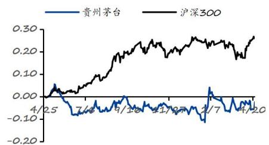

# 贵州茅台（600519.SH）

# 新篇已至，价值新生

## 投资要点：

司 事件：公司发布 2026 年一季度报告，2026 年一季度公司实现营业总财收入 547.03 亿元，同比+6.34%；营业收入 539.09 亿元，同比+6.54%；实现归母净利润 272.43 亿元，同比+1.47%；实现扣非归母净利润 272.40 亿元，同比+1.45%；经营性现金流净额 269.10 亿元，同比+205.48%。

 新篇已至，不失本色。 26Q1是公司开启市场化改革的第一个完整季度，在非标品未导入传统渠道的背景下，茅台酒依然实现了正增长：收入460.05亿元，同比+5.62%，预计 53度飞天茅台量增明显，与春节期间的渠道反馈相对应。系列酒也止滑、实现增长：收入 78.81亿元，同比+12.22%，预计系 1935大单品动销加速、起到带动作用。总体上看，26Q1 表现不失茅台过去稳健向上的本色。

 价值新生，“i 茅台”表现亮眼。 2026年 Q1，公司批发代理渠道收入243.82 亿元，同比-10.88%；直销渠道收入 295.04 亿元，同比+27.06%；其中，“i 茅台”数字营销平台收入 215.53 亿元，同比大幅增加 267.16%。批发代理渠道收入下降，预计主要是因为非标产品模式转型、Q1 未投放传统渠道所致；i 茅台大幅增长，与之前平台发布的 “Q1 新增用户超 1400万，超 398 万用户成功购酒”的情况相对应，总体反应出公司推动渠道改革的成效很好，体现出了公司市场化改革的带来的新的价值。

 盈利预测与投资建议: 综合考虑白酒消费场景修复节奏及公司自身的经营战略，我们预计公司 2026至 2028年归母净利润分别为 851.85 亿元、906.60 亿元、952.64 亿元（原 26-28 年值为 851.85/906.60/952.67 亿元），当前股价对应 PE 分别为 21.4倍、20.1倍、19.2倍，维持“买入”评级。

##  风险提示

宏观经济恢复不及预期；政策风险；食品质量安全风险等

<table><tr><td>财务数据和估值</td><td>2024A</td><td>2025A</td><td>2026E</td><td>2027E</td><td>2028E</td></tr><tr><td>营业收入(百万元)</td><td>170,899</td><td>168,838</td><td>174,863</td><td>183,086</td><td>191,548</td></tr><tr><td>增长率</td><td>16%</td><td>-1%</td><td>4%</td><td>5%</td><td>5%</td></tr><tr><td>净利润(百万元)</td><td>86,228</td><td>82,320</td><td>85,185</td><td>90,660</td><td>95,264</td></tr><tr><td>增长率</td><td>15%</td><td>-5%</td><td>3%</td><td>6%</td><td>5%</td></tr><tr><td>EPS(元/股)</td><td>68.86</td><td>65.74</td><td>68.02</td><td>72.40</td><td>76.07</td></tr><tr><td>市盈率(P/E)</td><td>21.2</td><td>22.2</td><td>21.4</td><td>20.1</td><td>19.2</td></tr><tr><td>市净率(P/B)</td><td>7.8</td><td>7.5</td><td>6.2</td><td>5.2</td><td>4.5</td></tr></table>

数据来源：公司公告、华福证券研究所

## 买入（维持评级）

## 基本数据

<table><tr><td>日期</td><td>2026-04-24</td></tr><tr><td>收盘价:</td><td>1,458.49 元</td></tr><tr><td>总股本/流通股本(百万股)</td><td>1,252.27/1,252.27</td></tr><tr><td>流通A股市值(百万元)</td><td>1,826,423.59</td></tr><tr><td>每股净资产(元)</td><td>216.32</td></tr><tr><td>资产负债率(%)</td><td>12.12</td></tr><tr><td>一年内最高/最低价(元)</td><td>1,645.00/1,322.01</td></tr></table>

## 一年内股价相对走势

## 团队成员

分析师： 龚源月(S0210526030001)

分析师： 杨良俊(S0210525040010)ylj30774@hfzq.com.cn

## 相关报告

1、韧性犹在，勇拓新篇——2026.04.17

2、品牌优势充分显现，市场化改革打开新局面——2026.04.16

3、保持定力，2024 年顺利收官——2025.01.03

图表 1：财务预测摘要  
资产负债表

<table><tr><td>单位:百万元</td><td>2025A</td><td>2026E</td><td>2027E</td><td>2028E</td></tr><tr><td>货币资金</td><td>51,691</td><td>106,264</td><td>166,394</td><td>220,777</td></tr><tr><td>应收票据及账款</td><td>3</td><td>579</td><td>711</td><td>907</td></tr><tr><td>预付账款</td><td>7</td><td>367</td><td>107</td><td>125</td></tr><tr><td>存货</td><td>61,427</td><td>61,588</td><td>59,182</td><td>60,196</td></tr><tr><td>合同资产</td><td>0</td><td>0</td><td>0</td><td>0</td></tr><tr><td>其他流动资产</td><td>139,391</td><td>145,042</td><td>146,117</td><td>155,583</td></tr><tr><td>流动资产合计</td><td>252,519</td><td>313,840</td><td>372,512</td><td>437,588</td></tr><tr><td>长期股权投资</td><td>147</td><td>37</td><td>46</td><td>57</td></tr><tr><td>固定资产</td><td>22,488</td><td>22,668</td><td>22,883</td><td>23,130</td></tr><tr><td>在建工程</td><td>2,472</td><td>1,872</td><td>1,222</td><td>522</td></tr><tr><td>无形资产</td><td>8,686</td><td>9,175</td><td>9,347</td><td>9,496</td></tr><tr><td>商誉</td><td>0</td><td>0</td><td>0</td><td>0</td></tr><tr><td>其他非流动资产</td><td>17,523</td><td>14,350</td><td>15,754</td><td>15,466</td></tr><tr><td>非流动资产合计</td><td>51,316</td><td>48,103</td><td>49,252</td><td>48,671</td></tr><tr><td>资产合计</td><td>303,835</td><td>361,943</td><td>421,764</td><td>486,259</td></tr><tr><td>短期借款</td><td>0</td><td>0</td><td>0</td><td>0</td></tr><tr><td>应付票据及账款</td><td>4,007</td><td>3,982</td><td>3,864</td><td>3,911</td></tr><tr><td>预收款项</td><td>0</td><td>0</td><td>0</td><td>0</td></tr><tr><td>合同负债</td><td>8,007</td><td>10,317</td><td>11,818</td><td>10,875</td></tr><tr><td>其他应付款</td><td>5,298</td><td>5,121</td><td>5,265</td><td>5,278</td></tr><tr><td>其他流动负债</td><td>32,298</td><td>34,734</td><td>33,683</td><td>35,404</td></tr><tr><td>流动负债合计</td><td>49,610</td><td>54,154</td><td>54,631</td><td>55,469</td></tr><tr><td>长期借款</td><td>0</td><td>0</td><td>0</td><td>0</td></tr><tr><td>应付债券</td><td>0</td><td>0</td><td>0</td><td>0</td></tr><tr><td>其他非流动负债</td><td>265</td><td>341</td><td>342</td><td>341</td></tr><tr><td>非流动负债合计</td><td>265</td><td>341</td><td>342</td><td>341</td></tr><tr><td>负债合计</td><td>49,876</td><td>54,494</td><td>54,973</td><td>55,810</td></tr><tr><td>归属母公司所有者权益</td><td>244,638</td><td>294,762</td><td>350,327</td><td>409,809</td></tr><tr><td>少数股东权益</td><td>9,321</td><td>12,686</td><td>16,464</td><td>20,640</td></tr><tr><td>所有者权益合计</td><td>253,959</td><td>307,448</td><td>366,791</td><td>430,449</td></tr><tr><td>负债和股东权益</td><td>303,835</td><td>361,943</td><td>421,764</td><td>486,259</td></tr></table>

现金流量表

<table><tr><td>单位:百万元</td><td>2025A</td><td>2026E</td><td>2027E</td><td>2028E</td></tr><tr><td>经营活动现金流</td><td>61,522</td><td>66,803</td><td>95,088</td><td>89,478</td></tr><tr><td>现金收益</td><td>83,658</td><td>86,253</td><td>91,853</td><td>96,671</td></tr><tr><td>存货影响</td><td>-7,084</td><td>-160</td><td>2,406</td><td>-1,014</td></tr><tr><td>经营性应收影响</td><td>2,021</td><td>-937</td><td>127</td><td>-213</td></tr><tr><td>经营性应付影响</td><td>362</td><td>-202</td><td>26</td><td>60</td></tr><tr><td>其他影响</td><td>-17,435</td><td>-18,150</td><td>674</td><td>-6,026</td></tr><tr><td>投资活动现金流</td><td>-31,642</td><td>18,172</td><td>-4,689</td><td>-4,373</td></tr><tr><td>资本支出</td><td>-2,978</td><td>-2,306</td><td>-2,002</td><td>-1,984</td></tr><tr><td>股权投资</td><td>-147</td><td>110</td><td>-9</td><td>-11</td></tr><tr><td>其他长期资产变化</td><td>-28,517</td><td>20,368</td><td>-2,678</td><td>-2,378</td></tr><tr><td>融资活动现金流</td><td>-73,427</td><td>-30,402</td><td>-30,267</td><td>-30,722</td></tr><tr><td>借款增加</td><td>-68</td><td>36</td><td>-7</td><td>4</td></tr><tr><td>股利及利息支付</td><td>-67,242</td><td>-36,481</td><td>-37,273</td><td>-36,630</td></tr><tr><td>股东融资</td><td>0</td><td>-4</td><td>0</td><td>0</td></tr><tr><td>其他影响</td><td>-6,118</td><td>6,047</td><td>7,013</td><td>5,904</td></tr></table>

数据来源：公司报告华福证券研究所

利润表

<table><tr><td>单位:百万元</td><td>2025A</td><td>2026E</td><td>2027E</td><td>2028E</td></tr><tr><td>营业收入</td><td>168,838</td><td>174,863</td><td>183,086</td><td>191,548</td></tr><tr><td>营业成本</td><td>14,892</td><td>15,567</td><td>14,856</td><td>15,044</td></tr><tr><td>税金及附加</td><td>27,354</td><td>28,328</td><td>29,660</td><td>31,031</td></tr><tr><td>销售费用</td><td>7,253</td><td>7,519</td><td>7,507</td><td>7,662</td></tr><tr><td>管理费用</td><td>8,320</td><td>8,568</td><td>8,605</td><td>8,811</td></tr><tr><td>研发费用</td><td>190</td><td>210</td><td>220</td><td>230</td></tr><tr><td>财务费用</td><td>-3,855</td><td>-4,534</td><td>-4,849</td><td>-5,057</td></tr><tr><td>信用减值损失</td><td>17</td><td>-20</td><td>3</td><td>-6</td></tr><tr><td>资产减值损失</td><td>0</td><td>0</td><td>0</td><td>0</td></tr><tr><td>公允价值变动收益</td><td>76</td><td>35</td><td>44</td><td>54</td></tr><tr><td>投资收益</td><td>1</td><td>12</td><td>15</td><td>15</td></tr><tr><td>其他收益</td><td>29</td><td>25</td><td>25</td><td>25</td></tr><tr><td>营业利润</td><td>114,809</td><td>119,258</td><td>127,176</td><td>133,917</td></tr><tr><td>营业外收入</td><td>75</td><td>71</td><td>76</td><td>75</td></tr><tr><td>营业外支出</td><td>129</td><td>150</td><td>150</td><td>156</td></tr><tr><td>利润总额</td><td>114,755</td><td>119,179</td><td>127,102</td><td>133,836</td></tr><tr><td>所得税</td><td>29,445</td><td>30,629</td><td>32,665</td><td>34,396</td></tr><tr><td>净利润</td><td>85,310</td><td>88,550</td><td>94,437</td><td>99,440</td></tr><tr><td>少数股东损益</td><td>2,990</td><td>3,365</td><td>3,777</td><td>4,177</td></tr><tr><td>归属母公司净利润</td><td>82,320</td><td>85,185</td><td>90,660</td><td>95,264</td></tr><tr><td>EPS(按最新股本摊薄)</td><td>65.74</td><td>68.02</td><td>72.40</td><td>76.07</td></tr></table>

主要财务比率

<table><tr><td></td><td>2025A</td><td>2026E</td><td>2027E</td><td>2028E</td></tr><tr><td colspan="5">成长能力</td></tr><tr><td>营业收入增长率</td><td>-1.2%</td><td>3.6%</td><td>4.7%</td><td>4.6%</td></tr><tr><td>EBIT 增长率</td><td>-3.6%</td><td>3.4%</td><td>6.6%</td><td>5.3%</td></tr><tr><td>归母公司净利润增长率</td><td>-4.5%</td><td>3.5%</td><td>6.4%</td><td>5.1%</td></tr><tr><td colspan="5">获利能力</td></tr><tr><td>毛利率</td><td>91.2%</td><td>91.1%</td><td>91.9%</td><td>92.1%</td></tr><tr><td>净利率</td><td>50.5%</td><td>50.6%</td><td>51.6%</td><td>51.9%</td></tr><tr><td>ROE</td><td>32.4%</td><td>27.7%</td><td>24.7%</td><td>22.1%</td></tr><tr><td>ROIC</td><td>52.9%</td><td>40.2%</td><td>35.8%</td><td>32.0%</td></tr><tr><td colspan="5">偿债能力</td></tr><tr><td>资产负债率</td><td>16.4%</td><td>15.1%</td><td>13.0%</td><td>11.5%</td></tr><tr><td>流动比率</td><td>5.1</td><td>5.8</td><td>6.8</td><td>7.9</td></tr><tr><td>速动比率</td><td>3.9</td><td>4.7</td><td>5.7</td><td>6.8</td></tr><tr><td colspan="5">营运能力</td></tr><tr><td>总资产周转率</td><td>0.6</td><td>0.5</td><td>0.4</td><td>0.4</td></tr><tr><td>应收账款周转天数</td><td>0</td><td>0</td><td>0</td><td>0</td></tr><tr><td>存货周转天数</td><td>1,399</td><td>1,422</td><td>1,463</td><td>1,428</td></tr><tr><td colspan="5">每股指标(元)</td></tr><tr><td>每股收益</td><td>65.74</td><td>68.02</td><td>72.40</td><td>76.07</td></tr><tr><td>每股经营现金流</td><td>49.13</td><td>53.35</td><td>75.93</td><td>71.45</td></tr><tr><td>每股净资产</td><td>195.36</td><td>235.38</td><td>279.75</td><td>327.25</td></tr><tr><td colspan="5">估值比率</td></tr><tr><td>P/E</td><td>22</td><td>21</td><td>20</td><td>19</td></tr><tr><td>P/B</td><td>7</td><td>6</td><td>5</td><td>4</td></tr><tr><td>EV/EBITDA</td><td>14</td><td>14</td><td>13</td><td>12</td></tr></table>

## 分析师声明

本人具有中国证券业协会授予的证券投资咨询执业资格并注册为证券分析师，以勤勉的职业态度，独立、客观地出具本报告。本报告清晰准确地反映了本人的研究观点。本人不曾因，不因，也将不会因本报告中的具体推荐意见或观点而直接或间接收到任何形式的补偿。

## 一般声明

华福证券股份有限公司（以下简称“本公司”）具有中国证监会许可的证券投资咨询业务资格。本报告仅供本公司的客户使用。本公司不会因接收人收到本报告而视其为客户。在任何情况下，本公司不对任何人因使用本报告中的任何内容所引致的任何损失负任何责任。

本报告的信息均来源于本公司认为可信的公开资料，该等公开资料的准确性及完整性由其发布者负责，本公司及其研究人员对该等信息不作任何保证。本报告中的资料、意见及预测仅反映本公司于发布本报告当日的判断，之后可能会随情况的变化而调整。在不同时期，本公司可发出与本报告所载资料、意见及推测不一致的报告。本公司不保证本报告所含信息及资料保持在最新状态，对本报告所含信息可在不发出通知的情形下做出修改，投资者应当自行关注相应的更新或修改。

在任何情况下，本报告所载的信息或所做出的任何建议、意见及推测并不构成所述证券买卖的出价或询价，也不构成对所述金融产品、产品发行或管理人作出任何形式的保证。在任何情况下，本公司仅承诺以勤勉的职业态度，独立、客观地出具本报告以供投资者参考，但不就本报告中的任何内容对任何投资做出任何形式的承诺或担保。投资者应自行决策，自担投资风险。

本报告版权归“华福证券股份有限公司”所有。本公司对本报告保留一切权利。除非另有书面显示，否则本报告中的所有材料的版权均属本公司。未经本公司事先书面授权，本报告的任何部分均不得以任何方式制作任何形式的拷贝、复印件或复制品，或再次分发给任何其他人，或以任何侵犯本公司版权的其他方式使用。未经授权的转载，本公司不承担任何转载责任。

## 特别声明

投资者应注意，在法律许可的情况下，本公司及其本公司的关联机构可能会持有本报告中涉及的公司所发行的证券并进行交易，也可能为这些公司正在提供或争取提供投资银行、财务顾问和金融产品等各种金融服务。投资者请勿将本报告视为投资或其他决定的唯一参考依据。

## 投资评级声明

<table><tr><td>类别</td><td>评级</td><td>评级说明</td></tr><tr><td rowspan="5">公司评级</td><td>买入</td><td>未来6个月内,个股相对市场基准指数指数涨幅在20%以上</td></tr><tr><td>持有</td><td>未来6个月内,个股相对市场基准指数指数涨幅介于10%与20%之间</td></tr><tr><td>中性</td><td>未来6个月内,个股相对市场基准指数涨幅介于-10%与10%之间</td></tr><tr><td>回避</td><td>未来6个月内,个股相对市场基准指数涨幅介于-20%与-10%之间</td></tr><tr><td>卖出</td><td>未来6个月内,个股相对市场基准指数涨幅在-20%以下</td></tr><tr><td rowspan="3">行业评级</td><td>强于大市</td><td>未来6个月内,行业整体回报高于市场基准指数5%以上</td></tr><tr><td>跟随大市</td><td>未来6个月内,行业整体回报介于市场基准指数-5%与5%之间</td></tr><tr><td>弱于大市</td><td>未来6个月内,行业整体回报低于市场基准指数-5%以下</td></tr><tr><td colspan="3">备注:评级标准为报告发布日后的6~12个月内公司股价(或行业指数)相对同期基准指数的相对市场表现。其中A股市场以沪深300指数为基准;香港市场以恒生指数为基准,美股市场以标普500指数或纳斯达克综合指数为基准(另有说明的除外)联系方式</td></tr></table>

## 华福证券研究所 上海

公司地址：上海市浦东新区浦明路1436号陆家嘴滨江中心 MT座 20层

邮编：200120

邮箱：hfyjs@hfzq.com.cn