# ——贵州茅台 2025年年报及 2026年一季报点评

##  茅台 25年营收首降，26 年一季度单季已恢复增长：

公司公布 2025 年年报实现营收 1688.38 亿元/-1.21%，净利润 823.20 亿元/-4.53%；25Q4 实现营收 411.50 亿元/-19.35%；归母净利润 176.93 亿元/-30.34%。2025 年毛利率 91.18%/-0.75pct；销售费用率 4.22%/+0.98pct；管理费用率 4.95%/-0.53pct；净利率 50.53%/-1.75pct。2025 年进入 12 月，贵州茅台酒全线产品市场价格波动加剧，渠道稳定性和韧性压力大增。公司果断停止向渠道分销产品，稳住了市场的“基本盘”。2025年经营活动现金流净额 615.22 亿元/-33.46%，渠道库存去化进入深水区。

公司 2026 年 Q1 实现营收 547.03 亿元/+6.34%；归母净利润 272.43 亿元/+1.47%。公司毛利率 89.76%/-2.21pct。两费方面，销售费用率 2.94%/+0.03pct；管理费用率 3.39%/-0.34pct。净利率 52.22%/-2.67pct。茅台终端价格体系松动后促销加码稀释毛利。

 主动调控效果显现，2026Q1茅台/系列酒收入增速企稳并恢复正向增长2025 年 茅 台 单 季 销 售 收 入 增 速 9.70%/10.99%/7.26%/-19.68% ， 系 列 酒Q1/Q2/Q3/Q4 单季销售收入增速分别为 18.30%/-6.53%/-34.00%/-17.02%，2025 年系列酒单季承压率先回落，四季度末公司主动出手稳市场，2026Q1茅台/系列酒收入增速分别回升至 5.62%/12.22%。公司建立了以渠道库存、存销比、售罄率等关键指标为主的渠道韧性评价模型，春节期间，茅台 1935酒和茅台王子酒市场动销加快。公司最新业绩说明会表示，公司产品的渠道库存处于良性健康水平。

##  白酒行业整体承压仍在探底中，茅台主动建立以市场为导向的定价机制灵活应对市场需求

国家统计局发布 2025 年全年白酒产量 354.9 万千升，同比下降 12.10%；结合中国酒业协会行业统计，2025 年上半年规模以上白酒企业 887 家，较 2016年峰值 1578家，十年减少近半。市场竞争激烈，行业探底仍未结束。

2026年，公司启动市场化改革的“元年”，一系列举措密集落地。从“i 茅台”上线飞天 53%vol 500ml 贵州茅台酒，到通过“自售+经销+代售”的销售模式统筹调度全国市场茅台酒投放计划，再到全面实施以市场为导向的自营体系零售价定价机制。其中代售模式是茅台市场化改革的重要举措，是推进“全面向 C”的重要销售模式。另外，当前代售模式已经试点落地，寄售模式仍然需要根据市场情况具体研判。

以市场为导向，灵活调整产品和价格应对市场需求。2026年年初 i 茅台上线飞天茅台 500ml，2026 年 3 月 31 日起，公司将飞天 53%vol 500ml 贵州茅台酒（2026）销售合同价由 1169 元/瓶调整为 1269 元/瓶、自营体系零售价由1499 元/瓶调整为 1539 元/瓶。一季度末推出代售产品为飞天 53% vol 500ml贵州茅台酒之外的其他主要产品。

公司将构建批发、线下零售、线上零售、餐饮、私域“五大渠道”并行的渠道布局，通过“线上+线下”融合转型，线上管效率、管触达，线下管转化、管服务，形成以消费者为中心的良性渠道生态体系。未来将按照市场化原则

## 强烈推荐（维持评级）

陈文倩（分析师）

chenwenqian@cctgsc.com.cn

登记编号：S0280515080002

## 市场数据 时间 2026.05.20

<table><tr><td>收盘价(元):</td><td>1,315.00</td></tr><tr><td>一年最低/最高(元):</td><td>1,314.00/1,595.94</td></tr><tr><td>总股本(亿股):</td><td>12.52</td></tr><tr><td>总市值(亿元):</td><td>16,467.35</td></tr><tr><td>流通股本(亿股):</td><td>12.52</td></tr><tr><td>流通市值(亿元):</td><td>16,467.35</td></tr><tr><td>近3月换手率(%):</td><td>17.76</td></tr></table>

## 股价一年走势

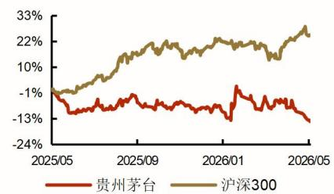

## 相关报告

《茅台高端地位稳固，中端白酒竞争激烈—贵州茅台 2025 年中报点评》2025-08-14

《2025 年稳健前行，双轮驱动优化产品结构———贵州茅台 2024年年报点评》2025-04-14

《主动控量助力企业稳健发展———贵州茅台 2024 年三季报点评》2024-11-12逐步丰富 i 茅台上架产品矩阵。

##  公司分红、回购和注销维护股价，切实保护投资者利益

公司 2024-2026 年现金分红规划，每年度分配的现金红利总额不低于当年实现归属于上市公司股东的净利润的 75%，每年度的现金分红分两次（年度和中期分红）实施。2025年股东回报总额达 650.33亿元（含 2025年年度分红预案金额 350 亿元），创历史新高：首次股票回购 60 亿元并已完成注销，合计回报占净利润比例高达 79%。现已启动第二轮股票回购计划（最高 30亿元，已回购 15亿元），切实保护投资者利益并持续为投资者创造价值。

##  盈利预测及投资建议

以消费者为中心、以市场需求为驱动的市场化转型契机和难得的改革窗口期，开启“全面向 C”的市场化改革。通过推动场景、客群、服务“三个转型”与产品端、渠道端、终端“三端变革”，茅台酒、系列酒及国际化三大板块协同发力，不断提振市场信心，有效稳住了市场基本盘，展现企业发展韧性，实现了市场稳健发展。我们预计公司 26/27/28 年实现营业收入分别为1740/1808/1888 亿元，同比增速 3.1%/3.9%/4.4%，净利润分别为 835/869/909亿元，对应 EPS 分别为 66.68/69.43 /72.56 元。当前股价对应 PE 分别为 20/19/18倍，公司当前 PE20 倍，维持公司“强烈推荐”评级。

 风险提示：消费信心不足，商务消费持续低迷，高端白酒销量萎缩，中端白酒竞争加剧，企业经营成本费用增加，财税政策改革，行业食品安全风险等。

财务摘要和估值指标（2026/05/20）

<table><tr><td>指标</td><td>2024A</td><td>2025A</td><td>2026E</td><td>2027E</td><td>2028E</td></tr><tr><td>营业收入(百万元)</td><td>170,899</td><td>168,838</td><td>174,031</td><td>180,846</td><td>188,838</td></tr><tr><td>增长率(%)</td><td>15.7</td><td>-1.2</td><td>3.1</td><td>3.9</td><td>4.4</td></tr><tr><td>净利润(百万元)</td><td>86,228</td><td>82,320</td><td>83,507</td><td>86,949</td><td>90,863</td></tr><tr><td>增长率(%)</td><td>15.4</td><td>-4.5</td><td>1.4</td><td>4.1</td><td>4.5</td></tr><tr><td>毛利率(%)</td><td>91.9</td><td>91.2</td><td>90.5</td><td>90.7</td><td>91.0</td></tr><tr><td>净利率(%)</td><td>50.5</td><td>48.8</td><td>48.0</td><td>48.1</td><td>48.1</td></tr><tr><td>ROE(%)</td><td>36.9</td><td>33.6</td><td>28.4</td><td>25.0</td><td>22.4</td></tr><tr><td>EPS(摊薄/元)</td><td>68.86</td><td>65.74</td><td>66.68</td><td>69.43</td><td>72.56</td></tr><tr><td>P/E</td><td>19.2</td><td>20.1</td><td>19.8</td><td>19.1</td><td>18.2</td></tr><tr><td>P/B</td><td>7.1</td><td>6.8</td><td>5.7</td><td>4.8</td><td>4.1</td></tr></table>

资料来源：Wind、诚通证券研究所预测，股价时间为 2026年 5月 20日

图 1： 2021Q1-2026Q1 单季营业收入及其同比主动调整后已回升，增速偏低  
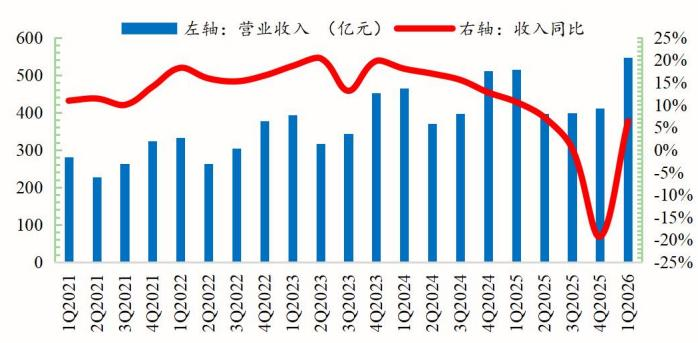  
资料来源：wind，诚通证券研究所

图 2： 2021Q1-2026Q1 单季归母净利润及其同比，主动调整后已回升，增速偏低  
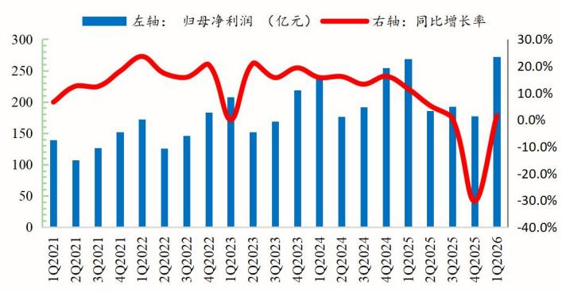  
资料来源：wind，诚通证券研究所，

图 3： 2021Q1-2026Q1 单季毛利率承压下滑  
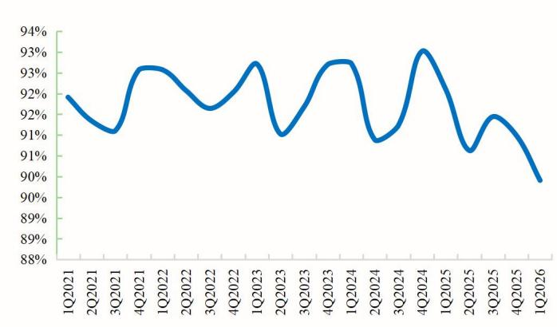  
资料来源：wind，诚通证券研究所

图 4： 2021Q1-2026Q1 单季销售费用率提升态势，管理费用率持续下降  
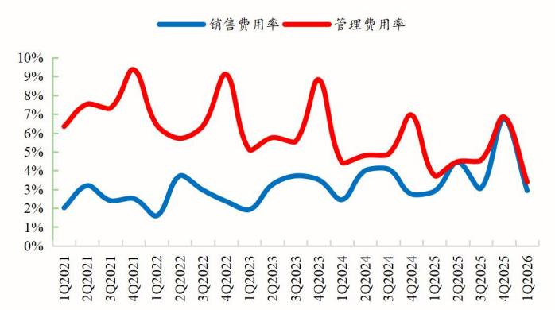  
资料来源：wind，诚通证券研究所

图 5： 2021Q1-2026Q1 单季净利率下滑后已企稳回升  
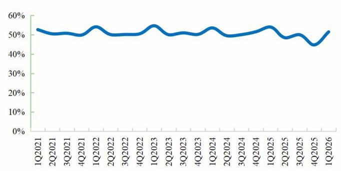  
资料来源：wind，诚通证券研究所

图 6： 2021Q1-2026Q1 公司合同负债(亿元）直销占比提升，预售货款下降  
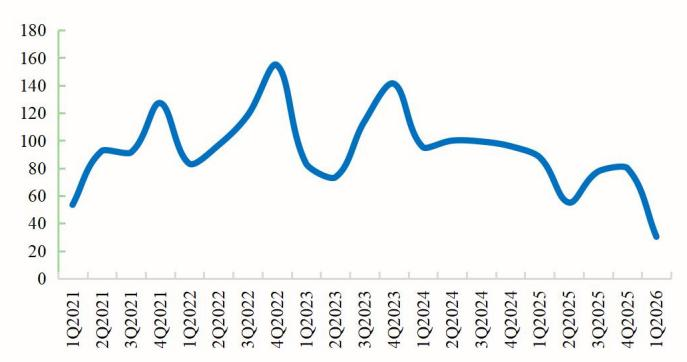  
资料来源：wind，诚通证券研究所

图 7： 2021Q1-2026Q1 单季销售商品现金流入随收入回落后已企稳回升  
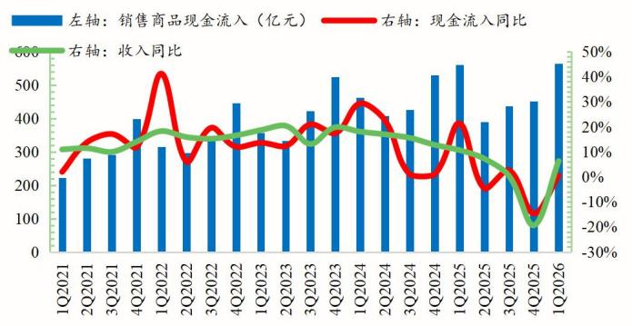  
资料来源：wind，诚通证券研究所

图 8： 2021Q1-2026Q1 单季销售商品现金流入/营业总收入表现稳定  
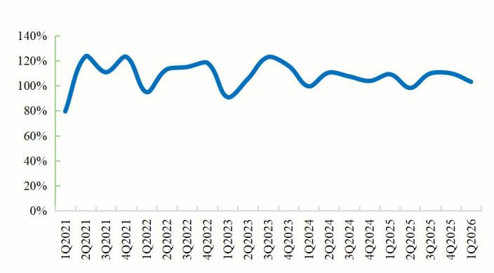  
资料来源：wind，诚通证券研究所

图 9： 时隔四年 2026 年 3 月底贵州茅台再次提高出厂价 8.5%至 1269 元/瓶  
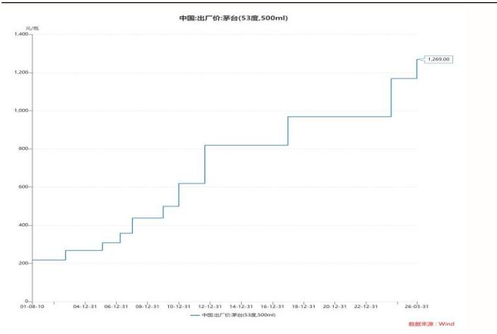  
资料来源：Wind，诚通证券研究所

图 10： 2025飞天茅台（散）批发价走势,2025年末探底后企稳回升  
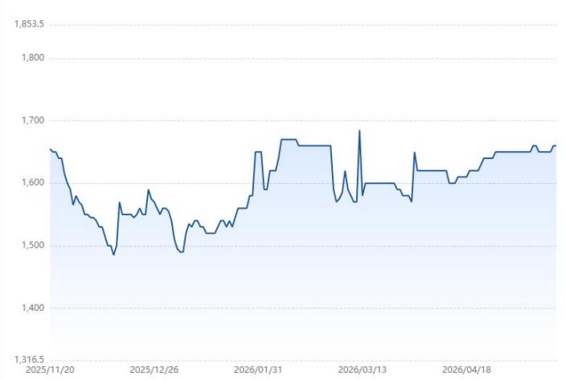  
资料来源：启明星，诚通证券研究所

图 11： 2025年白酒累计产量持续下滑同比下降 12.10%，十年累计下降 73.87%。  
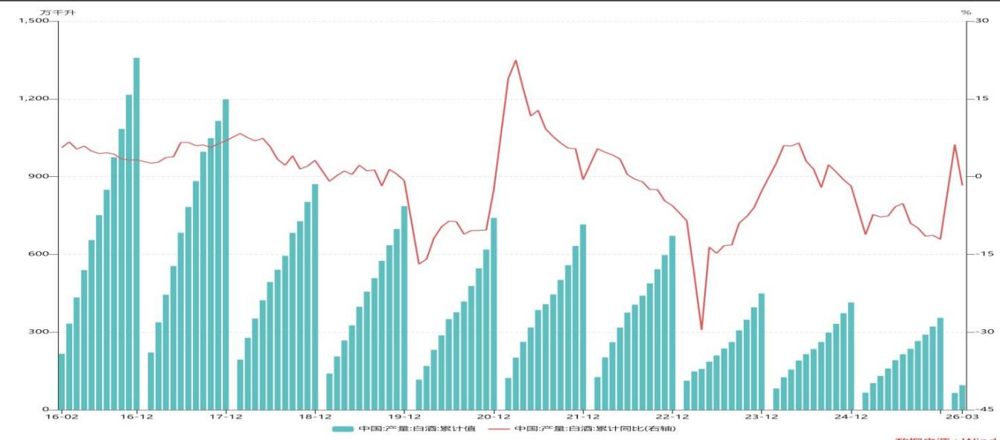  
资料来源：Wind，诚通证券研究所

附：财务预测摘要

<table><tr><td>资产负债表(百万元)</td><td>2024A</td><td>2025A</td><td>2026E</td><td>2027E</td><td>2028E</td></tr><tr><td>流动资产</td><td>251727</td><td>252519</td><td>301569</td><td>355751</td><td>416587</td></tr><tr><td>现金</td><td>59296</td><td>51691</td><td>103551</td><td>158259</td><td>210488</td></tr><tr><td>应收票据及应收账款合计</td><td>2003</td><td>3</td><td>2089</td><td>72</td><td>2191</td></tr><tr><td>其他应收款</td><td>30</td><td>36</td><td>29</td><td>37</td><td>34</td></tr><tr><td>预付账款</td><td>27</td><td>7</td><td>38</td><td>3</td><td>43</td></tr><tr><td>存货</td><td>54343</td><td>61427</td><td>67774</td><td>62972</td><td>69882</td></tr><tr><td>其他流动资产</td><td>136027</td><td>139355</td><td>128088</td><td>134407</td><td>133950</td></tr><tr><td>非流动资产</td><td>47218</td><td>51316</td><td>51216</td><td>51106</td><td>50951</td></tr><tr><td>长期投资</td><td>0</td><td>147</td><td>294</td><td>442</td><td>589</td></tr><tr><td>固定资产</td><td>21871</td><td>22488</td><td>22122</td><td>21787</td><td>21424</td></tr><tr><td>无形资产</td><td>8949</td><td>8803</td><td>9369</td><td>9799</td><td>10138</td></tr><tr><td>其他非流动资产</td><td>16398</td><td>19878</td><td>19431</td><td>19077</td><td>18800</td></tr><tr><td>资产总计</td><td>298945</td><td>303835</td><td>352784</td><td>406857</td><td>467538</td></tr><tr><td>流动负债</td><td>56516</td><td>49610</td><td>46934</td><td>45702</td><td>47129</td></tr><tr><td>短期借款</td><td>0</td><td>0</td><td>0</td><td>0</td><td>0</td></tr><tr><td>应付票据及应付账款合计</td><td>3515</td><td>4007</td><td>0</td><td>0</td><td>0</td></tr><tr><td>其他流动负债</td><td>53001</td><td>45603</td><td>46934</td><td>45702</td><td>47129</td></tr><tr><td>非流动负债</td><td>417</td><td>265</td><td>265</td><td>265</td><td>265</td></tr><tr><td>长期借款</td><td>0</td><td>0</td><td>0</td><td>0</td><td>0</td></tr><tr><td>其他非流动负债</td><td>417</td><td>265</td><td>265</td><td>265</td><td>265</td></tr><tr><td>负债合计</td><td>56933</td><td>49876</td><td>47199</td><td>45967</td><td>47395</td></tr><tr><td>少数股东权益</td><td>8905</td><td>9321</td><td>12495</td><td>15705</td><td>19050</td></tr><tr><td>股本</td><td>1256</td><td>1252</td><td>1252</td><td>1252</td><td>1252</td></tr><tr><td>资本公积</td><td>1375</td><td>2</td><td>2</td><td>2</td><td>2</td></tr><tr><td>留存收益</td><td>229423</td><td>242448</td><td>290181</td><td>341923</td><td>395268</td></tr><tr><td>归属母公司股东权益</td><td>233106</td><td>244638</td><td>293090</td><td>345185</td><td>401093</td></tr><tr><td>负债和股东权益</td><td>298945</td><td>303835</td><td>352784</td><td>406857</td><td>467538</td></tr></table>

<table><tr><td>现金流量表(百万元)</td><td>2024A</td><td>2025A</td><td>2026E</td><td>2027E</td><td>2028E</td></tr><tr><td>经营活动现金流</td><td>92464</td><td>61522</td><td>87447</td><td>89923</td><td>87288</td></tr><tr><td>净利润</td><td>89335</td><td>85310</td><td>86681</td><td>90159</td><td>94208</td></tr><tr><td>折旧摊销</td><td>1991</td><td>2204</td><td>1873</td><td>1982</td><td>2096</td></tr><tr><td>财务费用</td><td>-1470</td><td>-815</td><td>-1244</td><td>-1464</td><td>-1777</td></tr><tr><td>投资损失</td><td>-9</td><td>-1</td><td>-5</td><td>-3</td><td>-4</td></tr><tr><td>营运资金变动</td><td>1919</td><td>-24874</td><td>179</td><td>-706</td><td>-7180</td></tr><tr><td>其他经营现金流</td><td>699</td><td>-301</td><td>-36</td><td>-45</td><td>-55</td></tr><tr><td>投资活动现金流</td><td>-1785</td><td>-31642</td><td>-1732</td><td>-1825</td><td>-1882</td></tr><tr><td>资本支出</td><td>4679</td><td>3128</td><td>-248</td><td>-257</td><td>-302</td></tr><tr><td>长期投资</td><td>2805</td><td>-28642</td><td>-147</td><td>-147</td><td>-147</td></tr><tr><td>其他投资现金流</td><td>5698</td><td>-57156</td><td>-2127</td><td>-2229</td><td>-2331</td></tr><tr><td>筹资活动现金流</td><td>-71068</td><td>-73427</td><td>-33855</td><td>-33390</td><td>-33178</td></tr><tr><td>短期借款</td><td>0</td><td>0</td><td>0</td><td>0</td><td>0</td></tr><tr><td>长期借款</td><td>0</td><td>0</td><td>0</td><td>0</td><td>0</td></tr><tr><td>普通股增加</td><td>0</td><td>-4</td><td>0</td><td>0</td><td>0</td></tr><tr><td>资本公积增加</td><td>0</td><td>-1373</td><td>0</td><td>0</td><td>0</td></tr><tr><td>其他筹资现金流</td><td>-71068</td><td>-72050</td><td>-33855</td><td>-33390</td><td>-33178</td></tr><tr><td>现金净增加额</td><td>19610</td><td>-43544</td><td>51860</td><td>54708</td><td>52228</td></tr></table>

资料来源：Wind，诚通证券研究所预测

<table><tr><td>利润表(百万元)</td><td>2024A</td><td>2025A</td><td>2026E</td><td>2027E</td><td>2028E</td></tr><tr><td>营业收入</td><td>170899</td><td>168838</td><td>174031</td><td>180846</td><td>188838</td></tr><tr><td>营业成本</td><td>13789</td><td>14892</td><td>16620</td><td>16819</td><td>17090</td></tr><tr><td>营业税金及附加</td><td>26926</td><td>27354</td><td>26938</td><td>28253</td><td>29769</td></tr><tr><td>营业费用</td><td>5639</td><td>7253</td><td>7477</td><td>7769</td><td>8026</td></tr><tr><td>管理费用</td><td>9316</td><td>8320</td><td>7831</td><td>8319</td><td>9064</td></tr><tr><td>研发费用</td><td>218</td><td>190</td><td>198</td><td>208</td><td>222</td></tr><tr><td>财务费用</td><td>-1470</td><td>-815</td><td>-1244</td><td>-1464</td><td>-1777</td></tr><tr><td>资产减值损失</td><td>0</td><td>0</td><td>0</td><td>0</td><td>0</td></tr><tr><td>公允价值变动收益</td><td>61</td><td>76</td><td>35</td><td>44</td><td>54</td></tr><tr><td>其他收益</td><td>21</td><td>29</td><td>27</td><td>28</td><td>26</td></tr><tr><td>投资净收益</td><td>9</td><td>1</td><td>5</td><td>3</td><td>4</td></tr><tr><td>营业利润</td><td>119689</td><td>114809</td><td>116279</td><td>121017</td><td>126529</td></tr><tr><td>营业外收入</td><td>71</td><td>75</td><td>76</td><td>77</td><td>75</td></tr><tr><td>营业外支出</td><td>121</td><td>129</td><td>158</td><td>135</td><td>136</td></tr><tr><td>利润总额</td><td>119639</td><td>114755</td><td>116197</td><td>120959</td><td>126468</td></tr><tr><td>所得税</td><td>30304</td><td>29445</td><td>29516</td><td>30800</td><td>32260</td></tr><tr><td>净利润</td><td>89335</td><td>85310</td><td>86681</td><td>90159</td><td>94208</td></tr><tr><td>少数股东损益</td><td>3107</td><td>2990</td><td>3174</td><td>3210</td><td>3345</td></tr><tr><td>归属母公司净利润</td><td>86228</td><td>82320</td><td>83507</td><td>86949</td><td>90863</td></tr><tr><td>EBITDA</td><td>120147</td><td>115667</td><td>116129</td><td>119669</td><td>123955</td></tr><tr><td>EPS(元)</td><td>68.86</td><td>65.74</td><td>66.68</td><td>69.43</td><td>72.56</td></tr></table>

<table><tr><td>主要财务比率</td><td>2024A</td><td>2025A</td><td>2026E</td><td>2027E</td><td>2028E</td></tr><tr><td>成长能力</td><td></td><td></td><td></td><td></td><td></td></tr><tr><td>营业收入(%)</td><td>15.7</td><td>-1.2</td><td>3.1</td><td>3.9</td><td>4.4</td></tr><tr><td>营业利润(%)</td><td>15.4</td><td>-4.1</td><td>1.3</td><td>4.1</td><td>4.6</td></tr><tr><td>归属于母公司净利润(%)</td><td>15.4</td><td>-4.5</td><td>1.4</td><td>4.1</td><td>4.5</td></tr><tr><td>获利能力</td><td></td><td></td><td></td><td></td><td></td></tr><tr><td>毛利率(%)</td><td>91.9</td><td>91.2</td><td>90.5</td><td>90.7</td><td>91.0</td></tr><tr><td>净利率(%)</td><td>50.5</td><td>48.8</td><td>48.0</td><td>48.1</td><td>48.1</td></tr><tr><td>ROE(%)</td><td>36.9</td><td>33.6</td><td>28.4</td><td>25.0</td><td>22.4</td></tr><tr><td>ROIC(%)</td><td>53.3</td><td>46.3</td><td>47.7</td><td>49.8</td><td>50.6</td></tr><tr><td>偿债能力</td><td></td><td></td><td></td><td></td><td></td></tr><tr><td>资产负债率(%)</td><td>19.0</td><td>16.4</td><td>13.4</td><td>11.3</td><td>10.1</td></tr><tr><td>净负债比率(%)</td><td>-24.3</td><td>-20.3</td><td>-33.8</td><td>-43.8</td><td>-50.1</td></tr><tr><td>流动比率</td><td>4.5</td><td>5.1</td><td>6.4</td><td>7.8</td><td>8.8</td></tr><tr><td>速动比率</td><td>1.1</td><td>1.0</td><td>2.3</td><td>3.5</td><td>4.5</td></tr><tr><td>营运能力</td><td></td><td></td><td></td><td></td><td></td></tr><tr><td>总资产周转率</td><td>0.6</td><td>0.6</td><td>0.5</td><td>0.5</td><td>0.4</td></tr><tr><td>应收账款周转率</td><td>164.5</td><td>168.3</td><td>166.4</td><td>167.4</td><td>166.9</td></tr><tr><td>应付账款周转率</td><td>4.2</td><td>4.0</td><td>0.0</td><td>0.0</td><td>0.0</td></tr><tr><td>每股指标(元)</td><td></td><td></td><td></td><td></td><td></td></tr><tr><td>每股收益(最新摊薄)</td><td>68.86</td><td>65.74</td><td>66.68</td><td>69.43</td><td>72.56</td></tr><tr><td>每股经营现金流(最新摊薄)</td><td>48.09</td><td>55.92</td><td>69.83</td><td>71.81</td><td>69.70</td></tr><tr><td>每股净资产(最新摊薄)</td><td>186.15</td><td>195.36</td><td>234.05</td><td>275.65</td><td>320.29</td></tr><tr><td>估值比率</td><td></td><td></td><td></td><td></td><td></td></tr><tr><td>P/E</td><td>19.2</td><td>20.1</td><td>19.8</td><td>19.1</td><td>18.2</td></tr><tr><td>P/B</td><td>7.1</td><td>6.8</td><td>5.7</td><td>4.8</td><td>4.1</td></tr><tr><td>EV/EBITDA</td><td>13.4</td><td>14.0</td><td>13.5</td><td>12.7</td><td>11.8</td></tr></table>

## 特别声明

根据《证券期货投资者适当性管理办法》、《证券经营机构投资者适当性管理实施指引（试行）》规定，诚通证券评定此研报的风险等级为R3（中风险），适用的投资者类别仅限定为专业投资者及风险承受能力为C3、C4、C5的普通投资者。若您为非专业投资者及风险承受能力低于C3的普通投资者，请勿阅读、收藏、接收或使用本研报中的任何信息。

若因适当性不匹配，给您造成不便，烦请见谅！感谢您给予的理解与配合。

## 分析师声明

本报告署名分析师具有中国证券业协会授予的证券投资咨询执业资格并登记为注册分析师，认真审慎、专业严谨、独立客观的出具本报告并对报告内容和观点负责。

分析师的薪酬的任何组成部分无论是在过去、现在及将来均不会与本报告中具体的推荐意见或观点有直接或间接的联系。

## 投资评级说明

## 诚通证券行业评级体系：推荐、中性、回避

推荐： 未来6－12个月，预计该行业指数表现强于同期市场基准指数。

中性： 未来6－12个月，预计该行业指数表现基本与同期市场基准指数持平。

回避： 未来6－12个月，预计该行业指数表现弱于同期市场基准指数。

市场基准指数为沪深 300 指数。

## 诚通证券公司评级体系：强烈推荐、推荐、中性、回避

强烈推荐：未来 6－12个月，预计该公司股价相对同期市场基准指数涨幅在 20%以上。该评级由分析师给出。

推荐：未来 6－12个月，预计该公司股价相对同期市场基准指数涨幅介于 5%－20%。该评级由分析师给出。

中性：未来 6－12个月，预计该公司股价相对同期市场基准指数变动幅度介于-5%－5%。该评级由分析师给出。

回避：未来 6－12个月，预计该公司股价相对同期市场基准指数跌幅在 5%以上。该评级由分析师给出。

市场基准指数为沪深 300 指数。

## 分析、估值方法的局限性说明

本报告所包含的分析基于各种假设，不同假设可能导致分析结果出现重大不同。本报告采用的各种估值方法及模型均有其局限性，估值结果不保证所涉及证券能够在该价格交易。

## 免责声明

诚通证券股份有限公司经中国证券监督管理委员会批复，已具备证券投资咨询业务资格。

本报告由诚通证券股份有限公司（以下简称诚通证券）供其机构或个人客户（以下简称客户）使用，诚通证券无需因接收人收到本报告而视其为客户。本报告是发送给诚通证券客户的，属于机密材料，只有诚通证券客户才能参考或使用，如接收人并非诚通证券客户，请及时退回并删除。

本报告所载的全部内容只供客户做参考之用，并不构成对客户的投资建议，并非作为买卖、认购证券或其它金融工具的邀请或保证。诚通证券根据公开资料或信息客观、公正地撰写本报告，但不保证该公开资料或信息内容的准确性或完整性。客户请勿将本报告视为投资决策的唯一依据而取代个人的独立判断。诚通证券不需要采取任何行动以确保本报告涉及的内容适合于客户。诚通证券建议客户如有任何疑问应当咨询证券投资顾问并独自进行投资判断。本报告并不构成投资、法律、会计或税务建议或担保任何内容适合客户，本报告不构成给予客户个人咨询建议。

本报告所载内容反映的是诚通证券在发表本报告当日的判断，诚通证券可能发出其它与本报告所载内容不一致或有不同结论的报告，但诚通证券没有义务和责任去及时更新本报告涉及的内容并通知客户。诚通证券不对因客户使用本报告而导致的损失负任何责任。

对于浏览过程中可能涉及的诚通证券网站以外的地址或超级链接，诚通证券不对其内容负责。链接网站的内容不构成本报告的任何部分，客户需自行承担浏览这些网站的费用或风险。

除非另有说明，所有本报告的版权属于诚通证券。未经诚通证券事先书面授权，任何机构或个人不得以任何形式更改、复制、传播本报告中的任何材料，或以任何侵犯本公司版权的其他方式使用。所有在本报告中使用的商标、服务标识及标记，除非另有说明，均为诚通证券的商标、服务标识及标记。诚通证券版权所有并保留一切权利。

## 联系我们

诚通证券股份有限公司 研究所

地址：北京市朝阳区东三环路 27 号楼 12 层

邮编：100020

公司网址：http://www.cctgsc.com.cn